# 5. Controls

What this covers:

- the six input devices, and the one routine that reads them all (5.1);
- each device's handler: the ports, the bits, and how they become one control byte (5.2);
- every key the game reads, and the keys of play: the hold, the tune, the abort, the dead tests (5.3);
- the path from the control byte to the buggy: the jump, the speed, the fire (5.4);
- the menu keys and the options page (5.5);
- the hi-score entry (5.6);
- when the keys are read, and what a short press can miss (5.7).

The recordings it rests on (WALKTHROUGH 6.0 has the table):

- `a1`, from `work/snaps/entry.z80` (the entry, frame 256 of `c1`). It covers:
  - the options page with every device chosen in turn (frames 779-1069);
  - S;
  - the hold (2060-2220);
  - the tune key (2540, 2740);
  - CAPS SHIFT and SPACE (3174).
- `c1`, the random play of stage 1 (`work/game`). Its keys chose Sinclair 1 and then Kempston on the options page,
  and the joystick handlers ran in play.
- `i1`, `i2`, `g1`, `p2`, `h1` and `h2` play on the keyboard. `h1` and `h2` also type the hi-score entries.
- `t1` uses the tape keys.

The counts are executions in the L1 builds (`python3 tools/l1sum.py ADDR`).

## 5.1 Six devices, one reader

The options page offers six devices, one line each, chosen with Z, X, C, V, B or K:

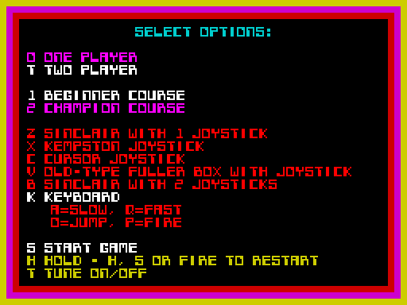

How to read the screenshot:

- **The bright white lines** are the current choices: one player, Beginner, the keyboard. These are the loaded
  image's defaults: Players `$B257` = 1, Course `$B258` = 1, Controls `$B259` = 6.
- **The keyboard line** names the play keys: A slow, Q fast, O jump, P fire.
- **The last block** names the keys of play: S starts, H holds (H, S or fire restart), T turns the tune on or off.

Whatever the device, the game asks one routine: ControlsRead `$AE17`. It jumps through a table of six handlers by
Controls. Every handler returns the same five bits:

| Bit | Control | Read by |
| ---: | --- | --- |
| 0 | fire | FireShots `$ACF1`, HoldLoop `$AEEF`, MenuCheckStart `$8227` |
| 1 | jump (up) | BuggyUpdate `$AA0F` |
| 2 | down | nobody |
| 3 | fast (right) | BuggyUpdate |
| 4 | slow (left) | BuggyUpdate |

```text
ControlsRead:
    handler = ControlHandlers[Controls - 1]     ; the table at $AE2E, 6 words
    push ControlsReadDone                       ; the handler's RET goes there
    jump to handler                             ; it returns the five bits active low (0 = pressed), bits 5-7 = 1
ControlsReadDone:
    A = NOT A                                   ; now 1 = pressed
    return
```

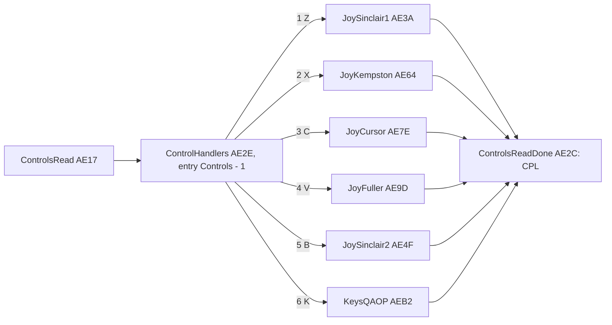

```asm
AE17  21 2E AE     LD HL,ControlHandlers
AE1A  16 00        LD D,$00
AE1C  3A 59 B2     LD A,(Controls)
AE1F  3D           DEC A                  ; 1-6 to 0-5
AE20  87           ADD A,A                ; a word each
AE21  5F           LD E,A
AE22  19           ADD HL,DE
AE23  5E           LD E,(HL)
AE24  23           INC HL
AE25  56           LD D,(HL)
AE26  EB           EX DE,HL               ; HL = the handler
AE27  11 2C AE     LD DE,ControlsReadDone
AE2A  D5           PUSH DE                ; its RET lands on the CPL
AE2B  E9           JP (HL)
AE2C  2F           CPL                    ; ControlsReadDone: 1 = pressed
AE2D  C9           RET
AE2E  3A AE 64 AE  DEFW JoySinclair1, JoyKempston, JoyCursor, JoyFuller, JoySinclair2, KeysQAOP
```

Worked example, the keyboard:

1. Controls = 6, so DE = 2 x 5 = 10.
2. HL = `$AE2E` + 10 = `$AE38`.
3. The word there is `$AEB2`, KeysQAOP.

The handler is entered by `JP (HL)`, not by `CALL`. So the L1 builds count no routine entries for the six handlers,
only their instructions.

The point: Controls is one byte, and the rest of the game never knows which device it names. The table follows the
options page's order (1 Z, 2 X, 3 C, 4 V, 5 B, 6 K), so Controls is simply the line number.

Witness:

- ControlsRead ran 7202 times in `i1`: two calls a pass, from FireShots and BuggyUpdate.
- It ran 28 792 times in `a1`, most of them from the hold's loop.
- KeysQAOP ran in every recording.
- In `c1`, JoySinclair1 ran 2296 times and JoyKempston 643: the random keys chose Z, and later X.
- In `a1`, each handler ran 7 or 8 times while its line was chosen, frames 779-1069. MenuCheckStart reads the
  device on every menu pass when the device is not the keyboard.

## 5.2 The six handlers

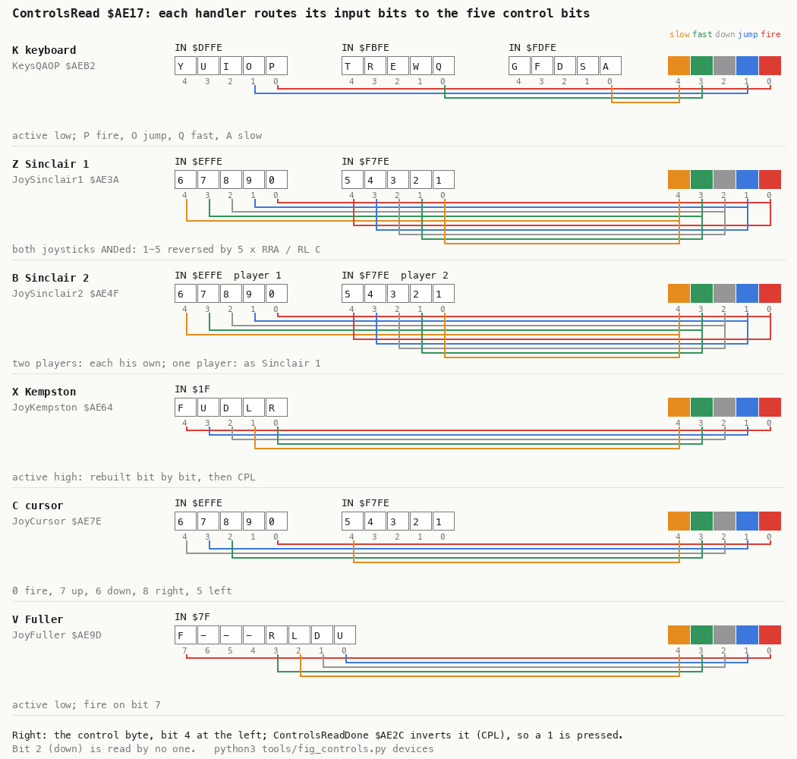

How to read the figure:

- **One band a device**: its option key and handler. On the left are the bytes it reads, each bit labelled with its
  key or joystick direction, bit 0 at the right as in the byte.
- **On the right** is the control byte: bit 4 (slow) at the left, bit 0 (fire) at the right.
- **A line** joins an input bit to the control bit it becomes, in the control's colour.
- **The point**: every device lands on the same five bits. Kempston is the only active-high input. The Sinclair
  handler reverses the 1-5 row so that both joysticks share one mapping.

```bash
python3 tools/fig_controls.py devices
```

**KeysQAOP `$AEB2`** (6, K) reads three half-rows. It keeps one key from each and rotates it into place:

```text
KeysQAOP:
    E = rotate_left(IN $FDFE OR $FE)        ; A (bit 0) to bit 1, the rest forced to 1
    E = (IN $FBFE OR $FE) AND E             ; Q on bit 0, A on bit 1
    E = rotate_left(E, 3)                   ; Q to bit 3, A to bit 4
    A = (IN $DFFE OR $FC) AND E             ; P on bit 0, O on bit 1
```

```asm
AEB2  01 FE FD     LD BC,$FDFE            ; A S D F G
AEB5  ED 78        IN A,(C)
AEB7  F6 FE        OR $FE                 ; keep A
AEB9  07           RLCA
AEBA  5F           LD E,A
AEBB  06 FB        LD B,$FB               ; Q W E R T
AEBD  ED 78        IN A,(C)
AEBF  F6 FE        OR $FE                 ; keep Q
AEC1  A3           AND E
AEC2  07           RLCA
AEC3  07           RLCA
AEC4  07           RLCA                   ; Q on bit 3, A on bit 4
AEC5  5F           LD E,A
AEC6  06 DF        LD B,$DF               ; P O I U Y
AEC8  ED 78        IN A,(C)
AECA  F6 FC        OR $FC                 ; keep P and O
AECC  A3           AND E
AECD  C9           RET
```

Worked example, P and Q held:

| Step | Value | Why |
| --- | --- | --- |
| IN `$FDFE` OR `$FE`, RLCA | `$FF` | A is up |
| IN `$FBFE` = `$FE`, OR `$FE`, AND E | `$FE` | Q down: bit 0 low |
| RLCA x 3 | `$F7` | the low bit moves to bit 3 |
| IN `$DFFE` = `$FE`, OR `$FC`, AND E | `$F6` | P down: bit 0 low |
| CPL (ControlsReadDone) | `$09` | bits 0 and 3: fire and fast |

**JoyKempston `$AE64`** (2, X) reads port `$1F`. Its bits are active high: right, left, down, up and fire, from bit
0. The handler shifts the bits out one by one into B, in the game's order. Then it inverts them to match the other
handlers:

```asm
AE64  DB 1F        IN A,($1F)
AE66  06 00        LD B,$00
AE68  1F           RRA                    ; right
AE69  CB 18        RR B                   ; parked in B bit 7
AE6B  1F           RRA                    ; left
AE6C  CB 10        RL B                   ; left on bit 0, right to the carry
AE6E  CB 10        RL B                   ; right on bit 0, left on bit 1
AE70  1F           RRA                    ; down
AE71  CB 10        RL B
AE73  1F           RRA                    ; up
AE74  CB 10        RL B
AE76  1F           RRA                    ; fire
AE77  CB 10        RL B                   ; B = left right down up fire, bits 4-0
AE79  78           LD A,B
AE7A  2F           CPL                    ; active low like the others
AE7B  F6 E0        OR $E0
AE7D  C9           RET
```

Worked example, right and fire held:

1. IN `$1F` = `$11`.
2. After the five shifts, B = `$09`: fire on bit 0, right on bit 3.
3. CPL and OR `$E0` give `$F6`.
4. ControlsReadDone's CPL gives `$09`: fire and fast. This is the same byte as P and Q on the keyboard.

**JoySinclair1 `$AE3A`** (1, Z). The Sinclair joysticks are read as keys:

- the row 6-0: 6 left, 7 right, 8 down, 9 up, 0 fire;
- the row 1-5: 1 left, 2 right, 3 down, 4 up, 5 fire.

The row 6-0 already has the game's order (`$EFFE`: 0 on bit 0, 6 on bit 4). The row 1-5 has it backwards (`$F7FE`:
1 on bit 0). So the handler reverses its five bits with five `RRA` / `RL C` pairs. Then it ANDs the two rows:
either joystick drives the buggy.

```asm
AE3A  3E EF        LD A,$EF
AE3C  DB FE        IN A,($FE)             ; 6 7 8 9 0
AE3E  5F           LD E,A
AE3F  3E F7        LD A,$F7               ; JoySinclairKeys1To5
AE41  DB FE        IN A,($FE)             ; 1 2 3 4 5
AE43  06 05        LD B,$05
AE45  1F           RRA                    ; JoySinclairReverse: bit 0 out...
AE46  CB 11        RL C                   ; ...into C from the bottom: reversed
AE48  10 FB        DJNZ JoySinclairReverse
AE4A  79           LD A,C
AE4B  A3           AND E                  ; both joysticks
AE4C  F6 E0        OR $E0
AE4E  C9           RET
```

**JoySinclair2 `$AE4F`** (5, B) is "Sinclair with 2 joysticks":

- With one player it is JoySinclair1.
- With two players, player 1 (Player `$B271` = 1) reads only the row 6-0.
- Player 2 reads only the row 1-5 (E = `$FF`, then the shared code at `$AE3F`).

```asm
AE4F  3A 57 B2     LD A,(Players)         ; JoySinclair2
AE52  3D           DEC A
AE53  28 E5        JR Z,JoySinclair1      ; one player: both joysticks
AE55  3A 71 B2     LD A,(Player)
AE58  3D           DEC A
AE59  1E FF        LD E,$FF               ; player 2: no row 6-0 ...
AE5B  20 E2        JR NZ,JoySinclairKeys1To5   ; ... only the row 1-5, reversed
AE5D  3E EF        LD A,$EF               ; player 1: the row 6-0 alone
AE5F  DB FE        IN A,($FE)
AE61  F6 E0        OR $E0
AE63  C9           RET
```

Worked example, two players, player 2 holding 4 (his jump; from the code): E = `$FF`; the row 1-5 reads `$F7` (bit 3
low); the reverse loop moves bits 0-4 of `$F7` into C mirrored, so key 4 (bit 3) lands on bit 1: C's low five bits
are `11101`; AND `$FF`, OR `$E0` = `$FD`; the `CPL` gives `$02`: jump. The row 6-0 (player 1's joystick) is not
read in player 2's turn.

The players take turns, so the two joysticks never act at once, and each player keeps his own.

**JoyCursor `$AE7E`** (3, C) reads the cursor keys: 5 left, 6 down, 7 up, 8 right, 0 fire. It makes four reads of
the two half-rows. Each read is masked to one or two keys and rotated into place:

- 0 stays on bit 0;
- 7 and 6 go to bits 1 and 2, by two `RRCA`;
- 8 goes to bit 3, by one `RLCA`;
- 5 is already on bit 4.

```asm
AE7E  01 FE F7     LD BC,$F7FE            ; JoyCursor: the row 1-5
AE81  ED 78        IN A,(C)
AE83  F6 EF        OR $EF                 ; keep 5 (bit 4): slow
AE85  5F           LD E,A
AE86  06 EF        LD B,$EF               ; the row 0-6
AE88  ED 78        IN A,(C)
AE8A  F6 FE        OR $FE                 ; keep 0 (bit 0): fire
AE8C  A3           AND E
AE8D  5F           LD E,A
AE8E  ED 78        IN A,(C)
AE90  F6 E7        OR $E7                 ; keep 7 and 6 (bits 3, 4)
AE92  0F           RRCA
AE93  0F           RRCA                   ; to bits 1 (jump) and 2
AE94  A3           AND E
AE95  5F           LD E,A
AE96  ED 78        IN A,(C)
AE98  F6 FB        OR $FB                 ; keep 8 (bit 2)
AE9A  07           RLCA                   ; to bit 3: fast
AE9B  A3           AND E
AE9C  C9           RET                    ; ControlsReadDone: CPL
```

Worked example, 7 (up) held: the row 0-6 reads `$F7` (bit 3 low), the row 1-5 `$FF`. E = `$FF`; the fire read gives
`$FF`; `$F7` OR `$E7` = `$F7`, two `RRCA` give `$FD`, AND E = `$FD`; the 8 read gives `$FF`. ControlsReadDone's
`CPL` turns `$FD` into `$02`: jump.

**JoyFuller `$AE9D`** (4, V) reads the "old-type Fuller box" on port `$7F`. Its bits are active low: up, down, left
and right on bits 0-3, fire on bit 7. The handler moves them like this:

- one `RLCA` brings fire to bit 0, and up and down to bits 1 and 2;
- right stays on bit 3;
- left goes to bit 4, with two more `RLCA`.

```asm
AE9D  DB 7F        IN A,($7F)             ; JoyFuller: up 0, down 1, left 2, right 3, fire 7
AE9F  F6 70        OR $70
AEA1  47           LD B,A
AEA2  07           RLCA                   ; fire to bit 0, up to 1, down to 2
AEA3  F6 F8        OR $F8                 ; keep bits 0-2
AEA5  4F           LD C,A
AEA6  78           LD A,B
AEA7  F6 F7        OR $F7                 ; keep right (bit 3): fast
AEA9  A1           AND C
AEAA  4F           LD C,A
AEAB  78           LD A,B
AEAC  F6 FB        OR $FB                 ; keep left (bit 2)
AEAE  07           RLCA
AEAF  07           RLCA                   ; to bit 4: slow
AEB0  A1           AND C
AEB1  C9           RET                    ; ControlsReadDone: CPL
```

Worked example, up held: `IN A,($7F)` = `$FE` (bit 0 low). B = `$FE`; `RLCA` = `$FD`, OR `$F8` = `$FD`; B OR `$F7` =
`$FF`, AND = `$FD`; B OR `$FB` = `$FF`, rotated `$FF`, AND = `$FD`. The `CPL` gives `$02`: jump. With fire held too
(`$7E`) the result is `$03`.

Witness:

- JoyCursor ran 7 times in `a1`, JoyFuller 8 and JoySinclair2 8. All of these ran in `a1` frames 779-1069, on the
  options page.
- No recording played with these three devices. Their mappings in play are known only from the code.
- JoySinclair1 and JoyKempston ran in `c1`'s play (5.1).

## 5.3 Every key, and the keys of play

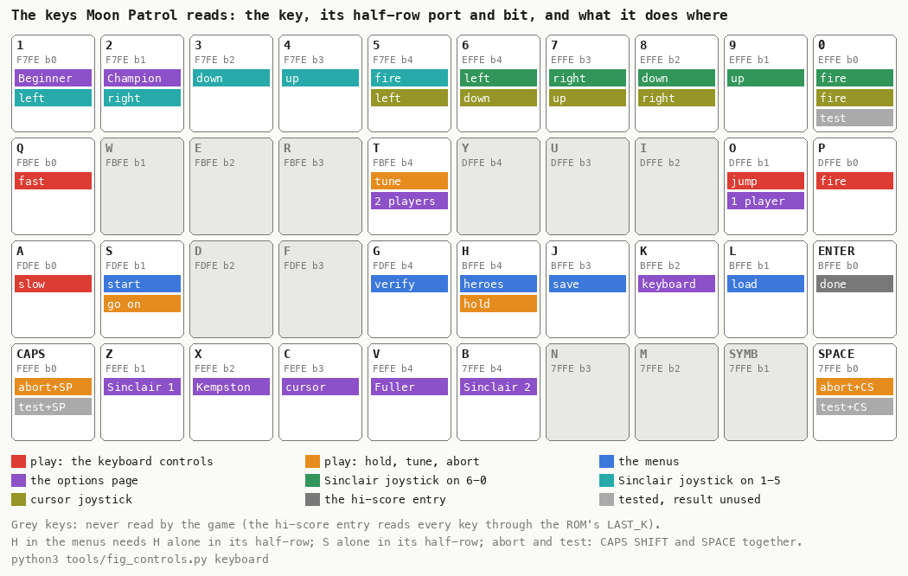

How to read the figure:

- **One box a key**, laid out like the 48K's keyboard. Under the key are the port of its half-row and its bit.
- **The coloured tags** are its uses, in the colour of where they apply (see the legend). A grey key is never read.
- **The point**: the game reads its keys port by port with `IN`, never through the ROM's scan. There are two
  exceptions: the options page (KEY_SCAN, 5.5) and the hi-score entry (LAST_K, 5.6). Some keys do double duty. H is
  the hi-score page on the menus and the hold in play. T is two players on the options page and the tune in play.

```bash
python3 tools/fig_controls.py keyboard
```

The keys of play are each tested once a pass, from the main loop's call list ([doc 4](04-game-loop.md), 4.6):

| Key | Test | Port, bit | What it does | Witness |
| --- | --- | --- | --- | --- |
| H | HoldCheck `$AECE` | `$BFFE` bit 4 | the hold, on a new press | `a1` 1 hold (`$AEDE`), left with H (`$AF09`) |
| T | TuneToggleCheck `$AF15` | `$FBFE` bit 4 | the tune off or on, on a new press | `a1` 2 flips (`$AF25`): off 2540, on 2740 |
| CAPS SHIFT and SPACE | BuggyBreakTest `$AABF` | `$FEFE` and `$7FFE` bit 0 | back to the title | `a1` 1 (`$AACD`, frame 3174) |
| 0 | BreakKeyTest `$9737` | `$EFFE` bit 0 | nothing: the result is dropped | runs every pass (`i1` 3601) |

### The hold

HoldCheck keeps the key's last state in PlayerFlags `$B288` bit 4, so holding H down holds the game only once. On
a new press it stops the game inside the call, in IM 1:

```text
HoldCheck:
    if H is up: PlayerFlags.bit4 = 0; return
    if PlayerFlags.bit4: return                    ; still the same press
    PlayerFlags.bit4 = 1
    SetIm1()                                       ; the clock and the tune stop: they live in the IM 2 handler
    wait until H is up; 5 HALTs
    loop:
        if fire (ControlsRead bit 0): break        ; at once
        if S: break                                ; at once
        if H: 5 HALTs; break
    SetIm2()
```

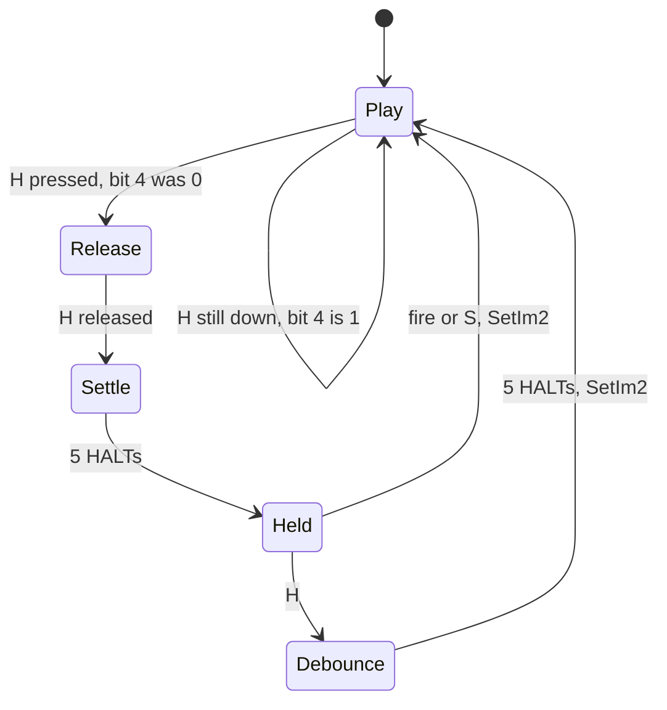

```asm
AECE  01 FE BF     LD BC,$BFFE
AED1  ED 78        IN A,(C)
AED3  F6 EF        OR $EF                 ; keep H
AED5  3C           INC A                  ; $FF + 1 = 0: H is up
AED6  21 88 B2     LD HL,PlayerFlags
AED9  28 37        JR Z,HoldKeyUp
AEDB  CB 66        BIT 4,(HL)
AEDD  C0           RET NZ                 ; the same press
AEDE  CB E6        SET 4,(HL)
AEE0  CD CB A7     CALL SetIm1
AEE3  ED 78        IN A,(C)               ; HoldWaitRelease
AEE5  F6 EF        OR $EF
AEE7  3C           INC A
AEE8  20 F9        JR NZ,HoldWaitRelease
AEEA  06 05        LD B,$05
AEEC  76           HALT                   ; HoldWait
AEED  10 FD        DJNZ HoldWait
AEEF  CD 17 AE     CALL ControlsRead      ; HoldLoop
AEF2  E6 01        AND $01
AEF4  20 18        JR NZ,HoldResume       ; fire
AEF6  01 FE FD     LD BC,$FDFE
AEF9  ED 78        IN A,(C)
AEFB  F6 FD        OR $FD                 ; keep S
AEFD  3C           INC A
AEFE  20 0E        JR NZ,HoldResume       ; S
AF00  06 BF        LD B,$BF
AF02  ED 78        IN A,(C)
AF04  F6 EF        OR $EF
AF06  3C           INC A
AF07  28 E6        JR Z,HoldLoop          ; no H: keep holding
AF09  06 05        LD B,$05
AF0B  76           HALT                   ; HoldResumeWait
AF0C  10 FD        DJNZ HoldResumeWait
AF0E  CD D4 A7     CALL SetIm2            ; HoldResume
AF11  C9           RET
AF12  CB A6        RES 4,(HL)             ; HoldKeyUp
AF14  C9           RET
```

- **The hold stops the clock.** PlayerTime counts IM 2 interrupts (doc 4, 4.3). In IM 1 the ROM's handler runs
  instead, so the time does not move and the tune is silent. A hold costs no time against the par.
- **Leaving with H waits 5 frames first.** On return H is still down and bit 4 is still set, so the next pass's
  HoldCheck does not hold again.
- **Leaving with S or fire leaves bit 4 set too.** The next pass with H up clears it.
- **The hold loop does not HALT**: it polls as fast as it can. `a1` held for about 160 frames (2060-2220) and ran
  HoldLoop 28 199 times, about 176 turns a frame.
- The screen during the hold is the play screen, frozen ([screenshot](img/play/a1-hold.png), `a1` frame 2100).

### The tune key

TuneToggleCheck keeps T's last state in PlayerFlags bit 0. On each new press it flips bit 7, the tune-off flag that
TunePlayer reads:

```asm
AF15  01 FE FB     LD BC,$FBFE
AF18  ED 78        IN A,(C)
AF1A  F6 EF        OR $EF                 ; keep T
AF1C  3C           INC A
AF1D  3A 88 B2     LD A,(PlayerFlags)
AF20  28 09        JR Z,TuneKeyUp
AF22  CB 47        BIT 0,A
AF24  C0           RET NZ                 ; the same press
AF25  F6 01        OR $01
AF27  EE 80        XOR $80                ; the tune off <-> on
AF29  18 02        JR TuneFlagsStore
AF2B  E6 FE        AND $FE                ; TuneKeyUp
AF2D  32 88 B2     LD (PlayerFlags),A
AF30  C9           RET
```

Worked example, starting from PlayerFlags = `$00`:

1. T pressed. Bit 0 is 0, so A = `$01` XOR `$80` = `$81`: the tune is off.
2. Next pass, T still down. Bit 0 is 1: return.
3. T up. A = `$80`.
4. T pressed again. `$81` XOR `$80` = `$01`: the tune is on.

PlayerFlags belongs to the player's block, which is swapped with the other player's. So each player keeps his own
tune setting.

### The abort

BuggyUpdate ends with BuggyBreakTest `$AABF`. It reads CAPS SHIFT (`$FEFE` bit 0) and SPACE (`$7FFE` bit 0) and
ORs them, so both keys must be down. Then it calls SetIm1 and jumps to TitlePage. The game is dropped without GAME
OVER and without the hi-score entry. The test runs on every pass, also while the buggy explodes: the explosion's
path (`$AAB5`) falls into it after drawing its frame.

```asm
AABF  01 FE FE     LD BC,$FEFE            ; CAPS SHIFT Z X C V
AAC2  ED 78        IN A,(C)
AAC4  5F           LD E,A
AAC5  06 7F        LD B,$7F               ; SPACE SYMB M N B
AAC7  ED 78        IN A,(C)
AAC9  B3           OR E                   ; bit 0 low only if both are down
AACA  E6 01        AND $01
AACC  C0           RET NZ
AACD  CD CB A7     CALL SetIm1
AAD0  C3 04 80     JP TitlePage
```

### The dead tests

Two tests run, and their result is dropped:

- **MenuBreakTest `$8215`** runs on every menu pass but the title's. It tests CAPS SHIFT and SPACE, the same test as the abort, and
  its caller ignores the flags (`a1` 2424 calls).
- **BreakKeyTest `$9737`** runs once a pass in play. It tests the key 0 (`$EFFE` bit 0) and returns NZ when it is
  down (Z when up). MainLoopCalls ignores it (`i1` 3601 calls).
- **A stub nothing calls** follows each: MenuBreakToBasic `$8222` and CourseBreakToBasic `$9740`. Both are
  `CALL SetIm1`, `RST 8`, report `$14` ("L BREAK into program"). They never ran in any recording.

The point: the authors had an exit to BASIC during development, on BREAK in the menus and on 0 in play. For the
release they removed the conditional jumps but left the tests. With a Sinclair joystick on 6-0, the key 0 is the
fire button: the dead test reads it every pass, harmlessly.

## 5.4 From the control byte to the buggy

In play the control byte is read twice a pass: by FireShots (call 3 of MainLoopCalls) and by BuggyUpdate (call 7).
Each makes its own `ControlsRead`, so the two can see different keys within one pass.

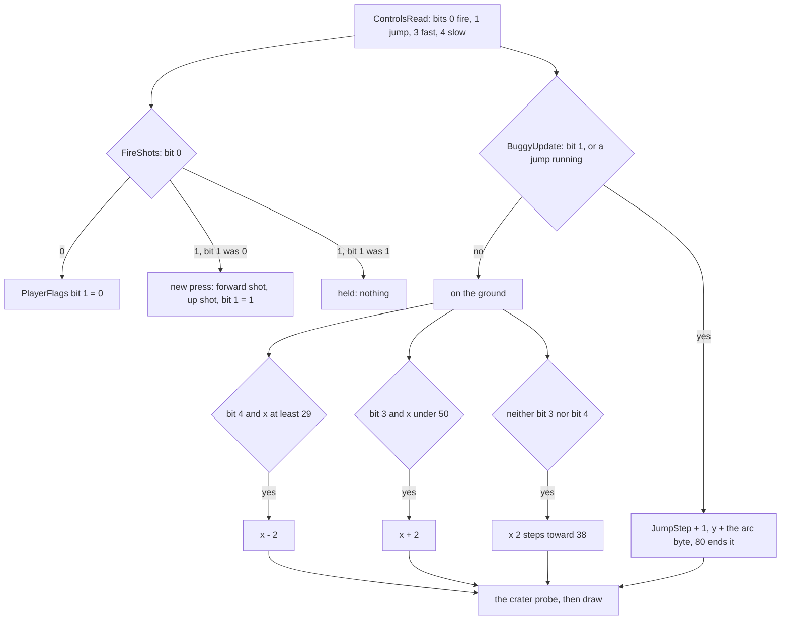

```text
BuggyUpdate (alive):
    c = ControlsRead()
    if c.jump or JumpStep != $FF:                ; a jump starts on the key and runs to its end mark
        JumpStep += 1
        delta = JumpArc[JumpStep]
        if delta == $80: JumpStep = $FF; delta = 0
        BuggyY += delta
    if JumpStep == $FF:                          ; on the ground only
        if c.slow and x >= $29: x -= 2
        if c.fast and x <  $50: x += 2
        if not c.slow and not c.fast and x != $38: x += 2 toward $38
        probe the road under the wheels for a crater
    draw the buggy; test CAPS SHIFT and SPACE
```

```asm
AA17  CD 17 AE     CALL ControlsRead
AA1A  4F           LD C,A                 ; the control byte, kept in C
AA1B  E6 02        AND $02                ; the jump key
AA1D  16 00        LD D,$00
AA1F  3A 23 B2     LD A,(JumpStep)
AA22  28 03        JR Z,BuggyNoJumpKey
AA24  3C           INC A                  ; key down: next step ($FF + 1 = 0 starts a jump)
AA25  18 03        JR BuggyJumpStep
AA27  3C           INC A                  ; BuggyNoJumpKey: no key
AA28  28 16        JR Z,BuggyMoveY        ; not jumping: stay on the ground
...                                       ; BuggyJumpStep $AA2A: y + the arc byte
AA49  3A 23 B2     LD A,(JumpStep)
AA4C  3C           INC A
AA4D  20 58        JR NZ,BuggyDraw        ; in the air: no speed change
AA4F  CB 61        BIT 4,C                ; slow
AA51  28 08        JR Z,BuggyFast
AA53  7C           LD A,H
AA54  FE 29        CP $29
AA56  38 03        JR C,BuggyFast
AA58  3D           DEC A
AA59  3D           DEC A
AA5A  67           LD H,A
AA5B  CB 59        BIT 3,C                ; BuggyFast
AA5D  28 08        JR Z,BuggyDrift
AA5F  7C           LD A,H
AA60  FE 50        CP $50
AA62  30 03        JR NC,BuggyDrift
AA64  3C           INC A
AA65  3C           INC A
AA66  67           LD H,A
AA67  79           LD A,C                 ; BuggyDrift
AA68  E6 18        AND $18                ; either speed key: no drift
AA6A  20 0D        JR NZ,BuggyProbe
...                                       ; two pixels toward x $38
```

What the code says about the feel:

- **Holding jump repeats the jump.** At the arc's end mark JumpStep returns to `$FF`. If the key is still down on
  the next pass, `$FF` + 1 = 0 starts the next jump at once. Unlike fire, the jump key is not edge-triggered.
- **No steering in the air.** The x moves only when JumpStep is `$FF`. SpeedGovernor chose the arc from x at
  take-off (doc 1, 1.5), so the jump's length is fixed when it starts.
- **Both speed keys cancel.** With slow and fast in the same pass, x goes - 2 then + 2, and there is no drift (the
  `AND $18` sees a key).
- **The limits are `$28` and `$50`.** x moves in steps of 2 from `$38`. Slow stops at `$28`, because the step is
  taken while x >= `$29`. Fast stops at `$50`.
- **Fire is a new press only.** FireShots keeps the last fire state in PlayerFlags bit 1 and shoots on a change
  from 0 to 1, so holding fire shoots once. A new press needs fire up on one pass and down on a later one.

Worked example, holding Q and then pressing O (from the code):

1. x goes `$38`, `$3A`, `$3C` ... `$50`, two pixels a pass: 12 passes.
2. With x over `$38`, SpeedGovernor picks JumpArcForward `$AB16`.
3. O starts a 32-pass jump. During it, Q does nothing.
4. On landing, x is still `$50`.

Witness:

- Jump steps (`$AA2A`): `i1` 3249, `c1` 463.
- New fire presses: `i1` 332, `i2` 367 (doc 1, 1.5).

## 5.5 The menu keys and the options page

Each menu page calls up to five tests on every pass (doc 1, 1.2): MenuBreakTest on all but the title,
MenuCheckStart and MenuCheckTape on all, MenuCheckHeroes on all but the hi-score page, MenuCheckAnyKey on all but
the options page (TitleLoop `$8048`, OptionsLoop `$80A7`, ScoreTableLoop `$8165`, DemoLoop `$81AA`, HeroesPageLoop
`$81E3`, TapeMessageLoop `$82D7`):

| Test | Keys | Port, mask | Then | Witness |
| --- | --- | --- | --- | --- |
| MenuBreakTest `$8215` | CAPS SHIFT and SPACE | `$FEFE`, `$7FFE` bit 0 | nothing (dead, 5.3) | `a1` 2424 |
| MenuCheckStart `$8227` | S alone in A-G; or fire alone on a joystick | `$FDFE` = `$FD` after OR `$E0`; ControlsRead = `$01` | SetIm1, SP = BasicStack, GameStart | `a1` 1, `c1` 5 |
| MenuCheckHeroes `$8247` | H alone in ENTER-H | `$BFFE` = `$EF` after OR `$E0` | the hi-score page | `a1` 1 |
| MenuCheckTape `$825A` | L, J or G | `$BFFE` bits 1, 3; `$FDFE` bit 4 | the tape ([doc 3](03-build-and-load.md)) | `t1` 3 |
| MenuCheckAnyKey `$8321` | any key (all half-rows, `IN` with A = 0) | 5 bits not all 1 | the options page | `a1` 21 |

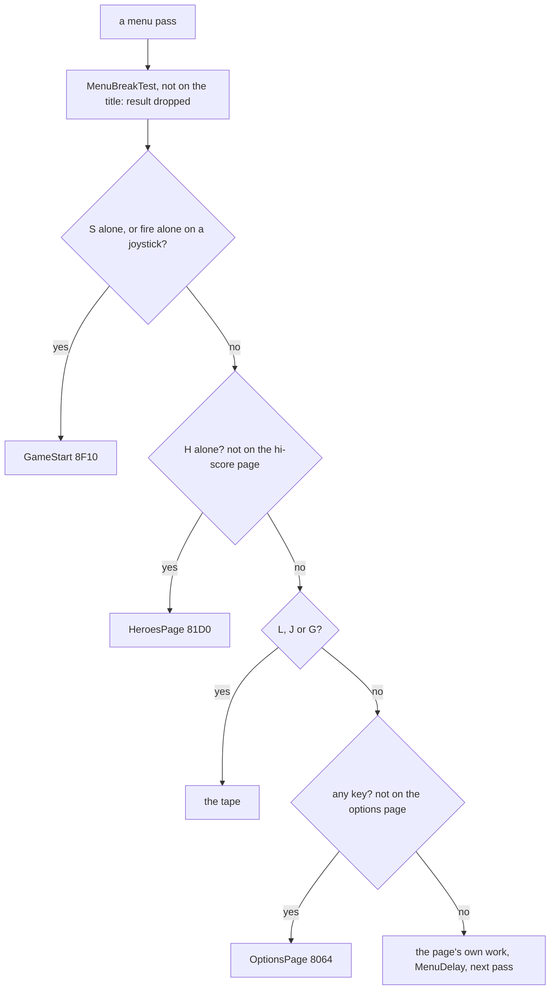

```asm
8227  3E FD        LD A,$FD               ; MenuCheckStart: A S D F G
8229  DB FE        IN A,($FE)
822B  F6 E0        OR $E0
822D  FE FD        CP $FD                 ; S down, A D F G up
822F  28 0C        JR Z,MenuStartGame
8231  3A 59 B2     LD A,(Controls)
8234  FE 06        CP $06
8236  C8           RET Z                  ; the keyboard: no fire button here
8237  CD 17 AE     CALL ControlsRead
823A  FE 01        CP $01                 ; fire, and nothing else
823C  C0           RET NZ
823D  CD CB A7     CALL SetIm1            ; MenuStartGame
8240  ED 7B 5D B2  LD SP,(BasicStack)
8244  C3 10 8F     JP GameStart
```

- **"Alone" is per half-row.** S with D does not start the game; S with Q does. The `CP` compares the whole
  half-row.
- **With the keyboard chosen, P does not start the game**: only S does. With a joystick, fire starts it, but only
  fire with no direction (`CP $01`).
- **The order matters.** S beats H, H beats the tape keys, and "any key" comes last. So a command key never falls
  through to the options page.

### The options page

There is no key redefinition. The keyboard is fixed to Q A O P and the other keys of 5.3 (KeysQAOP `$AEB2`); the
options page only picks the device, the players and the course.

The options page reads keys the ROM's way. Each pass it calls KEY_SCAN `$028E`, which returns one key's code in E
(`$FF` for none, NZ for two keys at once). It offers the code to three small tables in turn:

| Table | Key code | Key | Value | Attribute line |
| --- | --- | --- | ---: | --- |
| OptionPlayerKeys `$83BA` | `$1A` | O | Players = 1 | `$21` |
| | `$05` | T | Players = 2 | `$29` |
| OptionCourseKeys `$83C0` | `$24` | 1 | Course = 1 (Beginner) | `$39` |
| | `$1C` | 2 | Course = 2 (Champion) | `$41` |
| OptionControlKeys `$83C6` | `$1F` | Z | Controls = 1 | `$51` |
| | `$17` | X | Controls = 2 | `$59` |
| | `$0F` | C | Controls = 3 | `$61` |
| | `$07` | V | Controls = 4 | `$69` |
| | `$00` | B | Controls = 5 | `$71` |
| | `$11` | K | Controls = 6 | `$79` |

The codes are the ROM's key numbers: the index of the key in the ROM's key table at `$0205`. That table reads
"BHY65TGVNJU74RFCMKI83EDX", then symbol shift, "LO92WSZ", space, enter, "P01QA". So B is 0, and K is 17 = `$11`.

```text
OptionsSelect(table, entries B, key E, current value D, plain colour C):
    find the entry whose key code is E, else return NZ        ; not this group: try the next table
    if its value == D: return Z                               ; already chosen
    paint its line bright white ($47, 28 cells)
    find the entry whose value is D and paint its line colour C
    D = the new value; return Z
```

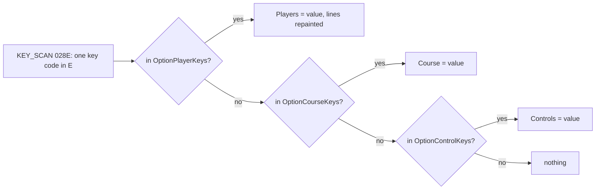

Worked example, K pressed with Controls = 1:

1. KEY_SCAN gives E = `$11`.
2. It is not in the players table (`$1A`, `$05`) and not in the course table (`$24`, `$1C`).
3. In the controls table it matches the sixth entry, `$11 $06 $79`. Its value 6 is not the current 1.
4. Attribute line `$79`, the KEYBOARD line, turns bright white.
5. The entry with value 1 (line `$51`, SINCLAIR WITH 1 JOYSTICK) goes back to its plain colour.
6. Controls = 6.

The point: the options page is the only place where O, T, 1, 2 and Z-K mean anything. Elsewhere they are ordinary
keys (any key, or play controls). The selected line is the only feedback: no sound, no confirmation.

Witness:

- KEY_SCAN found at most one key on 1789 passes of `a1`'s options page (`$80C9`).
- A real key was offered to the players table 958 times (`$80DE`), to the course table 834 times (`$80E4`) and to
  the controls table 827 times (`$80FB`).
- `a1` typed every option key in frames 537-18 573 (doc 1, 1.2).

## 5.6 The hi-score entry

The hi-score entry is the only place where the game reads text. EntryFieldEdit `$8D0D` lets the ROM's IM 1 handler
scan the keyboard, and waits on the system variable LAST_K `$5C08`:

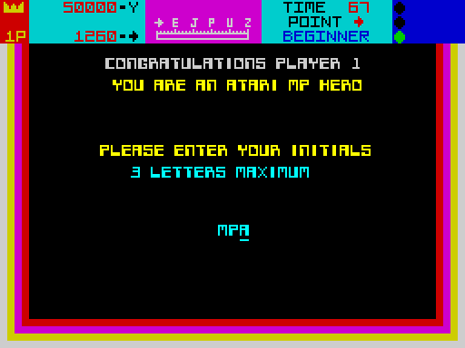

```text
EntryFieldEdit:
    cursor = 0; FLAGS bit 3 = 1 (L mode); FLAGS2 bit 3 = 1 (caps lock); MODE = 0
    loop:
        draw the field
        LAST_K = 0; wait until LAST_K != 0                 ; the ROM's interrupt scan fills it
        ENTER ($0D): return
        $08 (CAPS SHIFT 5): cursor left, if not at 0
        $09 (CAPS SHIFT 8): cursor right, if not at the end
        $0C (CAPS SHIFT 0, DELETE): close the gap at the cursor, a space at the end, cursor left
        $20-$5E: store at the cursor, cursor right (stays on the last place)
        anything else: ignored
```

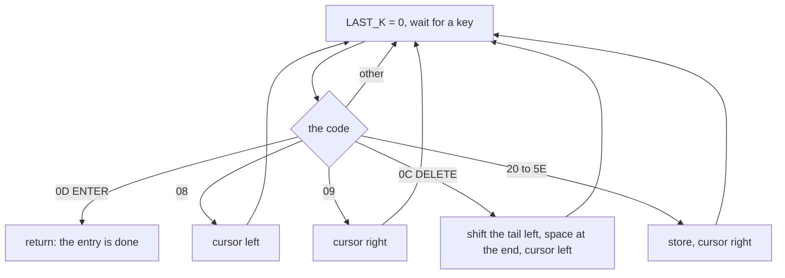

The wait and the dispatch (EntryCursor `$B254`, EntryLength `$B24B`, EntryBuffer `$B24C` hold the field's record):

```asm
EditWaitKey:
$8D23  LD HL,LAST_K           ; LAST_K = 0, wait for a key
$8D26  XOR A
$8D27  LD (HL),A
EditWaitLoop:
$8D28  CP (HL)                ; the ROM's IM 1 scan writes the next key code here
$8D29  JR Z,EditWaitLoop
$8D2B  LD A,(HL)
$8D2C  CP $0D                 ; ENTER: done
$8D2E  RET Z
$8D2F  CP $08
$8D31  JP Z,EditCursorLeft
$8D34  CP $09
$8D36  JP Z,EditCursorRight
$8D39  CP $0C                 ; DELETE
$8D3B  JP Z,EditDelete
$8D3E  CP $20                 ; below space: ignored
$8D40  JR C,EditWaitKey
$8D42  CP $5F                 ; above $5E: ignored
$8D44  JR NC,EditWaitKey
$8D46  LD D,A                 ; a character into the buffer at the cursor
$8D47  CALL EditCursorAddress  ; HL = EntryBuffer + EntryCursor
$8D4A  LD (HL),D
$8D4B  JP EditCursorRight      ; cursor + 1 unless it would reach EntryLength
```

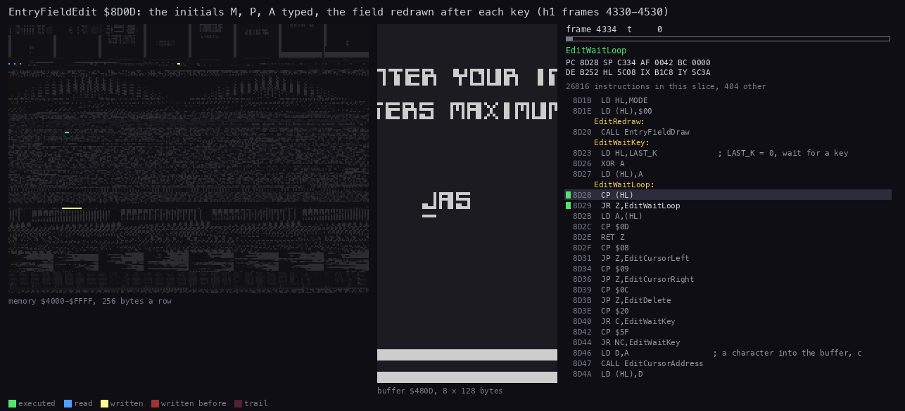

The loop in a recording: `h1` frames 4330-4530, one picture every 4 frames (279 552 T). The right panel is screen
bytes 13-20 of lines 64-191 (monochrome): the prompt above, the field at line `$7C` below it. Most pictures sit in
EditWaitLoop (`CP (HL)` on LAST_K); around frames 4345, 4405 and 4465 a key arrives, the letter is stored at the cursor
and EntryFieldDraw clears and redraws the field with the cursor line under the next place (it stays on the third).

```bash
python3 ../../kit/routine_anim.py --work work/anim/h1 --window 4330:0-4530:0 --listing build/game.lst \
    --out docs/img/routines/EntryFieldEdit.gif --pc 8C9C-8DAF --view buffer:480D:8x128:screen --range 4000-FFFF \
    --step 279552 --delay 150 --title "EntryFieldEdit \$8D0D: the initials M, P, A typed, the field redrawn after each key (h1 frames 4330-4530)"
```

The cursor keys and DELETE:

```asm
EditCursorLeft:
$8D5D  LD A,(EntryCursor)
$8D60  AND A
$8D61  JP Z,EditRedraw        ; at 0: stays
$8D64  DEC A
$8D65  LD (EntryCursor),A
$8D68  JP EditRedraw
EditCursorRight:
$8D6B  LD A,(EntryCursor)
$8D6E  INC A
$8D6F  LD HL,EntryLength
$8D72  CP (HL)
$8D73  JP Z,EditRedraw        ; would reach the length: stays
$8D76  LD (EntryCursor),A
$8D79  JP EditRedraw
EditDelete:
$8D7C  LD A,(EntryCursor)     ; DE = buffer + cursor
...
$8D87  LD HL,(EntryBuffer)
$8D8A  LD A,(EntryLength)
...
$8D90  ADD HL,BC
$8D91  DEC HL                 ; HL = the last place
$8D92  PUSH HL
$8D93  AND A
$8D94  SBC HL,DE              ; BC = the characters after the cursor
$8D96  LD A,H
$8D97  OR L
$8D98  JR Z,EditDeleteTail    ; the cursor on the last place: nothing to move
$8D9A  LD B,H
$8D9B  LD C,L
$8D9C  LD H,D
$8D9D  LD L,E
$8D9E  INC HL
$8D9F  LDIR                   ; the tail one place left, over the cursor's character
EditDeleteTail:
$8DA1  POP HL
$8DA2  LD (HL),$20            ; a space on the last place
$8DA4  JR EditCursorLeft
```

Worked example, DELETE in a 3-letter field holding `MPA` with the cursor at 1 (from the code): DE = buffer + 1, the
last place buffer + 2, BC = 1. The `LDIR` copies `A` over `P`: `MAA`. The space on the last place gives `MA `, and
the cursor moves left to 0. So DELETE removes the character under the cursor, not the one before it, and then steps
left.

Worked example, `h2` typing STAGE ONE over THE GREATEST's name. GreatestNameField `$8D53` is `14 AD 88 7C 44`:
20 characters, the buffer `$88AD`, its place on the screen. The buffer holds SPIKE NOTWELL and spaces (doc 1, 1.11).

| Key | LAST_K | Stored at | Cursor after | Buffer |
| --- | --- | --- | ---: | --- |
| (start) | | | 0 | `SPIKE NOTWELL` |
| S | `$53` | `$88AD` | 1 | `SPIKE NOTWELL` |
| T | `$54` | `$88AE` | 2 | `STIKE NOTWELL` |
| A, G, E | `$41`, `$47`, `$45` | `$88AF-$88B1` | 5 | `STAGE NOTWELL` |
| SPACE | `$20` | `$88B2` | 6 | `STAGE NOTWELL` |
| O, N, E | `$4F`, `$4E`, `$45` | `$88B3-$88B5` | 9 | `STAGE ONEWELL` |
| ENTER | `$0D` | | | `STAGE ONEWELL`: returned |

Nothing clears the field first, so the old tail WELL stays: the name saved is STAGE ONEWELL, as `h2`'s screenshot
shows (doc 1, 1.11). With caps lock set (FLAGS2 bit 3) the ROM's scan gives the capitals `$41-$5A` directly.

- **The fields**: three letters for a hero (InitialsField `$8D4E`) and twenty characters for THE GREATEST's name
  (GreatestNameField `$8D53`). A field record gives its length, its buffer and its place on the screen.
- **Capitals**: caps lock is set, so letters arrive as `$41-$5A`.
- **The cursor stays on the last place** when the field is full, so typing more overwrites the last character.
  `p2`'s random keys typed 614 characters into a 3-letter field.
- **Auto-repeat** is the ROM's. LAST_K is refilled by the ROM's scan, so a held key repeats after the ROM's delay.

Witness:

- Characters stored (`$8D46`): `h1` 3 ("MPA"), `h2` 9, `g1` 120, `p2` 614.
- The cursor keys and DELETE (`$8D5D`, `$8D7C`) never ran: they are known only from the code.

## 5.7 When the keys are read

- **In play, every key is read once a pass.** FireShots and BuggyUpdate read the control byte once each, and the
  other keys are read once. A pass is 6 to 8 frames, 120-160 ms ([doc 4](04-game-loop.md), 4.7). A press shorter
  than that can fall between two reads and be lost. A fire tap must span one read with the button down.
- **The reads are instants.** `IN` sees the key's state at that T-state. There is no latch, and no interrupt-driven
  scan in play: the IM 2 handler does not scan the keyboard.
- **On the menus**, a pass is MenuDelay (4.8 frames) plus the page's work. So a menu key must be held for up to
  about 150 ms (a pass of 4.8 to 7.7 frames, the hi-score page the longest).
- **On the hold**, the loop polls about 176 times a frame, so the restart is immediate.
- **In the hi-score entry**, the ROM's scan runs every frame, and LAST_K keeps the key until the game reads it. No
  key is lost.

The point: the game polls its input at the pass rate, so the feel is tied to the pace (doc 1, 1.5). Driving back
makes each pass longer by about a frame, and the reads rarer.
