# 6. Rendering

What this covers:

- the screen: one buffer drawn in place, its six bands, the attributes and how colour clash is kept out (6.1);
- how a position becomes a screen address: the pixel table and the line table, and the three pixel routines (6.2);
- the sprite table and the dispatcher DrawSprite (6.3);
- the ten sprite drawers: pre-shifted copies, the slot, the XOR rows, the two that colour cells (6.4);
- the erase strategy: XOR twice, and the draw that runs ahead of the scroll (6.5);
- the four scrolling bands and their feeds (6.6);
- the road, the craters and the broken top edge (6.7);
- the backdrop and the colours built at a life start (6.8);
- the pixel effects: the shots, the wheels of a death, the ground cuts (6.9);
- the block copy BlitRows: the title logo and the HUD panel (6.10);
- the drawing order against the beam and the cost of a pass (6.11);
- oddities of the graphics data (6.12).

The names are those of `src/game/game.ann` ([Terms](README.md#terms)). The recordings it rests on (all on the 48K;
WALKTHROUGH 6.0 lists how each was made):

- `game`: the L1 build of `c1` (power-on, the ROM load through the fast LD-BYTES trap, then 16 000 frames of seeded
  random play), frames 256-16 760. The run counts and the own t-states of every routine (doc 12) come from it.
- `i1` and `i2`: the immune clones (the kill `$A7DD` patched to `RET`, `work/snaps/immune.z80`) that drive the whole
  Beginner and the whole Champion course; every object kind, both sceneries and every drawer ran there.
- `a1`, `g1`, `p2`, `h1`, `h2`: from the entry snapshot `work/snaps/entry.z80` (`c1` at frame 256); the deaths, the
  wreck pieces and the menus' drawing.
- The screenshots of `docs/img/play/` (WALKTHROUGH 6.1), each taken at the start of the named frame.
- The image itself (`work/mkgame/original.bin`, the tape's block 3 at `$60F8`) for the tables and graphics bytes,
  read with `python3 work/docs/mpB-peek.py work/mkgame/original.bin ADDR:N`.

## 6.1 The screen

- **One buffer.** Everything is drawn straight into the Spectrum's screen at `$4000`. There is no back buffer, no
  copy and no frame sync ([doc 4](04-game-loop.md)). A pass of the main loop takes 6 to 8 frames in play, 7.05 on average
  (`i1` frames 300-4700, the buggy held forward; [doc 4](04-game-loop.md), 4.7). Every routine writes the screen when its turn in the pass
  comes.
- **Six bands.** The screen is cut into horizontal bands of whole character rows. Each has one job and one colour:

| Rows | Pixel lines | What | Drawn by | Scroll a pass | Colour (set byte) |
| --- | --- | --- | --- | --- | --- |
| 0-2 | 0-23 | the HUD | HudDraw `$9136` ([doc 8](08-hud-and-text.md)) | none | HudAttributes `$9621` |
| 3-7 | 24-63 | the sky: UFOs, the spinner, bombs, upward shots | the object handlers | none | +0 |
| 8-11 | 64-95 | the far band: hills | ScrollFarBand `$A846` | 1 pixel | +1, repainted every pass |
| 12-15 | 96-127 | the middle band: mountains or the moon base city | ScrollMiddleBand `$A89A` | 2 pixels | +2 |
| 16-19 | 128-159 | the near band: the buggy, rocks, the tank, boulders, the plant | the buggy and the object handlers | 2 pixels, only while the buggy is at least 10 pixels up (y < `$89`) | +3 |
| 20-23 | 160-191 | the road | ScrollRoad `$A932` | 4 pixels | +4 |

- **The colours are the band's.** SceneryColours `$95B0` paints rows 3-23 from one of two colour sets of five bytes,
  chosen by the scenery flag PlayerScenery `$B27D`. The set's address stays in `$B230` for the routines that need a
  band colour later (the low flyer's burst, the plant's head).

| Set | Address | +0 rows 3-7 | +1 rows 8-11 | +2 rows 12-15 | +3 rows 16-19 | +4 rows 20-23 |
| --- | --- | --- | --- | --- | --- | --- |
| mountains (`$B27D` = 0) | `$9617` | `$07` white on black | `$02` red on black | `$14` green on red | `$20` black on green | `$34` green on yellow |
| city (`$B27D` = `$FF`) | `$961C` | `$07` white on black | `$02` red on black | `$16` yellow on red | `$30` black on yellow | `$26` yellow on green |

  The bytes are the image's (`mpB-peek.py ... 9617:10` prints `07 02 14 20 34 07 02 16 30 26`). The screenshot
  `a1-play-beginner.png` (`a1` frame 1700) shows the first set: black sky, red hills, green mountains on red, the
  buggy on green, the road yellow with green ink.

- **How the clash is kept out.**
  - Almost every sprite is drawn in pixels only (6.4): it takes the colour of the band it is in.
  - Two drawers also write attributes, and both serve the sky. DrawSprite24x8Attr `$B069` (the saucers, the small
    bursts) and DrawSprite24x16Attr `$B115` (the spinner, the large burst) colour the cells under the sprite with the
    ink the caller puts in E' (UfoSetColour `$9E8E`: bright green, yellow, cyan or white).
  - A UFO that dips into rows 8-11 would leave its colour on the far band. So SceneryColoursRepaint `$95F2` paints
    rows 8-11 with the set's +1 and rows 22-23 with the paper of +4 on every pass (`game` 1596 runs, `i1` 3606).
  - The only other colour writer in play is the plant (PlantColourOn `$A458`, rows 18-19). It puts the band colour
    back itself (PlantColourOff `$A48D`).
- **Positions**: x counts pixels from the left (0-255), y counts pixel lines from the top (0-191). The drawers take H
  = x and L = y. The object records keep y before x ([doc 7](07-objects.md)).

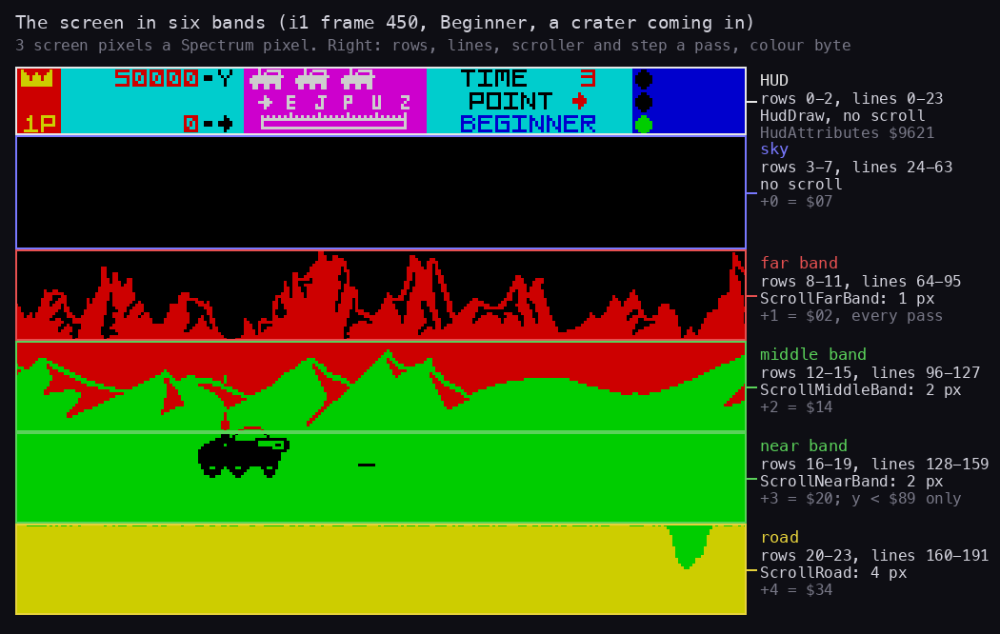

How to read the figure:

- **Left**: the screenshot `i1-crater.png` (`i1`, frame 450, Beginner course, the first crater coming in), 3 screen
  pixels a Spectrum pixel, with each band framed in its own colour.
- **Right**: for each band its character rows and pixel lines, the routine that scrolls it and its step a pass, and the
  byte of the colour set that paints it.
- The band edges fall on character rows 3, 8, 12, 16 and 20: every band is whole cells, so no cell holds two bands'
  colours.
- **The point**: the picture is six strips stacked, each with one colour and one speed; the crater on the right is
  pixels of the road band, the buggy pixels of the near band.

```bash
python3 tools/fig_rendering.py bands     # docs/img/rendering/bands.png
```

**The point**: the bands make the game cheap to draw in colour. Each scroller owns four whole character rows, every
sprite but the sky's is monochrome, and the band's attribute does the colouring.

## 6.2 From a position to a screen address

Two tables in the printing module replace the Spectrum's bit shuffling of a y coordinate:

| Table | Address | Size | One entry | Built |
| --- | --- | --- | --- | --- |
| PixelTable | `$FA00` | 512 bytes | for each x 0-255: the byte column x / 8, then the bit mask `$80` >> (x AND 7) | in the image |
| ScreenLineTable | `$FC00` | 384 bytes | for each line 0-191: the screen address of its first byte (a word, low byte first) | in the image |

Every routine indexes them the same way, by doubling a page number:

- H = `$7E`, L = y, then `SLA L` / `RL H` gives `$FC00` + 2y;
- B = `$7D`, C = x, then `SLA C` / `RL B` gives `$FA00` + 2x.

The tables are data in the image, not built at run time. Doc 2's "the font" at `$FA00-$FD7F` is these two tables
(annotator 05's correction, `work/stage2/ann/05-data-notes.md`).

The three pixel routines are the same code with a different last operation:

```asm
PlotPixel:                    ; H = x, L = y
$FD80  LD B,$7D
$FD82  LD C,H
$FD83  SLA C
$FD85  RL B                   ; BC = PixelTable + 2x
$FD87  LD H,$7E
$FD89  SLA L
$FD8B  RL H                   ; HL = ScreenLineTable + 2y
$FD8D  LD A,(HL)
$FD8E  INC HL
$FD8F  LD H,(HL)
$FD90  LD L,A                 ; HL = the line's first byte
$FD91  LD A,(BC)
$FD92  ADD A,L
$FD93  LD L,A                 ; + the byte column
$FD94  INC BC
$FD95  LD A,(BC)              ; the mask
$FD96  OR (HL)                ; UnplotPixel: CPL, AND (HL); FlipPixel: XOR (HL)
$FD97  LD (HL),A
$FD98  RET
```

```text
plot(x, y):
    address = ScreenLineTable[y] + PixelTable[x].column
    screen[address] = screen[address] OR PixelTable[x].mask      # Unplot: AND NOT mask; Flip: XOR mask
```

The `ADD A,L` needs no carry: a line starts on a `$20` boundary and the column is 0-31. There is no branch and no
loop, so no flowchart. The users:

| Routine | Operation | Users | Runs |
| --- | --- | --- | --- |
| PlotPixel `$FD80` | OR | the menu frame (`$87AE`, `$87B9`), the entry cursor `$8CF3`, the HUD progress dots `$92CE` | `game` 61 349 |
| UnplotPixel `$FD99` | AND NOT | UnplotRun `$A7F4`: the ground cuts of the score page (`$8133-$8143`), a mine, a bomb crater (`$9DCD`), the plant (`$A305`) | `a1` 1160, `i1` 420, `i2` 942 |
| FlipPixel `$FDB3` | XOR | ShotPlot `$AE11`: every shot pixel | `i1` 97 928 |

**A worked example**: the buggy's crater probe tests line 162 at x = `$38` + 5 = `$3D` (61) on its first step (6.7,
[doc 10](10-gameplay-logic.md)).

- PixelTable + 2 x `$3D` = `$FA7A` holds `07 04`: byte column 7, mask `$04` (61 AND 7 = 5, `$80` >> 5).
- ScreenLineTable + 2 x 162 = `$FD44` holds `80 52`: line 162 starts at `$5280` (third 2, character row 4, pixel
  line 2: `$5000` + 2 x `$100` + 4 x `$20`).
- The pixel is bit 2 of `$5287`. The probe does not call PlotPixel: it repeats the PixelTable read inline and ANDs
  the mask with ScreenRow162 `$5280` + the column (`$AA81-$AA93`).

**The point**: two table reads give any pixel. The same tables serve the print code, the sprites, the scrollers and
the probe, so no routine in the game computes a screen address from y by arithmetic.

## 6.3 The sprite table and DrawSprite

Every sprite is a number. DrawSprite `$A826` takes A = the number, H = x, L = y, finds the number's entry in
SpriteTable `$B2D6` and jumps to the entry's drawer with the entry's graphics.

**The data sheet.** SpriteTable holds 132 entries of 4 bytes, `$00-$83`:

| Bytes | Field |
| --- | --- |
| +0, +1 | the drawer's address (one of the ten drawers of 6.4, DrawShotForward `$ADF7`, or 0 = empty) |
| +2, +3 | the address of the frame's graphics (its first shift slot) |

| Numbers | What | Drawer | Graphics |
| --- | --- | --- | --- |
| `$00` | the buggy | DrawSprite40x23 | Buggy `$E140` |
| `$01-$04` | saucer A, frames 1 2 3 2 | DrawSprite24x8Attr | UfoA `$E020` |
| `$05-$0A` | saucer B, frames 1 2 3 4 3 2 | DrawSprite24x8Attr | UfoB `$DEA0` |
| `$0B-$0E` | the spinner, 4 frames | DrawSprite24x16Attr | Spinner `$DBA0` |
| `$0F` | the rock | DrawSprite24x12 | Rock `$DB10` |
| `$10` | a bomb crater | DrawSprite24x16 | BombCrater `$DA50` |
| `$11`, `$12` | the mine's two blink frames | DrawSprite16x4 | Mine `$D9D0` |
| `$13` | the tank | DrawSprite40x23 | Tank `$D7D0` |
| `$14` | the low flyer | DrawSprite24x8 | LowFlyer `$D710` |
| `$15-$1C` | empty | 0 | 0 |
| `$1D`, `$1E` | a UFO bomb dropping, falling | DrawSprite16x4 | UfoBomb `$D690` |
| `$1F-$26` | the buggy's explosion, 8 frames | DrawSprite40x23 | BuggyExplosion `$6500` |
| `$27-$2A` | a UFO's small burst | DrawSprite24x8Attr | BurstSmall `$7D80` |
| `$2B-$2E` | a shot rock's debris | DrawSprite24x12 | Debris `$7900` |
| `$2F-$32` | a shot UFO's large burst, coloured | DrawSprite24x16Attr | BurstLarge `$7600` |
| `$33-$36` | the tank's explosion: the buggy's first 4 frames | DrawSprite40x23 | BuggyExplosion `$6500` |
| `$37-$3A` | the low flyer's burst | DrawSprite24x8Attr | BurstSmall `$7D80` |
| `$3B` | the forward shot | DrawShotForward `$ADF7` | 0 |
| `$3C-$3E` | the three wreck pieces | DrawSprite16x9 | `$6350`, BuggyWreck2 `$63E0`, BuggyWreck3 `$6470` |
| `$3F` | empty | 0 | 0 |
| `$40-$43` | the small boulder rolling | DrawSprite16x8 | BoulderSmall `$D590` |
| `$44-$4B` | the medium boulder, 4 frames each twice | DrawSprite24x12 | BoulderMedium `$D350` |
| `$4C-$57` | the large boulder, 4 frames each three times | DrawSprite24x16 | BoulderLarge `$D050` |
| `$58-$5B` | the medium boulder's burst | DrawSprite24x12 | BurstMedium `$7B40` |
| `$5C-$5F` | Debris again (`$5F` is only the large boulder's start value, never drawn: [doc 7](07-objects.md)) | DrawSprite24x12 | Debris `$7900` |
| `$60-$63` | the large boulder's burst, uncoloured | DrawSprite24x16 | BurstLarge `$7600` |
| `$64-$72` | the plant's stem opening and closing, 15 entries over 8 frames | DrawSprite32x16 | PlantFrames `$C450` |
| `$73` | the 500 sign of a shot plant | DrawSprite32x16 | PlantScore `$7500` |
| `$74-$7A` | the plant's head, 7 entries over 4 frames | DrawSprite32x16 | PlantSpray `$CC50` |
| `$7B-$7E` | a shot plant's debris | DrawSprite24x12 | Debris `$7900` |
| `$7F` | empty (the small boulder's start value, never drawn) | 0 | 0 |
| `$80-$83` | the small boulder's burst | DrawSprite16x8 | BurstTiny `$C350` |

The animation is in the table, not in the handlers: a handler counts its sprite number up, and repeated entries
make the timing (the medium boulder's frames twice, the large one's three times, the plant's frames back and forth).
The graphics of every sheet are in `src/res/graphics/` as indexed PNG sheets (their README names the readers).

**The dispatcher.**

```asm
DrawSprite:                   ; A = sprite, H = x, L = y
$A826  PUSH BC
$A827  PUSH DE
$A828  PUSH HL
$A829  LD DE,SpriteTable
$A82C  LD H,$00
$A82E  LD L,A
$A82F  ADD HL,HL
$A830  ADD HL,HL
$A831  ADD HL,DE              ; HL = SpriteTable + 4A
$A832  LD E,(HL)
$A833  INC HL
$A834  LD D,(HL)
$A835  INC HL
$A836  PUSH DE
$A837  POP IX                 ; IX = the drawer
$A839  LD E,(HL)
$A83A  INC HL
$A83B  LD D,(HL)              ; DE = the graphics
$A83C  POP HL                 ; HL = the position again
$A83D  LD BC,DrawSpriteDone
$A840  PUSH BC
$A841  JP (IX)
DrawSpriteDone:
$A843  POP DE                 ; the drawer returns here
$A844  POP BC
$A845  RET
```

```text
draw_sprite(number, x, y):
    entry = SpriteTable[number]
    entry.drawer(x, y, entry.graphics)        # XOR: drawing it twice at the same place erases it
```

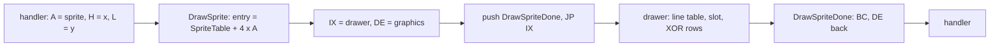

**A worked example**: the life start draws the buggy, sprite 0, at x `$38`, y `$89` (its y `$92` less 9, LifeStart
`$90D3`).

- SpriteTable + 4 x 0 = `$B2D6` holds `C8 B1 40 E1`: drawer `$B1C8` (DrawSprite40x23), graphics `$E140` (Buggy).
- IX = `$B1C8`, DE = `$E140`, HL = `$3889`; the drawer runs and returns to `$A843`.
- Witness: DrawSprite runs `game` 7358, `i1` 35 224, `i2` 42 588 times (`i1` frames 262-30 439); DrawSprite40x23
  runs `i1` 7524 times in 3601 passes: the buggy erased and drawn each pass, and the tank.

**The point**: one entry point draws everything, so a handler holds only a number. Which drawer, how wide, how many
shift copies is the table's business.

## 6.4 The drawers

**What a drawer does.** A drawer XORs a rectangle of W bytes by H lines onto the screen, top line first, at the byte
column x / 8 of line y. The pixels inside a byte come from a **pre-shifted copy**: the graphics hold the frame
already shifted right by each possible pixel offset, so a drawer never shifts at run time. The copy (the **slot**) is
picked by x:

- 8 slots, one per pixel (x AND 7), for the sprites that move one pixel at a time;
- 4 slots, one per two pixels (x AND 6), for the sprites whose x stays even. Everything that moves with the scroll
  moves by 1, 2 or 4 pixels a pass, so the 4-slot sheets suffice for most of the game and halve the memory.

Each slot is W x H bytes, W counting the spare byte on the right of every line for the bits shifted out (a 16 x 4
sprite has 8-byte slots; the 40 x 23 buggy 115 bytes in a 128-byte stride).
There is no mask: the XOR draws, the same XOR erases (6.5).

| Drawer | Address | W x H bytes | Slots | Slot size | Sprites | Runs `i1` / `i2` |
| --- | --- | --- | --- | --- | --- | --- |
| DrawSprite16x4 | `$AFDD` | 2 x 4 | 8 (x AND 7) | 8 | `$11` `$12` the mine, `$1D` `$1E` the UFO bomb | 8626 / 9653 instructions at the entry |
| DrawSprite16x8 | `$B003` | 2 x 8 | 4 (x AND 6) | 16 | `$40-$43` the small boulder, `$80-$83` its break-up | - / 670 |
| DrawSprite16x9 | `$B02A` | 2 x 9 | 8 (x AND 7) | 18 | `$3C-$3E` the wheels flying off a wreck | none (`g1` 728) |
| DrawSprite24x8Attr | `$B069` | 3 x 8, 3 x 2 cells | 4 | 24 | `$01-$0A` the saucers, `$27-$2A` `$37-$3A` bursts | 13 327 / 10 725 |
| DrawSprite24x8 | `$B0BA` | 3 x 8 | 8 | 24 | `$14` the low flyer from behind | - / 374 |
| DrawSprite24x12 | `$B0E2` | 3 x 12 | 4 | 36 | `$0F` the rock, `$2B-$2E` its pieces, `$44-$4B` the medium boulder, `$58-$5F` its break-up, `$7B-$7E` the plant's pieces | 2342 / 4368 |
| DrawSprite24x16 | `$B10D` | 3 x 16 | 4 | 48 | `$10` the bomb crater, `$4C-$57` the large boulder, `$60-$63` its break-up | 15 / 1072 |
| DrawSprite24x16Attr | `$B115` | 3 x 16, 3 x 3 cells | 4 | 48 | `$0B-$0E` the spinner, `$2F-$32` a shot UFO's burst | 3164 / 4112 |
| DrawSprite32x16 | `$B184` | 4 x 16 | 4 | 64 | `$64-$7A` the green plant and its `500` sign `$73` | - / 1524 |
| DrawSprite40x23 | `$B1C8` | 5 x 23 | 4 | 128 (115 used) | `$00` the buggy, `$13` the tank, `$1F-$26` the buggy's death, `$33-$36` the tank's | 7524 / 9168 |

The other entries of the 132: `$15-$1C`, `$3F` and `$7F` hold drawer `$0000` (never drawn: `$7F` is only the small
boulder's start value, 6.12) and `$3B` is the forward shot's own routine DrawShotForward `$ADF7` (6.9).

(Run counts from each drawer's `.ann` description; for DrawSprite16x4 the count is of instructions at its entry.)

**The slot offset.** Every drawer starts the same way: three `RRA` / `RR L` pairs split x into A = x / 8 (the byte
column, kept in C') and L = (x AND 7) x 32. Then a few rotates and masks turn L into slot x slot size. The buggy's
drawer:

```asm
DrawSprite40x23:              ; H = x, L = y, DE = graphics
$B1C8  LD B,$7E
$B1CA  LD C,L
$B1CB  SLA C
$B1CD  RL B                   ; BC = ScreenLineTable + 2y
$B1CF  PUSH BC
$B1D0  LD A,H
$B1D1  LD HL,$0000
$B1D4  RRA
$B1D5  RR L
$B1D7  RRA
$B1D8  RR L
$B1DA  RRA
$B1DB  RR L                   ; A = x / 8, L = (x AND 7) x 32
$B1DD  EXX
$B1DE  LD C,A                 ; C' = the byte column
$B1DF  EXX
$B1E0  LD A,L
$B1E1  AND $DF                ; (x AND 6) x 32
$B1E3  LD L,A
$B1E4  ADD HL,HL              ; (x AND 6) x 64 = slot x 128
$B1E5  ADD HL,DE
$B1E6  LD B,H
$B1E7  LD C,L                 ; BC = the slot's first byte
$B1E8  POP HL                 ; HL = the line table entry
$B1E9  EXX
$B1EA  LD B,$17               ; B' = 23 lines
DrawSprite40x23Rows:
$B1EC  LD A,C
$B1ED  EXX
$B1EE  ADD A,(HL)
$B1EF  LD E,A
$B1F0  INC HL
$B1F1  LD D,(HL)
$B1F2  INC HL                 ; DE = this line's address + column; HL = the next line's entry
$B1F3  EX DE,HL
$B1F4  LD A,(BC)
$B1F5  XOR (HL)
$B1F6  LD (HL),A              ; ... four more INC BC / INC HL / XOR pairs: 5 bytes
$B201  ...
$B20B  EX DE,HL
$B20C  EXX
$B20D  DJNZ DrawSprite40x23Rows
$B20F  EXX
$B210  RET
```

The other drawers differ only in the slot arithmetic and the number of bytes a line:

| Drawer | From L = (x AND 7) x 32 | Offset |
| --- | --- | --- |
| DrawSprite16x4 | `RRCA` x 2 | (x AND 7) x 8 |
| DrawSprite16x8 | `RRCA`, `AND $EF`, `RRCA` | (x AND 6) x 8 |
| DrawSprite16x9 | `RRCA`, then + its own `RRCA` x 3 | (x AND 7) x 16 + (x AND 7) x 2 = (x AND 7) x 18 |
| DrawSprite24x8Attr | `RRCA`, `AND $EF`, `RRCA`, + its `RRCA` | (x AND 6) x 12 |
| DrawSprite24x8 | `RRC L`, + its `RRCA` | (x AND 7) x 24 |
| DrawSprite24x12 | `RRCA`, `AND $EF`, + its `RRCA` x 3 | (x AND 6) x 18 |
| DrawSprite24x16(Attr) | SpriteSetup24 `$B143`: `RRCA`, `AND $EF`, + its `RRCA` | (x AND 6) x 24 |
| DrawSprite32x16 | `AND $DF` | (x AND 6) x 32 |
| DrawSprite40x23 | `AND $DF`, `ADD HL,HL` | (x AND 6) x 64 |

The row loops are shared where the width is: SpriteXor2Wide `$B052` serves the three 2-byte drawers, SpriteXor3Wide
`$B168` the five 3-byte ones; the 4- and 5-byte drawers have their own loops.

```text
draw(x, y, graphics, W, H, slot_size, slots):
    column = x / 8
    slot   = (x AND 7) if slots == 8 else (x AND 6) / 2
    source = graphics + slot * slot_size
    for line in y .. y + H - 1:
        address = ScreenLineTable[line] + column
        for i in 0 .. W - 1:
            screen[address + i] ^= source[0]; source += 1
    # the Attr drawers first set 3 x 2 (or 3 x 3) attribute cells from the cell of (x, y) to the colour in E'
```

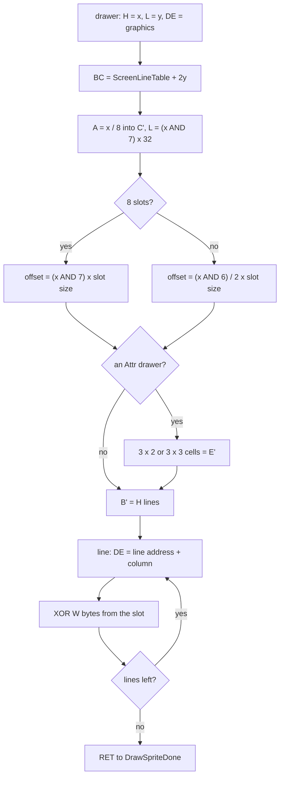

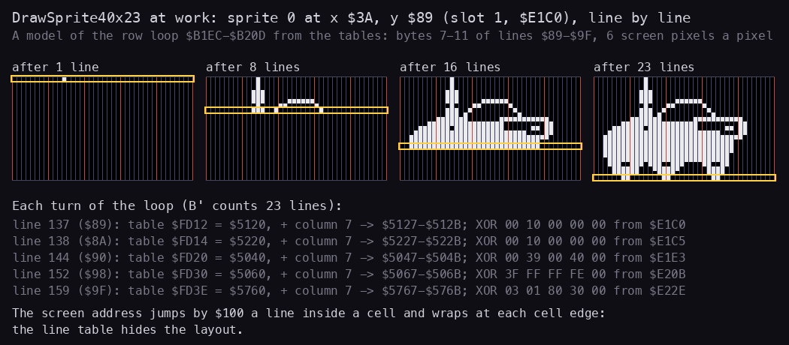

How to read the figure:

- **Four panels**: bytes 7-11 of lines `$89-$9F` (137-159), the buggy's rectangle, after the loop has drawn 1, 8, 16
  and all 23 lines; the yellow frame is the line just drawn. Red lines are byte boundaries.
- **The text below**: for five of the 23 turns, the line table entry the loop reads, the line's address, the five
  screen bytes it XORs and the five source bytes of slot 1 (`$E1C0` + 5 per line).
- A model of the loop from the image's tables, not a trace of a recording.
  `i1` runs the drawer 7524 times.
- **The point**: the loop never computes a screen address. It takes one word from the line table per line, adds the
  column it keeps in C', and the Spectrum's interleaved layout (`$5120`, `$5220`, ... `$5040` at the next cell) costs
  nothing.

```bash
python3 tools/fig_rendering.py drawer    # docs/img/rendering/drawer.png
```

**The colour drawers.** DrawSprite24x8Attr and DrawSprite24x16Attr take the attribute address from the first line's
screen address (high byte: bits 3-4 of the third, `OR $58`; low byte: the same) and write E' into 3 cells of 2 (or 3)
character rows, `$1E` apart, before the XOR. They never put the old colour back: the sky's attribute is `$07` white
on black, and a UFO's colour stays behind in black cells where it does not show, except in rows 8-11, which
SceneryColoursRepaint repaints every pass (6.1).

**A worked example: the buggy at x `$38` and at x `$3A`.** The life start draws sprite 0 at x `$38` (56), y `$89`
(137).

- The line table entry: `$FC00` + 2 x 137 = `$FD12` holds `20 51`: line 137 starts at `$5120`.
- x / 8 = 7: the buggy's bytes go to `$5127-$512B` on the first line.
- x AND 6 = 0: slot 0, `$E140`. The first line of slot 0 is `00 40 00 00 00`: one pixel, the top of the aerial.
- When the player holds fast, BuggyUpdate moves x by 2 to `$3A` (58). x / 8 is still 7, x AND 6 = 2: slot 1, `$E140`
  + 128 = `$E1C0`. The same frame, two pixels further right: both slots are the first two panels of the slots figure below.
- Witness: the buggy is drawn this way in every play recording (DrawSprite40x23 `game` 3191 runs, `i1` 7524). Its x
  starts at `$38` and moves in steps of 2 between `$28` (slow while x >= `$29`, `$AA54`) and `$50` (fast while x <
  `$50`, `$AA60`), so it is always even (BuggyUpdate `$AA0F`, [doc 10](10-gameplay-logic.md)). The 4-slot drawer is
  exactly enough.

**A second worked example: the rock, 24 x 12.** The rock is spawned at x `$F4` and moves left 4 a pass (6.5), so on the
ground its x AND 6 is 4, then 0, then 4 ...: slots 2 and 0 by turns. While the buggy is high in a jump (BuggyAirborne `$AFA5`) ScrollAdjustX
adds the near band's 2 (6.6), so x + 2 picks slots 3 and 1. Slot 0 starts `02 00 00 07 00 00` (the tip, one pixel
in byte 0, then three), slot 1 (`$DB10` + 36 = `$DB34`) `00 80 00 01 C0 00`: the tip has moved from bit 1 of byte 0
to bit 7 of byte 1, two pixels right.

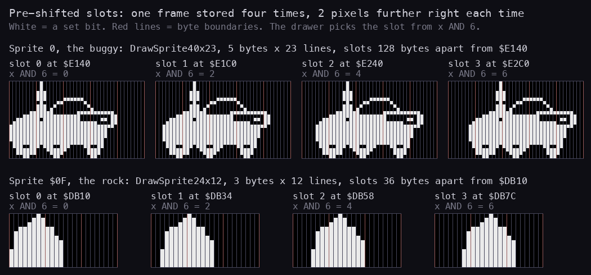

How to read the figure:

- **Top row**: the four slots of sprite 0, the buggy, from `$E140`, 128 bytes apart. Each panel is 5 bytes x 23 lines;
  a white square is a set bit; the red lines are the byte boundaries the drawer writes across.
- **Bottom row**: the four slots of the rock, sprite `$0F`, from `$DB10`, 36 bytes apart, 3 bytes x 12 lines.
- **Labels**: the slot's address and the value of x AND 6 that selects it.
- From the image `work/mkgame/original.bin`; no recording (the bytes never change). The slots drawn in play are
  witnessed by the run counts above.
- **The point**: the frame slides two pixels right from panel to panel and spills into the spare byte on the right;
  the drawer never shifts, it only chooses.

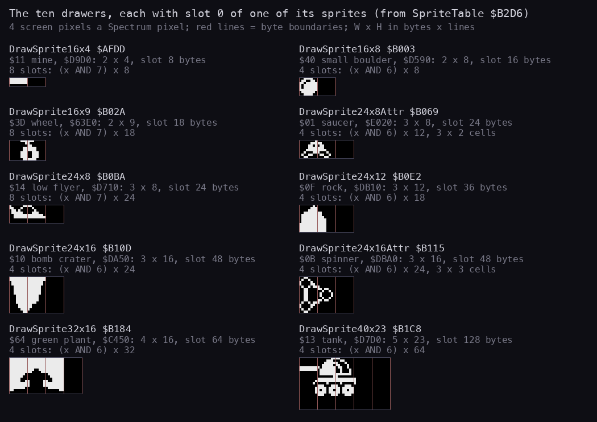

How to read the figure:

- One panel per drawer, in the order of the drawer table: the drawer's name and address, the sprite shown and its
  graphics address (from SpriteTable `$B2D6`), W x H, the slot size, and how x picks the slot.
- Each panel is slot 0 of the sprite, 4 screen pixels a Spectrum pixel, red lines at the byte boundaries. The right
  byte of each slot 0 is empty: the room the shifted copies grow into.
- From the image; the saucer's graphics address is read from its sprite table entry `$01`.
- **The point**: ten drawers, but one shape of code; what changes is W, H and how many slots the sheet holds, and the
  sprites that move by single pixels (the mine, the wheels, the low flyer) pay for eight.

```bash
python3 tools/fig_rendering.py slots     # docs/img/rendering/slots.png
python3 tools/fig_rendering.py drawers   # docs/img/rendering/drawers.png
```

**The point**: speed bought with memory. A drawer is a table read, a few rotates and a run of XORs; the shifting was
done once, by the artist's tools, into the sheets of `src/res/graphics/`.

## 6.5 Erasing on a scrolling screen

**The problem.** A sprite drawn by XOR is erased by drawing it again at the same place. But between one pass and the
next the band under the sprite scrolls: the far band by 1 pixel, the middle by 2, the road by 4, the near band by 2
or not at all. If the game drew a rock at x and the road then rolled 4 pixels left, the rock's pixels would sit at
x - 4, and an erase at x would leave the old rock and punch a new rock-shaped hole.

**The fix: draw ahead by the band's step.** Every object handler does three things in one order:

1. erase: XOR the sprite at the stored x;
2. move: store the new x (for the ground objects x - GroundSpeed, while the buggy is alive);
3. draw: XOR the sprite at the stored x **plus the scroll step of the band at its y** (ScrollAdjustX `$AF79`, or
   ScrollAdjustIfAlive `$AF74`, which adds nothing once the buggy is dying).

The scroller of that band runs later in the same pass and moves the fresh pixels left by exactly that step, so at the
next pass's erase they are back at the stored x. Where in the pass the scroller runs does not matter: it runs once
between the draw and the next erase.

```asm
ScrollAdjustIfAlive:          ; H = x, L = y
$AF74  LD A,(DeathStep)
$AF77  INC A
$AF78  RET NZ                 ; dying: the scrollers stop too (6.6), so no step
ScrollAdjustX:
$AF79  LD A,L
$AF7A  CP $40
$AF7C  JR C,BuggyAirborne     ; above line 64: no band, x unchanged
$AF7E  CP $60
$AF80  JR NC,ScrollAdjustMiddle
$AF82  LD A,(HillsSpeed)      ; lines 64-95: the far band, 1
$AF85  JR ScrollAdjustAdd
ScrollAdjustMiddle:
$AF87  CP $80
$AF89  JR NC,ScrollAdjustNear
$AF8B  LD A,(MiddleSpeed)     ; lines 96-127: the middle band, 2
$AF8E  JR ScrollAdjustAdd
ScrollAdjustNear:
$AF90  CP $A0
$AF92  JR C,ScrollAdjustNearBand
$AF94  LD A,(GroundSpeed)     ; line 160 and down: the road, 4
$AF97  JR ScrollAdjustAdd
ScrollAdjustNearBand:
$AF99  LD A,(BuggyY)          ; lines 128-159: only while the buggy is 10 or more pixels up
$AF9C  CP $89
$AF9E  JR NC,BuggyAirborne
...                           ; ScrollAdjustAdd: H = H + A
```

```text
draw_scrolled(sprite, x, y):
    if buggy dying: draw(sprite, x, y); return
    step = 0         if y < $40
         = 1         if y < $60          # HillsSpeed $B225
         = 2         if y < $80          # MiddleSpeed $B229
         = (2 if buggy_y < $89 else 0) if y < $A0
         = 4                             # GroundSpeed $B235
    draw(sprite, x + step, y)
```

The band is chosen by the sprite's **top** line only. A sprite that spans two bands is moved by the step of the
upper one; its lower part then drifts against its own band. The game avoids the case by where it puts things: the
ground objects (rock y `$94`, mines y `$A0`, boulders y = `$A0` - size, the crater sprite) sit wholly in one band.

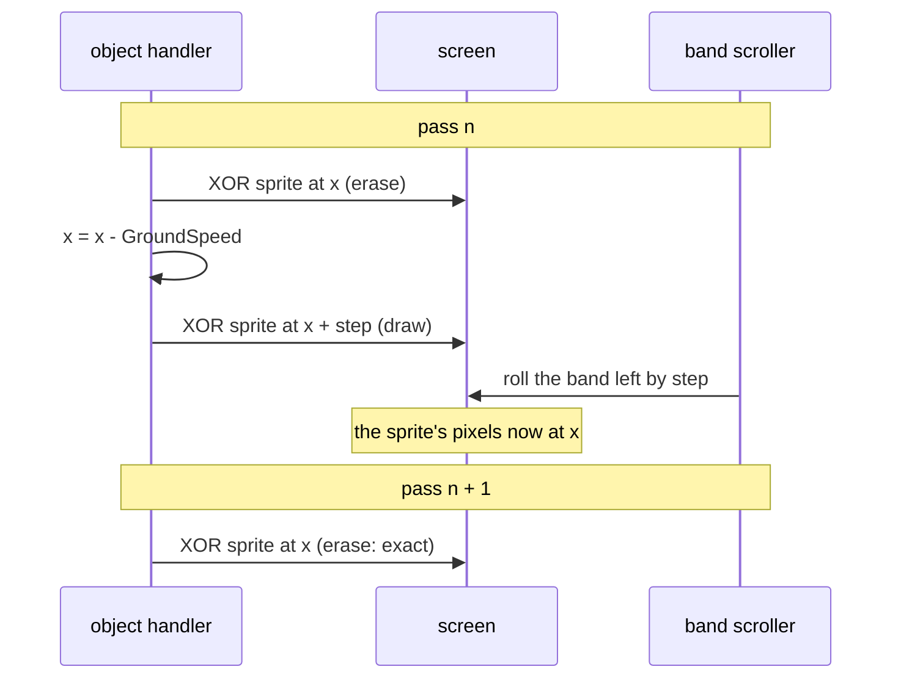

**A worked example: the rock.** ObjRock `$99C3` keeps its record as +2 delay, +3 sprite `$0F`, +4 y `$94`, +5 x.

```asm
ObjRockActive:
$99CC  PUSH HL
$99CD  INC HL
$99CE  LD C,(HL)              ; C = sprite $0F
$99CF  INC HL
$99D0  LD E,(HL)              ; E = y $94
$99D1  INC HL
$99D2  LD D,(HL)              ; D = x
$99D3  LD A,D
$99D4  CP $F4
$99D6  JR Z,ObjRockMove       ; first pass: nothing on the screen yet
$99D8  LD A,C
$99D9  EX DE,HL
$99DA  CALL DrawSprite        ; erase at the stored (x, y)
$99DD  EX DE,HL
ObjRockMove:
$99DE  LD A,(DeathStep)
$99E1  INC A
$99E2  JR NZ,ObjRockTest      ; dying: the rock stands still
$99E4  LD A,(GroundSpeed)
$99E7  NEG
$99E9  ADD A,(HL)
$99EA  LD (HL),A              ; x = x - 4
$99EB  JP Z,ObjRockRemove
...                           ; the collision and jump tests (doc 7)
ObjRockDraw:
$9A42  LD D,(HL)
$9A43  DEC HL
$9A44  LD E,(HL)
$9A45  DEC HL
$9A46  EX DE,HL
$9A47  CALL ScrollAdjustIfAlive
$9A4A  LD A,(DE)
$9A4B  CALL DrawSprite        ; draw at x + step
```

The rock is at y `$94` (148), in the near band. Two cases, from a rock that has reached x `$C0`:

| Pass | Buggy | Erase at | New x | Step | Drawn at | Scroll of lines 128-159 | Pixels end at |
| --- | --- | --- | --- | --- | --- | --- | --- |
| n | on the road (y `$92`) | `$C0` | `$BC` | 0 | `$BC` | none (the delay, 6.6) | `$BC` |
| n + 1 | jumping (y `$80`) | `$BC` | `$B8` | 2 | `$BA` | 2 left | `$B8` |
| n + 2 | jumping | `$B8` | `$B4` | 2 | `$B6` | 2 left | `$B4` |

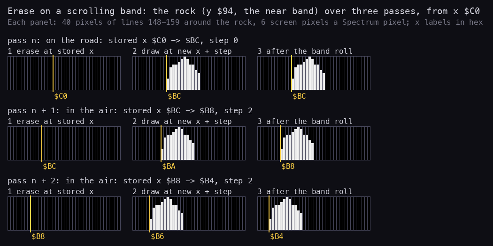

How to read the figure:

- **One row a pass**, the three rows of the table above. Each row has three panels of 40 pixels around the rock,
  lines 148-159 (the rock's 12 lines), 6 screen pixels a Spectrum pixel.
- **Panel 1**: right after the erase at the stored x (yellow mark): the place is clean.
- **Panel 2**: right after the draw at the new x plus the band's step (yellow mark): 0 on the ground, 2 in the air.
- **Panel 3**: after the near band's scroller ran later in the pass: the rock sits at the new stored x, where the next
  pass will erase it.
- Drawn from the rock's slots in the image and the code's arithmetic (a model, not a recording); `i1` runs ObjRock
  3080 times.
- **The point**: in the air the draw lands 2 pixels right and the band carries it back; on the ground nothing moves the
  band and the draw lands where it stays. Either way panel 3 is the place panel 1 of the next pass erases.

```bash
python3 tools/fig_rendering.py erase     # docs/img/rendering/erase.png
```

Each erase lands on the pixels of the last draw. The rock moves 4 pixels a pass on the screen in both cases, the
speed of the road it stands on, while the strip of lines 128-159 behind it moves 2 or nothing: the rock's speed is its
own, the step only undoes the band's roll.

Witness: ObjRock runs `game` 3060, `i1` 3080, `i2` 4289 times; the rocks in `i1-rock-point-a.png` stand clean on the
road. A stale sprite would show at once as a trail; none shows in any play screenshot of this case.

**The point**: one table of four speeds replaces masks, saved backgrounds and redraws. The price is a rule the code
keeps without saying it: everything that scrolls must be drawn after its erase in the same pass, and the scrollers
must stop exactly when ScrollAdjustIfAlive stops adding, at the buggy's death.

## 6.6 The scrollers

**What they do.** Four routines roll four bands of 32 lines left, each by its own step, a whole pass at a time. A
band is a 32 x 32-byte block; a roll walks each line from its last byte (column 31) to its first with `RL (HL)`, so the
bits leaving a byte on the left enter the next byte to the left, and the bits that enter the last byte on the right
come from a **feed**: one byte a line in the printer buffer, refilled from a strip every few passes.

| Routine | Address | Lines | Line table | Step | Feed | Refill | Source | Counter |
| --- | --- | --- | --- | --- | --- | --- | --- | --- |
| ScrollFarBand | `$A846` | 64-95 | `$FC80` | 1 | FeedFarBand `$5B00` | every 8 passes | HillsStrip `$EBC0`, column pointer FarColumn `$B226` | FarCountdown `$B224` |
| ScrollMiddleBand | `$A89A` | 96-127 | `$FCC0` | 2 | FeedMiddleBand `$5B20` | every 4 | MountainsStrip `$E340` or MoonBaseStrip `$E780`, MiddleColumn `$B22A` | MiddleCountdown `$B228` |
| ScrollNearBand | `$A8FD` | 128-159 | `$FD00` | 2, only with y < `$89` | none: zeros come in | - | - | - |
| ScrollRoad | `$A932` | 160-191 | `$FD40` | 4 | FeedRoad `$5B40` | every 2 | the 32 bytes at GroundProfile `$B232` | GroundCountdown `$B234` |

Every refill copies 32 bytes, one 8-pixel column of the strip: so a step of s pixels a pass empties a feed byte in
8 / s passes, exactly the refill period. The scrollers all start with `LD A,(DeathStep) / INC A / RET NZ`: while the
buggy dies, the world stands still.

**Names by band.** The scrollers and their buffers are named after the band they feed: ScrollFarBand feeds the
far band (lines 64-95) from HillsStrip, the craggy back range, and ScrollMiddleBand feeds the middle band
(lines 96-127) from MountainsStrip or MoonBaseStrip. The strip labels follow the game's own scenery words ("the
mountains or the city").

**The far band, one pixel a pass:**

```asm
ScrollFarBand:
$A846  LD A,(DeathStep)
$A849  INC A
$A84A  RET NZ                 ; dying: no scroll
$A84B  LD A,(FarCountdown)
$A84E  AND A
$A84F  JR NZ,FarRoll
$A851  LD HL,(FarColumn)    ; refill: the next column of HillsStrip
$A854  LD DE,$0020
$A857  ADD HL,DE
$A858  LD DE,HillsStrip+$0440 ; 34 columns: wrap at $F000
$A85B  PUSH HL
$A85C  AND A
$A85D  SBC HL,DE
$A85F  POP HL
$A860  JR NZ,FarFeedSet
$A862  LD HL,HillsStrip
FarFeedSet:
$A865  LD (FarColumn),HL
$A868  LD DE,FeedFarBand
$A86B  LD BC,$0020
$A86E  LDIR                   ; 32 bytes into $5B00
$A870  LD A,$08
FarRoll:
$A872  DEC A
$A873  LD (FarCountdown),A  ; 8 passes to the next refill
$A876  LD IX,FeedFarBand
$A87A  LD C,$20               ; 32 lines
$A87C  LD HL,ScreenLineTable+$0080
FarLine:
$A87F  LD E,(HL)
$A880  INC HL
$A881  LD D,(HL)
$A882  INC HL
$A883  EX DE,HL
$A884  LD A,L
$A885  ADD A,$1F
$A887  LD L,A                 ; HL = the line's last byte
$A888  RLC (IX+$00)           ; the feed's top bit into the carry (and back to its bottom)
$A88C  LD B,$20
FarByte:
$A88E  RL (HL)                ; carry in on the right, out on the left
$A890  DEC HL
$A891  DJNZ FarByte
$A893  EX DE,HL
$A894  INC IX
$A896  DEC C
$A897  JR NZ,FarLine
$A899  RET
```

**Two and four pixels a pass.** `RL (HL)` moves one bit. For two bits a byte ScrollMiddleBand keeps the two carry bits in
A between bytes: before a line it rotates the feed byte twice into A's bottom two bits; for each byte, `RRCA / RRCA`
puts them at A's top, then `RLA / RL (HL)` twice shifts one bit at a time out of A into the byte and the byte's two
top bits back into A, and a last `RLA` brings them to A's bottom for the next byte. ScrollRoad does the same with
four bits (`RRCA` x 4, then four `RLA / RL (HL)` pairs). ScrollNearBand is ScrollMiddleBand with A starting at 0 and no
feed: zeros come in on the right, which is where the band is empty.

```text
scroll(band_lines, step, feed, strip, counter, period):
    if buggy dying: return
    if counter == 0:
        column = next column of strip (wrap after 34)
        feed[0..31] = column[0..31]
        counter = period
    counter -= 1
    for line in 0 .. 31:
        bits = top `step` bits of feed[line]; feed[line] rotated left by step
        for byte from 31 down to 0:
            out  = top `step` bits of screen[line][byte]
            screen[line][byte] = (screen[line][byte] << step) | bits
            bits = out
```

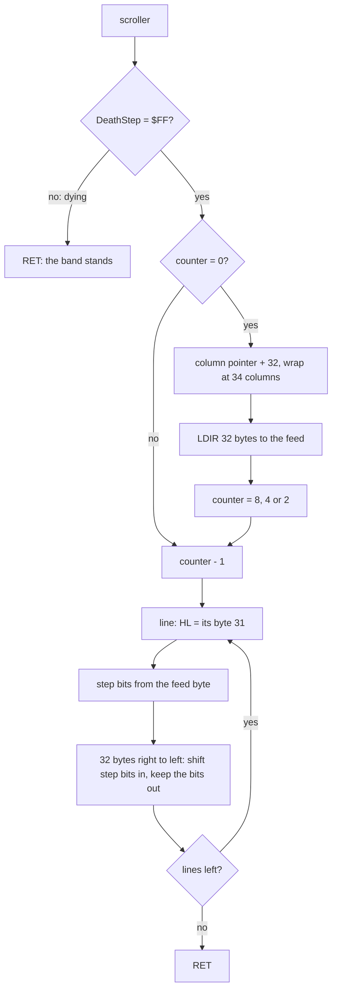

**The near band.** Lines 128-159 hold no scenery: ScenerySetup draws rows 8-15 only, and this band is the green
floor in front of the hills (attribute `$20` in the mountain sectors, `$30` black on yellow in the city). Its pixels are the sprites standing in it: the buggy, the
rocks, the boulders. ScrollNearBand rolls it two pixels only when BuggyAirborne `$AFA5` says the buggy's y is below `$89`, that is at least 10 pixels up; on the ground it burns a delay instead:

```asm
ScrollNearBand:
$A8FD  LD A,(DeathStep)
$A900  INC A
$A901  RET NZ
$A902  CALL BuggyAirborne     ; carry: y < $89
$A905  JR NC,NearBandDelay
...                           ; the roll, as ScrollMiddleBand with A = 0
NearBandDelay:
$A929  LD BC,$0AF5            ; 2805 turns of 26 T: 72 925 T
NearBandDelayLoop:
$A92C  DEC BC
$A92D  LD A,B
$A92E  OR C
$A92F  JR NZ,NearBandDelayLoop
$A931  RET
```

The roll costs 32 lines of 32 bytes at 69 T, 70 656 T, plus the line overhead: within a few per cent of the delay. So
a pass takes the same time in the air and on the ground, and the game's speed, which comes from the pass length
(6.11), does not change with a jump.

Why only in the air: the threshold is the buggy's. The buggy is drawn 9 lines above its y, so y < `$89` means its top
line is above line 128, in the middle band. ScrollAdjustX picks the step by the top line (6.5): an airborne buggy is
drawn 2 pixels ahead for the middle band's roll. Its lower lines are in the near band, and they come back to the
stored x only if the near band rolls by 2 as well. On the ground the whole buggy is in the near band, drawn with step
0, and the band must not move. So the rule "roll in the air" is the erase rule of 6.5 applied to the one sprite that
crosses the band edge. This reading is the code's alone: no comment says it, and no recording shows a buggy drawn
the other way. Known only from the code: the delay ran
`game` 1114 and `i1` 1524 of 3600 passes, the roll the rest.

**A worked example: one column of the far band.** At the life start ScenerySetup `$9541` draws columns 0-31 of
HillsStrip across the screen and sets FarColumn to column 31 (`$EBC0` + `$3E0` = `$EFA0`) and FarCountdown to 0.

- Pass 1: the counter is 0, so FarColumn + `$20` = `$EFC0`, column 32. Its 32 bytes go to `$5B00`:
  `00 00 00 00 00 00 00 00 00 00 00 00 00 00 00 00 00 00 00 80 80 E0 E0 F0 F0 F0 F0 F8 F9 F9 FB FF`.
  The counter becomes 8 - 1 = 7.
- Line 91 (64 + 27) takes byte 27, `$F8`: five set pixels, then three clear. `RLC (IX+0)` gives the carry 1 and leaves `$F1` in the feed.
  The line's 32 bytes shift left one bit, the 1 enters pixel 255.
- Passes 2 to 8: the carries are 1, 1, 1, 1, 0, 0, 0. After pass 8 the last byte of line 91 is `$F8`, the column
  is wholly on the screen, and the feed byte is back to `$F8` (eight rotations).
- Pass 9: the counter is 0 again; column 33 (`$EFE0`) goes in, byte 27 `$8F`. Pass 17 wraps: `$F000` equals
  HillsStrip + `$440`, so column 0 (`$EBC0`, byte 27 `$FF`) follows, the column drawn at x 0 at the life start.

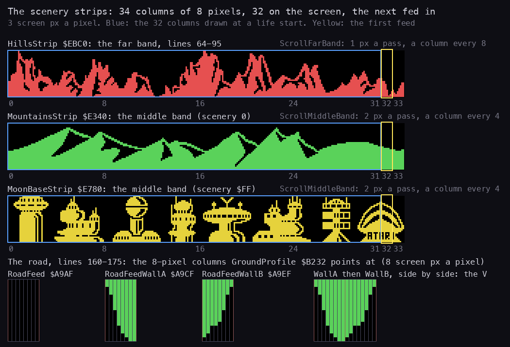

How to read the figure:

- **Three strips**, top to bottom: HillsStrip (the far band, red), MountainsStrip and MoonBaseStrip (the middle band
  for the mountain and the city sectors), each 34 columns of 8 pixels by 32 lines, laid out left to right as they
  appear on the screen, 3 screen pixels a Spectrum pixel. The numbers under each strip are column numbers.
- **Blue frame**: columns 0-31, what ScenerySetup draws at the life start. **Yellow frame**: column 32, the first column
  the scroller feeds; then 33, then 0 again.
- **Bottom**: the road's three feed columns, lines 160-175 (lines 176-191 are zero in all three), 8 screen pixels a
  Spectrum pixel, and RoadFeedWallA and RoadFeedWallB (WallA and WallB in the rest of this section) side by side,
  the V they make.
- From the image: the strips never change.
- **The point**: each strip is a little wider than the screen and wraps, so the band never shows a seam; the road has
  no strip at all, only three 8-pixel columns.

```bash
python3 tools/fig_rendering.py scroll    # docs/img/rendering/scroll.png
```

So the far band is a loop of 34 x 8 = 272 pixels and comes round every 272 passes, about 1900 frames or 38 seconds
at 7.05 frames a pass. The middle strip loops in 136 passes, the road's 8-pixel pattern in 2.

Witness: ScrollFarBand runs `i1` 3601, `game` 1576 times, once a pass; the bands in `i1-sector-f-city.png` and
`i1-crater.png` are whole, with no seam where the strips wrap.

**The point**: the scrolling is the game's real cost (6.11): four bands of 1024 bytes each, rolled bit by bit every
pass, half the pass. The trick that makes it seamless is the 34-column strip: 2 columns wider than the screen, so the
column that enters on the right is always the one that follows the last.

## 6.7 The road, its edge and the craters

**What the road is.** Rows 20-23, lines 160-191, attribute `$34` (yellow paper, green ink) on rows 20-21 and the
paper of `$34` on rows 22-23 (6.8). The road surface is paper: no pixels. What shows in ink is its **top edge**, line
160, and the **craters**, green notches cut down into it. Both are pixels in the band ScrollRoad rolls four pixels a
pass (6.6).

**The feed: one 8-pixel column, three choices.** ScrollRoad does not walk a strip: every second pass it copies the 32
bytes at GroundProfile `$B232` to FeedRoad `$5B40`, one byte a line, and those 8 pixels enter over two passes. Three
32-byte columns exist:

| Label | Address | Lines 160-175 (bytes 0-15) | Lines 176-191 | Shape |
| --- | --- | --- | --- | --- |
| RoadFeed | `$A9AF` | `00` x 16 | `00` x 16 | plain road |
| RoadFeedWallA | `$A9CF` | `FF FF 7F 7F 3F 3F 3F 3F 1F 1F 1F 1F 0F 0F 07 03` | `00` x 16 | the left half of a V: ink on the right, growing narrower |
| RoadFeedWallB | `$A9EF` | `FF FF FE FE FC FC FC FC F8 F8 F8 F0 C0 C0 80 00` | `00` x 16 | the right half: ink on the left |

The life start points GroundProfile at RoadFeed. Only ObjCrater `$9A92` changes it:

```asm
ObjCraterActive:
$9A9A  PUSH HL
$9A9B  LD A,(DeathStep)
$9A9E  INC A
$9A9F  JR NZ,ObjCraterNext
$9AA1  INC HL
$9AA2  LD A,(GroundSpeed)
$9AA5  NEG
$9AA7  ADD A,(HL)
$9AA8  LD (HL),A              ; x = x - 4 (the record starts at x 0: first $FC)
$9AA9  JR Z,ObjCraterRemove
$9AAB  CP $EC
$9AAD  JR C,ObjCraterJump     ; below $EC: only the jump test
$9AAF  JR NZ,ObjCraterColumns
$9AB1  LD HL,RoadFeed         ; at $EC: the plain road again
$9AB4  LD (GroundProfile),HL
$9AB7  JR ObjCraterNext
ObjCraterColumns:
$9AB9  CPL                    ; x $F8-$FF: bit 3 set -> 0 -> WallA
$9ABA  AND $08                ; x $F0-$F7: bit 3 clear -> 8 -> WallB
$9ABC  RLCA
$9ABD  RLCA                   ; 0 or 32
$9ABE  LD D,$00
$9AC0  LD E,A
$9AC1  LD HL,RoadFeedWallA
$9AC4  ADD HL,DE
$9AC5  LD (GroundProfile),HL
```

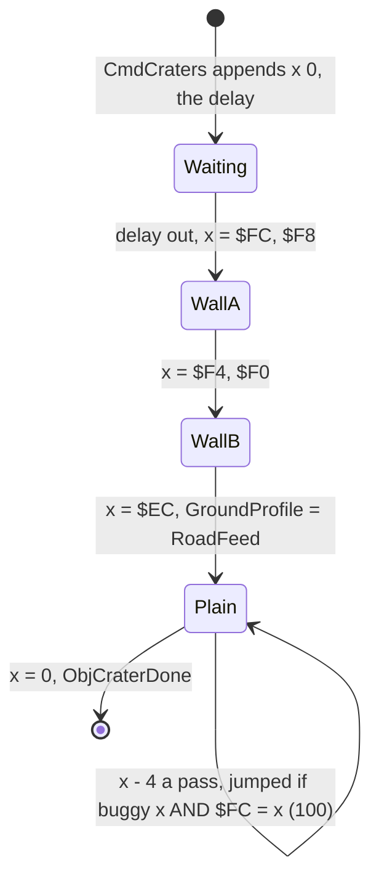

**A worked example: a crater coming in.** CmdCraters `$97E8` writes the record `92 9A`, the delay, `00`. When the
delay is out the passes run (ObjectListRun comes before ScrollRoad in the pass, 6.11):

| Pass | Crater x | GroundProfile after ObjCrater | ScrollRoad refills? | Bits entering line 162 |
| --- | --- | --- | --- | --- |
| 1 | `$FC` | WallA `$A9CF` | yes (counter 0): feed = WallA | `0111` (top half of `$7F`) |
| 2 | `$F8` | WallA | no | `1111` |
| 3 | `$F4` | WallB `$A9EF` | yes: feed = WallB | `1111` (top half of `$FE`) |
| 4 | `$F0` | WallB | no | `1110` |
| 5 | `$EC` | RoadFeed | yes: feed = plain | `0000` |

(Here the counter is at 0 on pass 1; with the other phase every refill comes a pass later, the same columns.) So
WallA and WallB enter back to back: a V 16 pixels wide on line 160, 14 on line 162, 2 on line 175, 16 lines deep, in
green ink on the yellow road, as in `i1-crater.png` (`i1` frame 450; the first crater record runs at frame 263).

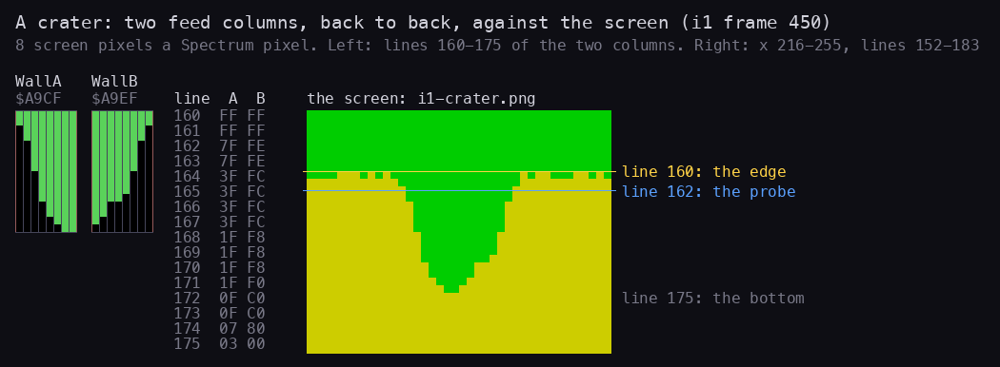

How to read the figure:

- **Left**: the two wall columns, lines 160-175, one square a pixel (8 screen pixels), green = a set bit; then their
  bytes line by line.
- **Right**: x 216-255, lines 152-183 of `i1-crater.png` (`i1` frame 450): green near band at the top, the road's
  yellow below, the V of the crater coming in from the right edge.
- **Yellow line**: line 160, the road's edge. **Blue line**: line 162, the line BuggyUpdate probes.
- **The point**: the screen's V is the two columns side by side, 16 pixels at the top, two at line 175; on line 162 it
  is 14 pixels of ink, the deadly width the probe looks for.

```bash
python3 tools/fig_rendering.py crater    # docs/img/rendering/crater.png
```

**The edge.** Line 160 starts as 32 bytes of the ROM: ScenerySetup copies `$2000-$201F` (`0D CD 79 1C CD C3 1F CD 07 23 ...`,
Z80 code of the 48K ROM) to `$5080`, the first pixel line of row 20. The bytes are any 256
pixels with no pattern, a cheap rough edge. Then each pass, after the roll, ScrollRoad ORs fresh random bits into the
four new pixels at the right end of line 160:

```asm
$A991  LD HL,PlayerFlags
$A994  BIT 3,(HL)
$A996  LD C,$0F               ; normally the 4 new pixels
$A998  JR Z,RoadTexture
$A99A  RES 3,(HL)             ; once after a ground cut: only 2
$A99C  LD C,$03
RoadTexture:
$A99E  LD A,(FRAMES)
$A9A1  LD B,A
$A9A2  LD A,R
$A9A4  XOR B
$A9A5  AND C
$A9A6  LD B,A
$A9A7  LD A,($509F)           ; line 160, byte 31
$A9AA  OR B
$A9AB  LD ($509F),A
$A9AE  RET
```

The feed's line 0 is `00` for the plain road and `FF` for the crater walls, so on the plain road the edge's ink comes
only from these random bits, about half of the four new pixels a pass: the broken line in every play screenshot.

**Cuts in the edge.** UnplotRun `$A7F4` walks E pixels to the right from (x, y) through UnplotPixel `$FD99`:

```asm
UnplotRun:
$A7F4  PUSH HL
$A7F5  CALL UnplotPixel       ; clears, despite the label
$A7F8  POP HL
$A7F9  INC H
$A7FA  DEC E
$A7FB  JR NZ,UnplotRun
$A7FD  RET
```

| Caller | Cut on line 160 | Then |
| --- | --- | --- |
| a mine, first pass `$9AEB` | x `$F6`, 10 pixels | `$B288` bit 3 set: the next texture only 2 pixels |
| the spinner's bomb landing `$9CE0` | 16 pixels at the bomb's x | the crater sprite `$10` drawn below |
| the green plant, first pass `$A2C6` | x `$E4`, 28 pixels | `$B288` bit 3 set |
| the score advance page `$8118` (`$8133`, `$813B`, `$8143`) | x `$22` 20, x `$3F` 10, x `$DE` 28 | the page's sprites |

The cut makes room: a mine or a plant stands in the edge without the green line running through it. The cut then
scrolls away with the road. Witness: UnplotRun `a1` 60 entries, `i1` 33, `i2` 63; the mines with their gaps are in
`i2-mines.png`.

**The crater probe.** BuggyUpdate tests five pixels of line 162, at x + 5, x + 10, ..., x + 25 under the buggy
(`$AA79-$AA98`, the worked example of 6.2). Line 162 is two lines below the edge, out of reach of the random bits and
of the edge's ROM bytes; there it is set only inside a crater wall (`7F` / `FE`) or under the bomb crater sprite. One
set pixel is a fall: BuggyKill `$A7DD` and the crater flag `$B220` ([doc 10](10-gameplay-logic.md)). The wall bytes
leave one pixel at each side of the V clear on line 162 (`7F`, `FE`): the deadly width is 14 pixels, and with probes
5 pixels apart a crater wholly under the buggy meets two or three of them.

**The point**: the road is the cheapest part of the picture: one 32-byte column that never changes, random bits on a
single line, and a crater that is two columns fed in at the right moment. The same pixels are the collision map: the
buggy dies by reading the screen.

## 6.8 The scenery at a life start

**What happens.** Every life (and every sector after a bonus screen, which ends in a life start) begins with a clean
backdrop. LifeStart `$90D3` calls SceneryColours `$95B0` (the attributes of rows 3-23, 6.1) and then ScenerySetup
`$9541`, which picks the middle strip by the scenery flag PlayerScenery `$B27D`, resets the three scroll pointers and
draws the two scenery bands whole:

| What ScenerySetup sets | Mountains (`$B27D` = 0) | City (`$B27D` = `$FF`) |
| --- | --- | --- |
| MiddleStart `$B22C` | `$E340` MountainsStrip | `$E780` MoonBaseStrip |
| MiddleEnd `$B22E` | `$E780` | `$EBC0` |
| MiddleColumn `$B22A` | `$E720` (column 31) | `$EB60` (column 31) |
| FarColumn `$B226` | `$EFA0` (column 31 of HillsStrip) | the same |
| FarCountdown / MiddleCountdown | 0 / 0 | 0 / 0 |

The flag comes from the sector-end record the bonus screen reads (SectorBonus `$A4EE`, `$A500`, [doc 10](10-gameplay-logic.md)):
`$FF` in the record at `$B87C` makes the sectors after E a city. The road's pointer GroundProfile is set by LifeStart
itself, to the plain RoadFeed.

```asm
ScenerySetup:
$9541  LD BC,MountainsStrip
$9544  LD DE,MoonBaseStrip
$9547  LD HL,MountainsStrip+$03E0
$954A  LD A,(PlayerScenery)
$954D  AND A
$954E  JR Z,SceneryStore
$9550  LD BC,MoonBaseStrip
$9553  LD DE,HillsStrip
$9556  LD HL,MoonBaseStrip+$03E0
SceneryStore:
$9559  LD (MiddleStart),BC
$955D  LD (MiddleEnd),DE
$9561  LD (MiddleColumn),HL
$9564  XOR A
$9565  LD (MiddleCountdown),A
$9568  LD (FarCountdown),A
$956B  LD HL,HillsStrip+$03E0
$956E  LD (FarColumn),HL
$9571  LD DE,HillsStrip
$9574  LD HL,$4800            ; rows 8-11
$9577  CALL SceneryDrawRows
$957A  LD DE,(MiddleStart)
$957E  LD HL,$4880            ; rows 12-15
$9581  CALL SceneryDrawRows
$9584  LD BC,$0020
$9587  LD DE,$5080            ; line 160
$958A  LD HL,$2000            ; 32 bytes of the ROM: the road's rough edge (6.7)
$958D  LDIR
$958F  RET
```

**SceneryDrawRows `$9590`: a column-major copy.** The strips store each 8-pixel column as 32 bytes, top line first
(6.6). The copy walks the screen the same way: down 8 lines of a cell with `INC H`, to the next cell down with
`ADD HL,$F820` (back 8 lines, `$20` on: the next character row), and after 4 cells to the next column with
`ADD HL,-$7F`.

```asm
SceneryDrawRows:              ; DE = the strip, HL = the screen address of the band's top left cell
$9590  EXX
$9591  LD B,$20               ; 32 columns
SceneryColumn:
$9593  EXX
$9594  LD C,$04               ; 4 cells down
SceneryCell:
$9596  LD B,$08               ; 8 lines
SceneryLine:
$9598  LD A,(DE)
$9599  LD (HL),A
$959A  INC DE
$959B  INC H                  ; the next pixel line of the cell
$959C  DJNZ SceneryLine
$959E  PUSH BC
$959F  LD BC,$F820
$95A2  ADD HL,BC              ; up 8 lines, down one row
$95A3  POP BC
$95A4  DEC C
$95A5  JR NZ,SceneryCell
$95A7  LD BC,-$007F
$95AA  ADD HL,BC              ; back 4 rows, one column right
$95AB  EXX
$95AC  DJNZ SceneryColumn
$95AE  EXX
$95AF  RET
```

```text
draw_rows(strip, top_left):
    for column in 0 .. 31:
        for cell in 0 .. 3:
            for line in 0 .. 7:
                screen[top_left + column + cell * $20 + line * $100] = strip[column * 32 + cell * 8 + line]
```

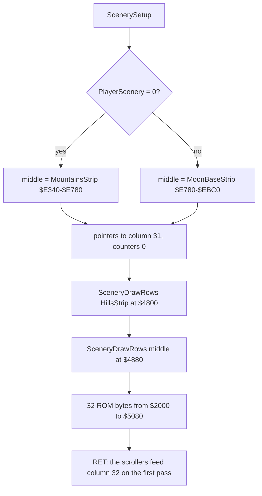

**A worked example: the first cell.** With HL = `$4800` and DE = `$EBC0`: the 8 bytes `01 01 01 01 01 01 01 03` go to
`$4800`, `$4900`, ..., `$4F00`, the 8 lines of row 8, column 0: a one-pixel vertical stroke on the right of the cell,
the left foot of the first crag. HL is then `$5000`; + `$F820` gives `$4820`, row 9, and the next 8 bytes
`03 03 03 03 03 03 03 07` go there. After four cells HL = `$5060` + `$F820` = `$4880`, and - `$7F` gives `$4801`: column
1 of row 8. The 32 columns read 1024 bytes, `$EBC0-$EFBF`, columns 0-31.

**Colours every pass.** SceneryColoursRepaint `$95F2` runs in each pass after ObjectListRun:

```asm
SceneryColoursRepaint:
$95F2  LD IX,(ColourScheme)
$95F6  LD HL,$5900            ; rows 8-11
$95F9  LD DE,$5901
$95FC  LD BC,$007F
$95FF  LD A,(IX+$01)
$9602  LD (HL),A
$9603  LDIR
$9605  LD HL,$5AC0            ; rows 22-23
$9608  LD DE,$5AC1
$960B  LD BC,$0040            ; 64 bytes moved, 65 cells: one past row 23, into $5B00
$960E  LD A,(IX+$04)
$9611  AND $F8                ; the paper of +4, ink black
$9613  LD (HL),A
$9614  LDIR
$9616  RET
```

Rows 8-11 get their colour back after any UFO that dipped into them (6.1). Rows 22-23 get the road's paper with black
ink. The black ink is for the **point letter**: CmdPoint `$9775` prints the coming point's
letter at the right edge of row 22 (TextPointAt `$97A7`, font 2) and inverts its cell (`$50DF`), and ScrollRoad then
carries it in from the right with the road, 4 pixels a pass, the black boxed letter of `i1-rock-point-a.png` and
`i2-boulders.png`. No road feed sets a pixel below line 175 (6.7), so the letter is the only ink in rows 22-23. The
second `LDIR` copies `$5AC0` to `$5AC1` 64 times and so writes one byte past the attributes, at `$5B00`: the first
byte of FeedFarBand. That byte is line 64's feed. The repaint runs after ScrollFarBand in the pass, so at every roll the
byte is the road colour (`$30` for the mountains, `$20` for the city), not the strip's, except on a refill pass, where
ScrollFarBand copies the column in and rolls at once. `$30` and `$20` have bit 7 clear, and the strip bytes of line
64 (byte 0 of each column) are all `$00` except columns 0 (`$01`) and 16 (`$03`), whose top bit is clear too. So line
64 is fed zeros only. The drawing at the life start puts the three pixels of columns 0 and 16 on line 64; once they
have scrolled off on the left (after at most 256 passes) they never come back. The effect is three pixels at the top
edge of the far band, on the top line of the far band. Known only from the code and the bytes: no screenshot of
this case was compared at that scale.

**The point**: the backdrop is drawn once a life, from the same strips the scrollers feed from, so the picture that
scrolls in on the right is always the one that was there before. Colours are the band's job, and the repaint is the
broom that sweeps up after the UFOs.

## 6.9 Shots and flying wheels

**The shots are pixels, not sprites.** The fire button makes two shots at once (FireShots `$ACF1`, [doc 10](10-gameplay-logic.md)): a
**forward shot**, a horizontal dash of 6 pixels that flies right, and an **upward shot**, a vertical dash of 4 pixels
that climbs. Neither has graphics: each is drawn pixel by pixel with FlipPixel `$FDB3`, the XOR twin of PlotPixel
(6.2), through the helper ShotPlot `$AE11`.

```asm
DrawShotForward:              ; H = x, L = y: 6 pixels at (x .. x+5, y+1)
$ADF7  LD A,$06
$ADF9  INC L
DrawShotForwardLoop:
$ADFA  EX AF,AF'
$ADFB  CALL ShotPlot          ; PUSH HL / CALL FlipPixel / POP HL
$ADFE  EX AF,AF'
$ADFF  INC H
$AE00  DEC A
$AE01  JR NZ,DrawShotForwardLoop
$AE03  RET
DrawShotUp:                   ; 4 pixels at (x+1, y .. y+3)
$AE04  LD A,$04
$AE06  INC H
DrawShotUpLoop:
$AE07  EX AF,AF'
$AE08  CALL ShotPlot
$AE0B  EX AF,AF'
$AE0C  INC L
$AE0D  DEC A
$AE0E  JR NZ,DrawShotUpLoop
$AE10  RET
FlipPixel:
$FDB3  LD B,$7D
$FDB5  LD C,H
$FDB6  SLA C
$FDB8  RL B                   ; BC = PixelTable $FA00 + 2x
$FDBA  LD H,$7E
$FDBC  SLA L
$FDBE  RL H                   ; HL = ScreenLineTable $FC00 + 2y
$FDC0  LD A,(HL)
$FDC1  INC HL
$FDC2  LD H,(HL)
$FDC3  LD L,A                 ; HL = the line's address
$FDC4  LD A,(BC)
$FDC5  ADD A,L
$FDC6  LD L,A                 ; + the byte column
$FDC7  INC BC
$FDC8  LD A,(BC)              ; the mask
$FDC9  XOR (HL)
$FDCA  LD (HL),A
$FDCB  RET
```

Six full FlipPixel calls cost about 6 x 130 T; a 2 x 4 sprite would have been cheaper, but the dash is drawn at any x
with no shifted copies, and DrawShotForward also sits in the sprite table as entry `$3B`, so DrawSprite can draw it
too.

**The boxes.** The shots live in the printer buffer at `$5B60`, copied from ShotBoxes `$9681` at each life start
(`FF 00 03 06 00`, then `FF 00 04 03` four times): the forward shot's y, x, height 3, width 6 and its end x; four
upward shots of y, x, height 4, width 3. y = `$FF` is a free slot. The object handlers test these boxes with BoxOverlap
([doc 7](07-objects.md)) and free a shot that hits by writing `$FF`.

**Moving.** ShotsMove `$AD61` runs once a pass. The forward shot follows the erase rule of 6.5:

```asm
ShotForwardMove:
$AD68  LD HL,ShotForward
$AD6B  LD A,(HL)
$AD6C  INC A
$AD6D  RET Z                  ; no shot
$AD6E  LD E,(HL)
$AD6F  INC HL
$AD70  LD D,(HL)
$AD71  EX DE,HL               ; H = x, L = y
$AD72  LD A,(DeadFlag)
$AD75  LD C,A
$AD76  LD A,(DeathStep)
$AD79  DEC A
$AD7A  OR C
$AD7B  CALL Z,ScrollAdjustX   ; first dying pass, not a crater: the band did not roll back
$AD7E  CALL DrawShotForward   ; erase
...                           ; hit ($FF in the height byte): free; else height 3
ShotForwardStep:
$AD8E  LD A,(HL)
$AD8F  ADD A,$06              ; x + 6
...                           ; at the end x: free
ShotForwardDraw:
$AD9E  LD (HL),A
...
$ADA3  INC L                  ; the band of the dash's own line, y + 1
$ADA4  CALL ScrollAdjustIfAlive
$ADA7  DEC L
$ADA8  CALL DrawShotForward   ; draw ahead by the band's step
$ADAB  RET
```

The line at `$AD7B` is the one exception to 6.5 in the code. When an object kills the buggy, it does so in
ObjectListRun, after ShotsMove drew the shot ahead by the band's step; the scrollers that come later in that pass see
DeathStep no longer `$FF` and stop. The dash is left 2 pixels to the right of its stored x. On the next pass (DeathStep
1) the erase adds the step too. A crater kills in BuggyUpdate, before ShotsMove, so the shot of that pass was drawn
without a step and needs no fix: hence the test of DeadFlag `$B220`, which only the crater sets. BuggyErase `$AAD3`
makes the same fix for the buggy (DeathStep 0). The upward shots (ShotUpMove `$ADBF`) do the same with height 4 and 4
pixels up a pass, and end above line `$18`.

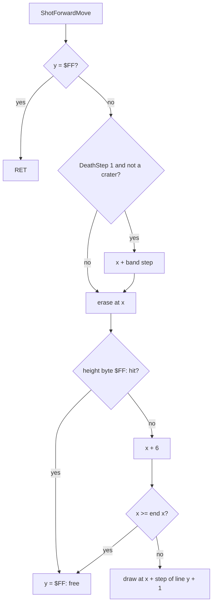

**A worked example: a shot from the start position.** The buggy stands at y `$92`, x `$38`. A new press of fire
(`$AD06`): the forward shot gets y `$93`, x `$38` + `$20` = `$58`, end x `$58` + `$60` = `$B8`, and is drawn at once:
6 pixels from x `$58` on line `$94` (148).

- ScreenLineTable `$FC00` + 2 x `$94` = `$FD28` holds `40 54`: line 148 starts at `$5440`.
- PixelTable `$FA00` + 2 x `$58` = `$FAB0` holds `0B 80`: byte column 11, mask `$80`. The next five x give `0B 40`,
  `0B 20`, `0B 10`, `0B 08`, `0B 04`.
- The six XORs set bits 7-2 of `$544B`: the byte becomes `$FC` on a clear background.
- Each pass after that the dash moves 6 pixels: x `$5E`, `$64`, ... the 16th move reaches `$B8` and frees the slot.
  The dash flies 96 pixels in 16 passes, about 134 frames or 2.7 seconds; one forward shot at a time.

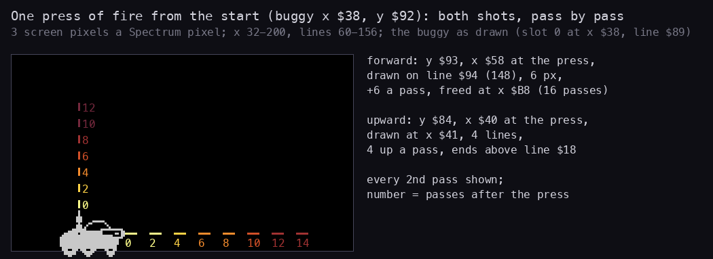

How to read the figure:

- **Black panel**: x 32-200, lines 60-156, 3 screen pixels a Spectrum pixel. The grey shape is the buggy as drawn at
  the start position (slot 0, x `$38`, line `$89`).
- **Horizontal dashes**: the forward shot every second pass after the press (the number), from x `$58` to the last
  place before x `$B8`; the colour fades with age.
- **Vertical dashes**: the upward shot, one a pass, 4 lines up each time.
- A model from the code's numbers (FireNewPress `$AD06`, ShotForwardMove `$AD68`, ShotUpMove `$ADBF`), drawn on a clear
  screen; the real shots fly over the scenery, as in `i1-rock-point-a.png`.
- **The point**: the forward dash covers 96 pixels in 16 passes, the reach of the gun; the upward dash rises 4 lines a
  pass, so a UFO 80 lines up is reached in about 20 passes, near 3.4 seconds.

The upward shot of the same press starts at y (`$92` - 12) AND `$FC` = `$84`, x `$38` + 8 = `$40` and is drawn at
x `$41`, lines `$84-$87`. A new upward shot needs every used upward shot above line `$6D` (`$AD2E`), so up to four
climb at once, spaced.

Witness: DrawShotForward entries `game` 936, `i1` 5642; DrawShotUp `game` 1913, `i1` 15 680; FlipPixel ran `i1`
97 928 times. The dash and the climbing shots are in `i1-rock-point-a.png` and `i2-boulders.png`.

```bash
python3 tools/fig_rendering.py shots     # docs/img/rendering/shots.png
```

**The wheels.** At a death the buggy's three wheels fly off. WheelsFly `$AB37` is called four times a pass while the
buggy dies (the four WheelsFly calls in the pass list, 6.11) and moves each wheel one step a call along WheelPaths
`$AC31`: 32 steps of 6 bytes, one (y up, x) pair a wheel. At step 0 the wheels start at y `$97` and x + 1, x + `$0A`,
x + `$16` (sprites `$3C`, `$3D`, `$3E`, DrawSprite16x9).

| Step | Left wheel (y up, x) | Middle | Right |
| --- | --- | --- | --- |
| 0 | `+11, -3` | `+12, 0` | `+11, +4` |
| 1 | `+10, -3` | `+11, 0` | `+10, +4` |
| 4 | `+5, -3` | `+7, 0` | `+5, +4` |
| 8 | `-1, -3` | `+2, 0` | `-1, +4` |
| 12 | `-7, -3` | `-3, 0` | `-7, +4` |
| 16 | `+7, -3` | `-8, 0` | `+7, +4` |
| 20 | `+3, -3` | `+9, 0` | `+3, +4` |

(From the bytes `0B FD 0C 00 0B 04 0A FD 0B 00 0A 04 ...`; the first byte of each pair is negated before it is added
to y.) Each wheel rises and falls, bounces once (the step back to `+7` at step 16, `+9` for the middle one at step 20)
and falls again; the left one drifts 3 pixels left a step, the right one 4 right, the middle one straight. A wheel
whose x carries out of 0-255 is dropped (its word set to 0). Each step is an erase (WheelErase `$AC20`, skipped at
step 0), a move and a draw, with no scroll step: the scrollers stand still while the buggy dies.

```text
wheels_fly():
    if buggy alive: return
    if step == 0: place three wheels at y $97, x + 1, + $0A, + $16; path = WheelPaths
    for each wheel w still on screen:
        if step > 0: draw(sprite w, pos w)          # erase
        dy, dx = next two path bytes
        pos w = (y - dy, x + dx); if x carried: drop w; continue
        draw(sprite w, pos w)
    step += 1
```

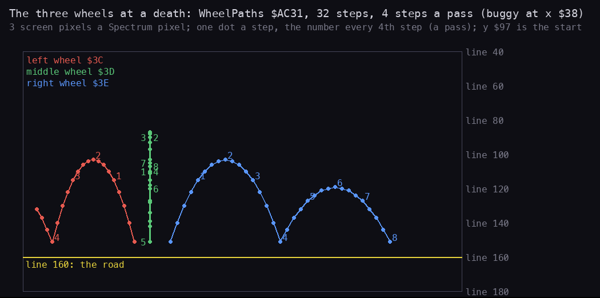

How to read the figure:

- **One dot a step** of WheelPaths, from the start at y `$97` (line 151) under a buggy at x `$38`; the number is the
  pass (every fourth step, since WheelsFly runs four times a pass). Red: the left wheel `$3C`, green: the middle `$3D`,
  blue: the right `$3E`.
- **Yellow line**: line 160, the road's top.
- A model from the bytes `$AC31-$ACF0`; the deaths of `game`, `a1` and `g1` run this path (WheelErase `a1` frames
  2010-2886).
- **The point**: the left and right wheels jump, land and bounce once each, the left one leaving the screen at the
  left edge; the middle wheel goes straight up and down. Eight passes, the length of the death.

```bash
python3 tools/fig_rendering.py wheels    # docs/img/rendering/wheels.png
```

Witness: the wheels fly in every recording with a death (`$AB5F` `game` 611, `a1` 67, `g1` 140); none in `i1` / `i2`,
where BuggyKill is a `RET`. WheelErase `a1` frames 2010-2886.

**The point**: the cheapest objects get the plainest code: a dash of XORed pixels for a shot, a 2 x 9 sprite on a
table of steps for a wheel. Both obey the same erase rule as everything else, and the one place the rule breaks, the
pass of the kill, is patched by hand in two lines.

## 6.10 BlitRows: the copies

**What it does.** Two pictures are not sprites: the title logo (TitleMoon `$6132`, TitlePatrol `$622C`) and the HUD
panel (HudPanel `$9481`). They are copied, not XORed, by BlitRows `$AFAB`: rows of BlitWidth bytes from HL to the
screen at BlitX, lines BlitTop to BlitBottom - 1. The four parameters are bytes at `$B247-$B24A`, set in pairs by
two `LD (nn),HL` before the call.

```asm
BlitRows:                     ; HL = the source; BlitTop $B247, BlitBottom $B248, BlitX $B249, BlitWidth $B24A
$AFAB  LD A,(BlitTop)
$AFAE  LD B,A                 ; B = the line
BlitRowsLoop:
$AFAF  PUSH BC
$AFB0  PUSH HL
$AFB1  LD L,B
$AFB2  LD B,$7D
$AFB4  LD A,(BlitX)
$AFB7  LD C,A
$AFB8  SLA C
$AFBA  RL B                   ; BC = PixelTable + 2 x BlitX
$AFBC  LD H,$7E
$AFBE  SLA L
$AFC0  RL H                   ; HL = ScreenLineTable + 2 x line
$AFC2  LD A,(HL)
$AFC3  INC HL
$AFC4  LD H,(HL)
$AFC5  LD L,A                 ; HL = the line's address
$AFC6  LD A,(BC)
$AFC7  OR L
$AFC8  LD L,A                 ; + the byte column of BlitX
$AFC9  POP DE
$AFCA  EX DE,HL               ; DE = the screen, HL = the source
$AFCB  LD B,$00
$AFCD  LD A,(BlitWidth)
$AFD0  LD C,A
$AFD1  LDIR                   ; one row
$AFD3  POP BC
$AFD4  INC B
$AFD5  LD A,(BlitBottom)
$AFD8  CP B
$AFD9  JP NZ,BlitRowsLoop
$AFDC  RET
```

BlitX is a pixel x, but only its byte column
counts: the copy is byte-aligned, with no shift.

```text
blit(source, top, bottom, x, width):
    for line in top .. bottom - 1:
        dest = ScreenLineTable[line] | PixelTable[x].column
        copy width bytes from source to dest; source += width
```

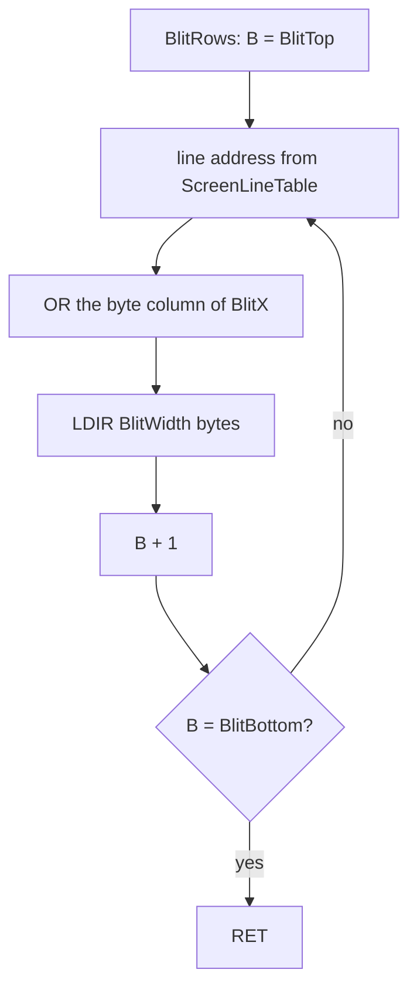

| Caller | Source | Lines | BlitX (byte) | Width |
| --- | --- | --- | --- | --- |
| TitlePage `$8018` | TitleMoon `$6132` | 24-48 | `$58` (11) | 10 |
| TitlePage `$8036` | TitlePatrol `$622C` | 55-79 | `$48` (9) | 14 |
| HudDraw `$9154` | HudPanel `$9481` | 0-23 | `$50` (10) | 8 |

**A worked example: the first row of "Moon".** TitlePage sets BlitTop/BlitBottom with `LD HL,$3118` (24, 49) and
BlitX/BlitWidth with `LD HL,$0A58` (`$58`, 10).

- Line 24: ScreenLineTable `$FC00` + 48 = `$FC30` holds `60 40`: `$4060`. PixelTable `$FA00` + 2 x `$58` = `$FAB0`
  holds `0B 80`: column 11. `$60` OR `$0B` = `$6B`: the row goes to `$406B-$4074`.
- The 10 bytes from `$6132`: `0F E0 1F E0 00 00 00 00 00 00`: the tops of the "M".
- 25 rows, 250 bytes; the next row (line 25) starts at `$416B`.

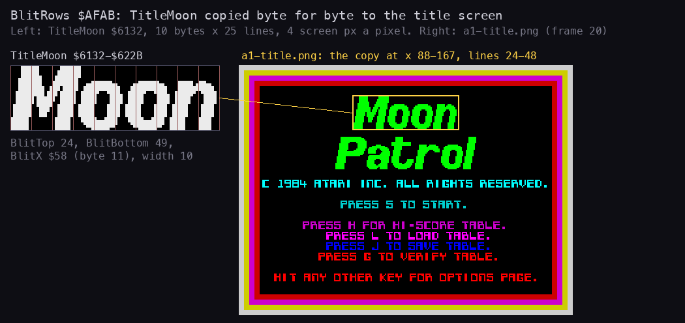

How to read the figure:

- **Left**: TitleMoon `$6132-$622B` as stored, 10 bytes x 25 lines, one square a pixel, red lines at the byte
  boundaries.
- **Right**: the screenshot `a1-title.png` (`a1` frame 20), the title page; the yellow frame is lines 24-48, x 88-167,
  where BlitRows puts the bytes (the colour is the title's attributes, not the copy's).
- **The point**: a byte-for-byte copy, with no mask and no shift: the logo is stored exactly as it appears, at a byte
  column, and the same routine serves the HUD panel of every life start.

```bash
python3 tools/fig_rendering.py blit      # docs/img/rendering/blit.png
```

Witness: BlitRows entries `game` 23, `a1` 8, `i1` 14 (`a1` frames 20-20424): twice a title page, once a life start.

**The point**: the one place the game writes the screen with plain copies is where nothing moves.

## 6.11 The pass against time

**No frame sync.** A pass of MainLoopCalls `$96FA` is the call list of 6.1's bands and the objects, in this order:

| # | Routine | Writes | Own T a call (doc 12) |
| --- | --- | --- | --- |
| 1-4 | TuneToggleCheck, BreakKeyTest, FireShots, HudPrintTime | flags, shots, the HUD clock | about 300 together |
| 5 | ScrollFarBand `$A846` | lines 64-95 | 36 996 |
| 6-9 | BuggyErase, BuggyUpdate, WheelsFly, ShotsMove | the buggy, wheels, shots | about 1100 together |
| 10 | ObjectListRun `$9745` | every object: erase, move, draw | 59 own, plus the handlers and drawers |
| 11 | SceneryColoursRepaint `$95F2` | attributes of rows 8-11, 22-23 | 5222 |
| 12 | WheelsFly | | |
| 13 | ScrollNearBand `$A8FD` | lines 128-159 (or the delay) | 66 598 |
| 14 | ScrollMiddleBand `$A89A` | lines 96-127 | 71 269 |
| 15 | WheelsFly | | |
| 16 | SpeedGovernor `$AF31` | nothing: a delay | 1 to `$05DC` loops of 26 T |
| 17 | ScrollRoad `$A932` | lines 160-191 | 118 924 |
| 18 | HoldCheck `$AECE` | | 81 |
| 19 | WheelsFly | | |
| 20 | SpeedGovernor | nothing: a delay | as 16 |

The pass never waits for the beam. It takes 6 to 8 frames in play (7.05 on average in `i1`, [doc 4](04-game-loop.md),
4.7), so each band is rolled once every 7 frames or so, at whatever point of the frame its turn comes; a frame interrupt lands
somewhere inside most routines. The picture is never torn in a way the eye catches because nothing moves more than 4
pixels between two rolls, and each band is rolled in one go, top line to bottom line, in about one frame or less.

**The speed comes from the pass length.** Every band moves a fixed number of pixels a pass. So the speed on the screen
in pixels a second is the step divided by the pass's time, and SpeedGovernor sets that time:

```asm
SpeedGovernor:
$AF31  LD A,(DeathStep)
$AF34  INC A
$AF35  LD BC,$0000
$AF38  JR Z,SpeedFromX
$AF3A  LD BC,$1800            ; dying: 6144 more loops
SpeedFromX:
$AF3D  LD A,(BuggyX)
$AF40  SUB $38
$AF42  JR Z,SpeedIndex        ; x = $38: index 1
$AF44  AND $80
$AF46  RLCA
$AF47  RLCA
$AF48  DEC A                  ; x > $38: 0 - 1 + 1 = 0; x < $38: 2 - 1 + 1 = 2
SpeedIndex:
$AF49  INC A
$AF4A  RLCA
$AF4B  RLCA                   ; 4 bytes an entry
...                           ; DE = the jump arc, HL = the loop count from JumpSpeeds $AF68
$AF5B  ADD HL,BC
$AF5E  LD (JumpArc),DE
SpeedDelay:
$AF62  DEC BC                 ; 6 T
$AF63  LD A,B                 ; 4 T
$AF64  OR C                   ; 4 T
$AF65  JR NZ,SpeedDelay       ; 12 T: 26 T a loop
$AF67  RET
```

| Buggy x | Loops a call (JumpSpeeds `$AF68`) | Two calls | Pass, against the centre | Road speed |
| --- | --- | --- | --- | --- |
| > `$38` (fast) | 1 | about 0 T | 39 000 T shorter, about 0.56 frame | about 8 % faster |
| = `$38` | `$02EE` = 750 | 39 000 T | - | - |
| < `$38` (slow) | `$05DC` = 1500 | 78 000 T | 39 000 T longer | about 7 % slower |
| dying | + `$1800` = 6144 | + 319 500 T | 4.6 frames more delay, 4.2 frames less scrolling | (nothing scrolls) |

(The percentages rest on `i1`'s measured pass, 7.05 frames, which is a forward pass: `i1` held the buggy forward in
7056 of its 7200 SpeedGovernor calls, JumpSpeeds `$AF68`. The centre pass is then 7.05 + 0.56 = 7.61 frames and the
back 8.17: 4 pixels in 7.05 frames against 7.61 is 8 % faster, in 8.17 against 7.61 7 % slower.) So
"faster" and "slower" are the same world drawn with less or more idle time per pass: the buggy's own 2-pixel step a
pass adds to the feeling. The same table hands BuggyUpdate the jump arc: forward the long flat arc, back the short
one ([doc 10](10-gameplay-logic.md)). While the buggy dies the scrollers return at once (6.6), which takes
293 787 T, about 4.2 frames, out of the pass; the extra `$1800` loops put 4.6 frames back. So a death pass lasts about
as long as a living one, and the eight death frames with their 32 wheel steps play at the game's usual pace instead
of racing by.

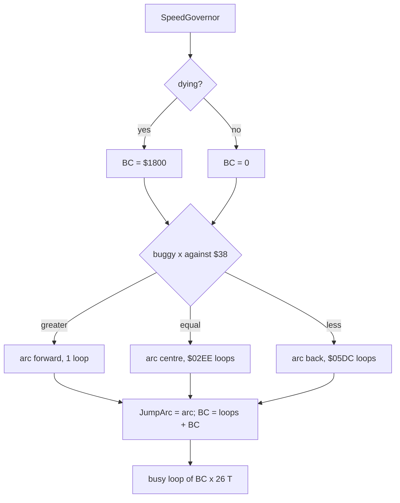

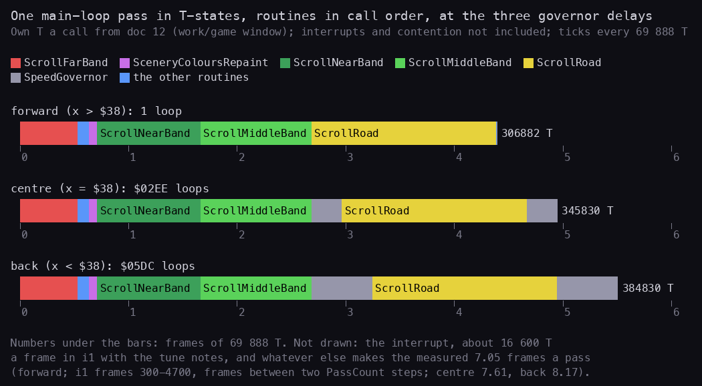

How to read the figure:

- **Three bars**, one per buggy position: the routines of a pass in call order, each as wide as its own T-states a
  call (doc 12, the `work/game` window); the grey blocks are the two SpeedGovernor delays.
- **Ticks**: frames of 69 888 T from the start of the pass.
- **Not drawn**: the frame interrupt (about 16 600 T a frame in `i1`, the tune's BEEPER notes included, about 2 frames
  a pass) and whatever else separates the bars' 4.4-5.5 frames from the measured 7.05 of a forward pass (not split here; the scrollers'
  writes to contended screen memory are a candidate, not measured).
- **The point**: four scrollers are three quarters of the drawn bar; the objects, the buggy and the shots are a sliver.
  The governor's grey blocks are the only part that changes with the buggy's place, and they change the pass by about
  half a frame.

```bash
python3 tools/fig_rendering.py pass      # docs/img/rendering/pass.png
```

**A worked example: the centre pass.** Buggy x `$38`: index 1, JumpSpeeds `$AF6C` holds `FD AA EE 02`: the arc
JumpArcCentre `$AAFD` and `$02EE` = 750 loops, 750 x 26 - 5 = 19 495 T a call. The four scrollers take 36 996 +
66 598 + 71 269 + 118 924 = 293 787 T, the two delays 38 990 T, the repaint 5222 T: 337 999 T, 4.84 frames, before
the objects and the interrupts.

Witness: SpeedGovernor entries `game` 3151, `i1` 7200 (two a pass); pass length `i1` from WALKTHROUGH 1; the delay
counts are the code's. The frame at which each band is rolled was not measured here (a beam timeline needs a trace of
a recording window, which this document does not have).

**The point**: the game's clock is its own code. Nothing waits for the frame; the pass is as long as its work plus a
delay, and the delay is the throttle.

## 6.12 Oddities

Facts from the code and the image that do not fit elsewhere, each with what checks it.

| What | Where | What it does | Checked by |
| --- | --- | --- | --- |
| Wreck piece 1 shows logo bytes | SpriteTable entry `$3C` = `$6350` | its 8 slots of 18 bytes start 58 bytes early, inside TitlePatrol: slots 0-2 and lines 0-1 of slot 3 are the logo's last bytes | the image; deaths in `game`, `a1`, `g1` draw sprite `$3C` |
| Explosion frame 1, slot 0 is not an explosion | `$6500-$6572` | lines 0-11 and 20-22 hold scattered 2-pixel stripes, lines 12-19 blank; a buggy dying at x AND 6 = 0 shows them for one pass | the image; read in `game`, `a1`, `g1`, `p2`, `h1`, `h2` (`.ann`); how it looks on screen was not captured |
| SceneryColoursRepaint writes one byte too many | `$960B`: `LD BC,$0040` | 65 cells from `$5AC0`, the last at `$5B00`: line 64's feed byte (6.8) | the code |
| Ten sprite numbers have no drawer | SpriteTable `$15-$1C`, `$3F`, `$7F` | drawer word `$0000`: drawing one would jump to `$0000` | `$7F` is only the small boulder's start value, never drawn (doc 7) |
| Four sprite numbers have no user | `$5C-$5F` | DrawSprite24x12 and Debris `$7900`; the medium boulder's count stops at `$5B` | the `.ann` (`$7900` notes) |
| UnplotRun clears | `$A7F4` calls UnplotPixel | 6.7 | the code |

**Wreck piece 1 in detail.** The sprite table gives sprite `$3C` the address `$6350`; DrawSprite16x9 adds (x AND 7) x
18. The piece's own bytes start at `$638A` (BuggyWreck1), 58 bytes later: 3 slots and 4 bytes. The left wheel starts
at the buggy's x + 1 (odd, the buggy's x is even) and moves 3 pixels left a step, so its x AND 7 runs through all
eight values: about half the steps draw from slots 0-3, whose 18 bytes are the end of the word "Patrol" of the title.

```text
draw wheel 1 at x:
    slot = x AND 7
    source = $6350 + 18 * slot      # slots 0..2 and the first 4 bytes of 3: TitlePatrol $6350-$6389
```

Worked example: a death with the buggy at x `$38`. The left wheel starts at x `$39`, but WheelsFly adds the step's
dx (-3, WheelPaths `$AC31`) before it draws (`$AB82-$AB8E`), so `$39` is never drawn. Step 0: x `$36`, AND 7 = 6,
`$63BC`: a wheel. Step 1: `$33`, 3: `$6386`, two lines of logo then the wheel. Step 2: `$30`, 0: `$6350`, logo.
Step 3: `$2D`, 5: `$63AA`, a wheel.

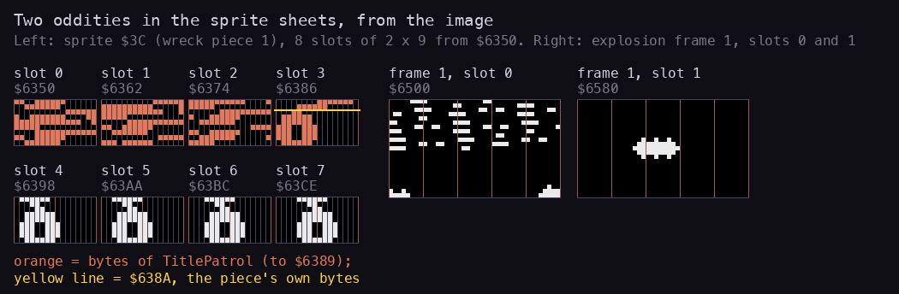

How to read the figure:

- **Left**: the eight slots of sprite `$3C` from `$6350`, 2 bytes x 9 lines each, 6 screen pixels a pixel. Orange
  slots are drawn from bytes below `$638A`; the yellow line in slot 3 is `$638A`, where the piece's own bytes begin
  (slot 3's lines 2-8 are the piece, coloured with its slot). Slots 4-7 are the wheel with its hub, a pixel further
  right each time.
- **Right**: explosion frame 1, slot 0 (`$6500`) and slot 1 (`$6580`), 5 bytes x 23 lines.
- From the image; no recording captures a frame of either on screen.
- **The point**: two sheets are wrong in the same way, a pointer or a slot that starts in the wrong place. Both show
  for a moment, during a death, when the screen is busy with the wreck.

```bash
python3 tools/fig_rendering.py odd       # docs/img/rendering/odd.png
```

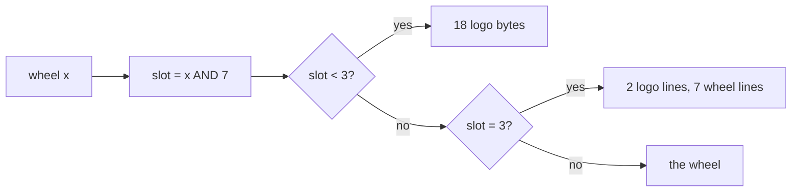

Witness: deaths with WheelsFly's work: `game` 611 steps, `a1` 67, `g1` 140; none in `i1` / `i2` (BuggyKill is a
`RET`). Known only from the code and the image: how the logo bytes look on the screen.

**The point**: the bugs of the drawing are in the data, not the code: the drawers do exactly what the table and the
sheets tell them.
