# 7. Objects

What this covers:

- the object list: one interpreter for the course script and the objects, the records it holds and how they end
  (7.1, 7.2);
- the rock as the pattern every ground handler follows: wait, erase, move, test, score, draw (7.3);
- the collision test BoxOverlap, the order of the tests and the jump score (7.4);
- the crater and the mine, which have no contact test (7.5);
- the UFOs and their bombs (7.6);
- the Champion objects: tank and shell, low flyer, boulders, green plant (7.7);
- the random numbers (7.8);
- every score site and what no recording reached (7.9).

The names are those of `src/game/game.ann` ([Terms](README.md#terms)). The recordings it rests on (all on the 48K;
WALKTHROUGH 6.0 lists how each was made):

- `game`: the L1 build of `c1` (power-on, the tape load, then 16 000 frames of seeded random play), frames
  256-16 760. Its 19 counted deaths are 1 rock and 18 craters.
- `i1` and `i2`: the immune clones (the kill `$A7DD` patched to `RET`) that drive the whole Beginner (`i1`) and the
  whole Champion (`i2`) course. Every object kind ran there. Because the kill is a `RET`, an object that touches the
  buggy goes on into its explosion and its score: the counts below separate touches from shots.
- `a1`, `g1`, `p2`, `h1`, `h2`, `t1`: short runs from the entry snapshot (the first rocks and craters, the deaths).
- The image `work/mkgame/original.bin` for the script, the record templates and the sprites.

A count "i1 17" means that instruction started 17 times in `i1` (`python3 tools/l1sum.py ADDR`).

## 7.1 The object list and its interpreter

- **One interpreter, two lists.** CourseRun `$9751` reads a word, pushes its own address as the return and jumps to
  the word. It runs the course script at `$B7E8` (Beginner) and the object list at `$BEF8` alike.
- **A record is a handler word and its fields.** The handler gets HL at the record's third byte. It must return with
  HL at the next record; its `RET` then lands in CourseRun again, which reads the next word.
- **The end is a handler too.** ListStop `$975E` pops CourseRun's return address and returns to the caller of the
  list. So a list is code: its last word stops it.
- **The script fills the object list.** A script segment starts with SegmentLength `$976C` (the passes until the
  next segment), holds spawn commands, and ends with SegmentEnd `$9760`. Each spawn command appends records at the
  write pointer `$B261`. SegmentEnd writes the word `$975E` after the last record and does not advance the pointer,
  so the next segment's records overwrite the end word.
- **Every record starts with a delay.** Byte +2 is a pass count. The handler counts it down and only steps HL while
  it is not zero. This is how the records of one segment come onto the screen one after another.
- **Done records stay.** A finished object writes the address of its own "skip" code into its handler word. The skip
  code only adds the record size to HL. The list is restarted at `$BEF8` at every MainLoop entry (life start, after a
  bonus screen, the course switch).

```text
CourseRun(HL):                         ; $9751
    IX = word at HL ; HL += 2
    push CourseRun                     ; the handler's RET comes back here
    jump IX                            ; the handler sees HL = record + 2

ListStop:                              ; $975E, the end word
    pop                                ; drop CourseRun's return
    return                             ; back to whoever called CourseRun

SegmentEnd:                            ; $9760, the last command of a segment
    word at ($B261) = ListStop         ; the end mark, pointer not moved
    goto ListStop
```

```asm
CourseRun:
$9751  LD C,(HL)
$9752  INC HL
$9753  LD B,(HL)
$9754  INC HL
$9755  PUSH BC
$9756  POP IX
$9758  LD BC,CourseRun
$975B  PUSH BC
$975C  JP (IX)
ListStop:
$975E  POP BC
$975F  RET
```

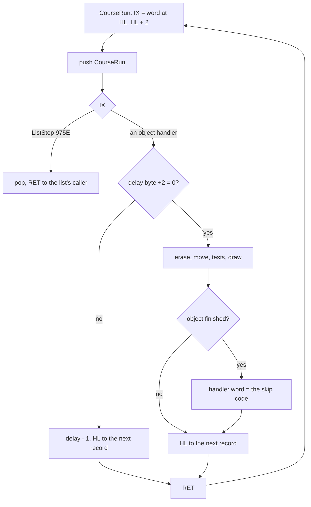

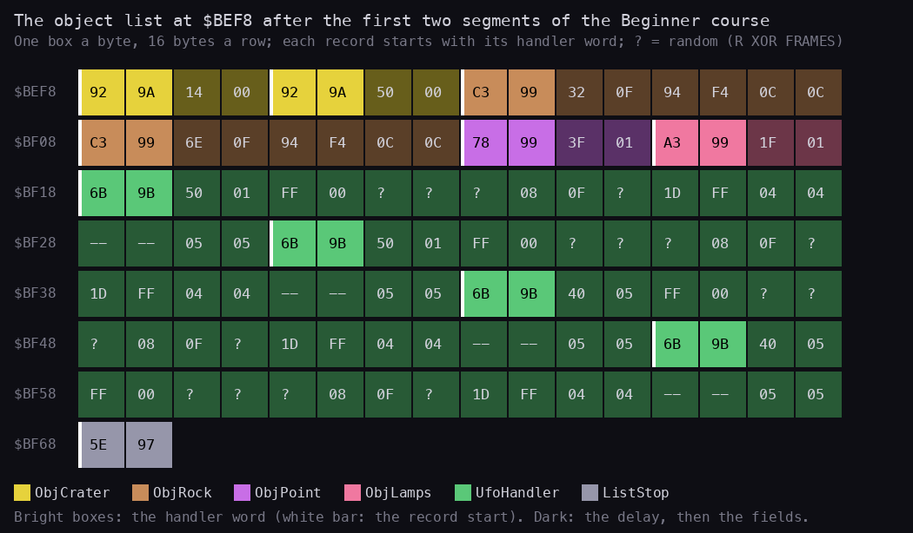

How to read the figure:

- One box a byte, 16 bytes a row, the address of each row on the left.
- A white bar marks a record's first byte. The two bright boxes are the handler word, little-endian (`92 9A` is
  `$9A92`, ObjCrater). The dark boxes are the delay and then the fields.
- `?` is a field the spawner fills from the random number (7.8). `--` is a field the spawner does not write (the
  bomb's y and x, written when the bomb drops).
- The colours are the kinds of the legend; the grey record at `$BF68` is the end word `$975E`.
- Built by running the spawners' rules on the script bytes of the image; no recording.

**The point**: the list is a flat run of variable-size records, each of which knows its own size. Nothing indexes
it: the only way through is to run it.

```bash
python3 tools/fig_objects.py list      # docs/img/objects/list.png
```

### Worked example: the first two Beginner segments

The script at `$B7E8`, from the image:

```text
$B7E8  6C 97 7F 00                SegmentLength $976C: 127 passes
$B7EC  E8 97 14 50 FF             CmdCraters $97E8: delays $14, $50
$B7F1  C5 97 32 6E FF             CmdRocks $97C5: delays $32, $6E
$B7F6  60 97                      SegmentEnd $9760
$B7F8  6C 97 7F 00                SegmentLength: 127 passes
$B7FC  75 97 3F 01                CmdPoint $9775: delay $3F, point byte 1 (A)
$B800  AD 97 1F 01 FF             CmdLamps $97AD: delay $1F, lamp value 1
$B805  21 98 50 50 FF             CmdUfos1 $9821: two saucers A, delays $50
$B80A  27 98 40 40 FF             CmdUfos5 $9827: two saucers B, delays $40
$B80F  60 97                      SegmentEnd
```

1. CmdCraters writes `92 9A 14 00` at `$BEF8` and `92 9A 50 00` at `$BEFC`: handler `$9A92`, delay, x 0.
2. CmdRocks writes `C3 99 32 0F 94 F4 0C 0C` at `$BF00` and the same with delay `$6E` at `$BF08`: handler `$99C3`,
   delay, sprite `$0F`, y `$94`, x `$F4`, height and width 12.
3. SegmentEnd writes `5E 97` at `$BF10`; `$B261` stays `$BF10`.
4. The second segment's CmdPoint overwrites `$BF10` with `78 99 3F 01`, CmdLamps adds `A3 99 1F 01` at `$BF14`, and
   the four UFO records of 20 bytes fill `$BF18-$BF67`. The new end word lands at `$BF68`.
5. In the first pass of the list the first crater sees delay `$14` and writes `$13`; it reaches 0 after 20 passes
   (about 141 frames at forward speed). The first rock waits 50 passes.

Witness: CourseRun runs `game` 8038, `i1` 89 827, `i2` 123 263 times; ListStop `game` 1598, `i1` 3631, `i2` 3968
(once a list pass, plus SegmentEnd's jump). The first crater and rock records start at `i1` frame 263; the crater is
on screen at `i1` 450 (`docs/img/play/i1-crater.png`), the rock at `i1` 1200 (`i1-rock-point-a.png`).

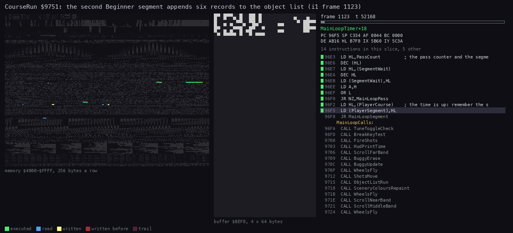

Step 4 in a recording: `i1` frame 1123, T 52 000-60 400, the pass in which SegmentWait runs out. The right panel is
the object list from `$BEF8`, 4 bytes a row (one bit a pixel, so a crater record is one row, a rock two, a UFO five):
CmdPoint writes row 7 (rows counted from 1; over the old end word) and inverts the point letter it prints at the
bottom right, CmdLamps row 8, the two UFO commands rows 9-28, and SegmentEnd the end word `5E 97` in row 29
(`$BF68`, DE in the last picture).

```bash
python3 ../../kit/routine_anim.py --work work/anim/i1 --window 1123:52000-1123:60400 --listing build/game.lst \
    --out docs/img/routines/CourseRun.gif --pc 9696-9977 --view buffer:BEF8:4x64 --range 4000-FFFF \
    --pictures 50 --delay 150 --title "CourseRun \$9751: the second Beginner segment appends six records to the object list (i1 frame 1123)"
```

## 7.2 The record data sheet

Offsets from the record start. +0/+1 is always the handler word and +2 the delay. "Box" is the four bytes y, x,
height, width that BoxOverlap compares (7.4). Sprite numbers index the sprite table `$B2D6`
([doc 6.3](06-rendering.md#63-the-sprite-table-and-drawsprite)).

| Kind | Spawner | Handler | Size | Fields after the delay | Skip code (+ size) |
| --- | --- | --- | ---: | --- | --- |
| crater | CmdCraters `$97E8` | ObjCrater `$9A92` | 4 | +3 x (0 at spawn) | `$9ADC` (+2) |
| rock | CmdRocks `$97C5` | ObjRock `$99C3` | 8 | +3 sprite `$0F`; box +4 y `$94`, +5 x `$F4`, +6 h `$0C`, +7 w `$0C` | `$9A81` (+6) |
| mine | CmdMines `$97FF` | ObjMine `$9AEB` | 6 | +3 bit 7 blink phase, bits 0-6 sprite `$11` / `$12`; +4 y `$A0`; +5 x `$F8` | `$9B5A` (+4) |
| point | CmdPoint `$9775` | ObjPoint `$9978` | 4 | +3 point byte (bits 0-4 the point, bit 5 Champion) | `$99A0` (+2) |
| lamps | CmdLamps `$97AD` | ObjLamps `$99A3` | 4 | +3 lamp value 0-3 | `$99C0` (+2) |
| UFO | CmdUfos1 / CmdUfos5 / CmdUfos11 `$9821` / `$9827` / `$982D` | UfoHandler `$9B6B` | 20 | +3 sprite (1, 5, `$0B`); +4 turn timer (`$FF` not on screen); +5 dy; +6 dx; box +7 y (random `$18-$37`), +8 x (0 or `$F0`), +9 h (8 or 16), +10 w `$0F`; +11 bomb wait (random `$10-$2F`); +12 bomb sprite `$1D`; +13 bomb timer (`$FF` not dropped); +14 dy, +15 dx (4, 4); box +16 y, +17 x, +18 h 5, +19 w 5 | UfoRecordSkip |
| UFO retreat | CmdUfosLeave `$98AA` | UfoRetreatTimer `$9EA5` | 3 | none | `$9EBB` (+1) |
| tank | CmdTanks `$98BE` | TankHandler `$9EBD` | 14 | +3 sprite `$13`; box +4 y `$8F`, +5 x `$E7`, +6 h `$11`, +7 w `$14`; shell: +8 wait 8, +9 sprite 0 then `$3B`, box +10 y `$93`, +11 x `$C1`, +12 h 3, +13 w 7 | TankRecordSkip |
| low flyer | CmdFlyers `$98F3` | LowFlyerHandler `$A03B` | 9 | +3 sprite `$14`; +4 pause count; box +5 y `$91`, +6 x 0, +7 h 8, +8 w `$0C` | LowFlyerRecordSkip |
| boulder | `$9917` / `$991C` / `$9921` | BoulderHandler `$A196` | 8 | +3 sprite `$40` / `$44` / `$4C`; box +4 y `$A0` - s, +5 x 256 - s, +6 h s, +7 w s (s = 8, 12, 16) | BoulderGone |
| green plant | CmdPlants `$9955` | PlantHandler `$A2C6` | 8 | +3 frame (0, then 1-15); +4 y `$90`; +5 x `$E4`; +6 / +7 hit box h, w (from PlantHitBoxes each pass) | PlantGone |

The other boxes: the buggy's at `$B212` (y `$92` on the ground, x `$28-$50`, h `$0D`, w `$1D`), the forward shot's
at `$5B60` and the four upward shots' at `$5B65 + 4n` ([doc 6.9](06-rendering.md#69-shots-and-flying-wheels)). A hit
writes `$FF` into the shot's byte +2, which ends the shot.

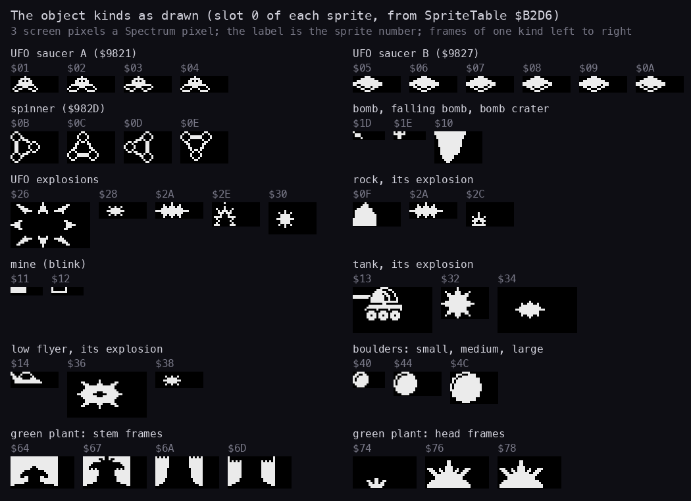

How to read the figure:

- Each group is one kind, labelled with its spawner where the kind has several. Each picture is the first
  pre-shifted slot of one sprite, 3 screen pixels a Spectrum pixel; the label above it is the sprite number.
- The frames of an animation run left to right: the saucers' 4 and 6 frames, the spinner's 4, the boulders' three
  sizes, the plant's stem and head frames (a selection).
- The black frame is the sprite's whole slot (bytes x lines); the drawer XORs all of it, so the black is no paint.
- Drawn from the sprite table of the image; no recording.

**The point**: every object is a sprite of the one sprite table; a kind is a handler plus a run of sprite numbers,
and an explosion is just the next run of numbers in the same record.

```bash
python3 tools/fig_objects.py kinds     # docs/img/objects/kinds.png
```

## 7.3 The rock: the pattern of every ground handler

ObjRock `$99C3` is the smallest complete handler. The tank, the boulders, the low flyer and the plant repeat its
steps with their own fields.

1. **Wait.** While the delay is not 0: delay - 1, step to the next record.
2. **Erase.** Draw the sprite at the stored (x, y) again. DrawSprite XORs, so this removes it. The first pass skips
   this: x is still the spawn value `$F4`, which marks "not drawn yet".
3. **Move.** While the buggy lives (DeathStep `$B216` = `$FF`), x - GroundSpeed `$B235` (4). At x 0 the record is
   finished: the handler word becomes ObjRockDone.
4. **Test the buggy.** BoxOverlap of the rock's box with the buggy's box. Overlap: BuggyKill, then the hit path.
5. **Test the forward shot.** Overlap with `$5B60`: the shot is spent (`$FF` at `$5B62`), then the hit path.
6. **Hit path.** Sprite `$2A`, handler ObjRockExplode `$9A51`, 100 points, RockSeen `$B26F` cleared.
7. **Jump score.** No overlap: if buggy x AND `$FC` equals the rock's x, 80 points.
8. **Draw** at x + the band's step (ScrollAdjustIfAlive `$AF74`): the road is scrolled later in the same pass, so the
   rock is drawn where the road will be ([doc 6.5](06-rendering.md#65-erasing-on-a-scrolling-screen)).

The explosion handler steps the sprite from `$2A` and finishes when it reaches `$2F`: `$2A` is never drawn (`$9A57`
skips the erase on the first pass), so four frames `$2B-$2E` are drawn over five passes, one a pass,
moving with the road.

```text
ObjRock(rec):                                        ; $99C3
    if rec.delay: rec.delay -= 1; return next
    if rec.x != $F4: DrawSprite(rec.sprite, rec.x, rec.y)       ; erase
    if alive: rec.x -= 4; if rec.x == 0: rec.handler = ObjRockDone; return next
    if overlap(rec.box, buggy): BuggyKill(); goto hit
    if overlap(rec.box, shot):  shot.state = $FF; goto hit
    if buggy.x & $FC == rec.x: score += 80
    DrawSprite(rec.sprite, rec.x + step, rec.y); return next
hit:
    rec.sprite = $2A; rec.handler = ObjRockExplode; score += 100; return next
```

```asm
ObjRockMove:
$99DE  LD A,(DeathStep)        ; $FF + 1 = 0: alive
$99E1  INC A
$99E2  JR NZ,ObjRockTest
$99E4  LD A,(GroundSpeed)
$99E7  NEG
$99E9  ADD A,(HL)              ; x - 4
$99EA  LD (HL),A
$99EB  JP Z,ObjRockRemove
ObjRockTest:
$99EE  DEC HL                  ; HL = the box (y)
$99EF  EXX
$99F0  LD HL,BuggyY            ; HL' = the buggy's box $B212
$99F3  EXX
$99F4  CALL BoxOverlap
$99F7  JR C,ObjRockShotTest
$99F9  CALL BuggyKill
$99FC  JR ObjRockHit
...
ObjRockMiss:
$9A2D  DEC HL
$9A2E  DEC HL                  ; HL = x
$9A2F  LD A,(BuggyX)           ; jumped over: 80 points
$9A32  AND $FC
$9A34  CP (HL)
$9A35  JR NZ,ObjRockDraw
$9A37  LD DE,$0000
$9A3A  LD BC,$0080
$9A3D  PUSH HL
$9A3E  CALL ScoreAdd
$9A41  POP HL
```

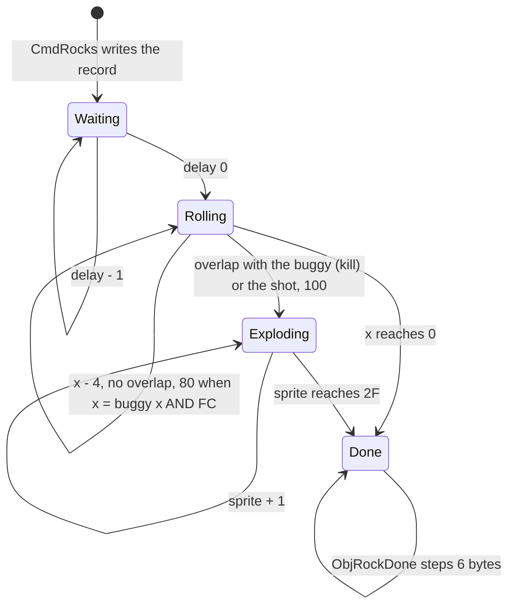

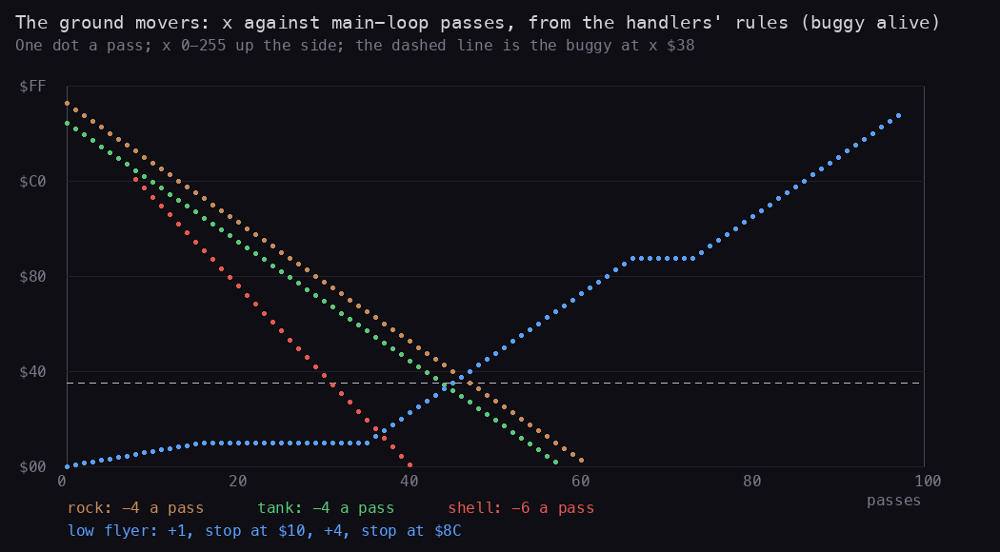

How to read the figure:

- x across the screen up the side (0 at the left), one dot a main-loop pass along the bottom, the buggy alive.
- The dashed line is x `$38`, the buggy's middle position. Where a line crosses it, the object is under the buggy.
- The rock (orange) and the tank (green) move with the road, 4 a pass; the shell (red) 6 a pass, 2 faster than the
  road; the low flyer (blue) comes from the left edge, creeps 1 a pass to `$10`, waits, runs at 4 a pass, waits at
  `$8C`, then leaves on the right. Its two waits are random (16-23 and 4-11 passes); 20 and 8 are drawn.
- A model of the handlers' rules, no recording; one pass is about 7 frames (7.05 in `i1`, doc 4, 4.7), so 60 passes are about 8.5 s.

**The point**: everything on the ground is fixed to the road and comes at the buggy at the road's speed; only the
shell is faster and only the low flyer moves on its own, from behind.

```bash
python3 tools/fig_objects.py movers    # docs/img/objects/movers.png
```

Witness (`l1sum`): ObjRock runs `game` 3060, `i1` 3080, `i2` 4289. Contact `$99F9`: `game` 1, `g1` 4, `i1` 17. Shot
`$9A0B`: `game` 1, `i2` 1. Jumped `$9A37`: `game` 1, `g1` 2, `i1` 10, `i2` 11.

A side effect of the order: a rock that hits the buggy also explodes and scores 100 (step 6 follows the kill). With
the kill's 25 the player gets 125 points for dying on a rock. Known only from the code: in `game` the rock death at
`$99F9` is the one contact, and its score jump was not checked in a timeline.

## 7.4 Collision: BoxOverlap and the jump score

BoxOverlap `$A7FE` takes two boxes, HL and HL'. It returns with carry as soon as one box ends before the other
starts on one axis. No carry means overlap. Touching counts as overlap: the test is "<", not "<=".

```text
BoxOverlap(a = (y, x, h, w) at HL, b = (y', x', h', w') at HL'):   ; $A7FE
    if a.y + a.h < b.y: return carry          ; a above b
    if b.y + b.h < a.y: return carry          ; b above a
    if a.x + a.w < b.x: return carry          ; a left of b
    if b.x + b.w < a.x: return carry          ; b left of a
    return no carry                           ; overlap
```

```asm
BoxOverlap:
$A7FE  LD B,(HL)               ; B, C, D, E = y, x, h, w of the object
$A7FF  INC HL
$A800  LD C,(HL)
$A801  INC HL
$A802  LD D,(HL)
$A803  INC HL
$A804  LD E,(HL)
$A805  EXX
$A806  LD B,(HL)               ; B', C', D', E' = the buggy or a shot
$A807  INC HL
$A808  LD C,(HL)
$A809  INC HL
$A80A  LD D,(HL)
$A80B  INC HL
$A80C  LD E,(HL)
$A80D  EXX
$A80E  LD A,B
$A80F  ADD A,D                 ; y + h
$A810  EXX
$A811  SUB B                   ; - y'
$A812  EXX
$A813  RET C
$A814  EXX
$A815  LD A,B
$A816  ADD A,D                 ; y' + h'
$A817  EXX
$A818  SUB B                   ; - y
$A819  RET C
$A81A  LD A,C
$A81B  ADD A,E                 ; x + w
$A81C  EXX
$A81D  SUB C                   ; - x'
$A81E  EXX
$A81F  RET C
$A820  EXX
$A821  LD A,C
$A822  ADD A,E                 ; x' + w'
$A823  EXX
$A824  SUB C                   ; - x
$A825  RET
```

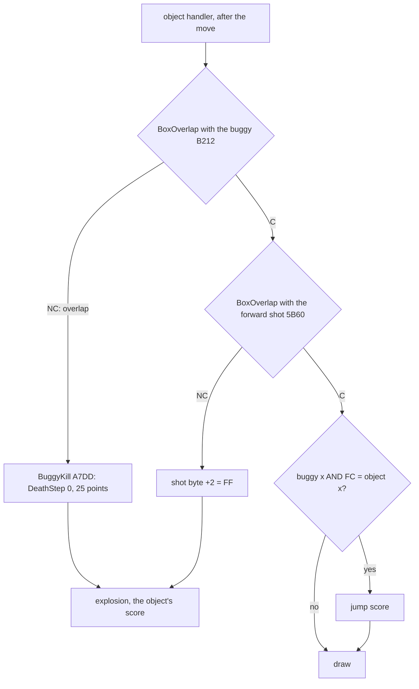

The order is the same in every ground handler: the buggy first, then the forward shot, then the jump score. The UFOs
test the four upward shots instead, and the bombs test the upward shots, then the forward shot, then the buggy
(7.6).

BuggyKill `$A7DD` returns at once unless the buggy is alive. It sets DeathStep `$B216` and WreckStep `$B217` to 0
and adds 25 points. The death itself is [doc 10](10-gameplay-logic.md).

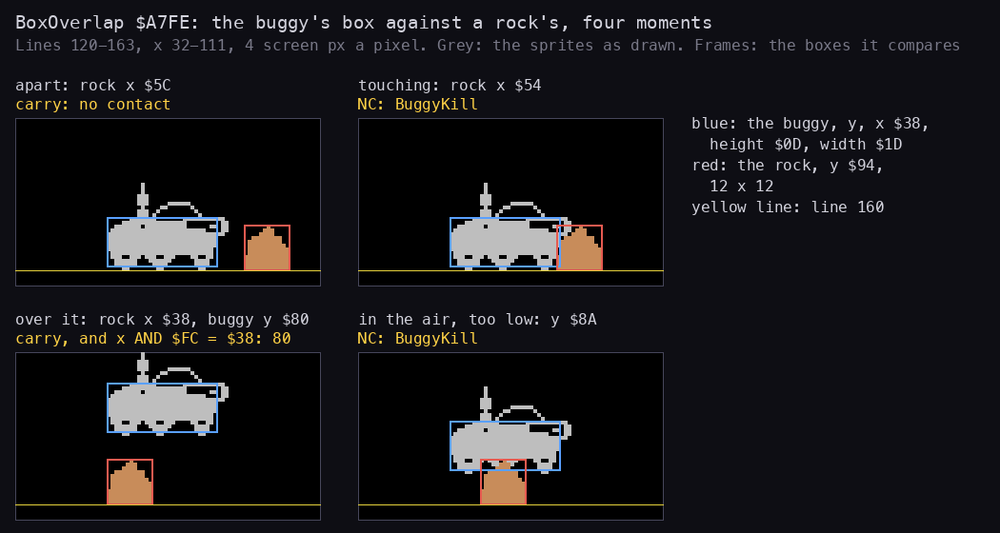

How to read the figure:

- Each panel shows lines 120-163 and x 32-111, 4 screen pixels a Spectrum pixel. Grey: the sprites as drawn.
  Blue frame: the buggy's box, red frame: the rock's box, yellow line: line 160, the road's top.
- The yellow text above each panel is BoxOverlap's result and what the handler does with it.
- The buggy's box covers its body, not the antenna or the wheels' bottom: 30 x 14 pixels at x `$38` (`$38-$55`, lines `$92-$9F`: BoxOverlap counts a touching edge
  as overlap).
- A model from the image's sprites and the box bytes; no recording.

**The point**: the boxes are smaller than the sprites, so a rock may touch the wheels' pixels without a kill; and the
jump scores exactly one pass, the pass the rock's x equals the buggy's x rounded down to 4.

```bash
python3 tools/fig_objects.py boxes     # docs/img/objects/boxes.png
```

### Worked example: when does a rock kill, when does it score?

The rock's box is y `$94`, h `$0C` (lines 148-160); the buggy on the ground y `$92`, h `$0D` (lines 146-159), x `$38`,
w `$1D`.

1. y: `$92` + `$0D` = `$9F` (159), not below `$94` (148); `$94` + `$0C` = `$A0`, not below `$92`. The y axis
   overlaps.
2. x: `$38` + `$1D` = `$55`. The rock is left of the buggy's right edge when its x <= `$55`. `x + $0C` >= `$38` when
   x >= `$2C`. So a rock at x `$2C-$55` touches.
3. The rock's x starts at `$F4` and steps by 4: `$F0`, `$EC` ... The first touching x is `$54` (the panel
   "touching"), the last `$2C`: 11 passes, about 78 frames.
4. To clear it the buggy's y + `$0D` must be below `$94`: y <= `$86`, 12 lines above the ground, for all 11 passes.
5. In one of those passes x = `$38` = `$38` AND `$FC`: the 80 points (`$9A37`, panel "over it"). With the buggy at
   x `$3A`, `$3A` AND `$FC` = `$38` as well.
6. At y `$8A` the buggy's box reaches line `$97`, below `$94`: overlap, the kill (panel "in the air, too low").

Witness: BoxOverlap runs `i1` 54 624, `i2` 54 655 times; in `i1` the rock contact `$99F9` 17 times and the jump
`$9A37` 10 times.

## 7.5 Craters and mines: no contact test

Neither ObjCrater `$9A92` nor ObjMine `$9AEB` calls BoxOverlap or BuggyKill. Both kill through the road: the buggy's
ground probe reads five pixels of line 162 under its wheels and dies on the first set one. On the plain road line
162 is clear; it is ink only inside a crater's walls and under a mine's sprite
([doc 6.7](06-rendering.md#67-the-road-its-edge-and-the-craters), [doc 10](10-gameplay-logic.md)).

- **The crater has no sprite.** Its handler moves an x by 4 a pass and, while x is above `$EC`, points GroundProfile
  `$B232` at one of the two wall columns (`$A9CF` for x `$F8-$FF`, `$A9EF` for x `$F0-$F7`); at x `$EC` it puts the
  plain road `$A9AF` back. ScrollRoad feeds these columns in at the right edge, so the hole is pixels of the road and
  scrolls with it. After that the handler only counts down x for the jump score (100 when x = buggy x AND `$FC`).
- **The mine is a sprite on a cut.** Its first pass (x `$F8`) clears 10 pixels of line 160 at x `$F6-$FF` (UnplotRun
  `$A7F4`) and sets bit 3 of PlayerFlags `$B288`, which ScrollRoad reads to feed a broken top edge. Then it moves
  with the road and blinks: bit 2 of PassCount `$B23B`, XOR the mine's phase bit 7
  (`$9B42-$9B53`; CmdMines `$9812` copies it from the script byte, `$00` or `$80` per mine), picks sprite `$11` or
  `$12`, so mines of opposite phase blink in turn. 50 points when jumped.
- **The bomb crater** is a crater record that the spinner's bomb appends to the list (7.6).

```text
ObjCrater(rec):                          ; $9A92, rec.x starts at 0
    if rec.delay: rec.delay -= 1; return
    if alive:
        rec.x -= 4                       ; 0 - 4 = $FC: the first value
        if rec.x == 0: rec.handler = ObjCraterDone; return
        if rec.x >  $EC: GroundProfile = WallA + ((NOT x) AND 8) * 4    ; $A9CF or $A9EF
        elif rec.x == $EC: GroundProfile = RoadFeed                      ; $A9AF
        elif buggy.x & $FC == rec.x: score += 100
```

```asm
ObjCraterColumns:
$9AB9  CPL                     ; the crater's columns: $A9CF or $A9EF by bit 3 of x
$9ABA  AND $08
$9ABC  RLCA
$9ABD  RLCA
$9ABE  LD D,$00
$9AC0  LD E,A
$9AC1  LD HL,RoadFeedWallA
$9AC4  ADD HL,DE
$9AC5  LD (GroundProfile),HL
```

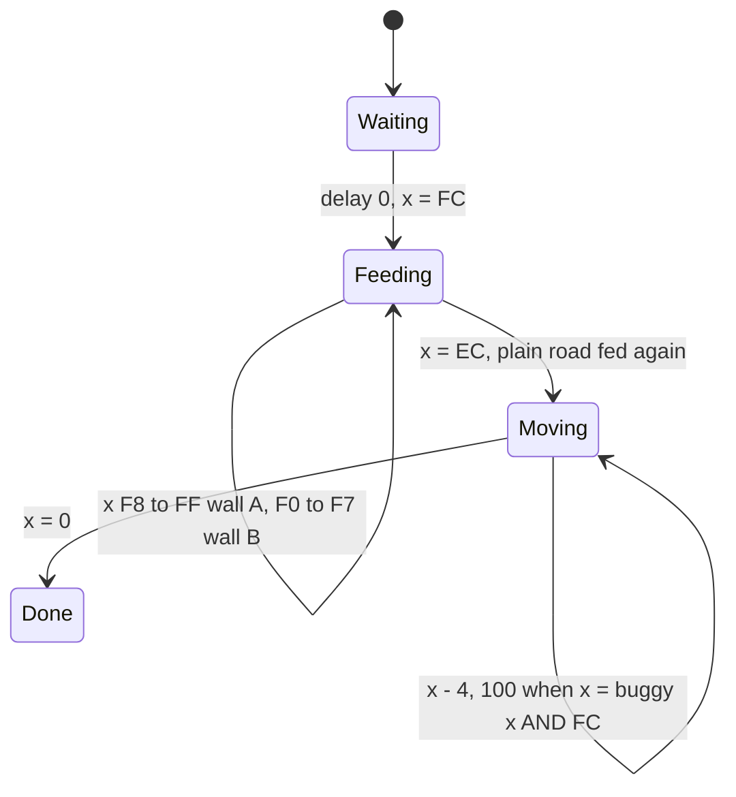

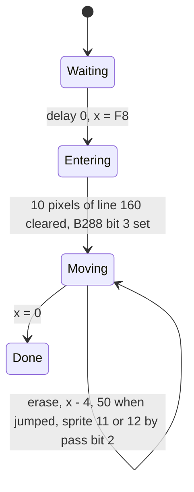

The figure of the crater's columns as they enter the road, from [doc 6.7](06-rendering.md#67-the-road-its-edge-and-the-craters):

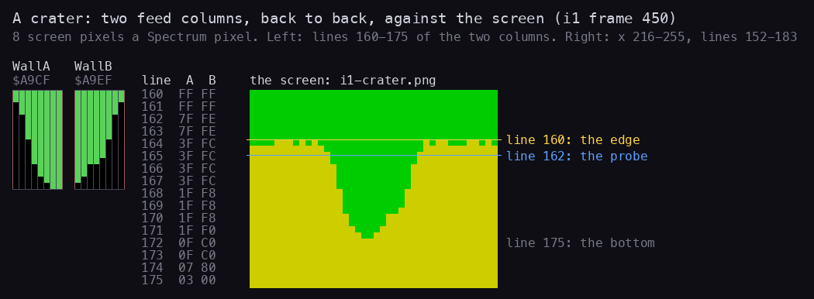

**The point**: the crater is not an object on the screen but a change of what the road scroller feeds; the record
only times the feed and the score. That is why it has no box: there is nothing to test against.

Witness: ObjCrater runs `game` 3039, `i1` 5432; the wall columns `$9AB9` `i1` 148 (37 craters, 4 passes each); jumped
`$9AD2` `game` 3, `i1` 43, `i2` 28. ObjMine runs only in `i1` 2298 (frames 11 801-14 790) and `i2` 4455; first passes
`$9B09` `i1` 18, `i2` 35; jumped `$9B2F` `i1` 17, `i2` 34. In `game` 18 of the 19 deaths are craters. Mines on screen:
`docs/img/play/i2-mines.png`.

Known only from the code: a mine kills only through the probe. Both its frames are 8 pixels wide and have a full
byte on their third line (sprite `$11` at `$D9D0`: `FF 00 FF 00 FF 00`; `$12` at `$DA10`: `81 00 81 00 FF 00`); drawn at
y `$A0`, that line is line 162. No recording shows a mine death outside the immune runs (`a1`, `g1`, `p2`, `h1`,
`h2`, `game` end before sector J).

## 7.6 The UFOs and their bombs

One 20-byte record holds a UFO and its bomb. Three spawners make three types: saucer A (`$9821`, sprites 1-4,
green), saucer B (`$9827`, sprites 5-10, yellow) and the spinner (`$982D`, sprites `$0B-$0E`, cyan, 16 lines high).

- **Entering.** The first pass after the delay sets the turn timer to 16-40 passes (R AND `$18` + `$10`, `$9B8E`); the UFO starts at x 0 or `$F0` (random) and a
  random y (`$18-$37`, capped at `$30` for the spinner). A new UFO clears the retreat flag `$B237`.
- **Flying.** Each pass the turn timer counts down. At 0 it reloads with 16-72 from R; a UFO moving across starts
  moving up or down by 2, one moving up or down starts moving across by 2, the sign from bit 6 of R. x stays below
  `$F1`; y stays in `$18-$38` (saucer) or `$18-$30` (spinner): the clamp at `$9C0E-$9C19` turns only when y passes the limit.
- **Retreat.** When UfoRetreatTimer `$9EA5` has set `$B237`, the UFO moves 4 a pass to the nearer side and is gone
  past it; its bomb part goes on. Each retreating pass sets the turn timer to `$FE` (`$9BFF`), so it no longer turns.
- **Shot.** The four upward shots are tested against its box. A hit spends the shot, sets sprite `$26` (saucer) or
  `$2E` (spinner) and UfoExplodeHandler `$9CA5`: four frames in place (`$27-$2A` or `$2F-$32`; gone at `$2B` / `$33`), then the record runs as UfoBombHandler only.
  100 for a saucer, 200 for the spinner. A UFO never touches the buggy: it has no buggy test.
- **The bomb.** Its wait (16-47 from R) counts down; then it drops from under the UFO (y + 8 or + 16, x + 16),
  sprite `$1D`, moving 4 down and 4 across for 8 passes, then straight down with sprite `$1E`. At the ground
  (y >= `$A0`) a saucer's bomb ends. A spinner's bomb tests five places 4 apart on lines 159 and 162; if all are
  clear it appends a crater record (`$9A92`) at the end of the list, clears 16 pixels of the road's top line and
  draws the crater sprite `$10`. In flight the bomb is tested against the upward shots, the forward shot (5 or 10
  points) and the buggy (the kill).

```text
UfoHandler(rec):                           ; $9B6B
    if rec.delay: rec.delay -= 1; skip
    spinner = rec.h == 16
    if rec.turn == $FF:                    ; the first pass
        rec.turn = (R AND $18) + $10       ; $9B8E: the entry turn timer, 16-40 passes
        retreat = 0                        ; enters at x 0 or $F0, set by CmdUfos
    else erase
    rec.turn -= 1
    if rec.turn == 0: rec.turn = (R AND $38) + $10   ; $9BBF: 16-72 in steps of 8
                      swap across <-> up/down, sign from R bit 6
    if retreat:
        x += 4 toward the nearer side; if off: rec.handler = UfoBombHandler
        rec.turn = $FE                     ; $9BFF: the timer never reaches 0 again
    else:
        x += dx; y += dy; turn at the edges
    for each upward shot: if overlap: shot spent; rec.sprite = $26 or $2E;
                                      rec.handler = UfoExplodeHandler; score += 100 (200 spinner)
    else next frame, draw
    UfoBombPart(rec)
```

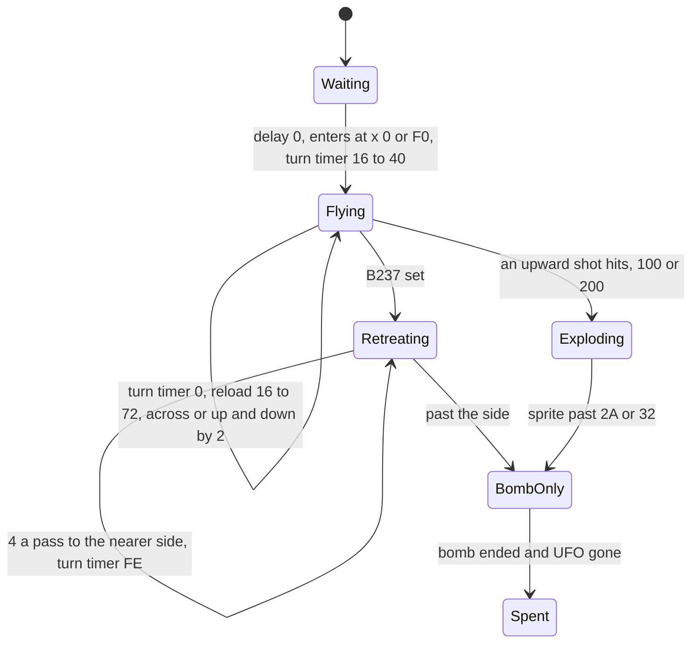

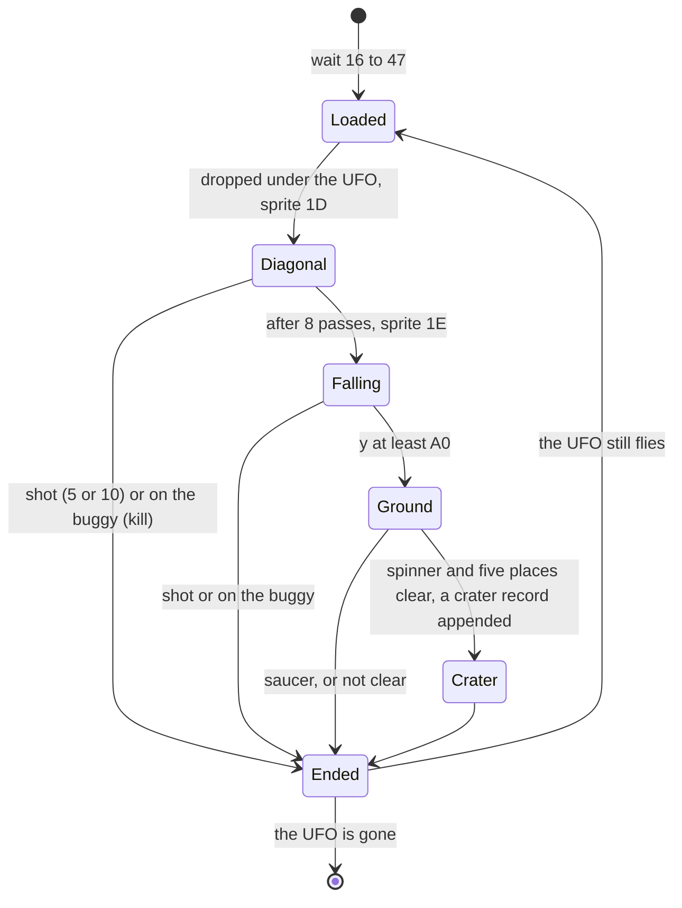

The UFO sprites, bombs and explosions are in the figure of 7.2; a wave on screen is `docs/img/play/i1-ufos.png`,
the spinner `i1-ufo-spinner.png`.

**The point**: the spinner is the only object that changes the course: its bombs add craters that the script did not
hold, and those craters kill like any other.

Witness: UfoHandler `i1` 13 759 runs (8172 active, frames 1125-30 439), `i2` 11 528. UFOs shot `$9C42`: `i1` 37,
`i2` 28. Turns: across to up/down `i1` 223, back `i1` 206. Bombs: drops `i1` 143, `i2` 131; craters made `$9DAD`
`i1` 15, `i2` 16; refused `$9D9B` `i1` 4, `i2` 8; shot `i1` 12, `i2` 18; on the buggy `i1` 16, `i2` 17. `g1` and `h1`
run the UFO handler 204 times but only its wait: no UFO reached the screen there.

## 7.7 The Champion objects

Tanks also appear at the end of Beginner (points V, W, Y); the low flyer, the boulders and the plant only in
Champion. All follow the rock's order of 7.3.

| Kind | Moves | Shot | Jumped | Special |
| --- | --- | --- | ---: | --- |
| tank `$9EBD` | with the road, 4 a pass, from x `$E7` | 250 | 200 | jump test: buggy x AND `$FC`, less 1, = tank x (the tank's x is odd); fires one shell 8 passes after it appears |
| shell `$9F8F` | 2 + the road's step = 6 a pass, from x `$C1` | 20 | 15 | same "less 1" jump test; ends past the left side |
| low flyer `$A03B` | from the left: +1 to `$10`, wait 16-23, +4, wait 4-11 at `$8C`, +4 to `$F0` | 300 / 500 / 800 at random | 125 | the flyer (DrawSprite24x8) takes the cells' colours, its burst `$37-$3A` (DrawSprite24x8Attr) the colour set's +3 attribute; moves with the scroll while the buggy is dying |
| boulder `$A196` | with the road; rolls: small `$40-$43`, medium `$44-$4B`, large `$4C-$57` | 100 / 150 / 200 | 50 / 100 / 150 | size 8, 12, 16; y = `$A0` - size, so it sits on the road |
| green plant `$A2C6` | with the road | 500 | 200 | 15-frame grow cycle; the head (frames 5-11) colours rows 18-19; the first pass cuts 28 pixels of line 160 and sets `$B288` bit 3 |

```asm
LowFlyerPaceTest:
$A076  CP $10                  ; below $10: x + 1; at $10: wait
$A078  JR Z,LowFlyerWait
$A07A  JR NC,LowFlyerPastEdge
$A07C  INC (HL)
$A07D  JR LowFlyerScroll
LowFlyerPastEdge:
$A07F  CP $88                  ; x = $88: a pause of 4-11
...
LowFlyerAtStop:
$A095  CP $8C                  ; x = $8C: wait
$A097  JR NZ,LowFlyerAdvance
LowFlyerWait:
$A099  DEC HL                  ; count the pause down, then go on
$A09A  DEC HL
$A09B  DEC (HL)
$A09C  INC HL
$A09D  INC HL
$A09E  JR NZ,LowFlyerScroll
LowFlyerAdvance:
$A0A0  LD A,(HL)               ; x + 4; at $F0 gone
$A0A1  ADD A,$04
$A0A3  CP $F0
$A0A5  JP Z,LowFlyerGone
```

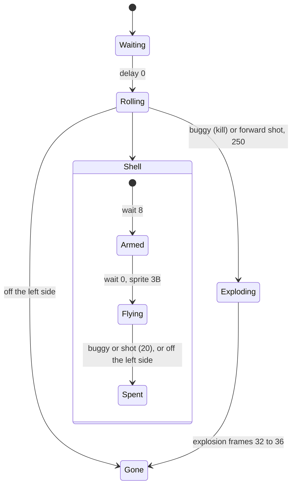

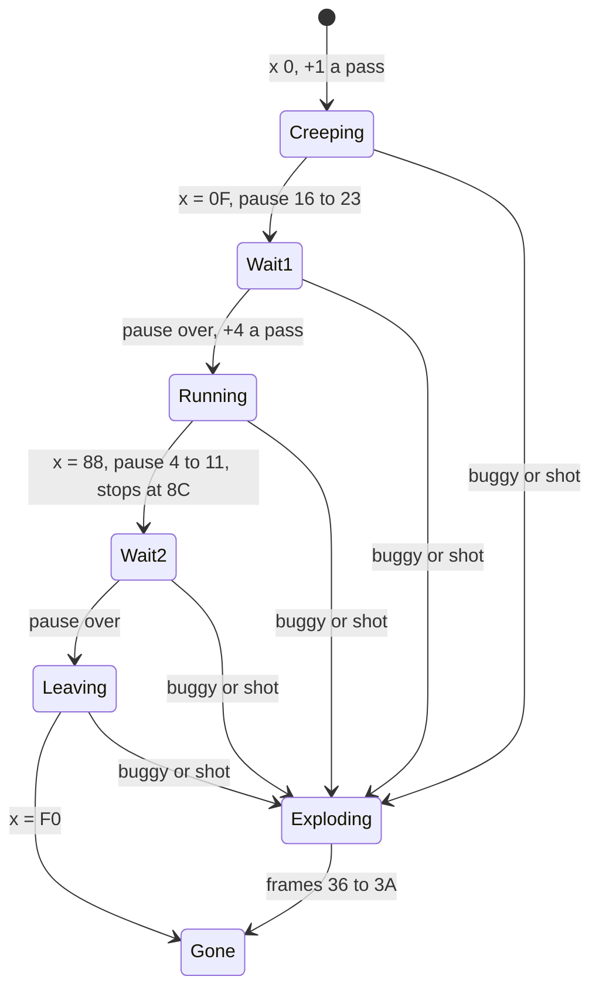

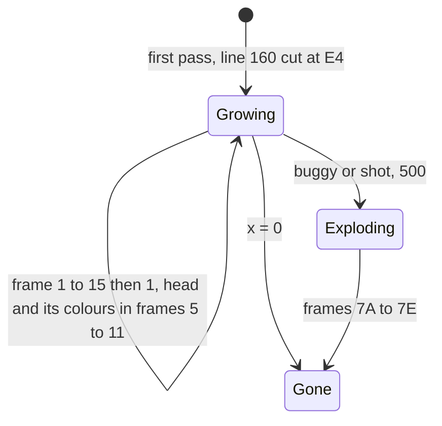

The plant's hit box comes from PlantHitBoxes `$A4B2`, one row a frame. The handler loads four bytes of the row but
stores only the first two, as both the offset and the size: y + dy, x + dx, dy, dx. The rows read like (dy, dx,
height, width) with dy + height = 16. The box the game tests (`$A33D-$A347`) differs from the table's row by row:

| Frames | Row | Tested box (h x w at y + dy, x + dx) | Table's intent (h x w) | Effect |
| --- | --- | --- | --- | --- |
| 1-4, 12-15 | `10 00 00 00` | 16 x 0 at y + 16 | none | a column from line `$A0` down, below the buggy's box: never hits |
| 5, 11 | `0C 08 04 08` | 12 x 8 | 4 x 8 | taller |
| 6, 10 | `08 05 08 0E` | 8 x 5 | 8 x 14 | narrower |
| 7, 9 | `04 01 0C 16` | 4 x 1 | 12 x 22 | much smaller |
| 8 | `03 02 0D 14` | 3 x 2 | 13 x 20 | much smaller |

Known only from the code; the effect on play is not measured (`i2`'s 8 plant kills were all touches).

The sprites of all four kinds are in the figure of 7.2; the tank's, shell's and low flyer's paths are in the figure
of 7.3. On screen: `docs/img/play/i2-tank.png`, `i2-low-flyer.png`, `i2-boulders.png`, `i2-green-plant.png`.

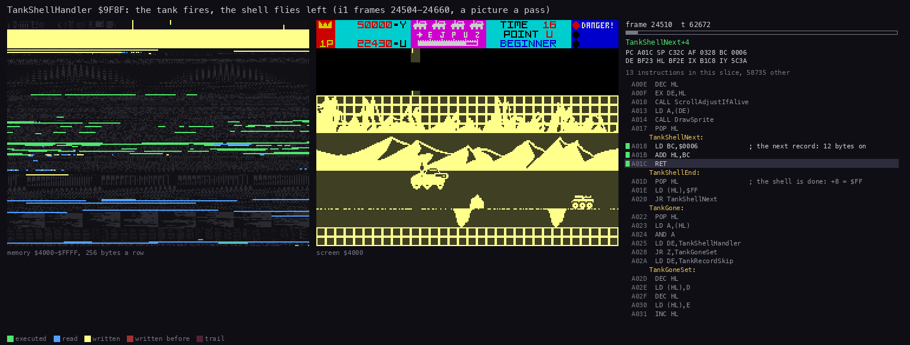

A tank at point U in a recording: `i1` frames 24504-24660, one picture a pass (482 000 T). The shell is fired at
frame 24531 (`$9FB1`) as a short dash at the tank's barrel and moves left 6 pixels a pass while the tank rolls 4
with the road; the buggy is in a jump the whole time. The screen is shown in the write colours because the bands and
the sprites are rewritten every pass; a picture ends wherever the pass is, so a sprite can be caught half redrawn.

```bash
python3 ../../kit/routine_anim.py --work work/anim/i1 --window 24504:0-24660:0 --listing build/game.lst \
    --out docs/img/routines/TankShellHandler.gif --pc 9F8F-A021 --view screen --range 4000-FFFF \
    --step 482000 --delay 200 --title "TankShellHandler \$9F8F: the tank fires, the shell flies left (i1 frames 24504-24660, a picture a pass)"
```

**The point**: Champion adds no new mechanism, only new records for the same pattern; the difficulty is the number
of objects and the low flyer, the one enemy that comes from behind.

Witness: TankHandler `i1` 912 runs (frames 23 663-28 206), `i2` 2503; shot `$9F07` `i1` 9, `i2` 19; touched `i2` 6.
TankShellHandler fired `$9FB1` `i1` 7, `i2` 24; jumped `$A000` `i1` 1, `i2` 4. LowFlyerHandler `i2` 430 (frames
1353-29 538); exploded 4, all on the buggy; jumped `$A116` 1. BoulderHandler `i2` 3448; exploded 26 (22 touches
`$A1CD`, 4 shots `$A1E1`); jumped 9. PlantHandler `i2` 1497; exploded 8, all touches; jumped `$A3A8` 4.

## 7.8 The random numbers

There is no generator and no seed. Every random choice reads the refresh register R, then masks. Some sites first
XOR R with the low byte of the frame counter FRAMES `$5C78` (counted by Im2Handler at `$7F23` in play): the UFO
start (y and side, `$9851`), the low flyer's pauses and score, and the road texture. The UFO timers (entry `$9B8E`,
turn `$9BBF`), the turn sign (`$9BCC`, `$9BDB`) and the bomb waits (`$988B`, `$9E64`) use R alone:

| Use | Code | Source | Range |
| --- | --- | --- | --- |
| UFO start side and height | CmdUfos `$9851` | R XOR FRAMES | x 0 or `$F0` (bit 6); y `$18-$37` |
| UFO bomb wait | CmdUfos `$988B`, UfoBombReload `$9E64` | R | AND `$1F` + `$10`: `$10-$2F` passes |
| UFO entry turn timer | UfoHandler `$9B8E` (first pass) | R | AND `$18` + `$10`: 16-40 passes |
| UFO turn timer and direction | UfoHandler `$9BBF`, `$9BCC` / `$9BDB` | R | AND `$38` + `$10`: 16-72 passes in steps of 8; sign from bit 6 |
| low flyer's pauses | `$A067`, `$A086` | R XOR FRAMES | AND 7 + `$10`; AND 7 + 4 |
| low flyer's score | `$A0E9` | R XOR FRAMES | AND 3, not 0: 300 / 500 / 800 |
| road texture | ScrollRoad `$A99E` | R XOR FRAMES | AND `$0F` ([doc 6.7](06-rendering.md#67-the-road-its-edge-and-the-craters)) |

```asm
LowFlyerPace:
$A067  LD A,(FRAMES)
$A06A  LD B,A
$A06B  LD A,R
$A06D  XOR B
$A06E  AND $07
$A070  ADD A,$10               ; a pause of 16-23 passes
```

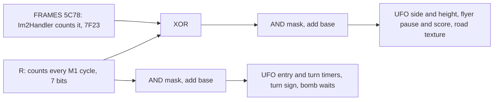

R advances by one every instruction fetch, so its value depends on exactly how many instructions ran since the last
load of R. The game runs the same code for the same input, so with the same inputs from the same snapshot the same
"random" values come back: this is why the recordings replay exactly. Where FRAMES is mixed in, it adds the interrupt
count; it changes the result when a pass ends at a different frame.

### Worked example: one low flyer pause

At `$A067` say FRAMES is `$3A` and R is `$5D`. `$5D` XOR `$3A` = `$67`; AND 7 = 7; + `$10` = `$17`: the flyer waits
23 passes at x `$10`. One more instruction before `$A06B` would make R `$5E`, the XOR `$64`, and the pause 20
passes. (Values chosen to show the arithmetic; the code reads both bytes at that instant.)

**The point**: the randomness is in the timing of the player's input, not in a generator; replaying a recording
replays every UFO path.

Witness: the recordings replay bit-exact from their snapshots (WALKTHROUGH 6.0); the figure of 7.1 marks the random
UFO fields of the Beginner course.

## 7.9 Scores and what no recording reached

| Object | Shot | Jumped | Touched (immune runs only) | CALL ScoreAdd (shot or touched, jumped) |
| --- | ---: | ---: | --- | --- |
| rock | 100 | 80 | 100 + 25 | `$9A24`, `$9A3E` |
| crater | - | 100 | - | `$9AD8` |
| mine | - | 50 | - | `$9B36` |
| saucer / spinner | 100 / 200 | - | - | `$9C70` |
| saucer bomb / spinner bomb | 5 / 10 | - | kill | `$9E0C` |
| tank | 250 | 200 | 250 + 25 | `$9F1E`, `$9F39` |
| shell | 20 | 15 | 20 + 25 | `$9FF0`, `$A007` |
| low flyer | 300 / 500 / 800 | 125 | same + 25 | `$A103`, `$A11D` |
| boulder small / medium / large | 100 / 150 / 200 | 50 / 100 / 150 | same + 25 | `$A20F`, `$A23B` |
| green plant | 500 | 200 | 500 + 25 | `$A38C`, `$A3AF` |
| the kill | - | - | 25 | `$A7EF` (in BuggyKill `$A7DD`) |

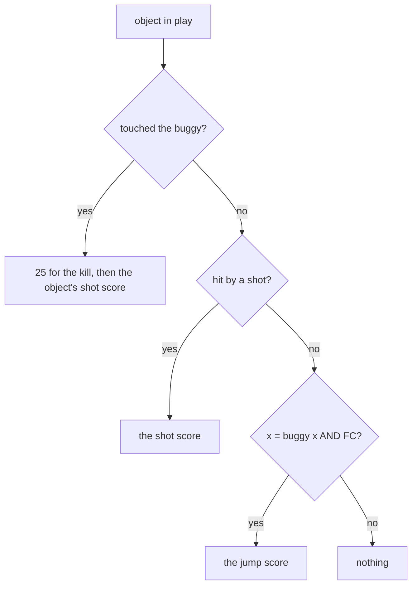

The SCORE ADVANCE TABLE (`docs/img/play/a1-score-advance-table.png`) matches the code except the plant's jump, which
the table prints as 250 and the code pays as 200 (`$A3AB` `LD BC,$0200`, executed 4 times in `i2`).

**The point**: the score is paid where the object decides, never by a central table; a mismatch with the printed
table can only be found by reading each handler.

Not executed in any recording (`game`, `a1`, `g1`, `t1`, `p2`, `h1`, `h2`, `i1`, `i2`):

- the tank's jump score `$9F32`;
- the shot paths of the shell `$9FE7`, the low flyer `$A0D8` and the plant `$A36F` (in `i2` those objects exploded
  only by touching the immune buggy);
- TankGone's other branch `$A02A` (its wait byte is always 0 there).

Known only from the code:

- the touch scores (the object's shot score after the kill's 25) in normal play: the normal runs die on rocks and
  craters only;
- the mine's kill through its sprite's ink on line 162;
- the plant's hit box, narrower than intended in frames 6-10 and taller in frames 5 and 11;
- the bytes `$B267`, `$B26A`, `$B26C`, `$B26D`, `$B26E`, `$B26F`, `$B270`, cleared by the hits and first appearances
  and never read in any recording.
