# 8. HUD and text

What this covers:

- the HUD panel: every field, its address, format and the routine that updates it (8.1);
- the score: four BCD bytes, the add, the print (8.2);
- the print code: PrintText, PrintChar and the control codes (8.3);
- the three fonts as a data sheet (8.4);
- the point letters (8.5);
- every string with its address (8.6);
- the menu pages and the attract cycle (8.7);
- the hi-score tables: layout, entry, sorting, saving (8.8).

The names are those of `src/game/game.ann` ([Terms](README.md#terms)). The recordings it rests on (all on the 48K;
WALKTHROUGH 6.0 lists how each was made):

- `a1`: from the entry snapshot, idle through the whole attract cycle, then a game (the pages, the score table).
- `g1`, `p2`: a game over with the hi-score prompt (the keys typed were play keys, no ENTER).
- `h1`: a hi-score entry finished (MPA, 1260 points); `h2`: THE GREATEST's name typed, the initials not finished.
- `t1`: the tape keys L, J, G on the heroes page (no tape: BREAK).
- `i1`, `i2`: the immune clones over both courses (every HUD update of play).
- `game`: the L1 build of `c1`, for the run counts.
- The screenshots of `docs/img/play/` (WALKTHROUGH 6.1) and the resources in `src/res/` (fonts, texts).

## 8.1 The HUD panel

The HUD is character rows 0-2 (lines 0-23). HudDraw `$9136` draws all of it at each life start; during play only five
routines touch it, each when its value changes.

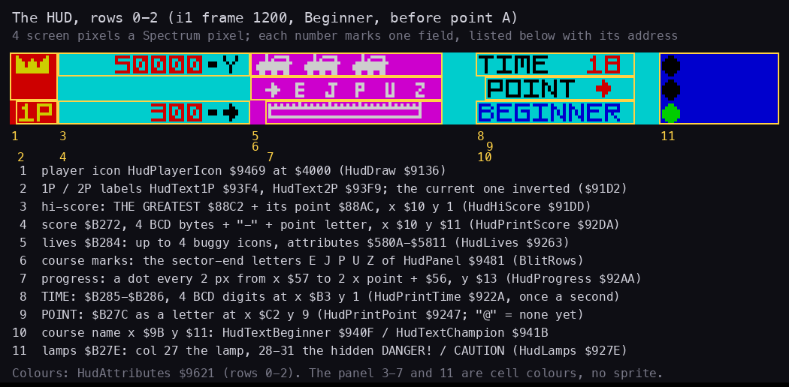

How to read the figure:

- The top is the HUD of `docs/img/play/i1-rock-point-a.png` (`i1`, frame 1200, Beginner, the rock before point A),
  4 screen pixels a Spectrum pixel. Each yellow frame is one field; its number is under it.
- The list gives each field's variable, its place (x, y in pixels for printed fields) and the routine that writes it.
- Fields 3-7 and 11 are on HUD backgrounds coloured by the attributes (HudAttributes `$9621`); field 11's texts
  DANGER! and CAUTION are printed in ink = paper, so they show only when HudLamps recolours their cells.

**The point**: the HUD is mostly a fixed picture (the panel is one BlitRows copy) with five small printed numbers and
letters on top; nothing in it is redrawn every pass.

```bash
python3 tools/fig_hud.py panel     # docs/img/hud/panel.png
```

| # | Field | Variable | Format | Drawn by | Updated during play by |
| ---: | --- | --- | --- | --- | --- |
| 1 | player icon | - | 16 x 8 pixels at `$4000` | HudDraw `$9146` | - |
| 2 | 1P / 2P | `$B271` player | font 2 text; the current player inverted | HudDraw `$919A` | - |
| 3 | hi-score | GreatestScore `$88C2`, GreatestPoint `$88AC` | 4 BCD bytes, "-", point letter | HudHiScore `$91DD` | - |
| 4 | score | PlayerScore `$B272` | 4 BCD bytes, "-", point letter `$B27C` | HudPrintScore `$92DA` | ScoreAdd `$92D3`, each score |
| 5 | lives | PlayerLives `$B284` | up to 4 icons shown by attribute `$1F` (others `$1B`, ink = paper) | HudLives `$9263` | the extra life `$9352` |
| 6 | course marks | - | the letters E J P U Z, part of the panel | BlitRows from HudPanel `$9481` | - |
| 7 | progress | `$B27C` point | a dot every 2 px from x `$57` to 2 x point + `$56`, y `$13` | HudProgress `$92AA` | ObjPoint `$9978`, each point |
| 8 | time | PlayerTime `$B285-$B286` | 4 BCD digits at x `$B3`, y 1 | HudPrintTime `$922A` | each main-loop pass, prints only when the clock marked it stale |
| 9 | point | `$B27C` | one letter at x `$C2`, y 9 | HudPrintPoint `$9247` | ObjPoint, each point |
| 10 | course | `$B27C` bit 5 | BEGINNER / CHAMPION at x `$9B`, y `$11` | HudCourseName `$9215` | - (redrawn at the next life start) |
| 11 | lamps | `$B27E` | 3 rows of 5 attribute cells from HudLampColours `$942D` + 15 x value | HudLamps `$927E` | ObjLamps `$99A3`, at each lamp record |

```text
HudDraw:                                    ; $9136, at each life start
    attributes rows 0-2 from HudAttributes $9621
    player icon 8 lines to $4000
    BlitRows(HudPanel $9481)                ; the 64 x 24 panel at x $50
    lamp glyph in column 27 of rows 0-2; PrintText(HudTextLamps)
    HudLives; HudLamps; HudProgress
    labels 1P (and 2P), the current one inverted
    hi-score: PrintBcd4(GreatestScore), "-", point letter
    HudPrintScore for both players (PlayerSwap around the second)
    PrintText("TIME", "POINT"); HudPrintPoint
    course name; HudPrintTime
```

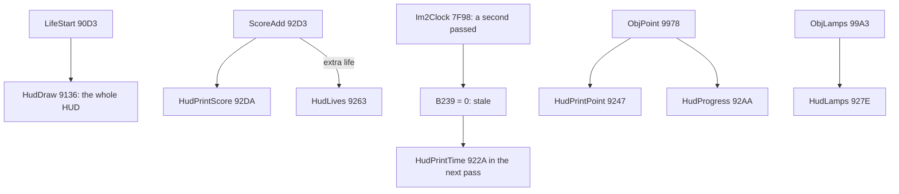

```asm
HudPrintTime:
$922A  LD HL,TimeShown         ; $B239: not 0 = already printed
$922D  LD A,(HL)
$922E  AND A
$922F  RET NZ
$9230  LD (HL),$FF             ; the time changed: print it
$9232  LD C,$03
$9234  LD HL,Screen+23
$9237  CALL ClearCells         ; three cells cleared at column 23
$923A  LD HL,PlayerTime
$923D  LD DE,$B301             ; x $B3, y 1
$9240  LD BC,$0206             ; 2 BCD bytes, 6 px a digit
$9243  CALL PrintBcd
$9246  RET
```

### Worked example: the lamps at value 1

ObjLamps writes `$B27E` = 1 (the record `A3 99 1F 01` of the second Beginner segment, [doc 7.1](07-objects.md#71-the-object-list-and-its-interpreter)).
HudLamps takes HudLampColours `$942D` + 15 x 1 = `$943C` and writes its 15 bytes as 3 rows of 5 cells at `$581B`,
`$583B`, `$585B`: column 27 is the lamp, columns 28-31 the text. Value 1 lights the middle lamp yellow and turns the
CAUTION text white; value 0 lights the bottom lamp green (the figure), 2 the top lamp red with DANGER!.

Witness: HudPrintTime runs `i1` 3613 times (once a pass) and prints (`$9230`) 523 times, about once a second;
HudProgress `i1` 37 (12 HUD draws + 25 points), its dots `$92CD` `i1` 1900; ObjLamps `i1` 21 lamp segments.

## 8.2 The score

- **Four BCD bytes, the highest first.** PlayerScore `$B272-$B275` holds 8 digits; the HUD prints 6 (the figure shows
  `300`: the leading zeros are not printed).
- **The add.** ScoreAdd `$92D3` takes the points in BC (and DE = 0): C is added to `$B275` (tens, units), B to
  `$B274` (thousands, hundreds), E and D above, each with DAA and the carry. So BC = `$0100` is 100 points and
  `$0080` 80.
- **The extra life** follows each add: below 60 000 points (`$B273` < 6) the score is compared with PlayerNextLife
  `$B276-$B279`; when reached, a life is added, HudLives redraws, and the next threshold is 20 000 points further.
  The life rules are [doc 10](10-gameplay-logic.md).
- **The print.** HudPrintScore prints at x `$10`, row 2 (row 1 for player 1 of two), then "-" and the point letter.

```text
ScoreAdd(BC, DE):                         ; $92D3 -> ScoreAddBcd $9311
    $B275 = bcd($B275 + C); $B274 = bcd($B274 + B + carry)
    $B273 = bcd($B273 + E + carry); $B272 = bcd($B272 + D + carry)
    if $B273 < 6 and score >= NextLife: lives += 1; HudLives; NextLife += 20000   ; 10000, 30000, 50000
    HudPrintScore
```

```asm
ScoreAddBcd:
$9311  LD HL,PlayerScore+$0003
$9314  LD A,C
$9315  ADD A,(HL)
$9316  DAA
$9317  LD (HL),A
$9318  DEC HL
$9319  LD A,B
$931A  JR NC,ScoreAddHundreds
$931C  INC A
ScoreAddHundreds:
$931D  ADD A,(HL)
$931E  DAA
$931F  LD (HL),A
```

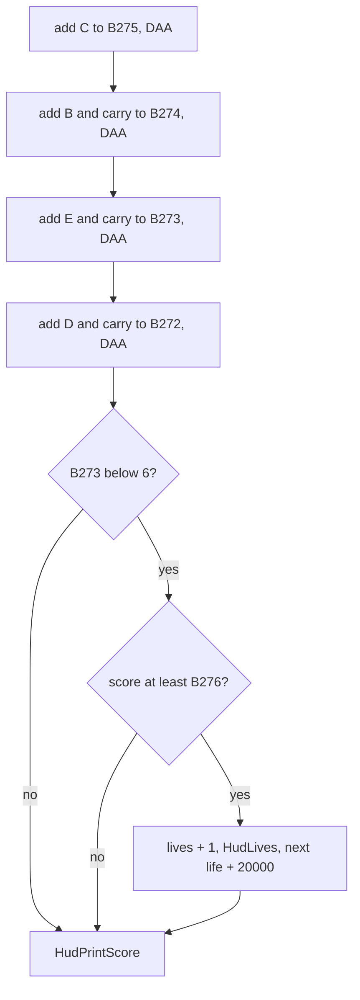

### Worked example: 300 + 80

The score is `00 00 03 00` (300). The rock jump passes BC = `$0080`. `$00` + `$80` = `$80`, DAA keeps `$80`, no carry;
`$03` + `$00` = `$03`. The score is `00 00 03 80`: 380, printed as `380-@` before point A.

**The point**: BCD makes the print trivial (one nibble a digit) and the add exact; there is no binary score anywhere.

The figure of the score field is the one of 8.1 (field 4).

Witness: ScoreAdd is called by every score site of [doc 7.9](07-objects.md#79-scores-and-what-no-recording-reached);
ScoreAddBcd runs `game` 25, `i1` 291, `i2` 424 times; the extra life `$9344-$935D` `i1` 2, `i2` 3 (at 10 000 and 30 000;
the third is at 50 000). The carry into the top byte `$932C` is not executed in any recording.

## 8.3 The print code

All text goes through two routines in the top of memory:

- **PrintText `$FFD0`** prints the bytes at HL until `$1F`, which ends the string and is not printed.
- **PrintChar `$FDCC`** prints one code. It keeps BC, DE, HL and IX, sets IX = `$F000` (the print variables) and jumps
  through PrintState `$F00A`. That word is PrintCharNormal `$FDE3` for a fresh code, or the parameter handler of a
  control code waiting for its argument.

PrintCharNormal sorts the code:

| Code | Meaning | Arguments |
| --- | --- | --- |
| `$20-$7F` | a glyph of the current font at PrintX `$F001`, PrintY `$F000`, ORed onto the screen | - |
| `$80-$FF` | prints `!` | - |
| `$0D` | new line: x to the margin `$F005`, y + the line step (past 184 wraps to the top) | - |
| `$10` INK, `$11` PAPER, `$12` FLASH, `$13` BRIGHT | set the attribute PrintAttr `$F004` | n |
| `$14`, `$15` | print `?` (no handler of their own) | - |
| `$16` AT | the position in pixels, x first | x, y |
| `$17` TAB | to pixel x; a new line if left of the cursor | x |
| `$18` MARGIN | the left margin | n |
| `$19` LIMIT | the right limit: a glyph past it starts a new line | n |
| `$1A` FONT | select font 0-3 (copy its descriptor, 8.4) | n |
| `$1F` | the end (PrintText only) | - |
| other below `$20` | prints `?` | - |

A parameter out of range sets bit 0 of PrintError `$F007`, which nothing reads.

```text
PrintText(HL):                    ; $FFD0
    while (HL) != $1F: PrintChar((HL)); HL += 1

PrintChar(A):                     ; $FDCC
    save BC, HL', IX; IX = $F000
    jump PrintState               ; normally PrintCharNormal

PrintCharNormal(A):               ; $FDE3
    if A >= $80: glyph('!')
    elif A >= $20: glyph(A)
    elif A == $0D: new line
    elif $10 <= A <= $1A: PrintState = PrintCodeTable[A - $10]   ; the next byte goes there
    else: glyph('?')
```

```asm
PrintText:
$FFD0  LD A,(HL)
$FFD1  CP $1F
$FFD3  RET Z
$FFD4  CALL PrintChar
$FFD7  INC HL
$FFD8  JR PrintText
...
PrintCharLow:
$FDEC  CP $20                  ; codes below $80
$FDEE  JP NC,PrintGlyph
$FDF1  CP $0D
$FDF3  JR Z,PrintNewline
$FDF5  CP $10
$FDF7  JR C,PrintUnknown
$FDF9  CP $1B
$FDFB  JR NC,PrintUnknown
$FDFD  LD HL,PrintCodeTable    ; $F080: one word a code $10-$1A
$FE00  SUB $10
$FE02  LD D,$00
$FE04  LD E,A
$FE05  ADD HL,DE
$FE06  ADD HL,DE
$FE07  LD E,(HL)
$FE08  INC HL
$FE09  LD D,(HL)
$FE0A  LD (PrintState),DE      ; the next code is this control's argument
$FE0E  RET
```

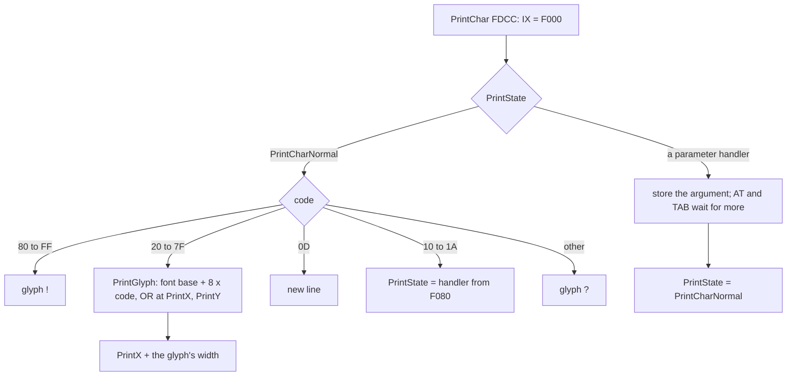

### Worked example: GAME OVER

TextGameOver `$9086`, from the image (`src/res/text/TextGameOver.txt`):

```text
$9086  10 07        INK 7
$9088  11 00        PAPER 0
$908A  13 00        BRIGHT 0
$908C  16 65 55     AT x $65 (101), y $55 (85)
$908F  1A 01        FONT 1 (FontBold)
$9091  47 41 4D 45 20 4F 56 45 52    "GAME OVER"
$909A  1F           end
```

1. `$10` puts INK's handler into PrintState; `$07` arrives there, sets the ink of PrintAttr and restores
   PrintCharNormal. The same for PAPER and BRIGHT.
2. AT takes two arguments: x 101, then line 85. The text starts in the middle of the screen, not on a cell edge.
3. FONT 1 copies FontBold's descriptor: width 6, step 9, 6 rows, base `$F300`.
4. `G` (`$47`) is drawn from `$F300` + 8 x `$47` = `$F538`, shifted by 101 AND 7 = 5 pixels, and its 2 x 2 cells take
   white on black. x becomes 107. Each letter follows 6 pixels on; the space moves 5.

Witness: PrintChar runs `game` 13 526 times, PrintCharNormal 8169; TextGameOver is read in `g1` (screenshot
`docs/img/play/g1-game-over.png`, frame 3950).

**The point**: the print code is a small terminal with pixel positioning and proportional widths; the strings carry
their own position, colour and font, so the callers only pass an address.

The text the print code writes is in the figures of 8.1, 8.7 and 8.8.

## 8.4 The fonts

Three fonts in the image and the ROM's. A font is a base address and six metrics; FONT n (`$1A n`) copies descriptor
n from FontDescriptors `$F096` (8 bytes each) to PrintWidth `$F00C` ... and PrintFont `$F008`.

| Font | Glyphs | Base | Width (I, M/W, space) | Line step | Rows | Colours |
| ---: | --- | --- | --- | ---: | ---: | --- |
| 0 | FontSmall `$F100-$F3FF` | `$F000` | 4 (4, 6, 2) | 6 | 5 | its cells take PrintAttr |
| 1 | FontBold `$F400-$F6FF` | `$F300` | 6 (5, 6, 5) | 9 (8 on the title) | 6 | its cells take PrintAttr |
| 2 | FontPlain `$F700-$F9FF` | `$F600` | 6 (6, 6, 6) | 8 | 6 | left alone |
| 3 | the ROM font `$3D00` | `$3C00` | 8 | 8 | 8 | left alone |

The base is 256 bytes below the glyphs because the first glyph is code `$20`: glyph = base + 8 x code. Bit 2 of the
base's high byte (`$F6`, `$3C`) tells PrintAttrCheck `$F0F0` not to colour: that is how font 2 and the ROM font print
without touching the attributes.

```text
FontDescriptors $F096:
  04 04 06 02 06 05 00 F0     font 0: width 4, I 4, M/W 6, space 2, step 6, rows 5, base $F000
  06 05 06 05 09 06 00 F3     font 1
  06 06 06 06 08 06 00 F6     font 2
  08 08 08 08 08 08 00 3C     font 3: the ROM
```

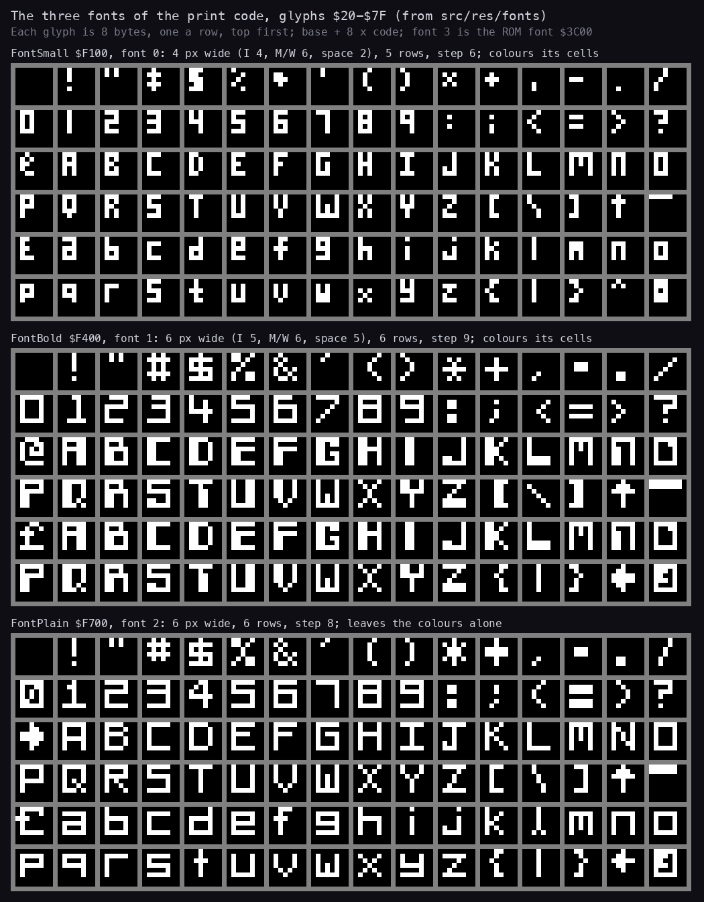

How to read the figure:

- Each sheet is one font from `src/res/fonts/` (the bytes of the image as an indexed PNG), 16 glyphs a row from `$20`
  (space) to `$7F`; white = a set bit.
- Only the top rows the descriptor names are drawn: 5 for font 0, 6 for fonts 1 and 2.
- Font 2's `@` (`$40`) is an arrow: it is what the HUD prints as the point letter before point A.
- The character set follows the Spectrum's: `$5E` up arrow, `$60` pound, `$7F` copyright.

**The point**: the fonts are narrow pixel fonts, not the 8 x 8 cells of the ROM; with per-glyph shifts the game fits
"PLEASE ENTER YOUR INITIALS" style texts on screens the ROM font could not hold.

```bash
python3 tools/fig_hud.py fonts     # docs/img/hud/fonts.png
```

### Worked example: `A` in font 2

Base `$F600` + 8 x `$41` = `$F808`. The bytes there are `7C 44 44 7C 44 44 00 00`: six rows of `.XXXXX..`,
`.X...X..`, `.X...X..`, `.XXXXX..`, `.X...X..`, `.X...X..`; the last two rows are not drawn. The glyph is 6 pixels
wide with its blank column at the left, so letters printed 6 apart touch nowhere.

Witness: the `--reads` of the fonts: FontSmall 175 of 768 bytes read, FontBold 420, FontPlain 246 (the characters the
game prints).

## 8.5 The point letters

The course has 25 points, A to Z without O. A point byte holds the point number in bits 0-4 (1 = A) and the course
in bit 5 (Champion). HudPrintPointLetter `$9258` turns it into a character:

```asm
HudPrintPointLetter:
$9258  AND $1F                 ; the point number
$925A  CP $0F                  ; carry when below 15
$925C  CCF                     ; carry when 15 or more
$925D  ADC A,$40               ; + '@', + 1 from 15 on: O is skipped
$925F  CALL PrintChar
$9262  RET
```

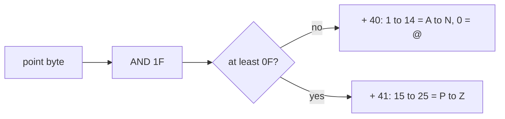

Worked example: THE GREATEST's point byte `$88AC` = `$18` (24). 24 >= 15, so `$18` + `$41` = `$59`, `Y`: the HUD prints
`50000-Y` (field 3 of the figure in 8.1). The point byte 0 (no point yet) prints `@`, which font 2 draws as the arrow
of field 4.

**The point**: one line of arithmetic skips the letter O, so the 25 points map onto the 25 letters A-Z without it.

Witness: HudPrintPoint runs `i1` 37 times (12 HUD draws + 25 points), `i2` 39.

## 8.6 Every string

Every print string is in `src/res/text/` as text with the control codes in braces (the format is
[src/res/text/README.md](../src/res/text/README.md)). The strings, by address:

| Address | Name | What | Read in |
| --- | --- | --- | --- |
| `$7F00` | BuildDate0335 | `$1F` first: prints nothing; a build date 03:35 30/10/84 follows | every life start |
| `$8413` | TitleText | the copyright line, "Press S to start.", the key list | `a1` |
| `$84FA` | OptionsText | SELECT OPTIONS, players, courses, the six controls | `a1` |
| `$8655` | ScoreAdvanceText | the SCORE ADVANCE TABLE | `a1` |
| `$8706` | DemoText | "DEMO" in font 1 | `a1` |
| `$8716` | TapeErrorText | "Tape error - hit any key." | none |
| `$873B` | RobotronWarningText | "WARNING- You have attempted to load an Atarisoft Robotron hi-score table..." | none |
| `$89DA` | HeroesTitleText | "MOON PATROL HEROES" | `a1`, `h1` |
| `$89FE` | AllTimeTitleText | "ALL TIME HEROES", "1) " | `a1`, `h1` |
| `$8A1F` | HeroesTapeKeysText | "L=LOAD, J=SAVE, G=VERIFY HI-SCORES." | `a1`, `h1` |
| `$8DB1` | HiScoreTexts | the entry texts, printed in pieces (CONGRATULATIONS PLAYER, YOU ARE, AN ATARI MP HERO, PLEASE ENTER YOUR, LETTERS MAXIMUM) | `g1`, `h1`, `h2` |
| `$9073` | TextPlayer | "PLAYER " (the digit follows) | every game |
| `$9086` | TextGameOver | "GAME OVER" | `g1` |
| `$909B` | TextGameOverPlayer | "GAME OVER PLAYER " | `p2` |
| `$90B8` | TextNoDate | `$1F` only; the build stamp after it never printed | every life start |
| `$93D3` | HudTextLamps | "DANGER!", "CAUTION" | every HUD |
| `$93F4` / `$93F9` | HudText1P / HudText2P | "1P" / "2P" | every HUD / `p2` |
| `$93FF` | HudTextTimePoint | "TIME", "POINT" | every HUD |
| `$940F` / `$941B` | HudTextBeginner / HudTextChampion | the course names | every HUD / `i2` |
| `$9427` | HudTextPointAt | AT for the HUD's point letter | each point |
| `$97A7` | TextPointAt | AT x `$F9` y `$B1` for the point letter on the road | each point |
| `$A6A0` | BonusHeaderText | TIME TAKEN TO REACH POINT, TIME REQUIRED FOR BONUS, BEST TIME SO FAR | `i1`, `i2` |
| `$A706` | SectorBonusText | SECTOR BONUS = | `i1`, `i2` |
| `$A719` | TimeBonusText | TIME BONUS = | `i1`, `i2` |
| `$A72C` | NoTimeBonusText | SORRY NO TIME BONUS | none |
| `$A743` | BestTimeText | AWESOME! BEST SECTOR TIME SO FAR!! | none |
| `$B2C2` | BuildDate0245 | `$1F` first, like `$7F00` | every life start |
| `$FFE7` | PrintResetText | INK 0, AT 0 0, MARGIN 0, LIMIT `$FF`, FONT 3 | PrintReset |

Not print strings of a page: the heroes' names (GreatestName `$88AD`, part of the saved table), the leftovers
CopyrightLeftover `$7FBF`, BuildTag `$FFF7`, and the build stamps after `$7F00`, `$90B8`, `$A182`, `$B2C2` (four
dates of 29 and 30 October 1984, never printed: the first byte of each string is the end code).

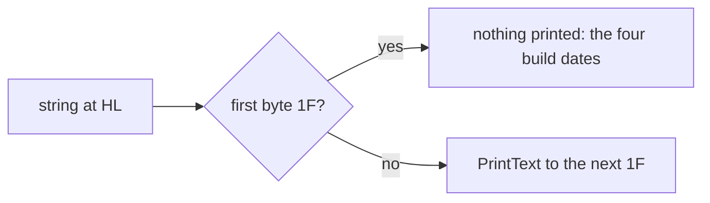

**The point**: the strings carry their own layout; the four dead build dates are a developer's stamps disabled by
putting the end code in front.

Not read in any recording (`game`, `a1`, `g1`, `t1`, `p2`, `h1`, `h2`, `i1`, `i2`): TapeErrorText, RobotronWarningText
(no tape was attached in `t1`), NoTimeBonusText and BestTimeText (every bonus in `i1` and `i2` had a time bonus and no
new best time).

The strings on screen are in the figures of 8.7 and 8.8.

## 8.7 The menu pages

The attract cycle runs in IM 1 (the ROM's interrupt): TitlePage (100 passes), OptionsPage (100), ScoreAdvancePage
(200), DemoPage (100 main-loop passes of the game with no objects), HeroesPage (200), and back to the title. Every
page pass checks the keys: S or fire starts the game (`$8F10`), H jumps to the heroes, L / J / G the tape (on the
heroes page), any key on the title goes to the options. A check that fires jumps straight to its page with SP
reloaded from `$B25D`.

Each page draws a pixel frame whose attribute rings change colour every pass (CycleFrameColours), and every text
attribute steps through ColourCycle (CycleScreenColours): the menu texts set their colours from that cycle so they
shimmer.

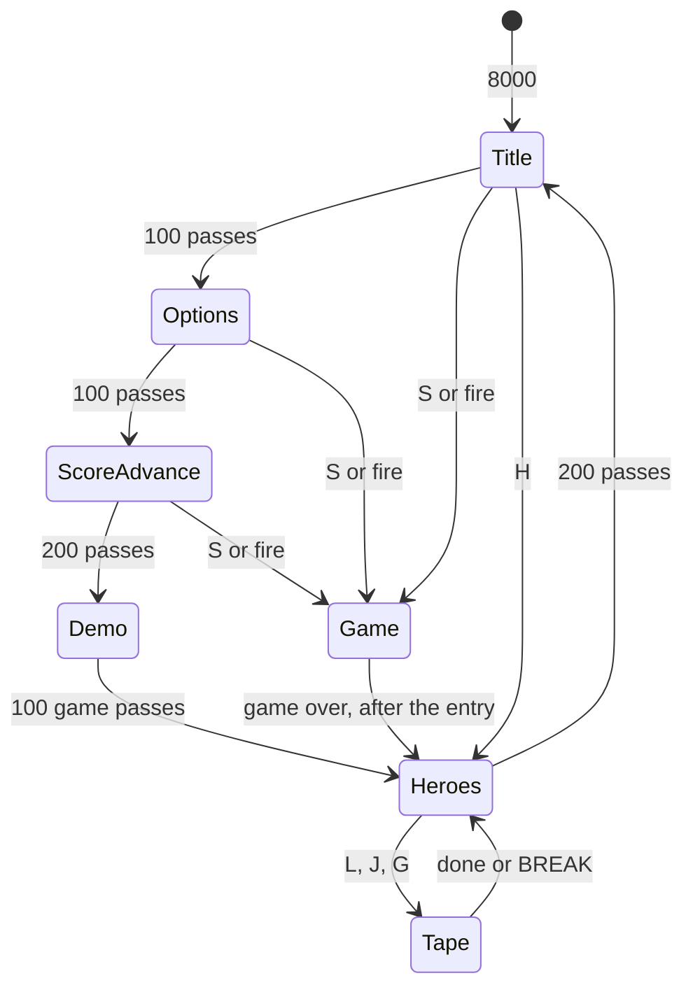

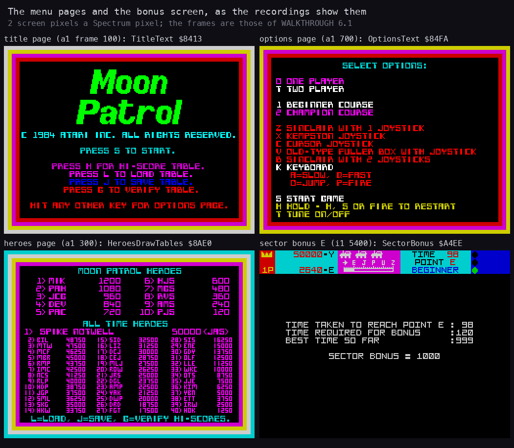

How to read the figure:

- Four screenshots, 2 screen pixels a Spectrum pixel: the title (`a1` frame 100), the heroes page (`a1` 300), the
  options page (`a1` 700) and the sector bonus E (`i1` 5400). The label names the page routine or string.
- The options page shows each choice (players, course, controls) in its own colour; the chosen one is highlighted by
  OptionsSelect `$8360`.
- The bonus screen prints its labels with BonusHeaderText and its numbers with PrintBcd at fixed pixel positions.

**The point**: all pages are the same machine: a frame, one string with its own layout, a colour cycle, a pass
counter and the key checks.

```bash
python3 tools/fig_hud.py pages     # docs/img/hud/pages.png
```

Witness: `a1` went round the cycle once while idle (the frames above); the options `$B259` / `$B257` / `$B258` start at
6 (keyboard), 1 player, Beginner.

## 8.8 The hi-score tables

Two tables, from `$8866`:

| Address | What | Record |
| --- | --- | --- |
| `$8866-$88AB` | the heroes: 10 records | 3 initials, 4 BCD score bytes (7 bytes) |
| `$88AC` | THE GREATEST's point byte | 1 |
| `$88AD-$88C1` | THE GREATEST's name: 20 letters, `$1F` | 21 |
| `$88C2-$88C5` | THE GREATEST's score | 4 BCD |
| `$88C6-$88C8` | THE GREATEST's initials | 3 |
| `$88C9-$89D9` | the all-time heroes 2-40: 39 records | 7 bytes each |

The tape block is `$88AC-$89D9` (`$12E` bytes, flag `$6C`): THE GREATEST and the all-time table. The ten heroes are
not saved.

- **Entry.** At GAME OVER HiScoreEntry `$8B8F` returns at once unless the score beats the last all-time score `$89D6`
  or the tenth hero `$88A8`. Otherwise it clears the screen and prints CONGRATULATIONS PLAYER n. A score over THE
  GREATEST's goes to GreatestEntry `$8E4E`; any other asks for 3 initials (EntryFieldEdit into `$B289`).
- **The field editor.** EntryFieldEdit uses the ROM keyboard (IM 1 and LAST_K, CAPS LOCK on): `$20-$5E` are stored at
  the cursor, ENTER ends; 8, 9 and 12 move left, right and delete. Typing over a longer old text keeps its tail.
- **Sorting is insertion.** HiScoreFindSlot walks the table from the top with ScoreCompare (byte by byte, highest
  first) and stops at the first record with a higher score; the place is the one below it. The records below shift
  down 7 bytes (LDDR) and the last falls off. Equal scores do not pass: the older record stays above.
- **THE GREATEST.** The all-time records 2-39 shift down one place (the 40th is lost), the old greatest's initials and
  score become number 2, but its name is not kept: the new name is typed over the old one in place.
- **Saving.** On the heroes page L loads into the buffer `$BEF8` and copies it over `$88AC` on success, J saves
  `$88AC`, G verifies. A block with flag `$6B` is reported as an Atarisoft Robotron table.

```text
HiScoreEntry(score):                                ; $8B8F
    if score <= alltime[40] and score <= heroes[10]: return
    print CONGRATULATIONS PLAYER n
    if score > greatest: GreatestEntry(); return
    print the hero prompt; initials = EntryFieldEdit(3)
    if score > alltime[40]: place = FindSlot(alltime); shift down; store
    if score > heroes[10]:  place = FindSlot(heroes);  shift down; store
```

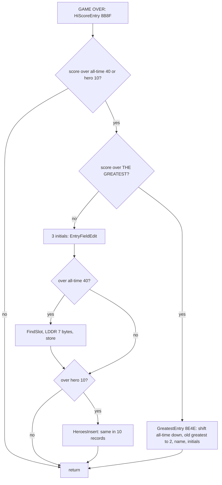

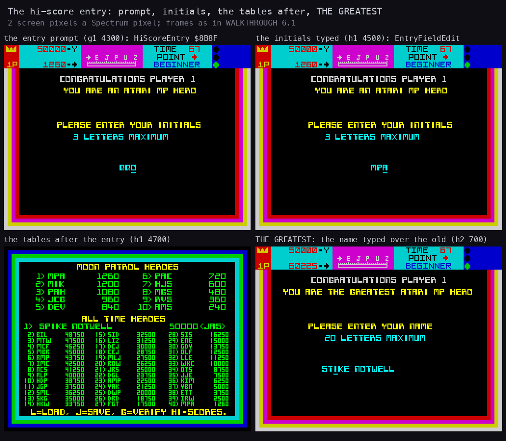

How to read the figure:

- Four screenshots, 2 screen pixels a Spectrum pixel: the entry prompt (`g1` 4300), the initials typed (`h1` 4500),
  the heroes page after `h1`'s entry (`h1` 4700: MPA at the top of the heroes and at place 40 of the all-time), and
  THE GREATEST's name being typed (`h2` 700).
- In the last one the new name is typed over SPIKE NOTWELL: what is not overtyped stays.

**The point**: the entry is an insertion sort of one element into a fixed array; only the all-time part goes to tape,
so the ten "MOON PATROL HEROES" are a per-session table.

```bash
python3 tools/fig_hud.py entry     # docs/img/hud/entry.png
```

### Worked example: h1's 1260 points

The heroes in the image: MIK `00 00 12 00` (1200) first, PAH `00 00 10 80` (1080) second, and so on. h1 ends with
1260. 1260 > the tenth hero, so the prompt runs; the initials MPA are typed. FindSlot over the heroes: ScoreCompare of
`00 00 12 60` with MIK's `00 00 12 00` finds the third byte equal and the fourth `$60` > `$00`: MIK is not higher, so
the walk stops at once and MPA goes to place 1; the nine below shift down and the tenth is lost. In the all-time table
1260 only beats the last record, so it goes to place 40.

Witness: HiScoreEntry entries `game` 4, `g1` 1, `p2` 1, `h1` 1, `h2` 1; `h1` placed all-time (`$8C1D`, place 40) and
heroes (`$8C58`, place 1); GreatestEntry `h2` once (`$8E81` moved 266 bytes).

Not executed in any recording: the editor's keys 8, 9 and 12 (`$8D5D`, `$8D7C-$8DA5`), GreatestEntry's end
`$8EC4-$8EE0` (h2 stopped at the initials), the tape's success and failure paths `$82AC-$82F2`, `$8309-$8320`.
