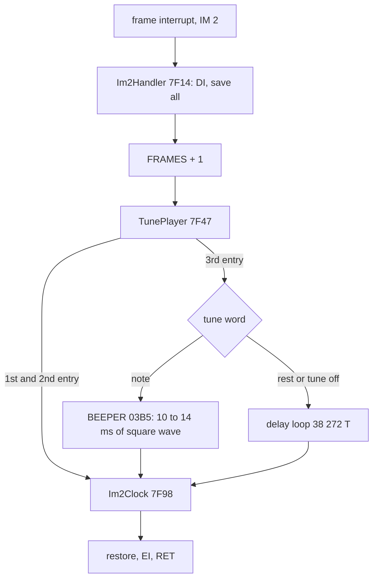
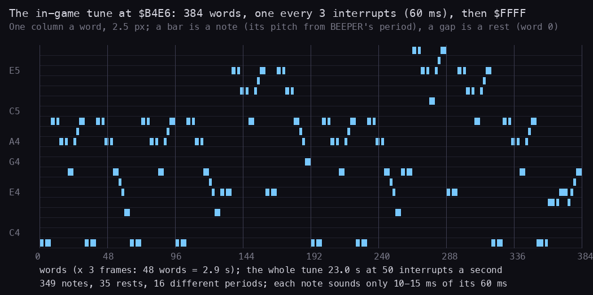
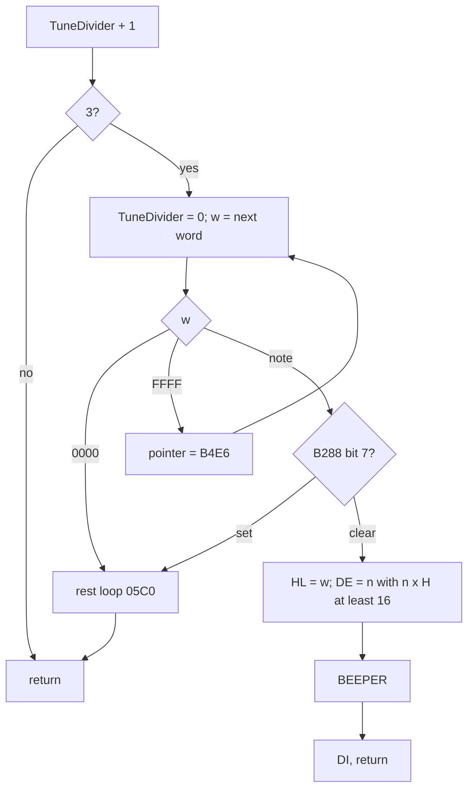
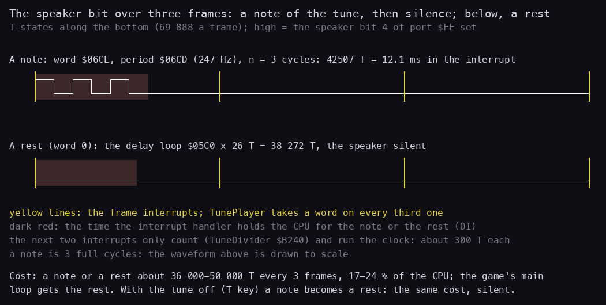
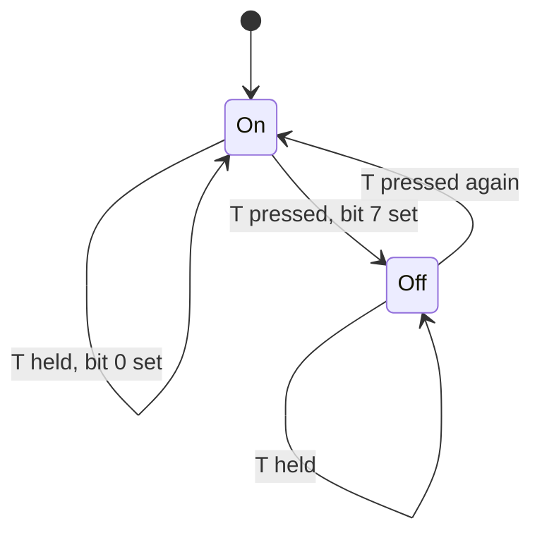
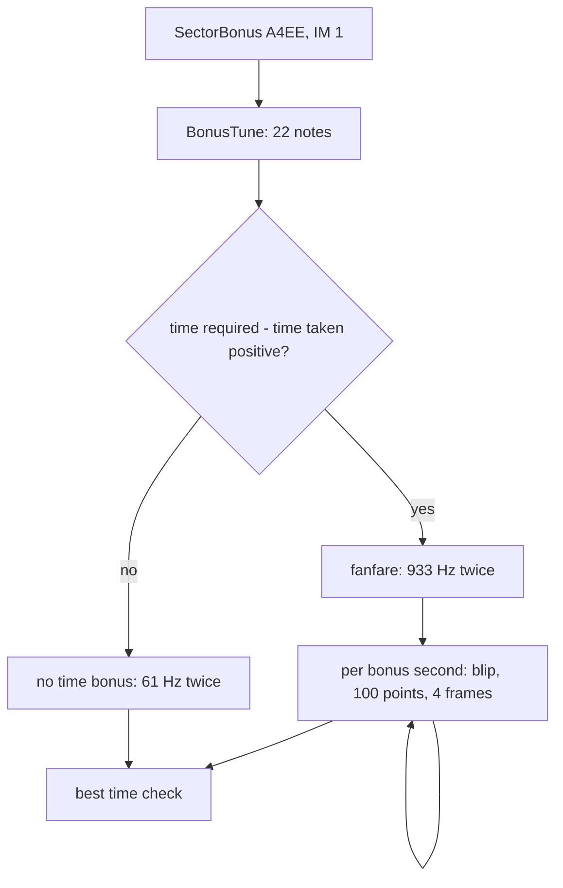
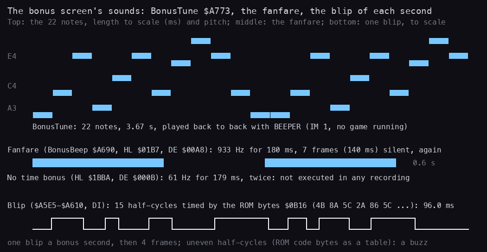
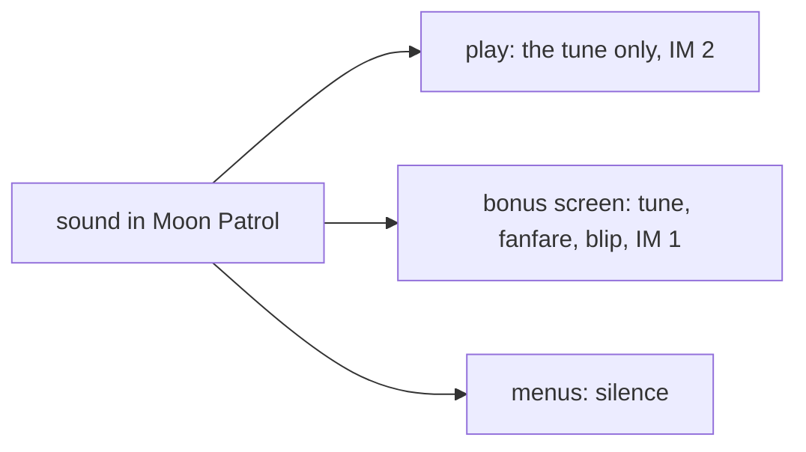

# 9. Sound

What this covers:

- the engine: the ROM's BEEPER, called from the game's own interrupt; no sound effects in play (9.1);
- the tune format byte by byte (9.2);
- the tune player, its timing and its cost per frame (9.3);
- the T key (9.4);
- the bonus screen's sounds: the bonus tune, the fanfares, the blip (9.5);
- what no recording reached (9.6).

The names are those of `src/game/game.ann` ([Terms](README.md#terms)). The recordings it rests on (all on the 48K;
WALKTHROUGH 6.0 lists how each was made):

- `i1`, `i2`: the immune clones over both courses: 25 747 IM 2 interrupts in `i1`, every tune word, five bonus screens
  each.
- `a1`: the tune switched off and on with T (frames 2540-2740).
- `game`: the L1 build of `c1`, for the run counts.
- The 48K ROM (`$03B5` BEEPER, the bytes `$0B16-$0B24`) and the image `work/mkgame/original.bin`.

The audio files in `docs/img/sound/` are rendered from a model of the speaker bit (`tools/fig_sound.py wav`): the
edges BEEPER and the blip loop make, at their T-states, sampled at 44 100 Hz. They were not recorded from the
emulator and were not played while writing this.

## 9.1 The engine

- **The beeper only.** The game makes sound through bit 4 of port `$FE`, the 48K speaker. There is no AY code.
- **Through the ROM.** Every note is a call of the ROM's BEEPER `$03B5` (HL = the period, DE = the cycles). BEEPER
  disables interrupts, toggles the speaker for DE full cycles of 8 x (HL + 30.125) T-states each, and ends with `EI`.
  One loop of the game's own toggles the speaker: the blip of the bonus screen (9.5).
- **Music during play, nothing else.** The IM 2 handler `$7F14` calls TunePlayer on every frame interrupt; every third
  call plays one note. No shot, jump, explosion or death makes a sound: no game routine of the play reaches BEEPER or
  `OUT ($FE)` except the tune player.
- **The menus are silent.** The attract cycle runs in IM 1 (the ROM's interrupt), which does not call TunePlayer.
  The demo runs in IM 2 (the call to LifeStart at `$8196`) but sets the tune-off bit 7 of PlayerFlags `$B288` (`$819B`), so
  TunePlayer plays rests.

| Site | What | Called from | Mode |
| --- | --- | --- | --- |
| `$7F8A` CALL BEEPER | a tune note | TunePlayer, IM 2 handler | play |
| `$A578` CALL BEEPER | the bonus tune, 22 notes | SectorBonus `$A4EE` | IM 1 |
| `$A692`, `$A69C` CALL BEEPER | the fanfares (two equal notes) | BonusBeep `$A690` | IM 1 |
| `$A60A` OUT (`$FE`),A | the blip of each bonus second | SectorBonus, DI | IM 1 |
| `$906B` OUT (`$FE`),A | the border colour of ClearScreen (bits 3, 4 = 0: silent) | ClearScreen `$9044` | any |
| ROM SA-BYTES / LD-BYTES | the tape signal of the hi-score save (J), load (L), verify (G) | MenuCheckTape `$825A` | IM 1 |



Witness: BEEPER's entries `i1` 7913: 7793 from `$7F8A` (the tune) and 120 from the bonus screens (5 x (22 + 2)).
No other caller in any recording (`game`, `a1`, `g1`, `t1`, `p2`, `h1`, `h2`, `i1`, `i2`).

The figure of the speaker bit is in 9.3.

**The point**: the sound design is one tune played by the interrupt; the game spends no code and no time on effects.

## 9.2 The tune format

The tune is a list of 16-bit words at Tune `$B4E6-$B7E7` (770 bytes, 384 words and the end mark; editable as
`src/res/tune/Tune.txt`):

| Word | Meaning |
| --- | --- |
| `$0000` | a rest: one note's time of silence |
| `$FFFF` | the end: the pointer goes back to `$B4E6` and the first word is taken at once |
| any other | a note: the word is BEEPER's period HL |

There is no length field: every word is one step of 3 interrupts (60 ms). A longer note is the same word repeated,
and each repeat is a new attack (a beep of 10-14 ms and silence), so the tune is staccato throughout.

The 16 periods the tune uses (word, cycles n, pitch, sound time):

| Word | n | Hz | Pitch | T-states |
| --- | ---: | ---: | --- | ---: |
| `$06CE` | 3 | 247 | B3 | 42 531 |
| `$05B4` | 4 | 294 | D4 | 47 684 |
| `$0560` | 4 | 311 | D#4 | 44 996 |
| `$0511` | 4 | 330 | E4 | 42 468 |
| `$04C7` | 4 | 349 | F4 | 40 100 |
| `$0480` | 4 | 370 | F#4 | 37 828 |
| `$043E` | 4 | 392 | G4 | 35 716 |
| `$03C4` | 6 | 440 | A4 | 47 718 |
| `$038C` | 6 | 466 | A#4 | 45 030 |
| `$0358` | 6 | 494 | B4 | 42 534 |
| `$02F7` | 8 | 554 | C#5 | 50 504 |
| `$02CB` | 8 | 587 | D5 | 47 688 |
| `$02A1` | 8 | 622 | D#5 | 45 000 |
| `$027A` | 8 | 659 | E5 | 42 504 |
| `$0254` | 8 | 699 | F5 | 40 072 |
| `$0231` | 8 | 740 | F#5 | 37 832 |



How to read the figure:

- One column a tune word (2.5 px), left to right in playing order; a bar is a note at its pitch (from BEEPER's period
  by the formula of 9.1), a gap is a rest.
- The grey lines are every 48 words, about 2.9 s. The tune is 384 words: 23.0 s at 50 interrupts a second.
- The roll is a model from the bytes; the pitches are equal-tempered names of the nearest semitone.
- Rendered: [tune.wav](img/sound/tune.wav), one loop, 23 s.

**The point**: a two-octave melody (B3 to F#5) in steady eighth-like steps, with rests only to separate repeated
notes; the format is as simple as a tune can be.

```bash
python3 tools/fig_sound.py tune    # docs/img/sound/tune.png
python3 tools/fig_sound.py wav     # docs/img/sound/*.wav
```

### Worked example: the first twelve words

```text
$B4E6  CE 06  CE 06  CE 06  00 00    B3 B3 B3 rest
$B4EE  CE 06  CE 06  CE 06  CE 06    B3 B3 B3 B3
$B4F6  58 03  58 03  58 03  00 00    B4 B4 B4 rest
```

1. `$06CE`: not 0, not `$FFFF`; HL = `$06CE` (1742: `INC HL` for the end test, `DEC HL` back). H = 6.
2. The cycles: n = 1 gives 6, n = 2 gives 12, n = 3 gives 18 >= 16: DE = 3.
3. BEEPER sounds 3 cycles of 8 x (1742 + 30.125) = 14 177 T: 42 531 T, 12.2 ms, 247 Hz.
4. The fourth word is `$0000`: a rest of 38 272 T, so the three B3s and the four that follow are heard as two groups.

## 9.3 The player and its timing

```text
TunePlayer:                                  ; $7F47, from the IM 2 handler, interrupts off
    TuneDivider += 1                         ; $B240
    if TuneDivider != 3: return
    TuneDivider = 0
again:
    w = word at TunePointer; TunePointer += 2   ; $B23E
    if w == 0: goto rest
    if w == $FFFF: TunePointer = $B4E6; goto again
    if PlayerFlags bit 7: goto rest          ; the tune off (9.4)
    HL = w; DE = smallest n with n x H >= 16    ; INC HL $7F68, DEC HL $7F7C
    BEEPER(HL, DE); DI; return
rest:
    loop $05C0 times                          ; 38 272 T of silence
```

```asm
TunePlayer:
$7F47  LD HL,TuneDivider
$7F4A  LD A,(HL)
$7F4B  INC A
$7F4C  LD (HL),A
$7F4D  CP $03
$7F4F  RET NZ
$7F50  XOR A                   ; the third entry: counter back to 0, one tune word
$7F51  LD (HL),A
TuneNextWord:
$7F52  LD IX,(TunePointer)
$7F56  LD L,(IX+$00)
$7F59  INC IX
$7F5B  LD H,(IX+$00)
$7F5E  INC IX
$7F60  LD (TunePointer),IX
$7F64  LD A,H                  ; 0: a rest
$7F65  OR L
$7F66  JR Z,TuneRest
$7F68  INC HL                  ; $FFFF: the end mark
$7F69  LD A,H
$7F6A  OR L
$7F6B  JR NZ,TuneNote
$7F6D  LD HL,Tune
$7F70  LD (TunePointer),HL
$7F73  JR TuneNextWord
TuneNote:
$7F75  LD A,(PlayerFlags)      ; the tune off ($B288 bit 7): a rest instead
$7F78  AND $80
$7F7A  JR NZ,TuneRest
$7F7C  DEC HL                  ; HL = the period, B = 16, DE = 1, A = H
$7F7D  LD B,$10
$7F7F  LD DE,$0001
$7F82  LD A,H
TuneCycles:
$7F83  CP B                    ; DE + 1 until DE x H >= 16
$7F84  JR NC,TuneBeep
$7F86  INC DE
$7F87  ADD A,H
$7F88  JR TuneCycles
TuneBeep:
$7F8A  CALL BEEPER
$7F8D  DI                      ; BEEPER's EI undone before the handler goes on
$7F8E  RET
TuneRest:
$7F8F  LD BC,$05C0
TuneRestLoop:
$7F92  DEC BC
$7F93  LD A,B
$7F94  OR C
$7F95  JR NZ,TuneRestLoop
```



- **Even note lengths.** n grows as the period's high byte falls, so n x (HL + 30) stays between 35 700 and 50 500
  T-states for every period: each note is 10-14 ms whatever its pitch.
- **No note crosses an interrupt.** A note starts about 300 T after the frame interrupt and ends at most 51 000 T into
  that frame, 19 000 T or more before the next one. The handler cannot nest (the only window is BEEPER's `EI` before
  its `RET`, at `$7F8D`), and no recording shows a nested entry.
- **The tempo is the interrupt's.** The main loop has no frame sync and a pass takes 6 to 8 frames
  ([doc 4](04-game-loop.md), 4.7); the tune does not care: one word every 3 interrupts, 16.7 words a second.
- **The cost.** Every third frame the handler holds the CPU for one note or rest: 35 700-50 500 T of 209 664, 17-24 %
  of the machine. In `i1` the handler averages about 16 600 T an entry ([doc 12](12-routine-reference.md)). A rest
  costs as much as a note.
- **A life restarts the tune.** LifeStart writes `$B4E6` to TunePointer (`$9117`), so the tune starts from the top at
  every life.



How to read the figure:

- T-states along the track, three frames (209 664 T); the yellow lines are the frame interrupts.
- The white line is the speaker bit: high = bit 4 of port `$FE` set. The top track is the tune's first word (`$06CE`,
  3 cycles at 247 Hz), drawn to scale; the bottom track a rest.
- Dark red is the time the interrupt handler holds the CPU (interrupts off): the note or the rest. The two interrupts
  after it only count and run the clock (about 300 T).
- A model from the code's timing, not a capture: the polarity of the first edge is BEEPER's and not checked.

**The point**: the beeper sound costs a fifth of the CPU at a fixed rhythm, taken out of the interrupt; the rest of
the game simply runs slower around it.

```bash
python3 tools/fig_sound.py beeper  # docs/img/sound/beeper.png
```

Witness: TunePlayer entered once per handler entry (`i1` 25 747); a word taken `i1` 8600 times: a note 7793, a rest
787; the tune wrapped at `$7F6D` `i1` 20 times, `i2` 22.

## 9.4 The T key

TuneToggleCheck `$AF15` runs first in every main-loop pass. It reads the half-row `$FBFE` (Q-T); on a new press of T
it flips PlayerFlags `$B288` bit 7. Bit 0 remembers that the key is down, so holding T flips once.

```asm
TuneToggleCheck:
$AF15  LD BC,$FBFE
$AF18  IN A,(C)
$AF1A  OR $EF                  ; keep bit 4: T
$AF1C  INC A                   ; zero when T is up
$AF1D  LD A,(PlayerFlags)
$AF20  JR Z,TuneKeyUp
$AF22  BIT 0,A                 ; still held: nothing
$AF24  RET NZ
$AF25  OR $01
$AF27  XOR $80                 ; the tune on / off
$AF29  JR TuneFlagsStore
TuneKeyUp:
$AF2B  AND $FE
TuneFlagsStore:
$AF2D  LD (PlayerFlags),A
$AF30  RET
```



With the tune off a note word is played as a rest: the pointer moves on, so the tune comes back where it would have
been, and the cost stays. The key is read once a pass, about 7 times a second, so a short tap between two reads is
missed.

Witness: `a1` switched the tune off at frame 2540 and on at 2740: 341 notes of 626 words.

The figure of 9.3 shows the rest that replaces a note.

**The point**: muting is a flag the player tests per note, not a stop: the music keeps time while silent.

## 9.5 The bonus screen's sounds

The sector bonus screen `$A4EE` runs in IM 1 with the game stopped, so it calls BEEPER directly:

1. **BonusTune `$A773`**: 22 records of 4 bytes, played back to back: a period word (BEEPER's HL), a length byte
   (DE, in cycles) and one unused byte. 3.7 s.
2. **The fanfare** BonusBeep `$A690` (with a time bonus): HL `$01B7`, DE `$00A8`: 933 Hz for 180 ms, 7 frames of
   HALT, the same again.
3. **The blip**, once a bonus second: 15 half-cycles with interrupts off, each a delay loop timed by one of the ROM
   bytes `$0B16-$0B24` (code bytes of the ROM used as a table), then 4 frames.
4. **No time bonus**: BonusBeep with HL `$1BBA`, DE `$000B`: 61 Hz for 179 ms, twice. Not executed in any recording.

```text
BonusTune:                                ; $A569
    HL = $A773
    repeat 22: period = word (HL); length = (HL + 2); HL += 4
               BEEPER(period, length)

Blip:                                     ; $A5E5, DI
    A' = the border colour (BORDCR AND $38) >> 3; DE = $0B16
    repeat 15: wait (DE) x 148 + 3689 T; DE += 1; A' XOR $18; OUT ($FE),A'
    EI; wait 4 frames
```

```asm
BonusTuneLoop:
$A56B  PUSH BC                 ; 22 records
$A56C  LD E,(HL)               ; DE = the period word
$A56D  INC HL
$A56E  LD D,(HL)
$A56F  INC HL
$A570  LD C,(HL)               ; C = the length
$A571  INC HL
$A572  INC HL                  ; the fourth byte is skipped
$A573  PUSH HL
$A574  EX DE,HL
$A575  LD D,$00
$A577  LD E,C
$A578  CALL BEEPER
$A57B  POP HL
$A57C  POP BC
$A57D  DJNZ BonusTuneLoop
...
BlipHalfCycle:
$A5F5  LD A,(DE)               ; (DE) x 10 DJNZ loops, then $77 short ones
$A5F6  INC DE
BlipDelayOuter:
$A5F7  LD B,$0A
BlipDelayInner:
$A5F9  DJNZ BlipDelayInner
$A5FB  DEC A
$A5FC  JR NZ,BlipDelayOuter
$A5FE  LD A,$77
...
$A607  EX AF,AF'
$A608  XOR $18                 ; the speaker and MIC bits, the border unchanged
$A60A  OUT ($FE),A
$A60C  EX AF,AF'
$A60D  DEC C
$A60E  JR NZ,BlipHalfCycle
```





How to read the figure:

- Top: the 22 notes of BonusTune, each bar as long as the note lasts and at its pitch.
- Middle: the fanfare to scale (0.6 s across): two notes of 180 ms with 140 ms between.
- Bottom: one blip, the speaker bit of its 15 half-cycles, 96 ms across; the uneven widths are the ROM bytes.
- A model from the bytes and the loop timing. Rendered: [bonus-tune.wav](img/sound/bonus-tune.wav),
  [fanfare.wav](img/sound/fanfare.wav), [blip.wav](img/sound/blip.wav) (three blips),
  [no-bonus.wav](img/sound/no-bonus.wav).

**The point**: the only sound effects of the game belong to the bonus screen, where nothing else needs the CPU; the
blip borrows the ROM's code bytes as a cheap source of uneven timing.

```bash
python3 tools/fig_sound.py bonus   # docs/img/sound/bonus.png
```

### Worked example: the first bonus note

`$A773`: `1D 08 23 00`. HL = `$081D` (2077), DE = `$23` (35). One cycle is 8 x (2077 + 30.125) = 16 857 T, so
207.6 Hz (G#3); 35 cycles last 589 995 T, 169 ms. The fourth byte `$00` is skipped.

Witness: BonusBeep entries `i1` 5, `i2` 5 (frames 5423-28 918), its 7-frame wait `$A699` 35 times each; the blip
`OUT $A60A` `i1` 2010 = 134 bonus seconds x 15.

## 9.6 What no recording reached

Not executed in any recording (`game`, `a1`, `g1`, `t1`, `p2`, `h1`, `h2`, `i1`, `i2`):

- the no-time-bonus sound (`$A626-$A62C`): every bonus in `i1` and `i2` had a time bonus;
- Im2Clock's branch for TuneDivider = 3 (`$7FA8-$7FAB`): TunePlayer resets the divider before the clock runs.

Known only from the code:

- the pitch and length of every note (from BEEPER's formula; the emulator's audio was not captured or played);
- that no interrupt is lost to a note: a model of the note lengths, agreed by the L1 builds (no interrupt is
  attributed to a routine inside the handler or BEEPER).



**The point**: the whole sound of the game is four BEEPER call sites and one OUT loop.
