# 10. Gameplay logic

What this covers:

- the buggy: its states, moving, jumping (10.1, 10.2);
- damage and death: the eight kill sites, the death frames, the end of a life (10.3);
- lives, respawn at the last point, extra lives, game over and two players (10.4);
- progression: points, sectors, the bonus screen, the two courses and the loop (10.5);
- scores and bonuses (10.6);
- difficulty (10.7);
- bugs and oddities, each with its witness (10.8);
- what no recording reached (10.9).

The names are those of `src/game/game.ann` ([Terms](README.md#terms)). The recordings it rests on (all on the 48K;
WALKTHROUGH 6.0 lists how each was made):

- `game`: the L1 build of `c1` (power-on, the tape load, then 16 000 frames of seeded random play), frames
  256-16 760: 19 deaths (1 rock, 18 craters), 5 games.
- `i1`, `i2`: the immune clones (BuggyKill patched to `RET`) through the whole Beginner course and on into Champion
  (`i1`), and through the whole Champion course and on into Beginner (`i2`). Their segment logs
  `work/stage1/i1-segments.txt` and `i2-segments.txt` sample the course pointer and the player record every 20 frames.
- `a1`, `g1`, `p2`, `h1`, `h2`: from the entry snapshot: deaths, game over, two players, the hi-score entries.
- The image `work/mkgame/original.bin` (the course scripts, the jump arcs).

## 10.1 The buggy's states

The buggy is one record of variables at `$B212`: y, x, its box (height `$0D`, width `$1D`), then DeathStep `$B216`,
WreckStep `$B217`, the wheels, DeadFlag `$B220`, the jump arc `$B221` and the jump index JumpStep `$B223`.

| State | DeathStep `$B216` | JumpStep `$B223` | What runs |
| --- | --- | --- | --- |
| on the ground | `$FF` | `$FF` | controls: jump, slow, fast; drift back to x `$38`; the crater probe |
| in the air | `$FF` | 0 ... arc length | one arc step a pass; no left / right, no probe |
| dying | 1 ... 8 | any | the death frames, the wheels fly; the scrollers stop |
| life over | 8 | any | MainLoopPass erases the last frame and returns |

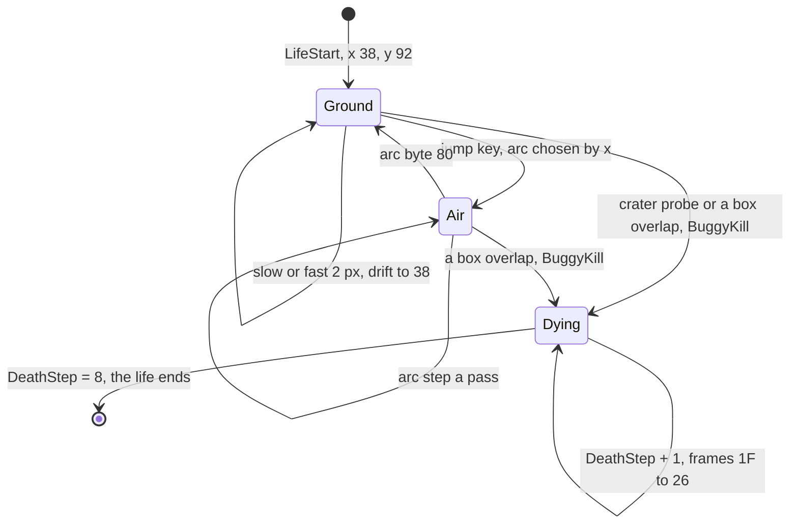

BuggyUpdate `$AA0F` runs once a pass (it is in MainLoopCalls once, [doc 4](04-game-loop.md)):

```text
BuggyUpdate:                                       ; $AA0F
    if alive:
        C = ControlsRead()                         ; bit 0 fire, 1 jump, 3 fast, 4 slow
        if C.jump and JumpStep == $FF: JumpStep = 0
        if JumpStep != $FF:
            d = JumpArc[JumpStep]; if d == $80: JumpStep = $FF else y += d; JumpStep += 1
        if JumpStep == $FF:                        ; on the ground
            if slow and x >= $29: x -= 2
            if fast and x < $50: x += 2
            if neither: x moves 2 towards $38
            for p in x+5, x+10, ..., x+25:         ; line 162
                if pixel(p, 162): BuggyKill(); DeadFlag = $FF; break
    draw sprite (alive: 0, dying: $1E + (DeathStep += 1)) at (x, y - 9)
    if CAPS SHIFT and SPACE: SetIm1; jump $8004   ; abort to the title
```

```asm
BuggyProbe:
$AA79  LD (BuggyY),HL          ; five points of line 162 under the buggy, from x + 5
$AA7C  LD A,H
$AA7D  ADD A,$05
$AA7F  LD B,$05
BuggyProbeLoop:
$AA81  LD H,$7D                ; the pixel table $FA00: byte column and mask of x
$AA83  LD L,A
$AA84  SLA L
$AA86  RL H
$AA88  LD D,$00
$AA8A  LD E,(HL)
$AA8B  INC HL
$AA8C  LD C,A
$AA8D  LD A,(HL)
$AA8E  LD HL,ScreenRow162
$AA91  ADD HL,DE
$AA92  AND (HL)
$AA93  JR NZ,BuggyFellInCrater
$AA95  LD A,C
$AA96  ADD A,$05
$AA98  DJNZ BuggyProbeLoop
$AA9A  JR BuggyDrawAt
BuggyFellInCrater:
$AA9C  CALL BuggyKill          ; a set pixel: the crater kills; flag $B220
$AA9F  LD A,$FF
$AAA1  LD (DeadFlag),A
```

The death frames are in the figure of 10.3; the jump arcs in the figure of 10.2.

**The point**: the buggy has only two living states, and only on the ground can it steer or die in a crater; in the
air it is a projectile on a fixed arc.

Witness: BuggyUpdate entries `i1` 3601 (frames 263-30 438), `game` 1576; jump steps `$AA2A` `i1` 3249; the probe hit
`$AA9C` `game` 18, `a1` 1, `p2` 4, `i1` 69, `i2` 67; the BREAK abort `$AACD` `a1` 1 (frame 3174).

## 10.2 Speed and the jump

The buggy's x does two things at once:

- **Speed.** SpeedGovernor `$AF31` runs twice a pass and burns a delay loop chosen by x: forward (x > `$38`) 1 loop,
  centre `$02EE`, back (x < `$38`) `$05DC`, plus `$1800` while dying. A loop is 26 T, so forward saves about 39 000 T
  a call against the centre and back costs about 39 000 T more. The road moves 4 px a pass in every case: the
  buggy goes faster by making the pass shorter (about +7 % forward, -6 % back, [doc 6.11](06-rendering.md#611-the-pass-against-time)).
- **The jump arc.** The same call stores one of three arcs in JumpArc `$B221` (JumpSpeeds `$AF68`): back `$AAF0`,
  centre `$AAFD`, forward `$AB16`. Each is a list of signed y steps ending in `$80`, summing to 0.

```text
SpeedGovernor:                                    ; $AF31, twice a pass
    i = 0 if x > $38, 1 if x == $38, 2 if x < $38
    JumpArc = JumpSpeeds[i].arc                    ; $AB16, $AAFD, $AAF0
    loops   = JumpSpeeds[i].delay (+ $1800 dying)  ; 1, $02EE, $05DC
    repeat loops: nothing
```

```asm
SpeedFromX:
$AF3D  LD A,(BuggyX)
$AF40  SUB $38
$AF42  JR Z,SpeedIndex         ; centre: index 1
$AF44  AND $80
$AF46  RLCA
$AF47  RLCA                    ; back: 2, forward: 0
$AF48  DEC A
SpeedIndex:
$AF49  INC A
$AF4A  RLCA
$AF4B  RLCA                    ; 4 bytes a row of JumpSpeeds
$AF4C  LD E,A
$AF4D  LD D,$00
$AF4F  LD HL,JumpSpeeds
$AF52  ADD HL,DE
$AF53  LD E,(HL)               ; the arc
$AF54  INC HL
$AF55  LD D,(HL)
$AF56  INC HL
$AF57  LD A,(HL)               ; the delay
$AF58  INC HL
$AF59  LD H,(HL)
$AF5A  LD L,A
$AF5B  ADD HL,BC               ; + $1800 while dying
```

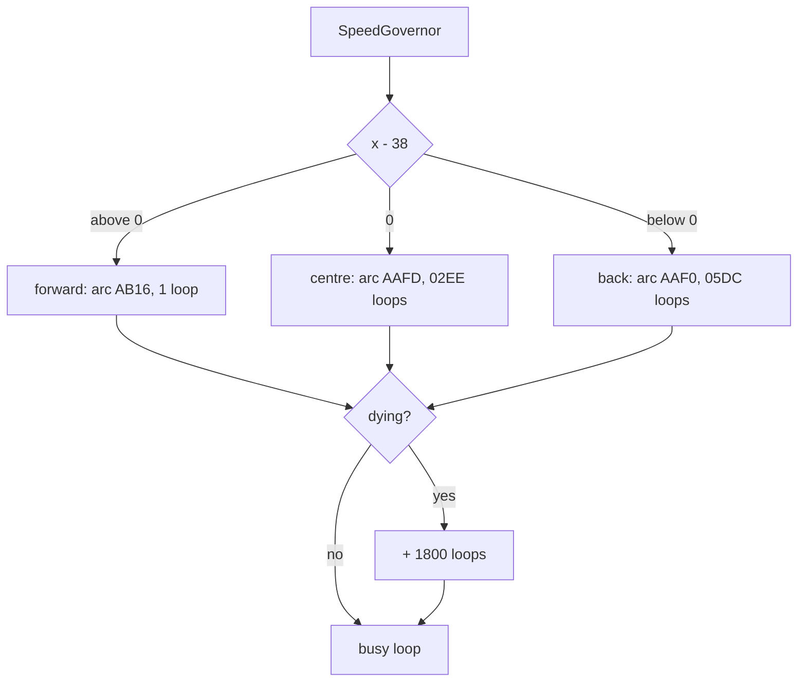

| Arc | Steps (passes) | Peak | Passes at least 12 lines up |
| --- | ---: | ---: | --- |
| back `$AAF0` | 12 | 10 | none |
| centre `$AAFD` | 24 | 19 | 5-19 (15) |
| forward `$AB16` | 32 | 20 | 7-25 (19) |

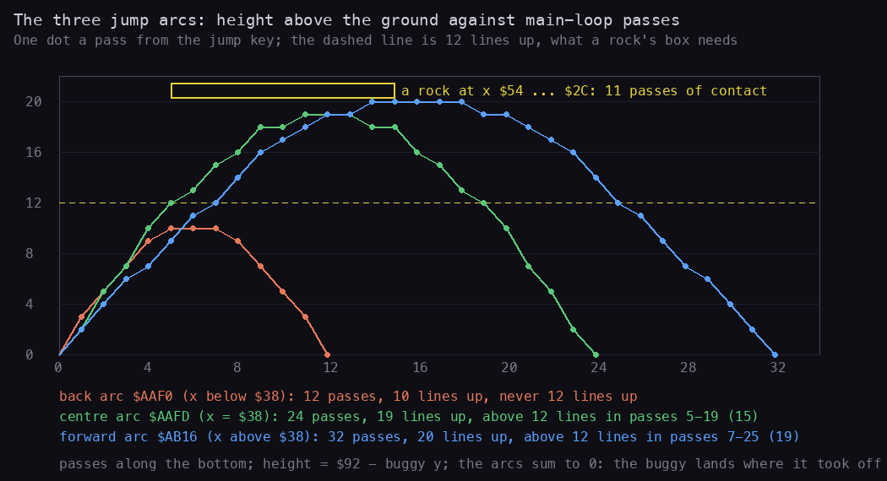

How to read the figure:

- Height above the ground (`$92` - y) up the side, passes since the jump key along the bottom, one dot a pass.
- The dashed yellow line is 12 lines: the buggy's box clears a rock's box (y `$94`) only at y <= `$86`
  ([doc 7.4](07-objects.md#74-collision-boxoverlap-and-the-jump-score)).
- The yellow frame is the 11 passes a rock overlaps the buggy's x range (x `$54` down to `$2C`), drawn at the
  earliest start the centre arc allows.
- A model from the arc bytes of the image; no recording.

**The point**: the back arc never rises 12 lines, so a jump from the back position cannot clear a rock; it clears a
crater only because the probe is off while airborne. The forward arc gives the widest timing window.

```bash
python3 tools/fig_gameplay.py jumps   # docs/img/gameplay/jumps.png
```

### Worked example: when to press jump before a rock

With the buggy at x `$38` the centre arc is high enough in its passes 5-19. A rock touches the buggy's box in 11
consecutive passes, from x `$54` (pass p) to `$2C` (pass p + 10). The jump must start at a pass s with s + 5 <= p and
s + 19 >= p + 10: s from p - 9 to p - 5, five possible passes, about 42 frames (0.84 s) of the pass length of 8.4
frames. With the forward arc s runs from p - 15 to p - 7: nine passes. With the back arc there is no s. During the
11 passes the rock passes x `$38` once and the jump pays 80 ([doc 7.3](07-objects.md#73-the-rock-the-pattern-of-every-ground-handler)).

Known only from the code: the back arc's failure over rocks. In `g1` and `h1` the 4 rock deaths were not checked for
the buggy's x at the jump.

## 10.3 Damage and death

There is no damage: one touch kills. Every death goes through BuggyKill `$A7DD`, called from eight places:

| Caller | Cause | Test | Deaths outside the immune runs |
| --- | --- | --- | --- |
| `$99F9` ObjRock | a rock | BoxOverlap | `game` 1, `a1` 1, `g1` 4, `p2` 4, `h1` 4, `h2` 1 |
| `$AA9C` BuggyUpdate | a crater wall or a mine on line 162 | the probe | `game` 18, `a1` 1, `p2` 4 |
| `$9E28` UfoBombHandler | a UFO bomb | BoxOverlap | none (`i1` 16, `i2` 17) |
| `$9EF3` TankHandler | a tank | BoxOverlap | none (`i2` 6) |
| `$9FD3` TankShellHandler | a tank shell | BoxOverlap | none (`i1` 6, `i2` 19) |
| `$A0C4` LowFlyerHandler | the low flyer | BoxOverlap | none (`i2` 4) |
| `$A1CD` BoulderHandler | a boulder | BoxOverlap | none (`i2` 22) |
| `$A358` PlantHandler | the green plant | BoxOverlap | none (`i2` 8) |

BuggyKill returns unless the buggy is alive; it sets DeathStep and WreckStep to 0 and adds 25 points. From the next
pass:

1. BuggyUpdate draws the death frame `$1E` + DeathStep after adding 1 to it: `$1F` ... `$26`, one a pass.
2. WheelsFly runs four times a pass: the three wheels fly 32 steps along WheelPaths `$AC31`.
3. The four scrollers and every object's move test DeathStep and stop: the world freezes, the objects keep being
   drawn. SpeedGovernor adds `$1800` loops twice a pass, which makes up for the skipped scrollers, so a death pass
   lasts about as long as a living one ([doc 6.11](06-rendering.md#611-the-pass-against-time)).
4. When DeathStep reaches 8, MainLoopPass erases the last frame, sets DeathStep and WreckStep back to `$FF`, moves the
   course pointer back to the restart point `$B27F`, sets IM 1 and returns: LifePlay ends.

```asm
MainLoopPass:
$96BB  CALL MainLoopCalls      ; one pass of the call list
$96BE  LD A,(DeathStep)
$96C1  CP $08
$96C3  JR NZ,MainLoopTimer
$96C5  LD HL,(BuggyY)          ; the death is over: erase, the restart point, IM 1
$96C8  LD A,L
$96C9  SUB $09
$96CB  LD L,A
$96CC  LD A,$26
$96CE  CALL DrawSprite
$96D1  LD A,$FF
$96D3  LD (DeathStep),A
$96D6  LD (WreckStep),A
$96D9  LD HL,(PlayerRestart)
$96DC  LD (PlayerCourse),HL
$96DF  CALL SetIm1
$96E2  RET
```

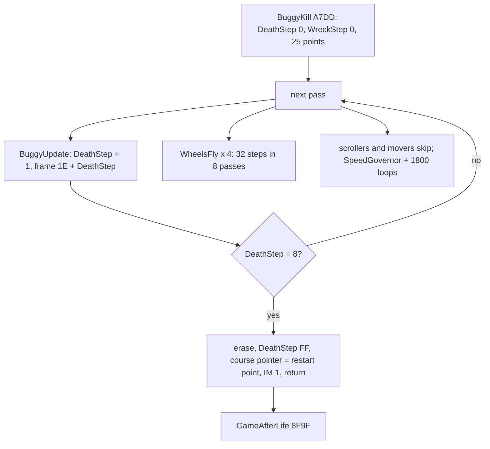

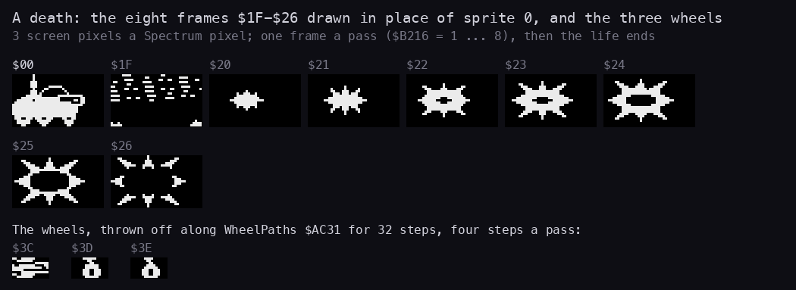

How to read the figure:

- Sprite 0 (the buggy) first, then the frames `$1F-$26` that replace it, one a pass, 3 screen pixels a Spectrum
  pixel; below, the three wheel sprites.
- Frame `$1F` and the first wheel `$3C` show other data: their table entries point into graphics that are not theirs
  (the stripes of `$6500` and the title bytes of `$6350`, [doc 6.12](06-rendering.md#612-oddities)).
- From the sprite table of the image; on screen the frames are XORed over the road and the scenery.

**The point**: a death is eight passes of animation, a little over a second, during which the world stands still;
then the life restarts at the last point passed.

```bash
python3 tools/fig_gameplay.py death   # docs/img/gameplay/death.png
```

Witness: the deaths `$96C5` `game` 19, `a1` 2, `g1` 4, `p2` 8, `h1` 4, `h2` 1; every one of them is a rock (`$99F9`)
or a crater (`$AA9C`).

## 10.4 Lives, respawn and game over

- **Lives.** GameStart `$8F10` gives each player 4 lives and the extra-life score 10 000 (`$B277` = 1). GameStartLife
  `$8F71` takes one from the reserve before each life, prints PLAYER n for 100 frames (300 with two players) and plays
  the life. The HUD shows the reserve: 3 at the first life.
- **Extra lives.** At 10 000, 30 000 and 50 000 points (ScoreAddBcd `$9344`: the threshold goes up 20 000 each time;
  none from 60 000 on), [doc 8.2](08-hud-and-text.md#82-the-score).
- **Respawn.** A point passed (ObjPoint `$9978`) sets the restart pointer `$B27F` to the start of the segment that
  held the point; MainLoop sets it to the course pointer at each entry (a life, a sector after the bonus screen). A
  death puts the course pointer back there: the next life replays from the last point.
- **Time.** The play time `$B285` counts on through deaths; only the bonus screen zeroes it. A death costs time
  bonus.
- **Game over.** GameAfterLife `$8F9F`: with lives left the turn passes to the other player if that player is still
  in; with none, GAME OVER (or GAME OVER PLAYER n), the hi-score entry ([doc 8.8](08-hud-and-text.md#88-the-hi-score-tables))
  and the heroes page.

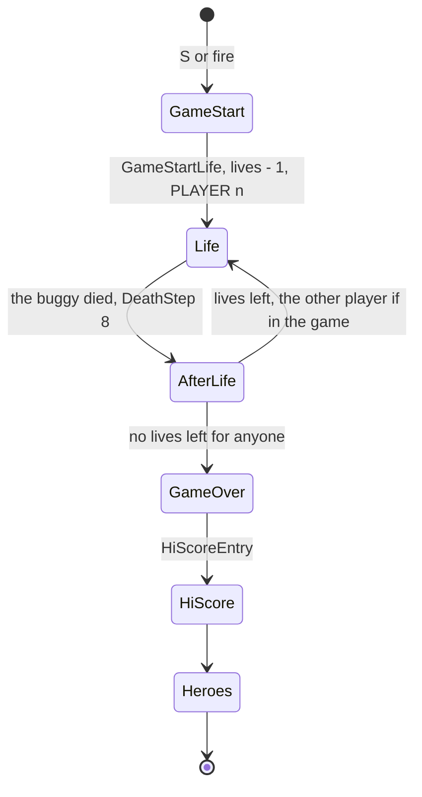

```text
GameStartLife:                    ; $8F71
    lives -= 1; ClearScreen; print "PLAYER n"; wait 100 (300) frames
    LifePlay: LifeStart; MainLoop until the death        ; course pointer = restart point
GameAfterLife:                    ; $8F9F
    if lives and other player in the game: PlayerSwap
    if no lives: in_game = 0; print GAME OVER; if both out: HiScoreEntry, heroes
    goto GameStartLife
```

The figure of the lives in reserve is the progress figure of 10.5 (the red numbers).

**The point**: a death costs a life, the time since the last point and the objects of that stretch again; nothing
else is lost, not the score, not the points.

Witness: GameStartLife runs `g1` 4 lives, `p2` 8 (four each); GameStart `game` 5; the lives in `i1-segments.txt`
go 3, 4 (frame 11 820, after 10 000), 5 (29 680, after 30 000); in `i2` 3, 4, 5, 6 (59 125 points).

## 10.5 Progression: points, sectors, courses

- **Points.** Each course has 25 points, A to Z without O, in five sectors of five: A-E, F-J, K-P, Q-U, V-Z. A point
  is a record ObjPoint in the object list; when it runs out it sets the point `$B27C`, the restart point, the HUD
  letter and the progress bar.
- **Sectors.** The last segment of a sector holds a sector-end record: the word `$A4EE` (SectorBonus) and six bytes:
  `01`, the time required (BCD word), the sector bonus (BCD byte), the scenery flag, the best time (BCD word).
- **The bonus screen** `$A4EE` (IM 1, the game stopped) shows the time taken, the time required and the best time,
  adds the sector bonus, then 100 points a second under the required time; a new best time is written back into
  the script. Then LifeStart and MainLoop at the next sector.
- **The courses.** After Beginner's sector Z the script holds BeginnerToChampion `$BB07`: the point base `$20`,
  ChampionCourse `$BB24`. After Champion's Z, ChampionToBeginner `$BED4` starts Beginner again. There is no end: the
  courses loop.

| Course | Sector (end at) | Record | Time required | Sector bonus |
| --- | --- | --- | ---: | ---: |
| Beginner | A-E | `$B87E` | 120 s | 1000 |
| Beginner | F-J | `$B91F` | 120 s | 1000 |
| Beginner | K-P | `$B9A8` | 125 s | 1000 |
| Beginner | Q-U | `$BA4B` | 125 s | 1000 |
| Beginner | V-Z | `$BAFD` | 140 s | 2000 |
| Champion | A-E | `$BBC1` | 125 s | 2000 |
| Champion | F-J | `$BC8F` | 130 s | 2000 |
| Champion | K-P | `$BD3C` | 135 s | 2000 |
| Champion | Q-U | `$BDEA` | 140 s | 2000 |
| Champion | V-Z | `$BECA` | 150 s | 4000 |

All ten records hold the best time `$0999` (the placeholder) in the image.

```mermaid
flowchart LR
    BA[Beginner A-E] --> B1[bonus] --> BF[F-J] --> B2[bonus] --> BK[K-P] --> B3[bonus] --> BQ[Q-U] --> B4[bonus] --> BV[V-Z] --> B5[bonus]
    B5 --> SW1[BeginnerToChampion BB07]
    SW1 --> CA[Champion A-E] --> C1[bonus] --> CF[F-J] --> C2[bonus] --> CK[K-P] --> C3[bonus] --> CQ[Q-U] --> C4[bonus] --> CV[V-Z] --> C5[bonus]
    C5 --> SW2[ChampionToBeginner BED4] --> BA
```

```text
SectorBonus:                                     ; $A4EE, from the course interpreter
    read TimeRequired, SectorBonus, scenery, BestTime; IM 1; clear screen
    print the three times; score += SectorBonus x 100; BonusTune
    d = TimeRequired - time (BCD)
    if d > 0: fanfare; repeat low byte of d: score += 100, blip, 4 frames
    else: SORRY NO TIME BONUS
    if time < BestTime: write time over the record's BestTime (AWESOME text unless BestTime was $09xx)
    time = 0; LifeStart; MainLoop at the next sector
```

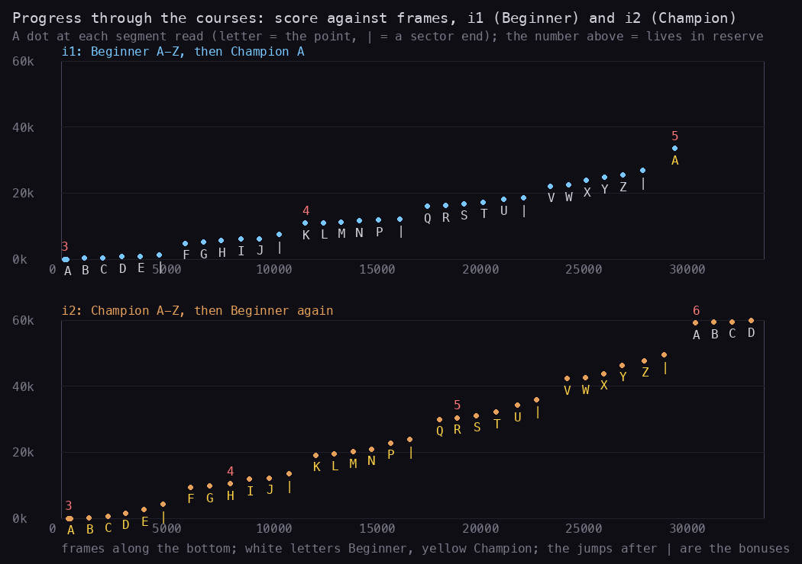

How to read the figure:

- Two runs, `i1` (top) and `i2` (bottom): the score up the side, the frame along the bottom, one dot each time a
  segment is read (`work/stage1/*-segments.txt`).
- The letter under a dot is the point the segment holds (white: Beginner, yellow: Champion); `|` is a sector end.
  The red number is the lives in reserve where it changes.
- The steps after each `|` are the bonus screens (sector bonus + time bonus); the slope between them is the objects'
  scores. The runs are immune, so every object that touched the buggy also scored.

**The point**: a course is about 28 000 frames (9 minutes) of play; the bonuses are a large part of the score (in
`i1` the first bonus screen pays about 3400 points, against 1360 for all the objects of sector A-E).

```bash
python3 tools/fig_gameplay.py progress   # docs/img/gameplay/progress.png
```

### Worked example: the first bonus of i1

`i1-segments.txt`: score 1360 at the sector end (frame 4760), 4840 at F (frame 6020): 3480 points from the bonus
screen. The record `$B87E` is `01 20 10 FF 09 99`: 120 s required, bonus `$10` = 1000 points, the city scenery
(`$FF`), best time 999. 3480 - 1000 = 2480 = 24 x 100 + 80: 24 seconds of time bonus (so about 96 s taken) and 80
points of objects between the two samples. The best time 999 is beaten, so the time is written over `$B882-$B883`;
because the old best was the placeholder `$09xx` the AWESOME text is not shown.

Witness: SectorBonus `i1` 5, `i2` 5; BestTimeWrite `$A659` `i1` 5, `i2` 5; BeginnerToChampion once in `i1` (frames
29 659-29 663), ChampionToBeginner once in `i2` (30 694-30 698).

## 10.6 Scores and bonuses

| Source | Points | Where |
| --- | --- | --- |
| objects shot or jumped | 5 to 800 | [doc 7.9](07-objects.md#79-scores-and-what-no-recording-reached) |
| a death | 25 | BuggyKill `$A7EC` |
| sector bonus | 1000 / 2000 / 4000 | SectorBonus, the record's byte |
| time bonus | 100 a second under the time required | TimeBonusLoop |
| extra lives | at 10 000, 30 000, 50 000 | ScoreAddBcd `$9344` |

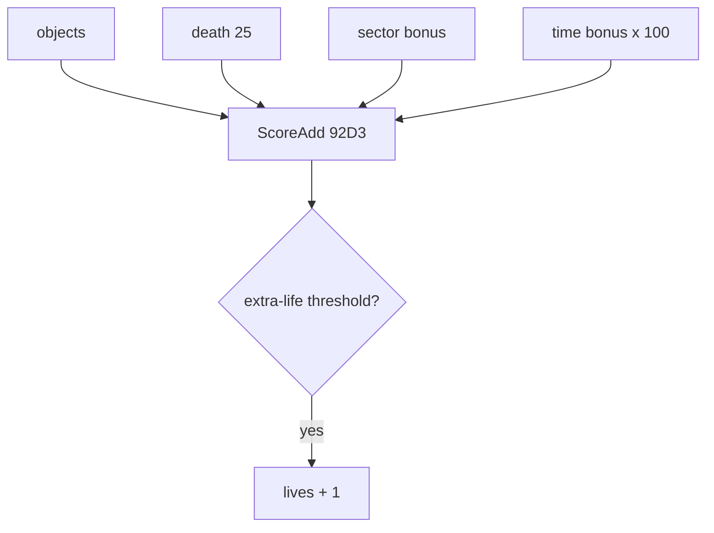

The figure of the score over a course is the one of 10.5.

**The point**: the score rewards speed: a sector finished early pays 100 a second, more than most objects.

## 10.7 Difficulty

- **No adaptive difficulty.** Nothing in the play code reads the score, the lives or the time except the HUD, the
  extra life and the bonus screen. The only difficulty is the script: the Champion course has more objects and the
  kinds Beginner lacks (low flyer, boulders, green plant) and more tanks.
- **The lamps** (ObjLamps, [doc 8.1](08-hud-and-text.md#81-the-hud-panel)) are set by the script at each point: a
  warning written by the designer, not computed.
- **The random parts** are the UFOs' paths and bomb drops, the low flyer's pauses and the road texture
  ([doc 7.8](07-objects.md#78-the-random-numbers)); they depend on the timing of the player's input.
- **The buggy's position** trades speed against safety: forward is faster and has the longest jump, back is slower
  and its jump cannot clear a rock (10.2).

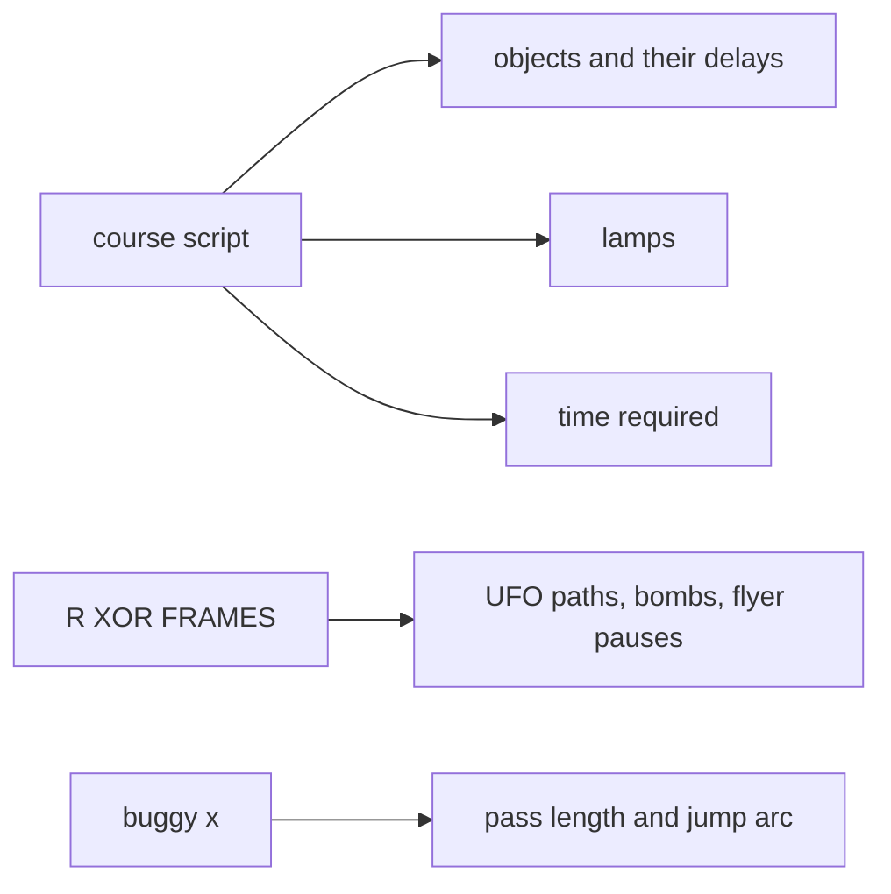

The figure of the difference is the progress figure of 10.5: Champion's slope is steeper (more objects).

**The point**: the game is a fixed course; what changes between plays is the player's timing and, through R, the
UFOs.

## 10.8 Bugs and oddities

| # | What | Witness |
| ---: | --- | --- |
| 1 | The green plant's jump pays 200; the SCORE ADVANCE TABLE prints 250 | `$A3AB` `LD BC,$0200`, executed 4 times in `i2`; `docs/img/play/a1-score-advance-table.png` |
| 2 | The plant's hit box uses two bytes of each PlantHitBoxes row as both offset and size: smaller than the table | code only (`$A326`), [doc 7.7](07-objects.md#77-the-champion-objects) |
| 3 | A rock that kills also explodes and pays 100 (the kill's 25 on top) | `$99F9` then `$9A10`; `game` 1 rock death, score not checked in a timeline |
| 4 | The time bonus counts only the low BCD byte of the difference: 100 s or more early would lose the hundreds | code only; it needs a sector finished 100 s early, under 20-50 s for times of 120-150 s; no recording did |
| 5 | THE GREATEST's new name is typed over the old one: the untyped tail stays | `h2`: STAGE ONE over SPIKE NOTWELL gives "STAGE ONEWELL" |
| 6 | The back jump cannot clear a rock (peak 10 lines, 12 needed) | code only (10.2) |
| 7 | SceneryColoursRepaint writes 65 cells, the last at `$5B00` (FeedFarBand byte 0) | [doc 6.8](06-rendering.md#68-the-scenery-at-a-life-start) |
| 8 | The four build-date strings start with the end code `$1F`: printed as nothing at every life start | `$7F00`, `$90B8`, `$A182`, `$B2C2`, [doc 8.6](08-hud-and-text.md#86-every-string) |
| 9 | MenuBreakTest `$8215` is called on every page, its result never tested; BreakToBasic is never called | code (`$8222`, `$9740`) |
| 10 | Two wreck graphics pointers point into other data (`$3C` at the title, `$1F` at stripes) | [doc 6.12](06-rendering.md#612-oddities) |

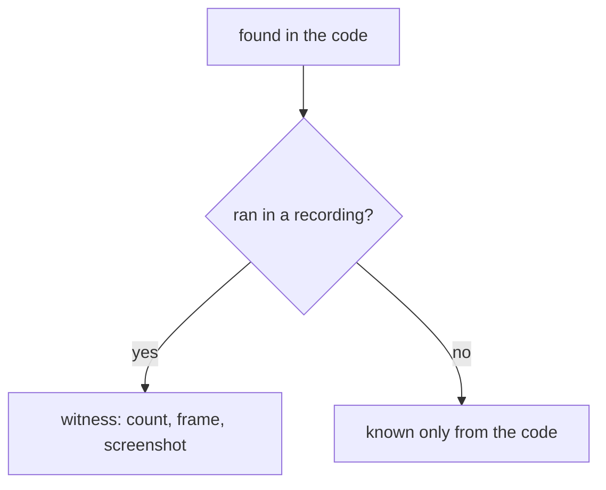

The figures of the bugs are in the documents the table links (the plant box in doc 7, the repaint in doc 6).

**The point**: none of these breaks the game; the visible ones are a score off by 50 and a name with a stale tail.

## 10.9 What no recording reached

Not executed in any recording (`game`, `a1`, `g1`, `t1`, `p2`, `h1`, `h2`, `i1`, `i2`):

- a sector finished late (NoTimeBonus `$A620`) and a second, faster finish (the AWESOME text `$A651`);
- a death by a bomb, tank, shell, low flyer, boulder, plant or mine in normal play (only the immune runs met them);
- the shot paths of the shell, the low flyer and the plant; the tank's jump score `$9F32`;
- the carry into the top score byte `$932C` (a million points) and the extra-life score's carry `$935E-$9363`;
- the joysticks with a direction pressed (every joystick handler ran only on the options page or with no input);
- Sinclair 2-joystick play with two players;
- the hold left by S or fire (`$AEF6`, `$AEF4`): `a1` left the hold with H.

Known only from the code: the 25 points of a death (no timeline compared the score across a death), the back jump
over a rock, the mine's kill through line 162, the time bonus's lost hundreds.

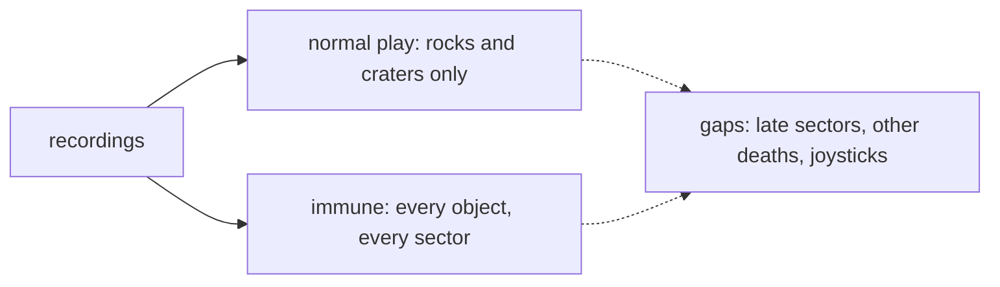

The figure of what the runs covered is the progress figure of 10.5: both courses, every point, no late sector.

**The point**: the immune runs cover every object and every sector, but only as touches; how the game kills with
anything but rocks and craters is read from the code.
