# 1. Game design

What this covers: the game as a player meets it.

- the premise and the goal: put history right, age by age, then face the evil god Dameron;
- every screen: the loading screen and its countdown, the logo, the credits, the menu, DEFINE KEYS, SELECT JOYSTICK,
  the stage titles, play and its panel, the item window, game over, the ending;
- the controls, with the one key the instructions get wrong;
- the panel: score, amount, energy, lives, the carried items, the teleport icons;
- the rules as the code plays them: energy, lives, credits, the score;
- the items, the teleport icons and the master icon;
- the five stages, their maps, enemies and bosses;
- a route: the RZX run, stage by stage.

The recordings it rests on ([WALKTHROUGH 6.0](../WALKTHROUGH.md#60-the-recordings)):

| Recording | Load | Used for |
| --- | --- | --- |
| `c1` | 48K from power-on, the original tape at signal speed (`tests/inputs/c1.txt`) | the loading screen and countdown, the logo, the credits, the menu, PRESS PLAY, stage 1's title, the first rooms |
| `menu` | c1's menu state | DEFINE KEYS |
| `joystick` | c1's menu state, 9706 frames | SELECT JOYSTICK, every choice in turn |
| `deaths` | c1's stage 1 state | contact damage and a life lost |
| `s1-right` ... `s5-right` | the RZX snapshot of each stage as loaded, then a walk to the right | the first rooms of each stage, the HUD's GAME OVER, the game-over menu |
| `rzx-r0` ... `rzx-r5` | the RZX archive's run (`myth.rzx`, 128K, 100 151 frames), replayed block by block with L1 and zero divergences | the whole game: the item window, every boss, the teleports, the ending |
| `ending` | snap5 with four POKEs of the duel's hit counter | the ending again, phase by phase |

The RZX run is another player's game, played with DEFINE KEYS 9 8 6 7 0. Its frames are "RZX frames", counted from
the RZX's start. A recording `rzx-rN` counts its own frames from the start of block N. So rzx-r1 frame f is about RZX
frame f + 2064 (`work/stage2/notes-rec.md`).

## 1.1 The game in one page

**The premise.** The instruction sheet tells the story (`work/candidates/docs/Myth-HistoryInTheMaking.txt`).

- A schoolboy obsessed with myths is chosen by the last good titans.
- The evil god Dameron changes the past to conquer the future.
- The boy must travel through the ages of myth and put each right.
- At the end he must banish Dameron.

**The goal.** Each age is one stage.

- In each stage the hero collects five teleport icons.
- With all five, a master icon appears somewhere in the stage.
- Carried to the teleport pad, the master icon ends the stage.
- Stage 5 is a duel with Dameron himself. The ending follows his fourth defeat.

**The shape.** A flip-screen action adventure for one player.

- A room is one screen of 28 x 18 cells. The hero walks off an edge into the next room.
- Each stage holds one to nine "grids", each a field of rooms ([1.8](#18-the-maps)).
- Each stage is a separate 33 792-byte block on the tape, loaded when the stage starts ([doc 3](03-build-and-load.md)).
- One stage is in memory at a time. A retry of the same stage needs no load; a new stage does.

| Stage | Title (StageTable, `src/res/resident/stages.txt`) | Setting |
| --- | --- | --- |
| 1 | THE ROAD TO HELL | a graveyard over caves of fire; the winged demon, the dragon |
| 2 | GREECE FOUR HUNDRED BC | a temple, the hydra's caves, Medusa |
| 3 | SCANDINAVIA FIVE HUNDRED AD | a longship in a storm, the swamp, the funeral pyre, the dragon, the giant on the throne |
| 4 | EGYPT THREE THOUSAND BC | a beach and a barrier, a hub of four tombs, the mummy, the pharaoh's head |
| 5 | DUEL WITH DAMERON | space: the hero flies and fires at Dameron's head |

The instruction sheet is the Commodore 64 text with a Spectrum page added.

- It says "4 levels". The Spectrum has five stages: its stage 1, the road to hell, is not on the C64 list.
- It names the C64 authors.
- The Spectrum's own credits say "Programmed by Neil Dodwell", "Graphics by Concept Animations" and "Sound effects by
  Neil Dodwell" ([credits](img/play/credits.png)).

The flow of a game, from the resident's code (`src/resident/game.asm`, [doc 4](04-game-loop.md)):

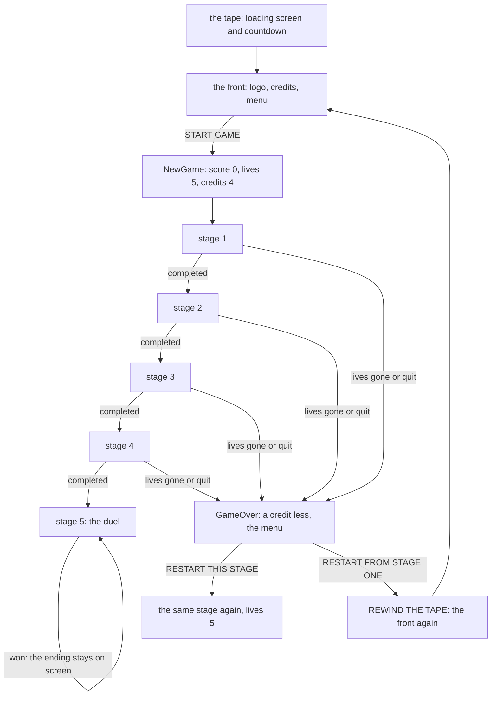

How to read it: every stage block returns E to the resident.

- E = 2 means completed, E = 1 quit, E = 0 lives gone (StageEntry's header, `src/stage1/entry.asm`).
- PlayStage `$F1CA` gives Z for E = 2, and the chain at `$F0A4-$F0E8` moves on.
- Anything else calls GameOver `$F24B` and plays the same stage again.

**The point**: the game is five separate programs on one tape, run in order by a 2.7 KB resident. Only the score, the
lives and the credits pass between them.

## 1.2 The screens

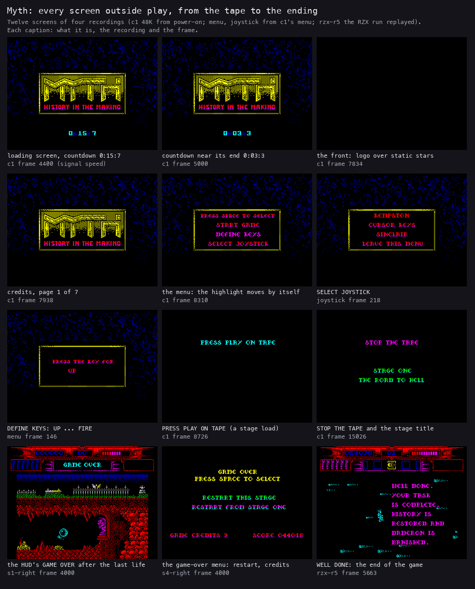

*Every screen outside play, from c1 (48K, power-on), joystick, s1-right, s4-right and rzx-r5. Made with `python3
tools/fig_design.py front docs/img/design/front.png`.*

How to read it: left to right, top to bottom, the order a player meets them. The caption under each screen names its
recording and frame.

| Screen | What it does | Where | Doc |
| --- | --- | --- | --- |
| [loading screen with the countdown](img/play/c1-04400-countdown.png) | the picture of the hero; a countdown in minutes, seconds and tenths until the main block is in | c1 4400, 5000 ([later](img/play/c1-05000-loading.png)) | [3](03-build-and-load.md) |
| [logo](img/play/logo.png) | MYTH and HISTORY IN THE MAKING; SPACE goes on | c1 7834 | [5](05-controls.md) |
| [credits](img/play/credits.png) | seven pages, about 3.6 s each | c1 7938 | [8](08-hud-and-text.md) |
| [menu](img/play/menu.png) | START GAME, DEFINE KEYS, SELECT JOYSTICK; a bar moves every 96 frames and SPACE takes the lit line | c1 8310 | [5](05-controls.md) |
| [DEFINE KEYS](img/play/define-keys.png) | UP, DOWN, LEFT, RIGHT, FIRE in turn | menu 146 | [5](05-controls.md) |
| SELECT JOYSTICK | KEMPSTON, CURSOR KEYS, SINCLAIR, LEAVE THIS MENU, lit in turn like the menu | joystick 218 | [5](05-controls.md) |
| [PRESS PLAY ON TAPE](img/play/press-play.png) | before every stage load | c1 8726 | [3](03-build-and-load.md) |
| [stage title](img/play/stage1-title.png) | STAGE ONE and THE ROAD TO HELL while the block loads | c1 15026 | [8](08-hud-and-text.md) |
| [play](img/play/stage1-start.png) | the panel on top, the room below | c1 15476 | [6](06-rendering.md) |
| item window | SPACE in play; LEFT and RIGHT move along the carried items | rzx-r1 1015 | [5](05-controls.md) |
| [HUD GAME OVER](img/play/hud-game-over.png) | the last life lost: GAME OVER over the panel | s1-right 4000 | [8](08-hud-and-text.md) |
| [game-over menu](img/play/game-over.png) | RESTART THIS STAGE, RESTART FROM STAGE ONE, GAME CREDITS n, SCORE | s4-right 4000 | [1.6](#16-the-rules) |
| the ending | WELL DONE. YOUR TASK IS COMPLETE. HISTORY IS RESTORED AND DAMERON IS BANISHED. | rzx-r5 5663 | [8](08-hud-and-text.md) |

The five stages, each with its title and a moment of play:

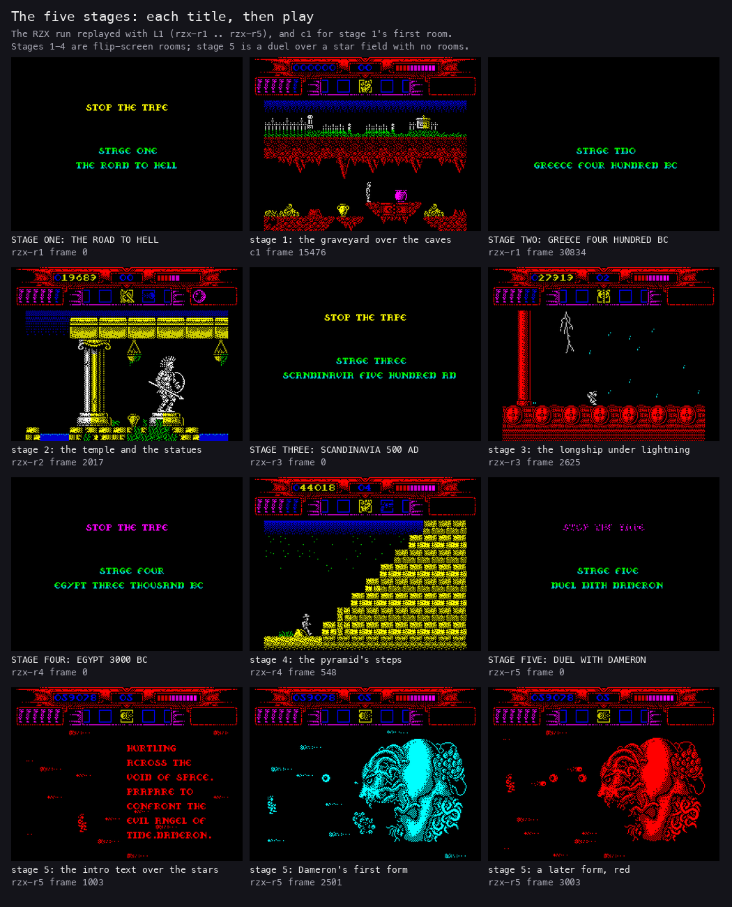

*The STAGE N title of each block and one screen of its play, from rzx-r1 ... rzx-r5 (the screens the recording tool
saved every 500 frames or so). Made with `python3 tools/fig_design.py stages docs/img/design/stages.png`.*

How to read it: each stage has its own pictures, colours and panel. Stage 5 has no rooms: a starfield, the hero on a
flying craft and Dameron's head.

More screens of each stage, from the walks:

- stage 1: [the graveyard](img/play/stage1-graveyard.png), [the cave](img/play/stage1-cave.png);
- stage 2: [the temple](img/play/stage2-temple.png), [the harpy](img/play/stage2-harpy.png);
- stage 3: [the longship](img/play/stage3-longship.png), [its prow](img/play/stage3-prow.png);
- stage 4: [the pyramid](img/play/stage4-pyramid.png);
- stage 5: [the intro text](img/play/stage5-void.png), [Dameron](img/play/stage5-dameron.png).

The flow of the front, from its code (`src/front/`, [doc 5](05-controls.md)):

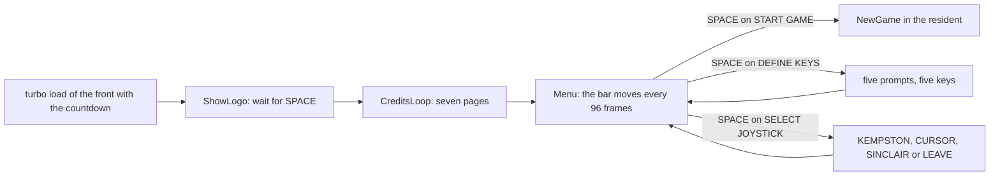

**The point**: there is no title tune loop and no demo mode. The front waits for SPACE twice, then for a choice timed
by a moving bar. The menu reads only SPACE.

## 1.3 The controls

The keys are read by five resident readers ([doc 5](05-controls.md)): `$FC90` UP, `$FC9F` DOWN, `$FCAE` LEFT, `$FCBD`
RIGHT, `$FCCC` FIRE. Each reader holds a port and a bit. DEFINE KEYS writes both; SELECT JOYSTICK writes a fixed set.

| Action | Tape default | What it does in play |
| --- | --- | --- |
| LEFT, RIGHT | Q, W | walk; in the item window, move along the items |
| UP | I | jump forward; FIRE + UP: the high strike |
| DOWN | J | crouch and leap up to a ledge; FIRE + DOWN: the low strike |
| FIRE | O | with the selected item: strike, throw, fire; FIRE + LEFT: the middle strike, whichever way the hero faces; FIRE + RIGHT does nothing |
| SPACE | fixed | the item window |
| CAPS SHIFT + SPACE | fixed | quit the stage: the game-over menu |
| ENTER | fixed | pause; a second press goes on |

| Choice | UP | DOWN | LEFT | RIGHT | FIRE |
| --- | --- | --- | --- | --- | --- |
| KEMPSTON | port `$1F` bit 3 | bit 2 | bit 1 | bit 0 | bit 4 |
| CURSOR KEYS | 7 | 6 | 5 | 8 | 0 |
| SINCLAIR | 9 | 8 | 6 | 7 | 0 |

The instruction sheet says H pauses the game. The code reads ENTER.

- CheckPause `$79B1` in stage 1's main loop tests port `$BFFE` bit 0, which is ENTER ([doc 5](05-controls.md)).
- H is bit 4 of the same port. No stage reads it.

The hero's moves, from HeroUpdate's states in stage 1 (`src/stage1/hero.asm`, [doc 10](10-gameplay-logic.md)):

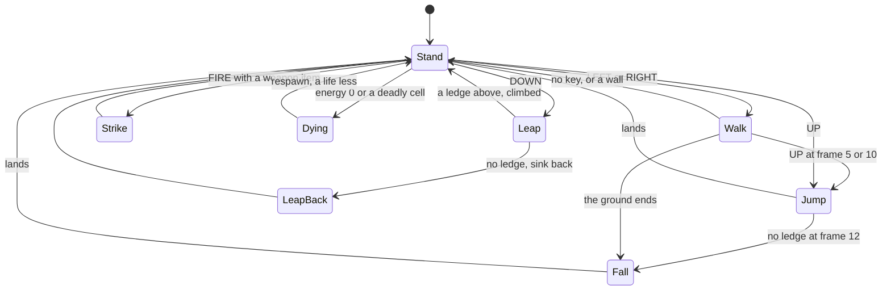

How to read it: the hero is a state machine of 11 states.

- They are: stand, walk, jump, fall, leap back, three strikes, leap up, a scripted move, dying.
- Only standing and walking take new input.
- The strikes need a weapon item selected.

**The point**: the controls are the C64's joystick moves mapped to five keys. FIRE changes what the directions mean.

## 1.4 The panel

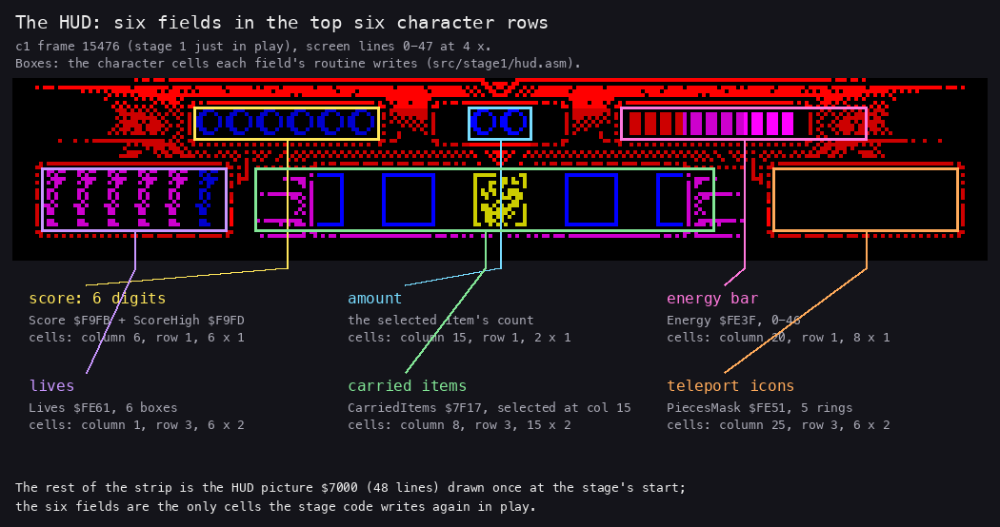

*c1 frame 15476's top 48 lines, four times their size, with the cells of each field from the stage code
(`src/stage1/hud.asm`). Made with `python3 tools/fig_design.py hud docs/img/design/hud.png`.*

How to read it: the panel takes the top six character rows. The sheet's six fields are all there. Score, Amount and
Energy are on row 1; Lives, Collected items and Teleport icons on rows 3-4.

| Field | Cells | Variable | What it shows |
| --- | --- | --- | --- |
| Score | row 1, columns 6-11, six digits | Score `$F9FB` + ScoreHigh `$F9FD` (resident) | the score, kept across stages |
| Amount | row 1, columns 15-16 | the selected item's count | how many uses the selected item has left |
| Energy | row 1, columns 20-27, a bar | Energy `$FE3F`, 0-46 | 46 is full; the bar empties from the right |
| Lives | rows 3-4, columns 1-6, six boxes | Lives `$FE61` | box n is lit while Lives is n or more |
| Collected items | rows 3-4, columns 8-22 | CarriedItems, ItemSelected | the carried items, the selected one at column 15 |
| Teleport icons | rows 3-4, columns 25-30, five rings | PiecesMask `$FE51` | a ring fills when its icon is taken; all five flash |

The addresses are stage 1's. Each stage block keeps its own copy of the panel and its own variable addresses. Only the
score lives in the resident ([doc 8](08-hud-and-text.md)).

**The point**: the panel is a loaded picture, not a drawing. The stage loads it at `$7000-$76BF` and only rewrites the
digits, the bar and the colours.

## 1.5 The items, the teleport icons and the master icon

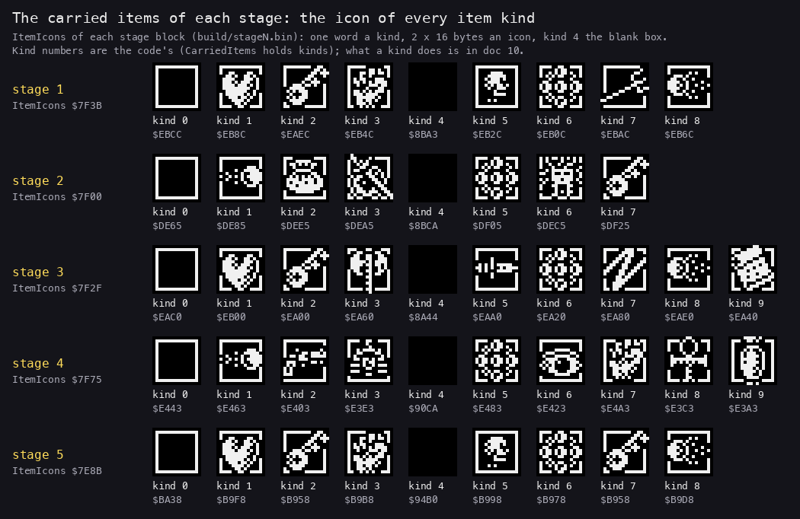

*The ItemIcons table of each stage block, kind by kind, drawn from the built images. Made with `python3
tools/fig_design.py items docs/img/design/items.png`.*

How to read it: a carried item is a kind number. The panel draws the icon of its kind. Kind 4 is the blank box in
every stage.

The hero starts each stage with the stage's StartItems.

- Stage 1 starts with kind 3, a weapon, at slot 6.
- Stage 2 starts with kind 3 and 36 of kind 1.

What each kind does is the stage's own code. In stage 1 (`work/stage2/notes-stage1.md`, [doc 10](10-gameplay-logic.md)):

| Kind | Icon | What the code does with it |
| --- | --- | --- |
| 1 | heart | a shield: damage is ignored while its count drains, one every 8th pass |
| 2 | key | opens the gate; the dragon's prize |
| 3 | weapon | lets the hero strike |
| 5 | skull | thrown; nine thrown into the fire pit of room 12 wake the demon |
| 6 | gems | the master icon: in room 2 it ends the stage |
| 7 | trident with lightning | opens room 12's right exit; fires bolts without limit |
| 8 | bolt | thrown (ThrowItem `$92D1`) |

The sheet's clues match the code.

- "SKULLS: A burning desire brings out the devil in you" is the fire pit of room 12.
- "HEART ITEM: Conserve your strength" is the shield.
- "BOLTS: It all adds up to a lot, so save some for a rainy day" is a counted weapon.

**The teleport icons.** These are the sheet's "teleport icons" and the code's "pieces".

- Each stage has five.
- Each is an actor that appears in its room. In stage 1 RoomEvents puts one there when the hero enters grid 0 room 0,
  5, 11 or 12 or grid 1 room 2, unless its bit is set in PiecesMask `$FE51` (SpawnBonus,
  [doc 10, 10.9](10-gameplay-logic.md#109-the-icons-the-master-icon-and-the-teleport)); room 12's waits behind the
  demon.
- It takes 6 hits, then rises. Touched, it gives 1200 points and fills its ring on the panel.

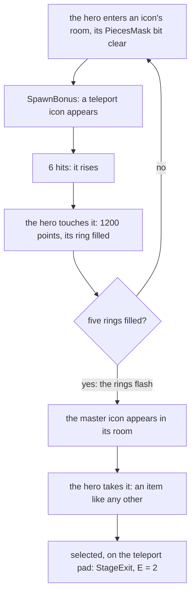

How to read it: the master icon is an ordinary carried item. The stage ends when it is selected and the hero stands
on the pad. In stage 1 it is kind 6, put in room 15 and used in room 2 (CheckStageExit, [doc 10](10-gameplay-logic.md)).

| Stage | Master icon | Where it appears | The pad |
| --- | --- | --- | --- |
| 1 | kind 6 | grid 0 room 15, after the fifth icon | grid 0 room 2 |
| 2 | kind 5 (the artefact) | grid 2, Medusa's room | grid 0 room 0, columns 12-15 |
| 3 | kind 6 | the throne giant's reward | grid 1 room 2, columns 10-13 |
| 4 | the exit item | grid 9, the hall beyond the boss | grid 8 room 1 |
| 5 | none | | the duel won: no exit |

**The point**: every stage is the same puzzle in a new costume. Five events give five icons, the icons give the master
icon, and the master icon opens the way out.

## 1.6 The rules

### Energy and lives

Energy runs from 46 (full) to 0. Each pass of contact with a danger takes a fixed amount, set in that danger's code.
The amounts, from every DamageHero call in the four listings:

| Stage | Damage (DamageHero's C) and the danger |
| --- | --- |
| 1 | 4: the danger zones, a hanging body, the warrior; 16: a flame jet |
| 2 | 2: Medusa's head; 4: the harpies, the drops; 20: Medusa's floor shot |
| 3 | 2: the swamp, the giant's fireball, the dragon's fire, a bog man; 3: the pyre; 6: a Viking; 40: a troll's swing |
| 4 | 2: a pendulum, the drain of a touch; 4: a deadly floor, a falling column, a touch |
| 5 | 9: any of Dameron's missiles (DamageHero `$7EDA`) |

Other rules of a life:

- A deadly cell at the hero's feet (fire, spikes, the pit) costs a life at once (HeroUpdate, [doc 10](10-gameplay-logic.md)).
- So does walking off the map sideways (column 0 or 32).
- A shard of a smashed urn gives 6 energy back (FragmentActor).
- Below 14 energy the hero flashes his colours.
- The shield item (kind 1 in stage 1) blocks the damage while its count lasts.

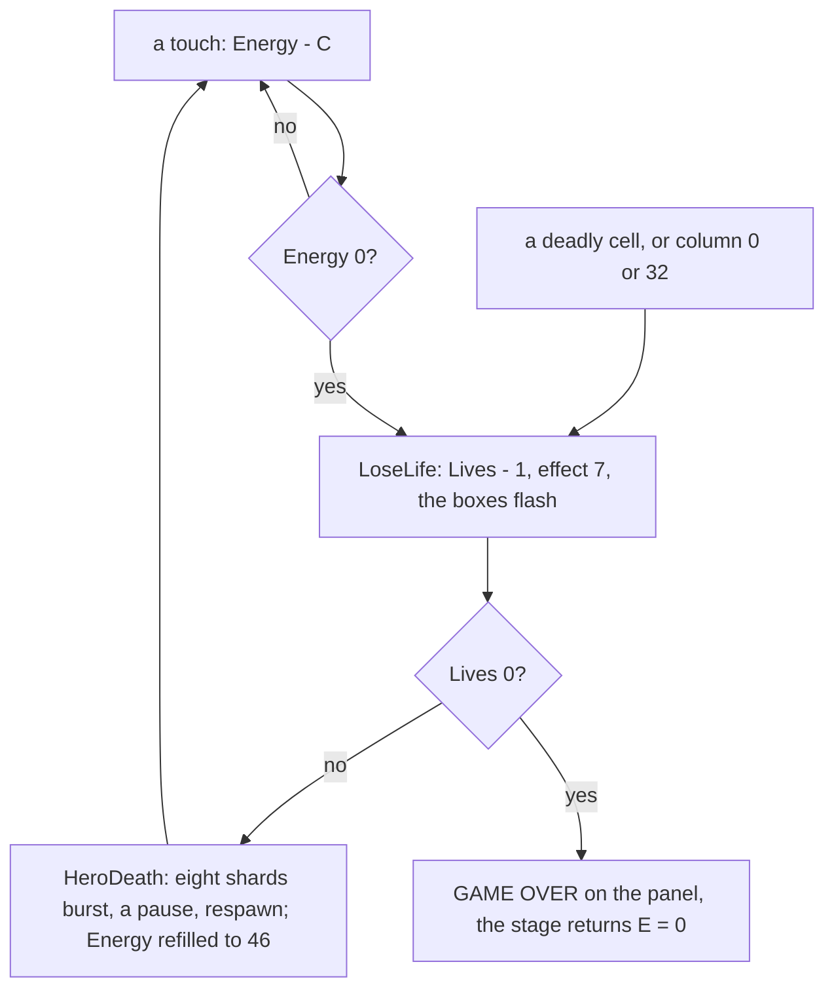

**A worked example.** The energy of the RZX run in stage 1 (`work/stage2/rzx/state.tsv`, RZX frames):

1. At 5786 the hero walks into room 3 with energy 46.
2. At 6053 he is in room 9 with energy 42: one pass of contact with a stage-1 danger, C = 4.
3. At 7547 he is in room 4 with energy 2: ten such passes.
4. At 8439 he has 14, at 8470 20: shards picked up, +6 each.
5. At 9376 he is back to 46.

Lives:

- The game starts with 5 (NewGame `$F090`).
- The lives pass from stage to stage in register H.
- An urn in stage 2 can release an extra life (ReleaseExtraLife), never above 5.
- The panel has six boxes, so the sixth is never lit.

### Credits and the game-over menu

The game starts with 4 credits. GameOver `$F24B` takes one at once (CreditsDec `$F25D`), then prints the menu.

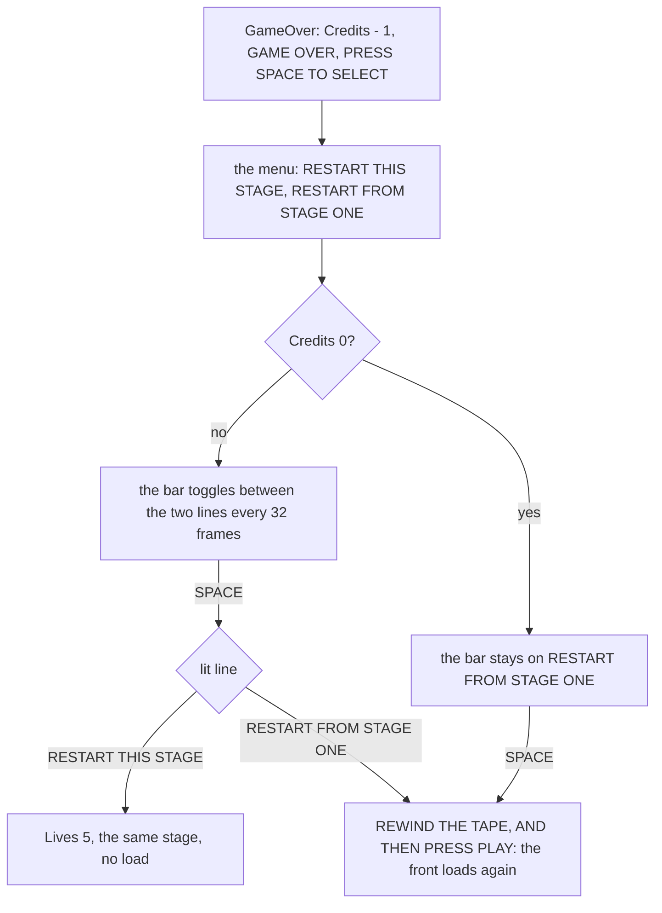

How to read it: the toggle is GameOverLoop `$F2A7`.

- Every frame whose FrameCounter AND `$1F` is 0 moves the option on.
- With 0 credits the next option is forced to 1, RESTART FROM STAGE ONE.
- So 4 credits buy three retries of a stage. The fourth game over leaves only the way back to stage one.

RESTART FROM STAGE ONE reloads the front from the tape (RestartFromStageOne `$F048`). START GAME then runs NewGame
again: score 0, lives 5, credits 4. No recording took this path.

The POKE files agree. "Credits 62045,0" is `$F25D`, the `DEC A` of CreditsDec.

### The score

The score lives in the resident, so it carries across stages. Score `$F9FB` is a word holding the low four decimal digits (0-9999); ScoreHigh `$F9FD` is a byte holding the high two (0-99). The stages add to it
through AddScore. Every call site, read from the five listings:

| Points | For | Stages | Site |
| --- | --- | --- | --- |
| 1200 | a teleport icon taken | 1-4 | PieceTaken (`$82E2` in stage 1) |
| 400 | an item picked up | 1-4 | ItemHandler (`$A101` in stage 1) |
| 25 | an urn's shard picked up (and 6 energy) | 1-4 | FragmentTouchLine |
| 20 | a strikeable thing destroyed (urn, skeleton) | 1-4 | ScoreBurst20 |
| 64 | a statue head | 1 | ScoreBurst64 `$A19E` |
| 160 | a hanging body | 1 | ScoreBurst160 `$A1D2` |
| 200 | a troll | 3 | ScoreBurst200 `$9FDA` |
| 2500 | the dragon | 3 | DragonBeaten `$A017` |
| 2000 | the throne giant | 3 | ThroneBossBeaten `$A032` |
| 1400 | the pharaoh's head | 4 | BossBeaten `$A28E` |
| 200 | a barrier block | 4 | ScoreBurst200 `$A224` |
| 80 | the mummy | 4 | ScoreBurst80 `$A1FE` |
| 0 | anything | 5 | AddScore has no caller in stage 5 |

**The point**: the score is a record of the route, not a goal. Nothing in the game reads it back, and there is no
high-score table.

## 1.7 The five stages

| Stage | Grids | Rooms | Enemies | Bosses and set pieces | Exit |
| --- | ---: | ---: | --- | --- | --- |
| 1 | 3 | 22 | hanging bodies, flame jets, fire pits, skeletons, the warrior | the winged demon (room 12), the dragon (grid 2) | master icon in room 2 |
| 2 | 3 | 15 | harpies, spirits, the pool, drops, statues | the hydra (three heads), Medusa | the artefact in grid 0 room 0 |
| 3 | 3 | 16 | Vikings, trolls, bog men, lightning | the pyre, the dragon (16 hits), the throne giant (30 hits) | kind 6 in grid 1 room 2 |
| 4 | 9 | 29 | scorpions, traps (pendulums, columns, slabs, spikes), the mummy | the barrier, the pharaoh's head (20 hits) | the exit item in grid 8 room 1 |
| 5 | 0 | 0 | Dameron's missiles | Dameron's four forms (80 hits) | none |

The rooms come from each stage's room tables (`src/res/stageN/rooms.txt`, [doc 7](07-objects.md)). Stage 5 has no
rooms: one screen, the duel.

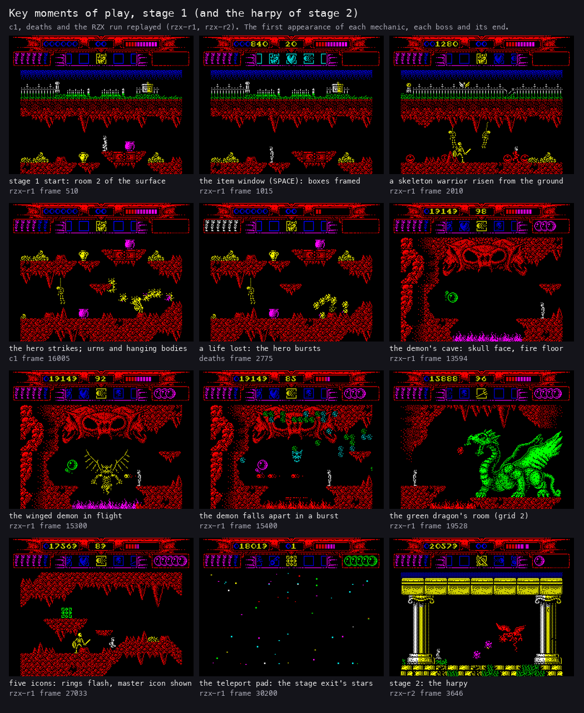

*Moments of the RZX run and the walks: rzx-r1 (stage 1), c1, deaths, rzx-r2 (stage 2). Made with `python3
tools/fig_design.py moments1 docs/img/design/moments-1.png`.*

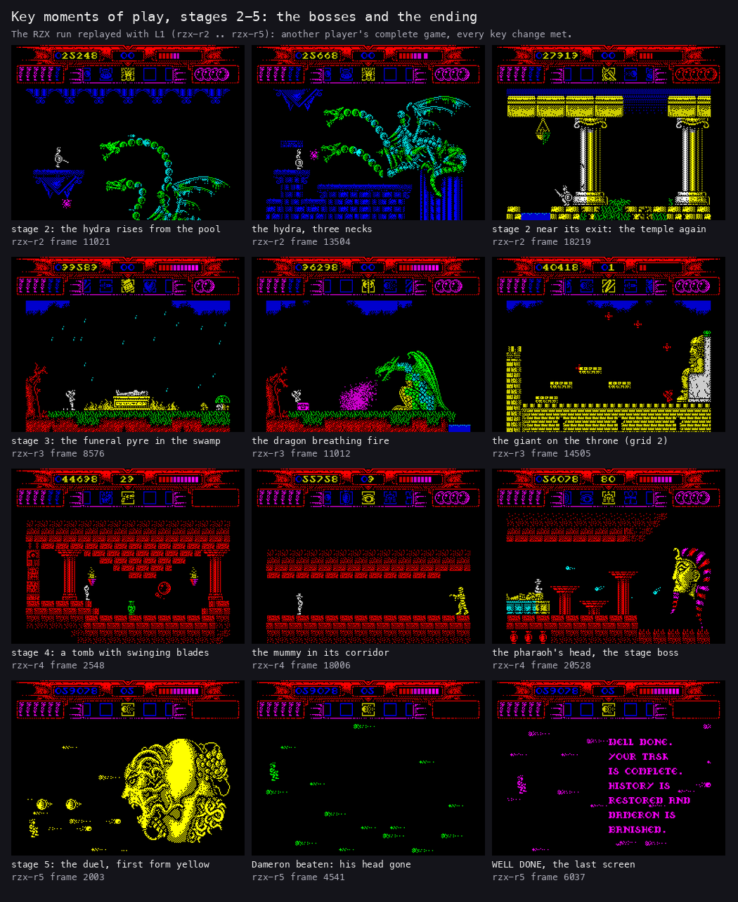

*The hydra and the temple (rzx-r2); the pyre, the dragon and the throne giant (rzx-r3); the tomb, the mummy and the
pharaoh's head (rzx-r4); the duel and the ending (rzx-r5). Made with `python3 tools/fig_design.py moments2
docs/img/design/moments-2.png`.*

How to read them: each screen names its recording and frame. The same frames are the windows of the animations in
[doc 10](10-gameplay-logic.md). Some of stage 1's are kept at full size:

- [a strike](img/play/c1-16005-strike.png), c1 16005;
- [the demon](img/play/rzx-r1-15300-demon.png), rzx-r1 15300, and [its burst](img/play/rzx-r1-15400-demon-burst.png),
  rzx-r1 15400;
- [the teleport](img/play/rzx-r1-30200-teleport.png), rzx-r1 30200;
- [a life lost](img/play/stage1-life-lost.png), deaths 2775.

### Stage 1: The road to hell

- Grid 0 is 18 rooms: a graveyard on the surface, the caves under it.
- Grid 1 is a shaft of three rooms. Grid 2 is the dragon's arena.
- Hanging bodies, flame jets, fire pits and urns fill grid 0. The warrior walks the graveyard.
- The winged demon sleeps in room 12's pit until nine skulls are thrown in.

### Stage 2: Greece, 400 BC

- Grid 0 is the temple, six rooms in a row. Grid 1 is the hydra's caves, eight rooms over a pool. Grid 2 is Medusa's
  room.
- Statues break under strikes and drop items. Harpies rise from lamps.
- The hydra's three heads take 9 hits each. Its body bursts after the last.
- Medusa's head spits floor shots. Only a low strike at the right frame beats one back.

### Stage 3: Scandinavia, 500 AD

- Grid 0 is the longship in a storm: rain, lightning on the masts, the sea.
- Grid 1 is 11 rooms of swamp and forest, with the funeral pyre, the dragon (room 8) and the drawbridge (room 10).
- Grid 2 is the castle hall with the giant on the throne.
- The rain puts the pyre's flames out. The body rises, and the bier drops an item.
- Only thrown objects hurt the dragon. The giant takes the hero's bolts.

### Stage 4: Egypt, 3000 BC

- Nine grids: the beach and its barrier, a hub with four doors, four tombs, the mummy's corridor, the boss's hall, the
  hall beyond.
- The tombs are rooms of traps.
- The altar's disc opens the mummy's corridor.
- The pharaoh's head fires shots in five directions and takes 20 bolts.

### Stage 5: Duel with Dameron

- The hero flies on the left of a starfield. Dameron's head fills the right.
- Dameron changes form after every 20 hits: four forms, 80 hits, 40 shots.
- Each form fires its own missiles.
- After the fourth form his head bursts, and the ending text stays on the screen.
- There is no exit: the game ends there ([doc 10](10-gameplay-logic.md)).

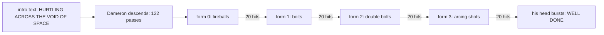

How to read it: DuelPhase `$FE43` is `$FF` during the intro, 0-3 for the forms and 4 when won. Each shot on the mouth
line gives two hits (PendingHits `$FE41`), so 10 shots end a form.

**The point**: stages 1-4 are adventures, stage 5 is a shooter. It has its own code for nearly everything, even its own
copy of the screen line table ([doc 2](02-architecture.md)).

## 1.8 The maps

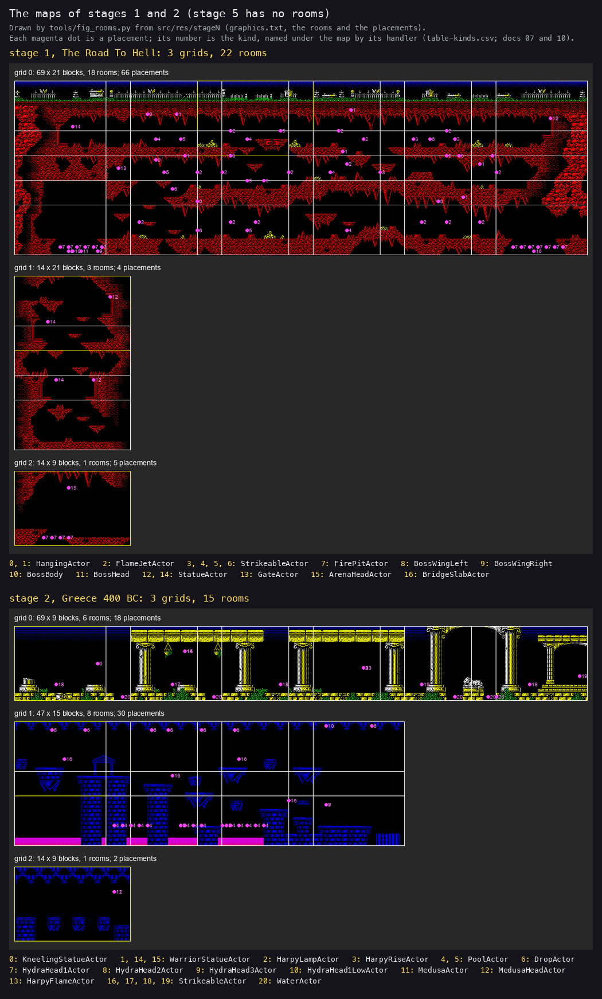

*The four map figures of `tools/fig_rooms.py`, scaled to the page. Made with `python3 tools/fig_design.py maps
docs/img/design/maps.png`.*

How to read it: each map is drawn from the stage's resources, never from the image.

- A grid is a field of 2 x 2-tile blocks.
- A room is a window of 14 x 9 blocks, stepping 11 columns and 6 rows.
- The yellow window is the start.

The full-size maps, and every room as the game builds it:

| Stage | Map | Rooms |
| --- | --- | --- |
| 1 | [stage1.png](img/maps/stage1.png) | [stage1-rooms.png](img/maps/stage1-rooms.png) |
| 2 | [stage2.png](img/maps/stage2.png) | [stage2-rooms.png](img/maps/stage2-rooms.png) |
| 3 | [stage3.png](img/maps/stage3.png) | [stage3-rooms.png](img/maps/stage3-rooms.png) |
| 4 | [stage4.png](img/maps/stage4.png) | [stage4-rooms.png](img/maps/stage4-rooms.png) |

Stage 1's tiles are on [their own sheet](img/sprites/stage1-tiles.png). How a room is unpacked and built is in
[doc 6](06-rendering.md) and [doc 7](07-objects.md).

## 1.9 A route: the RZX run

The RZX archive's run (`myth.rzx`, 128K, SPIN 0.5) plays the whole game. It loses no life in stage 1 and wins the
duel. Its six blocks, replayed with L1 (`work/stage2/notes-rec.md`):

| Block | Stage | RZX frames | Frames | Bosses, by the recording's own frame |
| --- | --- | --- | ---: | --- |
| rzx-r0 | the menu | 0-2063 | 2063 | DEFINE KEYS 9 8 6 7 0, START GAME |
| rzx-r1 | 1 | 2064-32 895 | 30 834 | the demon's cave 14 504-16 504, the dragon 19 528 |
| rzx-r2 | 2 | 32 896-52 067 | 19 175 | the hydra 13 504 |
| rzx-r3 | 3 | 52 068-69 521 | 17 455 | the dragon 11 012-12 128, the drawbridge 13 529, the throne giant 14 505 |
| rzx-r4 | 4 | 69 522-93 925 | 24 405 | the mummy 16 510-18 006, the pharaoh's head 19 570-20 528 |
| rzx-r5 | 5 | 93 926-100 150 | 6225 | the duel 1551-4005, WELL DONE 5663 |

The whole run is 100 151 frames, 33 minutes at 50 Hz. Stage 1 alone takes 10 minutes.

### Stage 1, room by room

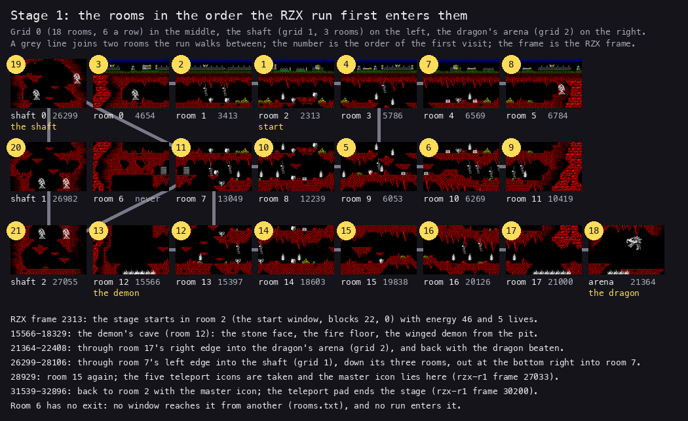

*The rooms of `docs/img/maps/stage1-rooms.png` placed as the grids join them, numbered by the RZX run's first visit
(`work/stage2/rzx/state.tsv`, the room window per frame). Made with `python3 tools/fig_design.py route1
docs/img/design/route-stage1.png`.*

How to read it: the number is the order of the first visit, the grey lines the passages walked. The run enters 21 of
the 22 rooms. Room 6 has no exit at all.

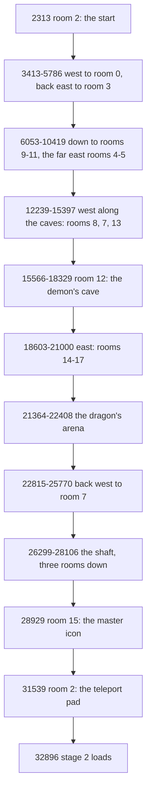

How to read it: RZX frames, from the room changes of the RZX dump. The energy column of the same dump gives the worked
example of [1.6](#16-the-rules).

### Stages 2 to 4

From the recordings' screens and the stage notes (`work/stage2/notes-stage2.md` ... `notes-stage4.md`):

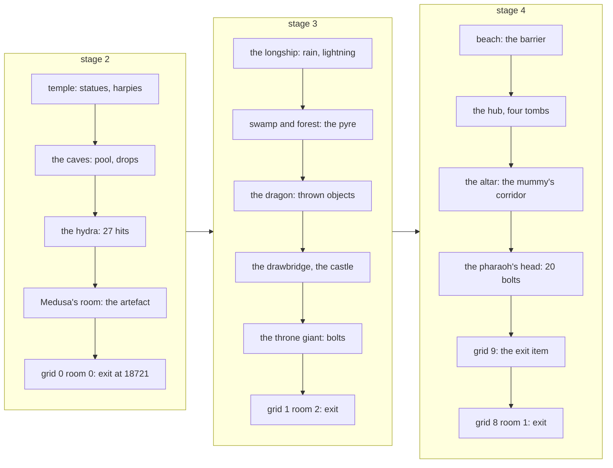

How to read it: the frame is the recording's own (rzx-r2 for stage 2). Each stage follows the pattern of
[1.5](#15-the-items-the-teleport-icons-and-the-master-icon): events, icons, the master icon, the pad.

**The point**: the RZX player knew the game. Each stage is one sweep: the five events, the master icon, back to the pad.

## 1.10 Known only from the code

- RESTART FROM STAGE ONE and REWIND THE TAPE (`$F048`): no recording chose it.
- The game-over menu with 0 credits.
- The quit key, CAPS SHIFT + SPACE (QuitStage): no recording pressed it.
- The extra life held at 5, and the sixth life box never lit.
- The H key of the instruction sheet: no code reads it; ENTER pauses.
