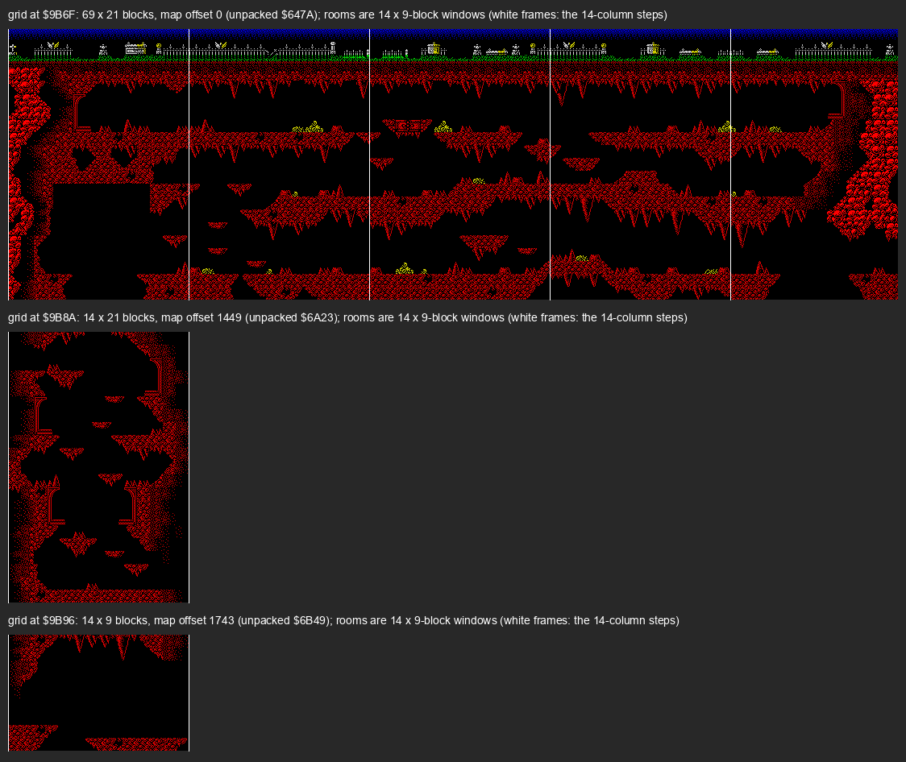

# 2. Architecture

What this covers: the machine budget, the memory map (a figure), the stages from the medium to play, the frame, the
main loop. The recordings it rests on: c1 (`work/stage1/c1`, a 48K from power-on, the original tape at signal speed,
its play window rebuilt as `work/stage1/c1o`, frames 15476-16658) and the stage recordings from the RZX run's
snapshots (WALKTHROUGH 6.0).

<!-- Figures this document needs (GUIDE.md 4.2), remove each line when it is in: -->
<!-- - the stages from power-on to play (mermaid) -->

## 2.1 The machine budget

A 48K game: banks 5, 2 and 0 only, also on a 128K (the RZX run's 128K snapshots have RAM 1, 3, 4 and 6 empty). The
128K's AY plays the sound effects; the 48K is silent ([WALKTHROUGH 0](../WALKTHROUGH.md#0-the-medium)). The memory
holds two layers:

- the **resident** part `$F03F-$FFFF`, put there by the Speedlock loader (copied to `$E000-$FFFF` at c1 frame 5166 and
  entered at `$F040`) and never loaded over;
- the **stage** part `$6C3F-$F03E`: first the main block (`$6C3F-$A83E`: the logo, credits, menu), then one stage block
  at a time over all of it (33 792 bytes each). Each stage block carries its own code: stage 1's main loop is at
  `$7839`, its variables at `$FE01-$FEFD`, its graphics and map packed at `$B4B2`.

## 2.2 The memory map

Stage 1 in play (c1's play window, L1 `work/stage1/c1o/l1.json`: what was executed, read and written; the contents
from `work/stage1/mem/c1-stage1.bin`, the memory at frame 15476):

| Range | Bytes | What | Witness |
| --- | ---: | --- | --- |
| `$4000-$57FF` | 6144 | the screen bitmap: the HUD (top four rows) and the play area | written in play |
| `$5800-$5AFF` | 768 | the attributes; read in play (332 of the first 512 bytes) | written and read in play |
| `$5B00-$6CFF` | 4608 | the play buffer: 144 lines of 32 bytes, cleared by ClearBuffer `$9AB5` (`PUSH HL` from `SP = $6D00`) and copied to the screen by CopyBuffer `$9ADA`; at a room change the stage's packed graphics are unpacked here first (`$9890`: `$B4B2` to `$5B00`, 4295 bytes) | all read and written in play |
| `$6D00-$77FF` | 2816 | stage variables and tables: the room's cells `$7280-$74BF` (cleared by `$A444`; RoomCells `$9928` writes 9 rows of 14 blocks from `$7282`, 64 bytes a row), actors `$74F2` (13 records of 18 bytes, `$A4CC`), flags `$74E0-$74F0`, the copy table at `$76A0` | read and written in play |
| `$7800-$B4B1` | 15 538 | stage 1's code: the entry `$7800`, the main loop `$7839`, the copy loop `$9B09`, Unrle `$A424`, the room records `$9B6F` | executed in play |
| `$B4B2-$C2B0` | 3583 | stage 1's tiles and map, RLE-packed (escape byte first; [map](#23-the-map-of-stage-1)) | read at a room change |
| `$C2B1-$F03E` | 11 662 | stage 1's other data: read in play over `$C2B1-$CFFF`, `$D800`, `$E000-$EBFF` (sprites and actors, to be named in stage 2) | read in play |
| `$F03F-$F5FF` | 1473 | resident: the stage loader with its texts ("PRESS PLAY ON TAPE", "STOP THE TAPE" at `$F607`), Print `$F3B0` | executed between stages |
| `$F600-$F9FF` | 1024 | resident: SetIm2 `$F635`, PlaySound `$F69B` (E = the effect, table `$F6BB`; jumped to from `$F9B0`), AyFrame `$F78A` and the channels `$F85E`, the handler `$F9B3`, the decimal table `$F9BF` (10000, 1000, 100, 10, 1), the score `$F9FB` (a word) and the amount `$F9FD` | executed every interrupt |
| `$FA00-$FCFF` | 768 | resident: tables (`$FB00`, `$FB60`), the key readers `$FC90-$FCDA` (one routine a key: port, bit, `XOR ($FCFA)`, patched by DEFINE KEYS) | read and executed in play |
| `$FD00-$FE00` | 257 | the IM 2 table, all `$FE` | read by every interrupt |
| `$FE01-$FEFD` | 253 | stage variables: lives `$FE61`, energy `$FE3F` (0 to `$2E`), the energy change `$FE4E`, the room column `$FE21` and row `$FE22`, the room record `$FE23`, the saved SP `$FE0E` | read and written in play |
| `$FEFE-$FF00` | 3 | `JP $F9B3`, the IM 2 vector | |
| `$FF01-$FF7D` | 125 | resident: the turbo loader (`LD (IX),L` at `$FF02`; its last instruction `RET` at `$FF7D`) | executed in loads |
| `$FF7E-$FFFF` | 130 | resident data that reads like 8 x 8 glyphs (`3C 42 42 52 4A 3C` at `$FFD9`), 89 bytes of it read in c1 before play and none in play; the stack lives on top of it: SP `$FFF9` in play, the lowest byte written `$FFD5` over every recording | read before play, written by the stack in play |

The stage 1 rows hold for every stage: each stage block runs its code from `$7800` (stages 1-5 executed
`$7800-$B4AF`, `$7800-$B7D4`, `$7800-$B4E9`, `$7800-$B779`, `$7800-$A35A` in their walks) and writes its own block
only at `$6D00-$77xx` and at single self-modified bytes ([WALKTHROUGH 6.2](../WALKTHROUGH.md#62-levels-objects-and-state)).

The heatmap of every recording's L1 (c1's play window, menu, deaths, s1-idle, s1-right to s5-right: 65 762 frames;
`python3 tools/merge_l1.py work/stage1/merged-l1.json ...` then `python3 ../../kit/heatmap.py
work/stage1/merged-l1.json docs/img/memory-heatmap.png --regions work/stage1/regions.txt --from 4000`). The code
band is `$7800-$B7D4`; the bright read band is `$A400-$AAFF` (the most read 256-byte blocks of the merge, data among the code that every pass reads, to be named in stage 2); writes
stay in the screen, the buffer, `$6D00-$77FF` and `$FE01-$FEFD`.

**The stack's low mark** over all of them is `$FFD5` (deaths, s2-right, s3-right; `$FFD7` in c1's play window):
43 bytes under `$FFFF`, over the glyph-like data, which nothing reads in play (whether a later stage
title prints from it is for stage 2). The menu writes `$FF00` and `$FF4D`: the turbo loader's own variables during a
stage load.

## 2.3 The map of stage 1

Drawn from the data by `python3 tools/stagemap.py work/stage1/mem/c1-stage1.bin B4B2 9B6F docs/img/maps/stage1.png
--sheet docs/img/sprites/stage1-tiles.png`. The format, read from the code ([WALKTHROUGH 6.2](../WALKTHROUGH.md#62-levels-objects-and-state)):

- the packed block `$B4B2-$C2B0` (3583 bytes) unpacks to 4295 bytes at `$5B00`: five words, offsets from `$5B0A`:
  tile kinds (`+$0000`, 196 bytes), tile bitmaps (`+$00C4`, 196 x 8), tile attributes (`+$06E4`, 196), blocks
  (`+$07A8`, 114 x 4 tile numbers: top left, top right, bottom left, bottom right) and the map (`+$0970`, 1869 bytes);
- the map holds three grids of block numbers, each named by a room record: `$9B6F` 69 x 21 blocks (the surface and
  the caves), `$9B8A` 14 x 21 (a shaft) and `$9B96` 14 x 9 (one room). Each record starts with the grid's width and
  height and holds its offset in the map at +6;
- a room is a 14 x 9-block window (28 x 18 cells) of a grid: RoomCells `$9928` takes it from row `$FE22` x width +
  column `$FE21` and writes it to `$7282`.

The tiles of stage 1 (196, each 8 x 8 with its attribute; numbered as the blocks use them):

