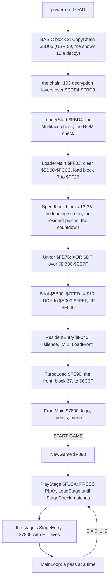
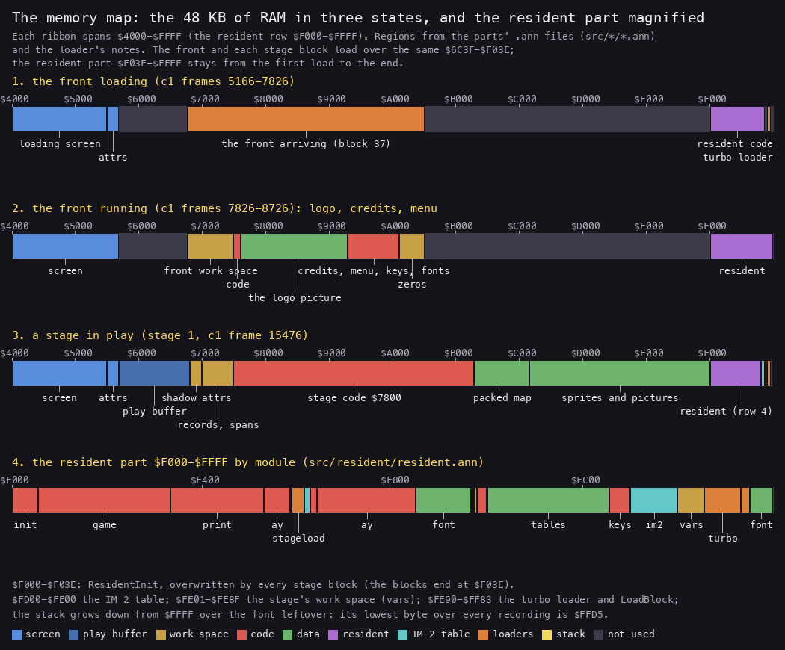
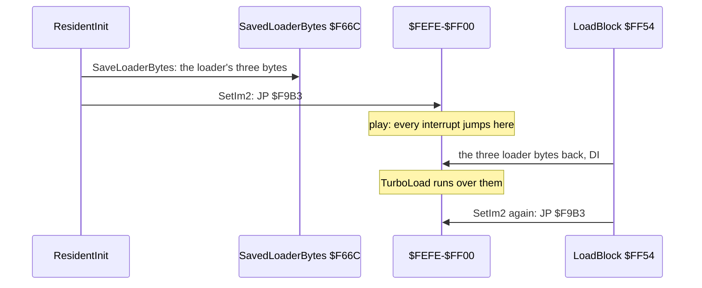
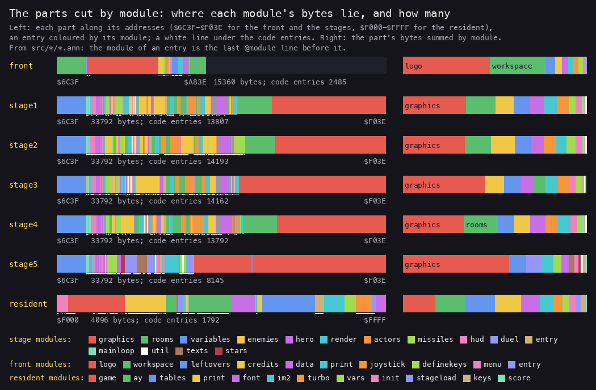
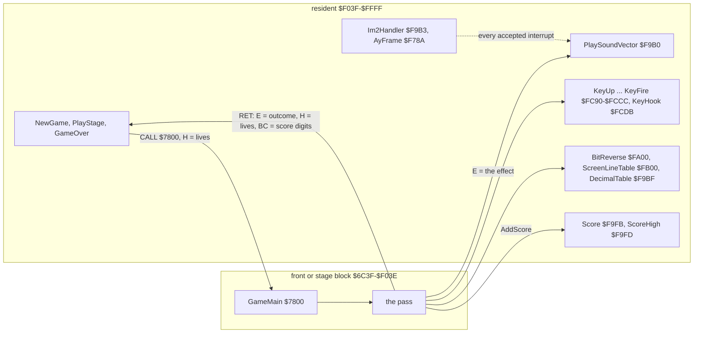
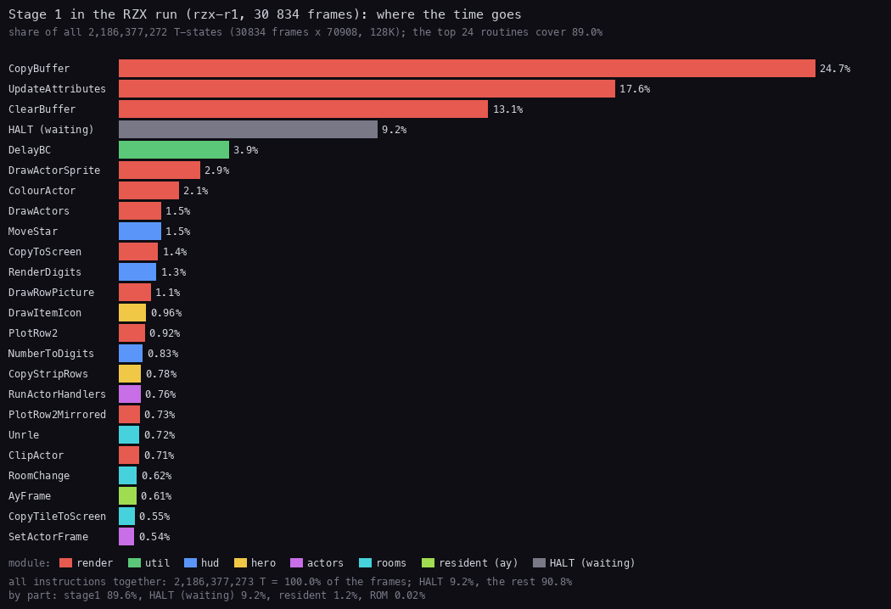
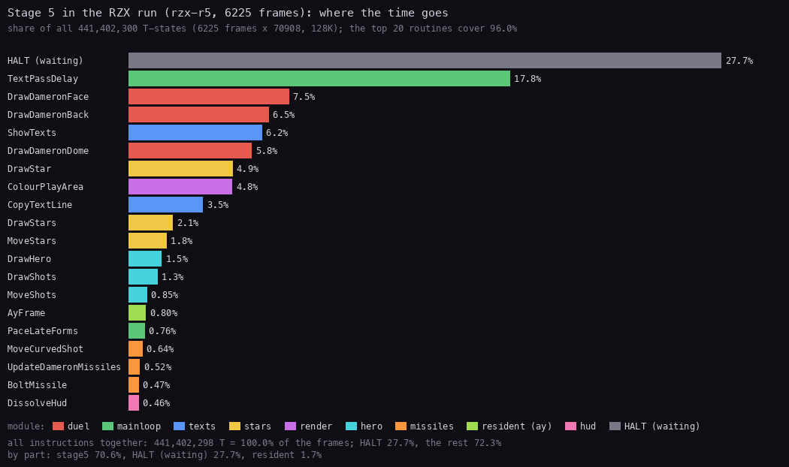
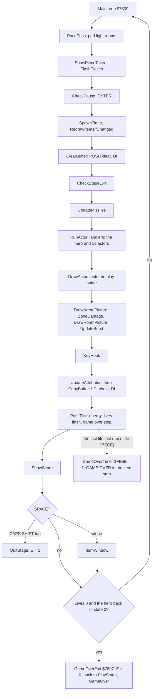
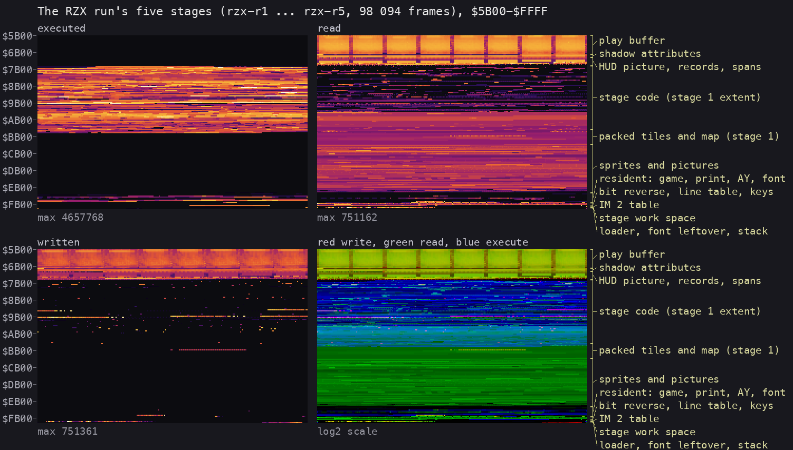
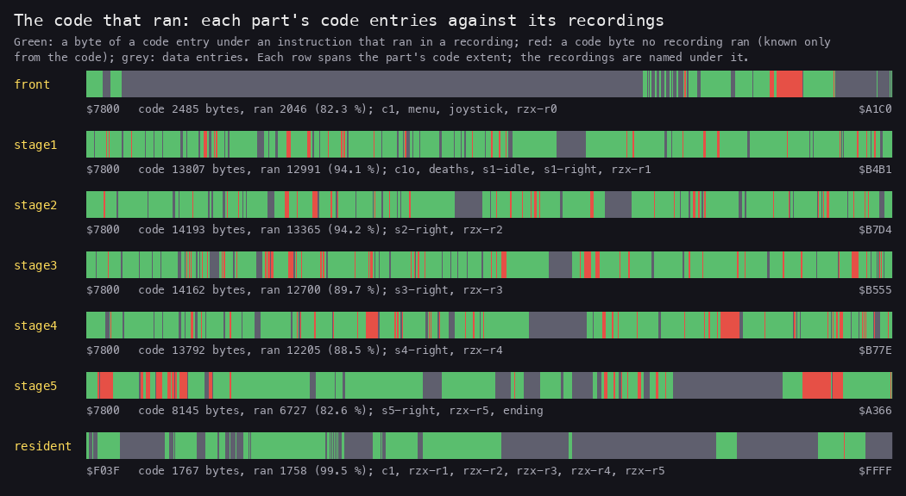

# 2. Architecture

What this covers:

- the machine budget: what a 48K and a 128K give the game;
- the stages from power-on to play;
- the memory map in its three states: the load, the front, a stage; the resident part and the IM 2 table;
- the module map: the thirteen parts and their modules;
- the frame budget: where the time of a pass goes, and the interrupts the game misses;
- the main loop's call graph;
- the heatmap and the stack;
- the code that ran and the leftovers;
- the 48K against the 128K.

The recordings it rests on ([WALKTHROUGH 6.0](../WALKTHROUGH.md#60-the-recordings)):

| Recording | Load | Used for |
| --- | --- | --- |
| `c1` | 48K from power-on, the original tape at signal speed | the load, the front, the memory in its first two states |
| `c1o` | c1's play window, frames 15476-16658 | stage 1's first rooms, the memory in play |
| `deaths`, `s1-idle`, `s1-right` ... `s5-right` | c1's stage 1 state, or the RZX snapshot of each stage | the code each stage runs in its first rooms |
| `rzx-r0` ... `rzx-r5` | the RZX run, block by block, with L1 | the time budget, the heatmap, the stack, the code that ran |
| `menu`, `joystick`, `ending` | c1's menu; snap5 with POKEs | the front's options; stage 5's last code |

## 2.1 The machine budget

Myth is a 48K game that also plays sound on a 128K.

- It uses only banks 5, 2 and 0: `$4000-$FFFF` as a 48K sees it.
- On a 128K, Boot `$5B00` writes `$10` to port `$7FFD` once: ROM 1 (48 BASIC), bank 0 at `$C000`; paging is not
  locked (bit 5, `$20`, stays clear).
  Nothing pages again.
- The RZX run's 128K snapshots have RAM 1, 3, 4 and 6 empty and only 198 bytes in RAM 7 ([README](../README.md)).
- What the 128K adds is the AY. The resident's IM 2 handler drives it every interrupt ([doc 9](09-sound.md)). On a 48K
  the AY writes go nowhere: the game is silent.

| Resource | Budget | Used by |
| --- | --- | --- |
| RAM | 48 KB, `$4000-$FFFF` | the screen 6912 bytes, the play buffer 4608, a stage block 33 792, the resident 4033 |
| CPU | 69 888 T a frame (48K), 70 908 (128K) | a pass of stages 1-4 takes 3.2-3.6 frames ([2.5](#25-the-frame-budget)) |
| Interrupts | 50 a second | IM 2, AyFrame only; 34-45 % of them are missed in play ([2.5](#25-the-frame-budget)) |
| Tape | one TZX of 53 blocks | the BASIC, the SpeedLock chain, the resident, the front, five stage blocks ([doc 3](03-build-and-load.md)) |
| Sound | the AY on a 128K, nothing on a 48K | 13 effects, no music in the game ([doc 9](09-sound.md)) |

**The point**: the 128K is not a memory upgrade here. The whole game fits in the 48K; the AY is its only use of the
128K.

## 2.2 The stages from power-on to play

From the loader's notes (`work/stage2/notes-loader.md`) and c1's frames ([doc 3](03-build-and-load.md)):



How to read it: everything above ResidentEntry runs once per load. Everything from PlayStage down runs once per stage.
The front and every stage are entered at the same address `$7800`, through the resident's `CALL GameMain`.

**The point**: three loaders run in turn. The ROM's loader takes the BASIC; the SpeedLock loader takes the resident
in small enciphered blocks; the resident's own turbo loader takes the front and the stages.

## 2.3 The memory map



*The 48 KB of RAM in the front's load, in the front, and in a stage; then `$F000-$FFFF` by the resident's modules.
From the parts' `.ann` files and the loader's notes. Made with `python3 tools/fig_arch.py memmap
docs/img/arch/memmap.png`.*

How to read it: the address grows to the right. The front and every stage block load over the same `$6C3F-$F03E`. The
resident part, `$F03F-$FFFF`, is loaded once and never loaded over.

Stage 1 in play (c1's play window and the RZX run; the other stages keep the same layout, with their own code and
data extents):

| Range | Bytes | What | Witness |
| --- | ---: | --- | --- |
| `$4000-$57FF` | 6144 | the screen bitmap: the panel (top 48 lines) and the play area | written in play |
| `$5800-$5AFF` | 768 | the attributes | written by UpdateAttributes |
| `$5B00-$6CFF` | 4608 | the play buffer: 144 lines of 32 bytes, linear; cleared by ClearBuffer `$9AB5`, copied by CopyBuffer `$9ADA`; at a room change the stage's packed tiles and map unpack here first | read and written every pass |
| `$6D00-$6FFF` | 768 | ShadowAttributes: the screen's colours, kept by the stage | every pass |
| `$7000-$77FF` | 2048 | as loaded, the panel's picture and colours; in play, the records over them: RoomAttributes `$7040`, Cells `$7280`, HeroRecord `$74E0`, Actors `$74F2` (13 x 18), Missiles `$75E0` (16 x 6), DigitBuffer `$7640`, SpanTable `$76A0` | every pass |
| `$7800-$B4B1` | 15 538 | stage 1's code with its tables: StageEntry `$7800`, MainLoop `$7839` | executed |
| `$B4B2-$C2B0` | 3583 | StageGraphics: the tiles and the map, RLE-packed | read at a room change |
| `$C2B1-$EFE0` | 11 568 | the sprites and pictures | read when drawn |
| `$EFE1-$F03E` | 94 | zeros, BlockEnd | never read |
| `$F03F-$FCFF` | 3265 | the resident: the game chain, Print, the AY driver, the font, the tables, the key readers | executed |
| `$FD00-$FE00` | 257 | Im2Table, all `$FE` | read at every interrupt |
| `$FE01-$FE8F` | 143 | the stage's work space: Lives, Energy, the room, PiecesMask, ... | every pass |
| `$FE90-$FF53` | 196 | TurboLoad, whose bytes `$FEFE-$FF00` double as the IM 2 jump | between stages |
| `$FF54-$FF83` | 48 | LoadBlock and StageCheck `$FF7F` | between stages |
| `$FF84-$FFFF` | 124 | RomFontLeftover, with the stack on top of it | the stack in play |

The stage 1 rows hold for every stage. Each stage's code starts at `$7800` and ends at `$B4B1`, `$B7D4`, `$B4E9`,
`$B77E` and `$A366` for stages 1-5 ([2.4](#24-the-module-map)). Each block writes its own bytes only in
`$6C3F-$77FF` and at single self-modified bytes ([WALKTHROUGH 6.2](../WALKTHROUGH.md#62-levels-objects-and-state)).

### The IM 2 table and the jump in the loader

The IM 2 set-up is three tables and a trick. From `src/resident/im2.asm`:

```asm
SetIm2:                       ; HL = the handler (Im2Handler $F9B3)
  DI
  LD A,$C3                    ; JP
  LD (Im2Jump),A              ; $FEFE
  LD (Im2Jump+$0001),HL
  LD A,$FD
  LD I,A                      ; the table at $FD00
  IM 2
  EI
  RET
```

**A worked example.** An interrupt with an idle bus:

1. The bus holds `$FF`. The Z80 reads the vector from `I` x 256 + `$FF` = `$FDFF`.
2. `$FDFF` and `$FE00` are both `$FE` (Im2Table is 257 bytes of `$FE`). The vector is `$FEFE`.
3. `$FEFE` holds `JP $F9B3`. Im2Handler runs AyFrame in the alternate registers and returns.

Any other bus byte gives the same vector, since every byte of the table is `$FE`.

The jump sits inside the turbo loader. `$FE90-$FF53` is TurboLoad, and its bytes `$FEFE-$FF00` are three of its
instructions.

- At start-up SaveLoaderBytes `$F629` copies the three bytes to SavedLoaderBytes `$F66C`, then SetIm2 writes the JP.
- Before a load LoadBlock `$FF54` puts the loader's bytes back. Interrupts are off for the whole load.
- After the load SetIm2 writes the JP again.



**The point**: the vector table, the jump and the loader share the top 768 bytes of RAM. 3 bytes of the loader are
swapped in and out at every load.

## 2.4 The module map

The source is thirteen parts, each assembled to its own bytes ([README](../README.md), `work/stage2/NOTES.md` 1):
basic, chain, sl1, unxor, sl1end, boot, resident, front and stage1-5. The parts that live in RAM during play:



*Each part along its addresses, each entry coloured by its module, with the code entries underlined; on the right the
bytes summed by module. From `src/*/*.ann`. Made with `python3 tools/fig_arch.py modules docs/img/arch/modules.png`.*

How to read it: the four adventure stages have the same twelve modules in nearly the same places. Graphics fill the
top half of every stage block. Stage 5 keeps the variables and the render layout but has its own duel, texts and stars.

| Part | Range | Code entries | Data and work space | Modules |
| --- | --- | ---: | ---: | --- |
| resident | `$F000-$FFFF` | 1792 | 2304 | init, game, print, ay, stageload, im2, font, vars, score, tables, keys, turbo |
| front | `$6C3F-$A83E` | 2485 | 12 875 | workspace, entry, logo, credits, menu, definekeys, joystick, print, data, leftovers |
| stage1 | `$6C3F-$F03E` | 13 807 | 19 985 | variables, entry, mainloop, render, util, hud, hero, missiles, enemies, actors, rooms, graphics |
| stage2 | `$6C3F-$F03E` | 14 193 | 19 599 | the same twelve |
| stage3 | `$6C3F-$F03E` | 14 162 | 19 630 | the same twelve |
| stage4 | `$6C3F-$F03E` | 13 792 | 20 000 | the same twelve |
| stage5 | `$6C3F-$F03E` | 8145 | 25 647 | variables, entry, mainloop, render, duel, hud, hero, missiles, util, stars, texts, graphics |

The counts are bytes of the `.ann` entries: "code" the entries of type `c` with the data inside them. The stage modules:

| Module | What | Stage 1's main entries |
| --- | --- | --- |
| variables | the work space `$6C3F-$77FF` | PlayBufferTail, ShadowAttributes, HudPicture |
| entry | the entry and set-up | StageEntry `$7800`, StageSetUp `$97AC` |
| mainloop | the pass | MainLoop `$7839`, PacePass `$795D`, CheckPause `$79B1` |
| render | the buffer, the sprites, the colours | ClearBuffer `$9AB5`, CopyBuffer `$9ADA`, UpdateAttributes `$8CAA`, DrawActors `$A5DF` |
| util | helpers | DelayBC `$79AB`, NextSeed `$8B76`, Multiply `$8B24` |
| hud | energy, lives, score, panel | DrawEnergyBar `$A3C5`, NumberToDigits `$8BE3`, LoseLife `$7ECE` |
| hero | the hero and the items | HeroActor `$AA3E`, HeroUpdate `$AC3D`, ItemWindow `$7C27` |
| missiles | 16 missile records | UpdateMissiles `$B2E6`, AddMissile `$B28D` |
| enemies | enemies, hazards, bosses | FirePitActor `$8D6D`, ArenaHeadActor `$90E7`, StrikeableActor `$A7C4` |
| actors | the actor records | RunActorHandlers, SetActorFrame `$AA02`, ActorKinds `$9C8A` |
| rooms | rooms and the map | RoomChange `$988B`, Unrle `$A424`, CheckRoomExits `$AADA` |
| graphics | packed tiles and map, sprites, pictures | StageGraphics `$B4B2`, the sprite sets `$C2B1-$EFE0` |

The five stages are not one engine with five data sets.

- At the same address only 4771-7446 of the 33 792 bytes of two stages agree, mostly zeros and tables.
- The longest identical run at other addresses is under 410 bytes (`work/stage2/NOTES.md`, section 1).
- So each stage is its own part, with the same jobs named alike (`tools/stage_names.py`).

How the parts call each other: the stages call into the resident through fixed addresses, and the resident calls the
front and the stages at `$7800`.



**The point**: the resident is a small operating system for the blocks: a loader, a sound driver, key readers,
tables and a score. Every block finds them at the same addresses.

## 2.5 The frame budget



*The T-states of rzx-r1 (stage 1 of the RZX run, 30 834 frames) summed per routine, coloured by module. Made with
`python3 ../../kit/fig_budget.py work/stage2/rec/rzx-r1/l1.json docs/img/arch/budget-stage1.png --ann
src/stage1/stage1.ann,page=0/2/5,range=6C3F-F03E --ann src/resident/resident.ann,page=0/2/5,range=F03F-FFFF,label=resident
--top 24`.*

How to read it: a bar is the routine's share of every T-state of the recording. HALT is the CPU waiting: the stage
title, the item window and the stage loader, not the pass.

- The three render routines take 55 %: CopyBuffer 24.7 %, UpdateAttributes 17.6 %, ClearBuffer 13.1 %.
- DelayBC is 3.9 %: the busy wait PacePass adds in light rooms.
- The AY driver, run from the interrupt, is 0.6 %.



*The same for rzx-r5 (stage 5, 6225 frames). Made with `python3 ../../kit/fig_budget.py
work/stage2/rec/rzx-r5/l1.json docs/img/arch/budget-stage5.png --ann src/stage5/stage5.ann,page=0/2/5,range=6C3F-F03E
--ann src/resident/resident.ann,page=0/2/5,range=F03F-FFFF,label=resident --top 20`.*

How to read it: stage 5 waits for the frame. Its main loop HALTs every pass, and HALT is 27.7 %. TextPassDelay pads
the passes while a text is shown (17.8 %).

Passes, frames and interrupts in each stage of the RZX run (the L1 counts of MainLoop and of Im2Handler `$F9B3`):

| Stage | Frames | Passes (MainLoop) | Frames a pass | Interrupts taken | Share of the frames |
| --- | ---: | ---: | ---: | ---: | ---: |
| 1 | 30 834 | 9313 | 3.31 | 18 993 | 61.6 % |
| 2 | 19 175 | 5806 | 3.30 | 10 663 | 55.6 % |
| 3 | 17 455 | 4902 | 3.56 | 10 856 | 62.2 % |
| 4 | 24 405 | 7675 | 3.18 | 16 015 | 65.6 % |
| 5 | 6225 | 2811 | 2.21 | 4945 | 79.4 % |

The game misses about 40 % of the interrupts in stages 1-4. ClearBuffer and CopyBuffer run with interrupts off.

- ClearBuffer moves SP into the play buffer and clears it with PUSH HL: 2304 PUSHes, about 27 000 T
  uncontended, 29 000-31 000 T measured (29 464 T in c1, 30 761 T a pass in rzx-r1, with contention).
- CopyBuffer moves SP along the span table: POP BC, POP HL, POP DE for each span.
- An interrupt while SP walks the buffer would push its return address into the picture. So both start with DI.
- The Z80 takes an interrupt only while the INT line is low, about 32 T at the frame's start. An INT that falls inside
  a DI stretch is lost.

**A worked example.** A pass of stage 1 in the RZX run:

1. 3.31 frames x 70 908 T = 234 700 T a pass.
2. CopyBuffer's share, 24.7 % of all T-states, is about 58 000 T a pass. ClearBuffer's 13.1 % is about 30 700 T.
3. Together about 88 700 T of each pass run with interrupts off: 38 % of the pass.
4. So about 38 % of the INTs fall in a DI stretch and are lost. The L1 counts give 38.4 % for stage 1.

The sound driver runs once per taken interrupt, so the effects play about 40 % slower in play than at the menu
([doc 9](09-sound.md)).

**The point**: Myth trades the interrupt for speed. The PUSH clear and the LDI copy are the fastest ways to move the
buffer, and both need SP, so both need the interrupts off.

## 2.6 The main loop's call graph

Stage 1's pass, from MainLoop `$7839` (`src/stage1/mainloop.asm`, [doc 4](04-game-loop.md)):



How to read it: one pass is one step of the game. Everything is drawn into the play buffer between ClearBuffer and
CopyBuffer. The screen sees only the finished picture.

**The point**: there is no frame sync in stages 1-4. A pass takes as long as it takes, and PacePass only pads the
light rooms ([doc 4](04-game-loop.md)).

## 2.7 The heatmap and the stack



*The L1 of rzx-r1 ... rzx-r5 summed by `tools/merge_l1.py` into `work/docs/myA/heat/rzx-play.json`, drawn from
`$5B00`. Made with `python3 ../../kit/heatmap.py work/docs/myA/heat/rzx-play.json docs/img/arch/heatmap.png --regions
work/docs/myA/heat/regions.txt --from 5B00 --cell 2`.*

How to read it: one row is 256 bytes, the brightness is log2 of the count.

- Execution fills `$7800` to about `$B7D4`: the code of the longest stage. Above it only the resident runs.
- Reads cover the play buffer, the records and the graphics: the sprites at `$C2B1` and up are read when drawn.
- Writes stay in the play buffer, `$6D00-$77FF` and the work space. Stage code is written only at its self-modified
  bytes: the LDI chain's patch, the row plotters, the screen addresses.

The stage 1 walks' heatmap from the first stage of this case is kept for comparison:


*The L1 of c1's play window, menu, deaths, s1-idle and s1-right to s5-right (65 762 frames). Made with `python3
../../kit/heatmap.py work/stage1/merged-l1.json docs/img/memory-heatmap.png --regions work/stage1/regions.txt --from
4000`.*

### The stack

The stack grows down from `$FFFF`, over RomFontLeftover `$FF84-$FFFF` that nothing reads in play. Writes per stack
byte over the RZX run (the L1's byte counts of page 0):

| Bytes | rzx-r1 writes | rzx-r2 writes | rzx-r5 writes | Depth |
| --- | ---: | ---: | ---: | --- |
| `$FFF9-$FFFA` | 673 | 159 | 2813 | the busiest level in stage 5 |
| `$FFF5-$FFF6` | 7631 | 4815 | 130 | the busiest level in stages 1-4 |
| `$FFEF-$FFF0` | 1110 | 533 | 30 | |
| `$FFE5-$FFE6` | 360 | 114 | 0 | |
| `$FFDB-$FFDC` | 129 | 54 | 0 | |
| `$FFD5-$FFD6` | 22 | 12 | 0 | the low mark |

The low mark is `$FFD5` in every stage but stage 5 (`$FFE9`). That is 43 bytes under `$FFFF`: 21 words. LoadBlock
writes `$FF00` and `$FF4D` during a load: those are the turbo loader's own variables, not the stack.

**The point**: the stack needs 43 bytes and has 124. No code puts the stack anywhere else, except ClearBuffer and
CopyBuffer, which borrow SP with the interrupts off.

## 2.8 The code that ran, and the leftovers



*Each part's code entries against the L1 of its recordings: green ran, red never ran, grey data. Made with `python3
tools/fig_arch.py coverage docs/img/arch/coverage.png`.*

How to read it: a red stretch is code known only from the code. Every such entry says so in its `.ann` comment.

| Part | Code bytes | Ran | Recordings |
| --- | ---: | ---: | --- |
| front | 2485 | 2046 (82.3 %) | c1, menu, joystick, rzx-r0 |
| stage1 | 13 807 | 12 991 (94.1 %) | c1o, deaths, s1-idle, s1-right, rzx-r1 |
| stage2 | 14 193 | 13 365 (94.2 %) | s2-right, rzx-r2 |
| stage3 | 14 054 | 12 592 (89.6 %) | s3-right, rzx-r3 |
| stage4 | 13 792 | 12 205 (88.5 %) | s4-right, rzx-r4 |
| stage5 | 8145 | 6727 (82.6 %) | s5-right, rzx-r5, ending |
| resident | 1767 | 1758 (99.5 %) | c1, rzx-r1 ... rzx-r5 |

The leftovers, in groups (the parts' notes, `work/stage2/NOTES.md`):

| Where | What | Why it is a leftover |
| --- | --- | --- |
| front `$94DB`, `$980B`, `$9A94`, `$9BC7`, `$A124` | OldStripedScreen, OldPaintBoxes, OldBouncingBars, OldRevealWide10, OldDefineKeysTexts ("DOW\N", sic) | an earlier menu: no CALL, JP or table names them |
| resident `$FF84-$FFFF` | RomFontLeftover: bytes that read as 8 x 8 glyphs | read only during the load, the stack's room in play |
| resident `$F5D9`, `$F9BD`, `$F646` | DelayB, DropReturn, CopyToScreen | named by stage 4's code or by nothing; never run |
| stages 2-4 | BossBurst, BossShots, AimedShot | stage 1's boss shots, carried into the next stages' code, never called there |
| stage 5 `$74E0-$763F` | stage 1's actor and missile records | only stage-1 leftovers in stage 5 touch them |
| every stage | HangFlashBorder | a border-flashing endless loop; no code reaches it |
| stage 1 `$EFE1-$F03E`, stage 2 `$EF12-$F03E`, stage 4 `$E98B` (1716 zeros) | zeros | the block is always 33 792 bytes |
| stages 1-4 | QuitStage | runs only on CAPS SHIFT + SPACE, which no recording pressed: not a leftover, only unwitnessed |

**The point**: the stages were made by copying the previous one and changing it. What one stage needed and the next
did not is often still there, unreached.

## 2.9 The 48K and the 128K

| | 48K | 128K |
| --- | --- | --- |
| The load | the same tape, the same blocks | the same; the ROM check skips the timing compare on a +2A/+3 ROM |
| Paging | none | Boot writes `$10` to `$7FFD`: ROM 1, bank 0, not locked (bit 5 clear) |
| Memory used | `$4000-$FFFF` | the same: banks 5, 2, 0 only |
| Sound | silent: the AY writes go nowhere | 13 effects through the AY, no music |
| Frame | 69 888 T | 70 908 T: a pass takes slightly fewer frames |
| Code paths | the same | the same: no code tests the model after the load |

**A worked example.** The RZX run is a 128K run, c1 a 48K one. In stage 1's first rooms c1 takes 656 interrupts in
1182 frames (55.5 %), the RZX run 61.6 % over the whole stage. Both lose the interrupt to the same DI stretches.

**The point**: one tape, one program. The 128K's only difference a player can hear is the AY, and its only difference
the code can see is the frame length.
