# 3. Build and load

What this covers:

- the tape block by block, as a picture;
- the BASIC line and the number it hides;
- the decryption chain of 103 layers;
- the Multiface check and the memory wipe;
- the SpeedLock reader: its pilot, its marks, its bit timing, its keys and its block table;
- the timing check;
- the attribute reveal and the countdown, run inside the bit loop;
- Unxor and Boot, which put the resident part in place;
- the turbo loader, the stage blocks, StageCheck and REWIND THE TAPE;
- every way the load can fail;
- the releases and copies (the standard Spectrum tapes only);
- the source build that gives the tape back byte for byte;
- what is known only from the code.

The recordings it rests on ([WALKTHROUGH 6.0](../WALKTHROUGH.md#60-the-recordings)):

| Recording | What it is | Used for |
| --- | --- | --- |
| `c1` | a 48K from power-on, the original tape played at signal speed, `fast_tape` and `turbo_tape` off | the whole load up to stage 1; every frame number here unless another recording is named |
| `stageload` | the RZX's state before stage 2 with the original loader bytes put back, then the original tape from stage 2's block | the stage loader on a 128K |
| `work/stage1/old/stage2` | `c1`'s menu, the tape sought to stage 2's block | StageCheck rejecting three blocks |

Every animation was made from `c1` on the case's own emulator instance. Each caption names the frames and the command.

## 3.1 The tape block by block

`orig/Myth-HistoryInTheMaking.tzx.zip` holds one TZX of 53 blocks. `python3 tools/tzxblocks.py list
work/stage1/media/myth.tzx` lists them. Times are the TZX's own: the pulses at 3.5 MHz, plus the pause after each.

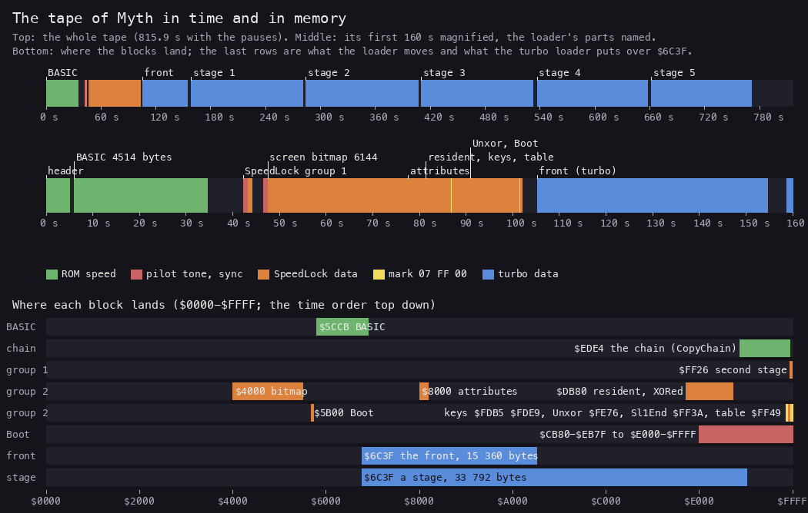

*The tape of Myth: the whole tape in time (top), its first 160 seconds magnified (middle), and where each block lands
in memory (bottom). Made with `python3 tools/fig_load.py tape docs/img/load/tape.png` from the TZX's block list
and the loader's sources.*

How to read it:

- The top band is time. The five stage blocks are three quarters of the tape: about two minutes each.
- The middle band is the load before the game. The ROM-speed blocks are green, the SpeedLock blocks orange, the
  turbo block blue.
- The yellow ticks in the orange part are the 3-byte marks between the SpeedLock blocks.
- The bottom rows are memory, `$0000` at the left. Each row is one step of the load, top down in time order.

| TZX block | Kind | Bytes | Lands at | Time | `c1` |
| --- | --- | ---: | --- | ---: | --- |
| 0 | archive info | | "Speedlock 7", "Original", "TZXed by Andrew Barker" | | |
| 1 | ROM header | 17 | Program "MYTH", 4514 bytes, LINE 0 | 5.08 s | PLAY at 234 |
| 2 | ROM data | 4514 | the BASIC at PROG `$5CCB-$6E6C` | 28.49 s | USR at 1963 |
| 3-8 | group "Speedlock 7 Block 1": tone, sync, the piece `$E8`, 171 bytes | 171 | the second stage `$FF26-$FFCF` | 1.79 s + 2.5 s pause | entered at 2387 |
| 9-36 | group "Speedlock 7 Block 2": tone, sync, `$E8`, then 12 blocks, each after a 3-byte mark | 11 222 | the screen, the resident's pieces, the keys, the table, Unxor, Sl1End, Boot | 55.4 s + 3.3 s pause | 2387-5166 |
| 37 | turbo, flag `$56` | 15 360 | the front `$6C3F-$A83E` | 49.39 s + 4.2 s | 5167-7826 |
| 38 | stop the tape | | | | |
| 39-40 | text "Stage 1: The Road To Hell", turbo | 33 792 | stage 1 over `$6C3F-$F03E` | 122.03 s + 3.5 s | 8626-15079 |
| 41 | stop | | | | |
| 42-43 | text "Stage 2: Greece 400 BC", turbo | 33 792 | stage 2 | 122.10 s + 3.8 s | |
| 44 | stop | | | | |
| 45-46 | text "Stage 3: Scandinavia 500 AD", turbo | 33 792 | stage 3 | 122.21 s + 4.5 s | |
| 47 | stop | | | | |
| 48-49 | text "Stage 4: Egypt 3000 BC", turbo | 33 792 | stage 4 | 120.71 s + 4.4 s | |
| 50 | stop | | | | |
| 51-52 | text "Stage 5: Duel With Dameron", turbo | 33 792 | stage 5 | 109.38 s + 44.6 s | |

The whole tape plays in 815.9 s with its pauses: 40 797 frames.

The emulator counts blocks its own way. Group markers, text blocks and the archive block are not blocks to it. Its
block 32 is the front, 33 the stop after it, and the stage blocks are its 34, 36, 38, 40 and 42.

The twelve blocks of group 2, in the order the loader reads them:

| TZX block | Bytes | Lands at | What it is |
| ---: | ---: | --- | --- |
| 13 | 6144 | `$4000` | the loading screen's bitmap, straight onto the screen |
| 15 | 768 | `$8000` | the loading screen's attributes, kept off the screen |
| 17 | 1152 | `$DE80` | the resident's piece `$F300-$F77F`, XORed with `$DF` |
| 19 | 2 | `$FDB5` | a new key for the loader's store: `LD A,$86` |
| 21 | 4 | `$FDE9` | a new key for the last-byte store: `LD A,$86` / `XOR L` / `ADD A,...` |
| 23 | 55 | `$FF49` | the block table, over itself |
| 25 | 768 | `$DB80` | the resident's piece `$F000-$F2FF`, XORed |
| 27 | 2176 | `$E300` | the resident's piece `$F780-$FFFF`, XORed |
| 29 | 115 | `$FE76` | Unxor, over the timing check |
| 31 | 15 | `$FF3A` | Sl1End, over the second stage's own end |
| 33 | 33 | `$5B00` | Boot, its first 33 bytes |
| 35 | 15 | `$5B21` | Boot's last 14 bytes and the check byte |

Between each two blocks is a mark: `07 FF 00` at a slower bit rate (875 T and 1750 T a pulse against 714 T and 1428
T). The "flag" tzxblocks.py prints for each block is only its first enciphered byte.

The main block and the stage blocks are not enciphered. Their bytes on the tape are their bytes in memory.

**The point**: the game blocks hide nothing. Every protection is in the tape's first 105 seconds: the BASIC, the
chain and the SpeedLock blocks.

## 3.2 The BASIC line and its hidden number

The program is one line, line 0. LIST would show it as:

```text
0 INK 0: PAPER 0: RANDOMIZE USR ((PEEK 23635+256*PEEK 23636)+10)
```

The header's LINE 0 runs it at once. 23635 is the system variable PROG, the program's first byte. So the line reads
as "call the program's address plus 10". That would land inside the line itself.

The ROM does not read the digits. Each number in a BASIC line is stored twice: its digits for LIST, then the byte
`$0E` and five bytes in the calculator's form. The interpreter reads only the five bytes. The tape's line carries
the digits `10` but the number 59.

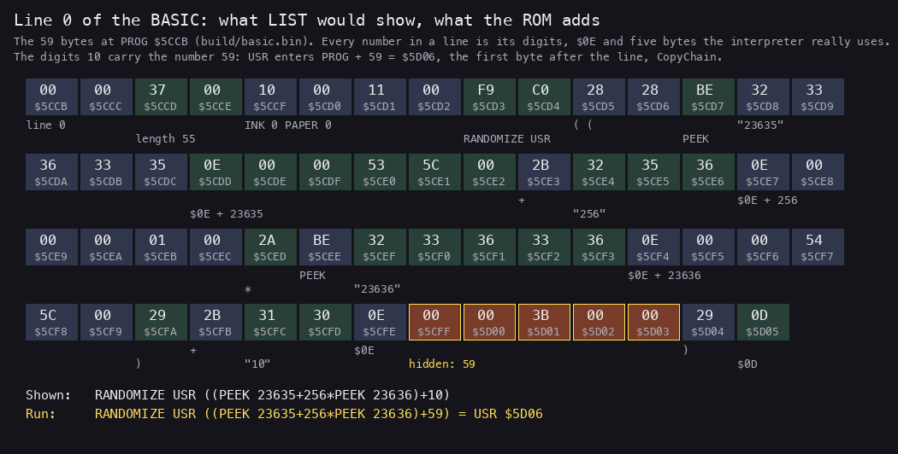

*The 59 bytes of line 0 at PROG `$5CCB`: the tokens, the digits and the five-byte numbers. The digits 10 hide
the number 59 (orange). Made with `python3 tools/fig_load.py basic docs/img/load/basic-line.png` from
`build/basic.bin`.*

### Worked example: the five bytes after "10"

The bytes after `31 30 0E` (the digits "10" and the number marker) are `00 00 3B 00 00`.

1. The first byte is `$00`: the ROM's small-integer form, not a floating-point number.
2. The second byte is the sign: `$00`, positive.
3. The third and fourth bytes are the value, low byte first: `$3B $00` = `$003B` = 59.
4. The fifth byte is always `$00` in this form.

So the expression is PEEK 23635 + 256 x PEEK 23636 + 59 = PROG + 59. In `c1` PROG is `$5CCB`, and the USR goes to
`$5CCB + $3B` = `$5D06`.

Line 0 is 4 bytes of number and length, then 55 bytes of body: 59 bytes in all, `$5CCB-$5D05`. `$5D06` is the first
byte after the line's end mark `$0D`. That is CopyChain.

The line has two more tricks. A line 0 is out of reach of LIST and EDIT on a real Spectrum. The INK 0 and PAPER 0 make
any listing black on black.

### CopyChain: the first machine code

```asm
CopyChain:                ; $5D06, entered by the USR
  DI
  LD HL,$4000             ; clear $4000-$5BFF: the screen goes black
  LD DE,$4001
  LD BC,$1BFF
  LD (HL),L
  LDIR
  XOR A
  OUT ($FE),A             ; border black
  LD HL,($5C53)           ; PROG
  LD DE,$005F
  ADD HL,DE               ; HL = PROG + $5F: the chain's first byte
  LD DE,$EDE4
  LD BC,$1142             ; 4418 bytes
  LD SP,$8000
  PUSH DE                 ; the RET below goes to $EDE4
  LDIR
  RET
```

CopyChain reads PROG rather than assuming `$5CCB`, so the program works wherever the ROM puts it. It copies the 4418
bytes after itself to `$EDE4-$FF25` and returns into them. The BASIC block's last byte, `$6E6C`, is a zero that no
code reads.

**The point**: the line LIST shows calls the wrong address. The number that runs is not the number that lists.

## 3.3 The decryption chain: 103 layers

The 4418 bytes at `$EDE4` are a chain of 103 layers. Each layer is a short routine. It rewrites every byte from the
end of its own code up to `$FF25`, then runs into the bytes it has just rewritten. Those bytes are the next layer.
The last layer runs into LoaderStart `$FBD4`, the loader proper.

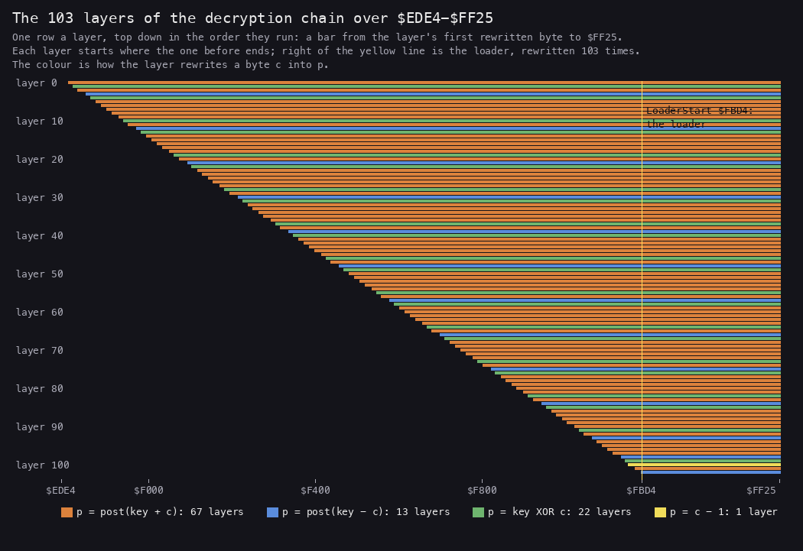

*Each row is one layer, in the order they run: a bar from the first byte it rewrites to `$FF25`. Each bar is
shorter than the one before by one layer's code. The loader at `$FBD4-$FF25` is under every bar: it is rewritten
103 times. Made with `python3 tools/fig_load.py chain LAYERS.txt docs/img/load/chain.png`, where LAYERS.txt is the
output of `tools/speedlock.py layers work/stage2/basic-tape.bin` (run under SkoolKit's Python).*

### One layer

Layer 0 is the first, entered by CopyChain's RET:

```asm
Layer000:                 ; $EDE4
  DI
  LD A,$42
  LD R,A                  ; R := $42: every key below depends on it
  LD BC,$3FFD
  LD A,$03
  NOP
  NOP
  LD HL,Layer000+$0011    ; shift the 30 bytes up to here down by one:
  LD BC,$001E             ; the code already run is garbled
  LD DE,Layer000+$0010
  LDDR
  LD HL,Layer000Loop+$000D ; HL = $EE10, the first byte to rewrite
  LD BC,$1116             ; 4374 bytes, to $FF25
  LD D,$8C
Layer000Loop:
  LD A,R                  ; the key: R as it is now
  XOR D
  ADD A,(HL)              ; p = (R XOR D) + c - 7
  SUB $07
  LD (HL),A
  INC HL
  DEC BC
  LD A,B
  OR C
  JP NZ,Layer000Loop      ; then on into $EE10, the new code
```

In pseudocode, every layer follows the same pattern:

```text
layer(start, rewrite):
    shift the 30 bytes before the loop down by one      (most layers)
    for each address a from start to $FF25:
        c = memory[a]
        memory[a] = rewrite(c, key(R, registers))
    go on at memory[start]
```

The key comes from R, the refresh register, which counts instruction fetches. LD R,A at the start fixes it. From then
on its value at each `LD A,R` depends on the exact instructions run. A debugger that steps, or one patched
instruction, changes R and turns every byte after it into garbage.

### The four kinds of rewrite

`tools/speedlock.py` reads the rewrite from each layer's own code. c is the byte before, p the byte after:

| Kind | Instructions | Rewrite | Layers |
| --- | --- | --- | ---: |
| add | `ADD A,(HL)`, then nothing, `CPL`, `SUB D` or `SUB n` | p = post(key + c) | 67 |
| sub | `SUB (HL)`, then `XOR IXl` or `DEC DE` | p = post(key - c) | 13 |
| xor | `XOR (HL)`, in 12 of them then `XOR D` | p = key XOR c, then XOR D | 22 |
| dec | `DEC (HL)` | p = c - 1 | 1 |

In the 12 "chained" XOR layers D is the byte the layer wrote just before, plus 1. Those are the only keys that depend
on the data. Every other key depends only on R, the constants and the loop counters.

Twelve layers end their loop with `JP Z,next` / `JP loop`. They leave two bytes after the JP that no instruction
runs: the gaps `LayerNNNGap` in `src/loader/chain.asm`.

### Worked example: layer 100 repairs its own jump

Layer 100 is the one `dec` layer, at `$FB72`:

```asm
Layer100:                 ; $FB72
  LD DE,$03A7             ; 935 bytes
  LD HL,Layer100Loop+$0007 ; HL = $FB7F
Layer100Loop:             ; $FB78
  DEC (HL)                ; p = c - 1
  DEC DE
  LD A,D
  INC HL
  OR E
  JP NZ,Layer100Loop      ; $FB7D: C2 78 FB
```

The JP NZ takes three bytes, `$FB7D-$FB7F`. The first byte the layer rewrites is `$FB7F`: the high byte of its own
JP.

1. Before layer 100 runs, `$FB7F` holds `$FC`: the plain view's `$FB`, plus 1. The JP reads JP NZ,`$FC78`, a jump
   into the middle of the loader.
2. The first pass decrements `$FB7F` to `$FB` before the JP is reached. The JP now reads JP NZ,`$FB78`.
3. The loop runs 935 times. At the end `$FB80` holds `C3 83 FB`: layer 101's jump to its own set-up.

A program that skipped the layers before and ran this one on the tape's bytes would jump into the loader at its
first pass. Each layer depends on all the ones before it having run.

### The chain in memory

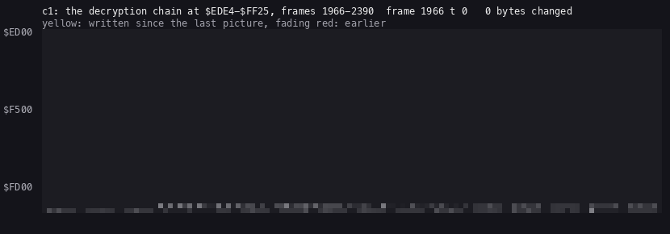

*`c1` frames 1966-2390, one picture every 7 frames: `$ED00-$FFFF`, 128 bytes a row. Yellow: bytes written since
the picture before; red: earlier. Made with `python3 ../../kit/memanim.py --work W --from 1966:0 --to 2390:0
--step 489216 --from-address ED00 --to-address FFFF --cell 6 --row-bytes 128 docs/img/play/load-chain.gif`.*

The L1 build of `c1` finds 31 of the layers as stages of their own
(`python3 ../../kit/rs.py stages --work work/stage1/c1`): layer 0 at frame 1967, `$EDE4`; layer 1 at `$EE11`, 1971; the last one found at `$F9CA`, 2189.
The other layers run on in stretches L1 counts with the one before. The second stage, `$FF26`, is entered at 2387,
once the loader has read tape block 7.

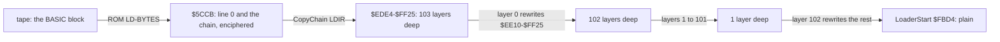

`tools/speedlock.py` runs the chain both ways in SkoolKit's simulator. From the tape it gives the plain view: the
source the build assembles. From the plain view it gives the tape's bytes back, identical
([3.13](#313-the-build)).

**The point**: 103 layers protect about 850 bytes of loader. The protection is not the cipher, which is weak. It is
R, which makes the chain run only straight through, at full speed and unpatched.

## 3.4 LoaderStart: the Multiface check and the wipe

The last layer falls into LoaderStart `$FBD4`:

```asm
LoaderStart:              ; $FBD4
  DI
  LD SP,$FFFF
  IN A,($3F)              ; a read that pages a Multiface in
  LD A,($0000)
  CP $F3                  ; the ROM's first byte: DI in every Spectrum ROM
LoaderReset:
  JP NZ,$0000             ; another byte: a device answered over the ROM, reset
  IN A,($9F)              ; the same with port $9F
  LD A,($0000)
  CP $F3
  JR NZ,LoaderReset
  XOR A
  LD L,A
  LD H,L
  OUT ($1F),A             ; 0
  INC A
  LD E,$01
  OUT ($7B),A             ; 1
  LD D,L
  OUT ($BB),A             ; 1
  LD (HL),L               ; (0) := 0, then LDIR over $0000-$3FFF
  LD A,$43
  LD BC,$3FFF
  LDIR
  DEC HL
  OUT ($7F),A             ; $43
  LD BC,$3FFF
  DEC DE
  LD A,C
  LDDR                    ; $3FFE down to $0000
  JP LoaderMain
```

| Step | Port or address | Why |
| --- | --- | --- |
| `IN A,($3F)`, `IN A,($9F)` | the reads that page a Multiface's RAM over the ROM | if the ROM's first byte is not `$F3` after them, something is paged in: `JP $0000` resets the machine |
| `OUT ($1F),0`, `OUT ($7B),1`, `OUT ($BB),1`, `OUT ($7F),$43` | none of them is the 128K's `$7FFD` (bit 1 of each is set) | page an add-on out; known only from the code |
| LDIR and LDDR over `$0000-$3FFF` | the ROM area | with the ROM in place nothing happens; a RAM paged over the ROM is wiped |

LoaderMain `$FF03` then clears `$5D00-$FC0C` (the BASIC and the chain's spent layers). It calls TimeCheck, which
loads block 7 at `$FF26`, clears the screen, and runs into the second stage.

`c1` has no add-on, and every check passed. What each port drives on a real device is known only from the code.

## 3.5 The SpeedLock reader

LoadStream `$FD2C` reads the SpeedLock blocks. It is not the ROM's LD-BYTES. It has its own pilot, marks, bit timing
and byte store.

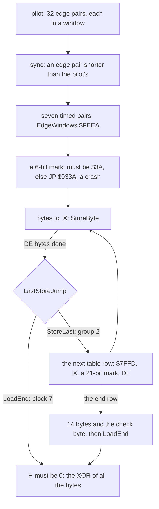

### The bit timing

Each bit is two edges. BitRead waits for one edge, calls a task, then waits for the next. Between them it counts
polls in B, and the count decides the bit.

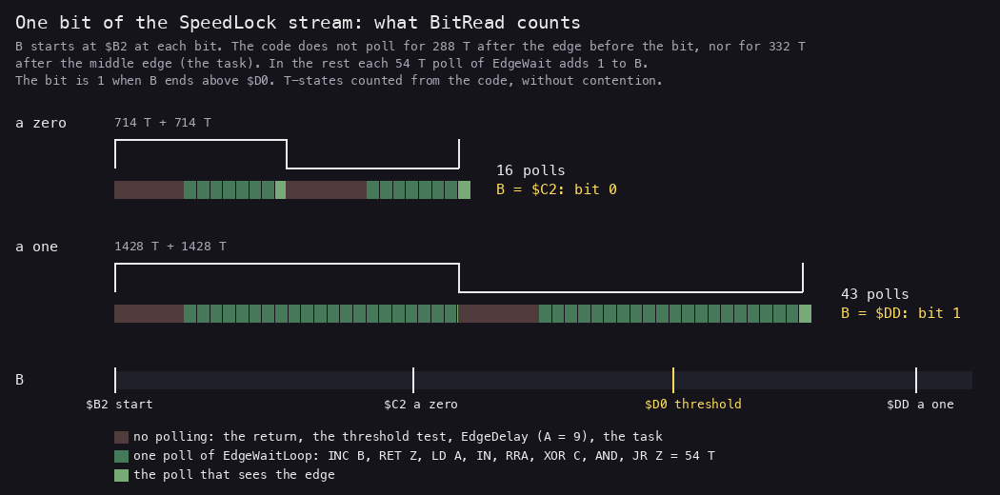

*A zero (two 714 T pulses) and a one (two 1428 T pulses) as BitRead counts them. Dark red: the code is not polling.
Green: one poll of EdgeWaitLoop, 54 T, B up by one. Made with `python3 tools/fig_load.py bits
docs/img/load/bit-timing.png`. The T-states are counted from the instructions; ULA contention on the port read is
left out.*

```asm
BitNext:
  LD A,$09                ; the next bit
BitRead:
  CALL EdgeDelay          ; 9 x 16 T, then EdgeWait: poll until the first edge
  RET NC                  ; B wrapped to 0: a timeout
BitHook:
  CALL AttrRevealStart    ; the task (3.7); it ends at EdgeWait: the second edge
  RET NC
  LD A,$13
BitThreshold:
  LD A,$D0                ; the bit is 1 when B passed $D0
  CP B
  RL L                    ; the bit into L
  LD B,$B2                ; B from $B2 for the next bit
  JP NC,BitNext           ; until the marker bit shifts out of L
```

One poll of EdgeWaitLoop:

```asm
EdgeWaitLoop:
  INC B                   ; 4 T
  RET Z                   ; 5 T: B wrapped, a timeout
  LD A,$7F                ; 7 T
  IN A,($FE)              ; 11 T: bit 6 is EAR
  RRA                     ; 4 T
  XOR C                   ; 4 T: C holds the last level
  AND $20                 ; 7 T
  JR Z,EdgeWaitLoop       ; 12 T: 54 T a poll
```

### Worked example: counting a zero and a one

Counted from the code, without contention:

1. After an edge, the code spends 288 T before its next poll. That is the return from EdgeWait, the threshold test,
   `LD B,$B2`, `LD A,9`, the CALL, and EdgeDelay's 9 loops of 16 T.
2. After the middle edge it spends 332 T. That is the return, the CALL of the task, the task itself (AttrReveal takes
   233 T with its 12 LDI), and the JP back to EdgeWait.
3. A zero is 714 T + 714 T. The first half has room for (714 - 288) / 54, about 8 polls, and the second for (714 -
   332) / 54, about 8. B ends near `$B2 + 16` = `$C2`. That is below `$D0`: a 0.
4. A one is 1428 T + 1428 T: about 22 + 21 polls. B ends near `$DD`. That is above `$D0`: a 1.
5. The threshold `$D0` is 30 polls from `$B2`, about halfway between the two.

Every task is padded with DJNZ loops to the same length. A task that took longer would move the threshold.

The marks use the same scheme with their own numbers: the start count `$B3`, an EdgeDelay of 12 and the threshold
`$DB`. The pilot's pairs must count from `$9C` to above `$C2`.

### The store and its keys

StoreByte does not store the byte it read. It stores `(L XOR k) + a`:

```asm
StoreByte:                ; $FDB5
  LD A,$C1                ; k: the operand at $FDB6
  XOR L                   ; L: the byte from the tape
  ADD A,$11               ; a: the operand at $FDB9
  LD (IX+$00),A
  INC IX
  DEC DE
```

A block's last byte goes through StoreLast `$FDE9`, which has its own copy of the same three instructions. Both start
with k = `$C1` and a = `$11`.

Tape block 19 loads 2 bytes at `$FDB5`: the loader's own code. Block 21 loads 4 bytes at `$FDE9`. From then on both
stores use k = `$86`. The keys change in the middle of the stream, rewritten by the stream.

### Worked example: tape block 19

Block 19 is the 2 bytes `EC B4`. It lands at `$FDB5` while both keys are still k = `$C1`, a = `$11`.

| Byte | Tape L | L XOR `$C1` | + `$11` | Stored at | Meaning |
| --- | --- | --- | --- | --- | --- |
| 1 | `$EC` | `$2D` | `$3E` | `$FDB5` | `LD A,n` |
| 2 | `$B4` | `$75` | `$86` | `$FDB6` | n = `$86`, the new k |

The first byte goes through StoreByte, the second (the block's last) through StoreLast. Both still had the old keys,
so both decode with `$C1`. StoreByte now reads `LD A,$86`.

The loader XORs every byte it reads into H. `$EC` XOR `$B4` = `$58`: the checksum tzxblocks.py prints for block 19.
Over the whole stream, up to the check byte, H must end at 0.

### The block table

StoreLast walks BlockTable `$FF49`, five bytes a row: the address, the length less one, and a value for port
`$7FFD`. A `$7FFD` value of 0 ends the table.

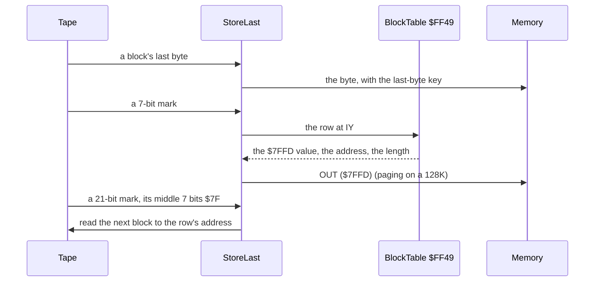

The table rewrites itself. Its row 4 is block 23, 55 bytes at `$FF49`: the table again. The loader is then on row 5,
and rows 5-10 come from the new table.

| Row | Block 7's table | After block 23 |
| ---: | --- | --- |
| 0 | `$8000` 768 | `$8000` 768 (already read) |
| 1 | `$DE80` 1152 | `$9500` 25 856 (not read again) |
| 2 | `$FDB5` 2 | zeros (not read again) |
| 3 | `$FDE9` 4 | zeros (not read again) |
| 4 | `$FF49` 55 | `$0000` 40 (not read again) |
| 5 | `$6000` 8192, page `$13` | `$DB80` 768 |
| 6 | `$4000` 6912, page `$12` | `$E300` 2176 |
| 7 | `$FB00` 512 | `$FE76` 115 |
| 8 | the end | `$FF3A` 15 |
| 9 | | `$5B00` 33 |
| 10 | | the end: 14 bytes and the check byte at `$5B21` |

Block 7's rows 5-7 are decoys: plausible rows that are never read. Someone who dumped the second stage and followed
its table would load the wrong blocks to the wrong places.

A wrong 21-bit mark does not stop the load. StoreLast sets FailFlag `$FEE9` to `$7F` and reads on. The load fails at
its end, far from the cause.

**The point**: the reader's own code is the stream's first target. The keys and the table change while the stream is
read, so no single dump of the loader decodes the tape.

## 3.6 The timing check

TimeCheck `$FE76` is LoaderMain's call. It loads block 7, then samples the tape for a while:

```asm
TimeCheck:                ; $FE76
  CALL LoadStream         ; block 7: the second stage at $FF26
  LD HL,$9000             ; TimeBuffer
  LD B,$FF
TimeCheckLoop:
  PUSH BC
  CALL TimeSample         ; E := the EAR changes in 255 polls
  LD (HL),E
  INC HL
  POP BC
  DJNZ TimeCheckLoop      ; 255 samples
  LD A,($006D)
  CP $28                  ; the +2A/+3 ROM: no compare
  RET Z
  CALL TimeCompare
  RET
```

TimeCompare `$FEAD` sums samples 50-99 (S1) and samples 205-254 (S2). FailFlag gets S2's high byte when S2 is 3328
or more, and 1 when S2 - S1 is 50 or more.

The samples fall in the 2.5-second pause after block 7. In `c1` at frame 2387 all 255 bytes of `$9000-$90FE` are
`$01`: one change in each sample, then silence. S1 = S2 = 50. The check passes, and FailFlag `$FEE9` is still 0.

So the check does not measure the tape's speed. It measures the silence after block 7. A copy that dropped the pause,
or noise on the line, gives S2 well above S1, and the load fails at its very end. On a +2A or +3 the ROM byte `$006D`
is `$28`, and the compare is skipped. Why those machines are spared is not in the code.

## 3.7 The reveal and the countdown

The loading screen does not appear while it loads. The bitmap goes straight to `$4000`, but LoaderMain cleared the
attributes to zero: black ink on black paper. The attributes go to `$8000`, off the screen.

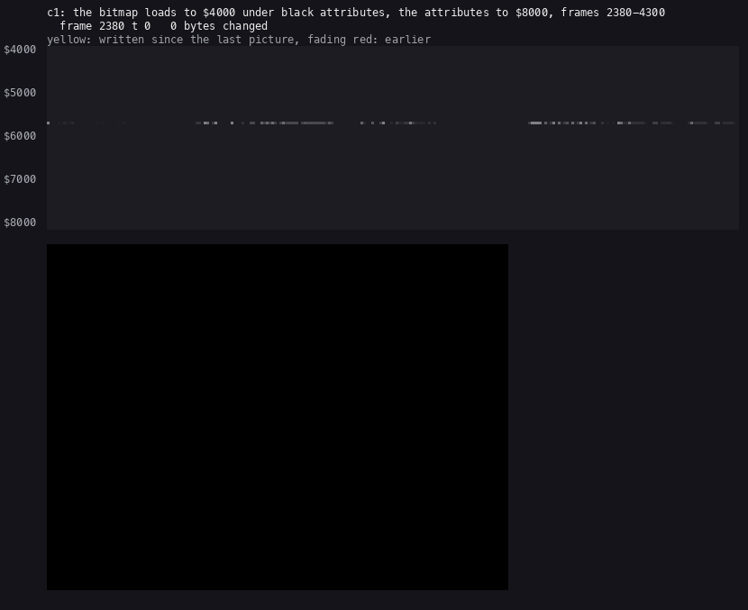

*`c1` frames 2380-4300, one picture every 40 frames: `$4000-$83FF`, the screen under it. The bitmap fills
`$4000-$57FF` while the screen stays black; then the attributes fill `$8000-$82FF`. Made with `python3
../../kit/memanim.py --work W --from 2380:0 --to 4300:0 --step 2795520 --from-address 4000 --to-address 83FF
--cell 3 --screen docs/img/play/load-screen.gif`.*

BitRead calls a task between the two edges of every bit: the CALL at BitHook `$FDCF`. The task works in the alternate
registers and ends by jumping to EdgeWait. Three tasks follow one another, each by rewriting the CALL's operand:

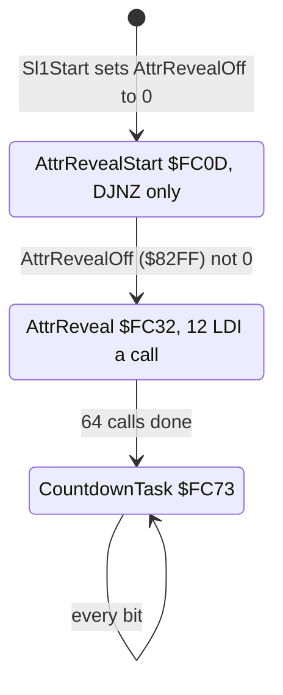

1. **AttrRevealStart** `$FC0D` waits. It tests AttrRevealOff, `$82FF`: the last byte of the attribute buffer. That
   byte stays zero until the attribute block's last byte arrives. So the attributes' own arrival switches the task.
2. **AttrReveal** `$FC32` copies 12 attribute bytes a call from `$8000` to `$5800`, with 12 LDI. 64 calls copy all 768
   bytes. 64 bits are 8 bytes of tape: the picture appears in about 3 frames.
3. **CountdownTask** `$FC73` draws four digits at character row 20, columns 13-18, and counts them down.

In `c1` BitHook's operand changes at frame 4134 (to AttrReveal) and at 4137 (to CountdownTask). The screen at frame
4100 is still all black.

### The countdown

CountdownCounter `$FD07` holds four glyph pointers: the low bytes into the digits at `$FF80`, 8 bytes a digit, `$80`
= 0 up to `$C8` = 9. It starts at `$80 $90 $88 $88`: 0, 2, 1, 1. The screen shows `0m21s1`: minutes, seconds,
tenths.


*`c1` frames 2380-5170, one picture every 30 frames (unchanged pictures merged): the screen appears at 4137 and the
countdown runs to the end of group 2. Made with `python3 ../../kit/screen_anim.py --work W --from 2380 --to 5170
--step 30 docs/img/play/load-countdown.gif`.*

CountdownTask keeps a phase in A'. In each cycle the first calls redraw the four digits, a few glyph rows a call. A
long run of calls then only pads its time. The last call of the cycle takes one tenth off:

```text
tick():
    tenths -= 1;  if it went below 0: tenths = 9, and
        seconds -= 1;  if it went below 0: seconds = 9, and
            tens -= 1;  if it went below 0: tens = 5, and
                minutes -= 1          (no wrap)
```

### Worked example: the countdown's last tick

1. From frame 4137 to 5160 is 1023 frames: 20.5 seconds. The counter started at 21.1 seconds. It is close to real
   time: one tick about every 4.8 frames.
2. At frame 5160 `$FD07-$FD0A` hold `$80 $80 $80 $80`: `0m00s0`.
3. The end row's bytes are still to come, and one more tick follows. Tenths, seconds and tens wrap to 9, 9 and 5.
   The minutes pointer goes from `$80` to `$78`, with no wrap.
4. `$FF78` is not a digit. It is 8 bytes of the block table's zero padding and its end. At frame 5164 the screen
   shows a dot where the minutes' 0 was, then `m59s0`, the tenths not yet redrawn.

The start value covers 211 ticks, and the blocks take 212. Nobody sees the extra tick: ResidentInit clears the screen
2 frames later.

**The point**: the loading screen and the countdown run inside the bit loop, between two edges. Each task is padded
to one length, so the bit timing never changes.

## 3.8 Unxor and Boot: the resident in place

LoadStream returns to `$FF3A`, which by then is Sl1End from block 31. If FailFlag is zero, Sl1End jumps to Unxor.

```asm
Unxor:                    ; $FE76, block 29
  LD HL,$DB80             ; the resident's three pieces as loaded
  LD BC,$1000             ; 4096 bytes
UnxorLoop:
  LD A,(HL)
  XOR $DF                 ; the second cipher, under the stream's
  LD (HL),A
  INC HL
  DEC BC
  LD A,B
  OR C
  JR NZ,UnxorLoop
  JP Boot

Boot:                     ; $5B00, blocks 33 and 35
  LD HL,$2758             ; the ROM's HL' for the calculator
  EXX
  LD SP,$5E87
  LD IY,$5C3A             ; the system variables
  LD BC,$7FFD
  LD A,$10
  OUT (C),A               ; a 128K: ROM 1, bank 0, paging locked
  RES 4,(IY+$01)          ; 48 BASIC mode
  LD HL,$EB7F             ; LDDR $CB80-$EB7F to $E000-$FFFF
  LD DE,$FFFF
  LD BC,$2000
BootCopy:
  LDDR
  LD HL,$F040             ; ResidentEntry
  LD DE,$5B00
  XOR A
  LD B,$2B
BootWipe:
  LD (DE),A               ; Boot wipes its own 43 bytes
  INC E
  DJNZ BootWipe
  JP (HL)
```

The resident lands in three pieces: `$DB80` (to be `$F000-$F2FF`), `$DE80` (`$F300-$F77F`) and `$E300`
(`$F780-$FFFF`). They sit `$1480` bytes below their final place. Boot's LDDR moves `$CB80-$EB7F` up to
`$E000-$FFFF`. It copies from the top down, so the overlap is safe. The 8192 bytes include the 4096 below the pieces;
they become `$E000-$EFFF`, which the front and the stages overwrite.

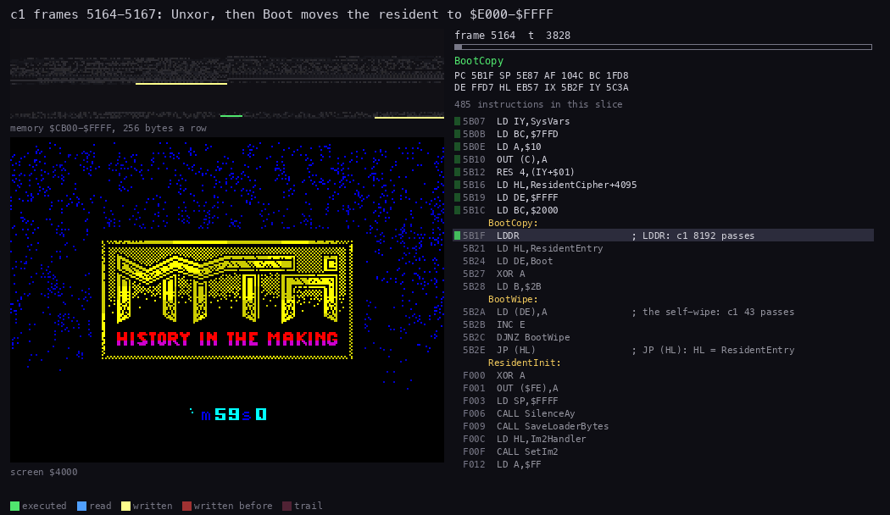

*`c1` frames 5164-5167: Unxor decodes `$DB80-$EB7F` in place, then Boot's LDDR moves the resident to
`$E000-$FFFF`, wipes itself and jumps to `$F040`. The memory map shows `$CB00-$FFFF`. Made with `python3
../../kit/routine_anim.py --work W --window 5164:0-5167:20000 --listing build/unxor.lst --listing build/boot.lst
--listing build/resident.lst --view screen --pc FE76-FE88,5B00-5B2E --range CB00-FFFF --pictures 60 --out
docs/img/routines/Unxor.gif`.*

Boot's JP (HL) enters ResidentEntry `$F040` at frame 5166. It sets IM 2 and loads the front
([doc 2](02-architecture.md#23-the-memory-map)).

Block 29 holds 99 bytes after Unxor that no code runs, `$FE89-$FEE8`: copies of Sl1End, Boot and Sl1Start's first 34
bytes. The mastering tool left them in the block.

## 3.9 The turbo loader and the stage blocks

The resident part keeps its own loader, TurboLoad `$FE90`. It reads the ROM's tape format at a faster rate: bits of
583 T and 1166 T against the ROM's 855 T and 1710 T. The first byte must be the flag `$56`.

### The length

TurboLoad takes no length. It computes one from three bytes the caller leaves:

```asm
TurboLoad:                ; $FE90
  LD A,(LoadLengthB)      ; B
  LD C,A
  SLA A
  SLA A
  SLA A
  ADD A,C                 ; 9 x B
  LD C,A
  LD A,(LoadLength)       ; + H
  ADD A,C
  LD C,A
  LD A,(LoadLengthL)      ; + L
  ADD A,C
  SLA A                   ; x 2
  LD D,A                  ; D = pages of 256 bytes
  LD E,$00
  LD IX,$6C3F
  JP TurboStart
```

### Worked example: the length of a stage block

The five stage records at `$F0EA`, `$F111`, `$F13E`, `$F172` and `$F1A1` each start with six bytes: D, E, C, H, L,
B. C is the stage. LoadFront passes the front's own values.

| Block | H | L | B | 9 x B + H + L | x 2 = pages | Bytes |
| --- | ---: | ---: | ---: | ---: | ---: | ---: |
| front | 2 | 1 | 3 | 30 | 60 | 15 360 |
| stage 1 | 0 | 3 | 7 | 66 | 132 | 33 792 |
| stage 2 | 5 | 7 | 6 | 66 | 132 | 33 792 |
| stage 3 | 1 | 2 | 7 | 66 | 132 | 33 792 |
| stage 4 | 6 | 6 | 6 | 66 | 132 | 33 792 |
| stage 5 | 2 | 1 | 7 | 66 | 132 | 33 792 |

Five different triples give one length: each record hides 33 792 in its own way. The D and E bytes (1, 8, 15, 23,
30 and 1, 5, 9, 4, 8) are not read by any code that ran.

### The IM 2 jump inside the loader

The bytes `$FEFE-$FF00` are three bytes of TurboLoad: a `JR NZ` and the first byte of a `JR NC`. They are also where
the IM 2 vector points ([doc 2](02-architecture.md#23-the-memory-map)). SetIm2 writes `JP Im2Handler` over them.

LoadBlock `$FF54` swaps them before and after each load:

```asm
LoadBlock:                ; $FF54
  DI
  LD HL,SavedLoaderBytes  ; $F66C: the loader's own 3 bytes
  LD DE,$FEFE
  LD BC,$0003
  LDIR                    ; the loader back
  CALL TurboLoad
  CALL SaveLoaderBytes    ; keep them again
  LD HL,Im2Handler
  CALL SetIm2             ; the JP back
  LD A,(StageLoaded)
  CP $00
  RET Z                   ; the front: no check
  LD C,A
  LD B,$00
  LD HL,StageCheckFront   ; $FF7E
  ADD HL,BC
  LD A,($BB80)            ; the block's byte at $BB80
  CP (HL)                 ; against StageCheck for this stage
  RET
```

### StageCheck: the right block or none

Every turbo block has the flag `$56`, and every stage block has one length. TurboLoad takes whichever stage block
comes next on the tape. LoadBlock then compares the block's byte at `$BB80` with StageCheck `$FF7F`:

| Stage | 1 | 2 | 3 | 4 | 5 |
| --- | --- | --- | --- | --- | --- |
| Byte at `$BB80` | `$16` | `$4B` | `$FA` | `$E0` | `$80` |

A wrong block gives NZ. PlayStage marks no stage loaded and loads again, with no message.

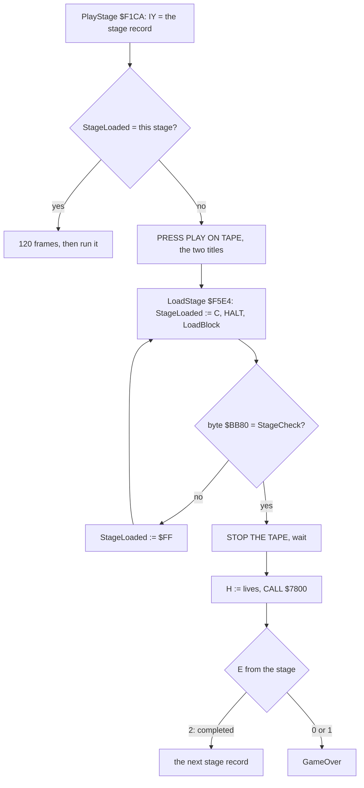

### Worked example: a tape wound on too far

In the old recording `work/stage1/old/stage2` the tape was sought to stage 2's block from `c1`'s menu, and START GAME
was chosen.

1. START GAME runs the stage records from stage 1. LoadStage wants C = 1: the byte `$16`.
2. TurboLoad reads stage 2's block. Its `$BB80` is `$4B`. NZ: rejected.
3. The same happens to stage 3's block (`$FA`) and stage 4's (`$E0`).
4. L1 counts LoadBlock 4 runs, the compare at `$FF7C` 3 runs, and the reject at `$F228` 3 runs. The tape stopped on
   stage 4's block, the fourth load waiting.

So the game cannot be started on a later stage by winding the tape on. A stage is wanted only when the one before it
is completed.

### REWIND THE TAPE

The front is the first turbo block on the tape. If a player chooses RESTART FROM STAGE ONE at the game-over menu,
RestartFromStageOne `$F048` prints REWIND THE TAPE and AND THEN PRESS PLAY, waits, and loads the front again. No
recording chose it: known only from the code.

Every stage block overwrites ResidentInit `$F000-$F03E`. Once a stage has loaded, the start-up code is gone, so the
restart must go through LoadFront `$F07E`.

### The front and stage 1 loading

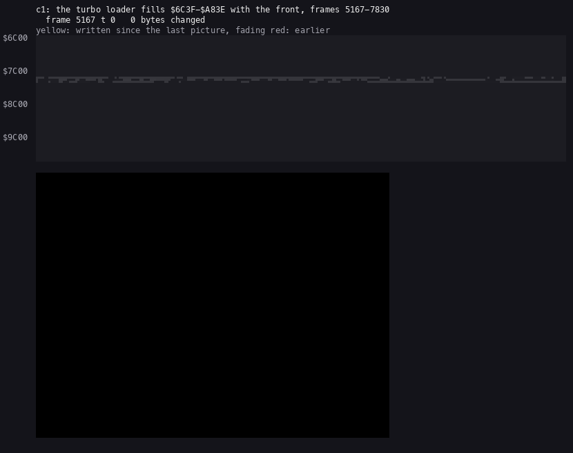

*`c1` frames 5167-7830, one picture every 40 frames: TurboLoad fills `$6C3F-$A83E` with the front, then JP `$7800`
draws the logo. Made with `python3 ../../kit/memanim.py --work W --from 5167:0 --to 7830:0 --step 2795520
--from-address 6C00 --to-address A8FF --cell 3 --screen docs/img/play/load-front.gif`.*

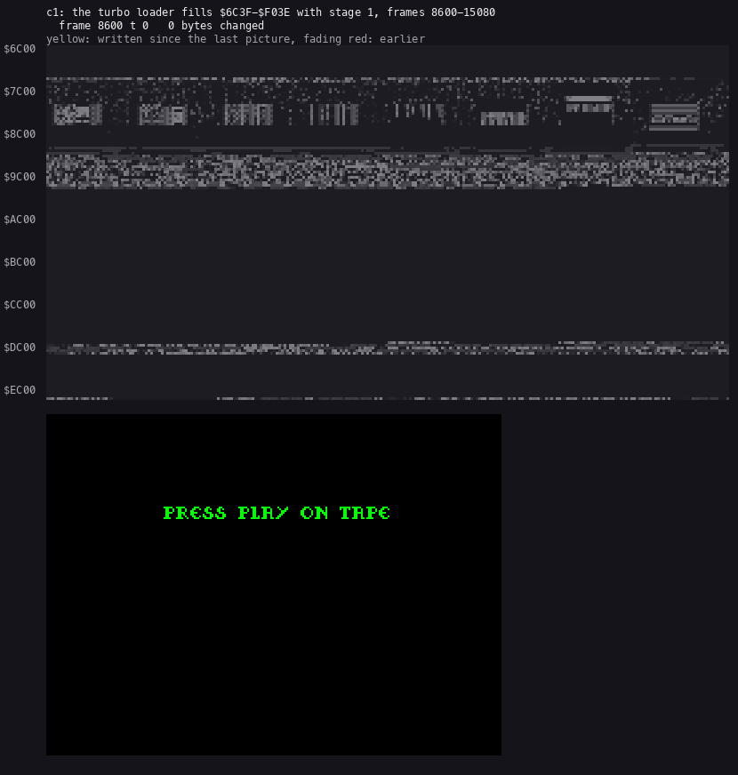

*`c1` frames 8600-15080, one picture every 140 frames: stage 1's block fills `$6C3F-$F03E` over the front while the
screen shows STAGE ONE, THE ROAD TO HELL. Made with `python3 ../../kit/memanim.py --work W --from 8600:0 --to
15080:0 --step 9784320 --from-address 6C00 --to-address F0FF --cell 3 --screen docs/img/play/load-stage1.gif`.*

**The point**: one loader, one length and one flag serve five blocks. The only thing that tells them apart is one byte
deep inside each, so the player cannot skip ahead.

## 3.10 How the load can fail

Only the turbo loader's failure prints a message.

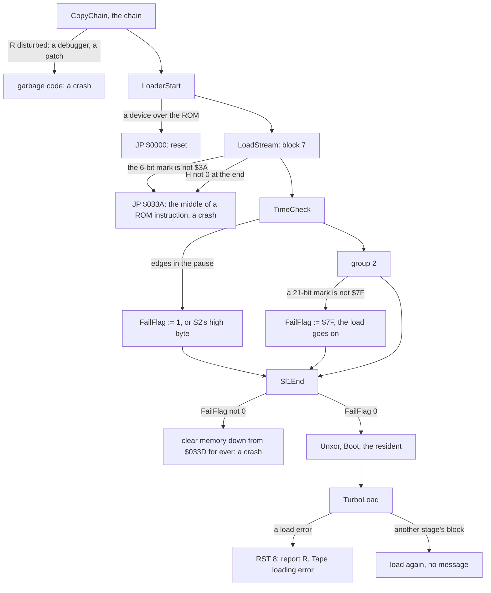

`$033A` is the second byte of the ROM's `JP M,$034F` at `$0339`. A jump there runs the bytes as other instructions:
a crash with no message.

Sl1End's wipe starts at `$033D`, a ROM address, and decrements for ever. It runs down through the ROM (the writes do
nothing), wraps to `$FFFF` and wipes the RAM, its own loop included.

## 3.11 The stages of the load in `c1`

`python3 ../../kit/rs.py stages --work work/stage1/c1` lists where code runs for the first time after it was written:

| Stage | Entry | Frame | Written | By | What it is |
| ---: | --- | ---: | --- | --- | --- |
| 0 | `$5D06` | 1963 | `$5CCB-$6E6C` | the ROM `$05AE` | CopyChain, entered by line 0's USR |
| 1 | `$EDE4` | 1967 | `$EDE4-$FF25` | `$5D27` | the chain, layer 0 |
| 2-31 | `$EE11` ... `$F9CA` | 1971-2189 | each to `$FF25` | the layer before | 30 of the other 102 layers |
| 32 | `$FF26` | 2387 | `$FF26-$FFCF` | `$FDBA` | the second stage, block 7, stored by StoreByte |
| 33 | `$F040` | 5166 | `$E000-$FFFF` | `$5B1F` | ResidentEntry, after Boot's LDDR |
| 34 | `$FEFE` | 5167 | `$FEFE` | `$F638` | the IM 2 jump written by SetIm2 |
| 35 | `$7800` | 7826 | `$6C3F-$A83E` | `$FF02` | the front, loaded by TurboLoad |
| 37 | `$8CA7` | 15079 | `$7F23-$F03E` | `$FF02` | stage 1, loaded the same way |

Stage 36 and those after 37 are stretches of the front or of stage 1 run for the first time after their load, and
stage 1's self-modified copy loop `$9B09`.

## 3.12 The releases

The standard Spectrum tapes only. `tools/copy_compare.py` compared every TAP and TZX found with the original, block
by block ([README](../README.md#other-releases-and-copies)). The main block and the five stage blocks are not
enciphered, so every copy that carries the game carries them byte for byte. Only the loaders differ.

| Release | Loader | The game blocks |
| --- | --- | --- |
| System 3, 1989: the original, this case | SpeedLock 7, then TurboLoad `$FE90` | the reference |
| other dumps of the original (TOSEC `[a]`, NVG's "SpeedLock 4" dump) | the same data with other pulse lengths and pauses; one dump encodes the SpeedLock blocks as one group | byte for byte |
| Kixx re-release | the same loader; other pauses and pilot lengths, a "Ramsoft MakeTZX" text | byte for byte |
| MCM Software (Spain), two sides | its own loader on side 1 | side 2: byte for byte |
| TAP re-saves (`MYTH.TAP` and its copies) | a deprotected BASIC and loader | byte for byte; one TAP has 12 bytes of stage 1 changed |
| the release the RZX run used | the resident loader patched at `$FEBB-$FECD` to call the ROM's LD-BYTES | the stage blocks at ROM speed |

### The RZX's release

The RZX run was recorded with another release. In every RZX snapshot the resident loader differs from the original's
in the 19 bytes `$FEBB-$FECD`, and in `$FF4D`:

| | From `$FEBB` |
| --- | --- |
| original | `LD A,$56` / `OR A` / `SCF` / `EX AF,AF'` / `LD A,2` / `LD ($FF4D),A` / ... its own edge loop |
| RZX | `LD A,$56` / `SCF` / `INC D` / `EX AF,AF'` / `DEC D` / `NOP` / `DI` / `NOP` / `NOP` / ... `JP $0562` |

`$0562` is inside the ROM's LD-BYTES. So that release's stage blocks were at ROM speed. An RZX state cannot load the
original tape's turbo blocks: the `stageload` recording first wrote the original 19 bytes back.

## 3.13 The build

`tools/build.sh` builds the tape from the sources and compares it with the original byte for byte. Its last run
printed `Myth.tzx identical` (`work/stage2/notes-loader.md`).

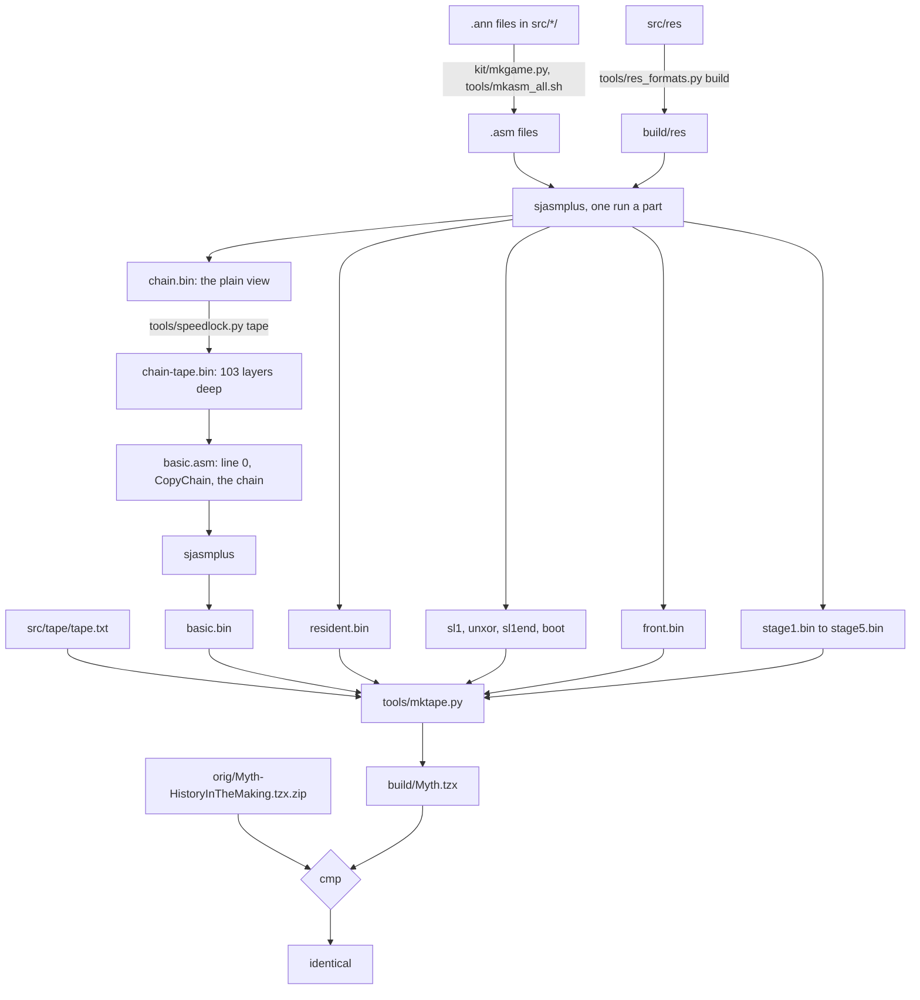

### Mastering the chain

`tools/speedlock.py tape` turns the plain view back into the tape's bytes:

1. It runs the chain in SkoolKit's simulator over the plain view. It notes every rewrite of every byte, but keeps the
   plain value: that is what the code sees when it runs.
2. It undoes the noted rewrites of each byte in reverse order. A `p = key + c` becomes `c = p - key`, and so on.
3. The chained XOR layers take D from the plain bytes already worked back.

This works because the control flow never depends on the rewritten bytes: every loop counts BC or DE. The method is
Battle Command's `tools/speedlock.py`, another SpeedLock 7 tape, with Myth's addresses and the XOR layers it lacked.

### Mastering the SpeedLock blocks

`src/tape/tape.txt` lists the TZX one block a line. An `sl` line is a block the SpeedLock reader stores:

```text
group Speedlock 7 Block 2
tone 2165 1541
pulses 714,714,714,714,1428,1428,2147,2147,2147,2147,2147,2147,1428,1428,714,714
pure 714 1428 6 0 hex:E8
sl 714 1428 8 0 $4000 res/screens/loading.scr:0:1800
pure 875 1750 5 0 hex:07FF00
sl 714 1428 8 0 $8000 res/screens/loading.scr:1800:1B00
pure 875 1750 5 0 hex:07FF00
sl 714 1428 8 0 $DE80 resident.bin@F000:F300:F780^DF
pure 875 1750 5 0 hex:07FF00
sl 714 1428 8 0 $FDB5 hex:3E86
```

`tools/mktape.py` stores each plain byte p as `((p - a) AND 255) XOR k`, the inverse of StoreByte. It takes k and a
from the loader's own bytes. When a block lands on `$FDB5-$FDED` it changes them for the bytes after, as the loader
does. `^DF` XORs the resident's pieces for Unxor. `check` adds the byte that makes the stream's XOR 0.

**The point**: the build is the load run backwards. Each part is assembled where it runs. The chain and the stream
are enciphered by tools that run the loader's own code in reverse.

## 3.14 Known only from the code

| What | Where | Why no recording shows it |
| --- | --- | --- |
| what ports `$3F`, `$9F`, `$1F`, `$7B`, `$BB` and `$7F` drive | LoaderStart `$FBD8-$FC01` | `c1` has no add-on |
| the crash `JP $033A` on a bad mark or checksum | LoadStream, LoadEnd `$FEF8` | every recorded load was good |
| the 12 two-byte gaps in the chain | `LayerNNNGap` | jumped over |
| Sl1Tail, the second stage's own end | `$FF3A-$FF48` | block 31 overwrites it first |
| the wipe in Sl1End | `$FF41-$FF48` | FailFlag stayed 0 |
| the leftover copies in block 29 | `$FE89-$FEE8` | Unxor jumps away |
| the TimeCompare failure | TimeFailed `$FEE5` | the pause was silent |
| TurboVerify, the verify path | `$FF11` | the flag's carry always says LOAD |
| the turbo load error, RST 8 | TurboExit `$FEB1` | every recorded load was good |
| RestartFromStageOne, REWIND THE TAPE | `$F048` | no game over chose it |
