# 4. Game loop

What this covers:

- the game cycle from the resident's entry to the last stage: ResidentEntry, the front, NewGame, PlayStage for each
  StageTable record, GameOver and its two ways out;
- the three clocks of the game: the interrupt, the pass and the HALT waits;
- the IM 2 handler `$F9B3`, which plays the sound and does nothing else;
- the stage's entry and the 400 frames before the first pass;
- the main loop `$7839`, which never waits for the frame, call by call;
- one ordinary pass measured, against the beam, and as an animation;
- PacePass, the busy wait that pads the light rooms, in every stage;
- the heaviest pass: a room change of 18 frames;
- the interrupts the game loses inside ClearBuffer and CopyBuffer;
- the five stages' loops side by side, and stage 5's HALT;
- the sub-loops: pause, the item window, EndStage, the waits;
- what is known only from the code.

The recordings it rests on ([WALKTHROUGH 6.0](../WALKTHROUGH.md#60-the-recordings)):

| Recording | What it is | Used for |
| --- | --- | --- |
| `c1` | a 48K from power-on, the original tape at signal speed; stage 1 in play from frame 15478 | the stage entry, the ordinary passes, the room change, the lost interrupts, the beam timelines, the animation |
| `c1o` | `c1`'s play window, traced (`work/stage1/c1o/traces/`) | the length of every pass in frames 16158-16658 |
| `rzx-r1` ... `rzx-r5` | the RZX run, one recording a stage, 128K | the average pass of each stage, the paced passes of room 0 |
| `s1-right` ... `s4-right` | stages 1-4 from the RZX snapshots, played to a game over | EndStage, GameOver |
| `ending`, `s5-right` | stage 5 | the stage 5 loop |

Every frame number is `c1`'s unless another recording is named. A time "F:T" is frame F, T-state T of that frame,
counted from the emulator's frame start. On the 48K the INT rises at frame T 1812; on the 128K at 1846.

## 4.1 The game cycle

Myth is one resident program at `$E000-$FFFF` and one overlay at `$6C3F-$F03E`. The overlay is the front (logo,
credits, menu) or one of the five stages. The resident loads each overlay from tape and calls it at `$7800`
(GameMain). It is the only program that sees the whole game.

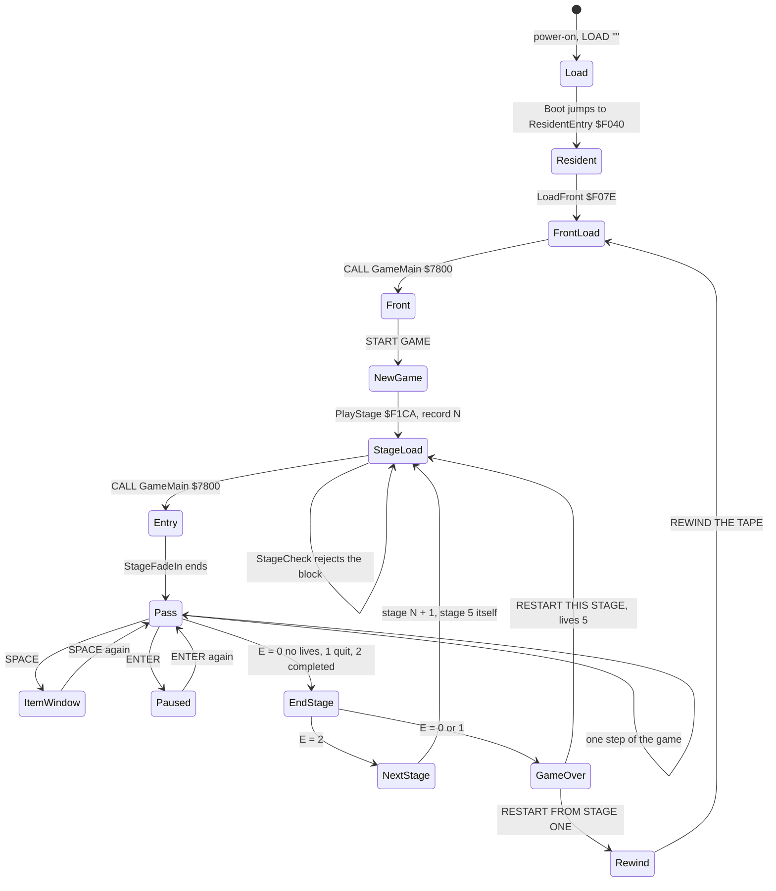

How to read it: a state is a place where the game runs for a while. The arrows are the only ways between them. The
load is [doc 3](03-build-and-load.md). The front's own screens are in [doc 5](05-controls.md) and
[doc 1](01-game-design.md#12-the-screens).

| State | Code | Who calls it | Recorded in |
| --- | --- | --- | --- |
| the resident's entry | ResidentEntry `$F040`: DI, ResidentInit, SetIm2 `$F635` | Boot's `JP (HL)` | `c1` frame 5166 |
| the front's load | LoadFront `$F07E`: LoadStage with C = 0, then CALL GameMain | ResidentEntry, RestartFromStageOne | `c1` 5167-7734 |
| the front | FrontMain `$7800`: logo, credits, menu | LoadFront | `c1` 7826-8524 |
| a new game | NewGame `$F090`: score 0, lives 5, credits 4 | the front's StartGame, by RET | `c1` 8524 |
| a stage's load | PlayStage `$F1CA`, StageLoadLoop | PlayStage1 ... PlayStage5 | `c1` 8626-14976 |
| a stage | StageEntry `$7800` of the stage block | StageRun's CALL GameMain | `c1` 15075 on |
| the passes | MainLoop `$7839` (stage 1) | StageEntry falls into it | `c1` 15478 on |
| the stage's end | EndStage `$789E` (stage 1) | GameOverExit, QuitStage, StageExit | `s1-right` |
| game over | GameOver `$F24B` | PlayStage1 ... PlayStage5 | `s1-right` ... `s4-right` |
| back to stage one | RestartFromStageOne `$F048` | GameOver | none |

### NewGame and the stage chain

NewGame sets the score, the lives and the credits. Then five blocks of the same shape play the stages in turn. A
block points IY at the stage's StageTable record and calls PlayStage. Z (the stage returned E = 2) goes on to the
next block. NZ calls GameOver and plays the same stage again.

```asm
NewGame:
  LD HL,$0000
  LD (Score),HL
  XOR A
  LD (ScoreHigh),A
  LD A,$05
  LD (Lives),A
  LD A,$04
  LD (Credits),A
PlayStage1:
  LD IY,StageTable        ; stage 1 until completed
  CALL PlayStage
  JR Z,PlayStage2
  CALL GameOver
  JR PlayStage1
  ...
PlayStage5:
  LD IY,StageRecord5      ; stage 5: the same either way
  CALL PlayStage
  JR Z,PlayStage5
  CALL GameOver
  JR PlayStage5
```

The same in pseudocode:

```text
NewGame:
    Score = 0; ScoreHigh = 0; Lives = 5; Credits = 4
    for N in 1..5:
        loop:
            if PlayStage(StageRecord[N]) == completed: break      # E = 2
            GameOver()                    # returns only for RESTART THIS STAGE
    # stage 5: "completed" plays stage 5 again, so the chain never ends
```

Stage 5's code never sets E = 2. Winning the duel leaves WELL DONE on the screen and the stage's loop running
([4.11](#411-the-five-stages-loops)). So the chain has no end: the game is over only when the machine is reset.

### PlayStage

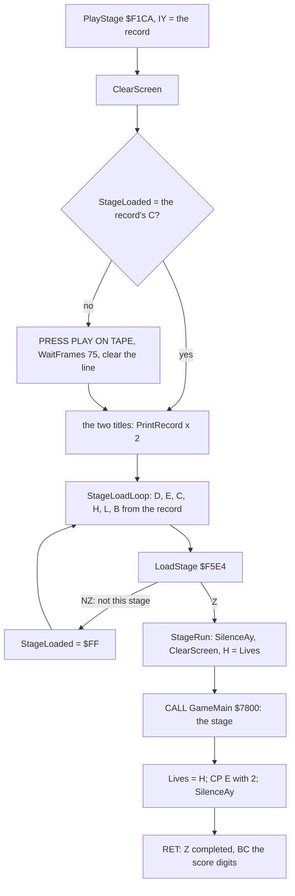

How to read it: the stage block may already be in memory, after a game over. Then StageLoaded matches the record's
stage number and the tape is not asked for. Otherwise LoadStage reads blocks until StageCheck finds the stage's own
([doc 3](03-build-and-load.md)).

The resident hands the stage only H, the lives, on entry. On return it takes E (the outcome), H (the lives) and BC
(the address of the six score digits). Everything else the stage keeps in its own block.

### GameOver

GameOver takes a credit, shows GAME OVER and PRESS SPACE TO SELECT, waits 20 frames, then prints the menu. The menu's
loop HALTs once a frame. Every 32 frames (FrameCounter `$FE31` AND `$1F` = 0) the highlight moves to the other line.

```asm
GameOverLoop:
  HALT                    ; one frame
  LD A,(FrameCounter)
  AND $1F
  JR NZ,GameOver4
  LD E,$00
  LD A,(Credits)
  CP $00
  JR NZ,GameOverToggle
  LD E,$01
GameOverToggle:
  LD A,(GameOverOption)
  INC A
  CP $02
  JR NZ,GameOverSetOption
  LD A,E
GameOverSetOption:
  LD (GameOverOption),A
```

```text
GameOver(BC = score digits):
    copy the six digits into the menu's SCORE
    Credits -= 1                          # CreditsDec $F25D
    print GAME OVER, PRESS SPACE TO SELECT; 20 frames of CycleColours
    option = 1                            # RESTART FROM STAGE ONE highlighted first
    every frame:
        HALT
        if FrameCounter % 32 == 0:
            option = option + 1
            if option == 2: option = 1 if Credits == 0 else 0
            paint the highlight on row 10 + 2 x option
        CycleColours
        if SPACE:
            if option == 0: Lives = 5; return          # RESTART THIS STAGE
            drop the return; goto RestartFromStageOne
```

**A worked example: the fourth game over.** The game starts with 4 credits.

1. Game overs one to three take them to 3, 2 and 1. Each time the highlight alternates between the two lines.
2. The fourth game over takes the last: Credits = 0.
3. At the next 32-frame tick, option = 1 + 1 = 2, so option = E = 1. The highlight stays on RESTART FROM STAGE ONE.
4. SPACE then drops PlayStageN's return address and jumps to RestartFromStageOne `$F048`. That prints REWIND THE
   TAPE, AND THEN PRESS PLAY and loads the front again. NewGame then gives 4 credits back.

So 4 credits buy three retries of a stage ([doc 1](01-game-design.md#16-the-rules)).

Witness: GameOver ran 4 times, once each in `s1-right`, `s2-right`, `s3-right` and `s4-right`. No recording took
RestartFromStageOne.

**The point**: the resident is a small state machine. A stage is a subroutine with one input (the lives) and one
answer (E). Everything that makes the game happens inside the CALL GameMain.

## 4.2 Three clocks

Myth runs on three clocks that do not know of each other.

| Clock | What runs on it | Paced by |
| --- | --- | --- |
| the interrupt, 50 a second | Im2Handler `$F9B3`: AyFrame `$F78A` and nothing else | the ULA's INT, when interrupts are on |
| the pass | MainLoop: one step of the game, drawn and copied | nothing in stages 1-4: as fast as the work allows |
| the HALT waits | the menus, the titles, the stage's entry, the item window, stage 5's pass | the next interrupt |

### The interrupt

The resident sets IM 2 with I = `$FD` (SetIm2 `$F635`). The table at `$FD00-$FE00` holds 257 bytes of `$FE`, so every
vector reads `$FEFE`. At `$FEFE` sits `JP $F9B3` ([doc 2](02-architecture.md#the-im-2-table-and-the-jump-in-the-loader)).

```asm
Im2Handler:
  EXX
  EX AF,AF'
  CALL AyFrame
  EX AF,AF'
  EXX
  EI
  RETI
```

The handler swaps to the alternate registers and plays one step of the sound ([doc 9](09-sound.md)). It does not save
IX or IY, and AyFrame does not touch them. It keeps no frame counter and reads no keys.

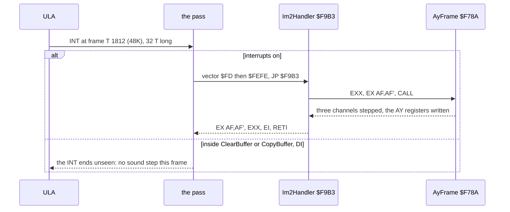

Witness: 125 688 runs of Im2Handler over every recording; 2373 in `c1`. In the room change of
[4.9](#49-the-heaviest-pass-a-room-change), AyFrame took 11 781 T for 17 interrupts. That is about 690 T an interrupt,
1 % of a frame.

### Who counts the passes

The handler does not count frames, so the game counts passes. PassCounter `$FE31` goes up by one in PassTick
`$984D`, once a pass. Every timer in play counts passes: the flashing pieces, the spawn timer, the energy drain, the
lives' colours. A pass is about 3 frames in stage 1 ([4.5](#45-one-pass-measured)). So a timer of 32 passes lasts
about 2 seconds in a light room and longer in a heavy one.

The resident names the same byte FrameCounter. In the menus and the waits CycleColours steps it once a frame, after a
HALT. So the same byte counts frames in the menus and passes in play.

**The point**: the interrupt is a sound clock only. Game time is counted in passes, and a pass is as long as its
work.

## 4.3 The stage's entry

The resident calls the stage at `$7800` with H = the lives. StageEntry sets the stage up and falls into MainLoop.

```asm
StageEntry:
  LD A,H
  LD (Lives),A
  CALL InitStageState
  CALL StageSetUp
  CALL ClearActors
  CALL ResetObjectLists
  LD HL,Grid0
  LD (RoomGrid),HL
  LD HL,Grid0Placements
  LD (Placements),HL
  CALL ReviveAllPlacements
  CALL PlaceHeroAtStart
  LD A,$02
  LD (RoomNumber),A
  CALL StartGrid
  CALL ClearBuffer
  CALL RunActorHandlers
  CALL DrawActors
  CALL CopyBuffer
  CALL StageFadeIn
```

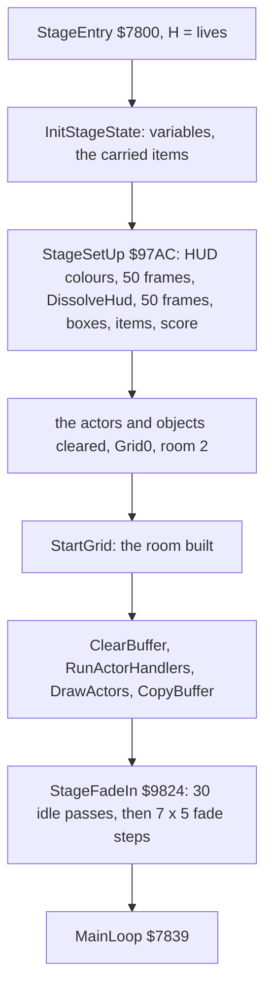

StageFadeIn runs the passes' clock without the game:

```asm
StageFadeIn:
  LD B,$1E
  CALL IdlePasses
  LD B,$07
FadeInRound:
  PUSH BC
  XOR A
  LD (PassCounter),A
  LD B,$05
FadeInFrame:
  PUSH BC
  HALT
  CALL FadeInStep
  LD HL,PassCounter
  INC (HL)
  POP BC
  DJNZ FadeInFrame
  POP BC
  DJNZ FadeInRound
```

IdlePasses `$9842` is B x (3 HALTs + PassTick). PassTick runs the energy, the lives' flash and the timers, so the
HUD is alive while the room is still dark.

**A worked example: the 403 frames before the first pass.** In `c1` the stage block's first instruction runs at frame
15075. The first fetch of MainLoop is at 15478:44858.

1. StageSetUp waits twice 50 frames (WaitFrames `$8C35` with BC = `$0032`, a HALT a round): 100 frames.
2. StageFadeIn's idle passes: 30 x 3 HALTs = 90 frames.
3. Its fade: 7 rounds x 5 HALTs = 35 frames.
4. That is 225 frames of fixed waits. The rest of the 403 is the HUD's dissolve, the room's build and the first
   draw.

Witness: StageEntry and StageFadeIn ran once each in `s1-idle` and `s1-right`, and in `c1` at frame 15075.

**The point**: the entry is the only part of stages 1-4 that waits for the frame, and it waits on purpose. The HUD and
the room fade in at a fixed speed whatever the room holds.

## 4.4 The main loop

MainLoop `$7839` runs one step of the game a pass. It has no HALT. Stage 1's pass, from `src/stage1/mainloop.asm`:

```asm
MainLoop:
  CALL PacePass
  CALL ShowPieceTaken
  CALL FlashPieces
  CALL CheckPause
  CALL SpawnTimer
  CALL RedrawItemsIfChanged
  CALL ClearBuffer
  CALL CheckStageExit
  CALL UpdateMissiles
  CALL RunActorHandlers
  CALL DrawActors
  CALL DrawArenaPicture
  CALL ZoneDamage
  CALL DrawRoomPicture
  CALL UpdateBurst
  CALL KeyHook
  CALL UpdateAttributes
  CALL PassTick
  CALL ShowScore
  CALL TestSpaceKey
  JR NZ,MainLoopNext
MainLoopSpace:
  LD BC,$FEFE             ; SPACE pressed: CAPS SHIFT too quits, else the item
                          ; window
  IN A,(C)
  BIT 0,A
  JP Z,QuitStage
  LD A,(HeroState)
  CP $0F
  CALL NZ,ItemWindow
MainLoopNext:
  LD A,(Lives)            ; go on while lives are left or the hero is not back
                          ; in state 0
  CP $00
  JR NZ,MainLoop
  LD A,(HeroState)
  CP $00
  JR NZ,MainLoop
GameOverExit:
  LD E,$00
  JP EndStage
QuitStage:
  LD E,$01
EndStage:
  ...
```

The same in pseudocode, with what each call does:

```text
MainLoop:
  forever:
    PacePass()               # every 64 passes reseed RandomPointer from R; busy wait in light rooms
    ShowPieceTaken()         # a piece just taken: its box on the HUD
    FlashPieces()            # the pieces' boxes flash
    CheckPause()             # ENTER: wait for release, press, release
    SpawnTimer()             # the room's spawn countdown
    RedrawItemsIfChanged()   # the item strip, if an item count changed
    ClearBuffer()            # DI; PUSH 0 over the play buffer $5B00-$6CFF; EI
    CheckStageExit()         # the stage's goal reached: EndStage with E = 2, never returns
    UpdateMissiles()         # the shots and the enemies' missiles
    RunActorHandlers()       # the hero (keys, moves, room exits) and the actors
    DrawActors()             # every actor into the play buffer
    DrawArenaPicture(); ZoneDamage(); DrawRoomPicture(); UpdateBurst()
    KeyHook()                # a patch point
    UpdateAttributes()       # the play area's colours, then CopyBuffer: DI; the buffer to the screen; EI
    PassTick()               # PassCounter + 1, energy, timers, the lives' colours, the game-over step
    ShowScore()              # the score's digits
    if SPACE:
        if CAPS SHIFT: E = 1; goto EndStage
        if HeroState != $0F: ItemWindow()
    if Lives == 0 and HeroState == 0: E = 0; goto EndStage
```

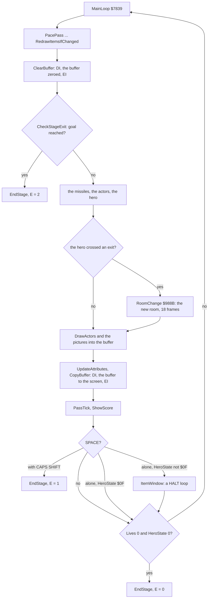

How to read it: the left column is every pass. The branches are the rare passes: a room change, SPACE, the end of the
stage. Only ItemWindow and CheckPause stop the pass to wait for a key.

Two rules follow from the order:

- The play buffer is cleared before anything is drawn and copied after everything is drawn. The play area shows only
  finished pictures, never a half-drawn one.
- The hero's keys are read once a pass, inside RunActorHandlers ([doc 5](05-controls.md)). A tap shorter than a pass
  (3 frames, 60 ms) can fall between two reads and never be seen.

Witness: MainLoop `$7839` ran 10 187 times in the stage-1 recordings (`c1o`, `deaths`, `s1-idle`, `s1-right`) and 9313
times in `rzx-r1`.

**The point**: one pass is one step of the world, and the play area changes once a pass. A pass has no fixed length.
The game's speed is the speed of its slowest room.

## 4.5 One pass measured

`tools/passes.py` measures each pass from one fetch of `$7839` to the next. It counts the interrupts taken (fetches
of `$FEFE`) and the T-states spent in DelayBC `$79AB-$79B0`.

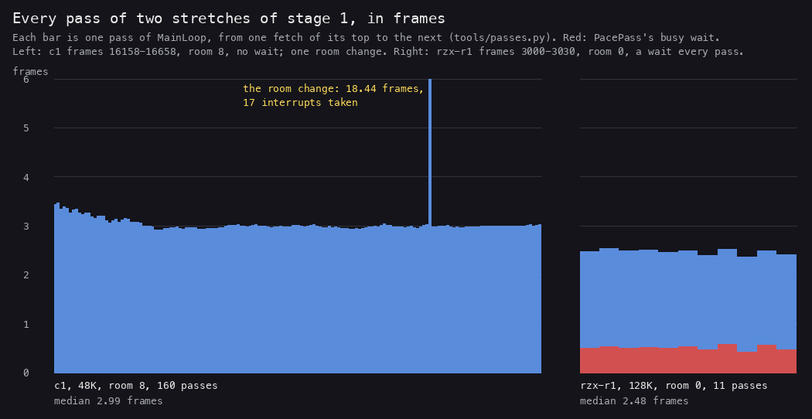

*Left: the 160 passes of `c1` frames 16158-16658 (room 8 of grid 0, then room 7), from the access trace in
`work/stage1/c1o/traces/`. Right: the 11 passes of `rzx-r1` frames 3000-3030 (room 0 of grid 0), traced on the case's
own instance. Made with `python3 tools/passes.py --work work/stage1/c1o --window 16158-16658 --json C1.json`, the same
for `rzx-r1` with `--window 3000-3030`, then `python3 tools/fig_loop.py passes C1.json R1.json
docs/img/loop/pass-lengths.png`.*

How to read it: a bar is one pass, its height in frames. The red part is PacePass's busy wait. Room 8 has no wait, so
its passes are all work: 2.99 frames at the median. Room 0 waits about half a frame a pass, and its passes are still
shorter (2.48 frames): it holds less to draw. The spike is the room change at 16531
([4.9](#49-the-heaviest-pass-a-room-change)).

One ordinary pass, from 16202:253 to 16205:10923 in `c1`, cut at its main calls. The times are the first fetches of
each routine in `work/docs/myA/c1/traces/16180_0-16215_0.uatr`:

| From | To | T | What runs |
| --- | --- | ---: | --- |
| 16202:253 | 16202:675 | 422 | PacePass (no wait in room 8), the HUD flashes, CheckPause, SpawnTimer, RedrawItemsIfChanged |
| 16202:675 | 16203:33296 | 102 509 | ClearBuffer (29 464 in its loop), the missiles, the actors, DrawActors, the pictures |
| 16203:33296 | 16204:6102 | 42 694 | UpdateAttributes: 504 cells, the shadow's colour into each open cell |
| 16204:6102 | 16205:10923 | 74 709 | CopyBuffer (67 533 in the copy), PassTick, ShowScore, TestSpaceKey |
| | total | 220 334 | 3.15 frames of 69 888 T |

The routines that took the most of that pass:

| Routine | T | Share |
| --- | ---: | ---: |
| CopyChain, CopyBuffer's LDI chain | 46 554 | 21.1 % |
| UpdateAttrCell, UpdateAttrNext | 41 444 | 18.8 % |
| ClearBufferLoop | 29 464 | 13.4 % |
| CopyLineE, CopySpan, CopyLineEnd, CopySpanRestore | 20 979 | 9.5 % |
| DrawActorOpaqueLoop, PlotRow2, PlotRow3Mirrored | 16 509 | 7.5 % |
| PathFlyerByte, a flying actor's path | 11 945 | 5.4 % |
| everything else | 53 439 | 24.3 % |

**A worked example: the pass in T-states.** The pass is 220 334 T.

1. One 48K frame is 69 888 T. 220 334 / 69 888 = 3.15 frames.
2. The three render routines take 29 464 + 41 444 + 67 533 = 138 441 T: 63 % of the pass.
3. The game itself (the actors, the missiles, the hero's moves) is what is left of the 102 509 T between ClearBuffer
   and UpdateAttributes once the clear is taken out: about 73 000 T.
4. So the game takes about 16 steps a second (50 / 3.15), and draws for 63 % of the time.

**The point**: Myth spends most of a pass moving bytes. The game's logic is a third of it.

## 4.6 One pass against the beam

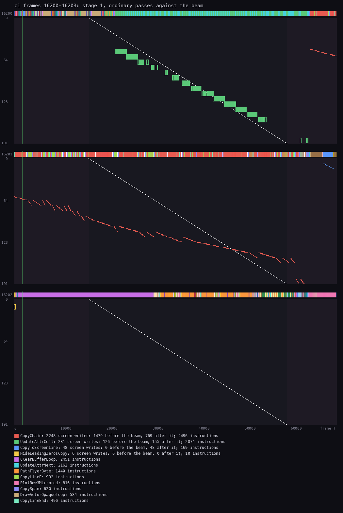

*`c1` frames 16200-16202, stage 1, room 8. Each panel is one frame. The strip at its top shows which routine runs at
each T-state. The dots below are the screen writes at their frame T (across) and screen line (down). The diagonal is
the beam. Made with `python3 ../../kit/beam_timeline.py --work work/docs/myA/c1 --window 16200:0-16204:0 --listing
build/stage1.lst --listing build/resident.lst --machine 48k --title 'c1 frames 16200-16203: stage 1, ordinary passes
against the beam' --out docs/img/play/pass-beam-light.png`.*

How to read it:

- Frame 16200: the green blocks are UpdateAttrCell writing the attribute rows, top to bottom. At the right edge the
  red dots start: CopyChain copying pixel lines.
- Frame 16201: the red dots are CopyChain. It copies one 8-line span after another down the play area, at about 570 T
  a line. The beam draws a line every 224 T, so it catches the copy at about line 135 and frame T 46 000. The lines
  above the crossing were copied before the beam drew them and show the new picture. The lines below show the last
  pass's picture for one more frame. That is the tear of a buffer copied without frame sync.
- Frame 16202: the strip is violet up to frame T 29 000: ClearBufferLoop. It writes no screen byte. Then the actors'
  routines (orange PathFlyerByte, pink PlotRow3Mirrored) draw into the buffer.
- The thin vertical line at frame T 1812 is the INT.

**A worked example: two interrupts lost in a row.** The trace shows the handler's first fetch of `$F9B3` in frames
16200 (at T 1843) and 16203 (at T 1844). It shows none in 16201 and 16202.

1. In frame 16201 the INT rises at T 1812. CopyBuffer began at 16200:63912 with DI, and its copy lasts about 67 000
   T, to about 16201:61 000. The INT's 32 T fall inside it, so the CPU never sees it.
2. In frame 16202 the pass starts at T 253. ClearBuffer's DI is at T 675, and its PUSH loop runs to about T 30 000.
   The INT at T 1812 falls inside again.
3. Two frames without AyFrame: the sound effect playing stood still for 40 ms.

Over the 32 frames 16183-16214 the trace shows 19 interrupts taken and 13 lost: 40.6 %. The RZX run gives 38.4 % for
the whole of stage 1 ([doc 2](02-architecture.md#25-the-frame-budget)).

**The point**: the pass and the beam are not locked. The copy moves down the screen at less than half the beam's
speed, so each pass's picture appears with a tear, at a different line each time.

## 4.7 One pass as an animation

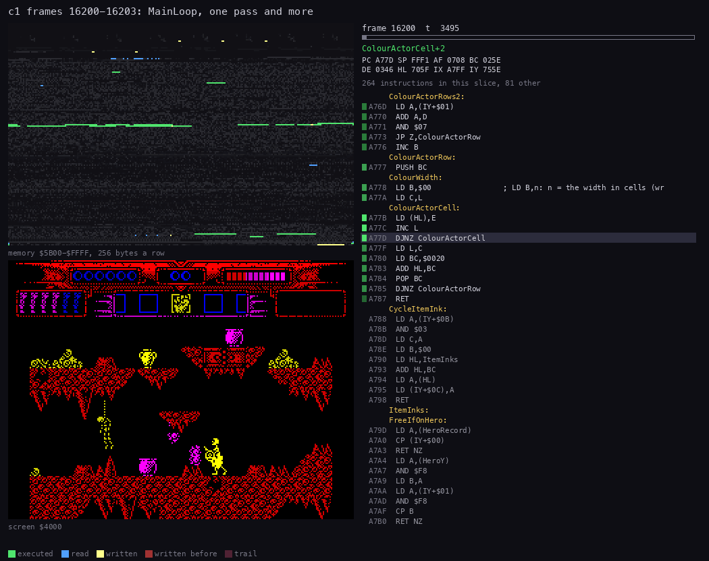

*`c1` frames 16200-16203 (80 pictures): the end of one pass (UpdateAttributes, CopyBuffer), then the next pass's
ClearBuffer, the actors and UpdateAttributes. Left, top: memory `$5B00-$FFFF`, 256 bytes a row, executed green, read blue, written
yellow. Left, bottom: the screen. Right: the code at the PC with the registers. Made with `python3
../../kit/routine_anim.py --work work/docs/myA/c1 --window 16200:0-16204:0 --listing build/stage1.lst --listing
build/resident.lst --view screen --pc 7800-B4B1 --range 5B00-FFFF --pictures 80 --title 'c1 frames 16200-16203:
MainLoop, one pass and more' --out docs/img/routines/MainLoop.gif`.*

What to watch:

- The rows at the top of the memory map are the play buffer `$5B00-$6CFF`. They turn yellow in one sweep while
  ClearBufferLoop pushes zeros, from `$6CFF` down.
- Then short yellow strokes appear in them as DrawActors puts the sprites in.
- During CopyBuffer the buffer turns blue (read) span by span while the screen's lines are written.
- The code panel shows the 16 PUSH HL of ClearBufferLoop, then CopyBuffer's set-up of a span.

## 4.8 PacePass: the busy wait

The passes of a light room would be faster than those of a busy room. PacePass pads them with a busy wait, so the
hero walks at about the same speed in the rooms the designers timed.

```asm
PacePass:
  LD A,(PassCounter)
  AND $3F
  JR NZ,PacePassRoom
  LD BC,(RandomPointer)
  LD A,R
  LD B,A
  LD (RandomPointer),BC
PacePassRoom:
  LD A,(GridNumber)
  CP $00
  JR NZ,PaceShaftRoom
  LD A,(RoomNumber)
  CP $06
  RET NC
  LD BC,$044C
  JP DelayBC
```

```asm
DelayBC:
  DEC BC
DelayBCTest:
  LD A,B
  OR C
DelayBCLoop:
  JR NZ,DelayBC
  RET
```

```text
PacePass:
    if PassCounter % 64 == 0:
        RandomPointer.high = R            # the refresh register: the only entropy in play
    if GridNumber == 0:
        if RoomNumber < 6: busy-wait $044C rounds
    else:                                 # PaceShaftRoom
        if GridNumber == 1 and RoomNumber == 0: busy-wait $0640 rounds
```

Every stage has its own PacePass:

| Stage | Where it waits | Rounds | T a round |
| --- | --- | --- | ---: |
| 1 | grid 0 rooms 0-5; grid 1 room 0 (PaceShaftRoom) | `$044C` = 1100; `$0640` = 1600 | 26 |
| 2 | nowhere: PacePassEmpty is a bare RET | 0 | |
| 3 | grid 1 room 10 only | `$044C` = 1100 | 26 |
| 4 | the table PaceWaits: grid 0 rooms 0 and 1, grid 4 rooms 0 and 1 | `$0258`, `$0640`, `$04B0`, `$04B0`; 1 elsewhere | 24 |
| 5 | TextPassDelay while a text page is up; PaceLateForms in form 3 and after the duel | `$07D0`; `$0320` or `$07D0` | |

Stage 4's wait is a loop of its own, PacePassWait: DEC BC, LD A,B, OR C, JP NZ. A JP NZ takes 10 T whether it jumps or
not. So a round is 6 + 4 + 4 + 10 = 24 T, not the 26 T of DelayBC's JR NZ.

**A worked example: a paced pass of room 0.** `rzx-r1` frames 3000-3030, room 0 of grid 0.

1. PacePass loads BC = `$044C` = 1100 rounds.
2. DelayBC's round is DEC BC (6 T) + LD A,B (4) + OR C (4) + JR NZ taken (12) = 26 T. The last JR is not taken (7 T).
3. In theory that is 1100 x 26 - 5 = 28 595 T, 0.40 of a 128K frame.
4. passes.py measured 29 686 to 40 441 T, and 35 373 T at the median.
5. The difference is the memory. DelayBC sits at `$79AB`, in `$4000-$7FFF`. The ULA delays the CPU's fetches there
   while it draws the paper. An interrupt that lands in the wait adds AyFrame's time as well.

**A worked example: the witness count.** The stage-1 recordings ran 10 187 passes, and 8978 of them waited.
8978 x 1100 = 9 875 800 rounds. The L1 count of DelayBC's first instruction is 9 877 843. The 2043 more are the
interrupts' returns into the loop, which the L1 counts as entries.

**The point**: PacePass is a fixed pad, not a frame lock. It evens out the rooms the designers timed. The rooms with
many actors still run slower.

## 4.9 The heaviest pass: a room change

When the hero walks out of a room, CheckRoomExits (called from the hero's handler in RunActorHandlers) calls one of
LeaveRoomLeft, LeaveRoomRight, LeaveRoomDown or LeaveRoomUp. They clear the buffer and call RoomChange `$988B`. It
unpacks the stage's graphics and map, draws the room and builds the spans. All of that happens inside one pass.

In `c1` the hero walks from room 8 to room 7. The pass runs from 16531:33882 to 16549:64359: 1 288 461 T, 18.44
frames.

| Part | Routines | T |
| --- | --- | ---: |
| the pass's own ClearBuffer, and RoomChange's | ClearBuffer x 2 | 63 682 |
| the buffer cleared before the unpack | ClearPlayBuffer `$8A7B`, one LDIR of 4401 bytes | 120 109 |
| the tiles and the map unpacked to `$5B00` | Unrle `$A424` | 211 180 |
| the room's cells | RoomCells, PutBlock | 96 357 |
| the play area's attributes zeroed | BlackOutPlayArea | 18 426 |
| the room drawn: attributes into the shadow, 8 bitmap bytes a cell onto the screen | RoomChangeCell, RoomChangeAttrs, RoomChangeBitmaps, CopyTileLine | 338 651 |
| the copy spans of the new room | BuildSpans, AddSpan | 124 269 |
| the attributes restored and the buffer copied | UpdateAttrRestore, CopyBuffer, RestoreAttr | 122 636 |
| a HALT inside UpdateAttrRestore | UpdateAttrRestore | 63 138 |
| the sound, 17 interrupts | AyFrame | 11 781 |
| the actors, the missiles, the HUD and the rest | | 118 705 |

*Summed per label from the trace `work/docs/myA/c1/traces/16531_33882-16550_10000.uatr` over the listings of stage 1
and the resident; the rows add up to 1 288 934 T, the pass and the last few hundred T of the trace.*

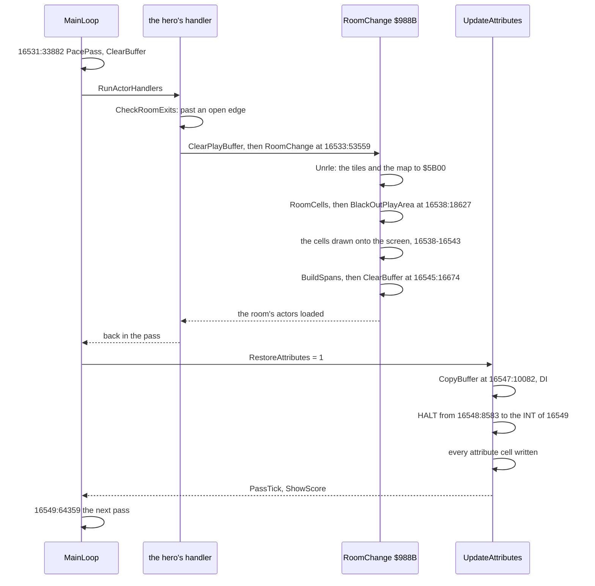

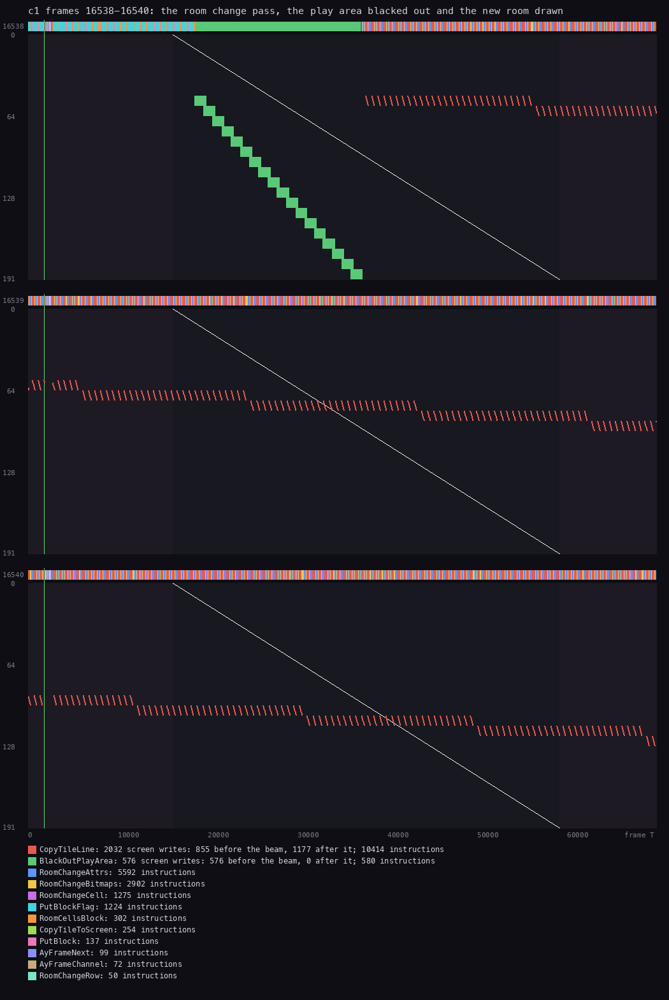

*`c1` frames 16538-16540, inside the room-change pass. Made with `python3 ../../kit/beam_timeline.py --trace
work/docs/myA/c1/traces/16531_33882-16550_10000.uatr --listing build/stage1.lst --listing build/resident.lst --machine
48k --frames 16538-16540 --title 'c1 frames 16538-16540: the room change pass, the play area blacked out and the new
room drawn' --out docs/img/play/pass-beam-roomchange.png`.*

How to read it:

- Frame 16538: the green staircase is BlackOutPlayArea zeroing the play area's 576 attributes, one row at a time.
  It runs ahead of the beam, so the old room goes black within this frame.
- Then the red strokes: CopyTileLine writes each cell's 8 bitmap bytes straight to the screen. A stroke is one cell,
  8 lines deep. Unlike a normal pass, the room is drawn on the screen itself, not in the buffer, behind black
  attributes.
- Frames 16539-16540: the cells go on, row after row. The beam crosses them, and nothing shows because the
  attributes are still black.

**A worked example: why 17 interrupts, not 18.** The pass covers the INTs of frames 16532-16549: 18 of them.

1. The trace shows the handler in every one of them except 16548.
2. In 16547 CopyBuffer starts at T 10082 with DI. Its copy runs past 16548's INT at T 1812, so that one is lost.
3. RoomChange itself runs with interrupts on. So the 12 frames of unpacking and drawing take every INT, and the sound
   plays on through the room change.
4. After CopyBuffer, UpdateAttrRestore HALTs at 16548:8583 until the INT of 16549. Then it writes every attribute
   cell right after the INT, while the beam is still in the top border. The new room appears in one frame.

Witness: RoomChange `$988B` ran 26 times in the stage-1 recordings. In `c1` this is the second-heaviest pass. The
heaviest is the other room change, out of room 2 at 15570:3606: 1 318 737 T, 18.87 frames
([WALKTHROUGH 1.2](../WALKTHROUGH.md#12-the-main-loop-and-the-frame)).

**The point**: a room change is a pass six times longer than the others, and the game hides it. The old room goes
black first, the new one is drawn behind black attributes, and a HALT lines its colours up with the frame.

## 4.10 The lost interrupts

ClearBuffer and CopyBuffer both move SP: into the play buffer, or along the span table. An interrupt would push its
return address there, into the picture or into the table. So both start with DI and end with EI.

```asm
ClearBuffer:
  DI
  LD (SavedSP),SP
  LD HL,$0000
  LD SP,PlayBuffer+4608
  LD B,$90
ClearBufferLoop:
  PUSH HL
  ...                     ; 16 PUSH HL in all
  DJNZ ClearBufferLoop
  ...                     ; SP back from SavedSP, EI, RET
```

```asm
CopyBuffer:
  DI
  LD HL,(SpanCount)
  PUSH HL
  LD (SavedSP),SP
  LD SP,SpanTable
CopySpan:
  POP BC
  ...                     ; the span's length patched into the LDI chain at $9B09
```

On the Spectrum the INT line stays low for 32 T at the frame's start. A Z80 with interrupts off at that moment never
sees it. The game loses the interrupt, and with it one step of the sound.

| Stage | Frames | Interrupts taken | Share | Frames a pass |
| --- | ---: | ---: | ---: | ---: |
| 1 | 30 834 | 18 993 | 61.6 % | 3.31 |
| 2 | 19 175 | 10 663 | 55.6 % | 3.30 |
| 3 | 17 455 | 10 856 | 62.2 % | 3.56 |
| 4 | 24 405 | 16 015 | 65.6 % | 3.18 |
| 5 | 6225 | 4945 | 79.4 % | 2.21 |

*The RZX run's L1 counts of Im2Handler `$F9B3` and MainLoop ([doc 2](02-architecture.md#25-the-frame-budget)).*

**A worked example: the share lost in stage 1.** A stage 1 pass in the RZX run:

1. ClearBuffer takes 30 761 T a pass and CopyBuffer 58 040 ([4.11](#411-the-five-stages-loops)). Together 88 801 T
   run with DI.
2. A pass is 3.31 x 70 908 = 234 705 T.
3. 88 801 / 234 705 = 37.8 % of the time an INT finds the interrupts off.
4. The L1 counts give 38.4 % lost. That is the same figure within the rounding.

Stage 5 has no play buffer, no ClearBuffer and no CopyBuffer, yet it loses 20.6 %. Its DrawHero and DrawHeroFrame
walk SP down ScreenLineTable `$FB00` with DI, and three of Dameron's face routines in `duel.asm` do the same.

**The point**: the lost interrupts are the price of the PUSH clear and the stack copy. Only the sound pays it: the
effects play about 40 % slower in play than in the menu ([doc 9](09-sound.md)).

## 4.11 The five stages' loops

Every stage block has its own MainLoop. Stages 1-4 share the shape of stage 1's and add their bosses' calls. Stage 5
is a different game: a duel on a starfield, with no rooms and no buffer.

| Stage | MainLoop | PacePass | What it changes in stage 1's pass | Item window |
| --- | --- | --- | --- | --- |
| 1 | `$7839` | grid 0 rooms 0-5, grid 1 room 0 | | yes |
| 2 | `$7837` | PacePassEmpty, a RET | adds UpdateHydraNecks, ColourHydra, DrawHydraBody, HydraDefeated; drops DrawArenaPicture, ZoneDamage, DrawRoomPicture | yes |
| 3 | `$784A` | grid 1 room 10 | adds RainChance, UpdateRain, DrawDragon, ThroneBossStep, LightningStep | yes |
| 4 | `$7837` | the PaceWaits table | adds TrapChainStep, LinkTrapSlots, DrawBossPicture, HeadShots | yes |
| 5 | `$7843` | a HALT at the head | a loop of its own, below | no |

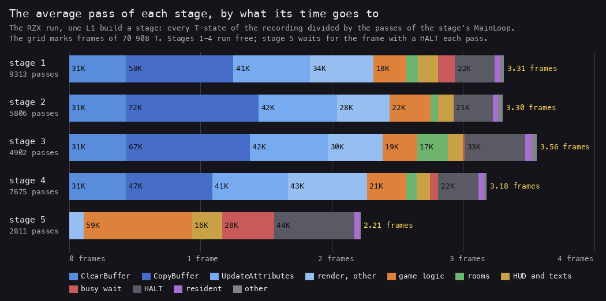

*The RZX run, one L1 build a stage (`work/stage2/rec/rzx-rN/l1.json`): every T-state of the recording summed by
routine, grouped, and divided by the passes of the stage's MainLoop. Made with `python3 tools/fig_loop.py
docs/img/loop/pass-anatomy.png`, which reads the stage's `.ann` with `kit/fig_budget.py`'s reader.*

How to read it:

- The blues are the renderer. In stages 1-4 they are 130 000 to 160 000 T a pass, about two frames.
- Stage 2's CopyBuffer is the largest (71 758 T): the hydra's room has more open cells to copy.
- HALT in stages 1-4 is not in the pass. It is the stage's title, its entry, the item window and the waits, spread
  over the passes by the division.
- Stage 5's bar is all logic, texts and waits. Its HALT is the one at the head of every pass.

| Stage | ClearBuffer | CopyBuffer | UpdateAttributes | other render | logic | rooms | HUD, texts | busy wait |
| --- | ---: | ---: | ---: | ---: | ---: | ---: | ---: | ---: |
| 1 | 30 761 | 58 040 | 41 367 | 34 294 | 17 738 | 6103 | 10 873 | 9254 |
| 2 | 30 679 | 71 758 | 42 188 | 28 483 | 22 128 | 4212 | 8157 | 0 |
| 3 | 30 963 | 66 629 | 42 218 | 29 585 | 18 689 | 16 566 | 8056 | 968 |
| 4 | 30 827 | 46 540 | 40 796 | 42 728 | 21 318 | 5499 | 7388 | 4336 |
| 5 | 0 | 0 | 0 | 7894 | 58 531 | 0 | 16 261 | 28 008 |

*T-states a pass, the figure's numbers.*

### Stage 5: the only loop with frame sync

```asm
MainLoop:
  LD HL,PassCounter
  INC (HL)
  HALT
  CALL HeroControl
  CALL HeroFire
  CALL MoveShots
  CALL DrawShots
  CALL MoveStars
  CALL DameronFire
  CALL ApplyEnergyChange
  CALL DrawEnergyBar
  CALL LivesFlashStep
  CALL DrawStars
  CALL DuelStep
  CALL UpdateBurst
  LD A,$FF
  LD (Screen+513),A
  LD A,$02
  LD (Screen+512),A
  LD A,(DuelPhase)
  CP $FF
  CALL Z,TextPassDelay
  LD A,(DuelPhase)
  CP $04
  CALL Z,TextPassDelay
  CALL DrawHero
  CALL UpdateDameronMissiles
  CALL ColourPlayArea
  LD A,(HeroGameOverCount)
  CP $00
  JP Z,GameOverExit
  LD BC,$FEFE
  IN A,(C)
  BIT 0,A
  JP NZ,MainLoop
MainLoopCaps:
  LD BC,$7FFE             ; CAPS SHIFT held: SPACE too quits
  IN A,(C)
  BIT 0,A
  JP Z,QuitStage
  JP MainLoop
```

```text
Stage 5 MainLoop:
  forever:
    PassCounter += 1
    HALT                                   # the frame sync stages 1-4 do not have
    the hero, his shots, the stars, Dameron's fire, the energy bar, the lives' flash
    DuelStep                               # the texts, or Dameron
    if DuelPhase == $FF or DuelPhase == 4: TextPassDelay   # $07D0 rounds while a page of text is up
    DrawHero; UpdateDameronMissiles; ColourPlayArea
    if HeroGameOverCount == 0: E = 0; goto EndStage
    if CAPS SHIFT and SPACE: E = 1; goto EndStage
```

Stage 5 draws straight onto the screen. It has no buffer to tear, so it waits for the frame at the head of each pass
and then draws. A pass still takes more than two frames on average: the HALT, then more than a frame of work.

It writes `$02` and `$FF` to the screen bytes `$4200-$4201` every pass: pixel line 2 of columns 0-1, in the HUD.

**A worked example: stage 5's frames a pass.** `s5-right`: 3730 passes in 7940 frames.

1. 7940 / 3730 = 2.13 frames a pass.
2. The pass starts with a HALT, so it starts at an INT. A pass with more than one frame of work waits for the INT after
   next: 2 frames.
3. While a text page is up, TextPassDelay adds `$07D0` = 2000 rounds of a busy wait to each pass.
4. Those longer passes lift the mean above 2.

There is no E = 2 in stage 5. Winning the duel sets DuelPhase to 4: the ending text stays and the loop goes on
([doc 10](10-gameplay-logic.md)).

**The point**: Myth's last stage is built the other way round from the first four: a frame-locked loop with no buffer.
A starfield and two figures are cheap enough to draw in place.

## 4.12 The sub-loops

Six loops stop the pass or run instead of it.

| Loop | Where | How it waits | Ends on |
| --- | --- | --- | --- |
| the pause | CheckPause `$79B1` | busy: IN from `$BFFE` | ENTER released, pressed, released |
| the item window | ItemWindow `$7C27` | a HALT a frame, an item step every 6 frames | SPACE, then the box flashed |
| the idle passes | IdlePasses `$9842` | 3 HALTs + PassTick | B rounds |
| the stage's waits | WaitFrames `$8C35` | a HALT a round | BC rounds |
| the resident's waits | WaitFrames `$F542` | HALT + CycleColours | 75 rounds |
| the stage's end | EndStage `$789E` | 100 frames after the fade | RET to PlayStage |

### The pause

```asm
CheckPause:
  LD BC,$BFFE
  IN A,(C)
  BIT 0,A
  RET NZ
PauseRelease:
  IN A,(C)
  BIT 0,A
  JR Z,PauseRelease
PausePress:
  IN A,(C)
  BIT 0,A
  JR NZ,PausePress
PauseRelease2:
  IN A,(C)
  BIT 0,A
  JR Z,PauseRelease2
  RET
```

Port `$BFFE` bit 0 is ENTER. The pause spins on the port with interrupts on. So the sound goes on stepping, and the
effect playing at the moment runs to its end.

**A worked example: the pause that was never taken.** `c1`'s script presses H at frames 16050 and 16104 to pause.

1. H is port `$BFFE` bit 4. CheckPause reads bit 0 only.
2. So the game went on. PauseRelease `$79B5` has 0 runs in every recording.
3. Only ENTER pauses, and DEFINE KEYS does not change that ([doc 5](05-controls.md)).

### The item window

SPACE alone opens ItemWindow, unless HeroState `$74EA` is `$0F`.

```asm
ItemWindow:
  XOR A
  LD (PassCounter),A
  HALT
  CALL CycleWindowFrame
  CALL TestSpaceKey
  JP Z,ItemWindow
ItemWindowStep:
  LD B,$06
ItemWindowFrame:
  PUSH BC
  HALT
  CALL CycleWindowFrame
  CALL DrawItemStrip
  CALL ShowItemCount
  POP BC
  DJNZ ItemWindowFrame
  CALL KeyRight
  ...
```

It waits for SPACE's release, then steps the item strip every 6 frames with RIGHT or LEFT, and ends on SPACE again.
It is the one place in stages 1-4's play that is frame-locked. [Doc 5](05-controls.md) covers its keys.

**A worked example: SPACE pressed during the respawn.** `c1`'s script opens the item window with SPACE.

1. The hero loses a life at about frame 15890 (Lives `$FE61` goes from 5 to 4). LoseLife sets HeroState `$74EA` to
   `$0F`: the pause before the hero comes back.
2. MainLoop's `JP Z,QuitStage` at `$787E` ran 3 times in `c1`, so TestSpaceKey saw SPACE three times. The trace shows
   two of them at 15948:43780 and 15951:68108.
3. HeroState was `$0F` from about 15890 to 16300 (it is `$01` at 16400). So `CALL NZ,ItemWindow` at `$7886` fell
   through each time.
4. So `c1` never opened the item window. `rzx-r1` did: ItemWindow's first instruction ran 245 times there, its
   release loop included.

### EndStage

EndStage is the stage's way back to the resident. It pushes E and hides the HUD's boxes. It saves the HUD's
attributes to `$7600` and its bitmap to `$7000`, clears the score and item fields, fades the screen and waits 100
frames. Then it returns with E, H = the lives and BC = ScoreDigitsHigh.

```text
EndStage(E):
    push E
    ClearBuffer
    hide the pieces boxes and the lives boxes (attribute 1)
    save the HUD's colours (rows 0-5) to $7600; clear four HUD fields from the empty buffer
    save the HUD's bitmap (lines 0-47) to $7000
    FlashFadeScreen; ClearScreen; WaitFrames 100
    pop E; BC = ScoreDigitsHigh; H = Lives
    RET                                  # to PlayStage's CALL GameMain
```

The saved HUD is what the next stage dissolves in at its own entry (StageSetUp's DissolveHud).

Witness: EndStage ran once in `s1-right`, a game over with E = 0. Stage 1's QuitStage `$789C` has no run in any
stage-1 recording.

**The point**: every sub-loop that waits for a key does it with a HALT or a port read inside the pass. The game's
world stands still while it waits, and only the sound goes on.

## 4.13 Known only from the code

| What | Where | Why no recording shows it |
| --- | --- | --- |
| PacePassUnused: rooms 0 and 5 wait `$03E8`, room `$0B` waits BC as it stands | `$7982` | no code calls it |
| the pause | PauseRelease `$79B5` | no recording pressed ENTER in play |
| RestartFromStageOne, REWIND THE TAPE | `$F048` | no game over chose it |
| QuitStage in stage 1 | `$789C` | no stage-1 recording held CAPS SHIFT with SPACE |
| stage 5's E = 2 | none | the code has no path that returns it |

PaceShaftRoom, the wait of `$0640` rounds in grid 1 room 0, ran 731 times in `rzx-r1` (the RZX run's stage 1 replayed
with an L1); no other stage-1 recording reached the shaft.
