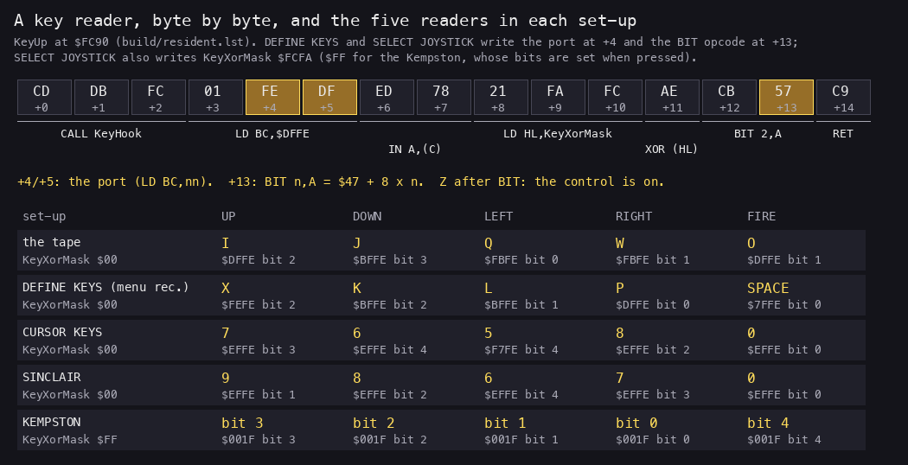
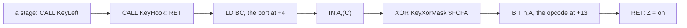
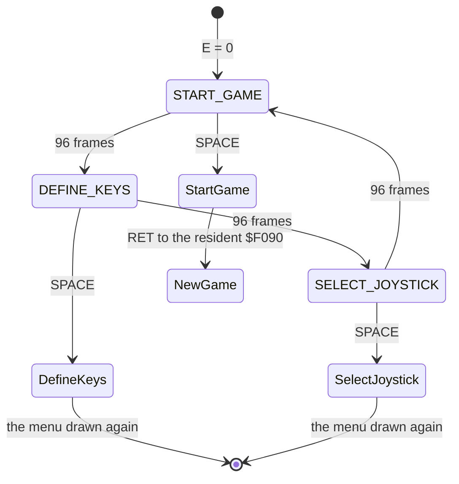
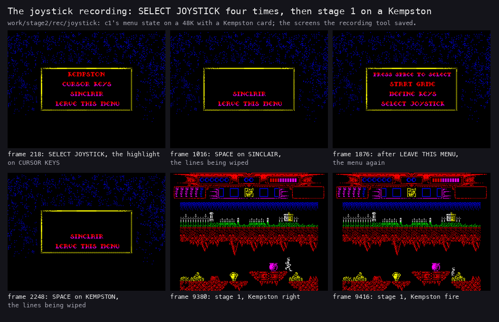
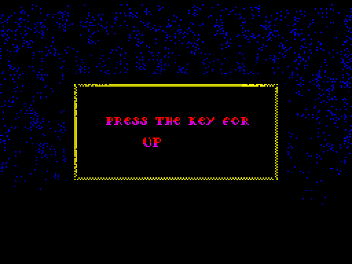
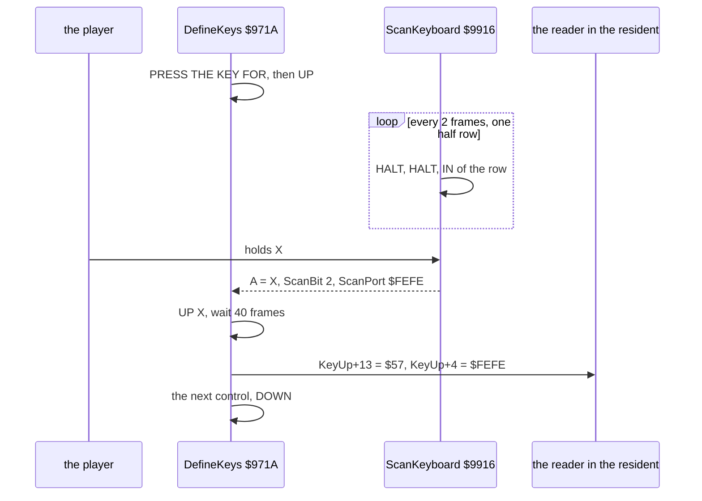
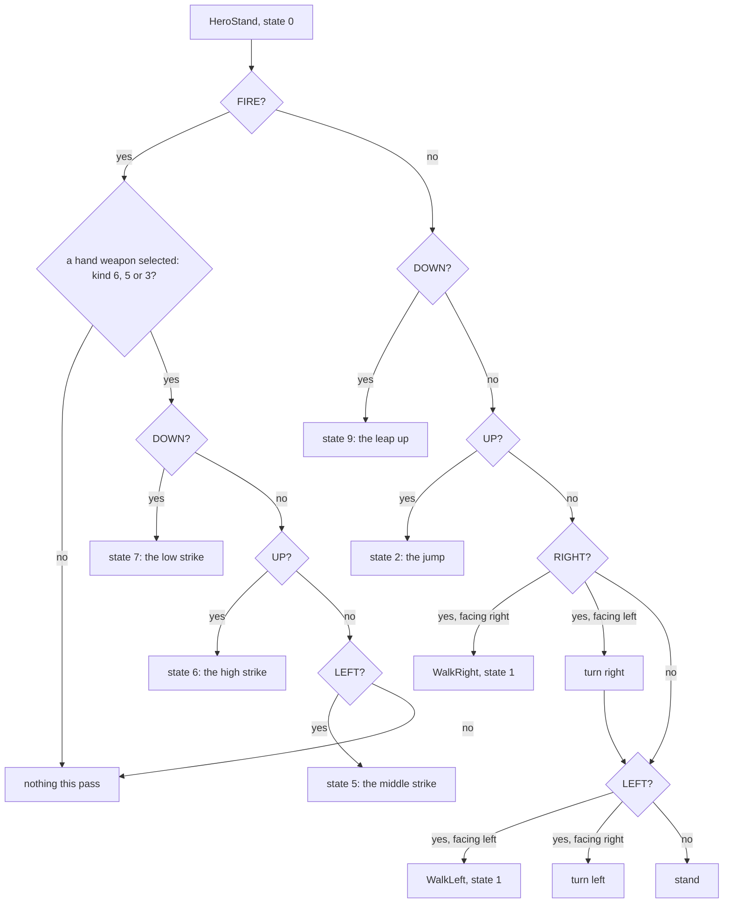
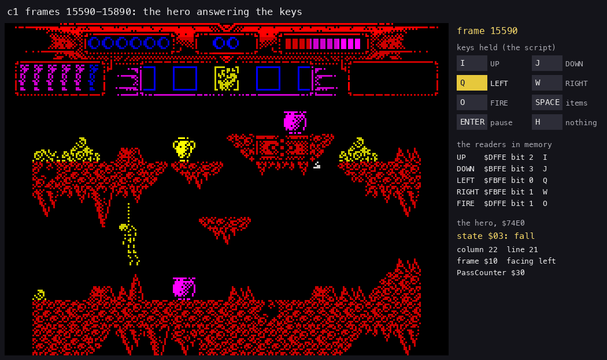
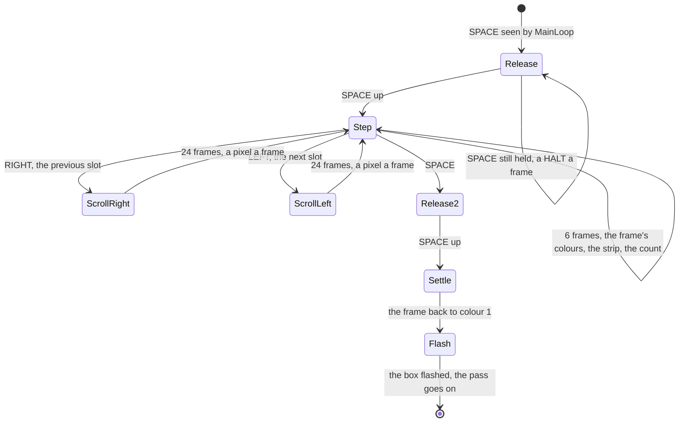
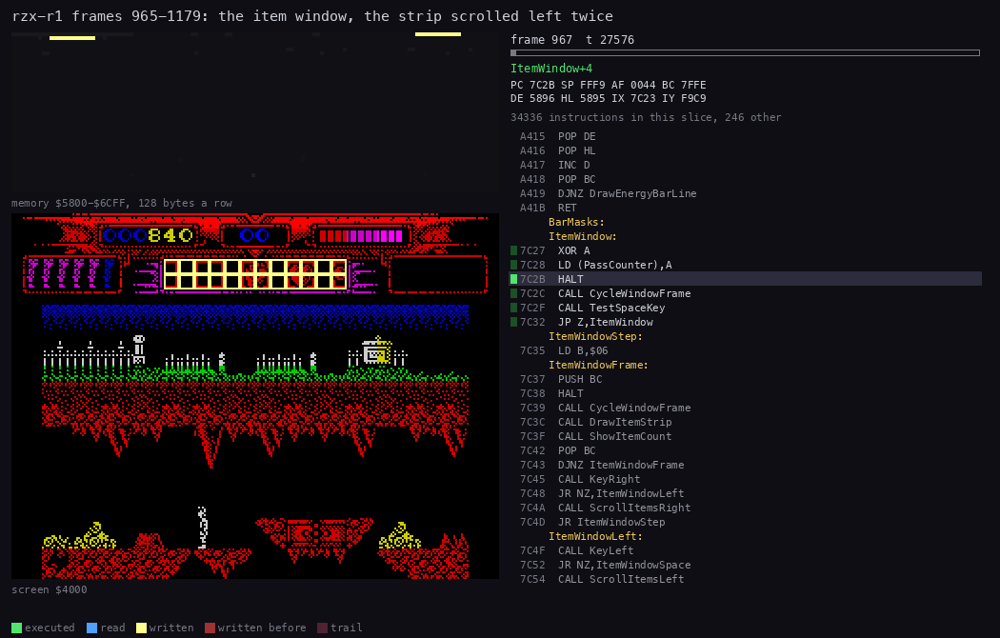

# 5. Controls

What this covers:

- the five key readers at `$FC90-$FCDA`, byte by byte, and the one mask that turns them into joystick readers;
- the keys no menu can move: SPACE, CAPS SHIFT and ENTER;
- the menu and its moving highlight;
- SELECT JOYSTICK: KEMPSTON, CURSOR KEYS, SINCLAIR, each as the bytes it writes;
- DEFINE KEYS: the keyboard scan, the patch, and its traps;
- the keys in play: the hero's stand and walk, the strikes, FIRE's latch, stage 5's free flight;
- the pause and the item window;
- what is known only from the code.

The recordings it rests on ([WALKTHROUGH 6.0](../WALKTHROUGH.md#60-the-recordings)):

| Recording | What it is | Used for |
| --- | --- | --- |
| `c1` | a 48K from power-on, the tape's default keys I J Q W O | the menu's timing, the hero answering the keys (frames 15590-15890) |
| `menu` | `c1`'s menu state, `tests/inputs/menu.txt` | DEFINE KEYS: UP = X, DOWN = K, LEFT = L, RIGHT = P, FIRE = SPACE |
| `joystick` | `c1`'s menu state on a 48K with a Kempston card, `tests/inputs/joystick.txt` | SELECT JOYSTICK four times (CURSOR KEYS, SINCLAIR, LEAVE THIS MENU, KEMPSTON), then stage 1 on the Kempston |
| `rzx-r1` | stage 1 of the RZX run, 128K, the Sinclair joystick | the item window |
| `s5-right` | stage 5 from the RZX snapshot | FIRE's latch in stage 5 |

## 5.1 The five readers

All the game's directions and FIRE go through five routines of the resident, 15 bytes each. A stage never reads a
port for a direction itself. It calls a reader and tests Z.

| Reader | Address | Tape default |
| --- | --- | --- |
| KeyUp | `$FC90` | I |
| KeyDown | `$FC9F` | J |
| KeyLeft | `$FCAE` | Q |
| KeyRight | `$FCBD` | W |
| KeyFire | `$FCCC` | O |

```asm
KeyUp:
  CALL KeyHook
  LD BC,$DFFE
  IN A,(C)
  LD HL,KeyXorMask
  XOR (HL)
  BIT 2,A
  RET
```



*KeyUp's bytes from `build/resident.lst`, and the port and bit of each reader in the five set-ups the recordings
show: the tape's own, the `menu` recording's DEFINE KEYS, and the three choices of the `joystick` recording
(its `record.json` keeps the readers after each choice). Made with `python3 tools/fig_keys.py reader
docs/img/keys/readers.png`.*

How to read it: the gold bytes are the only ones that change. `+4` and `+5` are the port of LD BC. `+13` is the
second byte of `BIT n,A`, which is `$47` + 8 x n. Everything else is the same in all five readers and in every set-up.

```text
Key<Control>():                          # Z when the control is on
    KeyHook()                            # a RET
    A = IN(port)                         # port = reader + 4, written by the menus
    A = A XOR KeyXorMask                 # 0 for keys (pressed = 0), $FF for the Kempston (pressed = 1)
    Z = (bit n of A) == 0                # n from the opcode at reader + 13
```



**A worked example: the bit in an opcode.** The `menu` recording defines UP as X.

1. ScanKeyboard finds X on half row `$FEFE`, the keys CAPS SHIFT, Z, X, C, V at bits 0-4. X is bit 2.
2. DEFINE KEYS writes `$47` OR 2 x 8 = `$57` at KeyUp + 13: `BIT 2,A`.
3. It writes `$FE` and `$FE` at KeyUp + 4 and + 5: `LD BC,$FEFE`.
4. In play, IN A,(C) reads that half row. X held makes bit 2 zero. XOR 0 keeps it. BIT 2,A sets Z: UP is on.

**A worked example: what a read costs.** One call of a reader from a stage:

1. CALL nn 17 T; CALL KeyHook 17; its RET 10; LD BC,nn 10; IN A,(C) 12; LD HL,nn 10; XOR (HL) 7; BIT 2,A 8; RET 10.
2. 101 T a read. The resident sits at `$FC90`, above `$7FFF`, so its code is never slowed. Only the IN from an even
   port can wait for the ULA, a few T at most.
3. A standing hero reads up to five controls a pass: about 500 T, 0.2 % of a pass.

Witness: KeyFire ran 49 911 times, KeyUp 41 801, KeyRight 40 953, KeyLeft 37 050, KeyDown 33 044, over every
recording. KeyHook ran 787 888 times: it is also called from the main loop and from TestSpaceKey.

**The point**: Myth reads its controls through five tiny self-modified routines. A set-up is two bytes per reader
and one shared mask, so the menus never touch the game's code.

## 5.2 The keys no menu can move

Three keys are read straight from their ports, past the readers. DEFINE KEYS and SELECT JOYSTICK do not change them.

| Key | Port, bit | Read by | What it does |
| --- | --- | --- | --- |
| SPACE | `$7FFE` bit 0 | TestSpaceKey `$8A54`, every pass | the item window |
| CAPS SHIFT | `$FEFE` bit 0 | MainLoopSpace, only when SPACE is held | with SPACE: quit the stage, E = 1 |
| ENTER | `$BFFE` bit 0 | CheckPause `$79B1`, every pass | pause until ENTER is pressed again |
| SPACE or FIRE | `$7FFE` bit 0, KeyFire | StageExit `$7A1D` | leave the stage's exit scene |

```asm
TestSpaceKey:
  CALL KeyHook
  LD BC,$7FFE
  IN A,(C)
  BIT 0,A
  RET
```

The instruction sheet says H pauses. No code reads H in play: CheckPause tests bit 0 of `$BFFE`, which is ENTER
([doc 4](04-game-loop.md#412-the-sub-loops)).

**A worked example: FIRE on SPACE.** The `menu` recording defines FIRE as SPACE. What happens in play follows from the
code; no recording played with it.

1. KeyFire now reads `$7FFE` bit 0. TestSpaceKey reads the same bit.
2. Each pass, a press of FIRE is also a press of SPACE.
3. In a pass, the hero's handler (RunActorHandlers) runs before the SPACE test. The press acts first: a strike, a
   throw or a bolt. Then the same pass opens the item window.
4. The window waits for SPACE's release. The next press of FIRE is its SPACE: it closes the window, and the hero does
   not act on it.
5. So the hero acts on every other press of FIRE (the 1st, 3rd, ...), and each of those presses also opens the window;
   the presses between only close it.

So the one key DEFINE KEYS accepts without complaint is the one that breaks play.

**The point**: the fixed keys are the game's own controls, not the player's. They sit outside the readers, so no
set-up can lose them.

## 5.3 The menu

The front ([doc 1](01-game-design.md#12-the-screens)) ends in the menu: PRESS SPACE TO SELECT, then START GAME,
DEFINE KEYS and SELECT JOYSTICK. A bar of colour moves over the three lines by itself. SPACE takes the line under it.

```asm
MenuHighlight:
  LD E,$00
  LD D,$00
MenuHighlightPass:
  PUSH BC                 ; two frames, the effects, the bar
  PUSH DE
  HALT
  HALT
  CALL ShimmerFrame
  CALL PaintBoxColours
  POP DE
  PUSH DE
  LD A,D
  AND $07
  LD C,A
  LD B,$00
  LD HL,MenuBarColours
  ADD HL,BC
  LD A,(HL)
  LD (MenuHighlightPass+$0029),A
  LD A,E
  SLA A
  ADD A,$0A
  LD (MenuHighlightPass+$0026),A
  CALL FillAttrBox
  DEFB $07,$0A,$12,$02,$00
MenuHighlightStep:
  POP DE                  ; the next pass; 48 passes a line
  INC D
  LD A,D
  CP $30
  JP NZ,MenuReadSpace
  LD D,$00
  INC E
  LD A,E
  CP $03
  JP NZ,MenuReadSpace
  LD E,$00
MenuReadSpace:
  LD BC,$7FFE             ; SPACE: the line E is taken
  IN A,(C)
  BIT 0,A
  JP Z,MenuHighlightTaken
  POP BC
  JP MenuHighlightPass
```

```text
MenuHighlight:                         # E = the line, D = the pass on that line
    E = 0; D = 0
    loop:
        HALT; HALT                     # a pass is 2 frames
        the frame's shimmer (ShimmerFrame) and the box's colours
        paint the bar: column 7, row 10 + 2 x E, 18 x 2 cells, colour MenuBarColours[D % 8]
        D += 1
        if D == 48: D = 0; E = (E + 1) % 3
        if SPACE: return E             # 0 START GAME, 1 DEFINE KEYS, 2 SELECT JOYSTICK
```



The bar's colour cycles through `$42 $43 $44 $45 $46 $45 $44 $43` (bright red, magenta, green, cyan, yellow and
back), one a pass. So the line under the bar flashes. The menu has no keys for up and down: the player waits for the
line and presses SPACE.

**A worked example: c1's menu.** The menu loop starts at frame 8195.

1. A line holds the bar for 48 passes of 2 frames: 96 frames.
2. The recording shows E moving at 8289 (DEFINE KEYS), 8385 (SELECT JOYSTICK) and 8481 (START GAME again): 96
   frames apart, as the code says.
3. SPACE is read at 8491, with E = 0: START GAME.
4. 149 passes in 296 frames: 2 frames a pass, with the frame's shimmer (ShimmerFrame) and the box's colours inside each.

So a menu choice costs up to 288 frames of waiting, almost 6 seconds. D and E start at 0 each time the menu is drawn,
so after DEFINE KEYS the bar is back on START GAME.

Witness: MenuHighlight ran in `c1` (149 passes, frames 8195-8491), `menu` and `joystick`.

**The point**: one key runs the whole front. The moving bar spares the menu any key reading of its own beyond SPACE.

## 5.4 SELECT JOYSTICK

SelectJoystick `$97D8` prints KEMPSTON, CURSOR KEYS, SINCLAIR and LEAVE THIS MENU, and moves the same bar over four
lines (JoystickHighlight `$9A3B`, 96 frames a line, 384 a cycle). SPACE takes the line. Each of the first three
writes a fixed set into the readers; LEAVE THIS MENU writes nothing.



*The `joystick` recording: SELECT JOYSTICK on CURSOR KEYS, SINCLAIR, LEAVE THIS MENU and KEMPSTON in turn, then
stage 1 played on the Kempston. The screens are the ones the recording tool saved (`work/stage2/rec/joystick/screens`).
Made with `python3 tools/fig_keys.py joystick docs/img/keys/joystick.png`.*

Every choice uses one helper per reader. It copies ReaderPort `$FE4D` to the reader's `+4` and ReaderBitOp `$FE4C`
to its `+13`:

```asm
PatchFireReader:
  LD HL,(ReaderPort)
  LD (KeyFire+4),HL
  LD A,(ReaderBitOp)
  LD (KeyFire+13),A
  RET
```

```asm
SetKempston:
  LD HL,$001F
  LD (ReaderPort),HL
  LD A,$67
  LD (ReaderBitOp),A
  CALL PatchFireReader
  LD A,$5F
  LD (ReaderBitOp),A
  CALL PatchUpReader
  LD A,$57
  LD (ReaderBitOp),A
  CALL PatchDownReader
  LD A,$47
  LD (ReaderBitOp),A
  CALL PatchRightReader
  LD A,$4F
  LD (ReaderBitOp),A
  CALL PatchLeftReader
  LD A,$FF
  LD (KeyXorMask),A
  JP BackToMenu
```

| Choice | Port | UP | DOWN | LEFT | RIGHT | FIRE | KeyXorMask |
| --- | --- | --- | --- | --- | --- | --- | --- |
| KEMPSTON | `$001F` | bit 3 | bit 2 | bit 1 | bit 0 | bit 4 | `$FF` |
| CURSOR KEYS | `$EFFE`, LEFT `$F7FE` | 7 | 6 | 5 | 8 | 0 | 0 |
| SINCLAIR | `$EFFE` | 9 | 8 | 6 | 7 | 0 | 0 |

How the Kempston works here: the interface puts a 1 on a bit for a pressed direction. Keys put a 0. KeyXorMask `$FF`
inverts the byte, so the same `BIT n,A` gives Z for a pressed Kempston direction.

**A worked example: CURSOR KEYS' LEFT.** SetCursorKeys writes four readers on `$EFFE` and then LEFT.

1. It patches DOWN with ReaderBitOp `$67`: `BIT 4,A`, the 6 key of half row `$EFFE` (keys 0, 9, 8, 7, 6 at bits
   0-4).
2. It sets ReaderPort to `$F7FE` and calls PatchLeftReader without setting ReaderBitOp again.
3. `$67` is still there: LEFT reads `$F7FE` bit 4. That half row is 1, 2, 3, 4, 5 at bits 0-4, so bit 4 is the 5
   key: the cursor key for left.
4. The `joystick` recording's readers after the choice agree: LEFT `$F7FE` with `$67`, DOWN `$EFFE` with `$67`.

**A worked example: the readers after each choice.** `record.json` of the `joystick` recording keeps the 75 bytes of
the five readers after each choice. The port and the BIT opcode of each:

| After | UP | DOWN | LEFT | RIGHT | FIRE |
| --- | --- | --- | --- | --- | --- |
| frame 0, the menu | `$DFFE` `$57` (I) | `$BFFE` `$5F` (J) | `$FBFE` `$47` (Q) | `$FBFE` `$4F` (W) | `$DFFE` `$4F` (O) |
| 454, CURSOR KEYS | `$EFFE` `$5F` (7) | `$EFFE` `$67` (6) | `$F7FE` `$67` (5) | `$EFFE` `$57` (8) | `$EFFE` `$47` (0) |
| 1116, SINCLAIR | `$EFFE` `$4F` (9) | `$EFFE` `$57` (8) | `$EFFE` `$67` (6) | `$EFFE` `$5F` (7) | `$EFFE` `$47` (0) |
| 1876, LEAVE THIS MENU | unchanged | unchanged | unchanged | unchanged | unchanged |
| 2348, KEMPSTON | `$001F` `$5F` (bit 3) | `$001F` `$57` (bit 2) | `$001F` `$4F` (bit 1) | `$001F` `$47` (bit 0) | `$001F` `$67` (bit 4) |

Then stage 1 is played on the Kempston from frame 9260: right at 9380, fire at 9416, up at 9466, left at 9616.

Witness: SetKempston, SetSinclair and SetCursorKeys ran once each in `joystick`, JoystickHighlight 4 times.

**The point**: a joystick in Myth is a set of keys like any other. The Kempston needs just one extra byte, the XOR
mask, because its bits are the other way up.

## 5.5 DEFINE KEYS

DefineKeys `$971A` prints PRESS THE KEY FOR, then for each control shows its name, waits for a key, shows the key,
waits 40 frames and patches the reader. After the fifth it draws the menu again.



*The `menu` recording during DEFINE KEYS ([doc 1](01-game-design.md#12-the-screens)).*

```asm
DefineKeysLoop:
  LD IY,KeyUp
  LD IX,KeyNames
  LD B,$05
  LD C,$00
DefineKeyNext:
  PUSH BC                 ; one key: the name into the slot
  PUSH IX
  PUSH IY
  PUSH IX
  POP HL
  LD DE,KeyNameSlot
  LD BC,$0007
  LDIR
DefineKeyScan:
  CALL PrintKeyName       ; the name, the scan, the name with the key
  CALL ScanKeyboard
  LD (KeyNameChar),A
  CALL PrintKeyName
  LD BC,$0014
  CALL WaitOrSpace
DefineKeyPatch:
  POP IY                  ; BIT n,A from ScanBit, then the port
  LD A,(ScanBit)
  SLA A
  SLA A
  SLA A
  OR $47
  LD (IY+$0D),A
  LD BC,(ScanPort)
  LD (IY+$04),C
  LD (IY+$05),B
  LD BC,$000F
  ADD IY,BC
  POP IX
  LD BC,$0007
  ADD IX,BC
  POP BC
  INC C
  DJNZ DefineKeyNext
```

The scan reads one half row every two frames:

```asm
ScanKeyboard:
  LD IX,KeyRowPorts
  LD IY,KeyRowChars
  LD B,$08
ScanRow:
  PUSH BC                 ; two frames, the effects, then this half row
  PUSH DE
  PUSH IX
  PUSH IY
  HALT
  HALT
  CALL ShimmerFrame
  CALL PaintBoxColours
  POP IY
  POP IX
  POP DE
  LD C,(IX+$00)
  LD B,(IX+$01)
  IN A,(C)
  LD B,$05
  LD E,$00
  LD D,A
ScanBitLoop:
  RRCA                    ; the five bits, bit 0 first
  JP NC,ScanFound
  INC E
  DJNZ ScanBitLoop
  ...
```

```text
DefineKeys:
    print PRESS THE KEY FOR
    for reader in KeyUp, KeyDown, KeyLeft, KeyRight, KeyFire:       # 15 bytes apart
        print its name (UP, DOWN, LEFT, RIGHT, FIRE)
        loop over the half rows $FEFE $FDFE $FBFE $DFFE $BFFE $7FFE $EFFE $F7FE:
            HALT; HALT
            A = IN(row)
            if a bit 0-4 is 0: key = that bit; break    # the lowest bit of the first row wins
        print the name with the key's character
        WaitOrSpace(20 passes = 40 frames)
        reader + 13 = $47 OR bit x 8
        reader + 4  = the row's port
    wipe the lines; back to the menu
```



**A worked example: how long a key must be held.** ScanKeyboard reads one half row a pass of two frames.

1. Eight rows make a cycle of 16 frames.
2. A key is seen only at the moment its row is read, once every 16 frames.
3. In the worst case the player presses just after the row was read and must hold the key 16 frames, a third of a
   second.
4. The `menu` recording held each key long enough: 55 entries of ScanKeyboard, 421 rows read, 5 keys found
   (frames 104-1234). Its script's Z at frame 70 came before the first scan at 104, and was not taken.

The `menu` recording's result: UP = X (`$FEFE` bit 2), DOWN = K (`$BFFE` bit 2), LEFT = L (`$BFFE` bit 1), RIGHT = P
(`$DFFE` bit 0), FIRE = SPACE (`$7FFE` bit 0). The readers held I, J, Q, W, O before.

Three traps live in this code. None was recorded:

- **A digit key.** KeyRowChars holds `0`-`9` for the digit rows. The name is printed in the large font, which has
  no digits (it ends with the space, glyph 26). PrintText's mapping turns a digit into glyphs 27-36 and draws the bytes
  after the font: garbage on the screen. The reader is still patched correctly.
- **SPACE held.** WaitOrSpace returns to its caller's caller when it sees SPACE. After FIRE = SPACE, a SPACE held past
  the 16 frames of the second PrintKeyName makes WaitOrSpace drop its return. The RET then lands on IY, the reader's
  address pushed at `$9745`. The reader runs, and its RET goes to IX, the name text, as code.
- **DEFINE KEYS after KEMPSTON.** DefineKeys never writes KeyXorMask. After KEMPSTON it stays `$FF`, so every defined
  key reads inverted: on when up, off when pressed.

Witness: DefineKeys ran once in `menu` (frame 71) and once in `rzx-r0`.

**The point**: DEFINE KEYS stores a key as a port and a bit, the same two bytes the readers use. It has no table of
key names to check and no guard against SPACE.

## 5.6 The keys in play

### The hero in stage 1

The hero's handler reads the controls only in two of his eleven states: standing (state 0) and walking (state 1).
Every other state runs its frames to the end first ([doc 10](10-gameplay-logic.md)).

```asm
HeroStand:
  CALL KeyFire
  JP Z,HeroFireHeld
  CALL KeyDown
  JP Z,StartLeap
  CALL KeyUp
  JP Z,StartJump
  CALL KeyRight
  JR NZ,HeroStandLeft
  BIT 7,(IY+$09)
  JP Z,WalkRight
  LD E,$04
  CALL MoveBaseX
  RES 7,(IY+$09)
HeroStandLeft:
  CALL KeyLeft
  RET NZ
  BIT 7,(IY+$09)
  JP NZ,WalkLeft
  LD E,$04
  CALL MoveBaseX
  SET 7,(IY+$09)
```

```asm
HeroFireHeld:
  CALL GetSelectedItem
  CP $06
  JR Z,HeroFireHeldKeys
  CP $05
  JR Z,HeroFireHeldKeys
  CP $03
  JR NZ,HeroFireHeldNoWeapon
HeroFireHeldKeys:
  CALL KeyDown
  JR NZ,HeroFireHeldUp
  ...                     ; state 7, the low strike
HeroFireHeldUp:
  CALL KeyUp
  JR NZ,HeroFireHeldLeft
  ...                     ; state 6, the high strike
HeroFireHeldLeft:
  CALL KeyLeft
  JR NZ,HeroFireHeldNone
  ...                     ; state 5, the middle strike
```



How to read it: the first key in the order wins. FIRE comes first, so FIRE with any direction is a strike or nothing,
never a walk. The middle strike is FIRE with LEFT, whichever way the hero faces. FIRE with RIGHT does nothing.



*`c1` frames 15590-15890, one picture every 3 frames (101 pictures). Left: the screen. Right: the keys `c1`'s script
holds at that frame, the five readers as they stand in memory, and the hero's record `$74E0` (state, column, line,
frame, facing) with PassCounter. Made with `python3 tools/anim_keys.py --work work/docs/myA/c1 --script
tests/inputs/c1.txt --from 15590 --to 15890 --step 3 --title 'c1 frames 15590-15890: the hero answering the keys'
docs/img/play/keys-hero.gif`.*

**A worked example: c1's strikes.** The hero faces left the whole time (bit 7 of `$74E9` set). Slot 6 is selected
(ItemSelected `$FE17` = 6), and it holds item kind 3, a hand weapon. HeroState `$74EA`, read with TTD memory_at
every 2 frames:

| Keys (frames) | HeroState (frames) | Why |
| --- | --- | --- |
| I (15596-15626) | `$03` fall until 15652, then `$00` | a fall reads no keys: the press is lost |
| J (15656-15676) | `$09` leap up at 15658, `$04` sink back at 15682, `$00` at 15710 | DOWN, standing; no ledge above |
| O (15696-15712) | `$04`, then `$00` at 15710 | FIRE during the sink back: not read |
| O W (15732-15748) | `$00` throughout | FIRE first, then no DOWN, UP or LEFT: nothing |
| O Q (15768-15784) | `$05` middle strike, 15772-15800 | FIRE + LEFT |
| O I (15804-15820) | `$06` high strike, 15808-15836 | FIRE + UP |
| O J (15840-15856) | `$07` low strike, 15844-15866 | FIRE + DOWN |
| O I W (15876-15892) | `$06` high strike at 15880, `$0F` dying at 15888 | FIRE + UP wins over RIGHT; then a life is lost |

The keys come from `tests/inputs/c1.txt`. The states come from the recording. Each strike starts 4 frames after the
press: the next pass's read. FIRE + RIGHT (O W) is the one press that does nothing, as the code says. Two presses
are lost to states that read no keys.

The walk reads only LEFT and RIGHT, and UP at walk frames 5 and 10 (WalkJumpCheck). With no key at frames 5 or 11
(the feet together) the hero stops. A press shorter than a pass may fall between two reads: a pass is 3 frames in
stage 1 ([doc 4](04-game-loop.md#45-one-pass-measured)).

### FIRE's latch

The weapons that shoot (FireBolt, ThrowAmmo) keep FireLatch `$FE50`. A shot needs FIRE released and pressed again:

```text
if FireLatch == 1:            # fired, FIRE not yet released
    if FIRE up: FireLatch = 0
    return
if FIRE held: FireLatch = 1; shoot
```

### Stage 5

Stage 5's hero flies in eight directions. HeroControl tests all four readers every pass and moves 2 pixels for each
one held:

```asm
HeroControl:
  LD IX,HeroRecord
  LD A,(IX+$04)
  CP $00
  JP NZ,HeroControlState
  CALL KeyRight
  CALL Z,HeroRight
  CALL KeyLeft
  CALL Z,HeroLeft
  CALL KeyUp
  CALL Z,HeroUp
  CALL KeyDown
  CALL Z,HeroDown
```

Its HeroFire shoots when FIRE is released, not when it is pressed (FireLatch `$FE3A`). FireLatch is 0 at the stage's
start, so the first pass with FIRE up fires once.

**A worked example: 30 presses, 31 shots.** `s5-right` presses FIRE 30 times.

1. At the stage's start FireLatch is 0 and FIRE is up: HeroFireArmed fires a shot and sets FireLatch = 1.
2. Each press clears FireLatch (FIRE held). Each release fires and sets it again.
3. 1 + 30 = 31 shots. The recording shows 31 (the note on HeroFire in `src/stage5/hero.asm`).

**The point**: in stages 1-4 FIRE changes what the directions mean. In stage 5 it is a plain trigger, fired on
release.

## 5.7 The pause

ENTER pauses, in stages 1-4 only. CheckPause `$79B1` runs early in every pass, after PacePass and the HUD's two
flashes. With ENTER down it waits for its
release, the next press and that release, all in a busy loop on port `$BFFE`.

```text
CheckPause:
    if ENTER up: return
    wait while ENTER down
    wait while ENTER up        # the game is paused here; the sound plays on
    wait while ENTER down
```

The pause is inside the pass, so the screen keeps the last pass's picture and the interrupt keeps the sound running.
No recording paused: `c1`'s script pressed H, which no code reads ([doc 4](04-game-loop.md#412-the-sub-loops)).

## 5.8 The item window

SPACE in play opens the item window, unless the hero is dying (HeroState `$0F`). The game stops. The strip of carried
items under the HUD's centre box scrolls with LEFT and RIGHT, and SPACE again takes the item in the box.

```asm
ItemWindow:
  XOR A
  LD (PassCounter),A
  HALT
  CALL CycleWindowFrame
  CALL TestSpaceKey
  JP Z,ItemWindow
ItemWindowStep:
  LD B,$06
ItemWindowFrame:
  PUSH BC
  HALT
  CALL CycleWindowFrame
  CALL DrawItemStrip
  CALL ShowItemCount
  POP BC
  DJNZ ItemWindowFrame
  CALL KeyRight
  JR NZ,ItemWindowLeft
  CALL ScrollItemsRight
  JR ItemWindowStep
ItemWindowLeft:
  CALL KeyLeft
  JR NZ,ItemWindowSpace
  CALL ScrollItemsLeft
  JR ItemWindowStep
ItemWindowSpace:
  CALL TestSpaceKey
  JR NZ,ItemWindowStep
ItemWindowRelease:
  CALL TestSpaceKey
  JR Z,ItemWindowRelease
ItemWindowSettle:
  HALT
  CALL CycleWindowFrame
  LD A,(Attributes+106)
  CP $01
  JR NZ,ItemWindowSettle
```



```text
ItemWindow:
    PassCounter = 0
    every frame until SPACE is up: HALT; cycle the frame's colours
    loop:
        6 frames: HALT; cycle the colours; draw slots selected-3 .. selected+4; show the count
        if RIGHT and selected > ItemFirst: scroll the strip right 24 pixels, one a frame; selected -= 1
        elif LEFT and selected < ItemLast: scroll the strip left 24 pixels; selected += 1
        elif SPACE: break
    wait for SPACE's release; cycle the frame until its colour is 1
    flash the selected box with inks 2 to 6, a frame each
```



*`rzx-r1` frames 965-1179 (90 pictures): the item window opened, the strip scrolled left twice, the window closed.
Left, top: memory `$5800-$6CFF`, the attributes and the play buffer, where the strip is drawn at `$5B64`. Left,
bottom: the screen. Right: the code at the PC. Made with `python3 ../../kit/routine_anim.py --work work/docs/myA/r1
--window 965:0-1180:0 --listing build/stage1.lst --listing build/resident.lst --view screen --pc 7800-B4B1 --range
5800-6CFF --pictures 90 --title 'rzx-r1 frames 965-1179: the item window, the strip scrolled left twice' --out
docs/img/routines/ItemWindow.gif`.*

**A worked example: one visit to the window.** `rzx-r1`, from the trace of frames 965-1180 and ItemSelected `$FE17`
read with TTD memory_at:

1. Frame 965: MainLoop sees SPACE and calls ItemWindow. The frame's attribute `$586A` starts to cycle.
2. ItemWindow's head runs 8 times, frames 965-972: SPACE is still held, one HALT a frame.
3. Frame 985: ScrollItemsLeft. ItemSelected goes from 6 to 7. The strip moves 24 pixels, one a frame.
4. Frame 1033: ScrollItemsLeft again, ItemSelected 8 at 1034.
5. ItemWindowStep ran 23 times in the visit: 23 x 6 frames plus 2 x 24 frames of scroll is 186 frames, 973-1159.
6. Frame 1159: SPACE again; the release loop. 1165: the settle loop. 1169: the flash.
7. Frame 1174: MainLoop's next pass. The visit took 209 frames, 4.2 seconds, with the world stopped.

Over all of `rzx-r1` the window was busy: ItemWindow's head ran 245 times (once a frame while SPACE is held),
ScrollItemsLeft 34 times and ScrollItemsRight 25. In `c1` it never opened: its SPACE presses fell during a respawn
([doc 4](04-game-loop.md#412-the-sub-loops)).

**The point**: the item window is the only place the player stops time. It is frame-locked, so its scroll runs at a
steady pixel a frame while the game outside it is frozen.

## 5.9 Known only from the code

| What | Where | Why no recording shows it |
| --- | --- | --- |
| KeyHookExit: IM 0, the saved stack and return, the IM 2 jump put back | `$FCDC-$FCF9` | KeyHook's RET at `$FCDB` keeps every reader out of it |
| a digit key in DEFINE KEYS: the name drawn with bytes after the font | KeyRowChars, PrintText | the `menu` recording took no digit |
| SPACE held in DEFINE KEYS: the reader and the name run as code | WaitOrSpace `$9BA5` | the `menu` recording let SPACE go in time |
| DEFINE KEYS after KEMPSTON: the keys read inverted | KeyXorMask `$FCFA` | no recording did both |
| FIRE defined as SPACE in play | KeyFire, TestSpaceKey | the `menu` recording did not play |
| the pause | PauseRelease `$79B5` | no recording pressed ENTER in play |
| CAPS SHIFT + SPACE in stage 1 | QuitStage `$789C` | no stage-1 recording quit |
| FIRE + RIGHT facing right | HeroFireHeld | `c1` faced left when it pressed it |
