# 6. Rendering

What this covers:

- the screen's two halves: the HUD drawn once, and the play area drawn every pass;
- the memory the renderer uses;
- a room built: the unpack, the cells, the scenery drawn straight onto the screen, the spans;
- one pass drawn: ClearBuffer's PUSHes, the sprites ORed into the play buffer, the colours, CopyBuffer's patched LDI
  chain;
- why the scenery stands in front of the actors;
- the code against the screen, and against the beam;
- the HUD, the other stages, and what is known only from the code.

The recordings it rests on ([WALKTHROUGH 6.0](../WALKTHROUGH.md#60-the-recordings)):

| Recording | Load | Used for |
| --- | --- | --- |
| `c1` | a 48K from power-on, the original tape; stage 1 in play from frame 15478 | an ordinary pass (frames 16202-16205), the room change from room 8 to room 7 (16531-16549), the figures and the animations |
| `s5-right` | stage 5 from the RZX snapshot | stage 5's DrawHero |

All addresses are stage 1's unless a section says otherwise. Stages 2-4 run the same code at other addresses
([6.13](#613-the-other-stages)).

## 6.1 The screen's two halves

Stage 1's screen has two parts:

- The HUD, rows 0-5 (lines 0-47). It is drawn once when the stage starts. A pass touches only its numbers and bars
  ([doc 8](08-hud-and-text.md)).
- The play area, rows 6-23 and columns 2-29: 28 x 18 cells, 224 x 144 pixels. Columns 0, 1, 30 and 31 stay black.

The play area itself has two layers, and the trick of the renderer is how they meet:

- **The scenery.** RoomChange draws every cell of the room straight onto the screen, once, when the room is entered.
- **The open cells.** Every pass, the actors are drawn into a play buffer. Then only the open cells, the ones with no
  scenery, are copied to the screen.

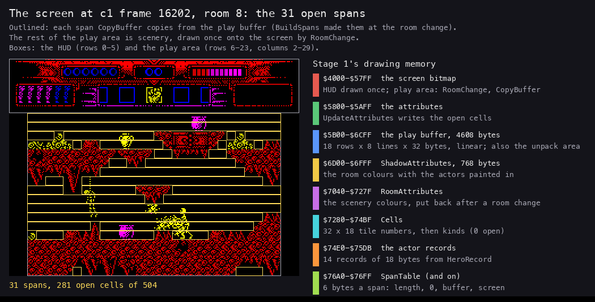

*`c1` frame 16202, room 8, read with TTD memory_at: the screen, SpanCount `$FE1C` and the span table `$76A0`. Each
yellow box is one span, a run of open cells that CopyBuffer copies. Made with `python3 tools/fig_render.py spans
work/docs/myA/c1 16202 docs/img/render/spans.png`.*

How to read it: the yellow boxes are everything a pass ever writes in the play area. The red rock between them is
never written after the room is built. An actor that walks behind a rock is still drawn into the buffer, but its
bytes under the rock are never copied. So the rock hides it, with no mask and no depth test.

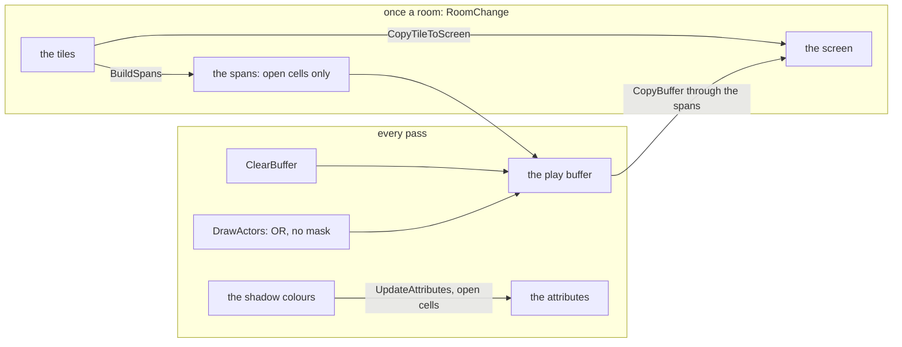

**The point**: Myth draws the room once and the actors through stencils cut from the room. The scenery is in front of
everything, for free.

## 6.2 The memory the renderer uses

| Address | Name | What it holds |
| --- | --- | --- |
| `$4000-$57FF` | the screen | the HUD, the scenery and the copied open cells |
| `$5800-$5AFF` | Attributes | the colours; the play area's open cells are rewritten every pass |
| `$5B00-$6CFF` | PlayBuffer | 4608 bytes: 18 rows of 8 lines of 32 bytes, linear (a line is +32, a row +256); also the unpack area of the stage's graphics |
| `$6D00-$6FFF` | ShadowAttributes | a copy of the 768 attributes; the room's colours with the actors' painted in |
| `$7040-$727F` | RoomAttributes | the scenery's colours, kept for the room change |
| `$7280-$74BF` | Cells | 32 x 18 bytes: the tile number of each cell, then its kind (0 open) |
| `$74E0-$75DB` | the actor records | 14 records of 18 bytes, the hero first |
| `$76A0` | SpanTable | 6 bytes a span: the length in cells, 0, the buffer's address, the screen's address |
| `$FE1C` | SpanCount | the spans in the table |
| `$FA00-$FAFF` | BitReverse (resident) | each byte with its bits reversed, for the sprites that face left |
| `$FB00` | ScreenLineTable (resident) | the screen address of each of the 192 lines |

The play buffer is linear, unlike the screen. A pixel line down is +32 and a character row is +256. So a sprite
plotter steps down with ADD 32, and only CopyBuffer deals with the screen's interleaved layout.

**A worked example: one byte in both.** The warrior of the next sections stands at buffer column 20, line 84.

1. In the buffer: `$5B00` + 84 x 32 + 20 = `$5B00` + `$0A80` + `$14` = `$6594`.
2. On the screen: line 48 + 84 = 132 (row 16, line 4 of the row), column 20.
3. Screen address: `$4000` + (132 AND `$C0`) x 32 + (132 AND 7) x 256 + (132 AND `$38`) x 4 + 20. That is `$4000` +
   `$1000` + `$0400` + `$0000` + `$14` = `$5414`.
4. So the byte at `$6594` reaches `$5414` when CopyBuffer copies the span that holds it.

## 6.3 A room built

A room is built once, when the hero leaves the old one ([doc 4](04-game-loop.md#49-the-heaviest-pass-a-room-change)).
RoomChange `$988B` does it in six steps.

```asm
RoomChange:
  LD A,$64
  LD (BurstTimer),A
  LD HL,StageGraphics
  LD DE,PlayBuffer
  CALL Unrle
  CALL ClearShots
  LD IX,(RoomGrid)
  CALL RoomCells
  CALL BlackOutPlayArea
  ...                     ; patch the bitmaps' and the colours' addresses
RoomChangeCell:
  PUSH BC                 ; one cell: its colour to the shadow, its 8 bytes to the screen
  PUSH HL
  LD A,(DE)
  LD C,A
  LD B,$00
RoomChangeAttrs:
  LD HL,$0000             ; LD HL,n: n = the tile attributes' address
  ADD HL,BC
  LD A,(HL)
  LD (IY+$00),A
  ...
RoomChangeBitmaps:
  LD BC,$0000             ; LD BC,n: n = the tile bitmaps' address
  ADD HL,BC
  CALL CopyTileToScreen
  ...
  CALL BuildSpans
  CALL ClearBuffer
  JP LoadRoomActors
```

```text
RoomChange:
    Unrle(StageGraphics $B4B2 -> $5B00)          # the stage's tiles and maps: 4295 bytes into the play buffer
    RoomCells(RoomGrid)                          # the room's 14 x 9 blocks -> 28 x 18 tile numbers in Cells
    BlackOutPlayArea()                           # the play area's 576 attributes to 0: the old room vanishes
    for row in 0..17, column in 2..29:
        tile = Cells[row][column]
        shadow[row + 6][column] = TileColours[tile]
        screen cell (row + 6, column) = TileBitmaps[tile]    # 8 bytes, straight onto the screen
    BuildSpans()                                 # tile numbers -> kinds; the open runs -> SpanTable
    ClearBuffer()                                # the unpacked data is wiped: the buffer is a buffer again
    LoadRoomActors()                             # the room's enemies and objects into actor records
```

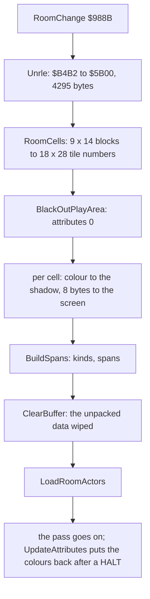

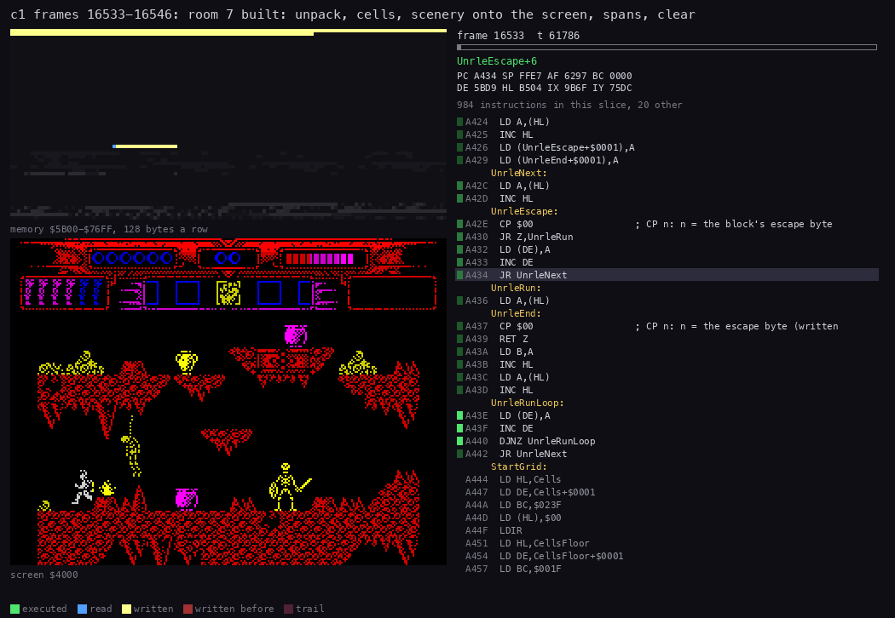

*`c1` frames 16533-16546, room 7 built (100 pictures, 8786 T each). Top left: memory `$5B00-$76FF`, the play buffer,
the shadow, the cells, the actors and the spans. Bottom left: the screen. Right: the code at the PC. Made with
`python3 ../../kit/routine_anim.py --work work/docs/myA/c1 --window 16533:53000-16546:23000 --listing
build/stage1.lst --listing build/resident.lst --view screen --pc 988B-9AFF,A424-A4FF,A057-A066 --range 5B00-76FF
--pictures 100 --title 'c1 frames 16533-16546: room 7 built: unpack, cells, scenery onto the screen, spans, clear'
--out docs/img/routines/RoomChange.gif`.*

How to read it: first the play buffer fills from the top as Unrle writes. Then the play area goes black. Then the
rock appears on the screen row by row, while the attributes stay black, so the player sees nothing yet. Last, the
buffer is wiped. The colours come back later in the same pass ([6.8](#68-the-colours)).

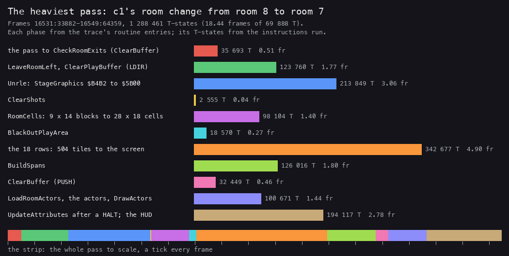

*The same room change, phase by phase. Each phase's T-states run from one routine's entry to the next in the trace
`work/docs/myA/c1/traces/16531_33882-16550_10000.uatr`, so they include the interrupts that fell inside them. Made with
`python3 tools/fig_render.py phases docs/img/render/roomchange-phases.png`.*

**A worked example: what Unrle leaves at `$5B00`.** The packed block starts `C7 00 00 C4 00 E4 06 A8 07 70 09 00 07 C7
0E 05`.

1. The first byte, `$C7`, is the escape. Unrle patches it into its two compares.
2. `00 00 C4 00 E4 06 A8 07 70 09` are not the escape: copied as they are. They become the five header words at
   `$5B00`: `$0000`, `$00C4`, `$06E4`, `$07A8`, `$0970`.
3. `00 07` are copied. Then `C7 0E 05` is 14 copies of `$05`.
4. Each header word is an offset from `$5B0A`. The tile kinds are at `$5B0A`, the bitmaps at `$5BCE`, the colours at
   `$61EE`, the blocks at `$62B2`, the map at `$647A`.
5. The sizes check: `$00C4` = 196 tiles of 1 kind byte; `$06E4` - `$00C4` = 1568 = 196 x 8 bitmap bytes; `$07A8` -
   `$06E4` = 196 colours.

[Doc 7](07-objects.md) decodes the rest: the blocks, the three grids and the room table.

**A worked example: the buffer cleared three times.** In the `c1` room change the play buffer is wiped three times in
one pass.

1. 16531:34427: the pass's own ClearBuffer, as in every pass.
2. 16532:1598: ClearPlayBuffer `$8A7B`, called by ShiftRoomColumns before RoomChange. An LDIR of 4401 bytes: 120 109 T.
3. Unrle then overwrites 4295 of those 4401 bytes.
4. 16545:16674: ClearBuffer again at RoomChange's end, so the actors start on a blank buffer.

The second clear buys nothing: Unrle overwrites almost all of it, and the third clear wipes what remains. It costs
1.7 frames of the room change's 18.4.

Witness: RoomChange `$988B` and Unrle ran 101 times in the five stage-1 builds (c1o, deaths, rzx-r1, s1-idle,
s1-right), CopyTileToScreen 50 904 times (101 x 504).

**The point**: the room build reuses the play buffer as its workspace, draws the scenery once onto the screen behind
black attributes, and leaves only a list of spans behind. The scenery is never drawn again while the hero stays.

## 6.4 The cells and the spans

RoomCells turns the room's 14 x 9 blocks into 28 x 18 tile numbers in Cells. BuildSpans then turns each tile number
into its kind (0 open, else scenery) and writes one span for each run of open cells in a row.

```asm
BuildSpansCell:
  PUSH BC
  LD C,(IY+$00)
  LD B,$00
BuildSpansKinds:
  LD HL,$0000             ; LD HL,n: n = the tile kinds' address
  ADD HL,BC
  LD A,(HL)
  LD (IY+$00),A
  INC IY
  CP $00
  JR Z,BuildSpansOpen
  XOR A
  LD (SpanOpen),A
  JR BuildSpansNext
BuildSpansOpen:
  LD A,(SpanOpen)
  CP $01
  JR NZ,BuildSpansStart
  INC (IX-$06)
  JR BuildSpansNext
BuildSpansStart:
  LD A,$01
  LD (SpanOpen),A
  CALL AddSpan
```

```text
BuildSpans:
    SpanCount = 0
    for row in 0..17:
        open = false
        for column in 2..29:
            kind = TileKinds[Cells[row][column]]; Cells[row][column] = kind
            if kind != 0: open = false
            elif open: the last span's length += 1
            else: open = true; AddSpan(row, column); SpanCount += 1

AddSpan(row, column):                         # 6 bytes at IX
    length = 1, 0
    buffer = $5B00 + row x 256 + column
    screen = ScreenLineTable[48 + row x 8] + column
```

**A worked example: the first spans of room 8.** At `c1` frame 16202 SpanCount is 31, and the table starts:

| Bytes | Length | Buffer | Screen | Where |
| --- | --- | --- | --- | --- |
| `1C 00 02 5B C2 40` | 28 | `$5B02` | `$40C2` | row 6, columns 2-29: the whole top row is open |
| `1C 00 02 5C E2 40` | 28 | `$5C02` | `$40E2` | row 7, the whole row |
| `03 00 02 5D 02 48` | 3 | `$5D02` | `$4802` | row 8, columns 2-4 |
| `0A 00 06 5D 06 48` | 10 | `$5D06` | `$4806` | row 8, columns 6-15 |
| `01 00 18 5D 18 48` | 1 | `$5D18` | `$4818` | row 8, column 24 |

1. The buffer address moves by 256 a row (`$5B02`, `$5C02`, `$5D02`): the buffer's rows are linear.
2. The screen address jumps from `$40E2` to `$4802` between rows 7 and 8: row 8 is the first row of the screen's
   second third.
3. The 31 spans hold 281 of the 504 cells. The other 223 are rock, written once and never again.

**The point**: the spans are the room's stencil, made once. A pass reads 31 records and never looks at the cells.

## 6.5 ClearBuffer: 4608 bytes with PUSH

Every pass starts drawing from a blank buffer. ClearBuffer `$9AB5` blanks it with the fastest store the Z80 has:

```asm
ClearBuffer:
  DI
  LD (SavedSP),SP
  LD HL,$0000
  LD SP,PlayBuffer+4608
  LD B,$90
ClearBufferLoop:
  PUSH HL                 ; 16 PUSHes: 32 bytes, one buffer line
  ...
  DJNZ ClearBufferLoop
  LD SP,(SavedSP)
  EI
  RET
```

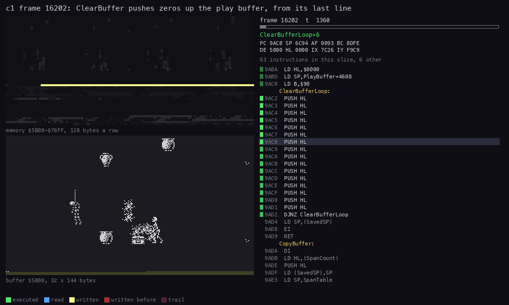

*`c1` frame 16202, the start of an ordinary pass (40 pictures). Top: memory `$5B00-$76FF`. Bottom: the play buffer
as 32 x 144 bytes, the last pass's sprites wiped from the bottom line up. Made with `python3
../../kit/routine_anim.py --work work/docs/myA/c1 --window 16202:600-16202:31000 --listing build/stage1.lst
--listing build/resident.lst --view buffer:5B00:32x144 --pc 9AB5-9AD9 --range 5B00-76FF --pictures 40 --title 'c1
frame 16202: ClearBuffer pushes zeros up the play buffer, from its last line' --out
docs/img/routines/ClearBuffer.gif`.*

**A worked example: what contention costs.** One round of ClearBufferLoop is 16 PUSH HL of 11 T and a DJNZ of 13.

1. 16 x 11 + 13 = 189 T a round. 144 rounds, the last DJNZ 8: 27 211 T.
2. The trace of the pass at 16202 measures ClearBufferLoop at 29 464 T.
3. The 2 253 T more are contention. The buffer is at `$5B00-$6CFF`, in the RAM the ULA shares, so a PUSH that falls
   while the ULA fetches the screen waits.
4. An LDIR clear of the same 4608 bytes would take 4607 x 21 + 16 = 96 763 T before contention: 3.5 times longer.
   ClearPlayBuffer ([6.3](#63-a-room-built)) is that slow form.

ClearBuffer runs with interrupts off: an INT in the middle would push its return address into the buffer. This is
one of the two places where interrupts are lost ([doc 4](04-game-loop.md#410-the-lost-interrupts)).

Witness: ClearBuffer ran 19 608 times in the five stage-1 builds (c1o, deaths, rzx-r1, s1-idle, s1-right).

**The point**: the buffer is wiped in 0.42 of a frame, at the cost of the interrupt that falls inside.

## 6.6 The sprites

DrawActors `$A5DF` walks the 14 actor records twice. The first walk draws the records whose `+$0F` has bits 6 and 7
clear. The second draws those with bit 7 set, on top of the others; it tests only bit 7. So bit 6 alone hides a
record, and a record with bits 6 and 7 set is drawn in the second walk.

```asm
DrawActors:
  LD B,$0E
  LD IY,HeroRecord
DrawActorsLoop:
  PUSH BC
  LD A,(IY+$00)
  CP $FF
  JR Z,DrawActorsNext
  BIT 6,(IY+$0F)
  JR NZ,DrawActorsNext
  BIT 7,(IY+$0F)
  JR NZ,DrawActorsNext
  CALL ClipActor
  CALL DrawActorSprite
DrawActorsNext:
  POP BC
  LD DE,$0012
  ADD IY,DE
  DJNZ DrawActorsLoop
  ...                     ; the same walk again for +$0F bit 7
```

The fields the renderer reads:

| Offset | What |
| --- | --- |
| `+0` | X, the column in bytes (`$FF`: a free record); for a left-facing actor, its right column |
| `+1` | Y, the line in the play area (0-143; `$C8` and up: above the top, partly drawn) |
| `+2` | the width in bytes |
| `+3` | the height in lines |
| `+4`, `+5` | the frame's address |
| `+9` | bit 0: drawn opaque (LDIR); bit 7: facing left (mirrored) |
| `+$0C` | the attribute |
| `+$0F` | bit 7: drawn in the second walk; bit 6: not drawn |
| `+$11` | a pixel shift 1-7 (0 or 100 and up: none) |

For each record ClipActor cuts the height at line 144 and finds the buffer address. DrawActorSprite picks a row
plotter from RowPlotters `$8910` by the width and the facing, patches it into a CALL, and calls it once a line:

```asm
DrawActorSpriteSet:
  LD C,(HL)
  INC HL
  LD B,(HL)
  LD (RowDrawCall+$0001),BC
  POP BC
  POP HL
RowDrawCall:
  CALL $0000              ; CALL n: n = the row routine (written above)
  DJNZ RowDrawCall
  CALL ColourActor
  RET
```

```asm
PlotRow2:
  LD A,(DE)
  OR (HL)
  LD (DE),A
  INC HL
  INC E
  LD A,(DE)
  OR (HL)
  LD (DE),A
  INC HL
  LD A,E
  ADD A,$1F
  LD E,A
  RET NC
  INC D
  RET

PlotRow1Mirrored:
  PUSH BC
  LD B,$FA
  LD C,(HL)
  LD A,(BC)
  LD C,A
  LD A,(DE)
  OR C
  LD (DE),A
  INC HL
  POP BC
  LD A,E
  ADD A,$20
  LD E,A
  RET NC
  INC D
  RET
```

```text
DrawActors:
    for pass in (normal, on top):
        for record in the 14 actors:
            if free or not in this pass: continue
            lines, buffer, frame = ClipActor(record)
            if opaque: LDIR each line
            else:
                plot = RowPlotters[2 x width + facing left]
                repeat lines: plot(frame, buffer)    # OR each byte in; mirrored: through BitReverse, right to left
            ColourActor(record)                     # its attribute into the shadow's cells under it
```

The sprites are ORed in with no mask. That works because the buffer is blank at the start of every pass, and the
scenery is not in the buffer. Two actors that overlap merge their pixels.

A sprite that faces left is not stored twice. The mirrored plotters read each byte through BitReverse `$FA00`, a
resident table of 256 bytes, and write the row from right to left. `$C0` (`11000000`) becomes `$03` (`00000011`): the
byte at `$FAC0` is `$03`.

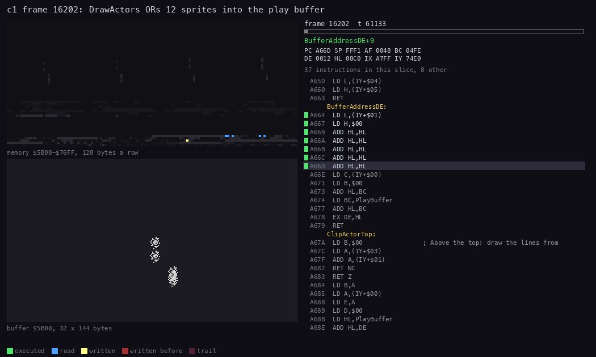

*`c1` frame 16202, DrawActors in an ordinary pass (80 pictures, 533 T each). Top left: memory `$5B00-$76FF`. Bottom
left: the play buffer as 32 x 144 bytes. Right: the code at the PC. Made with `python3 ../../kit/routine_anim.py
--work work/docs/myA/c1 --window 16202:60600-16203:33300 --listing build/stage1.lst --listing build/resident.lst --view
buffer:5B00:32x144 --pc 7F4D-7FFF,8776-8B02,A5DF-A7FF --range 5B00-76FF --pictures 80 --title 'c1 frame 16202:
DrawActors ORs 12 sprites into the play buffer' --out docs/img/routines/DrawActors.gif`.*

**A worked example: the warrior.** Record 1 at `$74F2`, at `c1` frame 16202, holds `14 54 03 1B F1 CB D0 94 18 80 03
00 46 16 4C 07 03 00`.

1. X = `$14` = 20, Y = `$54` = 84, 3 bytes wide, `$1B` = 27 lines; the frame at `$CBF1`.
2. `+9` = `$80`: bit 7 set, facing left. `+$11` = 0: no shift.
3. ClipActor: 84 + 27 = 111, under 145, so all 27 lines are drawn. The buffer address is `$6594` ([6.2](#62-the-memory-the-renderer-uses)).
4. The plotter is RowPlotters entry 2 x 3 + 1 = 7: PlotRow3Mirrored. It runs 27 times, 3 bytes a line, through
   BitReverse.
5. ColourActor writes `+$0C` = `$46` (bright yellow on black) into the shadow's cells under him. Facing left, his left
   column is X - 3 + 1 = 18.
6. His lines 84-110 cover the play area's cell rows 10-13. ColourActor counts 27 / 8 = 3 rows, plus one because line
   84 is inside a row, plus one because line 111 is too: 5 rows, 10-14. The shadow at 16203 holds `$46` in all 15
   cells, screen rows 16-20, columns 18-20. The fifth row is painted for nothing.
7. The trace's writers map below agrees: PlotRow3Mirrored wrote 81 bytes (27 x 3), read from `$CBF1-$CC41` and the
   BitReverse table.

**A worked example: the hero clipped.** The hero's record at 16202 holds Y = `$8C` = 140 and a height of `$16` = 22.

1. 140 + 22 = 162, past line 144.
2. ClipActor draws 144 - 140 = 4 lines. The hero is respawning, below the floor (HeroState `$0F`).
3. PlotRow2Mirrored wrote 8 bytes, 4 lines of 2, in the writers map.

The 12 sprites of that pass took 42 479 T, from DrawActors' entry at 16202:60705 to UpdateAttributes at 16203:33296.

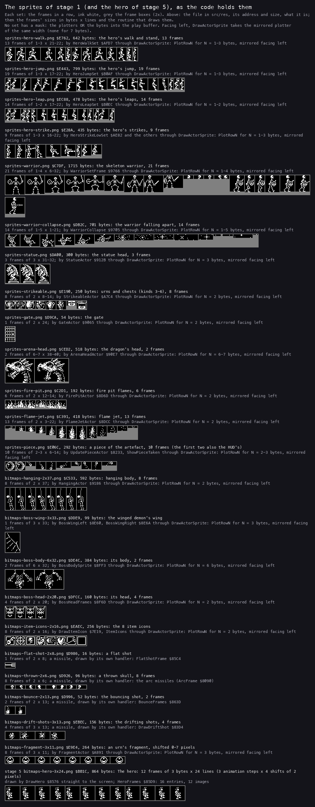

*Every sprite set and bitmap set of stage 1 that an actor or a missile draws, and stage 5's hero (12 images behind
HeroFrames' 16 entries, 6.13), from `src/res`: the address, the size, the frames' sizes in bytes x lines and the
routine that draws them. The fragment's 8 frames are its pre-shifted copies (0-7 pixels). Made with `python3
tools/fig_render.py sprites docs/img/sprites/stage1-sprites.png`.*

**The point**: the sprite code is a dispatcher over 13 tiny plotters, one per width and facing. No masks and no
second set of left-facing frames. The actors are drawn at byte columns: the fragment's 8 frames are its shifts drawn
into the data, and one sprite is shifted at run time (6.7).

## 6.7 Sprites on byte columns

X in an actor record is a column in bytes. PreShiftSprite `$7F4D` could shift a frame right by 1-7 pixels into a copy
at `$7640`. The shift was 0 in every pass of `c1o`, `deaths`, `s1-idle` and `s1-right`, so the actors they show move
sideways in steps of 8 pixels. One actor does use it: the skeleton warrior's flying head (WarriorHeadFly), which
StepFineBack `$8B4E` moves in eighths of a column through +`$11`. `rzx-r1` shifts 595 sprites, about 6 lines each
(ShiftLine1 6426 runs, StepFineBack 510, frames 2355-28753).

The walk hides it. SetActorFrame `$AA02` sets X and Y from the record's base (`+$0D`, `+$0E`) plus each frame's own
offsets. The hero's walk has 12 frames, and the figure moves across its sprite from frame to frame. The base column
moves 2 bytes only at frames 0 and 6 ([doc 10](10-gameplay-logic.md)). The eye sees the figure's steps, not the
column's.

**A worked example: the cost avoided.** A shift of n pixels would cost the hero, 2 bytes x 22 lines:

1. a copy of 44 bytes with one more byte a line, 66 bytes, by LDIR;
2. then 22 lines of 3 bytes, each shifted n times by the ShiftLine routines;
3. then a plotter one byte wider.

The 12 walk frames make it unnecessary. They cost memory instead of time.

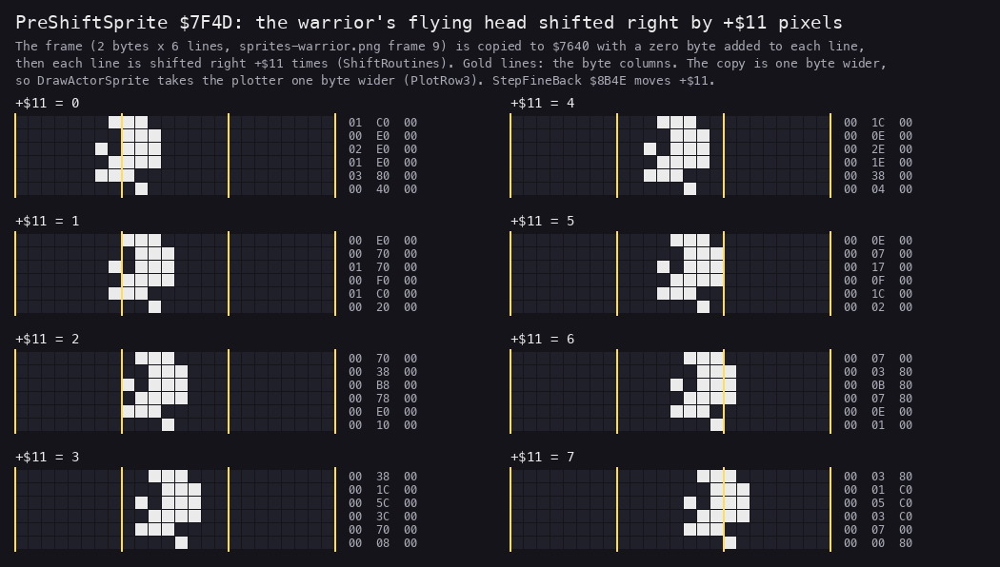

*The warrior's flying head (`sprites-warrior.png` frame 9, 2 bytes x 6 lines) as PreShiftSprite `$7F4D` copies it to
`$7640` for +`$11` = 0-7: one byte wider, shifted right +`$11` pixels; the gold lines are the byte columns, the
numbers the line's three bytes. Made with `python3 tools/fig_render.py shift docs/img/render/preshift.png`.*

**The point**: stage 1 moves its actors on byte columns and draws the in-between steps into the frames. In stage 1
the pixel shifter is kept for one small sprite, the warrior's flying head. Stages 2 and 3 use it more: the hydra's
heads (PlaceHydraHead `$8100` sets +`$11` every pass, 842 runs in `rzx-r2`), Medusa's falling head (StepFineLeft,
called at `$81F5`) and the troll's body (StepFineBack, called by TrollBodyActor at `$90D7`).

## 6.8 The colours

The attributes follow the bitmap's two layers:

- The scenery's colours go into the shadow at the room build. After the build, UpdateAttributes `$8CAA` writes every
  cell from the shadow and RoomAttributes, once, right after a HALT ([doc 4](04-game-loop.md#49-the-heaviest-pass-a-room-change)).
- In every other pass, ColourActor paints each actor's attribute into the shadow under it. UpdateAttributes then
  copies the shadow to the screen for the open cells only, and calls CopyBuffer.

```asm
UpdateAttributes:
  LD A,(RestoreAttributes)
  CP $01
  JP Z,UpdateAttrRestore
  LD DE,Attributes+194
  LD HL,PlayAttributesCell
  LD IX,CellsPlay
  LD B,$12
UpdateAttrRow:
  PUSH BC
  LD B,$1C
UpdateAttrCell:
  LD A,(IX+$00)
  CP $00
  JR NZ,UpdateAttrNext
  LD A,(HL)
  LD (DE),A
UpdateAttrNext:
  INC DE
  INC HL
  INC IX
  DJNZ UpdateAttrCell
  ...
  CALL CopyBuffer
  RET
```

Nothing ever puts an open cell's colour back after an actor leaves it. The actor's ink stays in the shadow. It never
shows, because the open cells have black paper and the buffer has no pixels there once the actor has gone.

**A worked example: the colours an actor leaves behind.** The shadow's open cells in room 8, read with TTD memory_at:

| Frame | `$00` | `$06` | `$07` | `$43` | `$46` |
| --- | ---: | ---: | ---: | ---: | ---: |
| 16202 | 127 | 10 | 3 | 59 | 82 |
| 16520 | 122 | 10 | 28 | 52 | 69 |

1. Every value has paper 0 (bits 3-5 clear): black.
2. The cells of ink 7 grow from 3 to 28 as actors with ink 7 walk through the room.
3. The colour of an open cell is whatever the last actor there painted. On black paper with no pixels, all of them
   look the same.

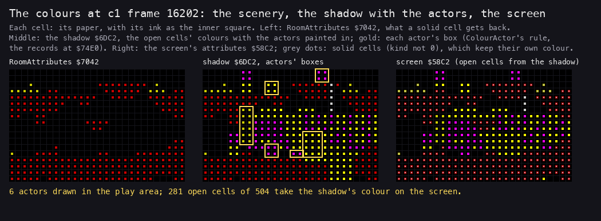

*`c1` frame 16202, room 8: the play area's 18 x 28 cells in RoomAttributes `$7042`, in the shadow `$6DC2` with each
drawn actor's box (gold, ColourActor's rule from the records at `$74E0`), and on the screen at `$58C2`. Made with
`python3 tools/fig_render.py colours work/review/fixB/c1 16202 docs/img/render/colours.png` (the recording opened
with `python3 ../../kit/rs.py open --work work/review/fixB/c1 --ttd work/stage1/c1/session.ttd --model 48K`).*

How to read it: the gold boxes are where ColourActor wrote the actors' +`$0C` into the shadow. On the screen only the
open cells (no grey dot) take the shadow's colour; a box that runs into a solid cell (the scenery in front) leaves that
cell's own colour, so the stencil of the spans also clips the colours.

**The point**: the colour clash is managed by the room's design. The open space is black paper, so a sprite's colour
can be left anywhere.

## 6.9 CopyBuffer: a patched LDI chain

CopyBuffer `$9ADA` copies the 31 spans of the open cells from the buffer to the screen. A span's 8 lines are each a run
of up to 28 bytes. The routine copies them with a chain of 30 LDIs, cut at the span's length by a JP it patches in.

```asm
CopyBuffer:
  DI
  LD HL,(SpanCount)
  PUSH HL
  LD (SavedSP),SP
  LD SP,SpanTable
CopySpan:
  POP BC                  ; the length
  LD A,$20
  SUB C
  LD L,A
  LD H,$00
  LD (CopyLineEnd+$0001),HL
  SLA C
  LD HL,CopyChain
  ADD HL,BC
  LD (CopySpanRestore+$0001),HL
  LD (HL),$C3             ; JP $9B45 over the LDI after the span's length
  INC HL
  LD (HL),$45
  INC HL
  LD (HL),$9B
  POP HL                  ; the buffer
  POP DE                  ; the screen
  LD A,E
  LD (CopyLineE+$0001),A
  LD A,$08
CopyChain:
  LDI                     ; 30 LDIs
  ...
CopyLineEnd:
  LD BC,$0000             ; LD BC,n: n = 32 - the length
  ADD HL,BC
CopyLineE:
  LD E,$00                ; LD E,n: n = the span's screen address's low byte
  INC D
  DEC A
  JR NZ,CopyChain
CopySpanRestore:
  LD HL,$0000             ; LD HL,n: n = where the JP was put
  LD (HL),$ED             ; ED A0 ED: the LDI and the next LDI's first byte back
  INC HL
  LD (HL),$A0
  INC HL
  LD (HL),$ED
  ...
```

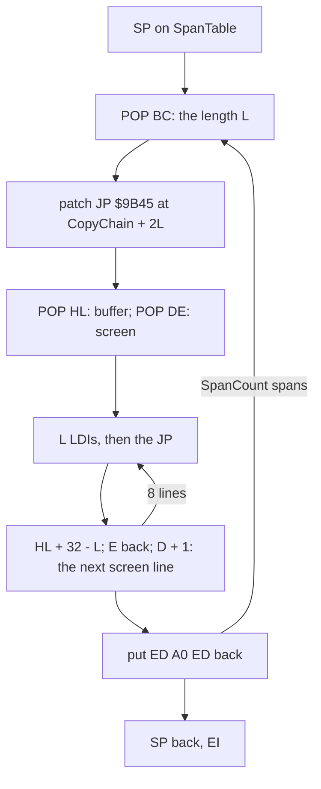

```text
CopyBuffer:                                   # DI; SP walks the span table
    for each span (length L, buffer, screen):
        write JP CopyLineEnd over the LDI number L
        repeat 8:
            L x LDI                           # buffer -> screen, HL and DE + L
            HL += 32 - L                      # the next buffer line (linear)
            E = screen's low byte; D += 1     # the next screen line (INC D inside a character row)
        put the LDI back
```

Two tricks make it fast:

- **POP as a reader.** SP walks the span table, so one POP reads a 2-byte field in 10 T.
- **INC D as the next line.** Inside a character row the screen's next pixel line is +256, so the screen pointer steps
  with INC D and a reload of E.

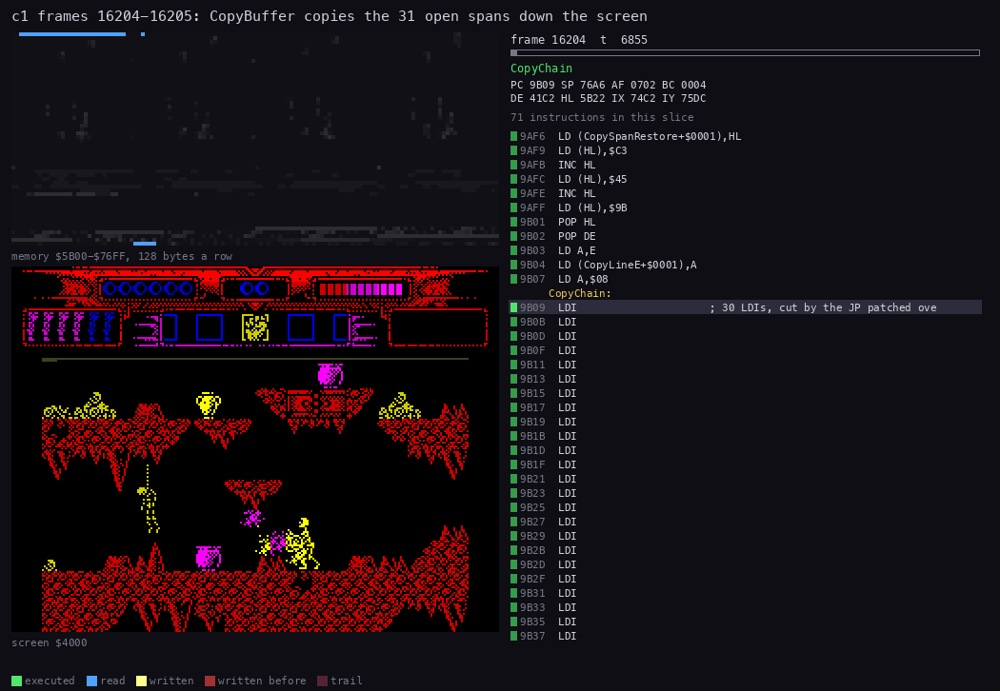

*`c1` frames 16204-16205, CopyBuffer in an ordinary pass (80 pictures). Top left: memory `$5B00-$76FF`. Bottom left:
the screen, the open cells written span by span. Made with `python3 ../../kit/routine_anim.py --work work/docs/myA/c1
--window 16204:6000-16205:4500 --listing build/stage1.lst --listing build/resident.lst --view screen --pc
9ADA-9B6E,8CAA-8D1C --range 5B00-76FF --pictures 80 --title 'c1 frames 16204-16205: CopyBuffer copies the 31 open
spans down the screen' --out docs/img/routines/CopyBuffer.gif`.*

**A worked example: a span of 3.** The third span of room 8: `03 00 02 5D 02 48`.

1. L = 3. CopyLineEnd's operand becomes 32 - 3 = 29.
2. The JP goes at CopyChain + 2 x 3: the fourth LDI. The chain runs 3 LDIs, then jumps to CopyLineEnd.
3. HL = `$5D02`, DE = `$4802`. Line 1 copies `$5D02-$5D04` to `$4802-$4804`.
4. HL + 29 = `$5D22`, the next buffer line. E = `$02`, D + 1: `$4902`, the next screen line.
5. After 8 lines the JP is replaced by `ED A0 ED`, the LDI that was there and the first byte of the next.

**A worked example: the copy's cost.** The pass at 16202 has 31 spans of 281 cells in all.

1. The LDIs: 281 cells x 8 lines x 16 T = 35 968 T.
2. Each line of each span adds LD BC 10, ADD HL 11, LD E 7, INC D 4, DEC A 4, JR 12 and the JP 10: 58 T. 31 spans x
   8 lines x 58 = 14 384 T.
3. Each span adds about 290 T: about 180 T for the three POPs, the two operand patches and the JP written into the
   chain, about 110 T for the restore of `ED A0 ED` and the span count. 31 x 290 = 9 000 T.
4. That is about 59 300 T. The trace measures 67 533 T for the copy. The rest is contention: each LDI reads the
   buffer and writes the screen, both in the RAM the ULA shares.

Witness: CopyBuffer ran 19 503 times in the five stage-1 builds (c1o, deaths, rzx-r1, s1-idle, s1-right).

**The point**: CopyBuffer is the cost of the stencil. It copies only the open cells, and copies them with the cheapest
copy the Z80 has.

## 6.10 The code against the screen

A writers map colours each byte of the screen by the routine that wrote it last in a window of the trace. Over the
room-change pass it shows every layer of the renderer at once.

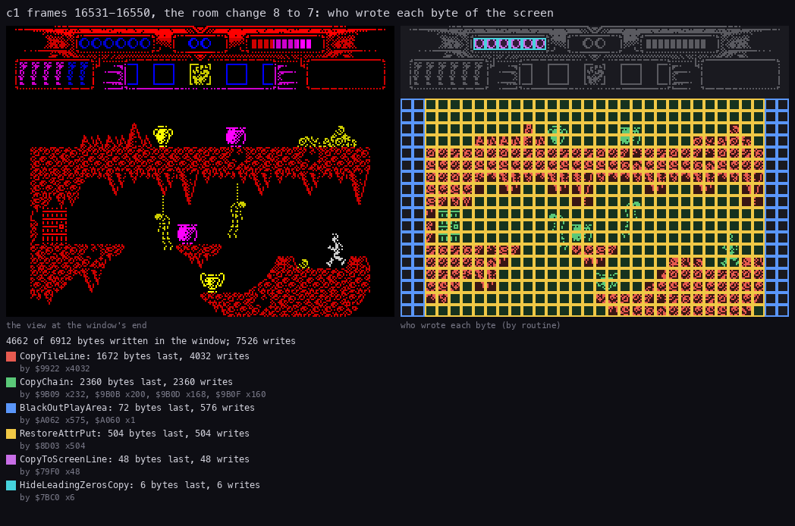

*`c1` frames 16531-16550, the room change from room 8 to room 7: the screen at the window's end, and each byte
coloured by its last writer. Made with `python3 ../../kit/writers_map.py --trace
work/docs/myA/c1/traces/16531_33882-16550_10000.uatr --listing build/stage1.lst --listing build/resident.lst --view
screen --by routine --title 'c1 frames 16531-16550, the room change 8 to 7: who wrote each byte of the screen' --out
docs/img/render/writers-roomchange.png`.*

How to read it:

- Red, CopyTileLine: the rock. It wrote 4032 bytes, 8 for each of the 504 cells. 1672 of them were still its own at the
  end: the 209 rock cells.
- Green, CopyChain: the open cells, 2360 bytes. 2360 / 8 = 295 open cells in room 7. CopyChain overwrote the tiles
  CopyTileLine had drawn there.
- Yellow, RestoreAttrPut: all 504 attributes of the play area, written after the HALT.
- Blue, BlackOutPlayArea: 576 attributes zeroed, of which 72 stayed its own, the four black columns 0, 1, 30 and 31 of
  18 rows.
- The HUD: CopyToScreenLine (48 bytes) and HideLeadingZerosCopy (6 bytes, the score's digits).

A second map shows the play buffer while DrawActors runs, with the memory each plotter read.

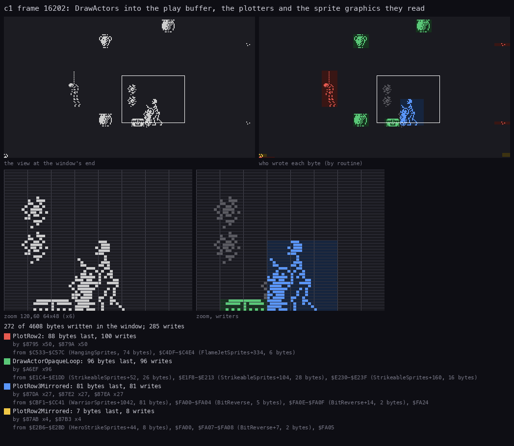

*`c1` frame 16202, the window of DrawActors. Left: the play buffer at the window's end. Right: each byte by its last
writer. The zoom shows the warrior and the box at his feet. The legend lists the sources: the sprite graphics and the
BitReverse table. Made with `python3 ../../kit/writers_map.py --trace
work/docs/myA/c1/traces/16202_60600-16203_33300.uatr --listing build/stage1.lst --listing build/resident.lst --view
buffer:5B00:32x144 --by routine --sources --zoom 120,60,64,48 --title 'c1 frame 16202: DrawActors into the play
buffer, the plotters and the sprite graphics they read' --out docs/img/render/writers-buffer.png`.*

How to read it:

- Blue, PlotRow3Mirrored: the warrior, 81 bytes from WarriorSprites (`$CBF1-$CC41`) through BitReverse.
- Red, PlotRow2: the hanging man and the flame jet, from HangingSprites and FlameJetSprites.
- Green, DrawActorOpaqueLoop: the opaque actors, the strikeable pots and the box, from StrikeableSprites.
- Yellow, PlotRow2Mirrored: the hero's 4 clipped lines at the bottom left.
- Grey: the two small shapes above the warrior were drawn earlier in the pass, before DrawActors.

**The point**: the two maps show the stencil at work. The rock is CopyTileLine's, written once per room. The rest is
CopyChain's, written every pass from a buffer that the plotters filled.

## 6.11 Against the beam

The renderer never waits for the beam. [Doc 4](04-game-loop.md#46-one-pass-against-the-beam) measures it:

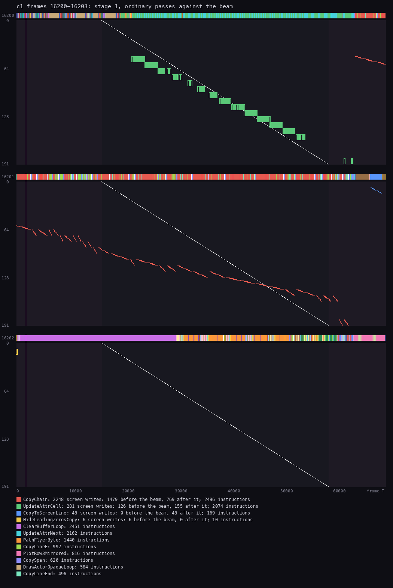

*The ordinary pass at `c1` 16200-16202 against the beam, from doc 4 4.6, where its command is given.*

- CopyChain copies at about 570 T a screen line. The beam draws a line every 224 T.
- So in the frame where the copy starts, the beam catches it at about line 135. The lines above the crossing show the
  new picture. The lines below show the last pass's until the next frame.
- The tear is in the open cells only, and it moves from pass to pass. Black paper and small sprites make it hard to
  see.

The room change is the one place the renderer lines up with the frame. UpdateAttrRestore `$8CE0` copies the buffer,
HALTs and then writes the 504 colours from just after the interrupt. At about 98 T a cell (LD C,(IY+0), the cell
test, LD (IX+0),C, four INCs and the DJNZ) and about 100 T a row it ends near T 51 000, well inside the picture. It
stays ahead of the beam all the way: it finishes play row r (screen row 6 + r) at about 2 850 x (r + 1) T, and the
beam reaches that row at 25 088 + 1 792 x r T. So the new room appears in one frame
([doc 4](04-game-loop.md#49-the-heaviest-pass-a-room-change)).

**The point**: Myth tears, but only in the open cells. The scenery, the bigger part of the screen, never changes
while the beam draws it.

## 6.12 The HUD

The HUD is rows 0-5 of the screen. The stage block carries it at `$7000-$76BF` as loaded: its picture, 48 lines of 32
bytes, and its colours, 6 rows of 32 at `$7600`. StageSetUp `$97AC` copies the colours into the shadow, dissolves the
picture onto the screen (DissolveHud `$8AB1`) and paints the boxes with FillShadowAttributes. From then on that memory
is the stage's records: the room colours, the cells, the actors and the span table of [6.2](#62-the-memory-the-renderer-uses).
A pass then touches only:

- the score's digits (ShowScore, HideLeadingZerosCopy);
- the energy bar and the lives (PassTick);
- the item strip and its count (DrawItemStrip, ShowItemCount), when the item changes;
- the teleport icons' boxes (FlashPieces).

They write the screen directly with CopyToScreen `$79CC`, not through the buffer. At the stage's end EndStage saves
the HUD's lines and colours back into `$7000` and `$7600`; the game-over path copies them back from there.
[Doc 8](08-hud-and-text.md) covers each field and its update.

## 6.13 The other stages

| Stage | RoomChange | Unrle | BuildSpans | ClearBuffer | CopyBuffer | DrawActors | UpdateAttributes |
| --- | --- | --- | --- | --- | --- | --- | --- |
| 1 | `$988B` | `$A424` | `$99E9` | `$9AB5` | `$9ADA` | `$A5DF` | `$8CAA` |
| 2 | `$9257` | `$A33D` | `$93B5` | `$9484` | `$94A9` | `$A545` | `$8CD0` |
| 3 | `$9853` | `$A39A` | `$99B1` | `$9A7D` | `$9AA2` | `$A7DD` | `$8B4B` |
| 4 | `$97FB` | `$A5AC` | `$9959` | `$9A28` | `$9A4D` | `$A768` | `$91D0` |
| 5 | none | none | none | `$96AC`, never run | none | `$9EDA` | none |

Stages 2-4 carry the same renderer at other addresses, with their own graphics block (StageGraphics `$B7D5`, `$B556`,
`$B77F`).

Stage 5, the duel with Dameron, has no rooms. It draws straight onto the screen, and each picture carries blank edges
that wipe its own trail. The hero is 3 bytes x 24 lines. HeroFrames `$85D9` has 16 entries, 4 animation steps x 4
shifts of 2 pixels, but only 12 distinct images: step 3 points at step 1's (`$BC3C-$BD14`).

```asm
DrawHero:
  LD IX,HeroRecord
  LD A,(IX+$04)
  CP $00
  JP NZ,DrawHeroFrame
  DI
  ...                     ; the frame: HeroFrames[(PassCounter AND 7) / 2, (X AND 6) / 2]
  LD (DrawHeroLine+$0003),A
  ...
  LD (SavedSP),SP
  LD SP,HL                ; SP on ScreenLineTable, at the hero's line
  EX DE,HL
  LD BC,$0048
DrawHeroLine:
  POP DE                  ; the line's screen address
  LD A,E
  ADD A,$00               ; ADD A,n: n = the column X / 8
  LD E,A
  LDI
  LDI
  LDI
  JP PE,DrawHeroLine      ; BC counts 72 bytes down: 24 lines
  LD SP,(SavedSP)
  EI
  RET
```

**A worked example: the two answers to a moving sprite.**

1. Stage 1: X in bytes, no shift, the motion drawn into 12 walk frames. The buffer and the stencil keep the scenery in
   front.
2. Stage 5: X in pixels, 2-pixel steps from 4 pre-shifted copies of each frame. Nothing is in front, so the sprite goes
   straight to the screen.
3. Both read the screen lines from a table with POP: the stencil's spans in stage 1, ScreenLineTable in stage 5.

**The point**: one engine for the four platform stages, and a separate, simpler one for the duel.

## 6.14 Known only from the code

| What | Where | Why no recording shows it |
| --- | --- | --- |
| width 0 and mirrored width 7: a hang loop that flashes the border | RowPlotters `$8910`, HangFlashBorder `$876C` | never reached with a valid frame |
| an item's ink cycled through four colours | CycleItemInk | no caller ran it |
| the left-facing missile drawer | DrawMissileMirrored `$B3DA` | no caller ran it, `rzx-r1` included |
| stage 5's ClearBuffer | `$96AC` | stage 5 never clears a buffer |
| the left-facing 6-byte plotter | PlotRow6Mirrored `$88AD` | no actor 6 bytes wide faces left in the recordings |

`rzx-r1` runs what the other stage-1 recordings do not: the pixel shift ([6.7](#67-sprites-on-byte-columns)),
the plotters for 5, 6 and 7 bytes (PlotRow5 180 runs, PlotRow5Mirrored 160, PlotRow6 7812, PlotRow7 570, from
DrawActorSprite; the
demon's body is 6 bytes wide), DrawRowPicture `$8B03` for the demon's face and the dragon (746 calls from DrawRoomPicture, 80 from
DrawArenaPicture) and the mirrored drawers of the hero's shot (DrawSpriteMirrored 284, ColourSpriteMirrored 559).
