# 7. Objects

What this covers:

- the data a stage carries: its tiles, its 2 x 2 blocks, its map of up to three grids, and the room tables;
- one room decoded by hand, from the map byte to the pixels;
- the grids, the room windows and their exits;
- the placements: where the enemies and the urns stand on the map, and how a room turns them into actor records;
- the 14 actor records, the slots, the kinds and their handlers;
- the movers, with the skeleton warrior as the example;
- the collisions: no boxes and no pixels, only columns and line distances;
- the 16 missile records;
- the other stages, and what is known only from the code.

The recordings it rests on ([WALKTHROUGH 6.0](../WALKTHROUGH.md#60-the-recordings)):

| Recording | Load | Used for |
| --- | --- | --- |
| `c1` | a 48K from power-on, the original tape; stage 1 in play from frame 15478 | room 7 decoded (frames 16537-16550), the warrior walking in room 8 (16195-16262), the handlers of one pass (16240) |
| `rzx-r1` | stage 1 of the RZX run, 128K, the Sinclair joystick | an urn struck twice and the shield it drops (frames 625-663), the demon closing room 12 (14981-15647) |

All addresses are stage 1's unless a section says otherwise. Stages 2-4 use the same formats at other addresses
([7.9](#79-the-other-stages)).

## 7.1 The stage's data: tiles, blocks and a map

A stage carries its whole world in one packed block: StageGraphics `$B4B2`, 3583 bytes. At every room change
RoomChange `$988B` unpacks it with Unrle `$A424` into the play buffer at `$5B00`
([doc 6](06-rendering.md#63-a-room-built)). The unpacked 4295 bytes are five tables behind a header of five words:

| Table | Address | Size | One entry |
| --- | --- | ---: | --- |
| the tile kinds | `$5B0A` | 196 | 1 byte a tile: 0 open, bit 1 solid, bit 3 deadly |
| the tile pixels | `$5BCE` | 1568 | 8 bytes a tile, one a line |
| the tile colours | `$61EE` | 196 | 1 attribute a tile |
| the blocks | `$62B2` | 456 | 4 tile numbers a block: top left, top right, bottom left, bottom right |
| the map | `$647A` | 1869 | 1 block number a map cell, row by row, the three grids one after another |

Each header word is the table's offset from `$5B0A`, so the code never needs a fixed address. RoomCells reads the map
offset from `$5B08` and PutBlock the block offset from `$5B06`.

A tile is 8 x 8 pixels with one colour. A block is 2 x 2 tiles, 16 x 16 pixels. The map is made of blocks. A room is
a window of 14 x 9 blocks, so 28 x 18 tiles: the whole play area.

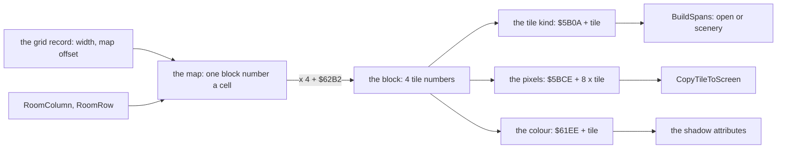

The 196 tiles of stage 1 fall into five kinds:

| Kind | Tiles | Bits | What the hero meets |
| ---: | ---: | --- | --- |
| 0 | 1 (tile 0) | none | open space: the actors show here |
| 7 | 145 | 0, 1, 2 | rock: solid, in front of the actors |
| 5 | 39 | 0, 2 | scenery he walks behind: not solid, but not open either |
| 15 | 10 (tiles 50, 51, 55, 56, 61, 62, 66, 67, 96, 145) | 0, 1, 2, 3 | solid and deadly |
| 1 | 1 (tile 146) | 0 | as 5: not solid, not open |

Only two bits are ever read. Bit 1 is solid: CellUnderFeet `$B134` and CellAt `$B162` test it. Bit 3 is deadly:
HeroUpdate `$AC3D` tests it. Bits 0 and 2 have no reader. For drawing, any kind but 0 is scenery
([doc 6](06-rendering.md#64-the-cells-and-the-spans)).

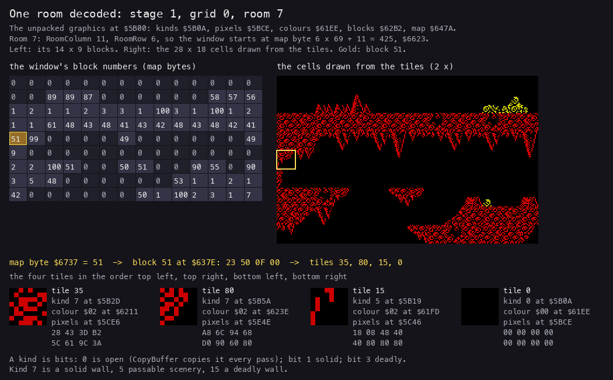

*Stage 1's graphics as the repository holds them (`src/res/stage1/graphics.txt` and `tiles.png`), packed again and
unpacked by `tools/res_stage.py`: the bytes Unrle leaves at `$5B00`. Room 7 of grid 0 (RoomColumn 11, RoomRow 6, as
`c1` holds them at frame 16550). Made with `python3 tools/fig_objects.py decode docs/img/rooms/decode-room7.png`.*

How to read it: the left grid is the 126 map bytes of the room's window. The right picture is what those bytes draw.
The gold block 51 is followed down to its four tiles at the bottom. The picture was checked against `c1`'s Cells
`$7280` at frame 16540: all 504 tile numbers are equal.

**A worked example: one block, by hand.** Room 7's block row 4, block column 0, the gold square.

1. Grid 0 is 69 blocks wide and its map starts at offset 0. Room 7's window starts at RoomRow 6, RoomColumn 11.
2. The map byte is at `$647A` + (6 + 4) x 69 + (11 + 0) = `$647A` + 701 = `$6737`. It holds 51.
3. Block 51 is at `$62B2` + 51 x 4 = `$637E`: `23 50 0F 00`. These are tiles 35, 80, 15 and 0.
4. Tile 35: kind 7 at `$5B2D` (solid rock), colour `$02` at `$6211` (red ink, black paper), pixels at `$5CE6`:
   `28 43 3D B2 5C 61 9C 3A`.
5. Tile 15: kind 5 at `$5B19`. It is the ragged edge of the rock: drawn in front of the actors, but the hero does not
   stand on it.
6. Tile 0: kind 0, colour `$00`, eight zero bytes. The open space is tile 0 everywhere.
7. The four tiles land in Cells at row 8, columns 2-3 (tiles 35 and 80), and row 9, columns 2-3 (tiles 15 and 0).

Block row 0 of room 7 is all zeros: block 0 is four tile 0s, the open space above the cave's roof.

**The point**: a room is never stored. It is a window onto a map of blocks, cut out at each room change. Stage 1's
whole world, the 18 rooms of grid 0 and the 4 of the other grids, costs 1869 map bytes, 456 block bytes and 196
tiles.

## 7.2 RoomCells: blocks into cells

RoomCells `$9928` cuts the window out of the map and writes 28 x 18 tile numbers into Cells. It is the only reader of
the map.

```asm
RoomCells:
  LD HL,$0000
  LD A,(RoomRow)
  CP $00
  JR Z,RoomCellsColumn
  LD B,A
  LD E,(IX+$00)           ; the grid's width in blocks
  LD D,$00
RoomCellsRowOffset:
  ADD HL,DE               ; RoomRow x width, by adding
  DJNZ RoomCellsRowOffset
RoomCellsColumn:
  LD A,(RoomColumn)
  ...                     ; + RoomColumn + the header's map offset + $5B0A + the grid's map offset
  PUSH HL
  POP IY                  ; IY = the window's first map byte
  LD HL,CellsPlay
  LD B,$09
RoomCellsRow:
  ...
  LD B,$0E
RoomCellsBlock:
  ...
  LD A,(IY+$00)
  CALL PutBlock           ; 4 tile numbers at HL, HL + 1, HL + 32, HL + 33
  ...
  INC HL
  INC HL
  INC IY
  DJNZ RoomCellsBlock
  ...
  LD DE,$0040             ; the next block row: 2 cell rows of 32
  ADD HL,DE
  LD E,(IX+$00)
  LD D,$00
  ADD IY,DE               ; the next map row: + the grid's width
  DJNZ RoomCellsRow
  RET
```

```text
RoomCells(grid):
    map = $5B0A + header[$5B08] + grid.map_offset + RoomRow * grid.width + RoomColumn
    for brow in 0..8:
        for bcol in 0..13:
            block = map[brow * grid.width + bcol]
            t = blocks[block]                       # 4 tile numbers
            Cells[2*brow][2*bcol + 2]       = t[0]  # columns 2-29 of a 32-byte row
            Cells[2*brow][2*bcol + 3]       = t[1]
            Cells[2*brow + 1][2*bcol + 2]   = t[2]
            Cells[2*brow + 1][2*bcol + 3]   = t[3]
            each cell's twin, 576 bytes lower = CellFlag      # always 0 (7.10)
```

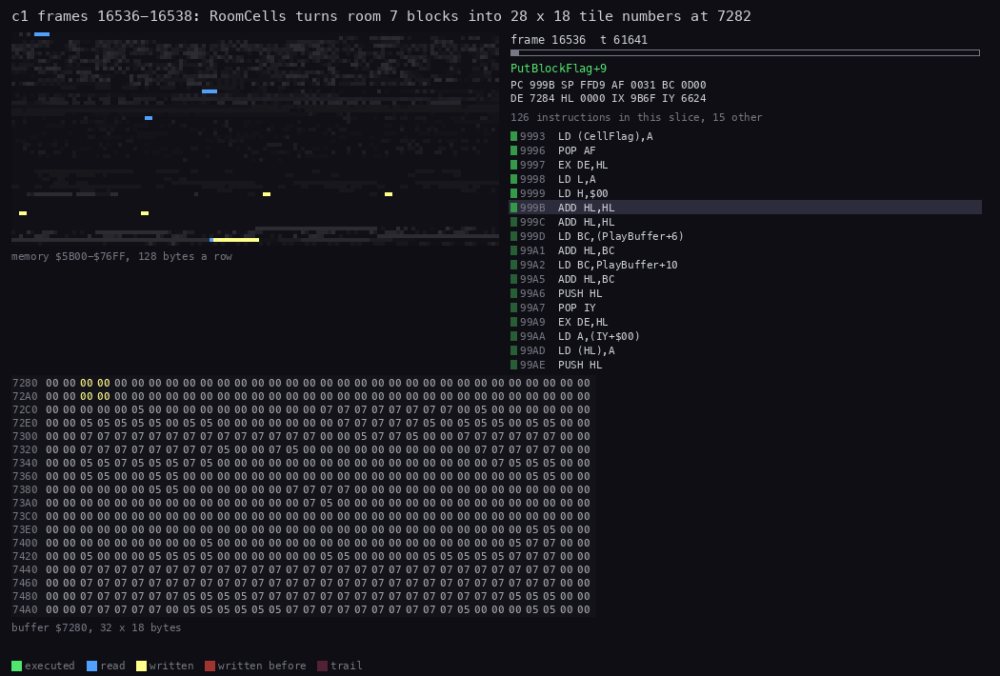

*`c1` frames 16536-16538, room 7 (60 pictures, 1641 T each). Top: memory `$5B00-$76FF`, 128 bytes a row: the map
and the blocks read in blue, Cells written in yellow. Bottom: Cells `$7280`, 32 x 18 bytes. Right: the code at the PC.
Made with `python3 ../../kit/routine_anim.py --work work/docs/myA/c1 --window 16536:60000-16538:18700 --listing
build/stage1.lst --listing build/resident.lst --view buffer:7280:32x18:hex --pc 9928-99E8 --range 5B00-76FF
--row-bytes 128 --pictures 60 --title 'c1 frames 16536-16538: RoomCells turns room 7 blocks into 28 x 18 tile numbers
at 7282' --out docs/img/routines/RoomCells.gif`.*

How to read it: the tile numbers fill Cells two rows at a time, left to right, one block per step. The rows below the
cursor still hold the old room's kinds (`05` and `07`). BuildSpans turns the new numbers into kinds later in the same
room change.

Witness: RoomCells ran 101 times in the five stage-1 builds (c1o, deaths, rzx-r1, s1-idle, s1-right), once per room
change, and PutBlock 12 726 times (101 x 126).

**The point**: the room is cut out with one multiply by addition and two nested loops. Its 98 104 T in the `c1` room
change ([doc 6](06-rendering.md#63-a-room-built)) are 8 % of the change.

## 7.3 The grids, the windows and the exits

A stage's map holds up to three grids. Each grid is a 9-byte record from `$9B6F`:

| Offset | Grid 0 | Meaning |
| --- | --- | --- |
| +0 | `$45` = 69 | the width in blocks |
| +1 | `$15` = 21 | the height in blocks |
| +2, +3 | 22, 0 | the start window: RoomColumn, RoomRow |
| +4, +5 | `$9B78` | the room table, one exit byte a room |
| +6, +7 | 0 | the grid's offset in the map |
| +8 | 6 | the rooms a row of rooms |

Stage 1's three grids:

| Grid | Size in blocks | Rooms | Map offset | Placements | What it is |
| --- | --- | ---: | ---: | ---: | --- |
| 0 | 69 x 21 | 6 x 3 | 0 | 66 | the graveyard and the caves |
| 1 | 14 x 21 | 1 x 3 | 1449 = 69 x 21 | 4 | the shaft |
| 2 | 14 x 9 | 1 | 1743 = 1449 + 14 x 21 | 5 | the arena |

The windows step 11 block columns and 6 block rows, but a window is 14 x 9 blocks. So two rooms side by side share 3
block columns, and two rooms one over the other share 3 block rows. The hero sees the same rock at the right edge of
one room and the left edge of the next. Grid 0 is 5 x 11 + 14 = 69 blocks wide and 2 x 6 + 9 = 21 high.

RoomNumber `$FE30` counts the windows: + 1 a step right, + 6 (the record's +8) a step down. Room 7 is RoomColumn 11
and RoomRow 6: row 1, column 1 of the rooms.

Each room's exit byte says which edges lead on: bit 0 right, bit 1 left, bit 2 up, bit 3 down. CheckRoomExits `$AADA`
reads it every pass:

```asm
CheckRoomExits:
  LD A,(IY+$0A)
  CP $0F                  ; dying: no exit
  RET Z
  LD A,(IX+$00)           ; IX = the room's exit byte
  AND $02
  JR Z,CheckRoomExitRight
  LD A,(IY+$00)
  CP $06                  ; column under 6: leave left
  CALL C,LeaveRoomLeft
CheckRoomExitRight:
  LD A,(IX+$00)
  AND $01
  JR Z,CheckRoomExitDown
  LD A,(IY+$00)
  CP $1A                  ; column 26 and up: leave right
  CALL NC,LeaveRoomRight
  ...                     ; bit 3: line $70 and down; bit 2: line under $10
```

Grid 0's room table, `$9B78`, drawn as the exits join the rooms (a line joins two rooms when the exit bit of one of
them points at the other):

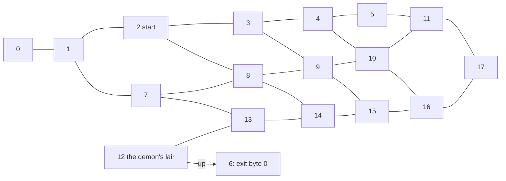

The bytes, a row of rooms a line: `01 0B 0B 0B 0B 0A`, `00 0D 0F 0F 0F 0E`, `05 07 07 07 07 06`. The bottom row has
no down bit: it is the bottom of the grid. Room 12 has `05`, right and up. Up from room 12 is room 6, whose own byte
is 0.

Four more doors join the grids. CheckGridPassages `$AB1C` tests the grid, a fixed room, the hero's column and his
facing, every pass:

| Grid | Room | Column | Facing | Also | Goes to |
| ---: | ---: | --- | --- | --- | --- |
| 0 | 7 | 4 | left | walking (state 1, `CP $01` at `$AB39`) | the shaft, grid 1 (EnterGrid1 `$AB83`) |
| 0 | `$11` = 17 | `$1D` = 29 and up | right | | the arena, grid 2 (EnterGrid2 `$ABDD`) |
| 1 | 2 | `$1D` = 29 and up | right | | back to the surface (LeaveGrid1 `$ABA7`) |
| 2 | any (its only room) | 1 | left | | back to the surface (LeaveGrid2 `$AC01`) |

```asm
CheckGridPassages:          ; the first door, grid 0 room 7
  LD A,(GridNumber)
  CP $00
  JR NZ,CheckGridPassageGrid1
  LD A,(RoomNumber)
  CP $07
  JR NZ,CheckGridPassageRoom11
  LD A,(HeroRecord)         ; his column
  CP $04
  RET NZ
  LD A,(HeroFlags)
  BIT 7,A                   ; facing left?
  RET Z
  LD A,(IY+$0A)             ; his state
  CP $01                    ; walking
  RET NZ
  JP EnterGrid1
```

So a jump or a fall past column 4 of room 7 does not open the shaft: the hero has to walk into it. Witness: EnterGrid1,
EnterGrid2, LeaveGrid1 and LeaveGrid2 ran once each, in `rzx-r1`.

**A worked example: the demon locks the lair.** `rzx-r1`, `$9B84` (room 12's exit byte, Grid0Rooms + 12), read with
TTD memory_at.

1. Up to frame 14980 it holds `$05`: right and up.
2. At 14981 it becomes `$04`. BossPart, the handler of the demon's parts, writes it when the demon takes flight
   (BossFlight): the right exit is shut.
3. At 15647 it is `$05` again. ItemLast `$FE18` goes from 9 to 10 in the same frame: the hero has picked up the item
   the demon left, and the pick-up of item kind 7 writes 5 back.

So a room's exits are data the game can rewrite. One lock is this exit byte; the other is CheckRightGate `$81B9`,
which holds the hero at base column `$1C` until BossPhase is 1, or 4 with item 7 ([doc 10, 10.7](10-gameplay-logic.md)).

The whole grid and the rooms one by one are drawn in doc 1: [the stage map](img/maps/stage1.png) (the three grids
from the tiles, `tools/stagemap.py`) and [the rooms](img/maps/stage1-rooms.png).

**The point**: a grid is a map with a stride. The rooms are windows that overlap, the exits are four bits a room, and
a boss fight shuts its room by writing 4 into one byte of the room table.

## 7.4 The placements

The enemies and objects of a grid are a list of 3-byte placements: the kind, then X and Y in cells over the whole grid.
Grid0Placements `$9BA0` holds 66, then `$FF`. Bit 7 of the kind means "done": the actor was beaten or taken, so it
does not come back. MarkPlacementDone `$A48E` sets it; ResetObjectLists `$922F` clears all of them when a stage starts.

Grid 0's 66 placements by kind:

| Kind | Handler | Count | What it is |
| ---: | --- | ---: | --- |
| 0, 1 | HangingActor `$9186` | 7, 7 | a hanging body (1 faces the other way) |
| 2 | FlameJetActor `$8DCC` | 15 | a jet of flame from the ground |
| 3, 4, 5, 6 | StrikeableActor `$A7C4` | 4, 4, 5, 3 | urns and chests: two blows break them |
| 7 | FirePitActor `$8D6D` | 13 | a fire pit |
| 8, 9, 10, 11 | BossWingLeft `$8E60`, BossWingRight `$8E6A`, BossBody `$8E7C`, BossHead `$8E86` | 1 each | the winged demon's four parts |
| 12, 14 | StatueActor `$912B` | 1, 1 | a statue's head |
| 13 | GateActor `$9065` | 1 | the gate |
| 16 | BridgeSlabActor `$90A3` | 1 | the bridge slab |

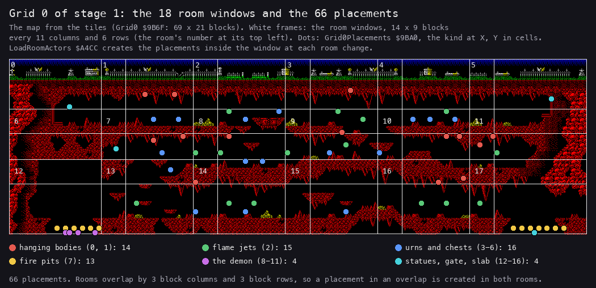

*Grid 0's map with its 18 room windows and the 66 placements of Grid0Placements `$9BA0`, coloured by the kinds of the
table above. Made with `python3 tools/fig_objects.py placements docs/img/rooms/placements-grid0.png`.*

How to read it: a room shows the dots inside its white frame. The fire pits lie on the cave floor at both ends of the
bottom row (rooms 12-13 and 17), the urns and chests on the ledges, and the demon's four parts in room 12. Where two frames overlap, a placement
belongs to both rooms and is created again when either is entered, unless it is marked done.

Grid 1 holds kinds 12 and 14, two each. Grid 2 holds four fire pits and kind 15, the dragon's head (ArenaHeadActor
`$90E7`).

The four urn kinds differ only in their +8, the first frame (6, 4, 2, 0), and their colour (`$43` magenta or `$46`
yellow). Each kind row is 9 bytes at ActorKinds `$9C8A`: the Y offset in lines, the handler, five bytes for the
record's +8 to +`$0C`, and the record's +`$0F`.

LoadRoomActors `$A4CC` runs at the end of every room change. It does two things:

1. It frees every record of `$74F2-$75DB` whose +`$0F` bit 1 is clear. Kept actors, such as a dropped item, survive.
2. It walks the placements. A placement not done whose X lies in 2 x RoomColumn to + 29 and whose Y lies in 2 x
   RoomRow to + 17 becomes an actor. Its record is the first free one found from `$75CA` (record 13) downwards.

```text
LoadRoomActors:
    for r in records 1..13: if not r.flags_0F.bit1: r.x = $FF
    slot = record 13
    for i, (kind, x, y) in enumerate(Placements) until $FF:
        while slot.x != $FF: slot -= 18                # no lower bound
        if kind.bit7: continue                         # done
        if not (2*RoomColumn <= x < 2*RoomColumn + 30 and 2*RoomRow <= y < 2*RoomRow + 18): continue
        k = ActorKinds[kind]                           # 9 bytes
        slot.handler = k.handler
        slot[+8 .. +$0C] = k[3 .. 7]
        slot.flags_0F = k[8]
        slot.x = x - 2*RoomColumn                      # columns from the window's left edge
        slot.y = (y - 2*RoomRow) * 8 + k.y_offset      # lines in the play buffer
        slot.base_x, slot.base_y = slot.x, slot.y
        slot.index = i                                 # +$10: MarkPlacementDone finds it again
        slot.width, slot.height, slot.shift = 1, 8, 0
        if slot.state == $40: slot.state = random 0-63
        slot -= 18
```

**A worked example: room 7's ten actors.** `c1` frame 16550, just after the change from room 8 to room 7.

1. The window is X 22 to 51 and Y 12 to 29 (RoomColumn 11, RoomRow 6).
2. Ten placements fall in it: indices 0, 1, 6, 17, 22, 24, 40, 41, 42 and 63.
3. They fill records 13 down to 4, in that order. Records 1-3 stay free.
4. Placement 0 is `04 22 0E`: kind 4 at X 34, Y 14. Kind 4's row at `$9CAE` is `00 C4 A7 04 01 00 00 46 00`.
5. Record 13 gets X = 34 - 22 = 12, Y = (14 - 12) x 8 + 0 = 16, the handler StrikeableActor `$A7C4`, +8 = 4, +9 = 1,
   the attribute `$46` (bright yellow), +`$10` = 0.
6. By frame 16550 the handler has run once. SetActorFrame has added frame 4's offsets to the base: the record is
   `0C 12 02 0E F8 E1 C4 A7 04 01 00 00 46 0C 10 00 00 00`. Y is 18, base 16 + 2. The size 2 x 14 and the image
   `$E1F8` are frame 4's.

The busiest window of grid 0 is room 10, with 12 placements. That leaves one of the 13 records free, so the missing
lower bound of the search is not reached by the placements alone.

**The point**: the enemies are not in the rooms but in one list over the whole grid. A room takes whatever lies under
its window. The records near the hero stay free for the random enemies and the drops.

## 7.5 The actor records

Fourteen records of 18 bytes from `$74E0`: the hero, then 13 others. The same layout serves the hero, the enemies, the
urns, the items and the fragments.

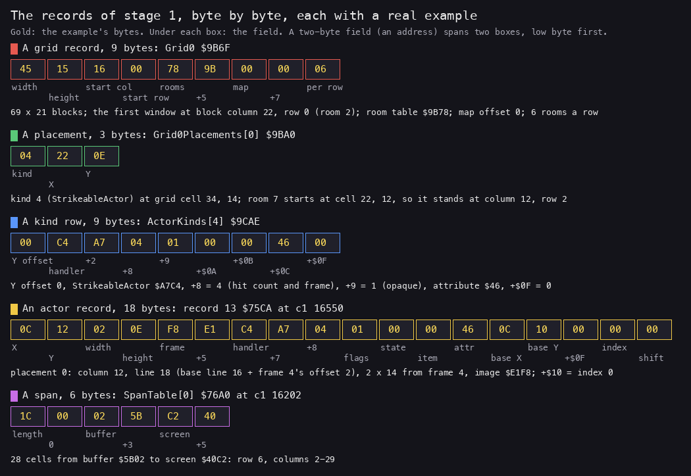

*The five record layouts of stage 1, each with real bytes: Grid0 `$9B6F`, placement 0 at `$9BA0`, kind row 4 at
`$9CAE`, actor record 13 at `$75CA` (`c1` frame 16550), the first span at `$76A0` (`c1` frame 16202). Made with
`python3 tools/fig_objects.py records docs/img/rooms/records.png`.*

| Offset | Field | Notes |
| --- | --- | --- |
| +0 | X | byte column 0-29; `$FF` a free record; `$FE` a flame jet between jets: still drawn, at column 254, which no span copies, so it is invisible |
| +1 | Y | line in the 144-line play buffer |
| +2, +3 | width, height | in bytes and lines, from the frame |
| +4, +5 | the image | the frame's bitmap, one bit a pixel, no mask |
| +6, +7 | the handler | called every pass by RunActorHandlers |
| +8 | a counter | the frame, the hit count, the walk step: the handler's |
| +9 | flags | bit 0 opaque, bit 4 hit, bit 7 facing left |
| +`$0A` | the state | the handler's state machine; an item's amount |
| +`$0B` | the item or a step | the item kind of an item, the warrior's spawn line |
| +`$0C` | the attribute | the colour ColourActor paints ([doc 6](06-rendering.md#68-the-colours)) |
| +`$0D`, +`$0E` | base X and Y | where the actor stands; the frame's offsets are added to them |
| +`$0F` | flags | bit 0 shootable, bit 1 kept over a room change, bit 2 a body, bit 6 not drawn, bit 7 drawn in the second pass |
| +`$10` | the placement's index | or a counter |
| +`$11` | the pixel shift | eighths of a byte column: 0 in the keyed recordings; the warrior's flying head moves by it (StepFineBack `$8B4E`, 510 runs in `rzx-r1`; [doc 6](06-rendering.md#67-sprites-on-byte-columns)) |

A frame is a 6-byte record of a frame table (SetActorFrame `$AA02`): the column offset, the line offset, the width,
the height, the image's offset. SetActorFrame sets X = base X + the column offset (negated when the actor faces left),
Y = base Y + the line offset, and copies the size and the image. So a handler moves an actor by moving its base, and
animates it by changing the frame number.

The records fill from both ends:

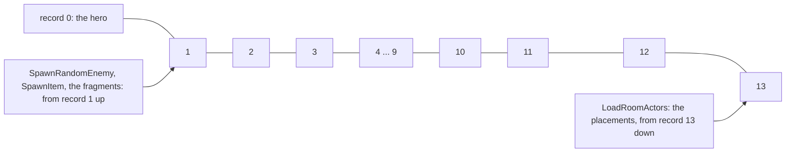

FindFreeActor `$8D3A` searches 13 records from `$74F2` up. FindFreeActorPair searches 12 for two free records in a
row, for the warrior and its head. LoadRoomActors searches from `$75CA` down. In room 8 at `c1` frame 16240 the
warrior and his head sit in records 1 and 2, record 3 is free, and the room's ten placed actors fill records 4-13.

The templates at `$9D23` are seven whole records that SpawnActor `$A4B1` copies: the bridge slab, the hero, an item, a
piece, a fragment, the warrior, the warrior's head.

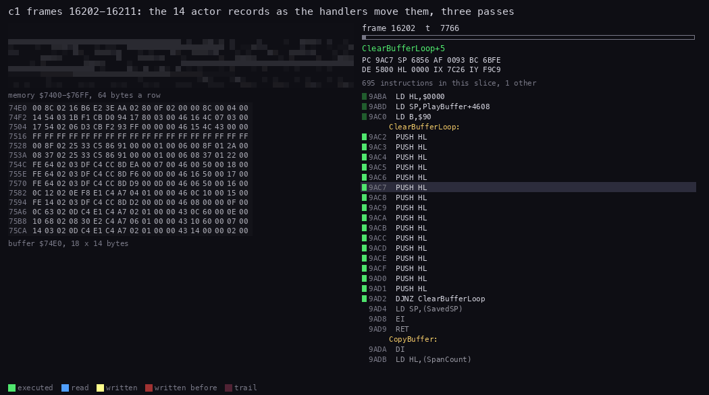

*`c1` frames 16202-16211, room 8 (90 pictures, 7766 T each). Top: memory `$7400-$76FF`, 64 bytes a row. Bottom: the 14
records, 18 bytes a row, record 0 on top. Right: the code at the PC. Made with `python3 ../../kit/routine_anim.py
--work work/docs/myA/c1 --window 16202:0-16212:0 --listing build/stage1.lst --listing build/resident.lst --view
buffer:74E0:18x14:hex --pc 7800-B4B1 --range 7400-76FF --row-bytes 64 --pictures 90 --title 'c1 frames 16202-16211:
the 14 actor records as the handlers move them, three passes' --out docs/img/routines/RunActorHandlers.gif`.*

How to read it: each pass, the rows light up one after another as their handlers write them. The counters at +8 tick,
the hero's X and Y change, and the flame jets' records flip their X between `$FE` and a column.

**The point**: one record type for everything that moves. The handler pointer at +6 is the only thing that tells a
warrior from an urn.

## 7.6 The movers: RunActorHandlers and the warrior

RunActorHandlers `$A5BD` runs once a pass. It calls each used record's handler, the hero first, through a CALL whose
operand it rewrites:

```asm
RunActorHandlers:
  LD B,$0E
  LD IY,HeroRecord
RunActorHandlersLoop:
  PUSH BC
  LD A,(IY+$00)
  INC A                   ; $FF: a free record
  JR Z,RunActorHandlersNext
  LD L,(IY+$06)
  LD H,(IY+$07)
  LD (HandlerCall+$0001),HL
HandlerCall:
  CALL $0000              ; CALL n: n = the record's handler (written above)
RunActorHandlersNext:
  POP BC
  LD DE,$0012
  ADD IY,DE
  DJNZ RunActorHandlersLoop
  RET
```

The warrior, a skeleton with a sword and a shield, is the stage's typical mover. SpawnTimer counts 30-61 passes; then,
in grid 0, SpawnRandomEnemy `$9353` puts a warrior and his head in a free pair of records, at one of four places the
room allows (SpawnRooms `$93AF`: bits 0-3 the places, bit 4 the lower line). WarriorActor `$94D0` is a state machine on
+`$0A`: 0 Rise, 1 the head coming down, 2 Face, 3 Walk, 4 Fight, 5 Collapse, 6 Block, 7 Strike.

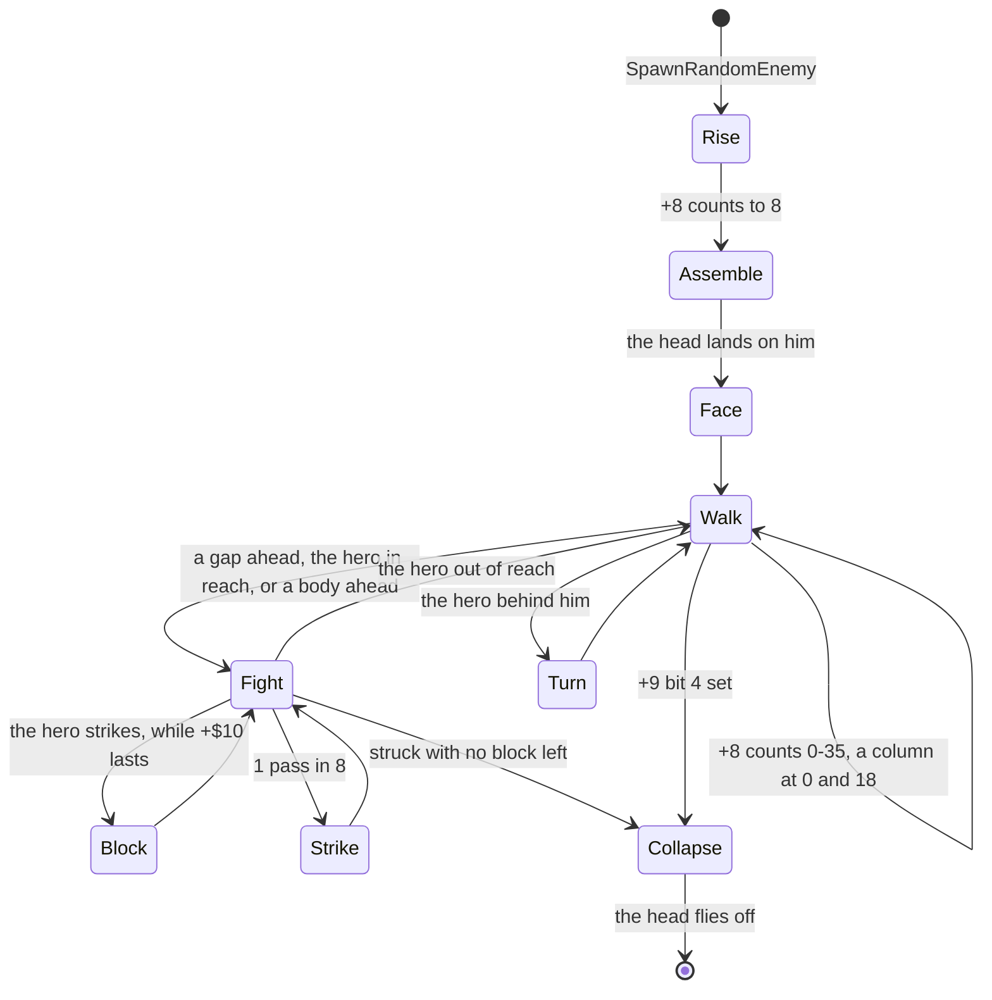

The walk, WarriorWalk:

```text
WarriorWalk(w):                                        # state 3
    if w.flags9.bit4: return WarriorCollapseStart(w)
    w.counter += 1
    if w.counter == 36:
        w.counter = 0; step(w)
    elif w.counter == 11:
        if CellAt(the floor 3 or 7 columns ahead) is not solid: w.state = 4; return
        if IsHeroInReach(w): w.state = 4; return
        if the hero is behind: return WarriorTurn(w)
        if IsWarriorAhead(w) finds another body: w.state = 4; return
    elif w.counter == 18:
        step(w)
    SetActorFrame(WarriorWalkFrames[w.counter / 2])    # 14 x 6, 15, 16, 17, twice over

step(w):
    MoveBaseX(w, 1 column forward)
    if w.x in (0, 31): free w and its head
```

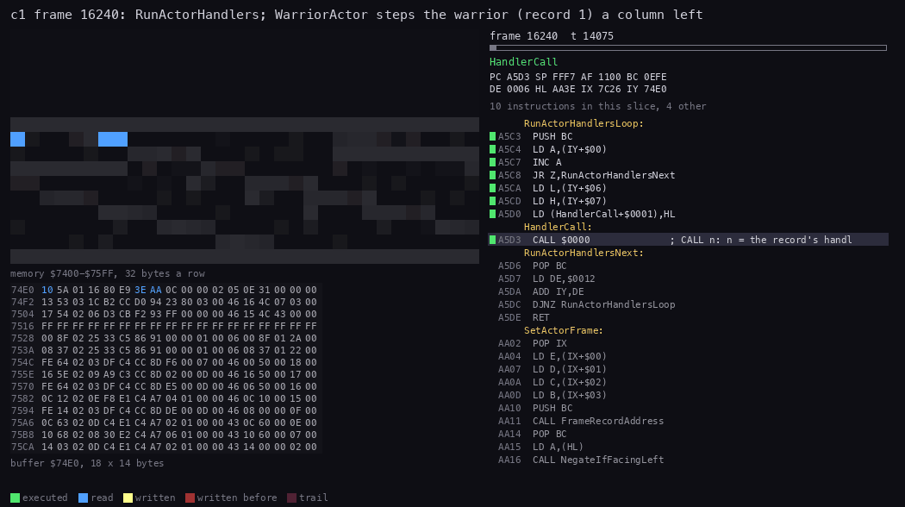

*`c1` frame 16240, room 8: one run of RunActorHandlers (60 pictures, 175 T each). Top: memory `$7400-$75FF`, 32
bytes a row. Bottom: the 14 records. Right: the code. Made with `python3 ../../kit/routine_anim.py --work
work/docs/myA/c1 --window 16240:13900-16240:24400 --listing build/stage1.lst --listing build/resident.lst --view
buffer:74E0:18x14:hex --pc 94D0-9780,B112-B140,AA02-AA60,A5BD-A5DE,93F2-94CF --range 7400-75FF --row-bytes 32
--pictures 60 --title 'c1 frame 16240: RunActorHandlers; WarriorActor steps the warrior (record 1) a column left' --out
docs/img/routines/WarriorActor.gif`.*

How to read it: the hero's handler runs first and reads the cells under his feet. Then record 1, the warrior: +8 wraps
from `$23` to 0, the base X at +`$0D` goes from `$16` to `$15`, and SetActorFrame rewrites X, the size and the image.
Then the head, the hanging bodies, the flame jets and the urns.

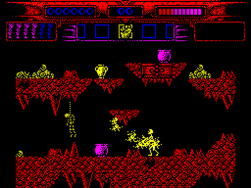

*`c1` frames 16196-16262, every third frame (23 pictures): the warrior, right of the hero, walks left toward him. Made
with `python3 ../../kit/screen_anim.py --work work/docs/myA/c1 --from 16196 --to 16262 --step 3 --scale 2 --delay 120
docs/img/play/warrior-walk.gif`.*

**A worked example: one step of the warrior.** `c1`, record 1 at `$74F2`, read every frame from 16195 to 16259.

1. The warrior faces left: +9 = `$80`. His base X is `$16`, his state 3.
2. The counter +8 goes up by one each pass: `$15` at 16195, `$18` at 16203, `$1D` at 16219. A pass is three frames,
   sometimes four.
3. At +8 = `$1E` (frame 16222) the frame becomes `$0F`: X `$13`, Y `$53`, 2 x 28, image `$CC42`. The foot comes
   forward.
4. At `$20` (16228) frame `$10`, image `$CC7A`. At `$22` (16235) frame `$11`, 3 bytes wide, image `$CCB2`.
5. At 16241 the counter wraps to 0. MoveBaseX takes the base to `$15`. Frame `$0E` puts X at `$15` - 2 = `$13`, Y at
   `$54`.
6. So the warrior moves one byte column, 8 pixels, every 18 passes: about 54 frames. The frames in between only move
   the drawing, not the base.

**A worked example: the cost of the movers.** `c1` frame 16240, from the trace of frames 16238-16241.

1. RunActorHandlers starts at T 13 959 and DrawActors at T 24 396.
2. In between, 13 handlers run: the hero, the warrior, his head, two hanging bodies, four flame jets and four urns.
3. They take 10 437 T, 15 % of a frame. The drawing that follows takes about four times as much
   ([doc 6](06-rendering.md#66-the-sprites)).

Witness: RunActorHandlers ran 19 503 times in the five stage-1 builds (c1o, deaths, rzx-r1, s1-idle, s1-right),
WarriorActor 3 604 times (c1o, deaths, rzx-r1, s1-right).

**The point**: a mover is a handler with a counter. The enemies move a byte column at a time on fixed counts of
passes, so they move slower when a pass is longer.

## 7.7 The collisions

There is no bounding box test and no pixel test in stage 1. Every collision compares a column for equality, or a
distance in lines against a limit. The one helper is AbsDiffBelow `$A7B8`, which patches its limit into its own
compare:

```asm
AbsDiffBelow:
  LD (AbsDiffLimit+$0001),A
  LD A,E
  SUB D
  JR NC,AbsDiffLimit
  NEG                     ; |E - D|
AbsDiffLimit:
  CP $00                  ; the limit, written by the first instruction
  RET                     ; carry: |E - D| under the limit
```

The tests:

| Who against whom | Routine | The rule |
| --- | --- | --- |
| the hero against the floor | CellUnderFeet `$B134` | the cell at row (Y + height + 3) / 8, his column: bit 1 solid |
| the hero against walls and spikes | CellAt `$B162` | A = the cell at row D / 8, screen column E - 2 (CellsPlay `$7282` is screen column 2); Z set when bit 1 (solid) is clear. HeroUpdate tests bit 3 (deadly) itself |
| the hero's strike against an urn | InStrikeReach `$A816` | the urn's column = the hero's + 3 (facing right) or - 3, and lines within 24 |
| the warrior's reach | IsHeroInReach `$9621` | the hero's column = the warrior's + 3 (or - 3), and the hero 0-9 lines below his top |
| a flame jet against the hero | FlameJetActor `$8DCC` | at the jet's frame 3: lines within 20 (HeroWithinY), the hero's column the jet's or the next |
| a missile against the hero | ShotHitsHero `$86EB` | the same column, lines within 14; not while the shield (item 1) is selected with a count |
| a missile against an actor | ShotHitsActor `$86A2` | +`$0F` bit 0, the same column, the shot's line within the actor's height |
| a warrior against a warrior | IsColumnTaken `$93C1` | another body (+`$0F` bit 2) within 2 columns: no warrior spawns there |

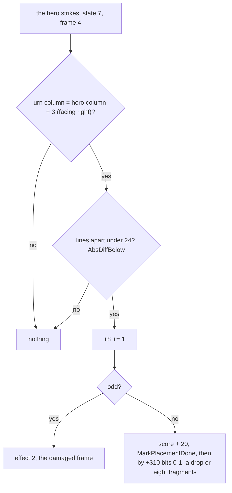

**A worked example: an urn struck twice.** `rzx-r1`, room 2, frames 625-663. Records read every frame with TTD
memory_at.

1. Record 13 is placement 2 (`05 40 0C`: kind 5 at X 64, Y 12). Room 2 starts at RoomColumn 22, so X = 64 - 44 = 20,
   `$14`. Base Y = 12 x 8 = `$60`; frame 2 adds 3, so Y = `$63`. +8 = 2.
2. At frame 638 the hero is at X `$11`, Y `$5D`, facing right (+9 = 0), in state 7 (the strike) with +8 = 4. That is
   the moment IsHeroHitFrame7 `$7FEE` waits for.
3. InStrikeReach: `$11` + 3 = `$14`, the urn's column. AbsDiffBelow with A = `$18`, E = `$63`, D = `$5D`: `$63` -
   `$5D` = 6, under 24. Hit.
4. +8 goes from 2 to 3. Odd: the urn shows its damaged frame, image `$E1DE`.
5. At 662 the second strike lands: +8 = 4, even. The score `$F9FB` goes from 0 to 20. The placement at `$9BA6` goes
   from `$05` to `$85`: done. Record 13's X becomes `$FF`.
6. +`$10` = 2, so bits 0-1 = 2: DropItemKind1 `$A0D6`. At 663 record 1 is the item: X `$14`, Y `$60`, 2 x 16, handler
   ItemHandler `$A0E9`, +`$0B` = 1 (the shield), +`$0A` = 20 (its amount), +`$0F` = `$82` (kept over a room change,
   drawn in the second pass).

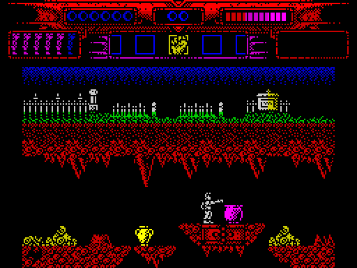

*`rzx-r1` frames 624-672, every second frame: the hero strikes the magenta urn twice; it breaks and leaves the
shield. Made with `python3 ../../kit/screen_anim.py --work work/docs/myA/r1 --from 624 --to 672 --step 2 --scale 2
--delay 120 docs/img/play/urn-strike.gif`.*

The drop is chosen by +`$10` bits 0-1: 0 eight fragments, 1 item kind 8, 2 item kind 1. +`$10` is the placement's
index. So what an urn holds is set by its position in the placement list, not by its kind.

**The point**: collisions are column equalities and one absolute difference. A strike reaches exactly three columns
ahead, never two or four.

## 7.8 The missiles

Shots, thrown objects and flyers live in 16 records of 6 bytes from `$75E0`: +0 the column (`$FF` free), +1 the line,
+2 the kind, +3 to +5 the kind's own. AddMissile `$B28D` fills slots 0-7 round robin from MissileCursor `$FE27`;
AddMissileHigh `$B296` fills slots 8-15. UpdateMissiles `$B2E6` calls each used record's handler from MissileHandlers
`$B31A`, through a patched CALL as for the actors.

| Kind | Handler | What it is |
| ---: | --- | --- |
| 0 | HangFlashBorder `$876C` | none: a trap that flashes the border for ever |
| 1 | UpdateAimedShot | a shot in one of 8 directions, hurts by 6 |
| 2, 3 | UpdateThrownArc `$8006` | an object the hero throws, left or right (item kind 5) |
| 4, 5 | UpdateDriftRight `$83A9`, UpdateDriftLeft `$8403` | a falling shot drifting sideways, hurts by 10 |
| 6 | UpdateFlatShot `$8564` | the hero's bolt (item kind 7) |
| 7, 8 | UpdatePathFlyer | the death burst: 8 flyers from the hero out to the respawn point, then back |
| 9 | UpdateHeroShot | a shot left or right that stops on an actor (ShotHitsActor) |
| 10, 11 | UpdateBouncer | a bouncing shot, hurts by 6 |

In `c1` the only sender is HeroDeath `$B22B`: it clears slots 8-15 and adds 8 flyers of kind 7. Their path runs out to
the respawn point, then back as kind 8 ([doc 10](10-gameplay-logic.md)).

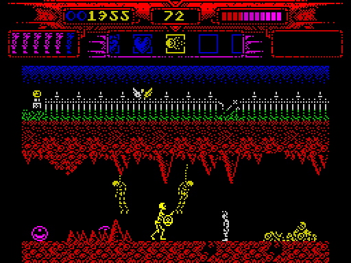

*`rzx-r1` frames 2310-2390, one picture every 2 frames: ThrowItem (item 8) adds a missile of kind 9 (UpdateHeroShot),
which flies left or right and stops on an actor (ShotHitsActor); the missile slots hold kind 9 at frame 2320. Doc 10
([10.3](10-gameplay-logic.md#103-strikes-items-and-weapons)) gives its command.*

Witness: UpdatePathFlyer ran in `c1o`, `deaths` and `s1-right`; UpdateBouncer and ShotHitsHero only in `s1-right`.

**The point**: the missiles are a second, lighter actor list. They have no frame records; each handler draws and
colours its shot itself.

## 7.9 The other stages

Stages 2-4 use the same formats: the same unpacked header, the same 9-byte grid records, the same placements and kind
rows, the same 18-byte actor records. Only the addresses and the tables differ.

| Stage | Tiles | Blocks | Map bytes | Escape | Kinds | LoadRoomActors | RunActorHandlers | ActorKinds |
| ---: | ---: | ---: | ---: | --- | ---: | --- | --- | --- |
| 1 | 196 | 114 | 1869 | `$C7` | 17 | `$A4CC` | `$A5BD` | `$9C8A` |
| 2 | 195 | 110 | 1452 | `$C9` | 21 | `$A431` | `$A523` | `$9607` |
| 3 | 229 | 118 | 1665 | `$F9` | 13 | `$A6CA` | `$A7BB` | `$9BFB` |
| 4 | 179 | 108 | 3099 | `$C1` | 22 | `$A654` | `$A746` | `$9E1B` |

Stage 3's grids are 47 x 9 blocks (14 placements), 124 x 9 (34) and 14 x 9 (none). Each stage has its own
StrikeableActor for its urns; stage 3's is at `$A9C2`.

Stage 5, the duel, has no map and no placements. Its RunActorHandlers `$9EB7` and UpdateMissiles `$9FB2` run a handful
of fixed records.

## 7.10 Known only from the code

- **PutBlock's dead flag.** PutBlock writes CellFlag into a twin of each cell 576 bytes lower, in RoomAttributes. It
  compares the block number with `$59` (89), but both branches load 0. The test suggests that blocks 89 and up were
  once marked; now no block is.
- **LoadRoomActors has no lower bound.** The search for a free record walks down from record 13 and stops only on a
  free one. With all 13 records used it would run below `$74F2`. The busiest window of grid 0 has 12 placements, so
  the placements alone never fill the table.
- **ShotHitsActor and UpdateHeroShot** run only in `rzx-r1` (889 and 914 runs). Missile kind 9 and the shootable bit,
  +`$0F` bit 0, are in the kind rows of the hanging bodies, the demon's body and head, the statues, the gate and the
  dragon's head; `c1o`, `deaths`, `s1-idle` and `s1-right` fire no kind-9 shot.
- **Missile kind 0 is a trap.** HangFlashBorder `$876C` flashes the border from R in a loop that never returns. A
  record of kind 0 would hang the game.
- **The fine steps.** StepFineRight `$8B37` and StepFineLeft `$8B61` move an actor by eighths of a byte column through
  +`$11`. No code in stage 1 calls them (stage 2's MedusaHeadFallStep calls its StepFineLeft at `$81F5`).
  Their sibling StepFineBack `$8B4E` is live: `$8736` and the warrior's flying head
  (WarriorHeadFly `$9474`) call it, 510 runs in `rzx-r1`.
- **Room 6.** Its exit byte is 0, so once in it the hero could not leave by an edge. Only room 12's up bit leads into
  it. In `rzx-r1`, read every 10 frames, RoomNumber is never 6.
