# 8. HUD and text

What this covers:

- the one font format of the game, its four copies, and each glyph's width;
- Print and TextToBuffer: a line drawn into a buffer with proportional glyphs, worked by hand;
- RevealText: the line brought onto the screen through masks picked by ROM bytes;
- the front's PrintText and RevealStrip, the same code a second time;
- every string of the game, and where it stands;
- the HUD: how it is set up, which routine writes which field, and what a pass costs;
- the score, the energy bar, the lives, the item count, the teleport icons and the HUD's GAME OVER;
- the other stages, and what is known only from the code.

The recordings it rests on ([WALKTHROUGH 6.0](../WALKTHROUGH.md#60-the-recordings)):

| Recording | Load | Used for |
| --- | --- | --- |
| `c1` | a 48K from power-on, the original tape | the credits (frames 7969-8524), PROGRAMMED BY revealed (8007-8023), PRESS PLAY ON TAPE (8561-8578) |
| `rzx-r1` | stage 1 of the RZX run, 128K, the Sinclair joystick | the HUD set up (frames 60-340), the score from 0 to 2269 (662-2702), the shield taken (712-714) |
| `deaths` | `c1`'s stage 1 state | the energy bar going down, a life lost at frame 2775 |
| `s1-right` | stage 1 as loaded, the walk right | every life lost, the HUD's GAME OVER (frame 4000) |
| `s5-right`, `rzx-r5` | stage 5 | the intro and the ending texts |

The resident's routines are at the same addresses for the whole game. The HUD's routines are stage 1's unless a section
says otherwise; stages 2-5 carry copies of them at other addresses ([8.10](#810-the-other-stages)).

## 8.1 Two print routines, one design

The game prints text in two places. The resident prints the tape prompts, the stage titles and the game-over screen.
The front prints the credits, the menu and DEFINE KEYS. Both take the text inline, right after the CALL. Both draw the
line into a buffer first, then dissolve it onto the screen over 16 frames.

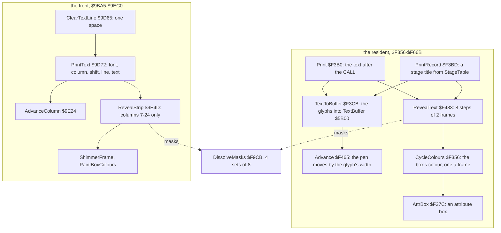

The two copies differ in three things: the font, the width of the strip they reveal, and what runs during the wait
([8.5](#85-the-fronts-printtext)). The HUD of a stage is drawn by other code: fixed-width digits, a bar and attribute
boxes ([8.7](#87-the-hud-set-up-once-then-field-by-field)).

**The point**: one idea, written twice. The tape prompts and the menu share the format of the text, the font and the
dissolve, but not the code.

## 8.2 The font

A glyph is 8 bytes: a width mask, then 7 pixel rows. Bit 7 is the left pixel. The mask has a bit set for each pixel
column the glyph uses, from bit 7 on. The eighth pixel row is never drawn; it stays blank under the text.

The glyphs are in a fixed order: A to Z (glyphs 0-25), the space (26), then the digits 0 to 9 (27-36). There are no
lower-case letters and no punctuation, apart from the full stop of stage 5's own copy.

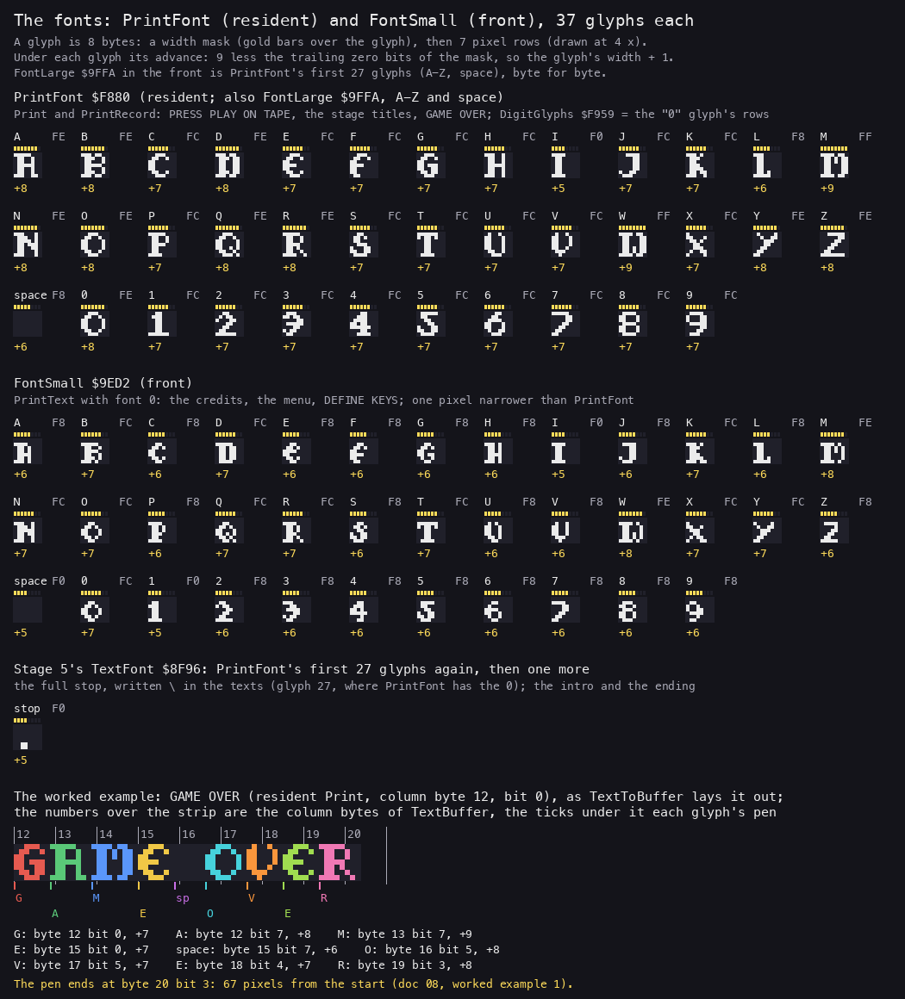

*The glyphs as `build/res` holds them, at 4 x. Over each glyph its mask in gold, under it the advance in pixels.
Bottom: GAME OVER laid out by hand as TextToBuffer lays it out ([8.3](#83-print-and-texttobuffer)). Made with
`python3 tools/fig_text.py fonts docs/img/hud/fonts.png`.*

How to read it: the advance is the glyph's width plus one blank pixel. M and W (mask `$FF`) are 8 pixels wide, so the
pen moves 9. I (mask `$F0`) is 4 wide, so the pen moves 5.

The game holds four copies of this format:

| Font | Where | Glyphs | Used by |
| --- | --- | ---: | --- |
| PrintFont | resident `$F880` | 37: A-Z, space, 0-9 | Print, PrintRecord |
| FontLarge | front `$9FFA` | 27: A-Z, space | PrintText with font 1: names, menu lines |
| FontSmall | front `$9ED2` | 37: A-Z, space, 0-9 | PrintText with font 0: headings, prompts |
| TextFont | stage 5 `$8F96` | 28: A-Z, space, full stop | DrawTextLine: the intro and the ending |

FontLarge is PrintFont's first 27 glyphs, byte for byte. TextFont is the same 27 glyphs again, with a full stop added
as glyph 27. Only FontSmall is drawn differently: most letters are one pixel narrower.

The HUD's digits come from PrintFont too. DigitGlyphs `$F959` is the address of the 0 glyph's first pixel row, one
byte past its mask. RenderDigits reads 7 rows from there, 8 bytes a digit, and ignores the masks. So the score's digits
are fixed-width, one byte column each ([8.8](#88-the-score)).

**The point**: one font, stored four times. The masks make it proportional, and the HUD reads the same bytes as a
fixed-width font by skipping the masks.

## 8.3 Print and TextToBuffer

Print `$F3B0` takes its parameters from the bytes after its CALL: a column byte (0-31), a bit within that byte (0-7),
a pixel row (0-191), then the text, then a 0. It returns to the byte after the 0.

```asm
Print:
  POP IY                  ; IY = the bytes after the CALL
  CALL TextToBuffer       ; IY ends past the 0
  PUSH IY                 ; the return address: after the text
  LD A,(TextRow)
  JP RevealText
```

TextToBuffer `$F3CB` clears the 256-byte TextBuffer `$5B00`, sets the pen at the column byte and the bit, then draws
each character. A character becomes a glyph number. The glyph's 7 rows are copied into GlyphBuffer as pairs (the row,
then 0), shifted right by the pen's bit, and ORed into the buffer at the pen. Then Advance moves the pen.

```asm
TextNextChar:
  LD A,(IY+$00)
  INC IY
  CP $00
  JP Z,TextEnd
  CP $3A
  JR NC,TextNotDigit
  CP $30
  JR C,TextNotDigit
  ADD A,$2C               ; '0'-'9' become $5C-$65: glyphs 27-36 after the SUB
  JR TextGlyph
TextNotDigit:
  CP $20
  JR NZ,TextGlyph
  LD A,$5B                ; the space: glyph 26
TextGlyph:
  SUB $41
  ...                     ; HL = PrintFont + 8 x the glyph
  LD A,(HL)
  LD (CharMask),A         ; the width mask, for Advance
  ...                     ; 7 rows into GlyphBuffer as (row, 0) pairs
TextShift:
  LD HL,GlyphBuffer
  LD B,$07
TextShiftRow:
  SRL (HL)                ; one pixel right through the pair
  INC L
  RR (HL)
  INC L
  DJNZ TextShiftRow
  DEC C
  JR NZ,TextShift         ; BitShift times
TextMerge:
  ...                     ; OR each pair into the buffer at DE, DE + 1; DE + 32 a row
  POP DE
  CALL Advance
  JR TextNextChar
```

Advance `$F465` counts the trailing zero bits of the mask, from 9 down:

```asm
Advance:
  LD A,(CharMask)
  LD C,$09
AdvanceCount:
  BIT 0,A
  JR NZ,AdvanceAdd
  SRL A
  DEC C
  JR AdvanceCount
AdvanceAdd:
  LD A,(BitShift)
  ADD A,C
  CP $08
  JR C,AdvanceStore
  INC DE                  ; past a byte boundary: the next column byte
  SUB $08
AdvanceStore:
  LD (BitShift),A
  RET
```

```text
TextToBuffer(text at IY):
    TextBuffer[0..255] = 0
    pen_byte, pen_bit, row = IY[0], IY[1], IY[2]
    for ch in text until 0:
        g = ch - 'A'               # A-Z: 0-25
        if ch == ' ': g = 26
        if '0' <= ch <= '9': g = ch - '0' + 27
        mask = PrintFont[8 g]
        for r in 0..6:
            pair = PrintFont[8 g + 1 + r] << 8 >> pen_bit    # 16 bits
            TextBuffer[32 r + pen_byte]     |= pair >> 8
            TextBuffer[32 r + pen_byte + 1] |= pair & $FF
        pen_bit += 9 - trailing_zeros(mask)                  # the width + 1
        if pen_bit >= 8: pen_byte += 1; pen_bit -= 8         # once only
```

Advance subtracts 8 once. After an M or a W (advance 9) drawn at bit 7, the pen is left at bit 8 of the next byte.
The next glyph is then shifted 8 times, a whole byte, and lands where it should ([8.11](#811-known-only-from-the-code)).

**Worked example 1: GAME OVER.** The game-over screen prints it with column byte 12, bit 0, row 40. The pen starts at
pixel 96.

| Character | Glyph | Mask | Trailing zeros | Advance | The pen before it |
| --- | ---: | --- | ---: | ---: | --- |
| G | 6 | `$FC` | 2 | 7 | byte 12, bit 0 |
| A | 0 | `$FE` | 1 | 8 | byte 12, bit 7 |
| M | 12 | `$FF` | 0 | 9 | byte 13, bit 7 |
| E | 4 | `$FC` | 2 | 7 | byte 14, bit 8: pixel 120 |
| space | 26 | `$F8` | 3 | 6 | byte 15, bit 7 |
| O | 14 | `$FE` | 1 | 8 | byte 16, bit 5 |
| V | 21 | `$FC` | 2 | 7 | byte 17, bit 5 |
| E | 4 | `$FC` | 2 | 7 | byte 18, bit 4 |
| R | 17 | `$FE` | 1 | 8 | byte 19, bit 3 |

The M is drawn at bit 7: its first row `$C6` becomes the pair `$01 $8C`. The pen then moves 9: 7 + 9 = 16, less 8
once, is bit 8 of byte 14. The E is shifted 8 times through its pair and lands in byte 15, at pixel 120. The sum of
the advances is 67, so the pen ends at pixel 163, byte 20 bit 3. The line's middle is at (96 + 162) / 2 = 129: the text
is centred on the screen's middle, pixel 128, to within one pixel. The bottom of [the font figure](img/hud/fonts.png)
shows the same layout.

Every string of the game is placed like this. The tables in [8.6](#86-every-string) give the start of each; the
middle of each line lies between pixels 126 and 135. The column bytes and the bits were worked out when the game was
written; no code centres anything.

Witness: Print ran 43 times in the L1 recordings, TextToBuffer 54 times and Advance 760 times. In `c1` TextToBuffer
took 58 996 T for PRESS PLAY ON TAPE (frame 8561), 3277 T a character.

**The point**: a proportional font costs one mask byte a glyph and one loop of shifts. The centring costs nothing at
run time; it is in the data.

## 8.4 RevealText: the dissolve

RevealText `$F483` copies TextBuffer's first 7 rows to the screen from pixel row A, all 32 bytes wide. It does so in 8
steps. Each step waits two frames: a HALT, then CycleColours, which HALTs again. In each step every byte goes through a
mask: the bits under the mask come from the buffer, the others stay as the screen has them.

```asm
RevealStep:
  PUSH BC
  LD A,$08
  SUB B
  ADD A,$CB
  LD (RevealMaskAdd+$0001),A ; the step 0-7, patched into the ADD below
  HALT
  CALL CycleColours
  LD IY,(RowPointer)
  LD DE,TextBuffer
  LD BC,$0000
  LD (BitShift),BC        ; the ROM pointer: from $0000 again, each step
  LD B,$07
RevealRow:
  ...
  LD B,$20
RevealByte:
  PUSH BC
  LD BC,(BitShift)
  INC BC
  LD (BitShift),BC
  LD A,(BC)               ; a ROM byte, from $0001 up
  AND $18                 ; one of 4 mask sets: 0, 8, 16 or 24
RevealMaskAdd:
  ADD A,$00               ; ADD A,n: n = $CB + step, written above
  LD C,A
  LD B,$F9
  LD A,(BC)               ; the mask at $F9CB + set + step
  LD B,A
  LD A,(DE)
  AND B                   ; the buffer's bits under the mask
  LD C,A
  LD A,B
  XOR $FF
  LD B,A
  LD A,(HL)
  AND B                   ; the screen's other bits
  OR C
  LD (HL),A
  ...
```

```text
RevealText(row):
    for step in 0..7:
        HALT; CycleColours                   # 2 frames
        p = $0000
        for r in 0..6:
            for col in 0..31:
                p += 1
                set = ROM[p] AND $18         # 0, 8, 16 or 24
                mask = DissolveMasks[set + step]
                screen[row + r][col] = (screen AND NOT mask) OR (TextBuffer[32 r + col] AND mask)
```

The masks are 4 sets of 8 at `$F9CB`. Each set grows from one bit to `$FF`, one bit a step:

| Set | Address | Step 0 | 1 | 2 | 3 | 4 | 5 | 6 | 7 |
| ---: | --- | --- | --- | --- | --- | --- | --- | --- | --- |
| 0 | `$F9CB` | `$10` | `$12` | `$1A` | `$B2` | `$B3` | `$B7` | `$BF` | `$FF` |
| 1 | `$F9D3` | `$04` | `$44` | `$46` | `$56` | `$76` | `$77` | `$F7` | `$FF` |
| 2 | `$F9DB` | `$80` | `$A0` | `$A2` | `$AA` | `$EA` | `$EB` | `$EF` | `$FF` |
| 3 | `$F9E3` | `$20` | `$21` | `$25` | `$65` | `$6D` | `$ED` | `$EF` | `$FF` |

The ROM is the source of noise. It is not random, but its bytes look random enough, and the pointer restarts at
`$0001` each step. So each screen byte keeps its set over the 8 steps and gains one bit a step. A bit, once copied,
stays: later steps copy it again or leave it alone. Set 0 is the odd one: `$1A` to `$B2` drops bit 3. In RevealText
that does not show, because the screen already holds that bit.

**Worked example 2: one byte through the 8 steps.** PRESS PLAY ON TAPE is printed at column byte 8, bit 2, row 52.
Row 52 is on the screen at `$44C0`, so column 8 is `$44C8`. In TextBuffer, the same byte is `$5B08` = `$3E`
(`00111110`, the left edge of P and R).

1. The pointer for row 0, column 8 is `$0009`. The 48K ROM holds `$5C` there. `$5C` AND `$18` = `$18`: set 3.
2. The step's mask AND `$3E` gives the bits copied. Step 0: `$20` AND `$3E` = `$20`. Step 1: `$21` gives `$20` again.
   Step 2: `$25` gives `$24`. Step 3: `$65` gives `$24`.
3. Step 4: `$6D` gives `$2C`. Step 5: `$ED` gives `$2C`. Step 6: `$EF` gives `$2E`. Step 7: `$FF` gives `$3E`, the
   whole byte.

The screen at `$44C8` in `c1`, read after each step (frames 8564 to 8578, every 2 frames), is `20 20 24 24 2C 2C 2E 3E`.
That is the prediction, byte for byte.

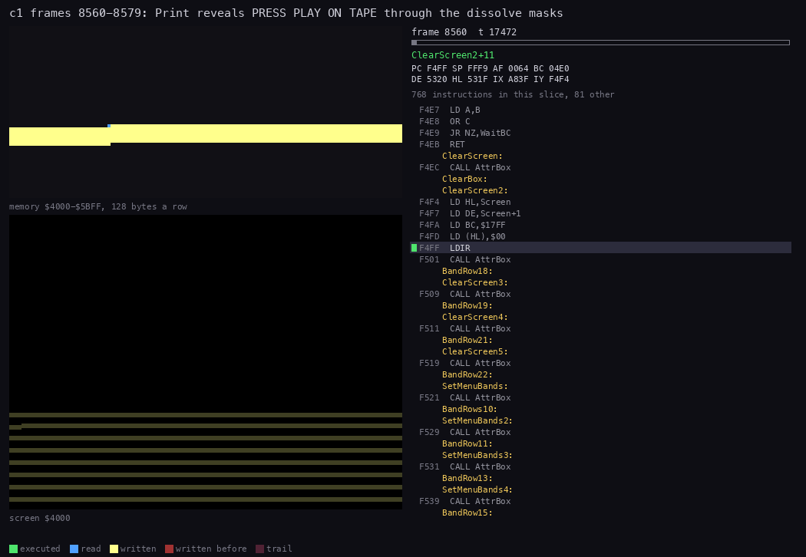

*`c1` frames 8560-8579 (80 pictures, 17 472 T each). Top: memory `$4000-$5BFF`, 128 bytes a row: TextBuffer read in
blue, the screen written in yellow. Bottom: the screen, the bytes written in the slice outlined. Right: the code at the
PC. Made with `python3 ../../kit/routine_anim.py --work work/docs/myA/c1 --window 8560:0-8580:0 --listing
build/resident.lst --view screen --pc F356-F52F --range 4000-5BFF --pictures 80 --title 'c1 frames 8560-8579: Print
reveals PRESS PLAY ON TAPE through the dissolve masks' --out docs/img/routines/RevealText.gif`.*

How to read it: the first pictures are TextToBuffer filling `$5B00` (the bottom row of the memory map). Then every
second frame one sweep writes the 7 screen rows, 224 bytes. The letters thicken a bit at a time.

Each step costs 43 269 T in `c1`, 193 T a byte, the same for all 8. The sweep runs in the second frame of the step,
from T 5375 to T 48 644; the first frame is spent in HALT. The reveal takes 16 frames, TextToBuffer most of one more.

Witness: RevealText ran 54 times in the L1 recordings, CycleColours 7883 times.

**The point**: the dissolve has no random number generator and no table of positions. Four sets of growing masks, and
the first 224 bytes of the ROM to choose among them, make the text appear grain by grain.

## 8.5 The front's PrintText

The front carries its own copy of the routine. PrintText `$9D72` reads a font number first, then the column byte, the
shift and the line, then the text. AdvanceColumn `$9E24` is Advance again, instruction for instruction (with JP for
JR). RevealStrip `$9E4D` is RevealText again, with three changes.

| | Resident: Print, RevealText | Front: PrintText, RevealStrip |
| --- | --- | --- |
| parameters | column byte, bit, row | font, column byte, shift, line |
| fonts | PrintFont | FontSmall (font 0) or FontLarge (any other) |
| a byte under `A` that is no digit | the subtraction wraps; no text has one | byte - `$15`: `-` shows as Y, `.` as Z, `/` as a space |
| the strip revealed | 32 bytes, columns 0-31 | 18 bytes, columns 7-24 |
| during the two frames | CycleColours: the text box's colour | ShimmerFrame, PaintBoxColours: the logo's shimmer and the box |
| one step | 43 269 T, 224 bytes | 24 803 T, 126 bytes |

The narrower strip keeps the rest of the screen untouched: the logo's box lies around columns 7-24. Every front text
fits inside it. The widest, PRESS SPACE TO SELECT, runs from pixel 66 to 192; the strip is pixels 56-199.

ClearTextLine `$9D65` prints a single space on a line. TextBuffer is cleared and holds no glyph, so the 16 frames
dissolve the line to paper. The resident does the same with its "clear line" texts.

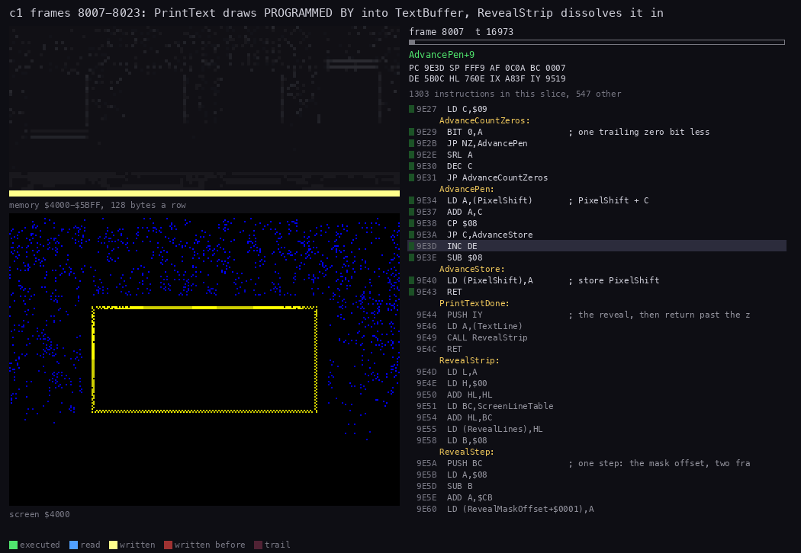

*`c1` frames 8007-8023 (70 pictures, 16 973 T each): PrintText draws PROGRAMMED BY in FontSmall, RevealStrip
dissolves it into the credits' box; the logo's shimmer goes on around it. Made with `python3 ../../kit/routine_anim.py
--work work/docs/myA/c1 --window 8007:0-8024:0 --listing build/front.lst --listing build/resident.lst --view screen --pc
9D72-9EC0 --range 4000-5BFF --pictures 70 --title 'c1 frames 8007-8023: PrintText draws PROGRAMMED BY into TextBuffer,
RevealStrip dissolves it in' --out docs/img/routines/RevealStrip.gif`.*

Witness: PrintText ran 146 times in the L1 recordings, AdvanceColumn 920 times, RevealStrip 146 times. In `c1` the
front prints 14 lines between frames 8007 and 8539.

**The point**: the front's copy changes only what the front needs, a second font and a narrower strip. The rest is
the resident's code, typed in again.

## 8.6 Every string

Each table gives the start pixel (8 x the column byte + the bit) and the line's width from the masks. A line's middle
is the start plus half the width.

The resident's strings ([src/res/resident](../src/res/resident/README.md)):

| Text | Column, bit, row | Start, width | Printed by | When |
| --- | --- | --- | --- | --- |
| PRESS PLAY ON TAPE | 8, 2, 52 | 66, 128 | PlayStage | before a stage block's load |
| a space | 8, 2, 52 | | PlayStage | clears that line again |
| STOP THE TAPE | 10, 3, 52 | 83, 91 | LoadStage | after the block loaded |
| a space | 0, 0, 36 | | LoadStage | clears row 36 |
| REWIND THE TAPE | 9, 3, 36 | 75, 107 | RestartFromStageOne | game over, RESTART FROM STAGE ONE |
| AND THEN PRESS PLAY | 7, 5, 52 | 61, 136 | RestartFromStageOne | the same |
| GAME OVER | 12, 0, 40 | 96, 67 | GameOver | the game-over screen |
| PRESS SPACE TO SELECT | 7, 0, 52 | 56, 146 | GameOver | the same |
| RESTART THIS STAGE | 8, 5, 84 | 69, 126 | PrintGameOverMenu | the same |
| RESTART FROM STAGE ONE | 6, 3, 100 | 51, 161 | PrintGameOverMenu | the same |
| GAME CREDITS 2       SCORE 000000 | 1, 6, 148 | 14, 232 | PrintGameOverMenu | the same, the 2 and the score patched |

The last line is also data. GameOver writes the credits left, as a digit, into CreditsDigit, and copies the stage's six
score digits into the string's ScoreDigits. The text is the variable: the tape holds `2` and `000000`.

The stage titles, two lines a stage, from StageTable ([stages.txt](../src/res/resident/stages.txt)), printed with
PrintRecord while the block loads:

| Stage | Line 1 (row 100) | Start | Line 2 (row 116) | Start |
| ---: | --- | ---: | --- | ---: |
| 1 | STAGE ONE | 97 | THE ROAD TO HELL | 72 |
| 2 | STAGE TWO | 98 | GREECE FOUR HUNDRED BC | 51 |
| 3 | STAGE THREE | 96 | SCANDINAVIA FIVE HUNDRED AD | 37 |
| 4 | STAGE FOUR | 98 | EGYPT THREE THOUSAND BC | 48 |
| 5 | STAGE FIVE | 99 | DUEL WITH DAMERON | 70 |

The front's strings ([src/res/front-texts](../src/res/front-texts/README.md)). S is FontSmall, L FontLarge:

| Screen | Text | Font | Line | Start |
| --- | --- | --- | ---: | ---: |
| credits 1 | PROGRAMMED BY / NEIL DODWELL | S / L | 84 / 100 | 88 / 90 |
| credits 2 | GRAPHICS BY / CONCEPT ANIMATIONS | S / L | 84 / 100 | 95 / 64 |
| credits 3 | PRODUCED BY / SYSTEM THREE | S / L | 84 / 100 | 95 / 88 |
| credits 4 | ORIGINAL GAME DESIGN / MARK CALE | S / L | 84 / 100 | 69 / 96 |
| credits 5 | SOUND EFFECTS BY / NEIL DODWELL | S / L | 84 / 100 | 80 / 90 |
| credits 6 | DEVELOPED / IN ASSOCIATION WITH / MARJACQ MICRO | S / S / L | 68 / 84 / 116 | 101 / 71 / 81 |
| credits 7 | COPYRIGHT 1989 / SYSTEM 3 SOFTWARE / PRESS SPACE TO START | S / S / S | 68 / 84 / 116 | 86 / 74 / 67 |
| menu | PRESS SPACE TO SELECT | S | 68 | 66 |
| menu | START GAME / DEFINE KEYS / SELECT JOYSTICK | L | 84 / 100 / 116 | 93 / 92 / 79 |
| joystick | KEMPSTON / CURSOR KEYS / SINCLAIR / LEAVE THIS MENU | L | 68 / 84 / 100 / 116 | 98 / 89 / 102 / 78 |
| define keys | PRESS THE KEY FOR | S | 84 | 77 |
| define keys | UP, DOWN, LEFT, RIGHT or FIRE, then the key | L | 100 | 104 for RIGHT |

The four text lines of the front's box are pixel lines 68, 84, 100 and 116. The define-keys line is a 7-byte slot that
DefineKeysLoop fills with the name and then the key ([doc 5](05-controls.md#55-define-keys)). The front also keeps the
texts of an older DEFINE KEYS that no code prints: PRESS KEY FOR, UP, `DOW\N`, LEFT, RIGHT, FIRE.

Stage 5 has two texts of seven lines, drawn by its own DrawTextLine with TextFont
([src/stage5/texts.asm](../src/stage5/texts.asm)):

| Text | Lines |
| --- | --- |
| the intro | HURTLING / ACROSS THE / VOID OF SPACE. / PRAPARE TO / CONFRONT THE / EVIL ANGEL OF / TIME.DAMERON. |
| the ending | WELL DONE. / YOUR TASK / IS COMPLETE. / HISTORY IS / RESTORED AND / DAMERON IS / BANISHED. |

The full stop is `\` in the data, glyph 27. "PRAPARE" is spelled so in the game. These lines all start at byte 0,
bit 0 of a 12-byte page: they are left-aligned in a column at screen columns 16-27, not centred.

**The point**: about sixty strings, each placed by hand to within a few pixels of the middle. The only text that
changes is the game-over line, and it changes by patching its own digits.

## 8.7 The HUD: set up once, then field by field

The HUD is the screen's top six character rows. The stage block brings it as a picture: 48 pixel lines of 32 bytes at
`$7000` and 6 rows of colours at `$7600` ([doc 6](06-rendering.md#612-the-hud)). StageSetUp `$97AC` puts it on the
screen once. After that, each field has its own routine, and nothing redraws the whole HUD.

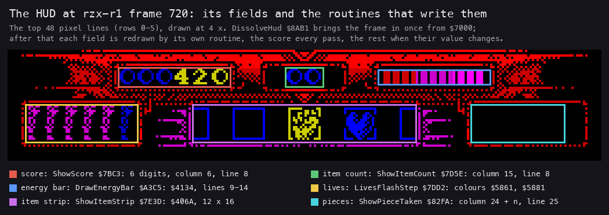

*`rzx-r1` frame 720: the score 000420, the shield taken. Each field outlined with the routine that writes it. Made with
`python3 tools/fig_text.py hud work/docs/myA/r1 720 docs/img/hud/hud-fields.png`.*

| Field | Screen | Routine | When |
| --- | --- | --- | --- |
| the score | row 1, columns 6-11 (lines 8-15) | ShowScore `$7BC3` | every pass |
| the item count | row 1, columns 15-16 | ShowItemCount `$7D5E` | when the items change |
| the energy bar | lines 9-14, columns 20-25 (`$4134`) | DrawEnergyBar `$A3C5` | every pass; draws only on a change |
| the lives | colours of rows 3-4, columns 1-6 (`$5861`, `$5881`) | LivesFlashStep `$7DD2` | 15 passes after a life is lost |
| the item strip | `$406A`: rows 3-4, columns 10-21 | ShowItemStrip `$7E3D` | when the items change, in the item window |
| the teleport icons | column 24 + n, line 25, 2 x 14 bytes | ShowPieceTaken `$82FA` | when an icon is taken |
| GAME OVER | column 12, line 28, 8 x 8 bytes | GameOverStep `$836D` | 48 passes after the last life |

The set-up runs before the first room appears:

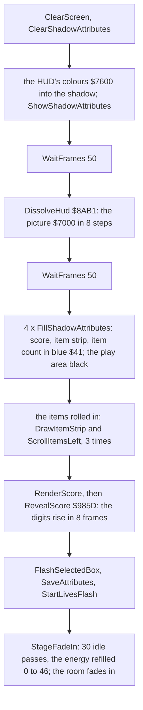

In `rzx-r1` DissolveHud starts at frame 80 and ends at 112. The items roll in from frame 163, RevealScore runs at 235,
StartLivesFlash at 248. The idle passes run every third frame from 265. The energy bar fills from 0 to 46, 2 a pass,
by frame 331.


*`rzx-r1` frames 60-340, every fourth frame: the HUD dissolves in, the items roll in, the score rises, the lives
flash and the energy bar fills. Made with `python3 ../../kit/screen_anim.py --work work/docs/myA/r1 --from 60 --to 340
--step 4 --scale 2 --delay 80 docs/img/play/hud-start.gif`.*

DissolveHud is a third dissolve, unlike the other two. It writes source AND mask, so the bits outside the mask are
cleared, not kept. Its ROM pointer is RandomPointer `$FE0A`; each step clears only its low byte. In `rzx-r1` the 8
steps read the ROM from `$0701`, `$0D01`, `$1301` and so on, 6 pages further each step. So each byte gets a new set
each step, and a pixel can show at one step and go at the next. The HUD fades in by density, not grain by grain.

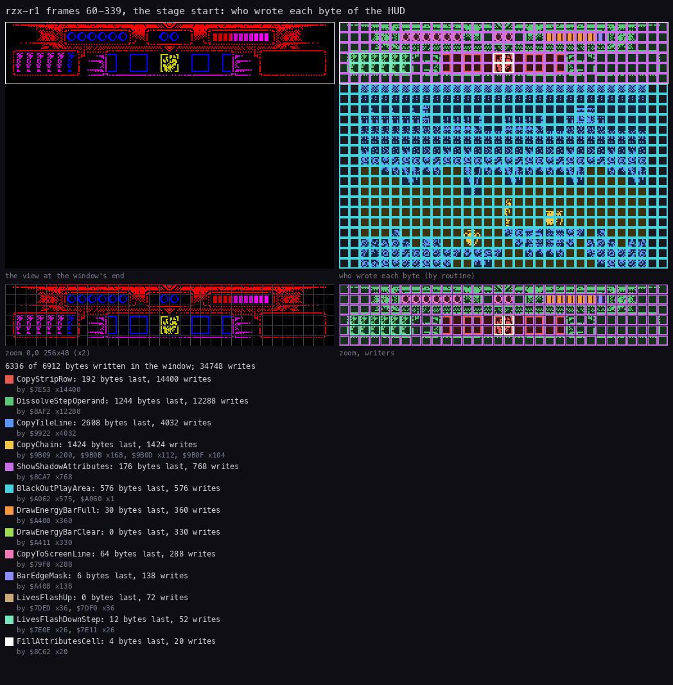

*`rzx-r1` frames 60-339: each byte of the screen coloured by the routine that wrote it last. Top left: the view at the
window's end; bottom: the HUD's 48 lines at 2 x. Made with `python3 ../../kit/writers_map.py --work work/docs/myA/r1
--window 60:0-340:0 --listing build/stage1.lst --listing build/resident.lst --view screen --by routine --zoom
0,0,256,48 --title 'rzx-r1 frames 60-339, the stage start: who wrote each byte of the HUD' --out
docs/img/hud/writers-hud.png`.*

How to read it: the frame of the HUD is DissolveStepOperand's (green), the dissolve's last write. The item strip is
CopyStripRow's, from the roll-in. Over the score box lie CopyToScreenLine's bytes, from RevealScore; over the bar,
DrawEnergyBarFull's and BarEdgeMask's. The play area below is CopyTileLine's: the first room, drawn while its colours
are still black.

Each pass then runs the HUD's part of the main loop ([doc 4](04-game-loop.md#44-the-main-loop)):

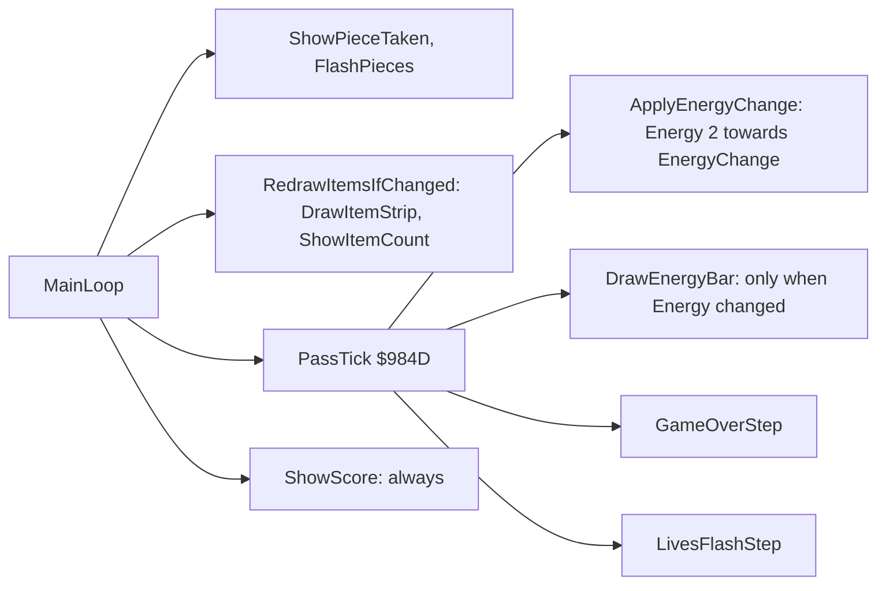

**The point**: the HUD is a picture drawn once and then patched. Every field has a routine that knows its bytes, and
most return at once when nothing changed. The score is the exception ([8.8](#88-the-score)).

## 8.8 The score

The score is six decimal digits in two resident variables. Score `$F9FB` holds the low four, 0-9999, as a binary word.
ScoreHigh `$F9FD` holds the high two, 0-99, as a byte. Being in the resident, the score lives through the stage loads.

AddScore `$7B53` adds BC:

```asm
AddScore:
  LD HL,(Score)
  ADD HL,BC
  LD (Score),HL
  LD BC,$2710             ; 10000
  AND A
  SBC HL,BC
  RET C
  LD (Score),HL           ; 10000 or more: carry into ScoreHigh
  LD A,(ScoreHigh)
  INC A
  LD (ScoreHigh),A
  CP $64
  RET NZ
  XOR A                   ; 100: back to 0
  LD (ScoreHigh),A
  RET
```

Stage 1's six callers, each with its own amount:

| Points | Caller | For |
| ---: | --- | --- |
| 20 | ScoreBurst20 | an urn or a chest broken (StrikeableActor) |
| 25 | FragmentTouch | a fragment picked up (it also adds 6 to EnergyChange) |
| 64 | ScoreBurst64 | a statue head broken (StatueActor) |
| 160 | ScoreBurst160 | a hanging body cut down (HangingActor) |
| 400 | ItemHandlerTaken | an item picked up |
| 1200 | PieceTaken | a teleport icon picked up |

In `rzx-r1`, read every 2 frames, the score goes 0, 20 (frame 662), 420 (712), 440, 840, 860, 1260, 1280, 1305
(2012), 1355 (2030), 1805 (2512), 2205 (2556), 2269 (2702). The steps are 20, 400, 25 and 64. The jumps of 50 at 2030
and 450 at 2512 are more than one AddScore between two samples.

ShowScore `$7BC3` draws the score every pass, changed or not:

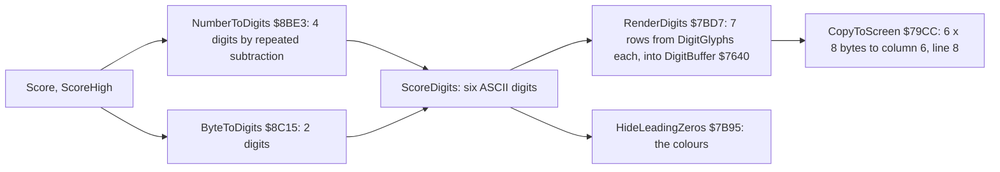

HideLeadingZeros colours the digits:

```asm
HideLeadingZeros:
  LD IX,ScoreDigitsHigh
  LD HL,ShadowAttributes
  LD DE,ShadowAttributes+$0001
  LD BC,$0005
  LD (HL),$06             ; six yellow-on-black attributes
  LDIR
  LD HL,ShadowAttributes
HideLeadingZerosNext:
  LD A,(IX+$00)
  CP $30
  JR NZ,HideLeadingZerosCopy
  INC IX
  LD (HL),$01             ; a leading '0': blue on black
  INC HL
  JR HideLeadingZerosNext
HideLeadingZerosCopy:
  LD HL,ShadowAttributes
  LD DE,Attributes+38     ; $5826: row 1, column 6
  LD BC,$0006
  LDIR
  RET
```

The six attributes are built in the first six bytes of ShadowAttributes `$6D00` and copied to the screen from there.
A score of 0 makes all six blue: the loop stops on the 0 that ends ScoreDigits.

**Worked example 3: 420 drawn.** At `rzx-r1` frame 712 Score is `$01A4` = 420 and ScoreHigh is 0.

1. NumberToDigits with B = 4 starts at the second entry of DecimalTable, 1000. 420 - 1000 borrows at once: `0`.
   420 - 100 four times leaves 20: `4`. 20 - 10 twice leaves 0: `2`. 0 - 1 borrows: `0`. So `0420`.
2. ByteToDigits with A = 0 writes `00`. ScoreDigits holds `000420`.
3. RenderDigits draws each digit from DigitGlyphs + 8 x the digit: the 4 from `$F979`, the 2 from `$F969`. Each takes
   one byte column of DigitBuffer, with a stride of 6 a line.
4. CopyToScreen puts the 6 x 8 bytes at column 6, line 8: screen `$4026`, then `$4126` and on, one line a step.
5. HideLeadingZeros: `0`, `0`, `0` give `$01` three times; the `4` stops it. Row 1, columns 6-11 get
   `01 01 01 06 06 06`. The zeros are dark blue, 420 yellow, as in [the HUD figure](img/hud/hud-fields.png).

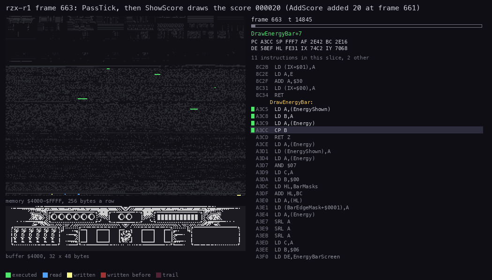

*`rzx-r1` frame 663 (60 pictures, 145 T each): PassTick, then ShowScore draws the score for the first time after
AddScore added 20 (frame 661). The view is the screen's top 48 lines laid out as on the screen. Made with
`python3 ../../kit/routine_anim.py --work work/docs/myA/r1 --window 663:14700-663:23400 --listing build/stage1.lst
--listing build/resident.lst --view buffer:4000:32x48:screen --pc
7B53-7C40,79CC-79FB,8BE3-8C40,984D-9860,7E9F-7EC5,A3C5-A420,836D-83C0,7DD2-7E20 --range 4000-FFFF --pictures 60 --title
'rzx-r1 frame 663: PassTick, then ShowScore draws the score 000020 (AddScore added 20 at frame 661)' --out
docs/img/routines/ShowScore.gif`.*

How to read it: PassTick's four calls take the first pictures and return early. Then the digits are computed and drawn
into DigitBuffer (`$7640`, in the memory map's row `$76`), and CopyToScreen copies them line by line into the score
box.

The cost, measured at `rzx-r1` frame 663:

| Part | T-states |
| --- | ---: |
| PassTick with nothing to do (energy, bar, game over, lives) | 220 |
| NumberToDigits and ByteToDigits, with RenderScore's set-up | 1 151 |
| RenderDigits: 6 digits | 3 422 |
| CopyToScreen: 6 x 8 bytes | 3 341 |
| HideLeadingZeros | 1 001 |
| ShowScore in all | 8 915 |

ShowScore takes 12.8 % of a 69 888 T frame, every pass, to draw the same digits again. The score changed 12 times in
the first 2700 frames of `rzx-r1`.

Witness: ShowScore and HideLeadingZeros ran 10 186 times in the L1 recordings, RenderScore 10 188 times, once a pass.
AddScore ran at `rzx-r1` frame 661, T 10 004.

**The point**: the score is cheap to keep (one ADD and one compare) and dear to show. A flag set by AddScore would
save almost 9 000 T a pass; the game redraws it anyway.

## 8.9 Energy, lives, items, icons and GAME OVER

### The energy bar

Energy `$FE3F` runs from 0 to 46. Damage and refills do not change it at once: they go into EnergyChange `$FE4E`, and
ApplyEnergyChange `$7E9F` moves the energy 2 a pass towards it. A value of `$80` and up is a drain, under `$80` a
refill. DamageHero `$870C` subtracts its damage from EnergyChange; a fragment adds 6; a life lost sets it to 46.

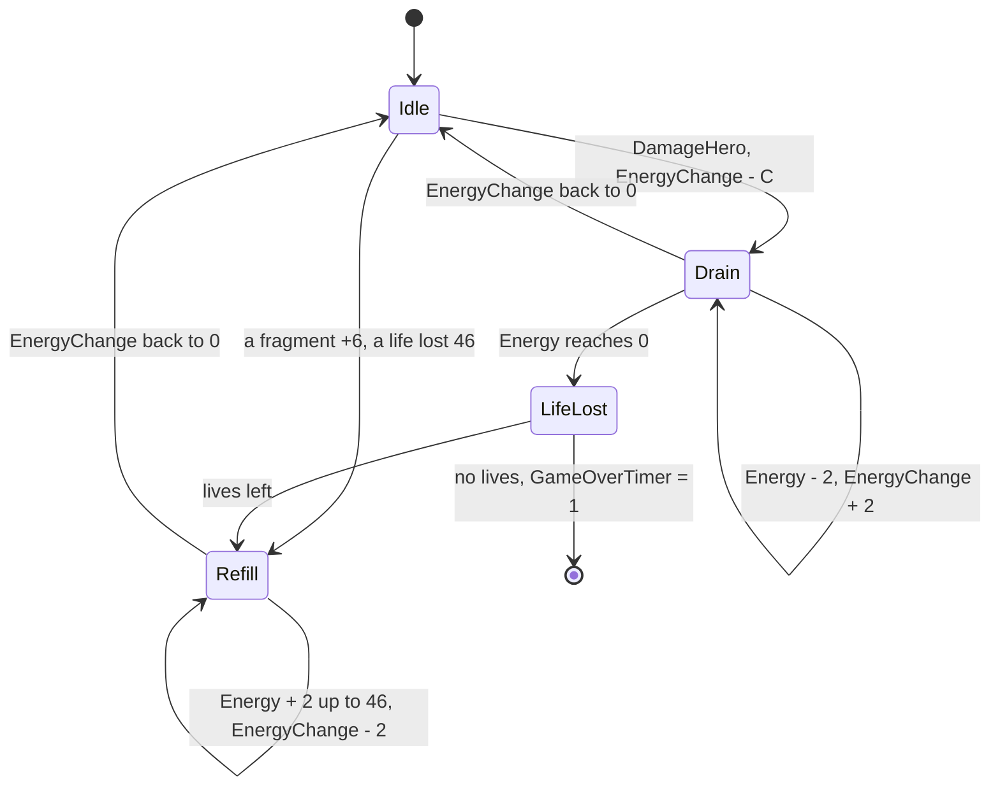

DrawEnergyBar `$A3C5` returns at once when Energy equals EnergyShown `$FE4D`. Otherwise it draws the bar:

```asm
  LD A,(Energy)
  AND $07
  LD C,A
  LD B,$00
  LD HL,BarMasks
  ADD HL,BC
  LD A,(HL)
  LD (BarEdgeMask+$0001),A ; the mask of the last byte, patched in
  LD A,(Energy)
  SRL A
  SRL A
  SRL A
  LD C,A                  ; Energy / 8 full bytes
  LD B,$06                ; 6 pixel lines
  LD DE,EnergyBarScreen   ; $4134
  LD HL,EnergyBarPattern  ; $E43D: 3B BB BB BB BB B8
DrawEnergyBarLine:
  ...                     ; C bytes of the pattern
DrawEnergyBarEdge:
  LD A,(HL)
BarEdgeMask:
  AND $00                 ; AND n: n = BarMasks[Energy & 7]
  LD (DE),A
  INC DE
  LD A,$05
  SUB C
  JR Z,DrawEnergyBarNext
  ...                     ; 5 - C bytes of 0
DrawEnergyBarNext:
  ...                     ; the same pattern on the next line: INC D
  DJNZ DrawEnergyBarLine
  RET
```

BarMasks is `00 80 C0 E0 F0 F8 FC FE`: the left 0-7 pixels. So the bar is one pixel per unit of energy, and always 6
bytes: C full, 1 edge, 5 - C empty.

**Worked example 4: Energy 20.** 20 / 8 = 2 full bytes, 20 AND 7 = 4, so the edge mask is `$F0`.

| Byte | 0 | 1 | 2 | 3 | 4 | 5 |
| --- | --- | --- | --- | --- | --- | --- |
| the pattern | `$3B` | `$BB` | `$BB` | `$BB` | `$BB` | `$B8` |
| drawn | `$3B` | `$BB` | `$BB` AND `$F0` = `$B0` | `$00` | `$00` | `$00` |

The bar reaches pixel 2 x 8 + 4 = 20 of the 6 bytes. At 46, the full energy, it is 5 full bytes and `$B8` AND `$FC`
= `$B8`: the whole pattern. The pattern's first two pixels are blank, so the bar's segments start at its third pixel.

In `rzx-r1` the refill at the stage's start draws the bar 23 times, about 2 000 T each (frames 265-331). When nothing
changed, the call costs 45 T a pass.

### The lives

The six boxes of rows 3-4, columns 1-6 are the lives. Their pixels never change; LivesFlashStep `$7DD2` changes their
colours. StartLivesFlash sets LivesFlash `$FE59` to 0; it is idle at `$10`. Steps 1-7 raise each box's ink by 1 up to
white. Steps 8-15 lower it again, to magenta (3) for box n while Lives is n or more, to blue (1) for a life gone.

LoseLife `$7ECE` takes a life, plays effect 7 and starts the flash. With lives left it sets Energy to 0 and
EnergyChange to 46: the bar refills over the next 23 passes. In `deaths` the life goes at frame 2775, Lives from 5 to 4.

### The item strip and the count

RedrawItemsIfChanged `$7D26` runs every pass and returns unless ItemsChanged `$FE4A` is 1. AddItem sets it. Then
DrawItemStrip draws 8 icons into the play buffer at `$5B64` and ShowItemStrip copies a 12-byte window to `$406A`.
ShowItemCount draws the selected item's count, two digits from CarriedCounts, at column 15, through RenderDigits with a
stride of 2. A count of 0 is hidden: both attributes `$41`, blue on black.

In `rzx-r1` the shield is taken at frame 712: ItemLast goes from 6 to 7, CarriedCounts gets 20 for the shield. The
strip is redrawn at 713 and the count at 714 (ShowItemCount `$7D5E` at 714, T 11 852). The item window of
[doc 5](05-controls.md#58-the-item-window) uses the same routines every 6 frames.

### The teleport icons

When a piece of the teleport is taken, PieceTaken adds 1200 points and sets PieceTakenFlag. On the next pass
ShowPieceTaken `$82FA` counts it in PiecesTaken, copies a 2 x 14-byte picture to column 24 + PiecesTaken, line 25,
plays effect 12 and sets PieceFlash to 45. FlashPieces then cycles the icons' colours for 45 passes. With all five
taken it never stops.

The pictures are 2 bytes wide and step one column: each picture overlaps the one before by a byte. The first piece
uses its own picture (`$E06C`); the others share `$E088`.

### GAME OVER in the HUD

LoseLife with no lives left sets GameOverTimer `$FE5B` to 1. GameOverStep counts it up one a pass. At `$31`, 48
passes later, it clears the item strip and copies the 8 x 8-byte GAME OVER picture at `$CE92` to column 12, line 28.
From then on it cycles the picture's colour every pass. This is a picture, not text: it does not use the font.
`s1-right` shows it at frame 4000 ([the screen](img/play/hud-game-over.png)).

**The point**: each field is a few bytes with its own routine. The energy bar is one pixel a unit, the lives are
colours only, and the teleport icons are pictures that overlap.

## 8.10 The other stages

Stages 2-4 carry their own `hud.asm` with the same routines: AddScore, ShowScore, RenderDigits, the lives, the energy
bar, the icons, GAME OVER and DissolveHud. They differ in addresses only. Stage 5 has no teleport icons and no stage
exit; its HUD has the score, the energy and the lives.

Stage 5 also prints its two texts, the only text inside a stage. DrawIntroText and DrawEndingText draw them once at the
stage's start, seven lines each, into 256-byte pages of the play buffer (`$5B00-$61FF` and `$6200-$68FF`).
DrawTextLine is TextToBuffer once more, with TextFont and 12-byte lines. ShowTexts `$8C87` copies a set to screen rows
8-20, columns 16-27, while the duel timer runs, and the rows' colours flash ([doc 10](10-gameplay-logic.md)). In
`s5-right` the intro stays on screen for 255 passes.

**The point**: the HUD is not shared. Each stage block brings its own copy of the code with its own picture, and only
the score's two variables live in the resident.

## 8.11 Known only from the code

- **The pen at bit 8.** Advance adds up to 9 to a bit of up to 7 and subtracts 8 once. After an M or a W at bit 7 the
  pen is at bit 8, and the next glyph is shifted a whole byte through its pair: it lands right. This happens three
  times: GAME OVER, START GAME and LEAVE THIS MENU, each after the M. A second advance of 9 from bit 8 would leave
  bit 9; the glyph after it would lose its right pixels out of the 16-bit pair. No string reaches bit 9.
- **The large font has no digits.** PrintText with FontLarge and a digit would read past the 27 glyphs into
  PixelShift and the other variables at `$A0D2`. No large text has a digit.
- **The resident's odd characters.** TextToBuffer treats any byte not a digit or a space as a letter. A byte under
  `A` would wrap the subtraction and read before PrintFont. No resident text has one.
- **Two mask sets unused.** DissolveMasks holds 6 sets of 8, 48 bytes. AND `$18` picks only sets 0-3, so the 16 bytes
  at `$F9EB-$F9FA` are read by none of the three dissolves.
- **CopyToScreen in the resident.** `$F646` copies B rows of D bytes to the screen through ScreenLineTable. No code
  calls it; each stage has its own CopyToScreen `$79CC`.
- **RomFontLeftover.** The 124 bytes at `$FF84` are a copy of the ROM font at `$3E34-$3EAF`, a leftover of the
  mastering. No code reads them, and the stack writes over their end in play.
- **The high score digits.** ByteToDigits has a branch for ScoreHigh above 0 (10 000 points or more). In the stage-1
  recordings only the 0 branch ran, and AddScore's wrap from 99 to 0 (a million points) never did.
- **The old DEFINE KEYS.** OldDefineKeysTexts `$A124` in the front holds PRESS KEY FOR and the five key names, with
  `DOW\N` for DOWN. No code prints them.
