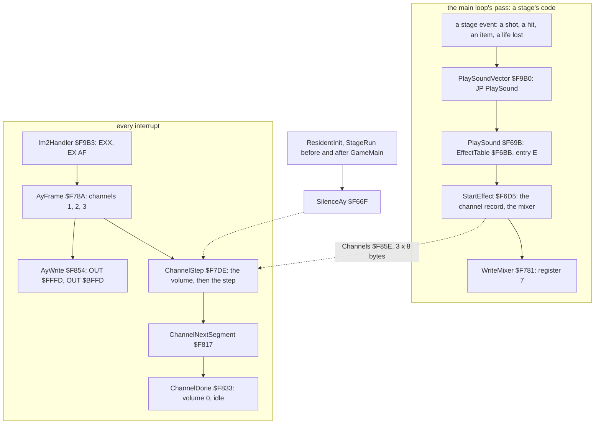
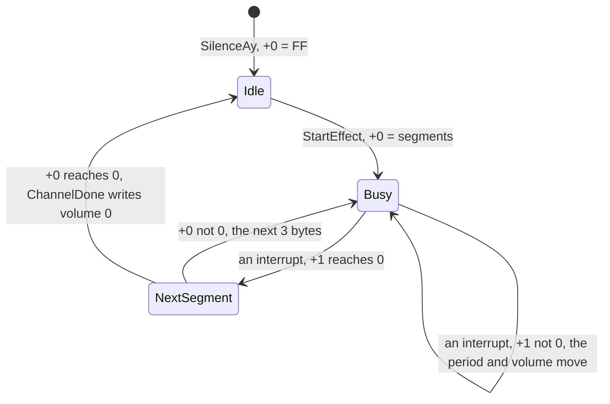
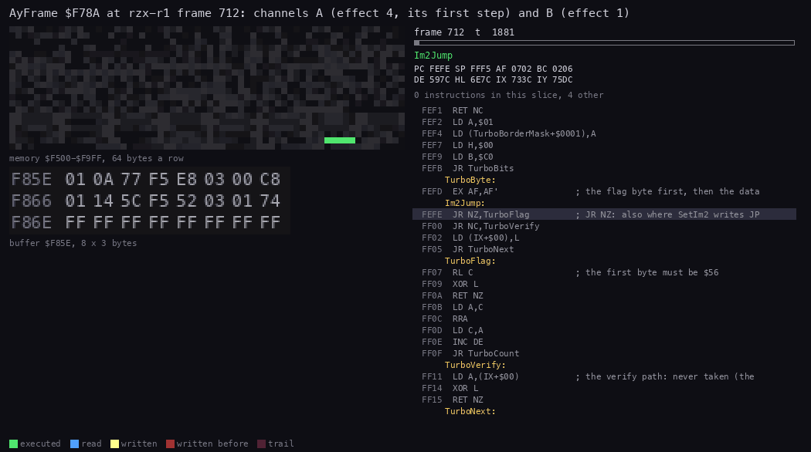
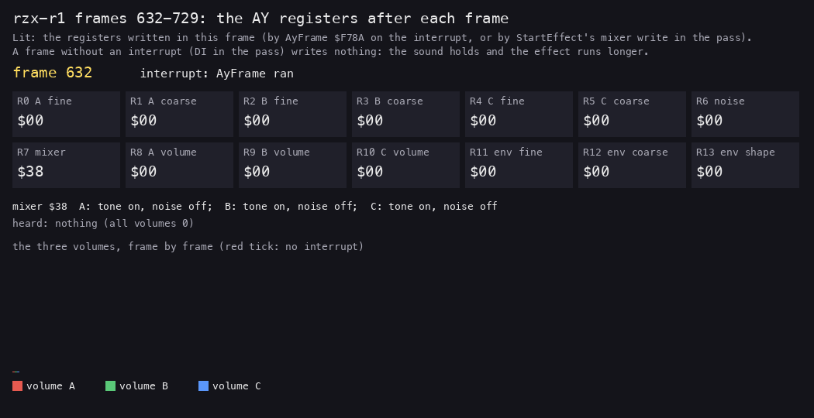
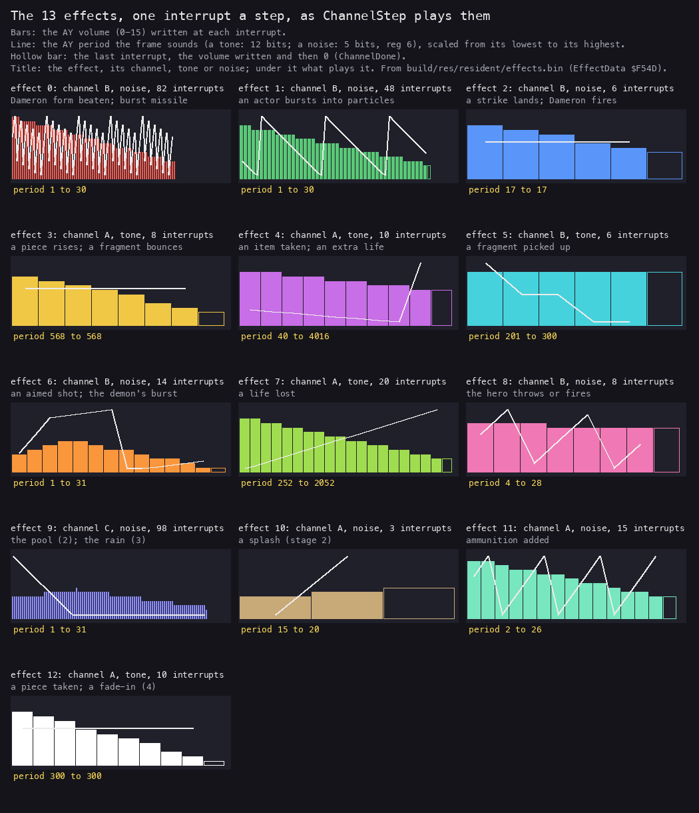

# 9. Sound

What this covers:

- the one sound engine of the game: thirteen AY effects, no music, no beeper;
- the effect format, byte by byte, and the channel record it fills;
- PlaySound and StartEffect: an effect put into its channel, and the mixer;
- AyFrame and ChannelStep: one step a channel at every interrupt, and the order of the writes;
- effect 2 worked by hand against the port writes of a recording;
- effect 4 and its period that wraps round on the last step;
- the lost interrupts, which stretch every effect;
- the thirteen effects: their shapes, their pitches, who plays them, and a render of each (WAV, MP3 for the three over a second);
- the 48K against the 128K;
- the cost, and what is known only from the code.

The recordings it rests on ([WALKTHROUGH 6.0](../WALKTHROUGH.md#60-the-recordings)):

| Recording | Load | Used for |
| --- | --- | --- |
| `rzx-r1` | stage 1 of the RZX run, 128K, the Sinclair joystick | an urn struck (effect 2, frames 637-646), a burst (effect 1 from 661), the shield taken (effect 4, 711-727), every AY write of frames 630-730 |
| `c1` | a 48K from power-on, the original tape | a life lost at frame 15886: effect 7 on a machine without an AY |

All the code of this document is the resident's `src/resident/ay.asm`, at the same addresses for the whole game. The
effects are `build/res/resident/effects.bin`, 138 bytes at `$F54D-$F5D6`.

## 9.1 One driver, thirteen effects

The game has no tune. Its sound is thirteen short effects, played on the AY of the 128K. A stage asks for an effect
with one call: `CALL PlaySoundVector`, E the effect number. The interrupt handler then plays the effect, one step a
frame.



The two halves share only the channel records at `$F85E`. The pass writes a record; the interrupt reads it and steps
it. A channel holds one effect at a time. A new effect on a busy channel replaces the old one at once.

The handler does nothing else:

```asm
Im2Handler:
  EXX
  EX AF,AF'
  CALL AyFrame
  EX AF,AF'
  EXX
  EI
  RETI
```

It swaps to the other register set and calls AyFrame. AyFrame keeps IX and IY on the stack itself.

There are 71 calls of PlaySoundVector in the five stages (15, 19, 13, 15 and 9). The resident and the front call none.
SilenceAy is called three times: once by ResidentInit, and by StageRun before and after each stage's GameMain. So no
effect runs on from one stage into the next.

**The point**: the sound is a background job of the interrupt. A stage only names an effect; it never waits for one.

## 9.2 The effect format

An effect is six bytes of header, then three bytes a segment.

| Byte | Field | Effect 4 (an item taken) |
| --- | --- | --- |
| +0 | the channel, 1-3 (A, B, C) | `01`: channel A |
| +1 | the noise flag: 0 a tone, 1 noise | `00`: a tone |
| +2 | the segment count | `01` |
| +3 | the start volume, times 16 | `C8`: 200, volume 12 |
| +4, +5 | the start period, low byte first | `E8 03`: 1000 |
| +6 | segment 1: its duration in interrupts | `0A`: 10 |
| +7 | segment 1: the period change a step, signed | `88`: -120 |
| +8 | segment 1: the volume change a step, signed, times 16 | `F8`: -8 |

The volume is kept times 16. A change of -8 lowers the AY volume by one every two steps. So the effects fade smoothly
with only 16 levels of output.

For a noise effect the period is the noise period. AyFrame writes only its low byte, to register 6. The AY reads only
5 bits of it.

EffectTable `$F6BB` holds the thirteen addresses. Effect 0 starts at `$F54D`, effect 12 at `$F5CE`.

**The point**: an effect is a start and a list of slopes. Nine bytes describe a one-segment effect of any length.

## 9.3 PlaySound and StartEffect

PlaySound keeps every register. A stage may call it from the middle of any routine.

```asm
PlaySound:
  PUSH IY
  PUSH IX
  PUSH BC
  PUSH HL
  PUSH DE
  PUSH AF
  SLA E
  LD HL,EffectTable
  ADD HL,DE
  LD C,(HL)
  INC HL
  LD B,(HL)
  PUSH BC
  POP IY
  CALL StartEffect
  ...                     ; the six registers back, RET
```

`ADD HL,DE` adds D as well. Every caller loads the number with `LD DE,n`, so D is 0.

StartEffect copies the header into the channel's record:

| Record byte | Meaning | From |
| --- | --- | --- |
| +0 | segments left; `$FF` idle | effect +2 |
| +1 | interrupts left in the segment | effect +6 |
| +2, +3 | the segment's address | the effect's address + 6 |
| +4, +5 | the period | effect +4, +5 |
| +6 | the noise flag | effect +1 |
| +7 | the volume times 16 | effect +3 |

Then it sets the channel's two bits in the mixer, register 7. In the mixer a set bit turns a source off.

```asm
StartEffectNoise:
  LD A,(Mixer)
  LD B,A
  LD A,(IY+$00)
  CP $01
  JR NZ,StartEffectNoise2
  RES 3,B
  SET 0,B
  JR StartEffectNoiseMixer
```

| Effect kind | Channel A | Channel B | Channel C |
| --- | --- | --- | --- |
| a tone | SET 3, RES 0 | SET 4, RES 1 | SET 5, RES 2 |
| noise | RES 3, SET 0 | RES 4, SET 1 | RES 5, SET 2 |

A tone effect turns its tone on and its noise off. A noise effect does the opposite. The mixer keeps the last effect's
choice for each channel after the effect ends; the volume of 0 makes the channel silent.

SilenceAy sets the mixer to `$38`: tones on, noise off, on all three channels. In stage 1, effect 4 (a tone on A) and
effects 1 and 2 (noise on B) give `$2A`. That is the value `rzx-r1` writes at frames 637, 661 and 711.



A StartEffect on a busy channel goes back to Busy with the new effect's bytes; the old effect is dropped.

**The point**: one record a channel and two mixer bits. The pass only fills the record; the interrupt does the rest.

## 9.4 AyFrame and ChannelStep

AyFrame walks the three records. For each busy channel it calls ChannelStep, then writes the period.

```asm
AyFrameChannel:
  PUSH BC
  PUSH DE
  CALL ChannelStep
  POP DE
  PUSH DE
  LD A,(IX+$00)
  CP $FF
  JR Z,AyFrameNext
  LD A,(IX+$06)
  CP $00
  JR NZ,AyFrameNoise
  LD E,(IX+$04)
  CALL AyWrite
  INC D
  LD E,(IX+$05)
  CALL AyWrite
  JR AyFrameNext
AyFrameNoise:
  LD E,(IX+$04)
  LD D,$06
  CALL AyWrite
```

D starts at 0 and grows by 2 a channel. Registers 0/1, 2/3 and 4/5 are the three tone periods.

ChannelStep does the step:

```asm
ChannelStep:
  LD A,(IX+$00)
  CP $FF
  RET Z
  CALL WriteVolume
  CALL AyWrite
  LD L,(IX+$02)
  LD H,(IX+$03)
  PUSH HL
  POP IY
  DEC (IX+$01)
  JR Z,ChannelNextSegment
  LD E,(IY+$01)
  LD C,E
  RL E
  SBC A,A
  LD B,A
  LD L,(IX+$04)
  LD H,(IX+$05)
  ADD HL,BC
  LD (IX+$04),L
  LD (IX+$05),H
  LD A,(IX+$07)
  ADD A,(IY+$02)
  LD (IX+$07),A
  RET
```

`RL E` and `SBC A,A` turn the sign bit of the period change into `$00` or `$FF`. So BC is the change, sign-extended to
16 bits.

The same in pseudocode:

```text
AyFrame():
    for ch in 1..3:
        rec = Channels[ch]
        ChannelStep(rec, ch)
        if rec.segments != FF:
            if rec.noise == 0: write(2*ch-2, low(rec.period)); write(2*ch-1, high(rec.period))
            else:              write(6, low(rec.period))

ChannelStep(rec, ch):
    if rec.segments == FF: return
    write(7+ch, rec.volume >> 4)          # WriteVolume falls into AyWrite...
    write(7+ch, rec.volume >> 4)          # ...and CALL AyWrite writes it again
    rec.frames -= 1
    if rec.frames == 0:
        rec.segments -= 1
        if rec.segments == 0: write(7+ch, 0); rec.segments = FF; return
        rec.segment += 3; rec.frames = segment.duration
        ChannelStep(rec, ch)              # JR ChannelStep: the volume again, the new count down at once
        return
    rec.period += sign_extend(segment.period_change)
    rec.volume += segment.volume_change
```

Three rules follow from the code:

- The volume is written before the step, the period after it. The first period heard is the start period already
  moved once. The volume heard is one step behind the period.
- A segment of N interrupts moves the period N - 1 times. Its last interrupt loads the next segment, whose count goes
  down at once.
- A segment of one interrupt moves nothing. Effect 10's second segment, `01 01 01`, only ends the effect.



*AyFrame `$F78A` at `rzx-r1` frame 712, T 1850-4300: the interrupt right after the shield is taken. Channel A holds
effect 4 at its first step, channel B effect 1. Under the memory map are the three records at `$F85E` in hex. A's
period turns from `E8 03` into `70 03` and its volume byte from `C8` into `C0`; B's frame count goes down. Channel C
stays `FF`. 79 pictures, 31 T each. Made with `python3 ../../kit/routine_anim.py --work work/docs/myA/r1 --window
712:1850-712:4300 --listing build/resident.lst --view buffer:F85E:8x3:hex --range F500-F9FF --row-bytes 64 --pc
F66F-F878 --pictures 80 --delay 90 --out docs/img/routines/AyFrame.gif`.*

Witness: in the L1 recordings AyFrame ran 125 689 times, ChannelStep 377 598 times (three a frame, idle or not),
WriteVolume 24 735 times and AyWrite 79 117 times.

**The point**: a channel is a small state machine stepped by the interrupt. The order of its writes decides what the
first step sounds like.

## 9.5 Worked example: effect 2 by hand

An urn struck in `rzx-r1` plays effect 2 on channel B. Its nine bytes at `$F55F`:

```text
02 01 01 C8 D1 00 06 00 ED
```

Decoded: channel B, noise, one segment, volume 200 (12), period `$00D1`. The segment lasts 6 interrupts. It moves the
period by 0 and the volume by `$ED`, which is -19.

StartEffect runs at frame 637, T 18 808, called from StrikeableActor (`$A7DB`). It writes register 7 = `$2A`. Then
each interrupt does this:

| Interrupt | Frame | Volume before | Written to register 9 | Count after | Volume after | Register 6 |
| ---: | ---: | ---: | --- | ---: | ---: | --- |
| 1 | 638 | 200 | `0C` `0C` | 5 | 181 | `D1` |
| 2 | 639 | 181 | `0B` `0B` | 4 | 162 | `D1` |
| 3 | 640 | 162 | `0A` `0A` | 3 | 143 | `D1` |
| 4 | 642 | 143 | `08` `08` | 2 | 124 | `D1` |
| 5 | 643 | 124 | `07` `07` | 1 | 105 | `D1` |
| 6 | 646 | 105 | `06` `06`, then `00` | 0: done | | none |

Each written volume is the volume shifted right four times: 200 / 16 = 12, 181 / 16 = 11, and so on. At the sixth
interrupt the count reaches 0 with no segment left. ChannelDone writes volume 0 and marks the channel `$FF`, so AyFrame
writes no period.

The port writes of `rzx-r1`, from the trace of frames 630-730 (OUT `$FFFD` the register, OUT `$BFFD` the value):

```text
637 R7=2A
638 R9=0C R9=0C R6=D1
639 R9=0B R9=0B R6=D1
640 R9=0A R9=0A R6=D1
642 R9=08 R9=08 R6=D1
643 R9=07 R9=07 R6=D1
646 R9=06 R9=06 R9=00
```

Every value matches. The noise period `$D1` is 17 in 5 bits. The noise is clocked at 1 773 400 / (16 x 17), about
6 520 Hz.

The bytes ask for 6 interrupts, 0.12 s. Frames 641, 644 and 645 had no interrupt, so the effect took 9 frames, 0.18 s
([9.7](#97-the-lost-interrupts-stretch-every-effect)).

**The point**: the hand computation and the recording agree write for write. The double volume write and the missing
period on the last step are both visible in the port stream.

## 9.6 Worked example: effect 4 and the period that wraps

Effect 4 is the item jingle: `01 00 01 C8 E8 03 0A 88 F8`. Channel A, a tone, period 1000, ten interrupts. The period
moves by -120 and the volume by -8 a step.

The period goes down by 120 nine times. 1000 is never heard; 880 is the first. The pitch of a tone is
1 773 400 / (16 x period).

| Interrupt | Frame | Registers 0, 1 | Period | Pitch | Register 8 |
| ---: | ---: | --- | ---: | ---: | --- |
| 1 | 712 | `70` `03` | 880 | 126 Hz | `0C` |
| 2 | 714 | `F8` `02` | 760 | 146 Hz | `0C` |
| 3 | 715 | `80` `02` | 640 | 173 Hz | `0B` |
| 4 | 718 | `08` `02` | 520 | 213 Hz | `0B` |
| 5 | 719 | `90` `01` | 400 | 277 Hz | `0A` |
| 6 | 720 | `18` `01` | 280 | 396 Hz | `0A` |
| 7 | 722 | `A0` `00` | 160 | 693 Hz | `09` |
| 8 | 723 | `28` `00` | 40 | 2 771 Hz | `09` |
| 9 | 726 | `B0` `FF` | `$FFB0`, read as `$FB0`: 4 016 | 27.6 Hz | `08` |
| 10 | 727 | none | | | `08`, then `00` |

The ninth step computes 40 - 120 = -80, `$FFB0`. The routine never checks the range. The AY keeps only the low 4 bits
of register 1, so the period becomes `$FB0`, 4 016. The rising sweep ends with a growl more than two octaves under its
start, for one frame.

Channel B played effect 1 at the same time. Its writes come in the same frames, after channel A's:

```text
712 R8=0C R8=0C R0=70 R1=03 R9=07 R9=07 R6=70
714 R8=0C R8=0C R0=F8 R1=02 R9=07 R9=07 R6=8E
...
726 R8=08 R8=08 R0=B0 R1=FF R9=05 R9=05 R6=60
727 R8=08 R8=08 R8=00 R9=05 R9=05 R6=7E
```

Effect 1's period grows by 30 a step: `$70`, `$8E`, `$AC`, ... In 5 bits that is 16, 14, 12, ... So the noise saws
up and down every few steps.

**The point**: the sweep relies on the numbers staying in range, and this effect leaves it. The slip is short enough to
pass as part of the sound.

## 9.7 The lost interrupts stretch every effect

ClearBuffer and CopyBuffer run with interrupts off ([doc 4, 4.10](04-game-loop.md#410-the-lost-interrupts)). An
interrupt that falls inside them is lost, and with it one step of every busy channel. Nothing makes the step up later.

In `rzx-r1` frames 630-729 AyFrame ran in 57 frames of 100. Of the 43 frames without it, 39 began inside ClearBuffer
or CopyBuffer with interrupts off. In the other four the trace shows no DI after the last EI, and still no interrupt;
why is not settled here.



*`rzx-r1` frames 632-729, one picture a frame. The 14 AY registers after the frame, those written in it lit. Under
them is what the channels sound like, then the three volumes frame by frame, with a red tick under each frame that had
no interrupt. Effect 2 (frames 637-646), effect 1 (from 661) and effect 4 (711-727) can be followed. 98 pictures.
Made with `python3 tools/fig_sound.py regs work/docs/myA/r1 632 730 docs/img/play/ay-registers.gif` (the trace is
kept in `work/docs/myA/r1/traces/630_0-730_0.uatr`).*

The lengths in `rzx-r1`:

| Effect | Interrupts | Written length | Frames heard |
| --- | ---: | ---: | ---: |
| 2, an urn struck | 6 | 0.12 s | 9 (638-646) |
| 4, the shield taken | 10 | 0.20 s | 16 (712-727) |

Stage 1 takes 61.6 % of its interrupts ([doc 4, 4.10](04-game-loop.md#410-the-lost-interrupts)). So in play every
effect lasts about 1.6 times longer than its bytes say. Its steps are held unevenly, one frame or three.

**The point**: the sound has no clock of its own. It runs at the rate of the interrupts the renderer lets through.

## 9.8 The thirteen effects



*Each effect stepped as ChannelStep steps it, one interrupt a bar. The bar is the AY volume, the line the period from
its lowest to its highest. Made with `python3 tools/fig_sound.py chart docs/img/sound/effects.png`, which reads
`build/res/resident/effects.bin`; `python3 tools/fig_sound.py table` prints the same steps as numbers.*

| Effect | Bytes | Channel, kind | Interrupts | Sound | Played by |
| ---: | --- | --- | ---: | --- | --- |
| 0 | `02 01 01 E6 0A 00 52 0A FE` | B, noise | 82 | noise sawing over 5 bits, volume 14 down to 4 | stage 5: NextDameronForm, BurstMissileStep |
| 1 | `02 01 01 C8 0A 00 30 1E FD` | B, noise | 48 | the same with a faster saw, volume 12 down to 3 | StartBurstSound (stages 1-4), stage 4 ColumnDust |
| 2 | `02 01 01 C8 D1 00 06 00 ED` | B, noise | 6 | a short hiss, period 17 | StrikeableActor (stages 1-4), stage 2 WarriorStatueStrike, stage 4 StrikeableKind9, stage 5 Dameron's fire |
| 3 | `01 00 01 BE 38 02 08 00 ED` | A, tone | 8 | 195 Hz, fading | PieceRisesSound, FragmentBounce (stages 1-4) |
| 4 | `01 00 01 C8 E8 03 0A 88 F8` | A, tone | 10 | 126 Hz rising to 2 771 Hz, then 27.6 Hz | ItemHandlerAdd (stages 1, 3, 4), stage 2 ItemHandler and ExtraLifeTaken |
| 5 | `02 00 05 C8 2C 01 02 00 00 02 CC 00 02 00 00 02 D1 00 02 00 00` | B, tone | 6 | three notes: 369, 447, 551 Hz | FragmentTouchLine (stages 1-4) |
| 6 | `02 01 02 48 00 00 04 09 12 0B 01 F5` | B, noise | 14 | noise that swells to 7, then fades | AimedShot (stages 1-3), stage 1 BossBurst, stage 2 SpiritFiresNext and HydraHeadShot, stage 4 HeadShots and FireKind3Press |
| 7 | `01 00 01 C8 98 00 14 64 F8` | A, tone | 20 | 440 Hz falling to 54 Hz | LoseLife (every stage) |
| 8 | `02 01 01 B4 28 00 08 0A FE` | B, noise | 8 | a hiss, volume 11 to 10 | stage 1 BossShots, ThrowItemPress (stages 1-3), stage 3 FireBoltPress, stage 4 FireKind1Press, stage 5 HeroFireArmed |
| 9 | `03 01 02 50 40 0E 21 FF 01 42 00 FF` | C, noise | 98 | a soft rumble, 2 s | stage 2 PoolActor, stage 3 RainChance |
| 10 | `01 01 02 54 0A 00 03 05 14 01 01 01` | A, noise | 3 | a click that grows | stage 2 DropActorSplash, UpdateFloorShotRun |
| 11 | `01 01 01 DC 0A 00 0F C8 F6` | A, noise | 15 | noise sawing down, volume 13 to 5 | stage 1 FireBoltAdd, ThrowAmmoAdd (stages 1, 3), stage 2 KindTwelveShot and FireHeroMissileAdd, stage 4 HeroThrowMissileAdd |
| 12 | `01 00 01 C8 2C 01 0A 00 EC` | A, tone | 10 | 369 Hz, a fast fade | ShowPieceTaken (stages 1-4), stage 4 FadeInFrame |

The callers come from the stage listings: `LD DE,n` and `CALL PlaySoundVector`. The interrupt counts are those the
bytes ask for. In play each lasts about 1.6 times as many frames.

There are five tones (3, 4, 5, 7 and 12) and eight noises. The channels split by use:

- A carries the hero's gains and losses (3, 4, 7, 12) and two small noises (10, 11);
- B carries the fighting (0, 1, 2, 5, 6, 8);
- C carries only the weather (9).

So a burst and a shot on the same pass cut each other off on channel B.

The renders, 44 100 Hz mono, one interrupt every 20 ms; a WAV up to 1 s, an MP3 (`lame -V 4`) for the three longer
ones (effects 0, 1 and 9):

| | | | | | | |
| --- | --- | --- | --- | --- | --- | --- |
| [effect 0](audio/effect-00.mp3) | [effect 1](audio/effect-01.mp3) | [effect 2](audio/effect-02.wav) | [effect 3](audio/effect-03.wav) | [effect 4](audio/effect-04.wav) | [effect 5](audio/effect-05.wav) | [effect 6](audio/effect-06.wav) |
| [effect 7](audio/effect-07.wav) | [effect 8](audio/effect-08.wav) | [effect 9](audio/effect-09.mp3) | [effect 10](audio/effect-10.wav) | [effect 11](audio/effect-11.wav) | [effect 12](audio/effect-12.wav) | |

They are made with `python3 tools/fig_sound.py wav docs/audio`. The model is an AY clock of 1 773 400 Hz, square
tones, a 17-bit noise generator and the AY's volume curve, with every interrupt taken. So they are the effects as their
bytes write them, without the stretching of [9.7](#97-the-lost-interrupts-stretch-every-effect).

**The point**: thirteen effects of nine to twenty-one bytes, 138 bytes in all. The game's whole sound is smaller than
one of its fonts.

## 9.9 The 48K against the 128K

The tape is one program for both machines. The game does not ask which machine it runs on. It runs the same IM 2
handler and the same AyFrame on both.

On a 48K the ports `$FFFD` and `$BFFD` have no device. Their low bit is 1, so the ULA, which answers the even ports,
ignores them. The writes go nowhere.

`c1` is a 48K. It loses a life at frame 15886, and LoseLife plays effect 7:

| Frame | What `c1` does |
| --- | --- |
| 15886, T 46 984 | PlaySoundVector from LoseLife (`$7EDB`); StartEffect at T 47 159; the first OUT to `$FFFD` at T 47 780, in AyWrite |
| 15887-15900 | channel A's record at `$F85E` counts down: `01 14 A1 F5 98 00 00 C8`, then `01 13 ...`, down to `01 0C A1 F5 B8 03 00 88` |
| 15950 | the record starts with `FF`: the effect is over |

Frames 15886-15890 hold 9 OUTs to `$FFFD`, 9 to `$BFFD` and none to `$FE`. The machine stays silent.

The game has no beeper code. Its OUTs to `$FE` set the border: in the loaders, the stage loads and HangFlashBorder,
the trap that flashes the border forever ([doc 3](03-build-and-load.md)). In the play of `c1` no `OUT ($FE)` runs.

| | 48K | 128K |
| --- | --- | --- |
| the effects | stepped and written, unheard | heard on the AY |
| the cost a frame | 804 to 2 131 T | the same |
| the memory | the game uses the 48K only | RAM 1, 3, 4 and 6 stay empty ([README](../README.md)) |

**The point**: the 48K version is the 128K version with the AY missing. The driver runs on both and does not know the
difference.

## 9.10 What the sound costs

The interrupt's cost depends on the busy channels. Measured in the trace of `rzx-r1` frames 630-730, from AyFrame's
entry to its return:

| Busy channels | T | Times seen | Share of a 128K frame (70 908 T) |
| ---: | ---: | ---: | ---: |
| 0 | 804 | 12 | 1.1 % |
| 1 | 1 422 | 34 | 2.0 % |
| 2 | 2 131 | 9 | 3.0 % |

Two more interrupts cost 1 270 and 1 888 T. Each is the last step of an effect: ChannelDone writes one volume and no
period.

When all three channels are idle, AyFrame still calls ChannelStep three times; each returns after its `CP $FF`. Most of
the 804 T are the PUSHes, POPs and CALLs around those calls.

One AyWrite with its CALL costs 68 T: `CALL` 17, `LD BC` 10, two `OUT (C)` of 12, `LD B` 7, `RET` 10. A busy tone
channel makes four of them a frame (the volume twice, the period twice); a noise channel three.

**The point**: about 2 % of a frame in play. The sound is cheap; the renderer, which loses the interrupts, is not.

## 9.11 Known only from the code

- **EffectLeftover** `$F5D7`: two bytes `06 04` after effect 12, like a segment's start. Effect 12's count is 1, so
  nothing reads them. A leftover of the effects' editing.
- **The double volume write.** WriteVolume falls into AyWrite, and ChannelStep calls AyWrite again. Every step writes
  the volume twice ([9.5](#95-worked-example-effect-2-by-hand)). It is harmless and costs 68 T a busy channel.
- **StartEffect's dead code.** For a tone it shifts C left once per channel number, from 4. C is never read after.
  Then it tests the noise flag a second time, already known to be 0.
- **SilenceAy's comment.** `$38` sets bits 3, 4 and 5: the noises off, the tones on. The source said "tones off"; it now
  says "tones on, noise off".
- **MixerSpare** `$F877`: a byte after Mixer that no code names.
- **A segment of one interrupt** changes nothing, because the next count goes down at once
  ([9.4](#94-ayframe-and-channelstep)). Only effect 10 has one.
- **The period has no range check.** Effect 4 wraps on its last step ([9.6](#96-worked-example-effect-4-and-the-period-that-wraps)).
  Effect 11 starts at 10 and moves by -56 a step, so its period is negative from the first step. Only the low 5 bits
  count, as noise, so it does not matter.
- **No envelope.** Registers 11, 12 and 13 are never written. The fades are done by hand, a volume step an interrupt.
- **StartBurst** loads `LD DE,$0001` on both of its paths (`$A1F7` and `$A1FE`); the CP before them decides nothing.
