# 10. Gameplay logic

What this covers:

- the hero as code: one record, one state a pass, and the order of the checks in HeroUpdate;
- walking, the jump, the leap and the fall, with one jump measured frame by frame;
- the strikes, the items and the weapons they fire;
- energy and damage: who hurts the hero and by how much, with one fight measured;
- a life lost: LoseLife, HeroDeath, the flyers and the respawn;
- stage 1's enemies and their state machines;
- the demon of room 12: woken by ten objects in its pit, beaten by ten hits;
- the dragon of the arena, the gates, the five teleport icons, the master icon and the teleport pad;
- the bosses of stages 2-5 and the ending;
- what is known only from the code.

The recordings it rests on ([WALKTHROUGH 6.0](../WALKTHROUGH.md#60-the-recordings)):

| Recording | Load | Used for |
| --- | --- | --- |
| `rzx-r1` | stage 1 of the RZX run, 128K, the Sinclair joystick | a jump (frames 3580-3628), a throw (2310-2390), the five icons, the demon (13 880-15 521), the dragon (19 600-19 750), the master icon and the teleport (29 590-29 880) |
| `c1` | a 48K from power-on, the original tape; stage 1 in play from frame 15478 | a fight with a skeleton and a flame jet (15 700-15 886), a life lost at 15886, the respawn at 16222 |
| `deaths`, `s1-right` | stage 1 as loaded | the witness counts of the hero's states and of LoseLife |

The `deaths` recording loses its life at frame 2775 in the same way as `c1` at 15886; its session is not kept, so the
measurements of this document use `c1`. The code is stage 1's (`src/stage1/hero.asm`, `enemies.asm`, `hud.asm`,
`missiles.asm`, `rooms.asm`) unless a section says otherwise.

## 10.1 The hero: one record, one state a pass

The hero is the actor record at `$74E0`, the first of the 14 records ([doc 7](07-objects.md)). His handler HeroActor
`$AA3E` runs first in each pass. It calls HeroUpdate `$AC3D`, then the footing, the room exits and the grid passages.

HeroUpdate does five things in a fixed order:

```asm
HeroUpdate:
  CALL DrainItemCharge
  LD A,(HeroRecord)
  CP $00
  JR Z,HeroUpdateDeath
  CP $20
  JR NC,HeroUpdateDeath
  LD A,(IY+$00)
  ADD A,$04
  BIT 7,(IY+$09)
  JP Z,HeroUpdateHazard
  SUB $04
HeroUpdateHazard:
  LD E,A
  LD D,(IY+$01)
  CALL CellAt
  BIT 3,A
  JP Z,HeroUpdateWeapons
HeroUpdateDeath:
  LD A,(IY+$0A)
  CP $0F
  JR Z,HeroUpdateWeapons
  CALL LoseLife
HeroUpdateWeapons:
  ...                     ; item 7: FireBolt, item 5: ThrowAmmo, item 8: ThrowItem
HeroUpdateState:
  LD A,(IY+$0A)
  CP $0F
  JP Z,RespawnCountdown
  CALL HeroColour
  LD A,(HeroFreeze)
  CP $00
  JR Z,HeroUpdateDispatch
  DEC A
  LD (HeroFreeze),A
  RET
HeroUpdateDispatch:
  ...                     ; by the state +$0A: HeroStand, HeroWalk, HeroJump, ...
```

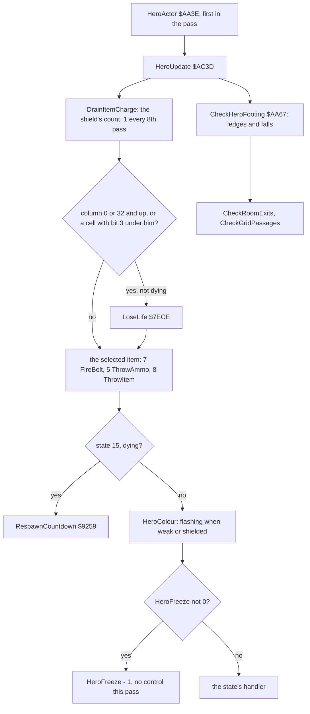

The deadly cells are those with bit 3 of their kind set ([doc 7](07-objects.md)). The hero tests one cell: the one at
his front column (+4 facing right) and his top line. A column of 0, or of 32 and more, is deadly too.

The states, the hero record's +`$0A`:

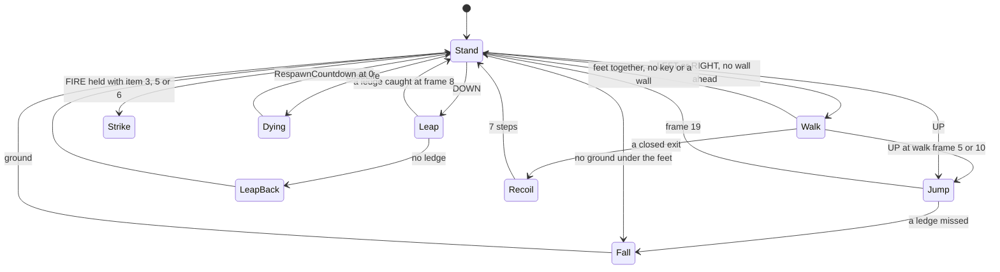

| State | Handler | What it is | L1 count |
| ---: | --- | --- | ---: |
| 0 | HeroStand `$ADA2` | reads the keys | 8194 |
| 1 | HeroWalk `$AF64` | 12 frames a cycle, 2 columns each half | 875 |
| 2 | HeroJump `$B087` | the forward jump, frames 0 to `$12` | 105 |
| 3 | HeroFall `$B021` | falls up to 4 lines a pass | 83 |
| 4 | HeroLeapBack `$B06B` | a leap that found no ledge sinks back | 9 |
| 5 | HeroStrikeMid `$AE8E` | the middle strike, 10 passes | 11 |
| 6 | HeroStrikeHigh `$AED4` | the high strike, 9 passes | 47 |
| 7 | HeroStrikeLow `$AE5D` | the low strike, 8 passes | 9 |
| 9 | HeroLeap `$B0B3` | the leap up (DOWN), frames 0 to `$0D` | 9 |
| `$0B` | HeroRecoil | thrown back from a closed exit | none |
| `$0F` | RespawnCountdown `$9259` | dying: hidden, waiting | 797 |

The counts are the handler's runs in the L1 recordings, from the routines' witness lines.

**The point**: the hero is a state machine with one handler a state. The hazards and the weapons are checked before the
state runs, so a death or a shot can happen in any state.

## 10.2 Walking, jumping, leaping, falling

Every move is a sequence of frames from a sprite set. A frame record carries its own offset from the base position,
+`$0D` and +`$0E` ([doc 6](06-rendering.md)). So most of the motion is in the frames, not in the code.

- **The walk** moves the base column 2 at walk frames 0 and 6. At frames 5 and 11 the feet are together: there the
  hero stops if a wall is ahead (FrontCell `$AFED`) or no key is held.
- **The jump** (UP) runs the jump set's 19 frames. The base column moves 1 at frame 9 and 5 more when he stands. On
  the way down CheckHeroFooting `$AA67` looks for ground one column ahead at frame 12; finding it, he lands on the
  ledge 16 lines up.
- **The leap** (DOWN) crouches and springs straight up. At frame 8 a ledge under his raised feet lets him climb onto
  it. Without one he sinks back (state 4).
- **The fall** starts where the ground ends: at walk frame 5 or 11, or standing. The speed grows by 2 a pass to 4 lines.

### Worked example: one jump in rzx-r1

The hero stands at column 6 in a cave of stage 1. At frame 3580 the joystick's UP starts a jump.

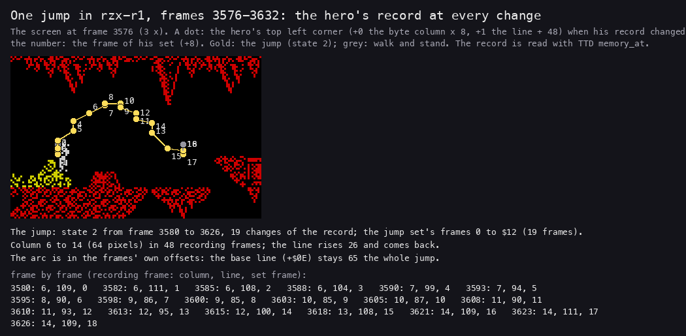

*`rzx-r1` frames 3576-3632: the screen at 3576 and, over it, the hero's top left corner at every change of his record,
numbered with the jump set's frame. Made with `python3 tools/fig_play.py jump work/docs/myA/r1 3576 3632
docs/img/play/jump-path.png`.*

Read from the record `$74E0` frame by frame:

| Frame | Column (+0) | Line (+1) | Jump frame (+8) |
| ---: | ---: | ---: | ---: |
| 3580 | 6 | 109 | 0 |
| 3588 | 6 | 104 | 3 |
| 3595 | 8 | 90 | 6 |
| 3600 | 9 | 85 | 8 |
| 3605 | 10 | 87 | 10 |
| 3613 | 12 | 95 | 13 |
| 3621 | 14 | 109 | 16 |
| 3626 | 14 | 109 | 18 |
| 3628 | 14 | 106 | standing again |

The line rises 26 and comes back to 109. The base line (+`$0E`) stays 65 all the way: the arc is drawn by the frames'
offsets. Column 6 to 14 is 64 pixels, over a gap in the cave floor.

The jump set has 19 frames, one a pass. They took 48 frames of the recording, about 2.5 frames a pass, as stage 1's
passes are long ([doc 4](04-game-loop.md)). A jump lasts about one second.

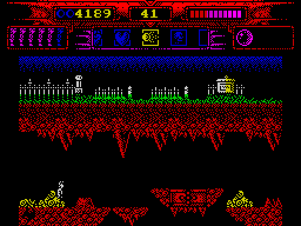

*`rzx-r1` frames 3576-3632, one picture a frame: the hero jumps over the gap and, at 3631, starts the next jump. Made
with `python3 ../../kit/screen_anim.py --work work/docs/myA/r1 --from 3576 --to 3632 --step 1 --scale 2 --delay 60
docs/img/play/jump.gif`.*

**The point**: the jump is data. The code only steps a frame counter and checks the ground at two frames; the arc and
its width are in the frame records.

## 10.3 Strikes, items and weapons

The hero's weapon is the selected item. HeroUpdate looks at its kind every pass ([10.1](#101-the-hero-one-record-one-state-a-pass)).

| Kind | What it does | Code |
| ---: | --- | --- |
| 1 | the shield: while selected with a count, the hero flashes white and blue and the guards at `$8DE7` and `$96A4` keep the damage off; one is used up every 8th pass | IsShieldUp, DrainItemCharge |
| 2 | the key of the arena: its left exit is closed without it | CheckItemGate |
| 3 | the starting weapon: FIRE held while standing strikes (DOWN low, UP high, LEFT middle) | HeroFireHeld `$ADE9` |
| 4 | the blank icon of the padding slots | |
| 5 | counted objects, thrown in an arc while standing; also a strike weapon | ThrowAmmo, kinds 2 and 3 |
| 6 | the master icon: the stage's exit on the pad; also a strike weapon | CheckStageExit |
| 7 | bolts with no count, one a press of FIRE in any state | FireBolt, kind 6 |
| 8 | counted shots, one a press | ThrowItem, kind 9 |

A strike hits on one frame only. IsHeroHitFrame7 and IsHeroHitFrame6 return Z when the hero is in the low or the high
strike at frame 4. StrikeableActor `$A7C4` and the enemies call them every pass for every actor in reach.

FIRE is edge-triggered for the thrown weapons. FireLatch `$FE50` stays 1 while FIRE is held, so each press throws once.

### A throw in rzx-r1

At frame 2310 the selected item is kind 8 with a count of 72. The run presses FIRE twice: the count reads 71 at 2311
and 70 soon after. Each throw is a missile of kind 9 that flies left or right and stops on the first actor it hits.

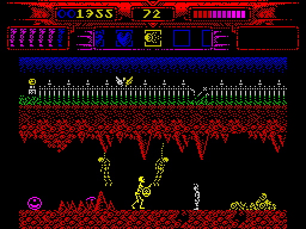

*`rzx-r1` frames 2310-2390, one picture every 2 frames: the hero throws at a skeleton; the count over the HUD's strip
goes 72, 71, 70. Made with `python3 ../../kit/screen_anim.py --work work/docs/myA/r1 --from 2310 --to 2390 --step 2
--scale 2 --delay 80 docs/img/play/shot.gif`.*

Witness: in `rzx-r1` the missile slots hold kind 9 at frame 2320 and again many times after.

**The point**: one key, many weapons. The item strip is the weapon selector, and each item brings its own rule.

## 10.4 Energy and damage

Energy `$FE3F` runs from 0 to 46. A hit does not take energy at once. It subtracts from a pending change,
EnergyChange `$FE4E`:

```asm
DamageHero:
  LD A,(HeroState)
  CP $0F
  RET Z
  LD A,(EnergyChange)
  SUB C
  LD (EnergyChange),A
  RET
```

ApplyEnergyChange `$7E9F` runs every pass. It moves the energy 2 a pass towards the pending change:

```asm
ApplyEnergyChange:
  LD A,(EnergyChange)
  CP $00
  RET Z
  CP $80
  JR C,ApplyEnergyRefill
  ADD A,$02
  LD (EnergyChange),A
  LD A,(Energy)
  CP $00
  RET Z
  SUB $02
  JP Z,LoseLife
  LD (Energy),A
  RET
```

The sources of damage, from the callers of DamageHero and ShotHitsHero:

| Source | Code | Damage |
| --- | --- | ---: |
| a skeleton's sword | WarriorFightStrike `$969C` | 4 |
| a hanging body, the hero under it | HangingStill `$91E4` | 4 |
| a room's danger zone (grid 0 column under 4; the arena right of column 16) | ZoneDamage `$8A2E` | 4 a pass |
| a flame jet | FlameJetHit `$8DE7` | 16 |
| an aimed shot, a bouncing shot | UpdateAimedShot, UpdateBouncer | 6 |
| a drifting shot | UpdateDriftRight, UpdateDriftLeft | 10 |
| a deadly cell, the edge of the play area | HeroUpdate | a life |

### Worked example: a fight in c1

`c1` reaches room 8 of stage 1 and meets a skeleton next to a flame jet. Read every 2 frames:

| Frame | Energy | EnergyChange | What happened |
| ---: | ---: | ---: | --- |
| 15 816 | 30 | 0 | the hero strikes high (state 6) |
| 15 818 | 30 | -4 | DamageHero at 15817, T 68 710, from WarriorFightStrike, C = 4 |
| 15 824 | 26 | 0 | two passes of 2 |
| 15 840 | 26 | -16 | DamageHero at 15839, T 13 524, from FlameJetHit, C = 16 |
| 15 864 | 10 | 0 | eight passes of 2 |
| 15 874 | 10 | -16 | the flame jet again |
| 15 884 | 2 | -8 | |
| 15 888 | 0 | +46 | ApplyEnergyChange reached 0: LoseLife |

-16 in eight steps of 2 takes 24 frames here, the passes being 3 frames long. So the HUD's bar drains visibly after
each hit, and the death comes a little after the blow that caused it.

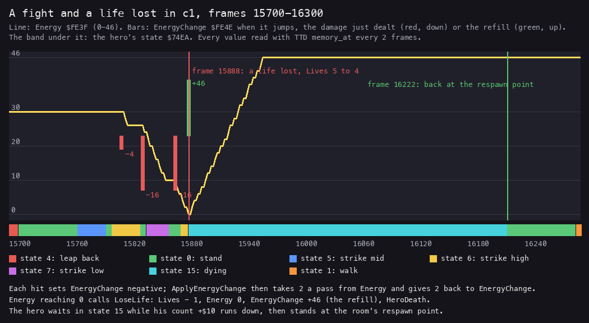

*`c1` frames 15 700-16 300: the energy, each damage as it lands and the refill, over the hero's states. Made with
`python3 tools/fig_play.py energy work/docs/myA/c1 15700 16300 docs/img/play/energy-death.png`.*

**The point**: damage is a debt paid 2 a pass. The bar never jumps, and a hero hit twice in a row pays both.

## 10.5 A life lost

LoseLife `$7ECE` is called from two places: ApplyEnergyChange, when the energy reaches 0, and HeroUpdate, on a deadly
cell or the edge.

```asm
LoseLife:
  LD A,(Lives)
  CP $00
  RET Z
  DEC A
  LD (Lives),A
  LD DE,$0007
  CALL PlaySoundVector
  CALL StartLivesFlash
  LD A,$17
  LD (HeroFreeze),A
  LD A,(Lives)
  CP $00
  JR Z,LoseLastLife
  XOR A
  LD (Energy),A
  LD A,$2E
  LD (EnergyChange),A
  LD E,$33
  JP HeroDeath
LoseLastLife:
  LD E,$6C
  LD A,$01
  LD (GameOverTimer),A
  JP HeroDeath
```

HeroDeath `$B22B` then:

1. clears the missile slots 8-15;
2. stores E in the hero's +`$10`: the wait, in pairs of passes;
3. adds eight flyers of kind 7 at the hero, one a direction (+4 = 0, 2, ..., 14);
4. takes the room's respawn point (RespawnPoint, a table of a column and a line a room);
5. sets state `$0F` and hides the hero at column 0, line `$8C`, colour 0.

The flyers fly out, then turn into kind 8 and fly towards the respawn point. RespawnCountdown `$9259` takes 1 from
+`$10` every second pass. At 0 the hero stands at the respawn point. HeroFreeze `$17` then holds him still for 23
passes. It does not count while he is dying, so it starts only when he is back.

| Frame of `c1` | What happens |
| ---: | --- |
| 15 886, T 46 868 | LoseLife: Lives 5 to 4, effect 7 ([doc 9](09-sound.md#99-the-48k-against-the-128k)) |
| 15 886, T 48 135 | HeroDeath; it returns at T 53 574 |
| 15 888 | state 15, the hero at column 0, line 140; Energy 0, EnergyChange +46 |
| 15 966 | the refill is done: Energy 46; the count +`$10` reads 40 |
| 16 222 | the count is 0: state 0 at column 16, line 90, room 8's respawn point |
| 16 222-16 290 | HeroFreeze 23 down to 0, one a pass |

The wait is 51 pairs of passes, 102 passes: 334 frames, 6.7 s. With no life left E is `$6C`, 216 passes, and
GameOverTimer starts the HUD's GAME OVER ([doc 8](08-hud-and-text.md)).

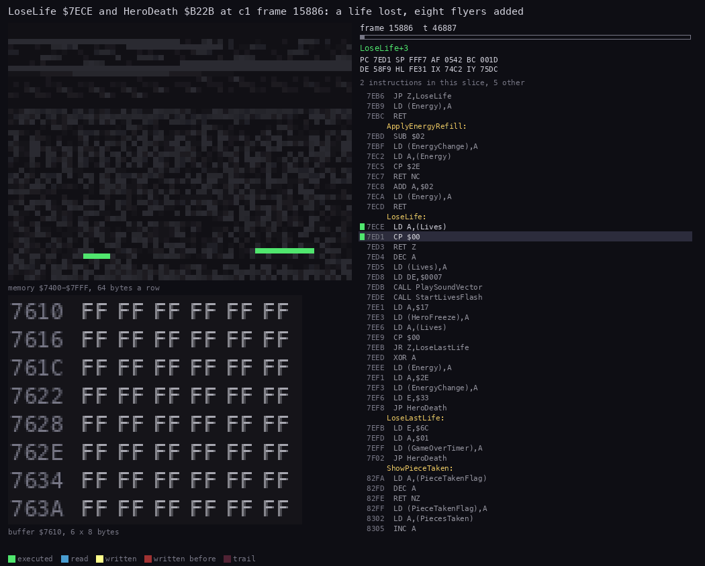

*LoseLife `$7ECE` and HeroDeath `$B22B` at `c1` frame 15886, T 46 800-53 700. Under the memory map the missile slots
8-15 at `$7610` in hex: cleared to `FF`, then filled with the eight flyers. Made with `python3 ../../kit/routine_anim.py
--work work/docs/myA/c1 --window 15886:46800-15886:53700 --listing build/stage1.lst --view buffer:7610:6x8:hex --range
7400-7FFF --row-bytes 64 --pc 7ECE-7F04 --pc B22B-B2E5 --pictures 80 --delay 90 --out docs/img/routines/HeroDeath.gif`.*

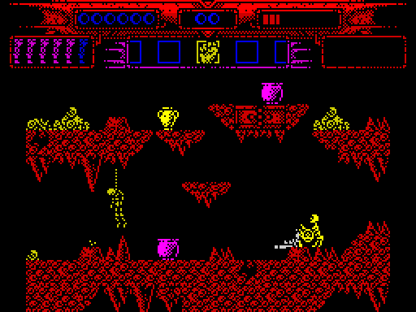

*`c1` frames 15 860-16 240, one picture every 4 frames: the flame jet's last blow, the burst of eight flyers, the
energy bar refilled while the hero is away, and the hero back at the respawn point. Made with `python3
../../kit/screen_anim.py --work work/docs/myA/c1 --from 15860 --to 16240 --step 4 --scale 2 --delay 80
docs/img/play/death.gif`.*

Witness: LoseLife ran 7 times in the L1 recordings (`c1o`, `deaths`, `s1-right`), HeroDeath 7 times,
RespawnCountdown 797 times.

**The point**: a death costs a life and about seven seconds, never the room. The hero comes back in the same room, at
its own fixed point, with the energy already full.

## 10.6 Stage 1's enemies

The actors of a room come from its placements and from SpawnRandomEnemy `$9353`, which raises a skeleton out of the
ground in grid 0 every 30-61 passes, at one of the room's four allowed places (SpawnRooms) ([doc 7](07-objects.md)).

| Enemy | Handler | Behaviour |
| --- | --- | --- |
| the skeleton warrior | WarriorActor `$94D0`, its head WarriorHeadActor `$93F2` | rises, turns to the hero, walks, blocks with its shield, strikes for 4; a hit makes it collapse; its head flies off and may leave an item |
| the hanging body | HangingActor `$9186` | swings; when still, the hero within 2 columns under it loses 4 |
| the statue head | StatueActor `$912B` | spits shots at the hero; breaks after hits |
| the flame jet | FlameJetActor `$8DCC` | rises out of the ground at random, long or short; 16 on contact |
| the fire pit | FirePitActor `$8D6D` | kills on touch |
| the urns and chests | StrikeableActor `$A7C4` | two low strikes break them into fragments; effect 2 |

The skeleton is the stage's common enemy. Its states, the record's +`$0A`:

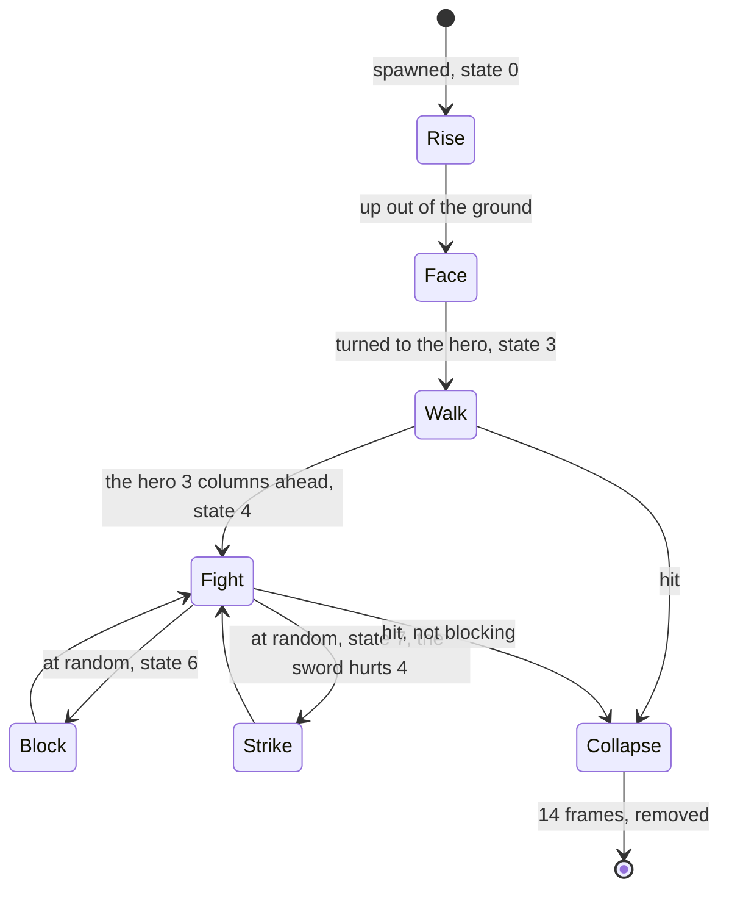

The routine animation [WarriorActor.gif](img/routines/WarriorActor.gif) of [doc 7](07-objects.md) shows the
handler stepping one skeleton.

**The point**: a handful of small state machines, each a few states long. Their danger comes from numbers: a new
skeleton every 30-61 passes in grid 0, two to four seconds.

## 10.7 The demon of room 12

Room 12 of grid 0 is the demon's lair. Its face fills the top of the room, and a pit of fire lies under it. The demon
is four actors: two wings, a body and a head (BossWingLeft `$8E60` to BossHead `$8E86`). One variable, BossPhase
`$FE4C`, drives them all.

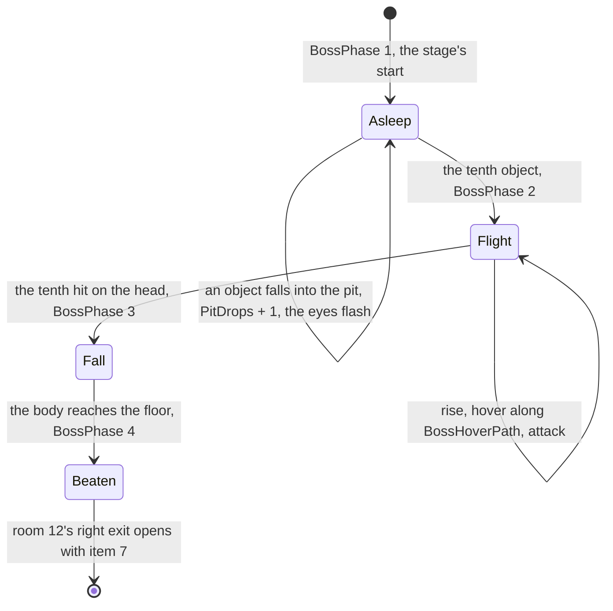

### Waking it

The thrown objects of item 5 fly in an arc (UpdateThrownArc `$8006`). Below line `$82` CheckPitDrop counts them:

```asm
CheckPitDrop:
  LD A,(IY+$01)
  CP $82
  RET C
  LD A,(RoomNumber)
  CP $0C
  JP NZ,RemoveActor
  LD A,(BossPhase)
  CP $01
  RET NZ
  LD A,(EyeFlashRepeats)
  INC A
  LD (EyeFlashRepeats),A
  LD A,(PitDrops)
  CP $09
  JR Z,CheckPitDropDone
  INC A
  LD (PitDrops),A
  RET
CheckPitDropDone:
  LD A,$02
  LD (BossPhase),A
  RET
```

PitDrops stops at 9. The object that finds it at 9, the tenth, wakes the demon. Each object also adds a flash of the
face's eyes (DrawRoomPicture).

### Beating it

The head is the only part that takes hits. The hero's weapon sets bit 4 of its +9:

```asm
BossHead:
  ...
BossHeadHit:
  BIT 4,(IY+$09)
  JP Z,BossPart
  RES 4,(IY+$09)
  LD A,$01
  LD (BossFlash),A
  LD A,(BossHits)
  DEC A
  JP Z,BossFlees
  LD (BossHits),A
```

BossHits starts at 10. The tenth hit finds 1, takes it to 0 and jumps to BossFlees without storing it, so BossHits
still reads 1 afterwards.

In flight the parts rise, hover along the 64 steps of BossHoverPath, then attack: the body changes its sprite, the head
opens its mouth and, at step 10, throws BossBurst `$B18B`: eight shots round it (effect 6).

### Worked example: the demon in rzx-r1

Read every 10 frames, then frame by frame around each change:

| Frame | PitDrops | BossPhase | BossHits | What happens |
| ---: | ---: | ---: | ---: | --- |
| 13 520 | 0 | 1 | 10 | the run enters room 12 |
| 13 880 | 1 | 1 | 10 | the first object in the pit |
| 14 780 | 9 | 1 | 10 | the ninth |
| 14 980 | 9 | 2 | 10 | the tenth: the demon wakes; the eyes flash once more |
| 15 240 | 9 | 2 | 9 | the first hit on the head |
| 15 360 | 9 | 2 | 1 | the ninth hit |
| 15 362 | 9 | 3 | 1 | the tenth: BossFlees, the body falls |
| 15 521 | 9 | 4 | 1 | the body on the floor: beaten |
| 16 150 | | | | the fourth teleport icon taken in room 12 |

The ten objects took 1100 frames, 22 s. The ten hits took 120 frames, 2.4 s.

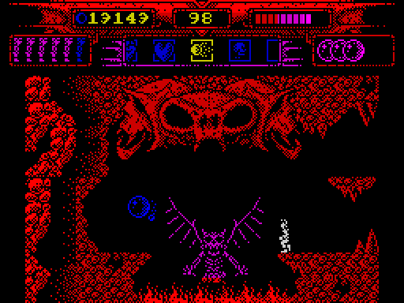

*`rzx-r1` frames 15 200-15 540, one picture every 3 frames: the demon flies, the hero's shots hit its head, it bursts
and its body falls onto the bridge. Made with `python3 ../../kit/screen_anim.py --work work/docs/myA/r1 --from 15200
--to 15540 --step 3 --scale 2 --delay 80 docs/img/play/demon.gif`.*

The right exit of room 12 (CheckRightGate) is open while BossPhase is 1, or 4 with item 7 carried. So the way on is
open before the demon is woken, and closed while it flies.

**The point**: the boss fight is a puzzle first. The demon sleeps until the player finds what to throw into its pit,
and only then is there anything to hit.

## 10.8 The dragon of the arena

Grid 2 is a single room, the arena. The dragon is its picture (DrawArenaPicture `$89BB`) and a head actor
(ArenaHeadActor `$90E7`) that opens its mouth and breathes.

- ZoneDamage takes 4 a pass from a hero at column 16 or more while the dragon lives.
- A bolt (item 7, kind 6) that reaches column 15 counts a hit: ArenaBossHit `$A14A`, ArenaBossHits + 1.
- At 20 hits the dragon bursts, ArenaBossBeaten is set, and item 2 drops at column `$14`, line `$70`.
- Item 2 opens the arena's left exit (CheckItemGate).

In `rzx-r1` ArenaBossHits reads 3 at frame 19 600, 8 at 19 650, 14 at 19 700 and 20 at 19 750: a hit about every 8
frames.

**The point**: the second boss is a race. The hero must stay out of the zone and land twenty bolts.

## 10.9 The icons, the master icon and the teleport

Each stage has five teleport icons, which the code calls pieces. In stage 1 RoomEvents puts one into five rooms when
the hero enters them, unless its bit is set in PiecesMask `$FE51`:

| Room | Event bit | Place | Taken in `rzx-r1` |
| --- | --- | --- | ---: |
| grid 0, room 0 | 0 | column `$12`, line `$54` | about 3150 |
| grid 0, room 5 | 1 | `$0A`, `$54` | about 5450 |
| grid 0, room 11 | 2 | `$09`, `$44` | about 8950 |
| grid 0, room 12 | 3 | `$09`, `$44` | about 16 150, after the demon |
| grid 1, room 2 | 4 | `$07`, `$54` | about 25 750 |

The frames are those where PiecesTaken `$FE52` steps, read every 50 frames.

A piece is UpdatePieceActor `$8233`. It takes 6 hits, rises and bobs along RiseSteps (effect 3), then waits. Touched,
it gives 1200 points, sets its bit and fills a ring on the HUD (ShowPieceTaken, effect 12). The fifth sets
PiecesComplete.

Then room 15 holds the master icon. SpawnRewardItem puts item kind 6 there once PiecesTaken is 5 and PiecesComplete 1.
`rzx-r1` takes it at about frame 27 250 (PiecesComplete 2).

The exit is CheckStageExit `$79FC`, run every pass:

```asm
CheckStageExit:
  LD A,(RoomNumber)
  CP $02
  RET NZ
  LD A,(GridNumber)
  CP $00
  RET NZ
  CALL GetSelectedItem
  CP $06
  RET NZ
  LD A,(HeroRecord)
  CP $12
  RET C
  CP $16
  RET NC
  LD A,(HeroY)
  CP $5A
  RET NZ
```

The hero must stand in room 2 of grid 0, at columns 18-21 and line `$5A`, with the master icon selected. StageExit
`$7A1D` then draws the field of falling stars. At FIRE or SPACE it calls EndStage with E = 2, and the resident loads
the next stage.

`rzx-r1` reaches room 2 at frame 29 500 and stands at column 20, line 90 at 29 620. It opens the item window and moves
the selection to slot 12 (item 6) between 29 654 and 29 744. The stars start soon after.

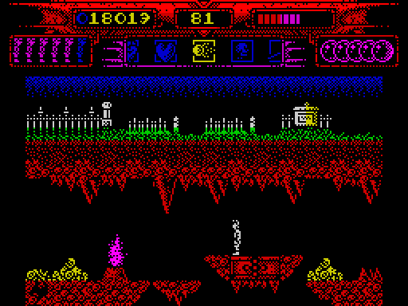

*`rzx-r1` frames 29 590-29 880, one picture every 3 frames: the hero on the pad, the item window scrolled to the
master icon, then the falling stars of StageExit. Made with `python3 ../../kit/screen_anim.py --work work/docs/myA/r1
--from 29590 --to 29880 --step 3 --scale 2 --delay 80 docs/img/play/teleport.gif`.*

The course of stage 1 in `rzx-r1`:

```mermaid
flowchart LR
    A["3150 icon 1, room 0"] --> B["5450 icon 2, room 5"]
    B --> C["8950 icon 3, room 11"]
    C --> D["13880-14980 ten objects in the pit"]
    D --> E["15240-15521 the demon beaten"]
    E --> F["16150 icon 4, room 12"]
    F --> G["19600-19750 the dragon: 20 bolts"]
    G --> H["25750 icon 5, grid 1 room 2"]
    H --> I["27250 the master icon, room 15"]
    I --> J["29620 on the pad, item 6 selected"]
    J --> K["stage 2"]
```

**The point**: the stage is one puzzle. Five icons give the master icon, and the master icon on the pad is the only way
out.

## 10.10 Stages 2-5 and the ending

The later stages reuse stage 1's engine with their own actors. From their annotation files:

| Stage | Enemies | Bosses and their rule |
| --- | --- | --- |
| 2 | the harpy (rises, aimed shots, flies off), the spirits over the temple floor (at most 2), the pool, the drops | the hydra: three heads, 9 hits each (HydraHeadHit); Medusa: her head struck falls as item 2, and held for 20 passes it turns into item 6 |
| 3 | Vikings, the lightning, the rain and the sea (CheckWaterDeath), trolls in two records, bog men | the funeral pyre (the rain puts the flames out); the dragon of room 8: 16 thrown objects; the giant on the throne: 30 bolts |
| 4 | scorpions, the traps, the mummy ([doc 1, 1.7](01-game-design.md#17-the-five-stages)) | the barrier of grid 0 room 1 (closed until BarrierState is 2, the hero thrown back by HeroRecoil); the pharaoh's head: 20 hits |
| 5 | Dameron's missiles | Dameron's four forms ([below](#the-ending)) |

### The ending

Stage 5 has no rooms and no exit. Its main loop waits for the frame with a HALT, the only stage loop that does
([doc 4](04-game-loop.md)).

- DuelPhase `$FE43` is `$FF` during the intro text, 0-3 for Dameron's four forms, 4 when he is beaten.
- A hero shot on the hit line sets PendingHits `$FE41` to 2. DuelHit moves one a pass into HitCounter `$FE44`.
- At 20, ten shots, the phase steps and NextDameronForm `$A0C4` bursts the old form (effect 0).
- After the fourth form the ending text stays on the screen and the loop runs on. Only no lives or CAPS SHIFT + SPACE
  leave the stage.

In `rzx-r5` the duel runs from frame 1551 to 4005 and WELL DONE appears at 5663 ([doc 1](01-game-design.md)).

**The point**: the game ends by not ending. Winning leaves the player in front of the text, in a loop that only a
quit or a reset ends.

## 10.11 Known only from the code

- **HeroRecoil** (state `$0B`), the hop back from a closed exit, never runs in stage 1's recordings. Stage 4's barrier
  shows it in `s4-right`.
- **ItemWindow's RIGHT** (ScrollItemsRight) and **QuitStage** never ran in the L1 recordings.
- **CellFlagUnused** tests bit 1 of a cell and has no caller.
- **BossGrowPart** `$9007` grows a boss part to 32 lines; no template names it.
- **SpawnBossBridge** `$8E56`: the right wing turns into a bridge slab from BossPhase 3 on. `rzx-r1` shows the slab
  under the falling body, but no L1 count covers it.
- **The tenth object.** The stage 1 source says "PitDrops up to 9; the ninth sets BossPhase 2". The code and `rzx-r1`
  both say the tenth (a change is sent to the lead).
- **BossHits** keeps 1 after the demon is beaten, because BossFlees is taken before the store.
- **ThrowItem, FireBolt and ThrowAmmo** are marked "Not executed" in the stage 1 source; `rzx-r1` runs ThrowItem (kind 9
  shots from frame 2320) and the bolts of the arena.
