# 1. Game design

The editor tape gives a Nether Earth player two things the original does not: seven ready-made battles, and an
editor to make more. This document covers the battles as a player meets them. The editor's own screens and keys are
in 05 and 08; the rules the saved-game format touches are in 10.

The recordings and runs it rests on ([03](03-build-and-load.md)): `work/edA/load` (the edition, level 1 loaded and
played, a save) and `work/edA/levels` (each of the eight saved games loaded from the menu snapshot and played for
400 frames, no keys pressed).

## 1.1 What the player loads

LOAD "" plays the first six blocks: after about four minutes at ROM speed the Nether Earth main menu is on the screen,
with its tune, exactly as the original game shows it ([3.4](03-build-and-load.md#34-the-load-recorded)). From here
the game is the original, unchanged ([3.5](03-build-and-load.md#35-the-image-against-nether-earths)): keys 1-4 choose
the controls, 0 starts the original battle (NE 1.3).

The levels are reached through option 5 of the menu, the game's own "load a saved game". The player winds the tape to
a level (the TZX text names each one: Enemy At The Gates, Break Through, Fortifications, The Chase, Jungle Of Stone,
Double Frontline, The Slogan), presses 5 and plays the tape. The border goes red, the level loads for about 50 s, and
play starts at once in the loaded position. The game never shows the level's name.

The editor (blocks 20-25) is loaded separately with LOAD "" from its place on the tape. The last two blocks are a
game saved from it, and load like the seven levels.

A loaded level is a saved game, so it starts mid-battle in any state its author chose: own robots already built,
factories already owned, any resources, the ship anywhere. All eight have the clock at 0 (`Clock` `$FD35`). Saving in
play (the SAVE control, key 5 in the `load` recording) writes a new level in the same format.

## 1.2 What a level can change

Everything the original's new game sets up comes from the saved block ([3.6](03-build-and-load.md#36-the-saved-game)):

- the map: all 16 × 512 cells, the terrain and the buildings drawn on it;
- the 28 capture points (4 warbases, 24 factories): where each one's door is, its type, its owner, or "out of play";
- the 48 robot records: position, chassis and weapons, orders, strength;
- both sides' resources and building counts;
- the ship's position and altitude.

The original battle ([NE 1](../../nether-earth/docs/01-game-design.md)) is one fixed set-up: our 1 warbase in the
west, the enemy's 3 in the east, 24 neutral factories, 20 general each, no robots. The seven levels vary all of it.

## 1.3 The levels

In the maps: four strips of 128 columns (west at the top left, east at the bottom right), 16 rows each. Squares are
the capture points (B a warbase; E, N, P, M, C, W the electronics, nuclear, phasers, missiles, cannon and chassis
factories), green ours, red the enemy's, white neutral, grey "x" out of play. Discs are robots, the blue cross the
ship. Every map is rendered from the level's text file, `python3 tools/levels.py render src/res/levels/<slug>.txt
docs/img/levels/map-<slug>.png`. The play pictures are the screen 400 frames after play started
(`work/edA/levels/<slug>/play-400.scr`, `kit/zxscreen.py`).

The numbers come from the text files (`src/res/levels/*.txt`, the `var` and `point` lines):

| Level | Our warbases / factories | The enemy's | Neutral factories | Our robots | Enemy robots | Our resources | Enemy resources |
| --- | --- | --- | ---: | ---: | ---: | --- | --- |
| Enemy At The Gates | 1 / 6 (one of each) | 3 / 12 (two of each) | 0 | 0 | 24 | general 99 | all 99 |
| Break Through | 1 / 0 | 3 / 0 | 24 | 6 | 1 | general 99 | all 99 |
| Fortifications | 1 / 0 | 3 / 18 (three of each) | 0 | 0 | 0 | all 99 | all 99, nuclear 0 |
| The Chase | 1 / 0 | 2 / 0 | 0 | 1 | 20 | all 99, nuclear 0 | all 99, nuclear 0 |
| Jungle Of Stone | 1 / 0 | 1 / 0 | 0 | 0 | 0 | general 30 | all 99 |
| Double Frontline | 1 / 0 | 2 / 0 | 24 | 0 | 0 | general 99 | all 99 |
| The Slogan | 1 / 0 | 3 / 0 | 0 | 0 | 0 | all 99 | all 99 |
| the editor's save | 1 / 0 | 1 / 0 | 0 | 0 | 0 | general 20 | general 20 |

"All 99" is 99 of each of the seven resources. Points not counted above are out of play (`$80`, see 10.2).

### Enemy At The Gates

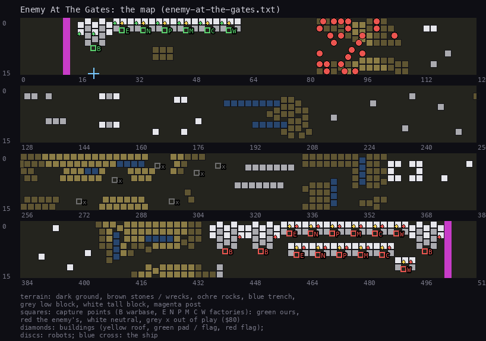

The enemy is already at our door. We start with one warbase at column 20 and one factory of each kind beside it, in a
row along the top edge (columns 28-58), but no robots and only general resources (99). Around columns 83-104, 24
enemy robots are already marching: their orders are 3, 4, 5 and 8 (NE 10.5: search and destroy our robots,
our factories and our warbase, the last two with nuclear parts, and capture our warbase). The enemy holds 3 warbases (441, 451, 497) and 12 factories in the far east, all
resources at 99. The middle of the map is open, with long walls and trenches.

The player must build defenders at once with the general resource and the six factories' daily production, while
24 robots arrive.

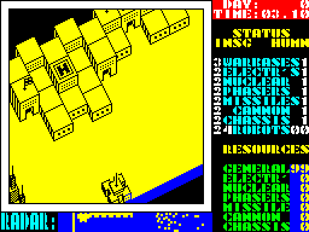

### Break Through

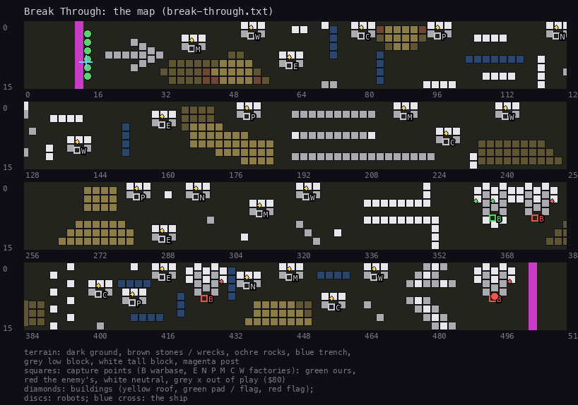

The original battle's map (1.4), with the bases moved: our warbase at 366, the enemy's at 376, 426 and 494, all in
the eastern half. We start with 6 robots in a column at x = 14, rows 3-13, far in the west: tracked phasers and
missiles, and one antigrav with missiles, phasers and nuclear under the ship (14, 9), at altitude 47. All 24
factories are neutral. The enemy has one robot (order 6) and all resources at 99.

The robots must break through the whole map to the bases, taking factories on the way.

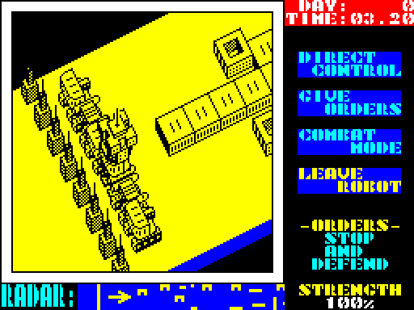

### Fortifications

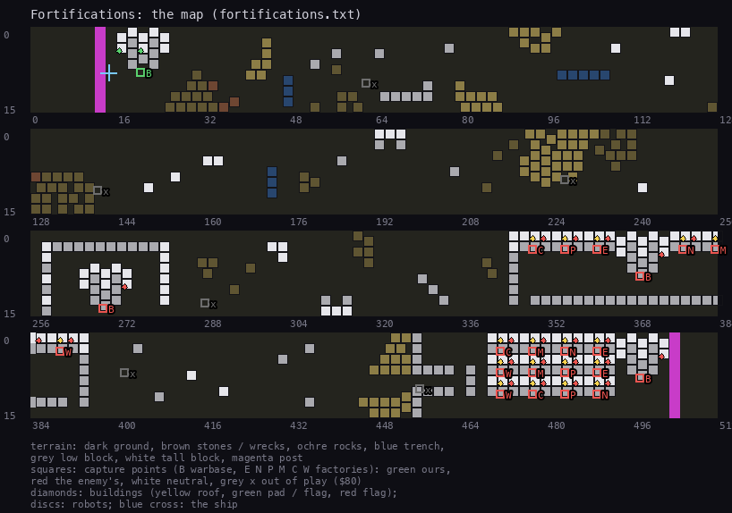

No robots on either side, and the enemy holds all 18 factories in play (three of each kind) in the east: six in a
row at columns 349-389, twelve in a block at 471-489 behind walls. Its warbases are at 269 (inside a walled
compound), 369 and 497. We have one warbase at 20 and all seven resources at 99, so we can build any robot at once;
the enemy has no nuclear resource (0) but 18 factories producing. Six factory points are out of play.

The fight is a siege: build strong robots early, before the enemy's production outgrows ours.

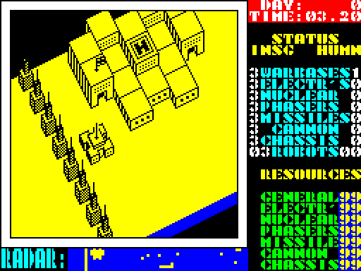

### The Chase

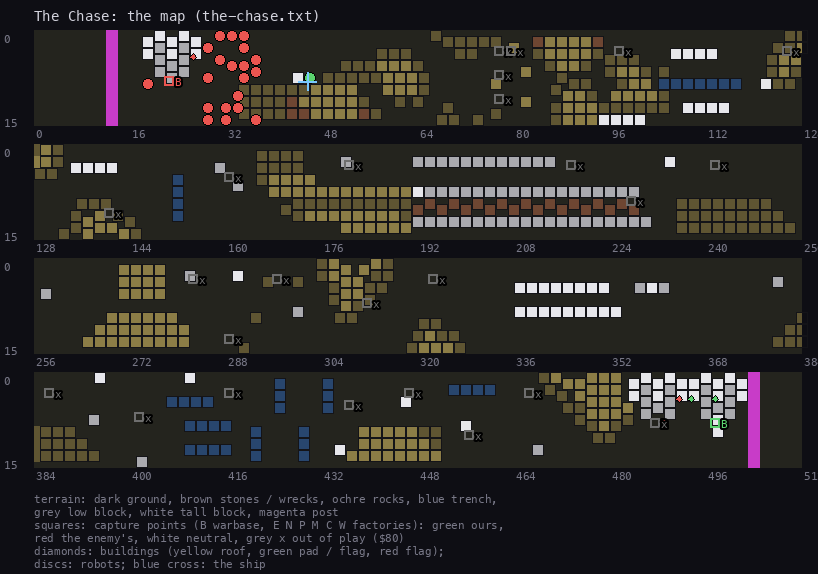

Here we are the hunted. Our warbase is at the far east (497), but our only robot, an antigrav with missiles and
phasers, stands at (45, 8) in the west, with the ship over it at altitude 31. Just west of it, 20 enemy robots fill
columns 18-36 around the enemy's warbase at 22; its other warbase is at 487, next to ours. There are no factories at all (all 24 points out of
play); both sides have every resource at 99 except nuclear.

The robot has to get home across the whole map, or turn and fight, while the enemy's base next to it keeps building.

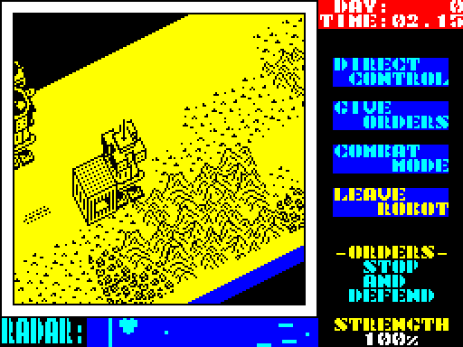

### Jungle Of Stone

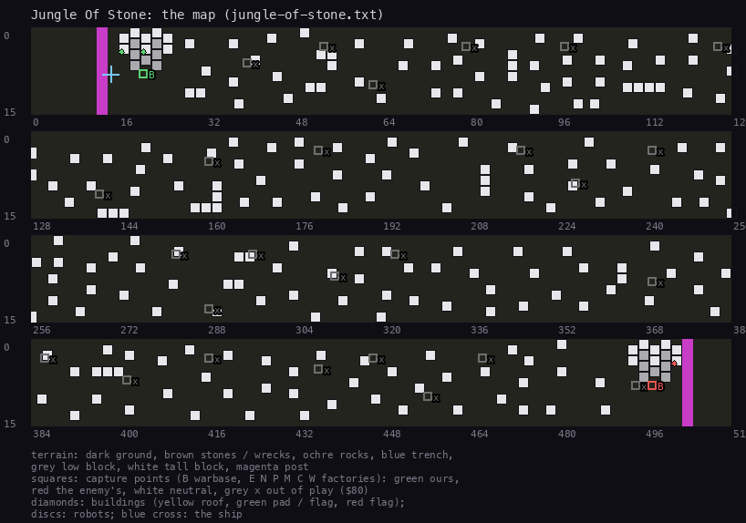

The map is strewn with single blocks over its whole length (1 064 non-empty cells, most of them alone or in pairs), a
maze for robots on the ground. One warbase each, ours at 20 and the enemy's at 497, no factories, no robots. We have
only 30 general against the enemy's 99 of everything.

A slow, poor start: one cheap robot at a time through the stones, against an enemy that can build anything.

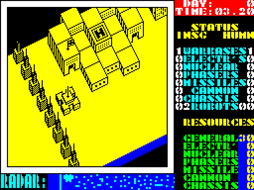

### Double Frontline

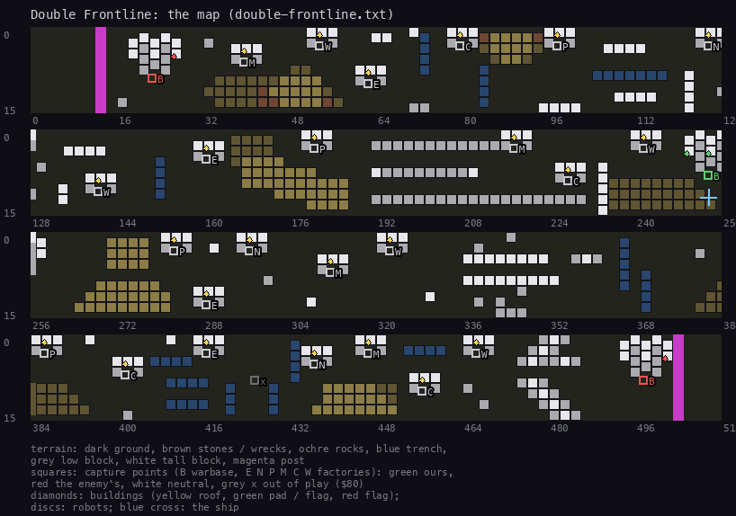

The original map again (1.4), with our warbase moved to the middle (253) and two enemy warbases, one at each end
(22 and 497). The 24 factories are neutral and spread over the map. No robots; we have 99 general, the enemy 99 of
everything.

Two fronts: the enemy comes from both sides, and each half of the map's factories is closer to one of its bases.

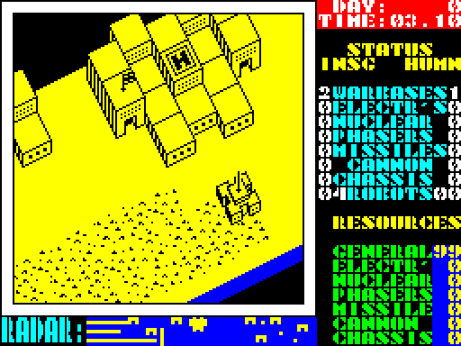

### The Slogan

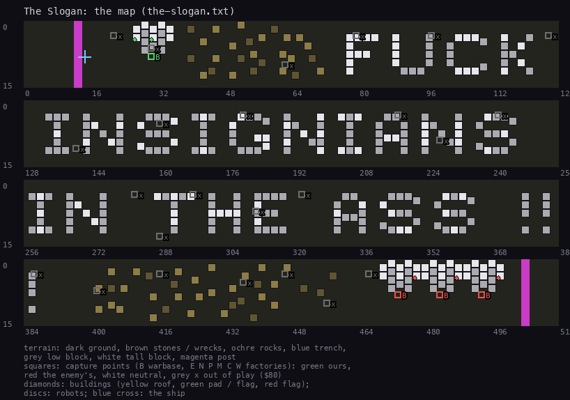

A joke level. Tall blocks spell **FUCK INSIGNIANS IN THE ASS !!** across columns 70-370 (the Insignians are the game's
enemy: "INSIGNIANS DESTROYED / YOU HAVE WON !", NE 10.10). The words show on the radar strip as the ship flies over
them. Our warbase is at 30, the enemy's three at 473, 483 and 493; no factories, no robots, all resources 99 for both.

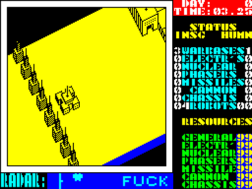

### The editor's saved game

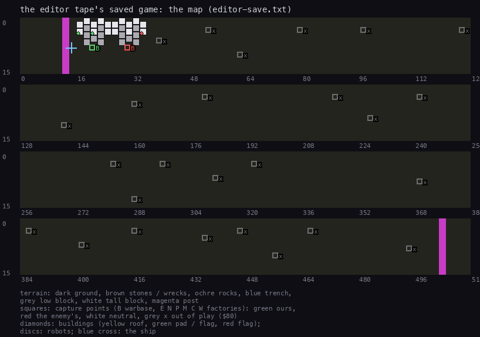

Not a level: what the editor last saved when the tape was made. The map is nearly empty (184 non-empty cells), the
enemy's single warbase stands at (30, 8), right next to ours at (20, 8), and both sides have 20 general. It looks like
a test of the editor's save rather than a battle.

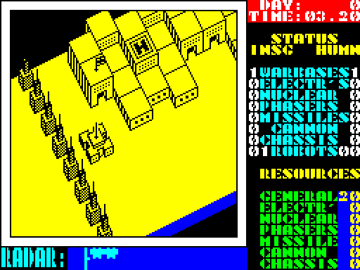

## 1.4 What makes them different

- **Position, not rules.** No level changes how robots fight, cost or move: those are in the game's code, and the
  save holds none of it. A level is a starting position: map, owners, robots, resources.
- **The maps.** Break Through and Double Frontline keep the original battle's map: against NE's map (`work/deep` of
  the NE case, the map at its frame 100), 552 and 332 of the 8 192 cells differ, in the columns around the moved bases.
  The Chase reuses parts of it (1 889 cells differ). Enemy At The Gates, Fortifications, Jungle Of Stone and The Slogan
  are new maps (2 900-3 700 cells differ).
- **Factories.** The original's 24 neutral factories become 0 (four levels), all of them pre-owned (Enemy At The
  Gates, Fortifications) or stay neutral (Break Through, Double Frontline). Without factories, only the warbases' 5
  general a day (NE 10.2) pays for robots, so starting resources decide those levels.
- **Robots on the map at the start**, which the original never has: an enemy army (Enemy At The Gates, The Chase), our
  own squad (Break Through, The Chase).
- **Base placement.** Our base in the middle (Double Frontline), in the east beside the enemy's (Break Through, The
  Chase), in the west beside it (the editor's save), while our robots start far away in the west (Break Through, The Chase).
