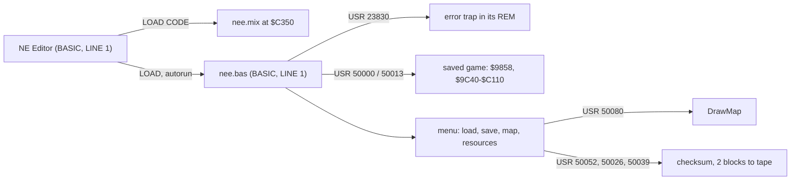

# 02. Architecture

(The game edition's part of this document is the lead's; this is the editor's section, from edB's notes.)

## The editor

The editor is a BASIC program with a little machine code: "NE Editor " (221 bytes) loads nee.mix (2244 bytes of
code, tiles and a font at 50000) and nee.bas (13625 bytes, 146 lines), which loads a saved game of Nether Earth and
edits it in place. Rests on the recording `work/edB/tour` (doc 05), the sources `src/basic/*.bas`,
`src/basic/nee-rem.asm`, `src/mix/mix.asm` (from `src/mix/mix.ann`) and the L1 builds `work/edB/tour` and
`work/edB/tour-edit`.

### Stages

In `tour`: NE Editor runs from frame 250, nee.mix and nee.bas are in by 259 (the ROM trap loads them fast), the
trap is set at 256+15777 (`$5D16`), the tape's saved game loads through nee.mix's own LD-BLOCK calls at signal
speed from 260 (checksum) and 512 (the block) to 2680, and the menu is up at about 2700.

### Memory map while it runs

| Range | What |
| --- | --- |
| `$4000`-`$5AFF` | the screen |
| `$5CB6`-`$5CCA` | the channels (NE Editor's POKE 23739 silences channel S during its loads; nee.bas's CLS restores it) |
| `$5CCB`-`$9203` | nee.bas (13625 bytes), its REM machine code at `$5D16`-`$5D5E`, then its variables (`Q(7,4)`, `I$` ...) |
| below `$9857` | the machine stack (CLEAR 38999: RAMTOP `$9857`) |
| `$9858`-`$9859` | the checksum word (the game's `$5B00`) |
| `$9C40`-`$C110` | the saved game block, 9425 bytes: the game's `$D92B`-`$FDFB` moved down by `$3CEB` (15595) |
| `$A015`-`$C014` | inside it: the map, 16 rows of 512 cells (the game's Map `$DD00`) |
| `$C350`-`$CC13` | nee.mix: the tape and checksum entries, DrawMap, the tiles, the font |

Between them `$985A`-`$9C3F` and `$C111`-`$C34F` are not used; `$CC14` up neither (the UDG pointer is moved into
nee.mix's tiles, the ROM's UDG area at `$FF58` is left alone).

### The address mapping

The editor never moves the block: it reads and writes the game's own layout at a fixed offset. Every number in
nee.bas that addresses the block is a game address minus 15595:

| Editor | Game (NE `game.ann`) | nee.bas uses |
| --- | --- | --- |
| 40000 `$9C40` | `$D92B` SaveShots | (loaded, saved, summed, not edited) |
| 40045 `$9C6D` | `$D958` SaveBuildings, 56 x 3 | lines 58-70, 99-103, 124-126 (55 of the 56 records: `FOR I=40045 TO 40207 STEP 3`); DrawDoor `$C453` walks all 56 |
| 40981 `$A015` | `$DD00` Map | the cursor's cell CA; DrawMap |
| 49207 `$C037` | `$FD22` Resources | line 133-136 |
| 49226 `$C04A` | `$FD35` Clock (4 bytes), `$FD39` PanelBusy | zeroed by line 15 before a save |
| 49231 `$C04F` | `$FD3A` PlayerBuildings | counts, line 9, 57, 64-65, 99, 122 |
| 49239 `$C057` | `$FD42` EnemyBuildings | the same |
| 49247 `$C05F` | `$FD4A` EnemyResources | line 137-140 |
| 49285 `$C085` | `$FD70` Warbases, 4 x 5 | lines 13-14 (sort), 54, 105 |
| 49305 `$C099` | `$FD84` Factories, 24 x 5 | lines 9, 14-15 (sort), 54, 128 |

A building record holds the game address of a cell: nee.bas writes `CA + 15595` (the door's cell: the warbase pad,
the factory) and `CA + 15591` / `15593` / `15597` / `15599` (the owner's flag 4 or 2 cells left or right of the door);
DrawDoor adds `$3CEA` to its map pointer (already one past the cell) to compare. A capture point's (X, Y) is the map cell in front of the building: nee.bas computes
`X + 256 x Xhi + 512 x Y + 39957`, the editor's cell of (X, Y) less 1024 (two rows up), and finds a factory's door
cell (the cursor) there, a warbase's door two more rows up (lines 54, 105: `CA - 38933`, 128: `CA - 39957`): the
point lies 2 rows below a factory's door cell and 4 below a warbase's.

What the editor leaves alone: the robots (`$DA00`-`$DCFF` in the game), the shots, the variables other than those
above. Before a save it sorts the capture points by X (lines 13-15), zeroes the clock and PanelBusy, and sums the
block (SumGameBlock `$C384`). doc 10 (edA) gives the fields; doc 05 the keys.

### Module map

| Module | Holds | Source |
| --- | --- | --- |
| NE Editor | the loader: title, CLEAR, the channel S POKE, two LOADs | `src/basic/ne-editor.bas` |
| nee.bas lines 1-15 | start, menu, load, status counts, save | `src/basic/nee.bas` |
| nee.bas lines 16-132 | the map editor: blocks, warbases, factories, status | `src/basic/nee.bas` |
| nee.bas lines 133-141 | the resources | `src/basic/nee.bas` |
| nee.bas 142-146 | footprint and piece tables (DATA), the error screen | `src/basic/nee.bas` |
| the REM of line 1 | TrapInstall `$5D16`, TrapError `$5D28` | `src/basic/nee-rem.asm` |
| nee.mix | LoadChecksum `$C350`, LoadGameBlock `$C35D`, SaveChecksum `$C36A`, SaveGameBlock `$C377`, SumGameBlock `$C384`, DrawMap `$C3A0`, ClearBox `$C4BE`, Tiles, BuildingTiles, Font | `src/mix/mix.ann` -> `src/mix/mix.asm` |

### Time

The editor is BASIC and slow: the counts after a load (line 9-10), a placement (about 90-140 frames from the last key
to the redraw in `tour`), DrawMap 13-18 frames a page (doc 08), the save's sort and checksum 458 frames (`2` at 13408,
SumGameBlock at 13866), the save itself 2374 frames at ROM speed (14013 to 16387).
