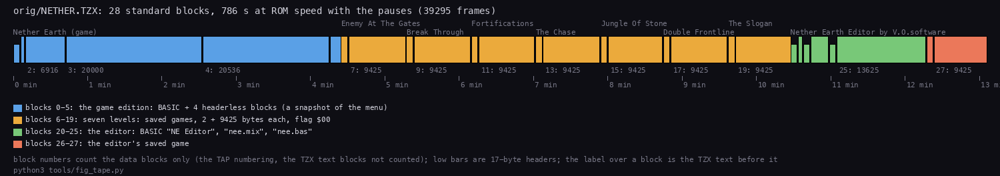
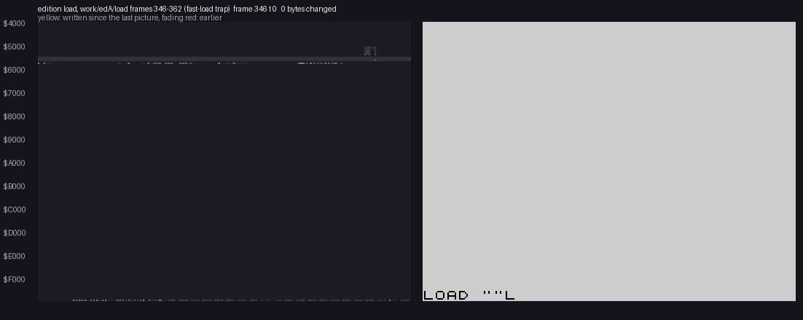
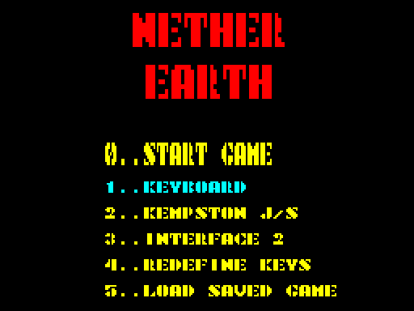
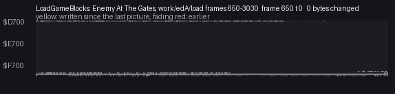
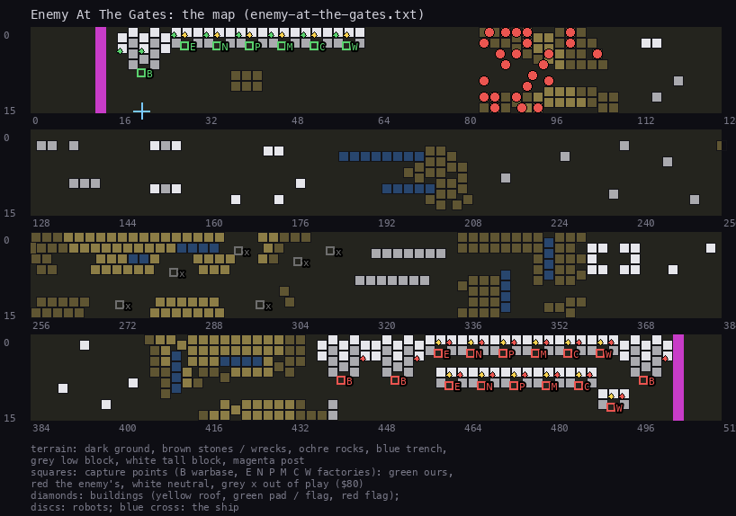

# 3. Build and load

This document covers the editor tape outside the editor program itself: its blocks, the copy of Nether Earth at
the front, how that copy loads, the saved-game format the seven levels and the editor share, and the build that makes
the tape again. The editor program (blocks 20-25) is in 02, 05 and 08.

In short: the tape's game is **not a new build of Nether Earth**. It is a snapshot of the original game, taken while
its main menu played the tune, and put on tape by a small snapshot loader in a BASIC REM line. Its memory equals the
original's image byte for byte apart from the state a running menu leaves (3.5). The seven levels are ordinary saved
games of that game (3.6), loaded by its own menu option 5.

"NE" below is the Nether Earth case (`../nether-earth`); its names (`SaveGame`, `Buildings`, `RadarDirty` ...) are
from its `src/game/game.ann`.

The recordings it rests on (folders under `work/edA/`, made by `tools/level_session.py`):

- `load`: power-on, LOAD "" with `orig/NETHER.TZX`, the edition, the menu, level 1 loaded through key 5 at signal
  speed, 300 frames of play, then SaveGame through key 5 in play. TTD file `load/session.ttd`, 5 705 frames,
  with an analysis build (`load/l1.json`). The frames below are TTD frames of this file; the rig's frame numbers in
  `load/events.json` are about 100 lower (the recording starts before the rig counts).
- `levels`: not recorded; from the menu snapshot `load/menu.szx`, each of the eight saved games loaded through key 5,
  with memory and screens taken in play.

## 3.1 The tape

`orig/NETHER.TZX` (141 299 bytes, SHA-1 `8818b4beaf9606f1dd3222120f509282ab3368bc`) is a TZX 1.10 file with 28
standard-speed data blocks and 10 text blocks (`$30`) naming the parts. The block numbers here count the data blocks
only: that is the TAP numbering of the TAP `tools/tzx_blocks.py orig/NETHER.TZX OUT.tap` writes, and it is also what the emulator's
`/tape/seek` counts.



```sh
python3 tools/fig_tape.py
```

`python3 ../../kit/tapblocks.py list work/edA/nether.tap`, with the TZX texts:

| Block | Text before it | Kind | Bytes | Loads at | Plays for |
| --- | --- | --- | ---: | --- | ---: |
| 0 | Nether Earth (game) | header Program `NetherEart`, LINE 20 | 17 | | 5.1 s |
| 1 | | BASIC, flag `$FF` | 146 | PROG `$5CCB` | 2.8 s |
| 2 | | headerless, flag `$FF` | 6 916 | `$4000` | 31.8 s |
| 3 | | headerless, flag `$FF` | 20 000 | `$61A8` (25000) | 109.5 s |
| 4 | | headerless, flag `$FF` | 20 536 | `$AFC8` (45000) | 101.6 s |
| 5 | | headerless, flag `$FF` | 1 704 | `$5B00`, over the BASIC | 8.9 s |
| 6, 7 | Levels by V.O.software (loading as "saved game"), Enemy At The Gates | flag `$00` | 2, 9 425 | `$5B00`, `$D92B` | 50.7 s |
| 8, 9 | Break Through | flag `$00` | 2, 9 425 | | 50.5 s |
| 10, 11 | Fortifications | flag `$00` | 2, 9 425 | | 49.8 s |
| 12, 13 | The Chase | flag `$00` | 2, 9 425 | | 50.7 s |
| 14, 15 | Jungle Of Stone | flag `$00` | 2, 9 425 | | 48.5 s |
| 16, 17 | Double Frontline | flag `$00` | 2, 9 425 | | 50.4 s |
| 18, 19 | The Slogan | flag `$00` | 2, 9 425 | | 49.3 s |
| 20, 21 | Nether Earth Editor by V.O.software | header Program `NE Editor `, LINE 1; BASIC | 17, 221 | | 8.2 s |
| 22, 23 | | header Bytes `nee.mix`, 50000; CODE | 17, 2 244 | `$C350` | 19.0 s |
| 24, 25 | | header Program `nee.bas`, LINE 1; BASIC | 17, 13 625 | | 76.5 s |
| 26, 27 | | flag `$00` (no text) | 2, 9 425 | | 47.3 s |

The whole tape plays for 760.9 s at ROM speed, 785.9 s with the TZX pauses. Every pause is 1 000 ms except after
blocks 5, 19 and 27 (0 ms). The level names are only in the TZX texts: the saved games carry no name (3.6).

Blocks 6-19 and 26-27 are what NE's `SaveGame` writes (3.6): two headerless blocks with flag `$00`. The edition can
load them, the editor (edB) makes them: block 26-27 is the last game saved from the editor when the tape was made.

## 3.2 The BASIC and its loader code (block 1)

`work/edA/edition.bas` (detokenised):

```basic
10 REM <70 bytes of Z80 code>
20 CLEAR VAL "24999": BORDER VAL "0": PAPER VAL "0": INK VAL "0": CLS : RANDOMIZE USR ( PEEK VAL "23635"+ VAL "256"* PEEK VAL "23636"+ VAL "5")
```

Line 20 is the autostart (header LINE 20). `CLEAR 24999` puts RAMTOP at `$61A7`, just below block 3. The screen goes
black on black, and `USR (PEEK 23635 + 256 * PEEK 23636 + 5)` calls PROG + 5: the byte after line 10's number, its
length and the REM token, `$5CD0`. The numbers are written with `VAL "..."` (no hidden 5-byte forms), so the listing
is what runs.

The REM holds the loader (`src/edition/edition.asm`, label `Loader`):

1. `DI`, then three `CALL LD-BYTES` (`$0556`, flag `$FF`): `$4000` / 6 916, 25000 / 20 000, 45000 / 20 536.
2. `LD SP,($5B00)`: block 2's last 4 bytes landed at `$5B00-$5B03` (the printer buffer). They give SP = `$410E` and
   the resume address `$4002`, both inside the screen just loaded.
3. Pops from that register frame: AF (A = `$FE` goes to I, the game's IM 2 page), DE', HL', BC' (then `EXX`), IY
   = `$5C3A`.
4. HL = (`$5B02`) = `$4002`; IX = `$5B00`, DE = 1 704, A = `$FF`, carry set; `PUSH HL`; `JP LD-BYTES`.

Block 5 then loads over `$5B00-$61A7`: the printer buffer, the system variables, and the BASIC and the REM code that
are running. Nothing of the BASIC is needed again: the code left the REM with the `JP`. LD-BYTES pushes its own
SA/LD-RET (`$053F`, into the frame's BC' slot, already popped) and returns into it. SA/LD-RET sets the border from
BORDCR (`$5C48`, by now the game image's `$38`), tests BREAK, executes `EI` and returns to the pushed `$4002`. The
trampoline therefore runs with interrupts on in IM 1 until its own `IM 2`; it is 14 instructions, 18 bytes.

## 3.3 The four blocks and the trampoline

| Block | Range | What it holds |
| --- | --- | --- |
| 2 | `$4000-$5B03` | the menu screen; at `$4002` the trampoline, at `$410E` the register frame, both in pixel lines the black attributes hide; then `$5B00` SP, `$5B02` the resume address |
| 3 | `$61A8-$AFC7` | the game image |
| 4 | `$AFC8-$FFFF` | the game image, N1's leftover, the variables, the IM 2 table, the stacks |
| 5 | `$5B00-$61A7` | the game image's first 1 704 bytes, loaded last (it overwrites the 4 bytes of block 2 and the loader) |

**The trampoline** (`$4002-$4013`, entered by LD-BYTES' `RET` with SP = `$4118`):

```text
POP AF          ; $0021, for AF'
POP IX          ; IX = $D92B
EX AF,AF'       ; AF' = $0021
POP HL
LD SP,HL        ; SP = $FFF0, the game's stack
POP DE          ; $265F
POP BC          ; $001F
POP HL          ; $C665
POP AF
LD R,A          ; R = $B3
POP AF          ; AF = $001A
IM 2
EI
RET             ; PC = $C4C3 (BassIdlePad, the menu tune's tone loop), SP = $FFFC
```

The register frame at `$410E-$411F`: AF `$FEAD`, DE' `$C78B`, HL' `$C6BF`, BC' `$0F0F`, IY `$5C3A`, AF' `$0021`,
IX `$D92B`, SP `$FFF0`. The last pops come from the game's own stack at `$FFF0-$FFFB` (block 4). The registers are
those of the menu at the moment of the snapshot: the tune's tone loop, with `Handler` = `MenuInterrupt` (3.5).

This is an SNA-style restorer: the same frame (I, the alternate set, IY, IX, SP, R, AF, IM, the PC on the stack) an
`.sna` file holds. The snapshot's PC was pushed on the game's stack (`$FFFA`), and the restorer's frame put 10 bytes
below it.

## 3.4 The load, recorded

The `load` recording plays the TZX with the ROM's fast-load trap on. TTD reads of `load/session.ttd` (memory at the
start of each frame, `work/edA/ttd.py`):

| TTD frame | What |
| ---: | --- |
| 348 | the BASIC is in place |
| 358 | line 10's code entered: `$5CD0`, called from the ROM's `USR` (`$34BB`) |
| 359 | blocks 2 and 3 in memory (the trampoline at `$4002` equals block 2) |
| 360 | block 4 in memory |
| 361 | block 5 in memory; the trampoline has run, the menu plays (block 4's tail now differs: the game's stack and variables) |

With the trap each LD-BYTES takes no tape time, so the four blocks fit in about 3 frames. At ROM speed blocks 1-5
play for 254.6 s (3.1).



```sh
python3 ../../kit/memanim.py --work work/edA/load --from 346 --to 362 --step 17472 --from-address 4000 --screen --label "edition load, work/edA/load frames 346-362 (fast-load trap)" docs/img/anim-load-edition.gif
```

What the player sees is the menu screen of block 2, already showing the main menu with "Keyboard" selected, then the
tune. There is no loading screen and no title: the game starts in its menu.



## 3.5 The image against Nether Earth's

`work/edA/mkimg.py` lays blocks 2-5 into 64 K the way the loader does (`work/edA/edition.bin`) and compares it with
NE's game block placed at `$4000` (`work/edA/ne.bin`). From `$5B00` on, the image is NE's `build/game.bin`
(`$5B00-$FCE8`) byte for byte, apart from the bytes below. No byte of code or data differs: **no crack, no patch, no
translation**. Every difference is state the running game, its loader N1 or the ROM wrote. `src/edition/edition.asm`
sets each one with its reason, and the build proves the list complete (3.7).

| Address | Edition | Meaning |
| --- | --- | --- |
| `$4000-$5AFF` | the menu screen | NE's block has a dead copy of `$C350-$DE4F` here (NE 3.4); `ClearScreen` overwrote it in the menu |
| `$4002-$4013`, `$410E-$411F` | trampoline, register frame | the snapshot loader's own bytes, put in black pixel lines (3.3) |
| `$C4D0` `$37`, `$C4D6` `$0D` | | the menu tune's lead period and pulse width (self-modified operands, `LeadNextEvent` `$C540`) |
| `$C4ED` `$7C`, `$C4EF` `00`, `$C4F3` `$1F` | | the bass period, the bass voice off, its pulse width |
| `$FCE9-$FD8D` | N1 from its 16th byte | NE's loader at `$FCDA`: the game block's tail covered its first 15 bytes, the rest stayed (NE 3.4) |
| `$FD00-$FD03` | `39 30 39 30` | `RandomSeed`, as `Start` seeds it |
| `$FD04` | `$50DA` | `PrintAddr` |
| `$FD08` | `$FFFC` | `SavedSP`: the menu tune's SP |
| `$FD13-$FD17` | `$46`, `$5ADA`, 0, 0 | `PrintAttr`, `PrintAttrAddr`, `PrintHeight`, `PrintWidth` |
| `$FD31-$FD33` | 8, `$16`, 5 | `PrintColumn`, `PrintRow`, `TitleColourPhase` |
| `$FD54-$FD57` | `$C67D`, `$C704` | `BassReturnPos`, `LeadReturnPos`: the tune's positions |
| `$FDFD-$FDFF` | `JP $C4FD` | the IM 2 jump, `Handler` = `MenuInterrupt` |
| `$FE00-$FF00` | 257 × `$FD` | the IM 2 vector table `Start` builds |
| `$FF01-$FF17` | zeros | `Buildings` not built yet (`NewGameSetup` runs after the menu) |
| `$FF18-$FF55` | ROM return addresses | the ROM's machine stack under the power-on RAMTOP `$FF57` (STMT-RET `$1B76`, MAIN-4 `$1303` at the top) |
| `$FF56-$FF57` | `00 3E` | the GO SUB stack's end marker at the power-on RAMTOP |
| `$FF58-$FFD9` | ROM `$3E08` on | the user graphics the ROM copies at power-on |
| `$FFDA-$FFDF` | `$FD6C`, `$FD54`, `$A600` | N1's stack: two returns into its edge loop and its push of `Start` |
| `$FFE0-$FFEF` | older bytes | BASIC and ROM stack leftovers |
| `$FFF0-$FFF9` | DE, BC, HL, R and A, AF | the snapshot loader's frame (3.3) |
| `$FFFA-$FFFF` | `$C4C3`, `$C1A1`, `$A62D` | the snapshot's PC (`BassIdlePad`), `MenuMusic`'s return into `MainMenu`, `MainMenu`'s return into `Start` |

So the snapshot was taken on the original tape's game, loaded the normal way (N1's stack and leftovers are there), in
its main menu. The power-on bytes at `$FF18-$FFD9` show a 48K that never had RAMTOP lowered before NE's loader ran.

## 3.6 The saved game

NE's save (`SaveGame` `$C28D`, `SaveGameBlocks` `$C2C9`) and load (`LoadGameBlocks` `$C21E`) are described in NE 3.6
from the code. Here both ran, in the `load` recording.

**The two blocks.** The 2-byte block is the 16-bit byte sum of the second block (`SaveChecksum` `$C30F`),
little-endian, kept at `$5B00`. The 9 425-byte block is memory `$D92B-$FDFB`:

| Offset | Bytes | Address | NE name | Contents |
| ---: | ---: | --- | --- | --- |
| 0 | 45 | `$D92B` | `Shots` (`$D7D3`), staged | 5 shot records of 9 bytes |
| 45 | 168 | `$D958` | `Buildings` (`$FF01`), staged | 56 building records of 3 bytes: column (word), type |
| 213 | 768 | `$DA00` | `Robots` | 48 records of 16 bytes: slots 0-23 ours, 24-47 the enemy's |
| 981 | 8 192 | `$DD00` | `Map` | 16 rows of 512 cells |
| 9 173 | 112 | `$FD00-$FD6F` | the variables | `RandomSeed` ... `Clock` `$FD35`, `PlayerBuildings` `$FD3A`, `PlayerRobotCount` `$FD41`, `EnemyBuildings` `$FD42`, `EnemyRobotCount` `$FD49`, `EnemyResources` `$FD4A`, `Side`, `RadarDirty` `$FD52` ... |
| 9 285 | 20 | `$FD70` | `Warbases` | capture points 0-3, 5 bytes each: column (word), row, owner and type, count |
| 9 305 | 120 | `$FD84-$FDFB` | `Factories` | capture points 4-27 |

`Resources` (`$FD22`) and the counts are part of the variables. The variables also hold display and sound state
(`PrintAddr`, `RadarBlink`, `MenuCursor`, `BassReturnPos` ...), saved because they lie in the range; the play screen
redraws from the rest. Field by field the levels' text form (3.7) names every byte.

**Load, recorded** (level 1, Enemy At The Gates, blocks 6-7). The tape was stopped at the menu and sought to block 6,
then key 5:

| TTD frame | What | Witness |
| ---: | --- | --- |
| about 425 | key 5 in the menu | `load/events.json` |
| 677 | the 2-byte block loaded: `$5B00` = `$FE01`, block 6 | TTD read |
| 1205 | the map part loading: `$DD00` written by the ROM's LD-BYTES (`$05AE`) | `find_last` |
| 3024-3025 | `$D92B-$FDFB` equals block 7, 0 bytes differ | TTD read against `work/edA/blocks/b7.bin` |
| 3025 | `$D7D3` written by `$C25B` and `$FF01` / `$FFA8` by `$C263`: the two `LDIR`s copy the staged shots and buildings back | `find_last` |
| 3026 | `Shots` and `Buildings` equal the staged copies; play starts (`Handler` = `$D566`) | TTD read |

`LoadGameBlocks` enters LD-BYTES at `$0562`, past the address the emulator's fast-load trap hooks, so this load ran
at signal speed: about 2 600 frames (52 s) for both blocks, with the red border NE 3.6 describes.



```sh
python3 ../../kit/memanim.py --work work/edA/load --from 650 --to 3030 --step $((34*69888)) --from-address D700 --label "LoadGameBlocks: Enemy At The Gates, work/edA/load frames 650-3030" docs/img/anim-load-level.gif
```

**Save, recorded.** About 300 frames into play, key 5 (SAVE) and a key at the "PRESS RECORD AND PLAY" prompt:

| TTD frame | What |
| ---: | --- |
| 3465 | SA-BYTES of the 2-byte block returns (to `$C2FB`) |
| 5586 | SA-BYTES of the 9 425-byte block returns (to `$C30A`); play goes on |

Read while SA-BYTES ran (`load/saved.bin`): `$5B00` = `$0000`, which is the 16-bit sum of the block (it was exactly
`$20000`); the staged `$D92B-$D9FF` equals the live `Shots` and `Buildings`; `RadarDirty` = 1. The saved block
against level 1's differs in 200 bytes, all from 300 frames of play: robot records 146, map cells 46 (robots and shots
moved), `RandomSeed`, `Altitude`, `RadarBlink` and `Clock`. So `SaveGame` writes the layout the levels have, field
for field.

**All eight load.** In the `levels` run each of the eight saved games (blocks 6, 8 ... 18, 26) loaded from
`load/menu.szx` through key 5 and reached play (`levels/<slug>/events.json`). No LOADING ERROR.

## 3.7 The level resources and the build

**Levels as text.** `src/res/levels/<slug>.txt` holds each saved game as editable text, and `tools/levels.py`
turns it back into the 9 425-byte block and its 2-byte sum:

- `var NAME VALUE ...` for each variable of `$FD00-$FD6F`, by NE's names;
- `point K X Y OWNER TYPE COUNT` for the 28 capture points (`neutral+destroyed` for `$80`);
- `building K X Y TYPE` for the used building records;
- `robot K X Y course=... parts=tracks+phasers ... order=... strength=...` for live robots, `raw` for free slots
  that keep bytes;
- `map`: 4 strips × 16 rows of 128 characters (`.` ground, `A`-`Z` a block's anchor cell of type 1-26, `a`-`z` its
  other cells). The object bit 6 and the ship bit 7 are derived from the robots, buildings, shots and ship;
  anything else is a `cell X Y $HH` line.

The format is in the script's docstring. `python3 tools/levels.py check work/edA/nether.tap src/res/levels` takes
every level from the tape to text and back and compares the block and its sum: all eight identical.



```sh
python3 tools/levels.py render src/res/levels/enemy-at-the-gates.txt docs/img/levels/map-enemy-at-the-gates.png
```

The maps of all eight are in [01](01-game-design.md#13-the-levels).

**The build.** `tools/build.sh [SJASMPLUS [PYTHON]]` (sjasmplus 1.23.1; PYTHON with SkoolKit):

1. NE's resources by NE's `tools/res_formats.py`, NE's `src/game/game.asm` and `src/loader.asm`, assembled into
   `build/edition/` (NE's folder is only read);
2. `src/edition/edition.asm`: the BASIC (`basic.bin`), and the 64 K image from `res/edition/menu-screen.scr`, the
   trampoline, NE's `game.bin`, `loader.bin` from its 16th byte, the state bytes of 3.5 and the ROM's UDG copy
   (`48.rom` `$3E08`), saved as `block2.bin` ... `block5.bin`;
3. the eight levels from `src/res/levels/*.txt`;
4. the editor: `nee.mix` from `src/mix/game.asm` and the PNG tiles and font of `src/res/mix/` (`tools/mix_res.py`),
   the REM code of `nee.bas` (`src/basic/nee-rem.asm`), both BASIC programs from their listings
   (`tools/zxbasic.py`, [2](02-architecture.md));
5. the TZX from a manifest, by `tools/tzx.py` (the text blocks, the pauses, the headers, the checksums).

Each edition block and each level is compared with the original's block, then the whole TZX:

```text
edition basic.bin: identical
edition block2.bin: identical
...
build/edition/NETHER.TZX: identical to orig/NETHER.TZX
```

`res/edition/menu-screen.scr` is block 2's screen as binary (6 912 bytes, `$4002-$4013` and `$410E-$411F` zeroed,
the assembler puts the trampoline and the frame there); a PNG would not give the bytes back exactly.

## 3.8 Design notes

- The edition is the cheapest way to put a game in front of an editor on one tape: snapshot the menu, write a
  restorer of 70 bytes in a REM and 18 bytes in the screen. It needs no knowledge of the game. The price is a
  game that always starts in its menu with "Keyboard" chosen, and the menu tune from where it was cut.
- The levels need no loader of their own: the game's option 5 reads them. The editor only has to write the same
  two blocks (02, 05).
- The saved game is a memory range, not a structure: it carries the display and tune state with the rules' state,
  and a free slot keeps whatever bytes it had (10.2).
