# 05. Controls: the editor's keys

What the editor reads and how: every screen of nee.bas, its keys and what each does to the saved game. The game's own
controls are Nether Earth's ([NE doc 05](../../nether-earth/docs/05-controls.md)); the edition on this tape does not
change them (doc 03).

Rests on the recording `work/edB/tour` (`re_session.py capture --record-load`, 48K, the editor's part of the tape:
TZX blocks 30-37 as `work/edB/editor.tap`; the tape's blocks load fast through the ROM trap, the editor's own
LD-BLOCK at signal speed) and its input script `work/edB/inputs/editor-tour.txt`. Frames below are that recording's;
the script's frame F is the recording's F + 2760. Key moments are `time_travel find_event {find: "key"}` hits
(`work/edB/keys.txt`): the frame the key went down, and the ROM's KEY-SCAN (`$0296`) reading it.

## 5.1 Devices and decoding

Keyboard only. nee.bas reads every key the same way: `PAUSE 0` (wait for a key), then `LET I$=INKEY$` and a chain of
`IF I$="..."` tests, one line a key (lines 3-7, 18-32). The cursor keys repeat while held: lines 74, 77, 80, 83 test
`INKEY$` again after each step and loop. Numbers for the resources are typed into `INPUT ... LINE I$` (line 134,
138). There is no Kempston, no Sinclair joystick port read: the help text's "SINC.2 J/S" column names the keys
1-5 and "SINC.1 J/S" the keys 6-0: what a Sinclair Interface 2 joystick presses (left, right, down, up, fire), so a
joystick in either port works through `INKEY$`.

BREAK (CAPS SHIFT + SPACE) in a tape load, and any other BASIC error, does not stop the program: the error trap in the
REM of line 1 ([nee-rem.asm](../src/basic/nee-rem.asm)) sends it to line 146 (the ERROR screen; a key returns to the
menu). In `tour` BREAK at frame 17970 during LOAD FILE with the tape ended: TrapError (`$5D28`) runs at 17970+1233,
the ERROR screen follows, ENTER at 18125 goes back to the menu.

## 5.2 The main menu (lines 2-7)

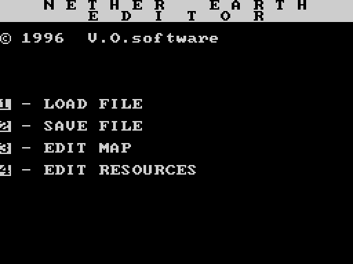

`menu.png`: frame 3050.

| Key | Line | Does |
| --- | --- | --- |
| 1 | 8 | LOAD FILE: "Searching..." (LoadChecksum `$C350`), "Loading file..." (LoadGameBlock `$C35D`), "Processing..." (the status table, GO SUB 9); a short beep |
| 2 | 11 | SAVE FILE: needs a human and an insignian warbase, else "Human warbases needed" / "Insignians warbases needed"; sorts the capture points, zeroes the clock, sums the block, "Start tape, then press any key", saves the 2 blocks |
| 3 | 16 | EDIT MAP (5.3) |
| 4 | 133 | EDIT RESOURCES (5.4) |

The program starts with LOAD FILE before the menu (line 1, GO SUB 8): the tape's saved game after nee.bas is loaded
at once (frames 260-2680 of `tour`).

## 5.3 EDIT MAP (lines 16-132)

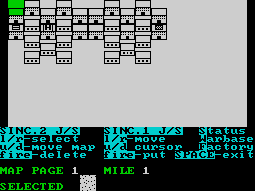

`map-page1.png`: frame 5000, page 1 of the tape's own saved game, the cursor (green) at the top left. The upper 16
rows are the map page (DrawMap `$C3A0`), rows 16-19 the help, row 21 the page and the mile, the lower screen the
selected block or a prompt.

| Key | Help | Line | Does |
| --- | --- | --- | --- |
| 1 / 2 | l/r - select | 39 / 42 | the previous / next block (2-18, skipping 15-16): shown after SELECTED |
| 3 / 4 | u/d - move map | 45 / 48 | the map page back / on: 20 cells a page, 24 pages (MAP PAGE); the map redrawn |
| 5 | fire - delete | 51 | delete the block or the building under the cursor (5.3.2) |
| 6 / 7 | l/r - move | 73 / 76 | the cursor left / right, columns 1-29, repeating while held |
| 8 / 9 | u/d cursor | 79 / 82 | the cursor down / up, rows 1-15, repeating while held |
| 0 | fire - put | 85 | put the selected block (5.3.1) |
| S / s | Status | 90 | the status table (5.3.4) |
| W / w | Warbase | 91 | place a warbase (5.3.3) |
| F / f | Factory | 110 | place a factory (5.3.3) |
| SPACE | SPACE - exit | 31 | back to the menu |

The cursor is two character squares wide and two high, drawn with OVER 1 (line 37); the MILE is the cursor's map
column / 2 (line 36), so it counts in halves.

### 5.3.1 Blocks

`0` puts the selected block CB with its bottom-left cell under the cursor: the map gets CB there and CB + 32 in the
cell to the right and the two above (line 88), and the tile is printed with the UDG pointer at its 32 bytes (line 89).
Blocks 12-18 have a second tile for odd map rows (Tiles + 224). A block goes only on four empty cells or over another
block (a cell 2-18 but not a door 15 / 16): else a beep (line 87). `5` on a block clears its four cells (line 53).

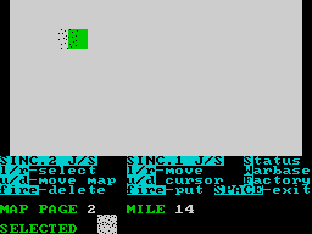 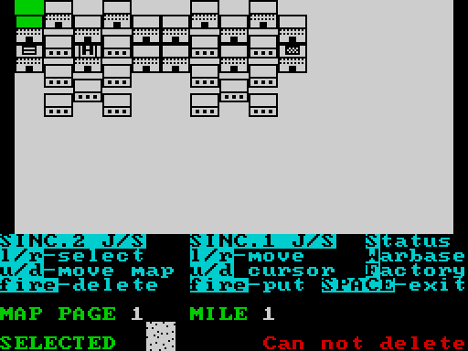

`map-blocks.png`: frame 6370, after `0` at 5834 and 6220 (blocks 2 and 4). `cannot-delete.png`: frame 5040, `5` at
5014 on an empty cell: "Can not delete" in red, a beep, 50 frames, then SELECTED again.

### 5.3.2 Deleting a building

`5` on a warbase's or a factory's door cell (80 or 16) finds its capture point (lines 54-56): the point's (X, Y)
lies 2 map rows below a factory's door cell and 4 below a warbase's. The record is marked free (owner byte 128), the owner's
building count drops, the footprint is cleared (DATA 142: 60 cells for a warbase, 143: 20 for a factory) and the
building records (SaveBuildings) of its pad and flag are zeroed; the map is redrawn. A destroyed point (owner above 70)
cannot be deleted. In `tour`: `5` at 11396 on the warbase placed at 9284; "Please wait", the page redrawn at 11536 (shot at 12890):

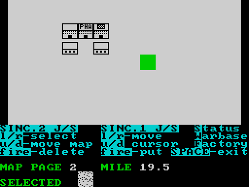

### 5.3.3 Warbases and factories

`W` (line 91) needs a warbase still available (at most 4, 3 a side), the cursor where the 60 cells of a warbase fit
(map rows 4-10, not the first columns of page 1) and all of them empty; then "Select warbase status: 1-HUMN 2-INSG".
`F` (line 110) needs a factory available (24 in all, 9 a type), 20 empty cells; then "Select factory type: 1-ELE
2-NUC 3-PHA 4-MIS 5-CAN 6-CHA" and "Select factory status: 1-HUMN 2-INSG 3-NEUTR". Anything else: "Can not place
warbase here" / "Can not place factory here", "No warbases available", "No factorys available", "Not available".

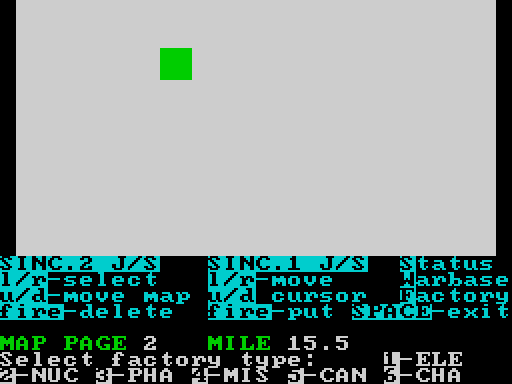 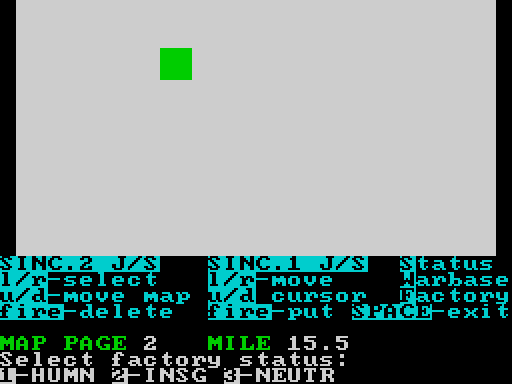 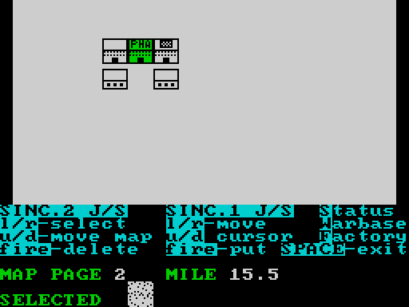

`F` at 6772, `3` (phasers) at 7176, `2` (insignian) at 7380: frames 7170, 7370, 8380. The BASIC loops over the
building records and the capture points take 86 frames: DrawMap redraws the page at 7466.

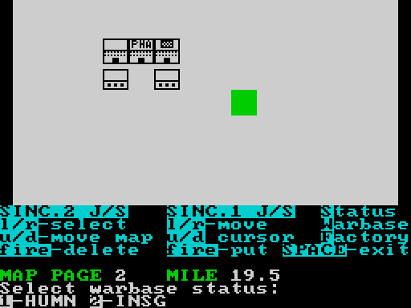 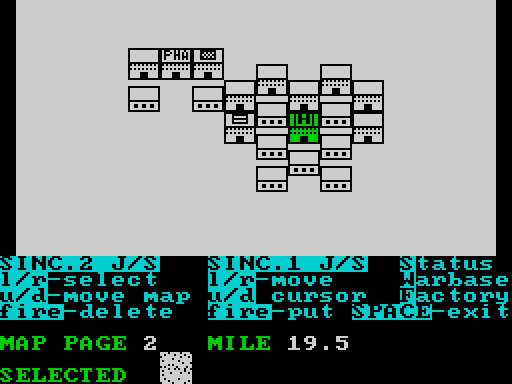

`W` at 8780, `1` (human) at 9284: frames 9280, 10780; the page is redrawn at 9398. [place-warbase.gif](img/editor/place-warbase.gif) shows frames
8770-10790 every 40.

What a placement writes into the saved game (lines 99-107, 122-130): the capture point (X, Y, owner + type), the
building records (the pad, the flag), the owner's count, and the building's pieces on the map with its door cells
(80 for the owner's door, 16 for the other side's). doc 10 (edA) gives the fields.

### 5.3.4 Status

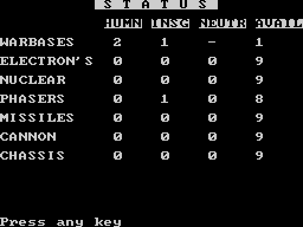

`S` at 10788, frame 11080: for warbases and the six factory types, how many are human, insignian, neutral and still
available (the table Q of line 9). Any key returns to the map.

## 5.4 EDIT RESOURCES (lines 133-141)

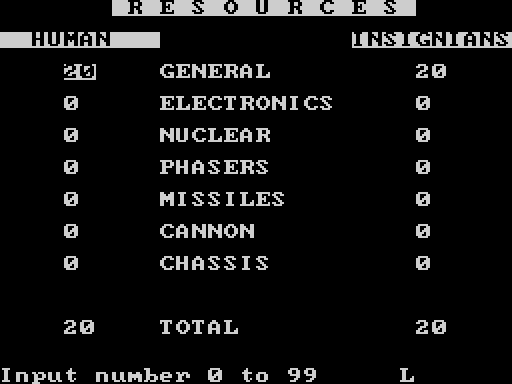 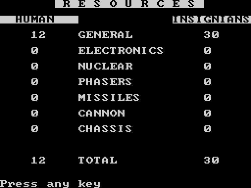

The seven resources of each side (general, electronics, nuclear, phasers, missiles, cannon, chassis) with their
totals. A flashing cursor walks down the human column, then the insignian one; at each, "Input number 0 to 99": a
number replaces the value, ENTER alone keeps it, a number outside 0-99 asks again; text that is no number is a
BASIC error in `VAL` (line 135), which the trap turns into the ERROR screen. After the last, "Press any
key". In `tour` (frames 3300 and 4300): human general 20 -> 12 (keys at 3314, 3328, 3342), insignian general 20 -> 30
(3790, 3804, 3818), the rest kept.

## 5.5 Hidden keys and quirks

- None hidden. Lower-case `s`, `w`, `f` work as the capitals (lines 28-30).
- LOAD FILE with no tape running waits in LD-BYTES until BREAK (the ERROR screen).
- Variables are case-blind: line 36 writes `cx` for CX and works.
- SAVE FILE writes the blocks at ROM speed with the standard pilot: the checksum block from 14013 to 14264, the game
  block to 16387 (2123 frames, 42 s). The game's own save uses a short pilot (NE SaveGame `$C28D`); both load the same.
