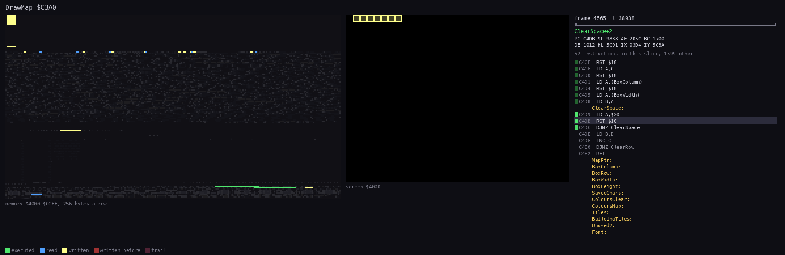
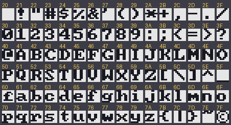
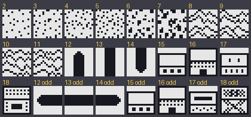
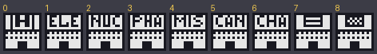

# 08. HUD and text: the editor's screens, font and strings

How the editor puts text and graphics on the screen, its font and tiles, and every string it prints. The game's own
panels and font are Nether Earth's ([NE doc 08](../../nether-earth/docs/08-hud-and-text.md)). Rests on the
recording `work/edB/tour` (doc 05 says how it was made; frames are its own) and on `src/basic/nee.bas` and
`src/mix/mix.asm`.

## 8.1 How it prints

Everything goes through the ROM's PRINT; nee.mix has no print routine of its own.

| What | How | Where |
| --- | --- | --- |
| text | BASIC PRINT with CHARS (23606) = 51220: the font of nee.mix, `Font` `$C914` (51476 = 51220 + 256) | nee.bas line 1 |
| the lower screen (prompts, SELECTED, messages) | `PRINT #0` (written `PRINT # BIN` : BIN with no digits is a 0 in 6 bytes); `INPUT BIN` (an INPUT of nothing) clears it | lines 8-146 |
| the selected block | UDGs A-D (`$90`-`$93`) with the UDG pointer (23675) at the block's tile, 50419 + 32 x (CB - 2): RANDOMIZE P, then SEED's two bytes POKEd | line 34, 89 |
| the map page | DrawMap `$C3A0`: CHARS pointed 256 bytes below a tile, characters `$20`-`$23` printed with RST `$10` | nee.mix |
| the cursor | two rows of two `$8F` (full block) with OVER 1: printed twice it is gone | line 37 |
| colours | INK / PAPER / OVER / FLASH items of PRINT; INVERSE and FLASH also as control codes inside the strings (`$14 $01` INVERSE 1, `$12 $01` FLASH 1) | throughout |

DrawMap clears the map area by printing spaces (ClearBox `$C4BE`: 30 x 16, then the two edge columns), then prints
the tiles with INK 8 PAPER 8 made permanent so they keep the cells' black-on-white attributes. In `tour` a call takes
18 frames on page 1 (frame 4565+24846 to 4583+35142, `find_event` on `$C3A0` and `$C42C`), 13 of them the spaces
(the tiles start at 4578+18862, `$C3E8`); on the near-empty page 2 the tiles take under one frame (5284+25398 to
5284+69559). Interrupts are off for the whole call (CHARS is not the ROM's while it runs).

`DrawMap.gif`: the access trace of frames 4565+24846 to 4583+35142 (`kit/routine_anim.py`, 90 pictures of 14092 T):
the box of spaces, then the tiles row by row. [drawmap-page1.gif](img/editor/drawmap-page1.gif) is the screen alone,
frames 4565-4585.

## 8.2 The font and the tiles

`Font` (`$C914`-`$CC13`, 96 glyphs, `src/res/mix/font.png`): a bold font of its own (2 glyphs equal NE's, 3 the
ROM's). It is the last part of nee.mix, which ends at 52243 exactly.

`Tiles` (`$C4F3`-`$C7F2`, `src/res/mix/tiles.png`): the 17 map blocks 2-18 and the odd-row variants of 12-18. Block
n's tile is 32 bytes at 50419 + 32 x (n - 2): top left, top right, bottom left, bottom right. Blocks 15 and 16 are the
pieces of warbases and factories: the `1` / `2` keys skip them (lines 39-43), only `W` and `F` place them.

`BuildingTiles` (`$C7F3`-`$C912`, `src/res/mix/building-tiles.png`): drawn on a door cell (`$50`) by the type of the
building record that names it: 0 the warbase pad, 1-6 the factories ELE NUC PHA MIS CAN CHA, 7 the human flag, 8 the
insignian flag. The pictures are made by `tools/mix_res.py preview docs/img/editor`.

## 8.3 The screens

| Screen | Lines | Picture (frame of `tour`) |
| --- | --- | --- |
| title while loading: the lower screen, INVERSE, "loading" FLASH | NE Editor line 1 | not kept: the tape loads fast in `tour` |
| main menu | 2 | [menu.png](img/editor/menu.png) (3050) |
| resources | 133-141 | [resources.png](img/editor/resources.png) (3300), [resources-done.png](img/editor/resources-done.png) (4300) |
| map editor | 16-37 | [map-page1.png](img/editor/map-page1.png) (5000) |
| status | 90 | [status.png](img/editor/status.png) (11080) |
| prompts in the lower screen | 94, 113, 117 | [factory-type.png](img/editor/factory-type.png) (7170), [factory-status.png](img/editor/factory-status.png) (7370), [warbase-status.png](img/editor/warbase-status.png) (9280) |
| save | 15 | [save-prompt.png](img/editor/save-prompt.png) (14000), [saving.png](img/editor/saving.png) (14500) |
| load | 8 | [load-searching.png](img/editor/load-searching.png) (17960) |
| error | 146 | [error.png](img/editor/error.png) (18120) |

The map editor's layout: rows 0-15 the map page (columns 1-30, black edges in 0 and 31), rows 16-19 the help in INK 5
(cyan) with the key letters INVERSE, row 21 "MAP PAGE n" and "MILE m" (INK 4 green labels, INK 7 values), the lower
screen's two rows "SELECTED" and the block (or a prompt, or a message in INK 2 red at column 18-21).

## 8.4 Every string

In nee.bas order (line numbers), the control codes left out (the key names and titles are INVERSE).

| Line | Text | When |
| --- | --- | --- |
| NE Editor 1 | `N E T H E R  E A R T H  E D I T O R`, `(c) 1996  V.O.software`, `loading` (FLASH) | the title while the tape loads |
| 2 | `N E T H E R  E A R T H  E D I T O R`, `(c) 1996  V.O.software`, `1 - LOAD FILE`, `2 - SAVE FILE`, `3 - EDIT MAP`, `4 - EDIT RESOURCES` | the menu |
| 8 | `Searching...`, `Loading file...`, `Processing...` | LOAD FILE |
| 11, 12 | `Processing...`, `Human warbases needed`, `Insignians warbases needed` | SAVE FILE refused |
| 15 | `Start tape, then press any key`, `Saving file...` | SAVE FILE |
| 17 | `SINC.2 J/S` `SINC.1 J/S` `Status` / `l/r-select` `l/r-move` `Warbase` / `u/d-move map` `u/d cursor` `Factory` / `fire-delete` `fire-put` `SPACE-exit` | the help |
| 33 | `MAP PAGE n` | the page |
| 34 | `SELECTED`, `/` (between the two variants) | the selected block |
| 36 | `MILE m` | the cursor's mile |
| 54, 92, 111 | `Please wait` | deleting, placing |
| 72 | `Can not delete` | 5 on nothing deletable |
| 90 | ` S T A T U S `, `HUMN INSG NEUTR AVAIL`, `WARBASES`, `ELECTRON'S`, `NUCLEAR`, `PHASERS`, `MISSILES`, `CANNON`, `CHASSIS`, `-`, `Press any key` | the status table |
| 91 | `No warbases` `available` | W with none left |
| 94 | `Select warbase status:` `1-HUMN 2-INSG` | W |
| 97, 116 | `Not available` | that owner / type is used up |
| 108 | `Can not place` `warbase here ` | W refused |
| 110 | `No factorys` `available` | F with none left |
| 113 | `Select factory type:` `1-ELE` `2-NUC 3-PHA 4-MIS 5-CAN 6-CHA` | F |
| 117 | `Select factory status:` `1-HUMN 2-INSG 3-NEUTR` | F |
| 131 | `Can not place` `factory here ` | F refused |
| 133 | ` R E S O U R C E S `, `  HUMAN   `, `INSIGNIANS`, `GENERAL`, `ELECTRONICS`, `NUCLEAR`, `PHASERS`, `MISSILES`, `CANNON`, `CHASSIS`, `TOTAL` | the resources |
| 134, 138 | `Input number 0 to 99     ` | the resources' INPUT |
| 141 | `Press any key` | after the resources |
| 146 | ` E R R O R ` (FLASH), `Press any key` | the error trap |

The status table writes ELECTRON'S where the resources screen writes ELECTRONICS; "factorys" and "Insignians" are the
program's spelling. The REM of line 37 keeps an older, tokenised copy of lines 36-37 (never run).

## 8.5 Not seen in a recording

The loading title (the tape loads through the ROM trap in `tour`: line 1 of NE Editor and the loads run between
frames 250 and 259), "Human warbases needed" / "Insignians warbases needed", "No warbases / No factorys available",
"Not available", "Can not place ... here".
