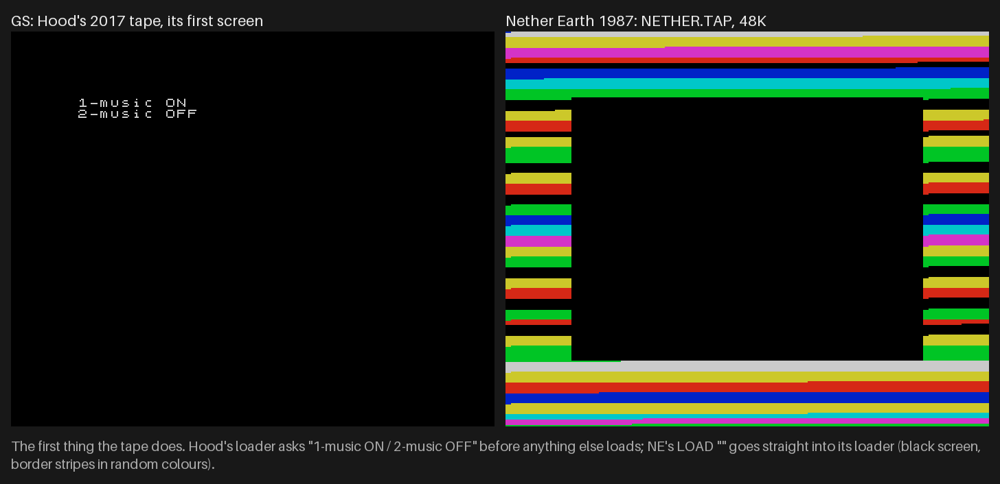
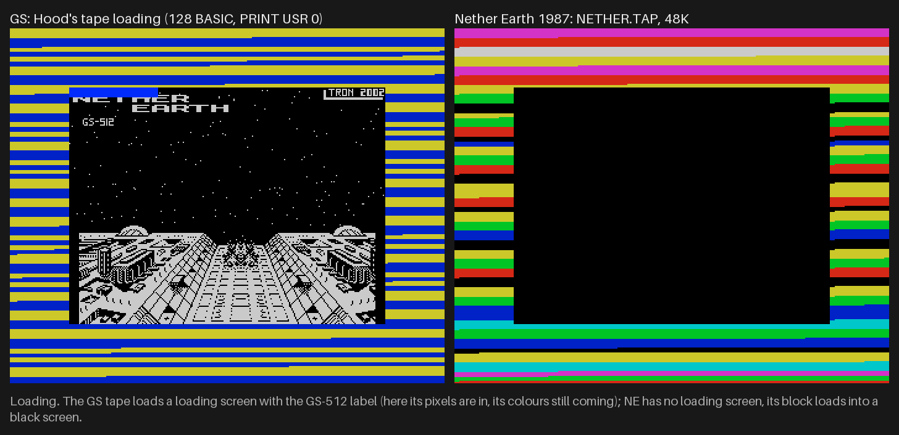
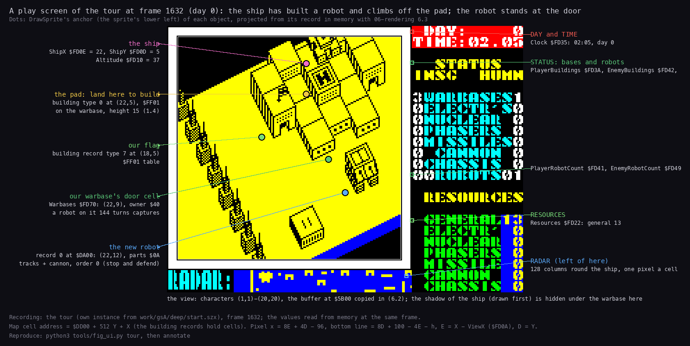
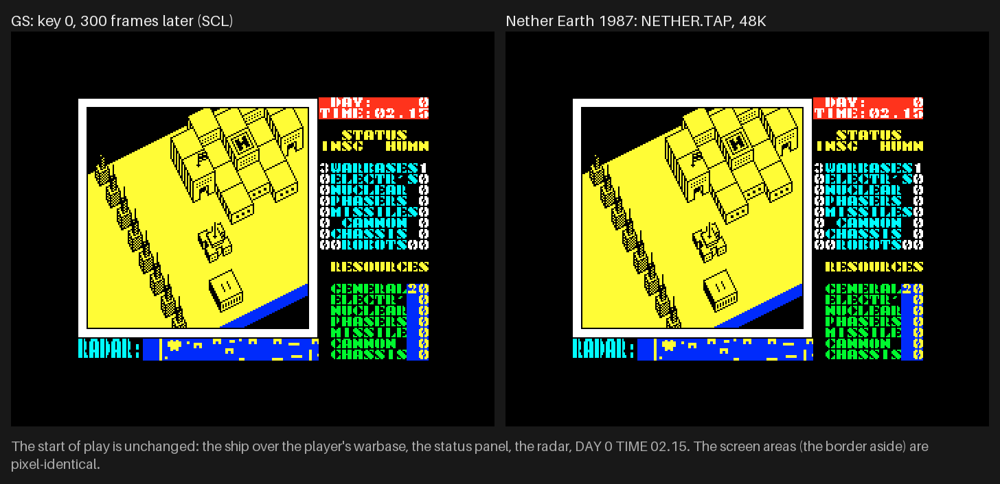
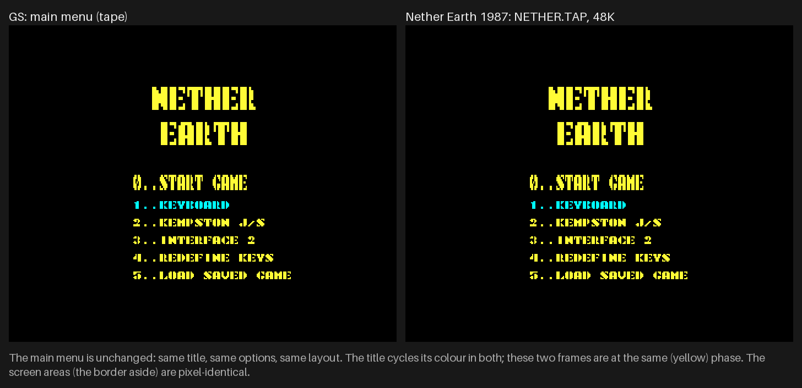
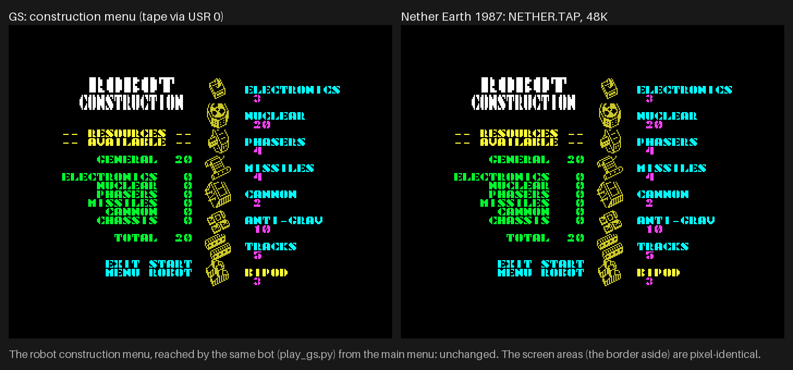
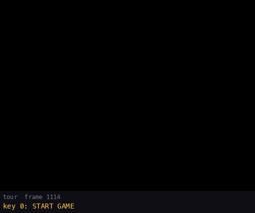
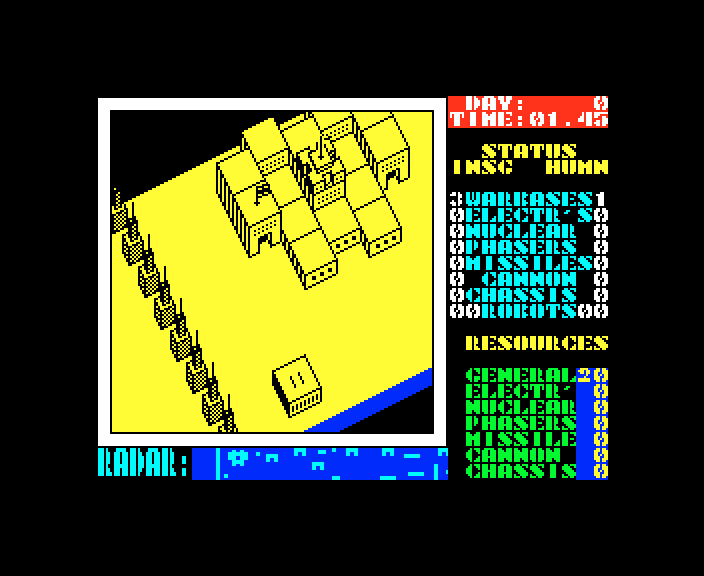
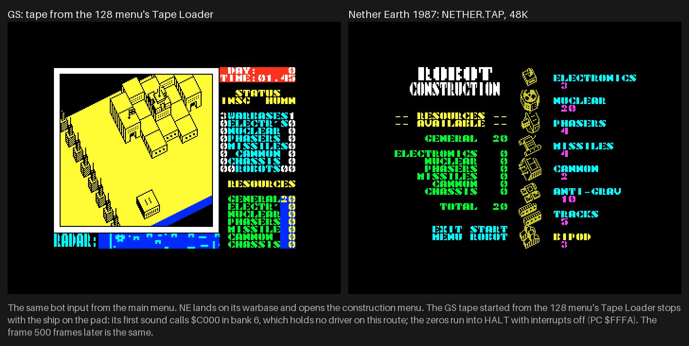

# 1. Game design

This document covers Nether Earth GS as a player meets it:

- the two editions and how each starts;
- the screen, the ship and the bases;
- building robots, giving them orders, fighting;
- the enemy, the days, and how a game is won or lost;
- the hang of Hood's tape on a 128K;
- saving and the sound.

Every rule here comes from the technical documents (2-12), which show where it lives in the code and how the
recordings saw it. Each section links its source.

The recordings this rests on ([Terms](README.md#terms)):

- `deep` (`work/gsA/deep`): the SCL on a Pentagon 128 + GS 512 KB, played from the main menu by the bot
  (`tools/play_gs.py`, steering by keys only) for 24 588 frames, 8 game days. The bot built 7 robots, gave them
  search orders and captured factories. Its L1 counts every routine;
- `tour` (`work/gsA/tour`): a scripted session from the same menu snapshot, 8 269 frames. It ran the redefine screen,
  a build, orders, direct control, combat and the distance menu, a pause, then hovering. At frame 7 729 it pokes
  `PlayerBuildings` to 0 to see the lost game's end: an experiment, not play;
- `rT` (`work/gsB/rT`, [7](07-objects.md)): Hood's tape played by the same bot for 40 134 frames, 13.4 game days;
- `shots` (stage 2, `tools/fig_capture.py`): the screens of each medium, and the frames of the side-by-side figures.

## 1.1 The game in one paragraph

**Nether Earth GS** is a strategy game for a ZX Spectrum 128 with a **General Sound** card (GS), the Z80 sound card
with its own RAM, ProTracker module player and samples. Two editions exist:

- **Tron Z, 2002**: an SCL and a TRD. Its loading screen says "GS-512" and "TRON 2002";
- **Hood, 2017**: a tape, "Conversion from TRD by Hood" in its BASIC ([3.7](03-build-and-load.md#37-the-tape-hood-2017)).

The player flies a ship over an isometric strip of land 512 cells long and 16 wide. Two sides own bases on it:

- the humans, **HUMN** on the status panel, are the player. They hold one warbase at the west end;
- the **Insignians**, **INSG**, are the computer. They hold three warbases further east.

The player does not fight: robots do. The ship lands on its own warbase's pad to build a robot from parts, paid for
with resources. It lands on a robot to give it an order: advance, retreat, destroy or capture.

There are 24 factories, all neutral at the start. Each gives its holder a resource every day; warbases give the
general resource. A robot that stands on a base's door for 144 game turns captures the base. The game is won when
the Insignians have no warbase left, and lost when the player has none.

The sound is the card's: a module for the whole game, and samples for the shots, hits and menus ([9](09-sound.md)).
How much of it a player hears depends on the edition (1.12).
Hood's tape plays the module and the samples.
The disk edition (SCL and TRD) plays neither: its card ends the load with no module, and its driver loses every
effect it sends ([9.5](09-sound.md#95-the-disk-version-plays-no-effect)).

## 1.2 The editions and how each starts

| Edition | Medium | The player does | The player sees |
| --- | --- | --- | --- |
| Tron Z, 2002 | SCL | TR-DOS, `RUN "neart GS"` | the loading screen with its progress bar over "GS-512", then the main menu |
| Tron Z, 2002 | TRD | TR-DOS, `RUN`, then key 1 | first the boot menu (0 boot, 1 neart GS, 2 Neart481, 3 Neart482), then as the SCL |
| Hood, 2017 | TAP | 128 BASIC, `PRINT USR 0`, then `LOAD ""` | "1-music ON / 2-music OFF", then the loading screen and the menu |
| Hood, 2017 | TAP | the 128 menu's Tape Loader, or its 48 BASIC and `LOAD ""` | the same, until the first sound in play: the machine stops (1.10) |

The load step by step, and the TRD's two extra programs, are in [3](03-build-and-load.md). The keys are in
[5.6](05-controls.md#56-starting-each-medium).

The start of the tape, side by side with Nether Earth's own tape of 1987 (`NETHER.TAP`, on a 48K):

How to read the figure:

- **Left**: Hood's tape, its first screen. The loader asks "1-music ON / 2-music OFF" before anything else loads.
- **Right**: the 1987 tape at the same point: a black screen, with border stripes in random colours.

How to read the figure:

- **Left**: the GS loading screen `neart000` arriving: the title over a starfield and a city, "GS-512" under it.
- **Right**: the 1987 tape at the same stage, still a black screen.

Both figures: `python3 tools/fig_capture.py`, then `python3 tools/fig_compare.py` (the frames are 2x, nearest
neighbour).

## 1.3 The screen

How to read the figure:

- **The screen**: tour frame 1 632, day 0, 02:05. The ship has built a robot and climbs off the pad.
- **Dots**: where `DrawSprite` puts each object, projected from its record in memory
  ([6.3](06-rendering.md#63-the-projection)).
- **Left labels**: the ship at (22,5), altitude 37; the pad (22,5); our flag (18,5); our warbase's door (22,9); the
  new robot, record 0 at (22,12), parts `$0A` (tracks + cannon).
- **Right labels**: the panel areas and the variables behind them.

`python3 tools/fig_ui.py tour`, then `python3 tools/fig_ui.py annotate`.

`DrawPlayScreen` `$D0CA` draws one fixed frame with four live areas
([6.8](06-rendering.md#68-the-play-screen-and-the-panel)):

| Area | Where | What it shows |
| --- | --- | --- |
| **View** | the white frame, characters (1,1)-(20,20) | the 32 x 16 map cells round the ship, isometric, black on yellow; redrawn every game turn ([6](06-rendering.md)) |
| **Clock** | top right, red | DAY and TIME (hours.minutes); `GameTurnEnd` `$AD90` prints it every turn |
| **Status panel** | right, rows 2-21 | each side's buildings by kind (INSG left, HUMN right), each side's robots, then the player's seven resources; a robot menu takes its place while the menu is open |
| **Radar** | bottom, "RADAR:" | 128 map columns, one pixel a cell: walls and blocks, our robots in cyan, the enemy's in yellow, blinking on alternate frames ([6.7](06-rendering.md#67-the-radar)) |

The start of play, side by side with the 1987 game:

How to read the figure: both frames are 300 frames after key 0 at the main menu. The screen area (border aside) is
the same, pixel for pixel. `python3 tools/fig_compare.py`.

The main menu, the same way:

How to read the figure: both menus at the yellow phase of the title's colour cycle; the screen areas match pixel for
pixel. The six options are in [5.2](05-controls.md#52-the-main-menu-and-the-redefine-screen).

## 1.4 The ship

The ship is the player's only body: a flying cursor with no record of its own (`MoveShip` `$AF11`,
[5.3](05-controls.md#53-in-play-the-ship-and-the-game-keys)).

- **Moving.** One cell a turn in the four directions, over columns 14-501 and rows 1-15.
- **Height.** Fire climbs 2 a turn up to 48; without fire the ship sinks 1 a turn, down to what stands under it.
- **Obstacles.** The ship cannot move into a place higher than its altitude. It climbs first.
- **The start.** A new game puts it at (17,10), altitude 0. It climbs 3 turns on its own (`ClimbTurns` `$FD30`).
- **Landing.** On our warbase's pad at altitude 15 it opens the construction menu. On the top of one of our robots it
  opens the robot menu. After either it climbs 5 turns on its own.
- **The view** follows it: the view moves one column when the ship reaches view column 13 or 22.

## 1.5 Bases, resources and days

**Bases.** There are 28 capture points ([7.6](07-objects.md#76-buildings-and-capture-points)):

- 4 warbases: ours at column 22, the enemy's at 261, 369 and 494;
- 24 factories, each of one kind: electronics, nuclear, phasers, missiles, cannon or chassis. All are neutral at the
  start.

A robot of either side that stands on a base's door for 144 game turns captures it, whatever its order
(`GameTurnEnd` `$AD90`, [10.7](10-gameplay-logic.md#107-capture)). An empty door resets the count.

**Resources.** Seven per side: general, electronics, nuclear, phasers, missiles, cannon, chassis. Both sides start
with 20 general and nothing else (`NewGameSetup` `$A62D`).

**Days.** A game turn is 5 minutes of game time and at least 10 frames ([4.5](04-game-loop.md#45-time)). So a game
day is 288 turns, 2 880 frames, about 58 s. At each new day `DailyProduction` `$AE38` pays both sides:

- 5 general for each warbase;
- 2 of a kind for each factory of that kind;
- every resource stops at 99 ([10.2](10-gameplay-logic.md#102-production-and-resources)).

In `deep` the day turned 8 times. At frame 24 580 (day 8, 04:25):

| | Warbases | Factories | Robots |
| --- | ---: | ---: | ---: |
| us | 1 | 3 | 6 |
| the enemy | 3 | 9 | 15 |

Our resources were 2, 3, 0, 0, 2, 2, 0: the bot spends everything it gets.

## 1.6 Building a robot

The ship sinks onto our warbase's pad. If the door below is free, the construction menu opens and the world stops
([5.4](05-controls.md#54-the-construction-menu)).

A robot is one chassis and up to four other parts:

| Part | Kind | Cost | Height |
| --- | --- | ---: | ---: |
| bipod | chassis | 3 | 11 |
| tracks | chassis | 5 | 7 |
| anti-grav | chassis | 10 | 8 |
| cannon | weapon | 2 | 6 |
| missiles | weapon | 4 | 6 |
| phasers | weapon | 4 | 7 |
| nuclear | weapon (the bomb) | 20 | 7 |
| electronics | | 3 | 7 |

The rules:

- **One chassis.** A new one replaces the old, which is refunded.
- **At most three** of the four weapons.
- **Payment.** Each part is paid from its own resource first, and the rest from the general one. A part the general
  resource cannot cover is refused.
- **START ROBOT** puts the robot on the door. It starts with order 0 (stop and defend) and strength 100.
- **The robot's height** is the sum of its parts' heights. A taller robot on higher ground takes less damage (1.8).

The costs are `PartCosts` `$CAF0`, the heights `PartHeights` `$D7B4`
([6.6](06-rendering.md#66-robots-parts-stacked), [10.3](10-gameplay-logic.md#103-construction-costs-and-limits)).

How to read the figure:

- **Left**: the GS game; **right**: the 1987 game. The same bot (`play_gs.py`) drove both from the main menu.
- **On each**: the resources at the left (GENERAL 20, the rest 0), the eight parts with their costs at the right.
- The screen areas match pixel for pixel. `python3 tools/fig_compare.py`.

In `deep` the bot built 7 robots, at frames 450, 1 578, 3 456, 6 552, 9 529, 15 448 and 24 270. Among their parts
bytes: `$09` (bipod + cannon) at 450, `$1A` (tracks + cannon + missiles) at 3 456, `$89` (bipod + cannon +
electronics) at 6 552, `$B2` at 15 448 and `$BC` at 24 270.

## 1.7 The robot menu and orders

The ship lands on the top of one of our robots: the robot menu takes the right panel, and the world goes on
([5.5](05-controls.md#55-the-robot-menu-and-its-submenus)).

| Item | What it does |
| --- | --- |
| DIRECT CONTROL | the player drives the robot with the controls; the ship rides on it; fire gives it back |
| GIVE ORDERS | STOP AND DEFEND; ADVANCE or RETREAT 0-50 miles; SEARCH & DESTROY enemy robots, factories or warbases; SEARCH & CAPTURE neutral factories, enemy factories or enemy warbases |
| COMBAT MODE | fire a weapon the robot carries, set off its nuclear bomb, move it, or stop |
| LEAVE ROBOT | the robot carries on with its order; the ship climbs off |

The order rules:

- Destroying factories or warbases needs the nuclear bomb. Without it the order becomes stop and defend.
- A search order with no target becomes stop and defend.
- 0 miles is stop and defend.

How each order moves the robot is in [7.2](07-objects.md#72-robots) and [10.5](10-gameplay-logic.md#105-orders).

How to read the figure:

- Tour frames 1114-2535, one picture every 6 frames; under each, the frame and the action.
- The ship flies to the pad (22,5) and sinks onto it (1 214).
- The construction menu: tracks + cannon (1 274-1 500).
- The robot at the door; the ship lands on it (1 672) and the robot menu opens (2 030).
- SEARCH & CAPTURE, NEUTRAL FACTORYS (2 129). The robot sets off at 2 295.

`python3 tools/fig_ui.py tour` (or `draw-tour` from the saved samples).

## 1.8 Fighting

Robots fight on their own under their orders, and in COMBAT MODE on the player's choice
([7.4](07-objects.md#74-shots), [10.6](10-gameplay-logic.md#106-shooting-and-damage)):

- **Weapons.** Cannon, missiles and phasers fire shots along the robot's facing. A shot flies 2 cells a turn for 5
  turns (missiles 7), one more with electronics.
- **Hits.** A shot hits a robot of either side anchored in the 3 x 3 cells round it. The robot takes
  `(60 - height - ground) / 4` times (weapon + 1), with weapon 1 cannon, 2 missiles, 3 phasers.
- **Strength.** A robot starts at 100. At 0 it is destroyed and its record freed.
- **Friendly fire.** The hit test does not look at the side. In `rT` the enemy's shots destroyed one of its own
  robots ([7.4](07-objects.md#74-shots)).
- **The nuclear bomb** destroys its carrier. It also destroys the first base close enough (`$070A` sets the warbases'
  reach, `$0507` the factories') and hits the area round it (`NuclearBlast` `$B99F`). No recording set one off
  ([10.9](10-gameplay-logic.md#109-the-nuclear-blast)).

## 1.9 The enemy, winning and losing

**The enemy** (`EnemyCommander` `$B7F4`, every turn; 2 359 calls in `deep`;
[10.8](10-gameplay-logic.md#108-the-enemy-commander)):

- **Builds.** It builds at a random warbase of its own when the door is free. The parts are random: one chassis, and
  at least one weapon. The more robots it has, the more parts it wants. It pays like the player, from
  `EnemyResources`.
- **Orders.** A robot with order 0 at once, and any other with a chance of 1 in 32 a turn, gets a new order. A robot
  with the bomb is sent to destroy factories or warbases; the others capture; destroy robots is the fall-back.
- **A capture in progress** keeps its order.

**The end** (`CheckGameEnd` `$AE6B`, every turn; [10.10](10-gameplay-logic.md#1010-winning-and-losing)):

| Condition | Message at the bottom | Then |
| --- | --- | --- |
| the enemy has no warbase | "INSIGNIANS DESTROYED / YOU HAVE WON !" | a control goes back to the main menu |
| we have no warbase | "YOU HAVE NO BASES LEFT / BETTER LUCK NEXT TIME!" | a control goes back to the main menu |

The witnesses:

- The tour's poke of `PlayerBuildings` at frame 7 729 showed the lost end, and a control at 7 887 went back to the
  main menu ([4.4](04-game-loop.md#44-the-end-of-a-game)).
- No recording won or lost a game by play. The won end is known from the code only.
- Pressing I in play also abandons the game, straight back to the main menu.

## 1.10 The hang of Hood's tape on a 128K

Started from the 128 menu's Tape Loader, Hood's tape loads, the module plays at the menu, and the game runs. Then
the machine stops at the first sound in play.
Started from the 128 menu's "48 BASIC" (`x5`), the tape leaves bank 6 empty in the same way; `x5` did not go on
into play, so its hang is known from the code only.

- **When.** In `x4` the first sound in play was the construction menu's (`GsMenuSound` `$A569`, the menu's first
  instruction), so the game stopped when the ship landed on the pad.
- **Why.** Every sound pages bank 6 in at `$C000` and calls the driver there. On these routes the driver went to
  bank 0, and bank 6 holds zeros ([9.10](09-sound.md#910-hoods-tape-the-paging-trap)).
  - The Tape Loader goes through the 128 ROM's tape loader, which restores the ROM's own paging (bank 0).
  - The 128 menu's "48 BASIC" locks the paging (bit 5 of `$7FFD`).
  - A `LOAD ""` typed in 128 BASIC goes through the same 128 ROM loader as the Tape Loader. No run tried it: that it
    hangs too is known from the code only.
- **What the machine does.** The zeros run as `NOP`s, and the CPU ends halted with interrupts off: PC `$FFFA`, `iff1`
  0, BC `$7FFD` (stage 1, `x4`). The frame 500 frames later is the same, pixel for pixel.
- **The way round.** 128 BASIC, `PRINT USR 0`, then `LOAD ""`: a 48 BASIC with paging free, where the driver lands in
  bank 6 ([3.7](03-build-and-load.md#37-the-tape-hood-2017)).

How to read the figure: the screen of the stopped machine, 2x. The ship has just sunk onto the pad. The clock stands
at day 0, 01:45, and it does not move again. `python3 tools/fig_screens.py` (frame `tl-hang` of `fig_capture.py`).

How to read the figure:

- **Left**: the GS tape from the Tape Loader, frozen on the pad.
- **Right**: the 1987 game, given the same bot input from its main menu, on the construction menu.
- The caption under both says why: `$C000` of bank 6 holds no driver on this route.

`python3 tools/fig_compare.py`.

## 1.11 Saving and loading a game

- **Save.** Key 5 in play: "PRESS RECORD AND PLAY", then two tape blocks hold the robots, the map, the buildings,
  the shots and the variables ([3.9](03-build-and-load.md#39-the-saved-game)).
- **Load.** Option 5 of the main menu, LOAD SAVED GAME. A bad checksum gives LOADING ERROR and the start-up again.
- **Not saved.** The key table and the controls choice.
- Both editions save to tape, also the disk one. No recording saved or loaded: this is known from the code only.

## 1.12 The sound the player hears

What the card plays is in [9](09-sound.md). In short:

| | The module at the menu | The effects in play |
| --- | --- | --- |
| disk (SCL, TRD) | none: the loader's `#30` is lost in the card's cold restart ([3.5](03-build-and-load.md#35-the-module-upload-and-the-cold-restart)) | none: the driver's commands race the card ([9.5](09-sound.md#95-the-disk-version-plays-no-effect)) |
| tape, music ON | yes | yes ([9.8](09-sound.md#98-a-whole-game-on-the-tape)) |
| tape, music OFF | none | yes |

The beeper is silent in every edition: the game's own menu tune still runs, with its `OUT`s replaced by `NOP`s
([9](09-sound.md)).

## 1.13 Design notes

- **The player is not in the fight.** The ship cannot shoot; it only builds and commands. Every fight is between
  robots under orders.
- **The world goes on in the robot menus**, so giving orders costs game time. The construction menu stops the world.
- **Capture by standing.** 144 turns on a door is 12 game hours: a robot sent to capture must survive there.
- **Resources by kind.** A factory of a kind pays only for that kind of part. The general resource pays for anything,
  so the warbases are worth the most.
- **Sound on a card.** The game moved its sound to the GS. On the disk edition that left it silent: no module, and
  no effect in play or in the menus (9.5). Hood's tape makes it heard, on the one route that puts the driver where
  the game looks for it.
