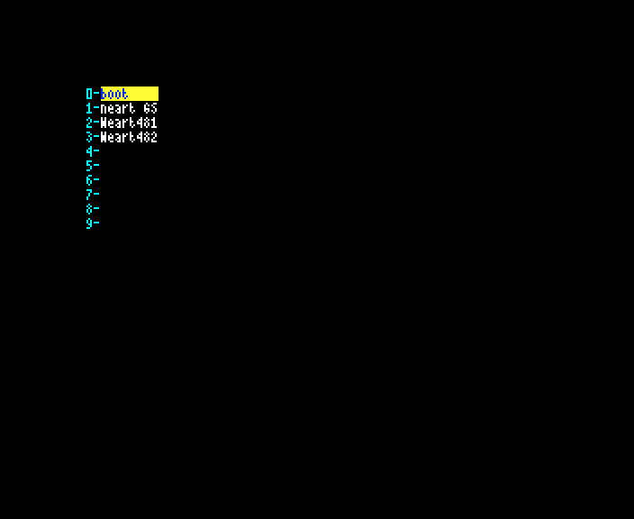
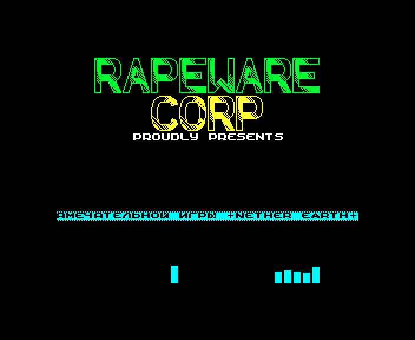
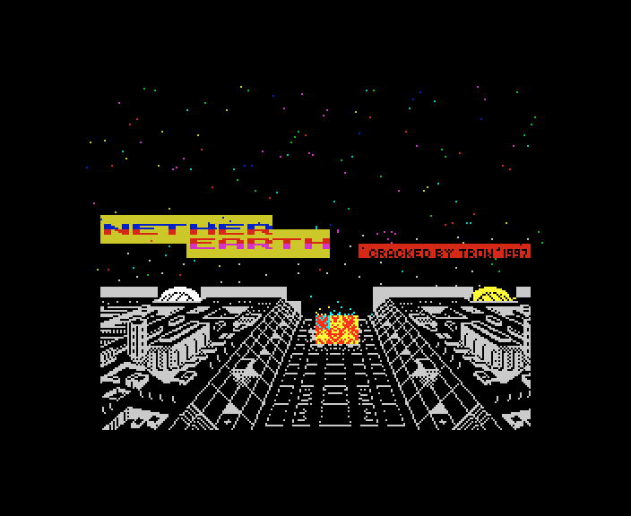

# 1. Game design

What this covers: what a player of the General Sound conversion sees that a player of Nether Earth (NE, Argus Press
Software 1987) does not, from power-on to play, on each medium. The game itself is NE's: its rules, screens, robots
and enemy are in [NE's 01](../../nether-earth/docs/01-game-design.md), and nothing here repeats them.

Stage 2 draft. It rests on the frames of `tools/fig_capture.py` (two live instances, both muted): a Pentagon 128 with
a GS 512 KB running the SCL, the TRD with its three entries and Hood's tape by two routes, and a 48K with no card
running NE's `NETHER.TAP`. The bot parts are `tools/play_gs.py` (NE's `bot.py`, steering by keys) from each main
menu. The figures are made by `tools/fig_screens.py` (single frames) and `tools/fig_compare.py` (GS against NE),
2x nearest neighbour; `work/stage2/NOTES-shots.md` has the commands and what each run showed.

## 1.1 The difference in one paragraph

Nether Earth GS is NE with its sound moved to a General Sound card: a module plays at the menu, and the beeper
effects are samples on the card ([9](09-sound.md)). Everything the player looks at once the game runs is NE's,
pixel for pixel: the menu, the start of play and the construction menu match NE's frames exactly (1.4). What is new
is around the game: a loading screen that says "GS-512", the TRD's boot menu with two extra programs, and on Hood's
tape a music ON / OFF question. One thing is new and bad: Hood's tape started the usual 128K way hangs the
machine on the first sound in play (1.5).

## 1.2 Starting each medium

| Medium | What the player does | What the player sees | NE |
| --- | --- | --- | --- |
| SCL (2002) | TR-DOS, `RUN "neart GS"` | the loading screen (1.3), the menu by about frame 3000 | `LOAD ""`, a black screen |
| TRD (2002) | TR-DOS, `RUN` | the HRUM boot menu: `boot`, `neart GS`, `Neart481`, `Neart482`; key 1 is the SCL's game | — |
| TAP (Hood, 2017) | 128 BASIC, `PRINT USR 0`, then `LOAD ""` | "1-music ON / 2-music OFF", then the loading screen | `LOAD ""` |
| TAP | the 128 menu's Tape Loader | the same, until the first sound in play: a hang (1.5) | — |

The TRD's other two entries are not the GS game ([03 3.4](03-build-and-load.md#34-the-trds-other-files)):

- `Neart482` is "10.12.95 KIDSON OF RAPEWARE CORP." intro: a logo, a scroller and AY level bars.
- `Neart481` is a 128K build of NE (no GS) with its own loading screen, "CRACKED BY TRON'1997" in the corner. It
  stops after this screen: unreal-ng reads the main CPU at PC `$0049` with interrupts off 2200 frames after the
  choice (stage 1 saw it looping at `$386E` at frame 253).

## 1.3 The start of the tape and the loading screen

NE's tape loads into a black screen; its loader N1 paints the border in random colours. The GS conversion has a
loading screen, `neart000`: the NE logo over a starfield and a city, "GS-512" under the title (the card it needs,
[9.6](09-sound.md#96-the-machine-it-needs)) and "TRON 2002" in the corner. Hood's tape first asks for the music.

Key 2 ("music OFF") pokes `RET` at `$62DF`, so the module never starts ([9.7](09-sound.md#97-the-tape-version-hood-2017));
the effects stay.

## 1.4 What stays NE's

The same moments of both games, taken from each one's main menu with the same keys or the same bot, compared over
the 256 x 192 screen area (the border aside):

| Moment | GS frame | NE frame | Differing pixels |
| --- | --- | --- | --- |
| the main menu, title at the yellow phase | tape via `USR 0`, `u-g` | `nm3` | 0 |
| key 0, 300 frames later | SCL, `scl-e-play` | `ne-play` | 0 |
| the construction menu, bot from the menu | tape via `USR 0`, `uplay/tap-04` | `play/tap-04` | 0 |

The robot menu, the orders and the target screens differ only where the clock and the robots have moved on (the bot
does not land on the same frame in both); their layout is NE's.

## 1.5 The hang of Hood's tape on a 128K

Started from the 128 menu's Tape Loader (or its 48 BASIC), the tape loads, the menu plays its music, and the game
runs until its first sound: that pages bank 6 and calls the driver at `$C000`, but the driver went to bank 0 on this
route, and bank 6 holds zeros. The zeros run into `HALT` with interrupts off (PC `$FFFA`, `iff1` 0, `BC` `$7FFD`),
and the picture freezes: the frame 500 frames later is the same, pixel for pixel. Why the driver misses bank 6:
[03 3.3](03-build-and-load.md#33-the-tape-load-hood-2017), [9.7](09-sound.md#97-the-tape-version-hood-2017).

The player's way round it is the one in 1.2: 128 BASIC, `PRINT USR 0`, then `LOAD ""` ([5.1](05-controls.md#51-starting-the-game)).
