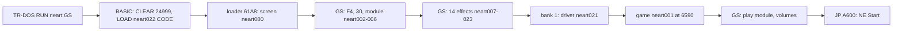

# 2. Architecture

What this covers: the machine the conversion needs, the memory map of the Spectrum and of the GS card, the stages
from the disk to play, and what of the 1987 game ([NE](../../nether-earth/docs/02-architecture.md)) is kept.

Stage 1 draft. It rests on the static comparison of `neart001` with NE's image (stage 1 NOTES 1) and the live runs of
stage 1 NOTES 2 (Pentagon 128 + GS 512 KB / NeoGS). The images are in `work/images/`:

- `tapusr0-menu-*` and `tapusr0-play-*`: the tape, at the menu and after 9000 frames of play;
- `tap-via128basic-menu-*`: the tape loaded from 128 BASIC, with bank 6 left empty.

Each set has the 64K CPU view, banks 0-7, the card's 512 KB RAM and an SZX.

## 2.1 The machine budget

| Resource | Use | Evidence |
| --- | --- | --- |
| CPU | a 128K Spectrum or clone with TR-DOS (Pentagon 128 here): the game is NE's 48K code; the 128K is used only for one page of RAM, bank 1, holding the GS driver | `OUT $7FFD,$11` / `$10` in `GsSound` `$A583` and `GsMenuSound` `$A569` are the only paging in the game |
| Sound | a General Sound with 512 KB (or a NeoGS): the module and 14 effects need 367 521 bytes on the card | [09.2](09-sound.md#92-what-is-on-the-card) |
| Beeper | silent: the menu tune runs with its `OUT`s replaced by `NOP`s | [09.1](09-sound.md#91-the-design-in-one-paragraph) |
| Disk | TR-DOS: the loader `neart022` loads 23 files by name through `$3D13` | [03](03-build-and-load.md) |
| Tape (Hood) | a 128K started in 48 BASIC with paging free (`USR 0`): the driver goes to bank 6 | [03.3](03-build-and-load.md#33-the-tape-load-hood-2017) |

## 2.2 The memory map in play

The 64 K Z80 view is NE's play map ([NE 2.2](../../nether-earth/docs/02-architecture.md#22-the-memory-map)) with
these changes:

| Range | Bytes | NE | Here |
| --- | ---: | --- | --- |
| `$61A8-$6508` | 865 | the view buffer's tail is from `$5B00`; free | the loader `neart022` (used once, then overwritten by nothing: it stays) |
| `$6590-$FFFF` | 39 536 | the game block's part from `$6590` | `neart001`: NE's bytes except 10 runs (159 bytes) below |
| `$A569-$A5A8` | 64 | the last byte of `SprBlockDottedRows` and `SpriteSpare`, zeros | `GsMenuSound` `$A569`, `GsSound` `$A583` |
| `$BAEE-$BB08` | 27 | `NuclearRumble` (ROM bytes to the speaker) | `GsSound(9)` and two empty `DJNZ $` waits of 255 turns each (B = `$FF`) |
| `$C4D3`, `$C4DB`, `$C4F0`, `$C4F8`, `$C5F3`, `$C610`, `$C61F`, `$C628` | 16 | the menu tune's `OUT ($FE),A` | `NOP NOP` |
| `$C849-$C84C` | 4 | `LD IY,$DA00` | `CALL GsMenuSound` / `NOP` |
| `$CCAC-$CCBC` | 17 | `Beep` | `CALL GsSound` / `RET` and 13 `RET`s |
| `$D5C4-$D5EB` | 40 | `SoundEffect`'s tone and noise | the three ids to `GsSound` |
| `$FCE9-$FFFF` | 791 | work space | in the file: NE's tape loader N1 as the tape left it, the seed `$FD00`, the IM 2 jump and table, a stack's leftovers: the file was cut from a memory dump of the running NE (`Start` rewrites all of it) |
| bank 1 `$C000-$C0F7` | 248 | | the GS driver `neart021` (disk) |
| bank 6 `$C000-$C10E` | 271 | | the GS driver `neart021` (tape, Hood) |

<!-- the figure: the memory map from the images (kit/heatmap.py or a per-case fig), Spectrum and GS side by side -->

## 2.3 The GS card's memory

From `work/images/tapusr0-menu-gsram512k.bin` (the region `gs.ram` of `memory_access`: 512 KB, offset = the card's
page x `$8000`; the CPU's `$4000-$7FFF` is offset `$4000-$7FFF`). The disk version's card holds no module and only 9
effects (9.2), so the map is the tape version's:

| Offset | Bytes | What | Evidence |
| --- | ---: | --- | --- |
| `$4000-$40FF` | | firmware variables: `NUMPG` 15 (`$4080`), `CNTMOD` 1, `CNTFX` 14, `CURMOD` 1, `CURFX` 14, `MODVOL` `$25`, `FXVOL` `$40` | the CPU view at `$4080` |
| `$8000-$29B55` | 138 070 | the module, as sent, its samples `+$80` (30 780 bytes still equal: the header and patterns) | byte compare with `neart002-006` |
| `$29B56-$4EC2D` | 151 448 | effects 1-11: `neart007`-`neart017` in order, back to back, as sent (unsigned) | byte compare: all equal |
| `$4EC2E-$52A16` | 15 849 | effect 12, `neart018` | equal |
| `$52A17-$55B26` | 12 560 | effect 13, `neart023` | equal |
| `$55B27-$61B9D` | 49 271 | effect 14, `neart019` + `neart020` from their 4th byte, every byte `+$80`: the card stored the stream from its 4th byte (the first 3 sent never landed; cause to trace in stage 2) | all 49 271 equal to the files XOR `$80` |
| `$61B9E-$7FFFF` | 124 002 | free | |

The firmware places each object at its current address (`CURADR`) and the next one right after it: 367 521 bytes from
`$8000`, so a 128 KB card (pages 0-3) would end its uploads at `$1FFFF`, inside effect 1.

## 2.4 The stages

## 2.5 What is NE's

`python3 ../advanced-nether-earth/tools/ne_match.py --image work/media/scl/files/neart001.C@6590:file` (stage 1
NOTES 1, `work/stage1/match-neart001.tsv`): 542 of NE's 563 entries are byte for byte at NE's addresses, 12 are
fill (work space), 3 changed (`DrumStep`, `ConstructionMenu`, and `SprBlockDottedRows`, whose last byte `$A569` is now the first of
`GsMenuSound`), 6 absent (`ViewBuffer`, outside the file, and the five sound routines). Nothing moved.
The sprites, the font, the map tables, the menus, the texts, the AI and the rules are NE's: the conversion is NE plus a
sound card.
