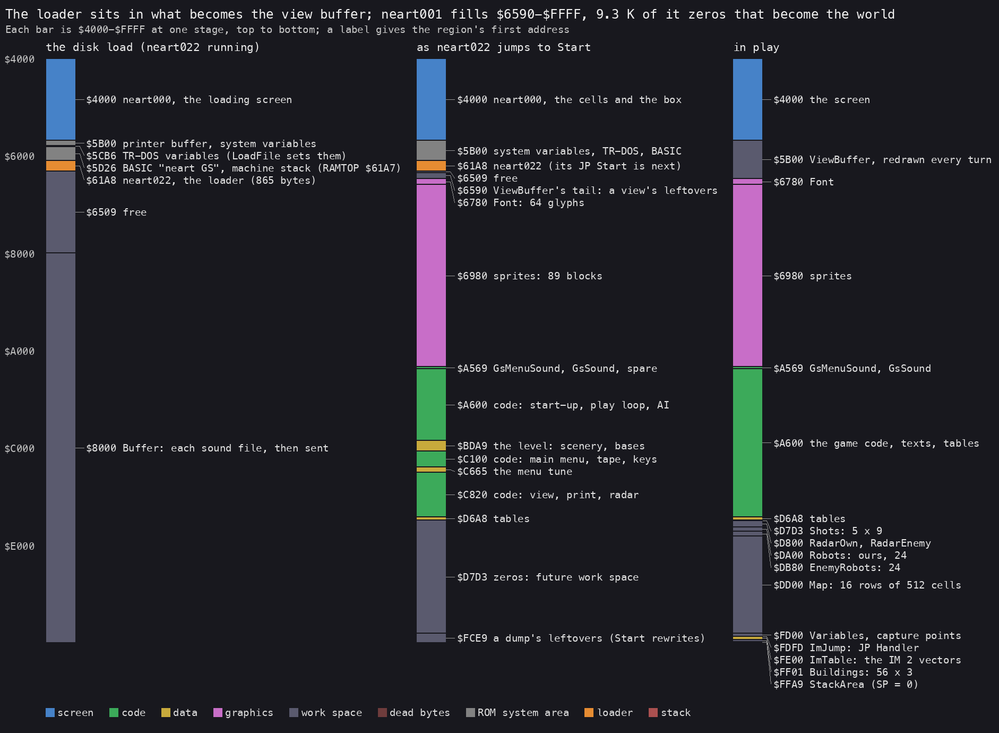
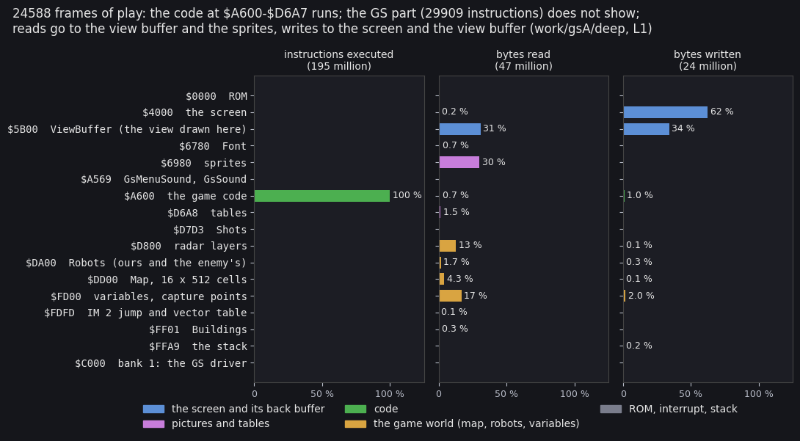
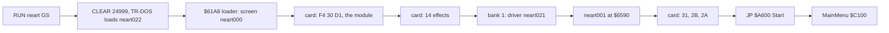
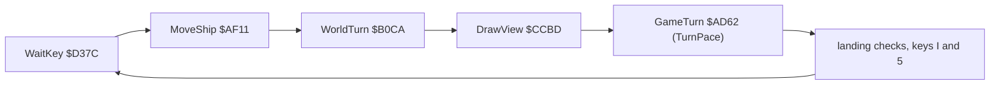

# 2. Architecture

This document covers the machine the game needs, its memory map at each stage, the path from the disk to play, the
interrupt and the main loop, where the CPU's time goes, the 24 modules of the source, and how the game reaches the
sound card through a paged RAM bank.

The recordings it rests on ([Terms](README.md#terms)):

- `deep` (`work/gsA/deep`, port base 15650): `tools/play_gs.py`'s bot plays from the main menu snapshot `start.szx`
  for 24 588 frames on a Pentagon 128 with a GS 512 KB. It builds 7 robots and gives them orders; at its end the clock
  reads day 8, 04:25. Its L1 (`l1.json`): 195 420 560 instructions, 1 762 467 705 T, 24 588 interrupts, 984 checks and
  0 divergences;
- `load` (`work/gsA/load`): the SCL from power-on to the menu ([3.3](03-build-and-load.md#33-the-disk-load-step-by-step));
- the images of stage 1 (`work/images/`): the 64K CPU view, banks 0-7 and the card's 512 KB at the menu and in play,
  for the tape and the disk.

## 2.1 The machine budget

| Resource | Use | Evidence |
| --- | --- | --- |
| CPU | a 128K Spectrum or clone, Pentagon 128 here, 71 680 T a frame | the game code itself is 48K code at `$6590-$FFFF` |
| RAM | bank 0 at `$C000` all the time; one more bank for the GS driver at `$C000`: bank 1 on the disk, bank 6 on the tape | `OUT ($7FFD)` with `$10` / `$11` (or `$16`) in `GsMenuSound` `$A569` and `GsSound` `$A583`, the only paging of the game |
| ROM | the 48 BASIC ROM, paged all the time (bit 4 of `$7FFD`) | the tape save and load call `SA-BYTES` / `LD-BYTES` ([3.9](03-build-and-load.md#39-the-saved-game)) |
| Sound | a General Sound with 512 KB, through ports `$BB` (command) and `$B3` (data) | the module and the effects need 367 521 bytes on the card ([3](03-build-and-load.md), [9](09-sound.md)) |
| Beeper | silent: no `OUT ($FE)` makes a sound | the menu tune's 8 `OUT ($FE),A` are `NOP NOP` (`$C4D3`, `$C4DB`, `$C4F0`, `$C4F8`, `$C5F3`, `$C610`, `$C61F`, `$C628`) |
| Disk | TR-DOS, for the load only | `LoadFile` `$639B` in the loader |
| Input | keyboard, Kempston (`IN ($1F)`) or Interface 2 (`IN ($EFFE)`) | `ReadControls` `$D38A` ([5](05-controls.md)) |

The game uses no AY. The Pentagon in unreal-ng has a TurboSound FM, a MoonSound and a Soundrive plugged as well: the
game touches none of them. In `deep` (keyboard play) its port reads are the keyboard's half-rows (`$7FFE`, `$BFFE`,
`$DFFE`, `$EFFE`, `$F7FE`, `$FBFE`, `$FDFE`, `$FEFE`, and `$E7FE`, two rows at once); its writes are `$FE` (the border), `$7FFD` and the card's `$B3` and
`$BB`.

## 2.2 The memory map



How to read the figure:

- **Each bar** is `$4000-$FFFF` at one stage, top to bottom. A label gives a region's first address and what it
  holds.
- **The colours** are the kinds: screen (blue), code (green), data (yellow), graphics (pink), work space (slate),
  the ROM's system area (grey), the loader (orange).
- **The disk load** (left): the loading screen, the system variables, the loader at `$61A8`, and the 32 KB buffer at
  `$8000` that each sound file passes through.
- **As `neart022` jumps to `Start`** (middle): `neart001` fills `$6590-$FFFF`. Its last 9.3 K, `$D7D3-$FCE8`, is
  zeros: the space for the shots, the radar, the robots and the map.
- **In play** (right): the loader is gone. `$5B00-$677F` is the view buffer, rewritten every turn. The zeros have
  become the world.
- **The point**: the loader sits in what becomes the view buffer, and the game file carries its own empty work
  space.

`python3 tools/fig_memmap.py --table tools/memmap-gs.txt --png docs/img/arch/memory-map.png`

The map in play, from the source's labels (`build/game/game-scl.sym`) and the images of `deep`:

| Range | Bytes | What | Module |
| --- | ---: | --- | --- |
| `$4000-$5AFF` | 6 912 | the screen | |
| `$5B00-$677F` | 3 200 | `ViewBuffer`: the 160 x 160 view drawn here, then copied ([6](06-rendering.md)) | (`$6590-$677F`: `viewbuffer.asm`) |
| `$6780-$697F` | 512 | `Font`: 64 glyphs, codes `$20-$5F` | `font.asm` |
| `$6980-$A568` | 15 337 | 89 sprite blocks, mask and graphic interleaved | `sprites.asm` |
| `$A569-$A5A8` | 64 | `GsMenuSound`, `GsSound`: the bridge to the sound card (2.8) | `gssound.asm` |
| `$A5A9-$A5FF` | 87 | zeros | |
| `$A600-$BDA8` | 6 057 | the code: start-up, play loop, robot menu, game turn, ship, world, enemy, bases | `start.asm` - `bases.asm` |
| `$BDA9-$C0FF` | 855 | the level: scenery and base lists, shapes | `level.asm` |
| `$C100-$D6A7` | 5 544 | the code: main menu, tape, keys, tune, construction menu, view, screen, controls, print, interrupts | `mainmenu.asm` - `interrupts.asm` |
| `$D6A8-$D7D2` | 299 | tables: view edges, part sprites, `SpriteTable` `$D6E8`, `PartHeights` `$D7B4` | `tables.asm` |
| `$D7D3-$D7FF` | 45 | `Shots`: 5 records of 9 bytes | `worldstate.asm` |
| `$D800-$D9FF` | 512 | `RadarOwn`, `RadarEnemy`: the two radar pictures; `$D92B-$D9FF` doubles as the save's staging area | `worldstate.asm` |
| `$DA00-$DCFF` | 768 | `Robots` (24 of ours) and `EnemyRobots` `$DB80` (24), 16 bytes each | `worldstate.asm` |
| `$DD00-$FCFF` | 8 192 | `Map`: 16 rows of 512 cells | `map.asm` |
| `$FD00-$FDFC` | 253 | `Variables`: the seed, the ship, the clock, the resources, the bases, the capture points | `workspace.asm` |
| `$FDFD-$FDFF` | 3 | `ImJump`: `JP Handler` | `workspace.asm` |
| `$FE00-$FF00` | 257 | `ImTable`: 257 bytes of `$FD` | `workspace.asm` |
| `$FF01-$FFA8` | 168 | `Buildings`: 56 records of 3 bytes | `workspace.asm` |
| `$FFA9-$FFFF` | 87 | `StackArea`: the stack, SP = 0 at `Start` | `workspace.asm` |
| bank 1 `$C000-$C0F7` | 248 | the GS driver `neart021` (disk) | `src/disk/driver.asm` |
| bank 6 `$C000-$C10E` | 271 | the GS driver (tape) | `src/tape/driver.asm` |

What the file holds that play never uses:

- `$61A8-$6508`: the loader. The first `ClearViewBuffer` `$CFFE` wipes it; in `deep` the view buffer covers it.
- `$6590-$677F`: 71 non-zero bytes, the leftovers of a view. The first `ClearViewBuffer` wipes them too.
- `$FCE9-$FFFF` (791 bytes) in the file: a loader's leftovers, the seed, the IM 2 jump and table, and a stack's
  bytes. The file was cut from a memory dump of a running game, and `Start` rewrites all of it (2.4).



How to read the figure:

- **Each row** is one region of the table above, by its first address.
- **The three panels** are the shares of all instructions executed (195 million), all bytes read (47 million) and
  all bytes written (24 million) in `deep`, from its L1.
- **Executed**: the game's code takes 100 %. The ROM and the GS driver in bank 1 (29 909 instructions in all, 2.8)
  are too small to show.
- **Read**: the view buffer 31 %, the sprites 30 %, the variables 17 %, the radar pictures 13 %.
- **Written**: the screen 62 %, the view buffer 34 %.
- **The point**: the game is a renderer. Two thirds of what it reads and almost everything it writes is the view
  (2.6).

`python3 tools/fig_access.py --l1 work/gsA/deep/l1.json --out docs/img/arch/access-regions.png`

## 2.3 The card's memory

The General Sound is a Z80 computer of its own: a 12 MHz CPU, a 32 KB ROM, 512 KB of RAM in 32 KB pages and four
8-bit DACs. The host sees only the two ports of [3.4](03-build-and-load.md#34-the-loader-neart022). The card's ROM
puts each object it is sent (a module or an effect) at its current load address, and the next one right after it,
from offset `$8000` of its RAM (offset = page x `$8000`).

- **The module** comes first: 138 070 bytes at `$8000-$29B55`.
- **The 14 effects** follow it, back to back: 229 451 bytes more (the loader's `LD DE` lengths,
  `src/disk/loader.asm`).
- **367 521 bytes** in all from `$8000`: they end past offset `$5FFFF`, beyond the first 128 KB of RAM (`$00000-$1FFFF`)
  and the 256 KB card's too. That is the "GS-512" of the loading screen.

What the card really holds at the end of each load, page by page, is [9](09-sound.md). On the disk the card ends
with no module and 9 effects ([3.5](03-build-and-load.md#35-the-module-upload-and-the-cold-restart)).

## 2.4 The stages from disk to play



The load is [3.3](03-build-and-load.md#33-the-disk-load-step-by-step). The frames of `load`: the loader starts at
739, `Start` runs at 4 868.

### Start-up, `$A600`

`Start` (`src/game/start.asm`) builds everything the file's dump left in `$FCE9-$FFFF` again:

1. `DI`, SP = 0: the stack grows down from `$FFFF`.
2. The IM 2 table: 257 bytes of `$FD` at `$FE00-$FF00`.
3. `JP` at `ImJump` `$FDFD`, its operand `Handler` `$FDFE` = `StartInterrupt` `$D59C`.
4. I = `$FE`, `IM 2`, `EI`.
5. The random seed `$FD00-$FD03` = `$39`, `$30`, `$39`, `$30` (12 345 twice).
6. `CALL MainMenu` `$C100`.

`Start` runs again after every abort, every game's end and every tape error. So every game from the menu starts
from the same seed ([4.2](04-game-loop.md#42-the-states)).

**The IM 2 trick.** Whatever byte the data bus holds during the interrupt, the CPU reads the vector from
`$FE00 + byte`. Every byte of the table is `$FD`, so the vector is always `$FDFD`. There a `JP` takes the CPU to
`Handler`. Switching the interrupt's work is one 16-bit write to `$FDFE`.

## 2.5 Time: frames and interrupts

The game runs on the 50 Hz frame interrupt. Three handlers take turns in `Handler` `$FDFE`:

| Handler | Address | Installed by | Work |
| --- | --- | --- | --- |
| `StartInterrupt` | `$D59C` | `Start`, `GameStop`, `SaveGame`, the construction menu, the end of the tune | `EI; RET`: the world stands |
| `MenuInterrupt` | `$C4FD` | `MenuMusic` `$C4A7` | the menu tune's two voices and its drum (silent: the `OUT`s are `NOP`s) and the title's colours |
| `PlayInterrupt` | `$D566` | `EnterPlay` `$A68E` and the end of the construction menu | `TurnFrames` + 1; one of the two radar pictures (`ShowRadar` `$D59E`); the sound effect's count (`SoundEffect` `$D5C4`) |

In `deep` the interrupt (`ImJump` `$FDFD`) ran 24 588 times, once a frame: 11.3 % of all T-states, 8 076 T a call.

- `PlayInterrupt` ran 23 686 times. Its `ShowRadar` costs 8 134 T a call: 10.9 % of all the time.
- `StartInterrupt` was entered directly 902 times: the frames in the menu and the construction menus.
- `SoundEffect` ran 154 times. It calls `GsSound` `$A583` from inside the interrupt (2.8).

How a turn lines up with the interrupts and the beam is [4.5](04-game-loop.md#45-time).

## 2.6 The main loop and where the time goes

`PlayLoop` `$A69A` is one game turn a pass ([4.3](04-game-loop.md#43-the-turn)):



The routines that take the time in `deep` (`python3 tools/l1_table.py --l1 work/gsA/deep/l1.json --top 25`):

| Routine | Entries | Inclusive share | T a call | What |
| --- | ---: | ---: | ---: | --- |
| `DrawView` `$CCBD` | 2 367 | 73.4 % | 546 165 (7.62 frames) | one view, buffer and copy |
| `DrawMapObjects` `$CCC6` | 2 366 | 57.9 % | 430 964 | the 32 x 16 cells back to front |
| `DrawSprite` `$CF2D` | 81 805 | 42.8 % | 9 222 | one masked sprite into the buffer |
| `GameTurn` `$AD62` | 2 358 | 17.4 % | 130 267 | the clock, the captures, `TurnPace`'s wait |
| `ImJump` `$FDFD` | 24 588 | 11.3 % | 8 076 | the interrupt |
| `ShowRadar` `$D59E` | 23 685 | 10.9 % | 8 134 | the radar, every frame |
| `CopyViewToScreen` `$D071` | 2 366 | 8.3 % (own) | 61 736 | the buffer to the screen |
| `DrawViewBackground` `$CFD7` | 2 368 | 6.1 % | 45 443 | clear the buffer, the corners |
| `WorldTurn` `$B0CA` | 2 359 | 4.5 % | 33 678 | the enemy, 48 robots, 5 shots |
| `RobotMenu` `$A720` | 7 | 3.9 % | 135 frames | the robot menu with its turns |
| `ConstructionMenu` `$C849` | 7 | 3.6 % | 126 frames | the construction menu |
| `ClearViewBuffer` `$CFFE` | 2 404 | 3.1 % | 22 794 | 3 200 bytes to 0 |

- **Drawing is three quarters of the time.** `DrawView` is 73.4 % of everything. Of the rest, the interrupt's
  radar is 10.9 % and the wait of `TurnPace` most of `GameTurn`.
- **The world is cheap.** `WorldTurn` with its 48 robot slots and 5 shots is 4.5 %.
- **2 358 game turns**: 2 275 from `PlayLoop` and 83 inside the robot menus (`ListMenu` `$ACD7` → `GameTurn`,
  [4.2](04-game-loop.md#42-the-states)). `MoveShip` ran 2 276 times: the last pass was cut by the recording's end.

## 2.7 Module map

The source is 24 modules in `src/game/`, assembled in this order from `game.asm` (`ORG $6590`). Own T is the share of
all T-states of `deep` spent in the module's own instructions:

| Module | Starts | What | Own T |
| --- | --- | --- | ---: |
| `viewbuffer.asm` | `$6590` | the view buffer's tail in the file | |
| `font.asm` | `$6780` | 64 glyphs | |
| `sprites.asm` | `$6980` | 89 sprite blocks | |
| `gssound.asm` | `$A569` | `GsMenuSound`, `GsSound` | 0.01 % |
| `start.asm` | `$A600` | `Start`, `NewGameSetup`, `EnterPlay`, `PlayLoop` | 0.03 % |
| `robotmenu.asm` | `$A720` | the robot menu, orders, combat, direct control | 0.01 % |
| `gameturn.asm` | `$AD62` | the clock, production, captures, the game's end, `TurnPace` | 13.79 % |
| `ship.asm` | `$AF11` | the ship, the view column, the radar window | 0.29 % |
| `world.asm` | `$B0CA` | each robot's step, each shot | 3.33 % |
| `enemy.asm` | `$B7F4` | the enemy commander, the nuclear blast | 0.07 % |
| `bases.asm` | `$BB09` | base counts and owners, `BuildMap` | 0.04 % |
| `level.asm` | `$BDA9` | the level's lists and shapes | |
| `mainmenu.asm` | `$C100` | the main menu, save and load, redefine keys | 0.00 % |
| `music.asm` | `$C4A7` | the menu tune loop, its interrupt, the title colours | 0.00 % |
| `construction.asm` | `$C849` | the construction menu, a new robot on the map | 2.86 % |
| `view.asm` | `$CCBD` | the view: buffer, painter's walk, sprites, copy | 64.71 % |
| `screen.asm` | `$D0B9` | the play screen, the panel, `Random` | 1.80 % |
| `controls.asm` | `$D37C` | `KeyTable`, the joysticks, `Input`, the pause | 0.41 % |
| `print.asm` | `$D3E5` | the print routines and numbers | 1.82 % |
| `interrupts.asm` | `$D566` | `PlayInterrupt`, `StartInterrupt`, the radar, `SoundEffect` | 10.80 % |
| `tables.asm` | `$D6A8` | view edges, part sprites, sprite pointers, heights | |
| `worldstate.asm` | `$D7D3` | shots, radar pictures, robot slots | |
| `map.asm` | `$DD00` | the map | |
| `workspace.asm` | `$FCE9` | variables, IM 2 jump and table, buildings, stack | 0.01 % |

The GS driver in bank 1 is 0.01 % (152 782 T). `gameturn.asm`'s 13.79 % is mostly the wait in `TurnPace` `$AE1D`.

## 2.8 Reaching the card: paging and the driver

Every sound of the game goes through two routines in `gssound.asm`:

```text
GsSound  $A583  DI
                PUSH HL, DE, BC, AF, IX, IY
                LD H,A                  ; the sound id
                LD A,$10|DriverBank     ; 48 BASIC ROM + the driver's bank
                LD BC,$7FFD
                OUT (C),A               ; the driver's bank at $C000
                LD A,H
                CALL $C000              ; GsDriver
                LD A,$10                ; bank 0 back
                OUT (C),A
                POP ...                 ; every register back
                EI
                RET
```

- **Interrupts off while bank 0 is out.** `PlayInterrupt`, the IM 2 table and the jump at `$FDFD` all live in bank
  0. An interrupt with the driver paged in would run the driver's bytes.
- **`GsMenuSound` `$A569`** is the same for the construction menu (id 3). It replaces the menu's first instruction,
  `LD IY,Robots`, with `CALL GsMenuSound` and a `NOP`, and runs it itself.
- **The callers** in `deep`: `Beep` `$CCAC` 259 times (the menus' clicks), `SoundEffect` 148 times (the shots, from
  inside the interrupt), `GsMenuSound` 7 times. The driver at `bank1:$C000` ran 414 times, 369 T a call; a
  `GsSound` call costs 615 T in all.
- **The driver** writes only the card's ports. In `deep` its `OUT ($B3)` values are 1, 3, 5, 6, 7, 9-13 and `$2F`;
  its `OUT ($BB)` values are `$39` and `$40`. What it sends for each id is [9](09-sound.md).
  On the disk the card never starts one of these effects: each `#39` is lost in a race with the card
  ([9.5](09-sound.md#95-the-disk-version-plays-no-effect)).
- **An `EI` inside the interrupt.** `GsSound` ends with `EI` also when `SoundEffect` called it from `PlayInterrupt`.
  The rest of the handler then runs with interrupts on. The next interrupt is a frame away, so nothing nests.

The GS part is small: 9 852 instructions in the game's two routines and 20 057 in the driver, in 24 588 frames.

## 2.9 Self-modifying code

| Address | Written by | What it changes |
| --- | --- | --- |
| `$FDFE` | `Start`, `EnterPlay`, `GameStop`, `SaveGame`, the menus | `Handler`: the interrupt's work (2.5) |
| `$C4D0`, `$C4D2`, `$C4D6`, `$C4ED`, `$C4EF`, `$C4F3` | the tune's note readers | the menu tune's periods, pulse widths and on / off values, as operands of its tone loop |
| `$CF3F` | `DrawSprite` `$CF2D` | the sprite's height, kept in an operand ([6.3](06-rendering.md#63-the-projection)) |
| `PrintMenuResource` `$CC08` | itself | the row of an inline `AT` in the construction menu's text |

## 2.10 Design notes

- **48K code on a 128K.** The game's code, data and work space fill `$6590-$FFFF` of the 48K map. The 128K's extra
  RAM holds only the 248-byte driver; the card's 512 KB holds the sound.
- **One page switch per sound.** The driver lives outside the game's map and is reached with two `OUT`s and a `CALL`.
  The game's own memory stays whole, at the price of `DI` around every sound.
- **A file with its own work space.** `neart001` reaches to `$FFFF` and carries 9.3 K of zeros for the world. The
  load needs no clearing; `NewGameSetup` and `BuildMap` clear it again for each game anyway.
- **A renderer with a game attached.** Three quarters of the CPU go to drawing the view, one tenth to the radar. The
  rules of the world take less than 5 %.
