# 3. Build and load

This document covers how Nether Earth GS gets from a disk or a tape into play, and what it sends to the General
Sound card on the way. There are two editions:

- **Tron Z, 2002**: an SCL and a TRD. A loader in machine code (`neart022`) reads 23 files through TR-DOS and streams
  the music and the effects to the card;
- **Hood, 2017**: a standard-speed tape. Its BASIC loads the same files as tape blocks and calls a reworked copy of
  the loader (`neart0222`) after each one.

It also covers the TRD's boot menu and its two extra programs, the saved game, and the build of all three media
from source.

The recordings it rests on ([Terms](README.md#terms)):

- `load` (`work/gsA/load`, port base 15660): the SCL from power-on on a Pentagon 128 with a GS 512 KB, 5 650 frames.
  The host's accesses to the card's ports are in `ports.jsonl` (to frame 4 546; the file is cut there). The load is
  typed by `tools/gs_session.py` steps (`work/gsA/load/scl-boot.txt`). Frames are counted from power-on;
- `x3` (stage 1, `work/stage1/x3`): the SCL on the same machine, with the `zxbus.1` history in capture mode. It holds
  every port access of the host on the card's ports and of the card's own CPU on its ports, on the card's clock.
  It is the witness of the card's cold restart (3.5);
- `x4`-`x8` (stage 1): the tape by three routes from the 128 menu, and the TRD's boot menu (3.7, 3.8);
- `shots` (stage 2, `tools/fig_capture.py`): the screens of each medium (`work/stage2/shots`).

## 3.1 The media

| Medium | File in `orig/` | Contents |
| --- | --- | --- |
| SCL (in `NE_GS_TZ.zip`) | `NE_GS_TZ.SCL` | 25 files: the BASIC `neart GS`, the loader `neart022`, the loading screen `neart000`, the game `neart001`, the module `neart002`-`006`, the effects `neart007`-`020` and `neart023`, the driver `neart021` |
| TRD | `...[h 2002 Tron Z].trd` | the same 25 files byte for byte, plus `boot` (a boot menu), `Neart481` and `Neart482` (3.8) |
| TAP | `...[h 2017 Hood, Tron Z].tap` | 25 header + data pairs: Hood's BASIC `NetherE GS` and the same data files, with the loader, the driver and 4 bytes of the game his own |

The files of the disk game, by role:

| File | Bytes | Loaded to | What |
| --- | ---: | --- | --- |
| `neart GS` | 67 | BASIC | `CLEAR 24999`, TR-DOS loads `neart022`, `RANDOMIZE USR 25e3` ([listing](texts/disk-basic.md)) |
| `neart022` | 865 | `$61A8` | the loader (3.4) |
| `neart000` | 6 912 | `$4000` | the loading screen |
| `neart002`-`006` | 138 070 | `$8000`, then the card | one ProTracker module in five files (4 x 32 768 + 6 998) |
| `neart007`-`020`, `neart023` | 229 451 sent | `$8000`, then the card | the effect samples; effect 14 is `neart019` + `neart020` |
| `neart021` | 248 | `$C000` of RAM bank 1 | the GS driver: the game's sound ids to card commands ([9](09-sound.md)) |
| `neart001` | 39 536 | `$6590-$FFFF` | the game ([2](02-architecture.md)) |

The three media are described byte for byte in `src/media/{scl,trd,tap}.txt`, and 3.10 builds them back.

## 3.2 The disk BASIC

The SCL holds one program, `neart GS`. On the TRD it is entry 1 of the boot menu (3.8). The listing
([disk-basic](texts/disk-basic.md), `src/disk/basic.asm`):

```text
10 CLEAR 24999
20 RANDOMIZE USR 15619:REM :LOAD "neart022"CODE
30 RANDOMIZE USR 25e3
```

- **Line 10** puts RAMTOP at `$61A7`, one byte under the loader.
- **Line 20** calls TR-DOS's command entry `$3D03` (15619). TR-DOS runs the command after `REM :`: it loads the
  loader `neart022` to its catalogue address, `$61A8`.
- **Line 30** runs the loader at `$61A8` (25 000). The loader never returns to BASIC.

## 3.3 The disk load, step by step

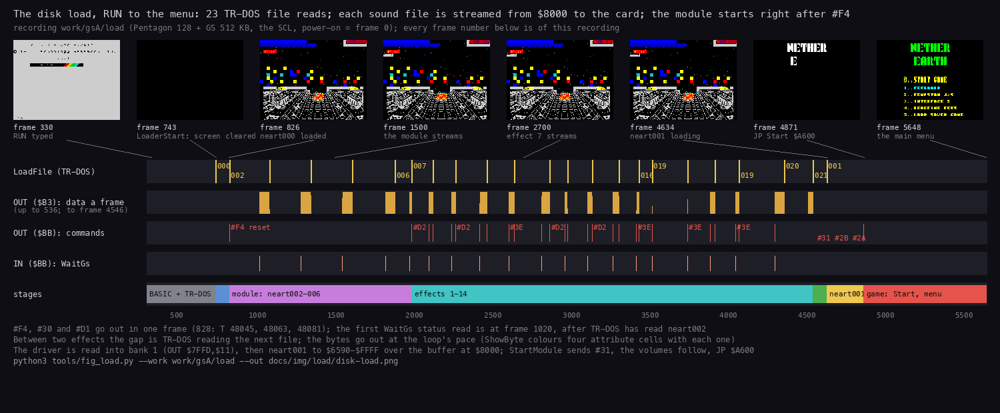

The whole load of `load`, from RUN to the menu, on one time line. How to read the figure:

- **The thumbnails** are the screen at eight moments, each with its frame and what is happening. A line runs from
  each to its place on the time line.
- **LoadFile (TR-DOS)**: one yellow mark for each of the 23 calls of `LoadFile` `$639B`, some labelled with the
  file's number (`000` is `neart000`).
- **OUT (`$B3`)**: the data bytes written to the card in each frame, up to 536 in one frame.
- **OUT (`$BB`)**: the commands. The labels name some of them: `#F4` the reset, `#D2` the end of a stream, `#3E` an
  effect load, and `#31 #2B #2A` at the end.
- **IN (`$BB`)**: the loader's status reads, one burst for each `WaitGs` `$6311`.
- **stages**: the BASIC and TR-DOS, then the module, the 14 effects, the driver (green), the game file (yellow) and
  the game itself.
- **The point**: almost all of the 91 s is the sound. TR-DOS reads a file, then the loader streams it from `$8000` to
  the card at the pace of its loop, and only then reads the next.

`python3 tools/fig_load.py --work work/gsA/load --out docs/img/load/disk-load.png`

The steps, with the frames of `load` (`ports.jsonl` for the ports, the L1 of the recording for the routines):

| Step | Code | What goes to the card | Frame |
| --- | --- | --- | --- |
| RUN, ENTER | BASIC | | 326 |
| the loader starts: screen cleared, border black | `LoaderStart` `$61A8` | | 739 |
| `neart000`, the loading screen | `LoadFile` | | 741 |
| reset, load a module, open the stream | `GsStartModule` `$61BE` | `#F4`, `#30`, `#D1` at frame T 48 045, 48 063, 48 081 | 828 |
| the module, `neart002`-`006` | `SendModuleFile` `$62EB` x 4, `SendModuleLast` `$62F0` | 138 070 bytes on `$B3`, then `#D2` | 1 020-1 988 |
| 14 effects | `GsLoadEffects` `$61FB`: `LoadEffect` `$6317` x 13; `LoadEffectOpen` `$6352` + `SendEffectRest` `$637C` for effect 14 | per effect: data 0, `#3E`, `#D1`, the bytes, `#D2` | 2 098-4 546 |
| the driver to bank 1 | `LoadDriver` `$62AF` | | 4 546 |
| the game `neart001` | `LoadGame` `$62C3` | | 4 633 |
| the module on, the volumes | `StartModule` `$62DF`, then `$62CC`-`$62DB` | data 0 + `#31`, data `$40` + `#2B`, data `$25` + `#2A` | 4 868 |
| play | `JP Start` `$A600` | | 4 868 |
| the main menu on the screen | | | by 5 648 |

- **23 file reads.** `LoadFile` ran at frames 741, 828, 1 082, 1 345, 1 609, 1 882, 1 988, 2 125, 2 268, 2 467,
  2 642, 2 867, 2 980, 3 137, 3 307, 3 437, 3 519, 3 745, 3 919, 4 074, 4 362, 4 546 and 4 633.
- **367 521 data bytes** go to the card: the module and 14 effects (one of them 401 bytes, 3.4). The count is the
  sum of the loader's `LD DE` lengths. The port history of `load` (`ports.jsonl`) holds 367 507 `OUT ($B3)`: it
  stops at frame 4 546 inside `SendEffectRest` `$637C`, before the last bytes of `neart020`, and its last line is cut.
- **From RUN to `Start`**: 4 542 frames, 91 s.

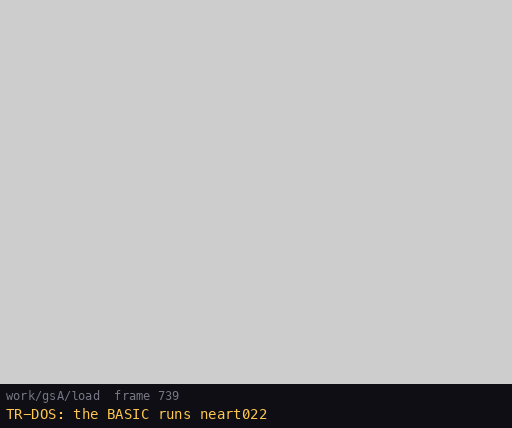

The same recording as a film, 123 pictures. Each picture is the screen at that frame. The label under it is the
frame and the last file `LoadFile` was given. Watch the "GS-512" label: it flickers while a stream runs (3.6).
`python3 tools/fig_load.py --work work/gsA/load --gif docs/img/load/disk-load.gif`

## 3.4 The loader `neart022`

865 bytes at `$61A8-$6508`, `src/disk/loader.asm`. It runs once, with the 48K ROM and TR-DOS, and ends with
`JP Start`. Its routines:

| Routine | Address | What |
| --- | --- | --- |
| `LoaderStart` | `$61A8` | clear `$4000-$5AFF`, black border, load `neart000` |
| `GsStartModule` | `$61BE` | `#F4`, `#30`, `#D1`; the five module files |
| `GsLoadEffects` | `$61FB` | the 14 effects in the card's order |
| `LoadDriver` | `$62AF` | page bank 1 (`OUT ($7FFD),$11`), load `neart021` to `$C000`, page bank 0 (`$10`) |
| `LoadGame` | `$62C3` | load `neart001`, `StartModule`, the two volumes, `JP $A600` |
| `StartModule` | `$62DF` | wait, data 0, `#31` |
| `SendModuleFile`, `SendModuleLast` | `$62EB`, `$62F0` | 32 768 or 6 998 bytes into the open stream |
| `SendBytes` | `$62F3` | wait once, then the bytes with no wait per byte |
| `WaitGs` | `$6311` | `IN A,($BB)`, `RRCA`, `JR C`: wait until the card has taken the last command |
| `LoadEffect` | `$6317` | wait, data 0, `#3E`, `#D1`, the bytes, `#D2` |
| `ShowByte` | `$6345` | the byte as the attribute of four cells, `$5861-$5864` |
| `LoadEffectOpen` | `$6352` | `LoadEffect` without the `#D2` |
| `SendEffectRest` | `$637C` | more bytes into the open stream, then `#D2` |
| `LoadFile` | `$639B` | set up TR-DOS's variables, copy the name to `$5CDD`, function `$0E` through `$3D13`, `DrawProgress` |
| `DrawProgress` | `$64AF` | the box and one tick for each file |
| `BarWidth`, `TickX` | `$6507`, `$6508` | the box's width (22) and the next tick's x |

**The card's two ports.** The loader and the driver talk to the card through two ports of the Spectrum
(`src/disk/gs.inc`):

| Port | Write | Read |
| --- | --- | --- |
| `$BB` | the command latch | the status: bit 0 set until the card has taken the last command; bit 7 set until it has read the last data byte |
| `$B3` | the data latch: a command's parameter, or a load's bytes | the card's reply |

A command's parameter goes to `$B3` first. Then the command goes to `$BB`. Each port has one latch: a byte written
before the card has read the last one replaces it.

**What the loader sends:**

| Command | Name in the GS ROM | Here |
| --- | --- | --- |
| `#F4` | `COMF4` | restart the card cold |
| `#30` | `COM30` | load a module |
| `#3E` | `COM3E` | load an effect; data 0 means signed samples, data 1 unsigned |
| `#D1`, `#D2` | `LOAD` | open and close the data stream of the load just started |
| `#31` | `COM31` | play the current module |
| `#2B`, `#2A` | `COM2B`, `COM2A` | the effects' and the module's volume, 0-64 |

**Three bugs** (`src/disk/loader.asm`, its header):

- **No wait between commands.** `WaitGs` runs once before each stream, never between two commands. The module is
  lost to it (3.5), and so are 5 of the 14 effects ([9](09-sound.md)).
- **The wrong sign.** Every effect is loaded with data 0, signed. The files are unsigned. The card stores every
  byte with its top bit flipped.
- **The wrong file for effect 11.** `$6273` gives `LoadFile` the name of `neart019` with DE = 401. Effect 11 becomes
  the first 401 bytes of `neart019`, and `neart017` is never read. In `load` the 17th read, at frame 3 519, is
  `neart019`, where `neart017` would be.

**TR-DOS from machine code.** `LoadFile` `$639B` does by hand what the BASIC would have set up for TR-DOS:

- `$5CC8` = `$83` and 82 zero bytes after it;
- `ERR_NR` `$FF`, `FLAGS` 0;
- `$5CFA` = 8, `$5D06` = 9, a `RET` at `$5CC2`, `$5CB6` = `$F4`;
- `E_LINE` and `STKEND` at `$5D27`.

Then it copies the 9-byte name (8 characters and the type) to `$5CDD` and calls `$3D13` with C = `$0E` and A = 0:
load the file at its catalogue address. The sound files are catalogued at `$8000`, the driver at `$C000`, the game
at `$6590`.

## 3.5 The module upload and the cold restart

`GsStartModule` `$61BE` writes three commands with nothing between them but `LD A,n`:

```text
$61BE  LD A,$F4      ; GsReset
       OUT ($BB),A
       LD A,$30      ; GsLoadModule
       OUT ($BB),A
       LD A,$D1      ; GsOpen
       OUT ($BB),A
```

In `load` the three `OUT`s are 18 T-states apart (frame 828, frame T 48 045, 48 063 and 48 081, at PC `$61C0`,
`$61C4`, `$61C8`). `#F4` is the GS ROM's `COMF4`, which jumps to 0: the card starts again as from power-on. `x3`
recorded both sides of this moment:

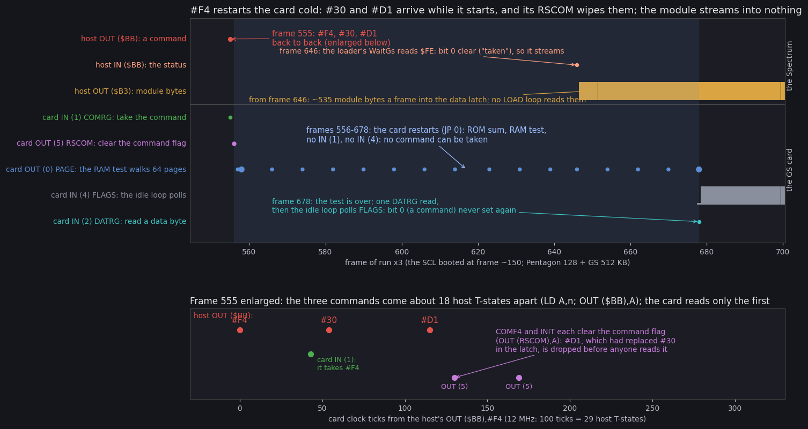

How to read the figure:

- **The top panel** is frames 545-700 of `x3`. Each lane is one kind of port access: the Spectrum's above the line,
  the card's CPU below it. A dot is a frame with such accesses; a bar's height is the count in that frame.
- **Frame 555**: the host writes `#F4`, `#30` and `#D1` (red). The card reads one command (green, `IN (1)`) and
  clears the command flag (violet, `OUT (5)`).
- **Frames 556-678** (blue band): the card is restarting. Its ROM sums itself and tests the RAM, walking its 64
  pages (blue dots, `OUT (0)`). It reads no command (`IN (1)`) and polls no status (`IN (4)`).
- **Frame 646**: the loader's `WaitGs` reads the status. Bit 0 is clear, "taken", because the restart cleared the
  flag. From here the module's bytes go out, about 535 a frame (orange).
- **Frame 678**: the test ends. The card reads one data byte, then its idle loop polls `FLAGS` (grey) for a command
  that never comes: no `LOAD` loop is running to take the bytes.
- **The bottom panel** enlarges frame 555 on the card's clock (12 MHz; 100 ticks are 29 host T-states). The card
  takes `#F4` 43 ticks after it was written. `#30` arrives 54 ticks after `#F4`, `#D1` 115 ticks after. `COMF4` and
  the start-up each clear the command flag (`OUT (5)`, at 130 and 169 ticks): `#D1`, which had replaced `#30` in the
  latch, is dropped before anything reads it.
- **The point**: the bug is the loader's. `#F4` takes the card away for 123 frames, 2.5 s, and the loader does not
  wait for it. The card does what its ROM says.

`python3 tools/fig_gs_reset.py --events work/stage1/x3/gs-events.jsonl --out docs/img/load/gs-reset.png`

What follows from it:

- The 138 070 module bytes are written into the data latch, one over the other. The closing `#D2` reaches the card as
  an unknown command.
- The card ends the disk load with no module. `StartModule`'s `#31` at frame 4 868 plays nothing: the disk edition
  has no music. [9](09-sound.md) shows what the card holds at the end and how it sounds.
- The effects suffer from the same missing wait, between `#3E` and `#D1` ([9](09-sound.md)).

The tape loader waits after every command (3.7), and its card holds the module.

## 3.6 The loading display

The loader prints no text. It shows its progress in two ways:

- **`ShowByte` `$6345`**: every byte sent to the card is also written as the attribute of the four cells
  `$5861-$5864` (character row 3, columns 1-4). These cells are the "GS-512" label of the loading screen. While a
  stream runs the label flickers in the colours of the data; after each stream it is set to `$56` (bright, red paper,
  yellow ink).
- **`DrawProgress` `$64AF`**: after each file, the ROM's `DRAW-LINE` `$24BA` draws a 22 x 3 box at (0,140) in ROM
  coordinates (y counts up). Then it draws a tick 3 pixels high at x = `TickX`, which counts up. 23 files give 23
  ticks.

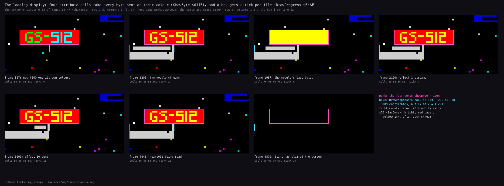

How to read the figure:

- **Each panel** is the screen's pixels 0-63 of lines 16-47 at one frame of `load`, 8 times enlarged. Under it: the
  frame, the four cells' attributes, and `TickX`, read from memory at that frame.
- **The pink box** is the four cells `ShowByte` writes. **The blue box** is `DrawProgress`'s box.
- **Frame 827**: `neart000` is on with its own colours (cells `54 54 55 55`); `TickX` is 0.
- **Frames 1 200, 2 160, 3 600, 4 643**: between two streams the cells hold `$56`. The ticks fill the box: `TickX` 2,
  7, 16, 22.
- **Frame 1 987**: the module's last bytes are going out; the cells hold the data (`F6`).
- **Frame 4 870**: `Start` has cleared the screen. `TickX` is 23: all 23 files.
- **The point**: the "GS-512" label is the progress bar.

`python3 tools/fig_load.py --work work/gsA/load --bar docs/img/load/progress.png`

The loading screen itself, as the TRD's entry 1 shows it before the first stream:

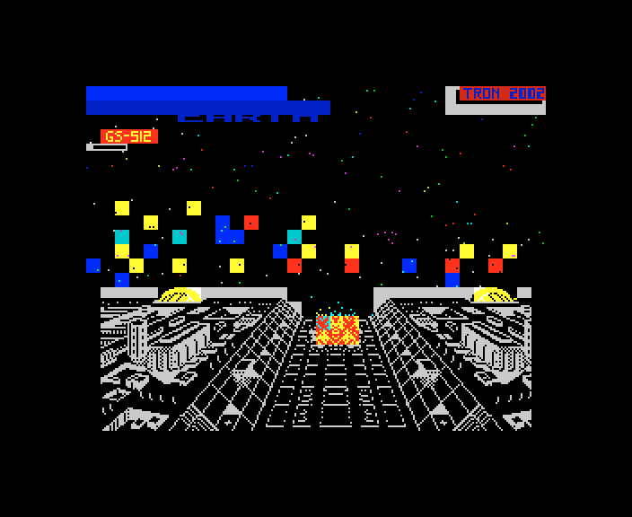

`neart000` is a 6 912-byte screen: the "NETHER EARTH" logo on a blue band, a starfield with coloured blocks, a city
in perspective, "GS-512" in red under the title and "TRON 2002" in the corner. "GS-512" names the card the game
needs: a General Sound with 512 KB ([9](09-sound.md)).

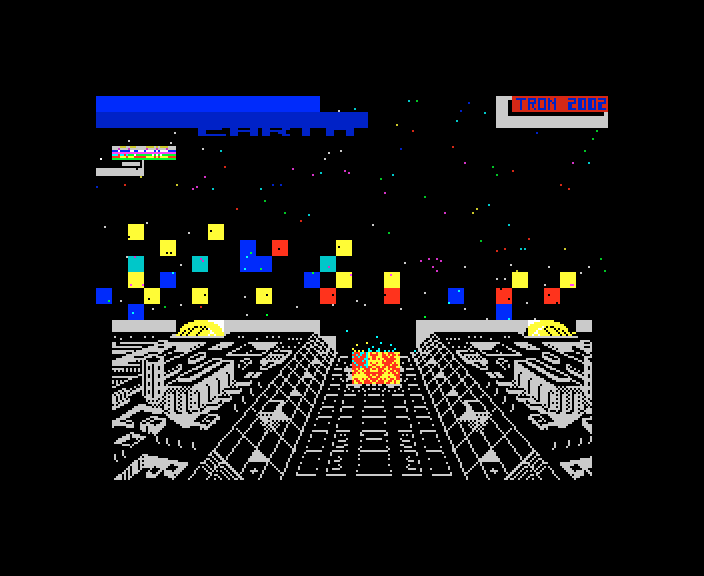

## 3.7 The tape (Hood, 2017)

Hood's BASIC `NetherE GS` (961 bytes, LINE 10, [listing](texts/tape-basic.md), `src/tape/basic.asm`) does the
disk loader's work line by line. Each file is a standard ROM block. The BASIC loads it with `LOAD "" CODE` and then
enters the loader at the code that sends that file to the card:

| Line | Loads | Calls | What goes to the card |
| --- | --- | --- | --- |
| 1 | | | `REM` "Conversion from TRD by Hood.7.4.2017.hood.speccy.cz" |
| 10-11 | | | the menu "1-music ON / 2-music OFF"; waits for 1 or 2 |
| 13 | `neart0222`, `neart000` | `USR 25561` `TickReturn` `$63D9` | |
| 16 | (key 2) | `POKE 25311,201`; `USR 25516` `MusicOff` `$63AC` | `#F4` only; a `RET` at `StartModule` `$62DF` |
| 20 | (key 1) `neart002`-`006` | `USR 25022` `GsStartModule` `$61BE`, then a `SendModule` entry after each file | `#F4`, `#30`, `#D1`, the module, `#D2`, each command waited for |
| 30-50 | `neart007`-`016`, `neart017`, `neart018`, `neart023`, `neart019`, `neart020` | a `SendFx` entry after each | effects 1-13: data 1 + `#3E`; effect 14: data 0 + `#3E`; `#D1`, the bytes, `#D2` |
| 60 | `neart021`, `neart001` | `USR 25273` `PageBank0` `$62B9`; `USR 25286` `StartGame` `$62C6` | data 0 + `#31`, data `$40` + `#2B`, data `$25` + `#2A`, `JP $A600` |

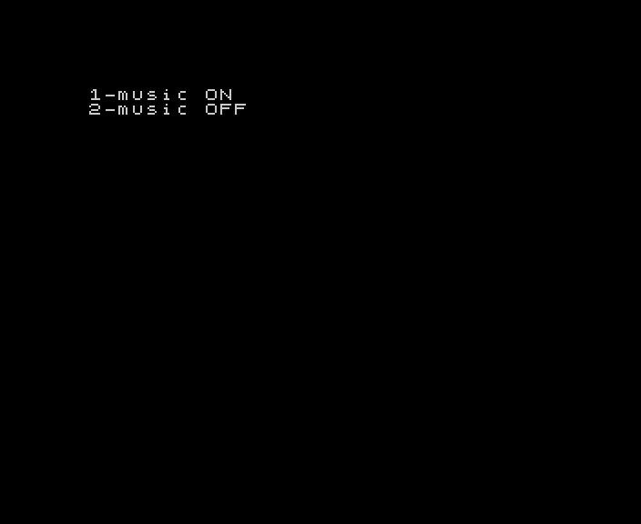

**The loader `neart0222`.** Hood changed 91 bytes of `neart022` in place (`src/tape/loader.asm`):

- **Every command waits.** `SendCommand` `$63A3` takes the command byte inline after its `CALL`, writes it and waits
  with `WaitGs`. `#F4`, `#30` and `#D1` now reach the card. In stage 1's tape runs (`x4`, `x6`, `x8`) the card ends
  with the module and 14 effects ([9](09-sound.md)).
- **No file reads.** Each disk `LD HL,name` / `CALL LoadFile` became `RET` / `CALL LoadFile`. The `RET` ends the
  entry before it; `LoadFile` only draws the tick and gives BASIC back its H'L' (`$2758`).
- **Effects 1-13 unsigned.** `LoadEffect` sends data 1. Effect 14 still goes through the old `LoadEffectOpen`: data 0,
  and no wait between `#3E`, `#D1` and the bytes.
- **Effect 11 is `neart017`.** The BASIC loads it by name.
- **The driver in bank 6.** The `USR` after `neart020` pages bank 6 at `$C000` and returns. The BASIC loads
  `neart021` (271 bytes) to `$C000`, and `USR 25273` pages bank 0 back. The game's tape build has `DriverBank` = 6
  (`src/game/game.asm`).

The tape loads in about 900 frames with unreal-ng's fast load (`x4`, frames 1 709-2 631). At the ROM's speed it is
about 2 547 s.

**The paging trap.** The driver reaches bank 6 only if nothing pages bank 0 back between the two `USR`s. On a 128K
that depends on how the tape is started:

| Started from | Bank 6 after the load | Play |
| --- | --- | --- |
| the 128 menu's Tape Loader (`x4`) | zeros: the 128 ROM's loader restores its own paging | the menu and its music work; the first sound in play calls `$C000` in an empty bank 6 and hangs (PC `$FFFA`, interrupts off) |
| the 128 menu's 48 BASIC (`x5`) | zeros: the menu locks the paging | not played in `x5`; with bank 6 empty, the same hang by the code |
| 128 BASIC, `PRINT USR 0`, then `LOAD ""` (`x6`, `x8`) | the driver at `$C000` | plays, with every sound (9 000 frames in `x6`) |

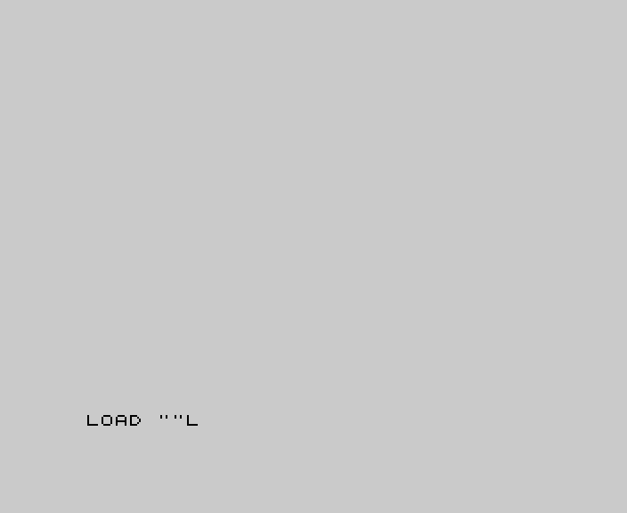

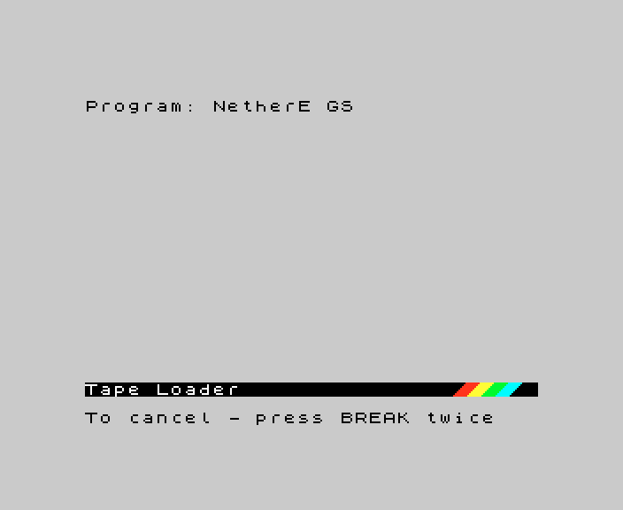

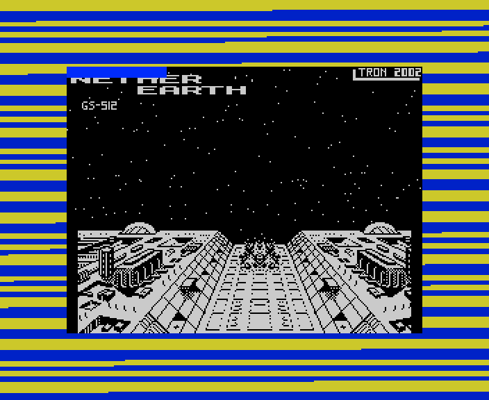

A `LOAD ""` typed in 128 BASIC was not run. It goes through the same 128 ROM loader as the Tape Loader, so by the
code it leaves bank 6 empty and hangs the same way.

The hang itself is in [1.10](01-game-design.md#110-the-hang-of-hoods-tape-on-a-128k).

## 3.8 The TRD's boot menu and its extras

`RUN` on the TRD starts `boot` (172 bytes). Its code line loads 20 sectors at `$61A8`: a menu packed with HRUM 3.5
("HRUM v3.5 by Dmitry Pyankov ... 09.01.97", [the credit](texts/trd-boot-hrum-credit.md)). The menu lists the
disk's programs ([the menu's text](texts/trd-boot-menu.md)), and a digit key starts one:

| Key | File | What it is | Seen (`x7`, `shots`) |
| --- | --- | --- | --- |
| 0 | `boot` | the menu itself | the menu |
| 1 | `neart GS` | the GS game: 3.2-3.6 | as the SCL |
| 2 | `Neart481` | a 128K build of the game with no GS: a loader in a `REM` reads its own tail into banks 0, 6, 3, 4, 1 and 0, then `USR 57800`, `USR 65004`, `USR 24110`, `USR 42496` | its loading screen, "CRACKED BY TRON'1997"; then it stops (PC `$0049` with interrupts off, 2 200 frames after the key) |
| 3 | `Neart482` | "10.12.95 KIDSON OF RAPEWARE CORP." intro: a logo, a scroller and AY level bars | the intro runs ([the scroller](texts/trd-neart482-scroller.md)) |

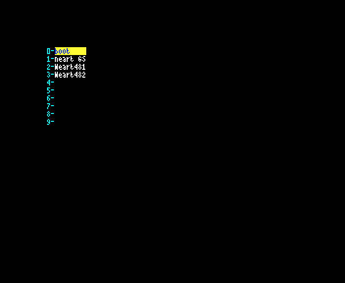

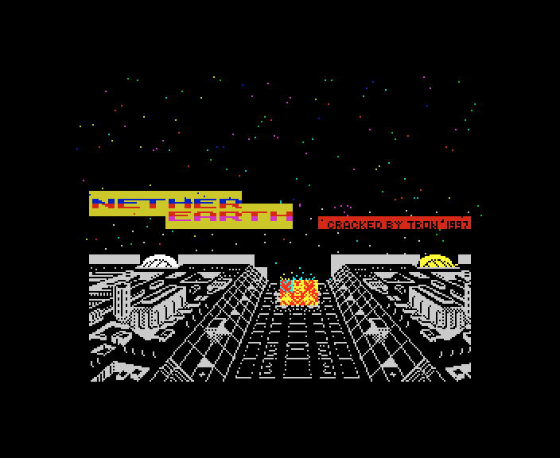

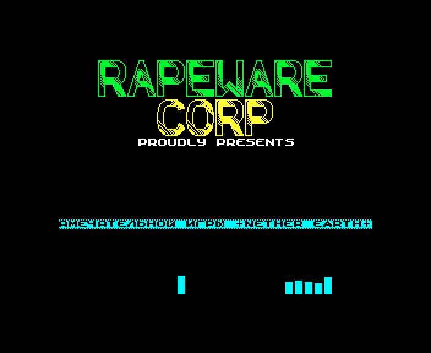

Neither `Neart481` nor `Neart482` uses the GS. Their sources are in `src/trd/`. The TRD's sector 9 and its free
sectors hold older texts ([sector 9](texts/media-trd-sector9.md), [leftovers](texts/media-trd-leftovers.md)).

## 3.9 The saved game

Key 5 in play saves the game to tape. Key 5 in the main menu loads it. No recording of this case ran either; this
section is read from the code (`src/game/mainmenu.asm`).

**Saving** (`SaveGame` `$C28D`):

1. It installs `StartInterrupt`: the world stops.
2. It prints PRESS RECORD AND PLAY / THEN ANY KEY at row 22 and waits for a key.
3. It copies the five shot records (`$D7D3`, 45 bytes) and the buildings (`$FF01`, 168 bytes) to `$D92B-$D9FF`, so
   that `$D92B-$FDFB` is one block.
4. It sums the block into 2 bytes at `$5B00` (`SaveChecksum` `$C30F`).
5. It saves the 2 bytes, then the `$24D1`-byte block, both headerless with flag `$00`, through the ROM's `SA-BYTES`.
6. `JP EnterPlay`: the screen is redrawn and play goes on.

The two builds call `SA-BYTES` at different entries (`SaveBytesEntry`, `src/game/game.asm`):

| Build | Entry | Effect |
| --- | --- | --- |
| disk | `$04D0`, past the pilot choice | the game's own short pilot (HL = `$0900`), no `SA/LD-RET` |
| tape (Hood) | `$04C2`, the start | the ROM's own pilot and its `SA/LD-RET` exit |

**Loading** (`LoadGameBlocks` `$C21E`, main menu key 5): red border, the two blocks through `LD-BYTES` `$0562`, then
the sum. A good sum puts the shots and the buildings back and returns NZ, and play starts from the loaded state. A
bad sum prints LOADING ERROR!, waits for a key and jumps to `Start` (`LoadError` `$C282`).

The block holds the robots (`$DA00`), the map (`$DD00-$FCFF`) and the variables `$FD00-$FDFB`. A saved game is the
whole game.

## 3.10 The source build

The source is complete: `tools/build.sh` builds the three media and compares each with the original.

```sh
tools/build.sh            # holds build/.lock: one build at a time
```

| Step | Tool | Output |
| --- | --- | --- |
| 1 | `tools/build_game.sh`: `src/game/game.asm` (24 modules), assembled twice | `build/game/neart001-scl.bin` (disk), `neart001-tap.bin` (with `-DHOOD_TAPE`) |
| 2 | `tools/build_loaders.sh`: `src/disk`, `src/tape`, `src/res` | the BASICs, the loaders, the drivers, the module, the effects, the screen |
| 3 | `tools/build_trd_extras.sh`: `src/trd` | `boot`, `Neart481`, `Neart482` |
| 4 | `tools/mkscl.py`, `mktrd.py`, `mktap.py` with `src/media/*.txt` | the SCL, the TRD, the TAP |

The last lines of the run:

```text
build: identical to build/orig/NE_GS_TZ.SCL
build: identical to orig/Nether Earth (1987)(Argus Press Software Ltd)(EN)(GS)[h 2002 Tron Z].trd
build: identical to orig/Nether Earth (1987)(Argus Press Software Ltd)(EN)(GS)[h 2017 Hood, Tron Z].tap
```

**One source, two targets.** The game's two builds differ in two constants of `src/game/game.asm`:

| Constant | Disk | Tape |
| --- | --- | --- |
| `DriverBank` | 1 | 6 |
| `SaveBytesEntry` | `$04D0` | `$04C2` |

They give 4 differing bytes: `$A56B` and `$A58E` (the page in `GsMenuSound` and `GsSound`), and `$C2F9` / `$C308`
(the `SA-BYTES` calls).

The variants side by side:

| | SCL (2002) | TRD (2002) | TAP (Hood, 2017) |
| --- | --- | --- | --- |
| Start | `RUN "neart GS"` | `RUN`, then 1 | 48 BASIC with free paging, `LOAD ""` |
| Loader | `neart022` | the same | `neart0222` and the BASIC |
| Waits for the card | before each stream | the same | after every command |
| Effect signs | all 14 flipped | the same | effect 14 flipped |
| Effect 11 | `neart019`'s first 401 bytes | the same | `neart017` |
| Driver | 248 bytes, bank 1 | the same | 271 bytes, bank 6 |
| Extras | | the boot menu, `Neart481`, `Neart482` | the music question |
| On the card at the end | no module, 9 effects ([9](09-sound.md)) | the same | the module and 14 effects |

## 3.11 Design notes

- **The load is the sound.** The card gets 367 521 bytes; the game file is 39 536.
- **A buffer at `$8000`.** Every sound file is loaded to the same 32 KB at `$8000` and streamed from there. The game
  file goes in last, over the buffer, so the buffer costs no memory.
- **A display for free.** `ShowByte` turns the data into the progress bar: four attribute writes a byte, and the
  label "GS-512" becomes the bar.
- **Fast, not safe.** The loader waits for the card only before a stream. The waits it saves cost the disk edition
  its music and five effects (3.5).
- **The driver races too.** The disk driver saves the same waits, and they cost it every effect it plays
  ([9.5](09-sound.md#95-the-disk-version-plays-no-effect)): the disk edition is silent.
- **The fix.** Hood's tape waits after every command, in one short routine, `SendCommand`.
