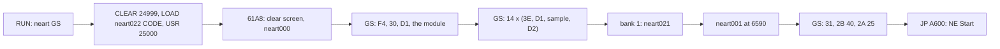

# 3. Build and load

What this covers: the three media of the General Sound conversion (the 2002 SCL and TRD, the 2017 tape), how each
gets from power-on into play, and what each one sends to the GS card on the way. The build of the media from source
is stage 2's work.

Stage 1 draft. It rests on the static listings of stage 1 NOTES 1 and on the live runs of stage 1 NOTES 2. All the
runs are on unreal-ng's Pentagon 128 with a GS 512 KB or a NeoGS, and every one starts at power-on:

| Run | What it ran |
| --- | --- |
| `x1` | the SCL, NeoGS |
| `x2`, `x3` | the SCL, GS 512 KB, with the `zxbus.1` history captured |
| `x4` | the tape from the 128 menu's Tape Loader |
| `x5` | the tape from the 128 menu's 48 BASIC |
| `x6` | the tape from 48 BASIC via `USR 0`, then 9000 frames of a bot game |
| `x7` | the TRD: the boot menu, `Neart482`, `Neart481` |
| `x8` | as `x6`, on NeoGS |

Frames are counted from each run's power-on.

## 3.1 The media

| Medium | File in `orig/` | Contents |
| --- | --- | --- |
| SCL (in `NE_GS_TZ.zip`) | `NE_GS_TZ.SCL` | 25 files: the BASIC `neart GS`, the loader `neart022`, the screen `neart000`, the game `neart001`, the module `neart002-006`, the effects `neart007-020` and `neart023`, the driver `neart021` |
| TRD | `...[h 2002 Tron Z].trd` | the SCL's 25 files byte for byte, plus `boot` (a HRUM 3.5 boot menu), `Neart481` (a separate 128K build of NE) and `Neart482` (an intro) |
| TAP | `...[h 2017 Hood, Tron Z].tap` | 50 blocks: Hood's BASIC "NetherE GS", then the SCL's files as standard blocks; the loader, the driver and 4 bytes of the game changed |

Catalogues: `work/stage1/scl-catalogue.txt`, `trd-catalogue.txt`, `tap-blocks.txt`. Extracted files are in
`work/media/{scl,trd}/files` and `work/media/tap/blkNN.bin`.

## 3.2 The disk load (SCL, TRD option 1)

`neart GS` (67 bytes): `CLEAR 24999`, `RANDOMIZE USR 15619: REM : LOAD "neart022" CODE`, `RANDOMIZE USR 25000`.
The loader `neart022` (865 bytes at `$61A8`) does everything else. It reads each file by name through TR-DOS
(`LoadFile` `$639B`, the names at `$63E0-$64AE`) to `$8000` and streams it to the card:

| Step | Code | Sends | Live (`x3`) |
| --- | --- | --- | --- |
| clear the screen, load `neart000` | `$61A8` | | |
| reset the card, start a module | `$61BE-$61C8` | `#F4`, `#30`, `#D1` back to back | frame 555 |
| the module: `neart002` - `neart006` | `SendFile` `$62EB` / `$62F0` x 5 | 138 070 bytes on `$B3`, then `#D2` | to frame 1214 |
| 14 effects | `LoadEffect` `$6317` x 13, `$6352` + `$637C` for effect 14 (two files, one stream) | per effect: wait for the card (`WaitGs` `$6311`), data 0, `#3E`, `#D1` back to back, the bytes, `#D2` | frames 1248-2387 |
| the driver | `$62AF-$62C1` | `OUT ($7FFD),$11`, load `neart021` to `$C000` (bank 1), `OUT ($7FFD),$10` | |
| the game | `$62C3` | load `neart001` to `$6590` (39 536 bytes, to `$FFFF`) | |
| start the module, volumes | `$62DF`, `$62CC`, `$62D4` | data 0 + `#31`, data `$40` + `#2B`, data `$25` + `#2A` | frame 2512 |
| play | | `JP $A600` (NE's `Start`) | menu by about frame 3000 |

- The loader waits for the card only before each effect (`WaitGs`: `IN A,($BB)` / `RRCA` / `JR C` on bit 0). It never
  waits between two commands, and never for a data byte.
- `$6345`, called for every byte, copies it to four attribute cells (`$5861-$5864`): a loading bar in the data's
  colours.
- The table of names loads `neart019` again for effect 11 (`$6273`: HL = `$648B`, DE = 401). The effect is the
  first 401 bytes of `neart019`, and `neart017` is never read.

What the card keeps of this, and why there is no music, is in [9.2](09-sound.md#92-what-is-on-the-card).

## 3.3 The tape load (Hood, 2017)

Hood's BASIC (961 bytes, "Conversion from TRD by Hood.7.4.2017") does the loader's job line by line:

- `LOAD "..." CODE` for each file to `$8000`, then a `RANDOMIZE USR` into the sending code of the loader
  `neart0222` (91 bytes changed from `neart022`).
- Line 10 asks "1-music ON / 2-music OFF". For 2, `POKE 25311,201` puts a `RET` at `$62DF`, so `#31` is never sent.
- Every command goes through `SendCommand` `$63A3`, which takes the command byte inline after its `CALL` and waits
  (`WaitGs` `$6311`) after sending it.

| Line | Loads | Sends |
| --- | --- | --- |
| 13 | `neart0222`, `neart000` | |
| 20 | `neart002` - `neart006` | `#F4`, `#30`, `#D1`, the module, `#D2` |
| 30-50 | `neart007` - `neart018`, `neart023`, `neart019`, `neart020` | effects 1-13: data 1 + `#3E` (unsigned); effect 14: data 0 + `#3E` (signed); `#D1`, the bytes, `#D2` |
| 60 | `neart021` (271 bytes) to `$C000` with bank 6 paged by the previous `USR` (`$62AF`), then `USR 25273` pages bank 0 back; `neart001` | data 0 + `#31`, data `$40` + `#2B`, data `$25` + `#2A`, `JP $A600` |

Live (`x4`, `x6`): the commands reach the card in order. Then:

- `CNTMOD` is 1 and `CNTFX` 14;
- the module plays at the menu;
- effect 11 is `neart017`.

The tape loaded at fast-load speed in about 900 frames (frames 1709-2631 in `x4`); at ROM speed it is 2547 s.

**The tape needs a 48K ROM with free paging.** The driver goes to bank 6 only if nothing pages bank 0 back between the
`USR` and the `LOAD` ([9.7](09-sound.md#97-the-tape-version-hood-2017)):

| Started from | Bank 6 after the load | Play |
| --- | --- | --- |
| 128 menu, Tape Loader (`x4`) | zeros: 128 BASIC's tape loader restores `BANKM` | the menu and its music work. The first sound in play calls `$C000` in an empty bank 6 and hangs with interrupts off (PC `$FFFA`, `iff1` 0) |
| 128 menu, 48 BASIC (`x5`) | zeros: the menu locks paging | the same |
| 128 BASIC, `PRINT USR 0`, then `LOAD ""` (`x6`, `x8`) | the driver at `$C000` | plays, with every sound (9000 frames in `x6`) |

## 3.4 The TRD's other files

`RUN` on the TRD starts `boot` (172 bytes): a code line loads 20 sectors at `$61A8`, a HRUM 3.5-packed menu ("HRUM v3.5
by Dmitry Pyankov ... 09.01.97", masked signature `packers/hrum/3.5/depacker`). The menu lists:

| Key | File | What it is | Live (`x7`) |
| --- | --- | --- | --- |
| 0 | `boot` | the menu itself | `work/stage1/screens/trd-01-boot-menu.png` |
| 1 | `neart GS` | the GS game, as 3.2 | as the SCL |
| 2 | `Neart481` | a separate 128K build of NE: a loader in a REM reads its own tail into banks 0, 6, 3, 4, 1 and 0, then runs `USR 57800`, `USR 65004`, `USR 24110`, `USR 42496` (`$A600`) | its loading screen (`trd-03-neart481-loading.png`), then stops with the main CPU looping at `$386E` (in the 48K ROM's spare bytes) after the last sector read, frame 253 after the choice. Not followed further in stage 1 |
| 3 | `Neart482` | "10.12.95 KIDSON OF RAPEWARE CORP. PRESENTS NEW INTRO FOR NEW PROG'S": an AY intro with a scroller in Russian about NE | `trd-02-neart482-intro.png`, `work/audio/trd-neart482-intro-ay-15s.wav` |

Neither `Neart481` nor `Neart482` uses the GS.

## 3.5 The variants in brief

| | SCL (2002) | TRD (2002) | TAP (Hood, 2017) |
| --- | --- | --- | --- |
| Files of the GS game | 25 | the same 25, byte for byte | the same data. New BASIC; loader `neart0222`, driver `neart021`, game `neart001` changed |
| Start | `RUN "neart GS"` | `RUN` -> boot menu -> 1 | 48 BASIC with free paging, `LOAD ""` |
| Extras | | boot menu, `Neart481`, `Neart482` | "music OFF" choice |
| Driver page | bank 1 (`$11`) | bank 1 | bank 6 (`$16`, game bytes `$A56B`, `$A58E`) |
| Effect 11 | first 401 bytes of `neart019` (a slip) | the same | `neart017` |
| GS handshake | none between commands | none | a wait after every command |
| Effect sign | all 14 sent as signed (data 0): stored flipped | the same | 1-13 unsigned (right), 14 signed (flipped) |
| The driver's play | `#40` note, then `#39` effect: the note goes to the effect played before | the same | `#2E` select, `#40` note, `#39` play |
| On the card (live) | no module; 9 effects, renumbered | the same loader | module + 14 effects |
| Other game bytes | | | `$C2F9` / `$C308` call `$04C2` (SA-BYTES) instead of NE's `$04D0`: the save-game on tape |
