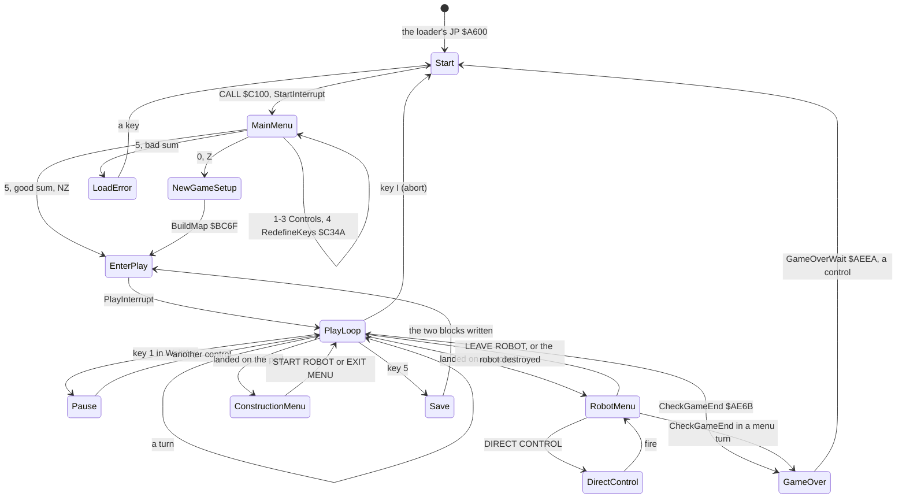
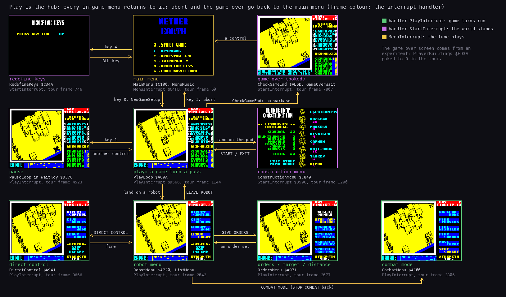
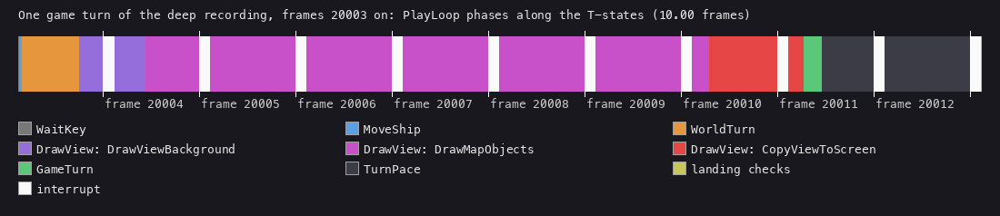
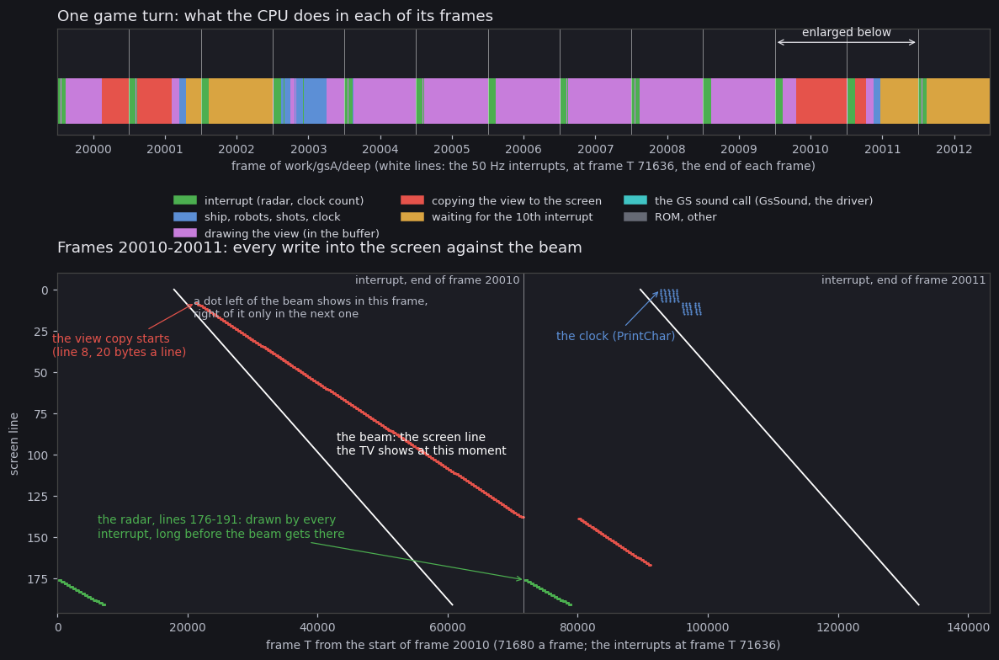

# 4. Game loop

This document covers the game's state machine: the start-up, the main menu, a new or loaded game, the play loop with
its two menus, and the end of a game. It also covers the order of work inside a game turn, and how a turn lines up
with the frames and the beam of a Pentagon 128. The whole machine is a chain of fall-throughs and jumps from `Start`
`$A600`, and every exit leads back to `Start` with `JP`.

The recordings it rests on ([Terms](README.md#terms)):

- `deep` (`work/gsA/deep`): the bot's game, 24 588 frames from the menu snapshot. In it:
  - the game starts at frame 105 (`play.log`);
  - the first construction menu opens at frame 253, the first robot is built at 450;
  - L1 counts 2 276 passes of `PlayLoop` (`MoveShip`'s entries) and 2 358 game turns;
- three access traces of `deep` (`analysis trace` on its own instance, `work/gsA/deep/traces/`):
  - `20002_0-20016_0`: the turn of 4.3, read with `tools/fig_turn.py`;
  - `20000_0-20013_0`: the same turn against the beam (4.5);
  - `2502_17000-2510_0`: a turn whose copy tears ([6.9](06-rendering.md#69-the-copy-and-the-beam));
- `tour` (`work/gsA/tour`): a scripted, recorded session on an own instance from the menu snapshot, 8 269 frames
  (`python3 tools/fig_ui.py tour`). It redefines the keys, builds two robots, gives orders, drives a robot, fires,
  sets a distance, pauses and hovers for a day. At frame 7 729 it pokes `PlayerBuildings` to 0 to see the game's end
  (an experiment, not play).

## 4.1 The state machine





The same machine with the real screens of the tour. How to read the figure:

- **A box** is a state: its screen as the tour saw it, its name, the code that runs it, the handler and the tour
  frame.
- **An arrow** is a transition, labelled with the key or the event that takes it.
- **The frame colour** is the interrupt handler installed (`Handler` `$FDFE`, read at that frame):
  - green `PlayInterrupt` `$D566`: game turns run; the clock, the radar and the robots go on;
  - violet `StartInterrupt` `$D59C` (`EI; RET`): the world stands (the construction menu, the redefine screen, the
    game-over wait);
  - yellow `MenuInterrupt` `$C4FD`: the menu's tune loop.
- **The point**: play is the hub. The robot menu and its submenus keep `PlayInterrupt`: the war goes on under them
  ([5.5](05-controls.md#55-the-robot-menu-and-its-submenus)).
- **The game-over screen** is an experiment: the tour poked `PlayerBuildings` `$FD3A` to 0 at frame 7 729, so
  `CheckGameEnd` `$AE6B` found no warbase of ours. The screen is from frame 7 807.

`python3 tools/fig_ui.py states` draws it from the tour's saved screens (`work/gsA/tour`).

## 4.2 The states

| State | Code | Handler (2.5) | Game turns | Ends |
| --- | --- | --- | --- | --- |
| start-up | `Start` `$A600` | `StartInterrupt` `$D59C` | no | falls into `CALL MainMenu` |
| main menu | `MainMenu` `$C100`, `MainMenuKeys` `$C192` | `MenuInterrupt` `$C4FD` while the tune loop runs, else `StartInterrupt` | no | key 0 (Z) or a good load (NZ) |
| redefine keys | `RedefineKeys` `$C34A` | `StartInterrupt` | no | the eighth key, back to the menu |
| load error | `LoadError` `$C282` | `StartInterrupt` | no | a key, `JP Start` |
| new game | `NewGameSetup` `$A62D` | `StartInterrupt` | no | falls into `EnterPlay` |
| enter play | `EnterPlay` `$A68E` | sets `PlayInterrupt` `$D566` | no | falls into `PlayLoop` |
| play | `PlayLoop` `$A69A` | `PlayInterrupt` | one a pass | the keys I and 5, the game's end |
| pause | `PauseLoop` `$D381` in `WaitKey` `$D37C` | `PlayInterrupt` | no | a control other than pause |
| robot menu | `RobotMenu` `$A720`, `ListMenu` `$ACD7` | `PlayInterrupt` | one a pass of `ListMenu` | LEAVE ROBOT `$A801`; the robot destroyed |
| direct control | `DirectControl` `$A941` | `PlayInterrupt` | one a pass | fire, or the robot destroyed |
| construction menu | `ConstructionMenu` `$C849` | `StartInterrupt` | no | START ROBOT, EXIT MENU |
| save | `SaveGame` `$C28D` | `StartInterrupt` | no | `JP EnterPlay` |
| game over | `GameStop` `$AF00`, `GameOverWait` `$AEEA` | `StartInterrupt` | no | a control, `JP Start` |

**Notes on the states.**

- **Start-up.** `Start` runs again for every new game: after an abort, a game's end or a load error. It rebuilds
  the IM 2 table and resets the seed every time, so every game from the menu starts from the same random state
  ([2.4](02-architecture.md#24-the-stages-from-disk-to-play)).
- **New game** (`NewGameSetup` `$A62D`). It clears the 48 robot records, the variables `$FD04-$FDFC`, the buildings
  and the shots. It puts the ship at column 17, row 10, altitude 0, climbing for 3 turns (`ClimbTurns` `$FD30`). It
  gives each side 20 general resource, and `BuildMap` `$BC6F` lays out the level. In `deep` the state at frame 105
  reads exactly that: ship (17,10), resources 20.
- **A loaded game** goes from the menu straight to `EnterPlay` with the loaded state
  ([3.9](03-build-and-load.md#39-the-saved-game)). No recording loaded one.
- **The menus run turns, or not.**
  - The robot menu and direct control run whole game turns of their own: `WorldTurn`, `DrawView`, `MenuRadarTick`
    `$B048`, `GameTurn`, `ShowStrength` `$A81D`. They leave out only `MoveShip` and the landing checks. In `deep`, 83
    of the 2 358 turns ran inside the robot menu (`ListMenu` → `GameTurn`, 83 calls; `MenuRadarTick` 83 entries).
  - The construction menu installs `StartInterrupt` and waits in its own loop: no turn, no frame count and no radar
    until it closes. In `deep` it was open 7 times, 126 frames on average.
- **Pause** (`WaitKey` `$D37C`). While key 1 is held, `PauseLoop` `$D381` loops on `ReadControls` until a control
  other than pause is pressed with key 1 released. The play interrupt keeps running: the radar blinks and
  `TurnFrames` counts on. The tour paused at frame 4 453 and went on at 4 523.
- **Abort** (key I) is `JP Start` from `CheckGameKeys` `$A70D`, with no question asked.

## 4.3 The turn

One pass of `PlayLoop` `$A69A` is one game turn:

```text
PlayLoop  $A69A  CALL WaitKey      ; the controls; the pause while key 1 is held
                 CALL MoveShip     ; the ship
                 CALL WorldTurn    ; the robots and the shots
                 CALL DrawView     ; the view
                 CALL GameTurn     ; clock, captures, game end, the pace
                 CALL ShipCell     ; then the landing checks
```



How to read the figure:

- **Across** is time: one turn of `deep`, frame 20 003 T 8 587 to frame 20 013 T 8 591, with the frame boundaries
  marked below.
- **Each colour** is a phase of the table below. **White** is an interrupt.
- **The point**: drawing the view is most of the turn (violet and red), and the turn ends by waiting (dark grey)
  for its tenth frame.

`python3 tools/fig_turn.py work/gsA/deep/traces/20002_0-20016_0.uatr --png docs/img/loop/turn-phases.png`

The phases of that turn: 716 804 T, 10.00 frames, 81 150 instructions:

| Step | Code | Work | T | Share | Starts at (frame, T) |
| --- | --- | --- | ---: | ---: | --- |
| 1 | `WaitKey` `$D37C` | read `Input`; the pause | 745 | 0.1 % | 20003, 8587 |
| 2 | `MoveShip` `$AF11` | the ship, the view column, the radar window | 2 341 | 0.3 % | 20003, 9332 |
| 3 | `WorldTurn` `$B0CA` | the enemy commander, 48 robot slots, 5 shots | 42 399 | 5.9 % | 20003, 11673 |
| 4a | `DrawView` → `DrawViewBackground` `$CFD7` | clear the view buffer, paint the corners | 40 602 | 5.7 % | 20003, 54106 |
| 4b | `DrawView` → `DrawMapObjects` `$CCC6` | the 32 x 16 cells back to front, the sprites ([6.4](06-rendering.md#64-the-draw-order)) | 368 860 | 51.5 % | 20004, 32116 |
| 4c | `DrawView` → `CopyViewToScreen` `$D071` | the buffer to the screen | 61 736 | 8.6 % | 20010, 21158 |
| 5 | `GameTurn` `$AD62` | random step, clock, production, game end, captures | 13 920 | 1.9 % | 20011, 19597 |
| 6 | `TurnPace` `$AE1D` | wait for `TurnFrames` ≥ 10, clear it | 101 532 | 14.2 % | 20011, 33517 |
| 7 | `ShipCell` `$CCA0` and on | the landing checks, then the keys I and 5 | 148 | 0.0 % | 20013, 8443 |
| | `$FDFD` | the 10 interrupts that land in the turn | 84 487 | 11.8 % | each frame |

An interrupt is counted from its `$FDFD` entry until it returns. `DrawView`'s own two instructions take 34 T.

**The landing checks** (`$A6A9`-`$A70C`), after the turn's work:

- **Under the ship, map bit 6**: if it is not set, go straight to the keys.
- **A robot** (`FindRobot` `$CDD8`):
  - an enemy's slot (24-47): nothing;
  - one of ours, when `Altitude` = its `+$09` + `+$0D` exactly: `RobotMenu`.
- **A building** (`FindBuilding` `$CDF5`) of type 0, our warbase's pad, when `Altitude` = 15 and the door cell 4 rows
  below, the cell under it and its two neighbours are free of bit 6: `ConstructionMenu`.
  - On its return, `PlayLoop` gives the new record its starting state: `+$05` 4, `+$06` 5, `+$0B` 0 (stop and
    defend), `+$0C` 100 (strength), `+$0F` 1.
  - It then recounts the robots (`CountRobots` `$BB40`) and reprints the panel (`UpdateStatusPanel` `$D293`).
- **A bug, from the code.** With all 24 of our slots in use, `ConstructionMenu` returns at once with IY = `$DB80`,
  the first enemy slot. `PlayLoop` then writes the starting state into that enemy robot: strength 100 %, order 0.
  This repeats every turn the ship rests on the pad. No recording of this case had 24 robots of ours (`deep` ended
  with 6).
- **The keys** (`CheckGameKeys` `$A70D`): `Input` bit 6 is `JP Start`; bit 5 is `SaveGame`, then `JP EnterPlay`;
  otherwise `JP PlayLoop`.

**Inside `GameTurn` `$AD62`:**

1. `Random` `$D358`: one step of the generator a turn, so the enemy's choices depend on the turn count.
2. The clock + 5 minutes. At 60 minutes an hour, at 24 hours a day and `DailyProduction` `$AE38` (8 calls in
   `deep`: 8 game days).
3. The clock printed at (0,22): the day, then hours.minutes.
4. `CheckGameEnd` `$AE6B` (4.4).
5. The 28 capture points: each door with bit 6 counts up, each empty one is reset; at 144 the base goes to the side
   of the robot standing there. In `deep`: `GiveFactory` `$BB61` 12 times, `GiveWarbase` `$BB86` 4 times, then
   `CountBases` `$BB09` and the panel.
6. `TurnPace` `$AE1D` (4.5).

## 4.4 The end of a game

`CheckGameEnd` `$AE6B` runs in every turn, the turns inside the robot menu included:

1. `EnemyBuildings` `$FD42`, the enemy's warbases, = 0: `GameWon` `$AEB1` prints "INSIGNIANS DESTROYED / YOU HAVE
   WON !".
2. Otherwise `PlayerBuildings` `$FD3A` = 0: "YOU HAVE NO BASES LEFT / BETTER LUCK NEXT TIME!".

Both messages print at (22,0) in attribute `$45`, after `GameStop` `$AF00`. `GameStop` gives the panel back to the
status (`PanelBusy` `$FD39` = 0) and installs `StartInterrupt`: the radar freezes and the frame count stops.
`GameOverWait` `$AEEA` follows:

1. a beep, id `$FA` (`Beep` `$CCAC`; the driver has no effect for it: silent);
2. 100 `HALT`s, 2 s;
3. `WaitRelease` `$AD57`;
4. a wait for a control: the chosen keys or stick, not any key;
5. `JP Start`.

The stack is not unwound: `Start` sets SP = 0.

- **The lost end** was seen in the tour, by experiment: `PlayerBuildings` poked to 0 at frame 7 729, the message at
  7 807, a control at 7 887, and the main menu again.
- **The won end** is read from the code: no recording took the enemy's three warbases. In `deep` the enemy still
  held 3 warbases and the player 1 at day 8 (frame 24 580).

## 4.5 Time

**The pace.** `PlayInterrupt` adds 1 to `TurnFrames` `$FD34` every frame. The end of a turn waits until it reaches
10, then clears it:

```text
$AE1D  LD A,(TurnFrames)   ; TurnPace
       CP $0A
       JR C,$AE1D          ; fewer than 10 frames since the last clear: wait
       XOR A
       LD (TurnFrames),A
       RET
```

So a turn is at least 10 frames, 200 ms: 5 turns a second, 12 turns a game hour, 288 a game day (57.6 s).

- **The work fits.** In the measured turn the work took 8.6 frames and ended in frame 20 011 at frame T 33 517. The
  wait then spun for 101 532 T, 1.42 frames, until the tenth interrupt of the turn.
- **Turns are 10 frames almost always.** `deep` averages 24 588 / 2 358 = 10.4 frames a turn. The excess comes from
  the frames no turn runs in: the main menu before frame 105 and the construction menus (7 x 126 frames).
- **The clear drops leftover frames.** A turn whose work ran past 10 frames does not carry the extra frames into
  the next turn: the clear sets the count to 0.

**The Pentagon's frame.** unreal-ng's Pentagon 128 (`ApplyModelTimingDefaults`):

- 71 680 T a frame, 224 T a line, no contended memory;
- the interrupt rises at frame T 71 636, 44 T before the frame ends;
- the first paper byte is fetched at frame T 17 944. The byte at screen line L, column c is fetched at
  17 944 + 224 L + 4 c.

T here is the frame T: the T-state in the emulator's frame, as unreal-ng's access trace stores it.

**The beam.** The turn is not synchronised with the beam. Its start drifts with the work, and only the interrupt
gives it a phase: the wait ends just after an interrupt, so a turn starts at about frame T 8 590, some 8 630 T after
the interrupt.



How to read the figure:

- **The top strip** is the turn of `deep` around frames 20 000-20 012, one colour for each kind of work:
  - the interrupt at the end of every frame (green), the frame boundaries as white lines;
  - the ship, robots, shots and clock (blue);
  - drawing the view in the buffer (violet, about six frames);
  - copying it to the screen (red, about a frame);
  - waiting for the tenth interrupt (yellow);
  - the GS sound call (cyan) and the ROM (grey) would show if they ran here.
- **The lower panel** enlarges frames 20 010 and 20 011:
  - across: the frame T from the start of frame 20 010 (71 680 a frame); the thin vertical line is the interrupt at
    the end of frame 20 010;
  - down: the screen line;
  - each dot: one byte written into the screen.
- **The white diagonals** are the beam: the line the TV shows at that moment, one diagonal a frame. A byte written
  left of the diagonal shows in that frame; one written right of it waits for the beam's next pass.
- **The red slope** is the copy, 20 bytes a line. It starts at line 8 at frame T 21 158 of frame 20 010, just after
  the beam has passed line 8, and it is slower than the beam (438 T a line on average, against 224). The beam pulls
  away from it, so every byte of frame 20 010 is written behind the beam. In frame 20 011 the beam comes round again
  after the copy has finished: all 3 200 bytes show in frame 20 011, none in 20 010.
  - This copy does not tear.
- **The green steps** at lines 176-191 are the radar, redrawn by every interrupt at the start of the frame, long
  before the beam reaches the bottom: it never tears.
- **The blue marks** at the top right are the clock's digits.

```
python3 ../../kit/beam_timeline.py --work work/gsA/deep --window 20000:0-20013:0 --listing work/gsA/game.lst \
    --frames 13 --out work/gsA/figs/beam-raw.png    # traces the window once into work/gsA/deep/traces
python3 tools/fig_beam.py --trace work/gsA/deep/traces/20000_0-20013_0.uatr --listing work/gsA/game.lst \
    --copy-frame 20010 --out docs/img/loop/beam-turn.png
```

The writers to the screen in the 13 frames of the trace, by loop:

| Loop | Writes | What |
| --- | ---: | --- |
| `CopyLineLoop` (`CopyViewToScreen` `$D071`) | 6 400 | two copies of the 160 x 160 view, 20 bytes a line |
| `RadarLineLoop` (`ShowRadar` `$D59E`) | 3 328 | the radar picture, lines 176-191, in every interrupt |
| `FillAttrLoop` | 416 | the radar's attributes |
| `GlyphLineLoop` (`PrintChar`) | 180 | the clock |

Whether a copy tears depends on where it starts. The copy starts wherever the drawing ends, and the game makes no
attempt to start it at the interrupt:

| Turn | Copy starts (frame, T) | Shown |
| --- | --- | --- |
| 20 010 (above) | 20 010, 21 158 | all 3 200 bytes in frame 20 011: no tear |
| 2 508 | 2 508, 65 814 | frame 2 509 shows the new view above screen line 113 and the old one below: 2 121 of 3 200 bytes new ([6.9](06-rendering.md#69-the-copy-and-the-beam)) |

A copy that starts behind the beam, early in the frame, never meets it again. A copy that starts late, near the
interrupt, is overtaken by the beam's next pass: the screen mixes two views for one frame.

## 4.6 Design notes

- **A frame budget by counting, not by syncing.** The interrupt only counts. The loop draws as fast as it can and
  then waits for the count, which keeps the speed constant whatever the view holds. The price is the occasional tear
  of 4.5.
- **Menus that keep the world running.** The robot menu calls the same turn routines as `PlayLoop`, minus the ship.
  Giving orders costs no game time, but the world moves while the player reads.
- **One way out.** Abort, game over and a bad load all `JP Start`. `Start` resets the stack, the interrupt table
  and the seed, so no state needs unwinding.
