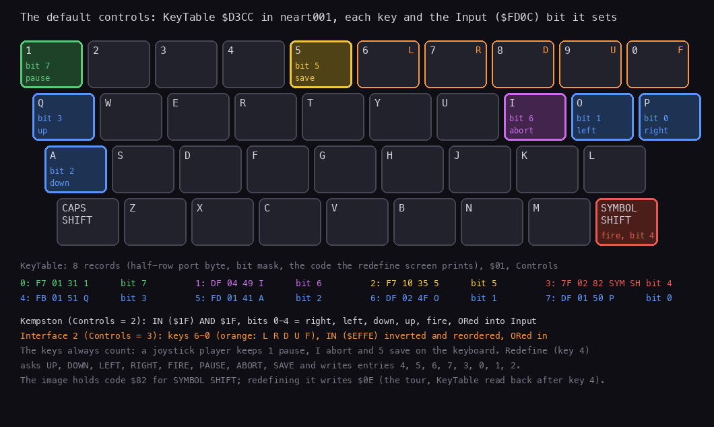
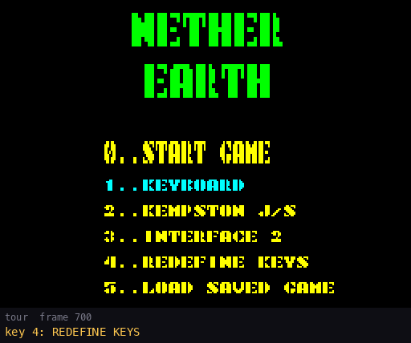
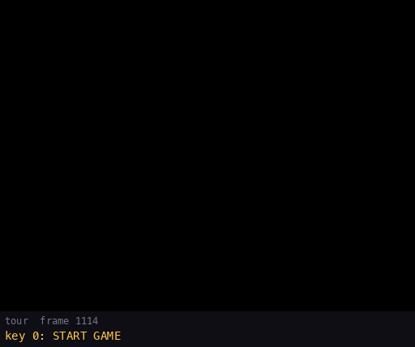
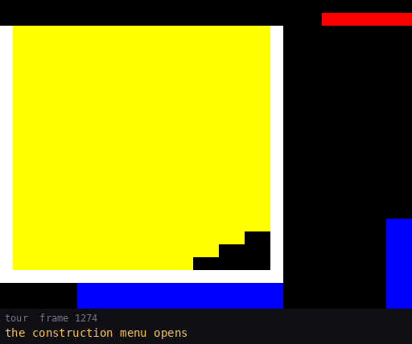
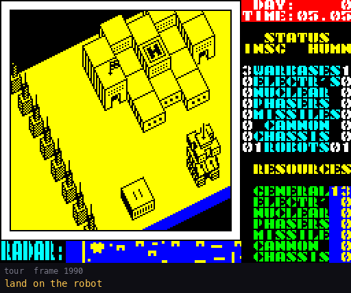
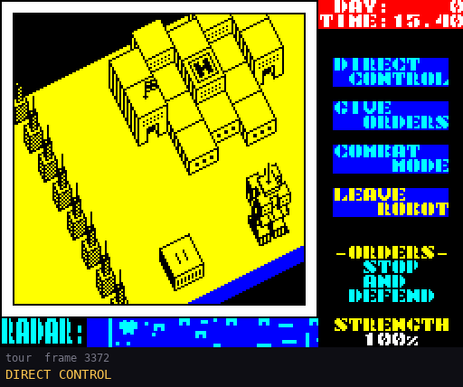
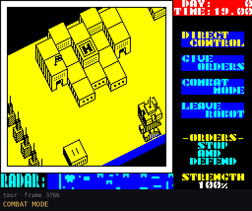
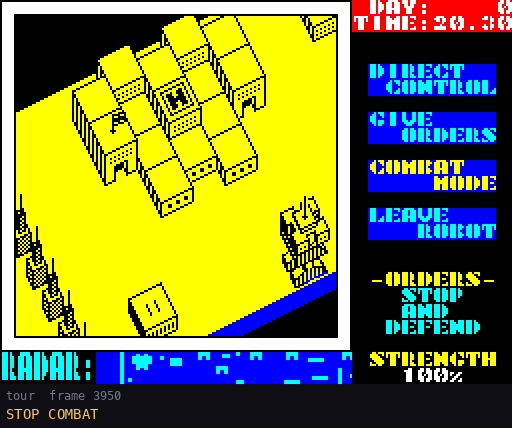
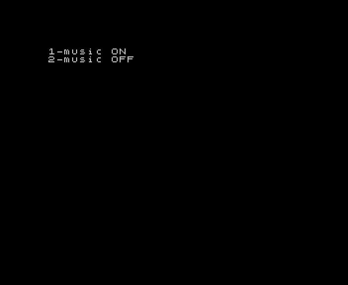

# 5. Controls

This document covers every input the game reads:

- the devices and the eight game keys;
- the main menu and the redefine screen;
- the ship in play, and the keys for pause, abort and save;
- the construction menu;
- the robot menu and its submenus;
- the keys that start each medium.

The evidence ([Terms](README.md#terms)):

- the code of `src/game/controls.asm`, `mainmenu.asm`, `ship.asm`, `start.asm`, `construction.asm` and
  `robotmenu.asm`;
- `tour`: a scripted session on an own instance (Pentagon 128 + GS 512 KB, muted), started from the main menu
  snapshot `work/gsA/deep/start.szx` and driven by keys only (`python3 tools/fig_ui.py tour`, `work/gsA/tour`, 8 269
  frames). Its 60 events with their frames are in `work/gsA/tour/events.json`. The animated figures here come from it;
- `deep`: the bot's game (`work/gsA/deep`, 24 588 frames), for the call counts.

Every GIF below shows the screen at 2x, one picture every 2 tour frames (4 for direct control, 6 for the first robot).
Under each picture are the tour frame and the action given at it. All of them are drawn by `python3 tools/fig_ui.py
tour`, or again from the saved samples by `python3 tools/fig_ui.py draw-tour`.

## 5.1 Devices

How to read the figure:

- **Coloured keys**: the eight keys of `KeyTable` `$D3CC` as built, with the bit of `Input` `$FD0C` each one sets.
- **Orange letters on 6-0**: the Interface 2 stick (L R D U F).
- **The lines below**: the eight 3-byte records, and the two joystick reads.

`python3 tools/fig_ui.py keys` (reads `KeyTable` from `build/game/neart001-scl.bin`).

All game input goes through one byte, `Input` `$FD0C`. `ReadControls` `$D38A` builds it once a turn:

| Bit | Meaning | Default key |
| --- | --- | --- |
| 0 | right | P |
| 1 | left | O |
| 2 | down | A |
| 3 | up | Q |
| 4 | fire | SYMBOL SHIFT |
| 5 | save | 5 |
| 6 | abort | I |
| 7 | pause | 1 |

How it is built:

1. Each `KeyTable` record holds the half row's port byte, the bit mask and the key code. `KeyLoop` reads the half row
   with `IN A,($FE)` and rotates the key's state into C. C starts at 1, so the 1 drops out after the eighth key and
   ends the loop.
2. The byte `Controls` `$D3E4`, set by the main menu, adds a joystick:
   - 1: no joystick, the keyboard only;
   - 2: Kempston, `IN ($1F)` AND `$1F`: bits 0-4 are already right, left, down, up, fire;
   - 3: Interface 2, keys 6-0 on `$EFFE`, inverted and put into the Kempston order.
3. The joystick bits are ORed over the keys. The keys always count, so a joystick player keeps 1, I and 5 on the
   keyboard.

`WaitKey` `$D37C` is the one entry every loop uses: the play loop, direct control, the menus and the end screens. In
`deep` it ran 9 830 times.

The witnesses:

- In `deep`, the port reads are the keyboard half rows only: `$7FFE`, `$BFFE`, `$DFFE`, `$EFFE`, `$F7FE`, `$FBFE`,
  `$FDFE`, `$FEFE` and `$E7FE` (the menu's KEY-SCAN).
- No recording read `$1F`. Kempston and Interface 2 are known from the code only.

## 5.2 The main menu and the redefine screen

`MainMenu` `$C100` prints NETHER EARTH and six options. `MainMenuKeys` `$C192` then waits:

| Key | Option | What it does |
| --- | --- | --- |
| 0 | START GAME | returns Z: `Start` goes on into a new game ([4.2](04-game-loop.md#42-the-states)) |
| 1 | KEYBOARD | `Controls` = 1, the options again |
| 2 | KEMPSTON J/S | `Controls` = 2 |
| 3 | INTERFACE 2 | `Controls` = 3 |
| 4 | REDEFINE KEYS | `RedefineKeys` `$C34A`, then the whole menu again |
| 5 | LOAD SAVED GAME | `LoadGame` `$C1FD`: the tape load of [3.9](03-build-and-load.md#39-the-saved-game) |

How the menu reads the keys:

- It does not use `KeyTable`. It reads the keyboard with the ROM's KEY-SCAN `$028E` and the ROM's key table `$0205`,
  so 0-5 work whatever keys were defined.
- The chosen controls option shows in cyan, the others in yellow (`ControlsOptionAttr` `$C336`).
- First it waits for all keys up. Then `MenuMusic` `$C4A7` runs until a number key is down; the title's colours cycle
  all the while.
- Any other key is ignored.

**The redefine screen.** It clears `KeyTable` and asks for UP, DOWN, LEFT, RIGHT, FIRE, PAUSE, ABORT and SAVE in
turn (`PrintKeyPrompt`, `DefineKey` `$C427`):

- A key already taken in this pass is refused, and the wait goes on.
- A key becomes the 3-byte record: the port byte (`$7F` for the SPACE-B row down to `$FE` for CAPS-V), the mask and
  the code. Its name is printed: SYM SH, ENTER, CAPS SH, SPACE, or the character.
- After the eighth key it waits for the release and about half a second (a 65 536-pass loop), then the menu comes
  back.

How to read the figure: tour frames 700-1096. Key 4 opens the screen at frame 700. One key follows every 40 frames
(746 UP to 1 026 SAVE). The menu is back at 1 066.

What the tour proved:

- After the redefine, `KeyTable` read back `f7 01 31 df 04 49 f7 10 35 7f 02 0e fb 01 51 fd 01 41 df 02 4f df 01 50`,
  then `Controls` = `01`.
- These are the default keys. One byte differs from the image: SYMBOL SHIFT is written back with the code `$0E`,
  while the image holds `$82`. The code is only used for printing and for the taken test, so the key works the same.

## 5.3 In play: the ship and the game keys

`PlayLoop` `$A69A` runs one turn a pass: `WaitKey`, `MoveShip` `$AF11`, `WorldTurn`, `DrawView`, `GameTurn`
([4.3](04-game-loop.md#43-the-turn)). The ship moves one cell a turn:

| Input | The ship |
| --- | --- |
| right / left | `ShipX` `$FD0E` + 1 / - 1, kept in columns 14-501. Both together cancel. |
| down / up | `ShipY` `$FD0D` + 1 / - 1, kept in rows 1-15 |
| fire held | `Altitude` `$FD10` + 2 a turn, up to 48 (`$30`) |
| fire not held | `Altitude` - 1 a turn, down to what stands under the ship |

The rules of the move:

- **Blocked moves.** A step that would put the ship lower than the highest top under its 2 x 2 footprint is refused
  (`CheckShipMove` `$B052`). The player climbs first, then crosses.
- **The forced climb.** While `ClimbTurns` `$FD30` is not 0, the ship climbs whatever fire says:
  - 3 turns at the start of a game, so it rises to 6 on its own;
  - 5 turns after LEAVE ROBOT or the construction menu, so it rises off the robot or the pad and the menu does not
    open again at once.
- **The view.** It follows the ship. It moves one column when the ship reaches view column 13 or 22. The radar window
  jumps 64 columns near its edge (`ScrollRadar` `$AFE6`, [6.7](06-rendering.md#67-the-radar)).

**Landing opens the menus.** After the turn, `PlayLoop` looks at the cell under the ship (`ShipCell` `$CCA0`, map bit
6):

| Under the ship | Condition | Opens |
| --- | --- | --- |
| a robot of ours (slots 0-23) | `Altitude` = the robot's ground `+$0D` + its height `+$09`: the ship sits on its top | the robot menu (5.5) |
| our warbase's pad (building type 0) | `Altitude` = 15, and the door below and the three cells under it are free | the construction menu (5.4) |
| an enemy robot or any other building | | nothing |

**The game keys.** They are tested at the end of every turn (`CheckGameKeys` `$A70D`):

| Key | Input bit | Does |
| --- | --- | --- |
| 1 | 7 | the pause: `WaitKey` loops in `PauseLoop` `$D381` until another control is pressed with 1 up. That control is the turn's input. The interrupt goes on, so the radar blinks and a sound plays out. |
| I | 6 | abandons the game: `JP Start`, the start-up and the main menu again |
| 5 | 5 | `SaveGame`: "PRESS RECORD AND PLAY", the tape save, then the play screen again ([3.9](03-build-and-load.md#39-the-saved-game)) |

The witnesses:

- The tour pressed key 1 at frame 4 453; fire ended the pause at 4 523.
- Abort and save ran in no recording. They are known from the code only.

How to read the figure:

- Tour frames 1114-2535, one picture every 6 frames.
- At 1 144 the ship flies to the pad at (22,5), and at 1 214 it sinks onto it with fire up.
- The construction menu takes the screen from 1 274 to 1 512.
- The robot stands at the door, and the ship climbs off.
- At 1 672 the ship lands on the robot; the robot menu opens at 2 030 (5.5).
- At 2 295 the robot sets off for the nearest neutral factory.

## 5.4 The construction menu

`ConstructionMenu` `$C849` takes a free record among our 24 robots as the preview. If none is free, it returns at
once. The play loop then writes the new robot's start values into the enemy's slot 24: a bug, from the code only
([10.12](10-gameplay-logic.md#1012-bugs)). The world stands still while the menu is open:

- the menu loop runs no game turns;
- the handler is `StartInterrupt`, so neither the frame count nor the radar runs.

The screen ([1.6](01-game-design.md#16-building-a-robot)):

- **Left**: ROBOT CONSTRUCTION, the resources as the menu spends them (a copy, `MenuResources`), their total, and
  EXIT MENU / START ROBOT.
- **Right**: the eight parts from BIPOD at the bottom to ELECTRONICS at the top, each with its picture and cost.
- **Bottom left**: the preview robot (drawn by `DrawRobot`, [6.6](06-rendering.md#66-robots-parts-stacked)).

The keys (`ConstructionMenuLoop` `$CA0F`, `MoveMenuCursor` `$CB00`):

| Input | Does |
| --- | --- |
| right / left | the column: 0 EXIT MENU, 1 START ROBOT, 2 the parts |
| up / down, in the parts column | the part row: up towards ELECTRONICS, down towards BIPOD |
| fire on a part | takes it, or gives it back if it was taken |
| fire on START ROBOT | builds the robot: `StartRobot` `$CB52` |
| fire on EXIT MENU | leaves, nothing built: `LeaveConstructionMenu` `$CB8E` |

The rules of fire on a part (`PartToggle`):

- **Chassis.** Bipod, tracks and anti-grav replace one another. The old chassis is refunded first.
- **Weapons.** Cannon, missiles, phasers and nuclear: at most three of the four.
- **Payment.** A part costs `PartCosts` `$CAF0`: bipod 3, tracks 5, anti-grav 10, cannon 2, missiles 4, phasers 4,
  nuclear 20, electronics 3. It is paid from the part's own resource first, and the rest from the general one.
- **Refusal.** A part the general resource cannot pay is refused. A replaced chassis then stays refunded, so the
  robot is left without one.
- **The sounds.** Beep `$64` for a part taken; `$78` for a part refused or given back. The GS ids are in
  [9.7](09-sound.md#97-every-call-of-the-sound).
- **The pause.** Every press, moves too, ends in `MenuPause`: 10 frames in which a press is lost.

How to read the figure: tour frames 1274-1532, one picture every 2 frames. Watch GENERAL in the left column:

| Frame | Fire on | General after | Why |
| --- | --- | --- | --- |
| 1 274 | the menu opens | 20 | |
| 1 290 | BIPOD | 17 | paid 3 |
| 1 310 | TRACKS | 15 | the bipod is refunded (+3), the tracks paid (-5) |
| 1 345 | CANNON | 13 | paid 2 |
| 1 391 | NUCLEAR | 13 | refused: 20 is more than 13 |
| 1 459 | MISSILES | 9 | paid 4 |
| 1 483 | MISSILES again | 13 | given back |
| 1 500 | START ROBOT | 13 | the robot is built: record 0, parts `$0A` (tracks + cannon) |

`StartRobot` copies the menu's resources back to `Resources` `$FD22` and places the robot at the door. Then
`PlayLoop` gives it its start state: order 0 (stop and defend), strength 100. In `deep` the bot opened the menu 7
times. It stayed 126 frames each time.

## 5.5 The robot menu and its submenus

`RobotMenu` `$A720` opens when the ship sits on the top of a robot of ours. The robot stands while its menu is open
(`+$0A` = 1). Unlike the construction menu, the world goes on:

- every list runs one game turn per pass while it waits (`ListMenu`: `WorldTurn`, `DrawView`, `GameTurn`);
- every list prints the robot's strength;
- a robot destroyed under its open menu closes the whole menu.

All the lists work the same way:

- Up and down move the highlight, with a click (beep `$14`).
- Fire chooses.
- Each list waits for all controls up first, so the fire that opened it does not choose.
- The lists draw in the right panel. `PanelBusy` `$FD39` = 1 keeps the status panel off it.

The menus:

| Menu | Items | Then |
| --- | --- | --- |
| robot menu | DIRECT CONTROL, GIVE ORDERS, COMBAT MODE, LEAVE ROBOT; under -ORDERS-, the current order | |
| GIVE ORDERS (`OrdersMenu` `$A971`) | STOP AND DEFEND (0), ADVANCE ?? MILES (1), RETREAT ?? MILES (2), SEARCH & DESTROY, SEARCH & CAPTURE | the distance or target menu |
| distance (`DistanceMenu` `$AA40`) | 0-50 miles in steps of 5: up adds 5, down takes 5, fire sets | `+$0E` = miles x 2. 0 miles turns the order into 0. |
| SEARCH & DESTROY (`TargetMenu` `$AACF`) | ENEMY ROBOTS (3), ENEMY FACTORYS (4), ENEMY WARBASES (5) | 4 and 5 need the nuclear bomb, else the order becomes 0 |
| SEARCH & CAPTURE | NEUTRAL FACTORYS (6), ENEMY FACTORYS (7), ENEMY WARBASES (8) | |
| COMBAT MODE (`CombatMenu` `$AC00`) | NUCLEAR BOMB, FIRE PHASERS, FIRE MISSILES, FIRE CANNON, MOVE ROBOT, STOP COMBAT | see below |
| DIRECT CONTROL (`DirectControl` `$A941`) | the controls drive the robot; fire gives it back | the robot menu |
| LEAVE ROBOT (`LeaveRobot` `$A801`) | | the robot carries on with its order, and the ship climbs 5 turns |

**The orders.** A search order looks for its first target at once (`SetOrder`). With no target, it becomes 0. The
robot's behaviour under each order is in [7.2](07-objects.md#72-robots) and [10.5](10-gameplay-logic.md#105-orders).

**The combat menu.**

- Items 1-4 need the weapon. Without it, the menu answers with beep `$FA` and opens again. The driver has no sound for
  `$FA`, so the answer is silent ([9.7](09-sound.md#97-every-call-of-the-sound)).
- FIRE PHASERS, MISSILES or CANNON launch shot record 0 at `$D7D3` along the robot's facing, if it is free.
- NUCLEAR BOMB sets off the blast at the robot (`NuclearBlast` `$B99F`). The bomb destroys its carrier, and the menu
  closes.
- MOVE ROBOT is direct control.

**Direct control.** It sets the robot's `+$0A` to 2. Then `WorldTurn` moves the robot from `Input`, and `MoveShip`
runs from there, so the ship rides on the robot.

How to read the figure: tour frames 1990-2355.

- 2 030: the robot menu, LEAVE ROBOT highlighted first.
- 2 042: GIVE ORDERS.
- 2 077: SEARCH & CAPTURE.
- 2 129: NEUTRAL FACTORYS. The order line under -ORDERS- changes.
- 2 142: LEAVE ROBOT, with fire held, so the ship climbs away.
- The clock runs all the while.

How to read the figure:

- Tour frames 3372-3766 on the second robot, one picture every 4 frames.
- Down: the robot turns first, then steps. The ship and the view move with it.
- Right: again a turn first, then steps.
- 3 736: fire gives the robot back, and the robot menu returns.

How to read the figure: tour frames 3766-3948.

- 3 806: FIRE CANNON fills shot record 0 (`$D7D3`).
- The shot flies east, 2 cells a turn.
- 3 878: it ends. `SoundFx` `$FD53` = `$FC`, the end of a shot.
- 3 908: STOP COMBAT.

How to read the figure: tour frames 3950-4229.

- 3 980: ADVANCE.
- 4 022-4 097: up five times, 5 miles a press: 5, 10, 15, 20, 25.
- 4 117: down, back to 20.
- 4 137: fire. The order line reads ADVANCE 20 MILES.
- A held key steps once a turn: there is no release wait in the distance loop.

In `deep` the bot opened the robot menu 7 times (135 frames each). It only gave search orders: 6, 6, 3, 7, 3, 7, 3.
Only the tour ran direct control, the combat menu and the distance menu.

## 5.6 Starting each medium

How each medium starts and what it shows is in [3](03-build-and-load.md). The keys:

| Medium | Keys |
| --- | --- |
| SCL (Tron Z, 2002) | in TR-DOS, `RUN "neart GS"` |
| TRD (Tron Z, 2002) | in TR-DOS, `RUN`; then key 1 in the boot menu (2 and 3 start `Neart481` and `Neart482`, [3.8](03-build-and-load.md#38-the-trds-boot-menu-and-its-extras)) |
| TAP (Hood, 2017) | 128 BASIC, `PRINT USR 0`, ENTER, then `LOAD ""`; then 1 or 2 at the music question |
| TAP, from the 128 menu's Tape Loader | loads, but hangs at the first sound in play ([1.10](01-game-design.md#110-the-hang-of-hoods-tape-on-a-128k)) |

The TRD's boot menu lists the disk's programs as `0-` to `9-`, and a digit key starts one at once. Its picture is in
[3.8](03-build-and-load.md#38-the-trds-boot-menu-and-its-extras).

The music question is Hood's loader's: "1-music ON / 2-music OFF".

- Key 1 loads and starts the module.
- Key 2 writes `RET` at `StartModule` `$62DF`, so the module never starts.
- The effects are sent either way ([3.7](03-build-and-load.md#37-the-tape-hood-2017)).

## 5.7 Design notes

- **One input byte.** Keys, Kempston and Interface 2 all become `Input` bits, ORed together. Every routine tests bits
  of one byte, so the joysticks cost two `IN`s and no other code.
- **The menu reads the ROM's table.** The main menu works with any redefinition, at the price of a second keyboard
  reader.
- **The world goes on in the robot menus.** A robot can die under its menu. The construction menu, on the other hand,
  stops the world: building costs no game time.
- **The forced climb after a menu** keeps the menu from reopening, without a flag.
- **The 10-frame pause** after each construction press is the menu's only debounce. A short press inside it is lost.
