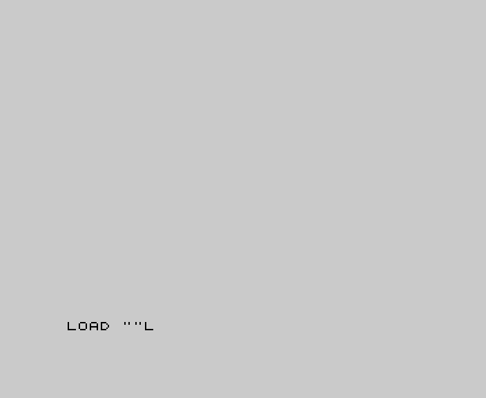
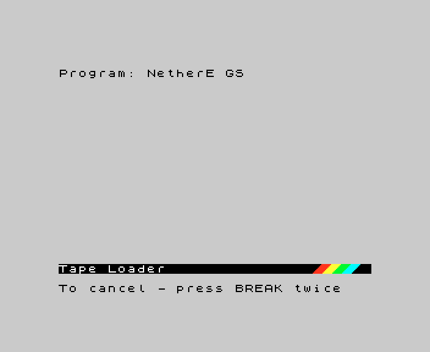

# 5. Controls

What this covers: the keys the GS conversion adds to Nether Earth (NE): the way each medium is started, the TRD's
boot menu and the tape's music question. In the game the controls are NE's: devices, the main menu, the ship, the
construction and robot menus are in [NE's 05](../../nether-earth/docs/05-controls.md).

Stage 2 draft. It rests on the frames of `tools/fig_capture.py` (Pentagon 128 + GS 512 KB, and NE on a 48K, both
driven by keys only) and on `tools/play_gs.py`, which plays both games from their main menus with NE's own bot
steering by the keyboard; `work/stage2/NOTES-shots.md` lists the runs.

## 5.1 Starting the game

| Medium | Keys | Notes |
| --- | --- | --- |
| SCL | Pentagon menu: up (CS+7), ENTER for TR-DOS; then `RUN "neart GS"` | `tools/fig_capture.py` types it from `SCL_BOOT` |
| TRD | TR-DOS, `RUN`; then 1 in the boot menu (2 and 3 start `Neart481` and `Neart482`, 5.2) | |
| TAP | 128 menu: down to 128 BASIC, ENTER; `PRINT USR 0`, ENTER; `LOAD ""`, ENTER; then 1 or 2 (5.3) | of the 128K routes tried, the one that plays: [03 3.3](03-build-and-load.md#33-the-tape-load-hood-2017) |
| TAP | 128 menu: Tape Loader | loads and plays the menu music, then hangs at the first sound in play ([01 1.5](01-game-design.md#15-the-hang-of-hoods-tape-on-a-128k)) |

NE itself needs only `LOAD ""` (run here on a 48K).

## 5.2 The TRD's boot menu

HRUM 3.5's menu lists the disk's programs as `0-` to `9-`; the digit key starts one at once (the cursor bar is on
`boot`). `fig_capture.py` presses 1, 2 and 3 from the same snapshot of the menu: 1 is the GS game, 2 `Neart481`, 3
`Neart482`. The picture is in [01 1.2](01-game-design.md#12-starting-each-medium).

## 5.3 The tape's music question

Hood's loader shows "1-music ON / 2-music OFF" before the screen loads and waits for a key: 1 loads and starts the
module, 2 pokes `RET` at `$62DF` so the module is never started ([9.7](09-sound.md#97-the-tape-version-hood-2017)).
The effects are sent either way.

## 5.4 In the game

The keys, the joysticks and the redefine screen are NE's; the main menu is the same frame as NE's
([01 1.4](01-game-design.md#14-what-stays-nes)). `tools/play_gs.py` drives both games with the same key presses (O,
P, Q, A and SYMBOL SHIFT for fire, NE's device 1) and reaches the same construction menu; NE's bot needs no change for
the GS build.
