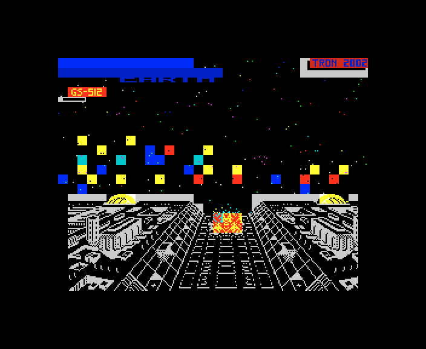
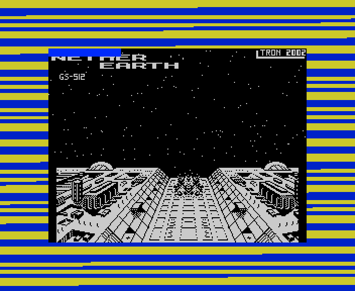
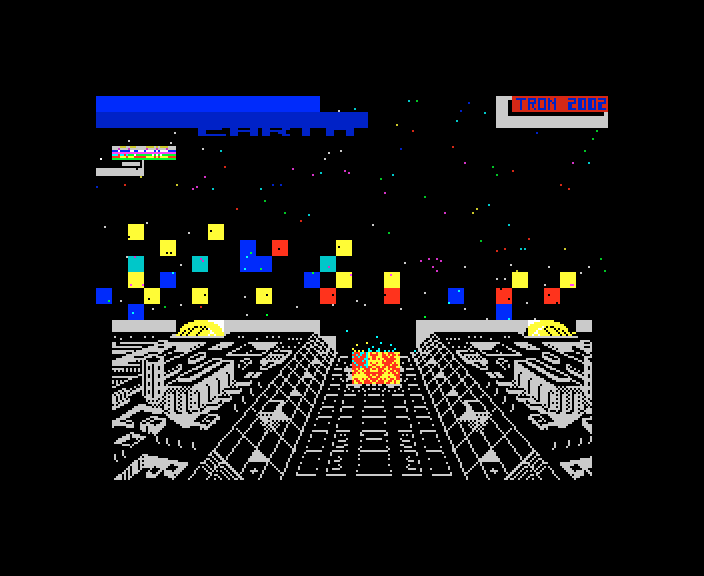
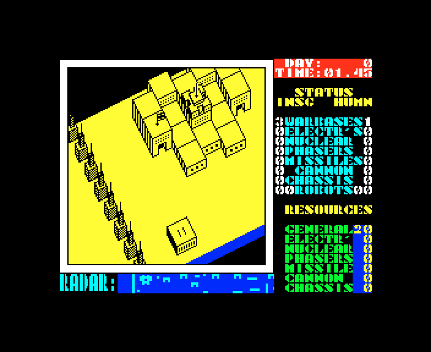

# 6. Rendering

What this covers: what the GS conversion draws that Nether Earth (NE) does not: the loading screen `neart000`, the
loader's progress bar on it, and the frozen frame of the tape's hang. The game's drawing (the view buffer, the
projection, the sprites, the radar, the panel) is NE's, unchanged: [NE's 06](../../nether-earth/docs/06-rendering.md).

Stage 2 draft. It rests on the frames of `tools/fig_capture.py` (Pentagon 128 + GS 512 KB: the SCL, the TRD's entry 1,
Hood's tape by two routes; NE's `NETHER.TAP` on a 48K) and on the screen-area comparisons of `tools/fig_compare.py`.
`work/stage2/NOTES-shots.md` lists the runs.

## 6.1 The game's screens are NE's

The main menu, the start of play and the construction menu of the GS build are NE's frames pixel for pixel over the
256 x 192 screen area ([01 1.4](01-game-design.md#14-what-stays-nes)). In the game file `neart001` 542 of NE's 563
entries are byte for byte at NE's addresses and nothing moved ([02 2.5](02-architecture.md#25-what-is-nes)); the
changes are the sound routines and the three entries next to them.

## 6.2 The loading screen `neart000`

The loader clears the screen and loads `neart000` (6912 bytes) first ([03 3.2](03-build-and-load.md#32-the-disk-load-scl-trd-option-1)):
NE's logo on a blue band, a starfield with coloured blocks, a city in perspective, "GS-512" in red under the title
and "TRON 2002" in the corner. Hood's tape loads the same file as a standard block, so on tape the picture arrives at
the ROM loader's pace, pixels first, under the ROM's blue / yellow border stripes.

NE has none of this: its game block loads into a black screen ([01 1.3](01-game-design.md#13-the-start-of-the-tape-and-the-loading-screen)).

## 6.3 The progress bar over "GS-512"

While the module and the effects go to the card, the loader's per-byte routine `$6345` copies each byte to the four
attribute cells `$5861-$5864` ([03 3.2](03-build-and-load.md#32-the-disk-load-scl-trd-option-1)). Those cells are the
"GS-512" label: row 3, columns 1-4. So the label flickers in the data's colours for the whole load, on disk and on
tape alike. The TRD frame above, taken 600 frames after the choice, still shows the label's own red.

## 6.4 The frozen frame

On the tape's hang ([01 1.5](01-game-design.md#15-the-hang-of-hoods-tape-on-a-128k)) the CPU halts with interrupts
off, so nothing redraws: the last view stays, the ship on the pad and the clock at `01.45`. Two frames 500 apart are
identical.

