# 6. Rendering

The isometric view is redrawn from nothing every game turn. `DrawView` `$CCBD` clears a 160 x 160 pixel buffer,
paints the corners outside the map, walks the 32 x 16 visible map cells back to front along diagonals, drawing each
block, building, robot and the ship as a masked sprite, and copies the buffer to the screen. Nothing scrolls and
nothing is erased. The redraw takes 7.6 frames on average, and it sets the game's pace of one turn every 10 frames
([4.5](04-game-loop.md#45-time)).

This document also covers the radar, the play screen and its panel, and what the copy does against the beam of a
Pentagon 128.

The evidence ([Terms](README.md#terms)):

- the code of `src/game/*.asm`: the view in `view.asm`, `viewbuffer.asm` and `sprites.asm`, the radar in
  `interrupts.asm`, the tables in `tables.asm`;
- `deep` (`work/gsA/deep`, 24 588 frames of the bot's game): the L1's counts and T-states (`l1.json`: 1 762 467 705
  T, 2 367 view draws);
- the access trace `2502_17000-2510_0` of `deep`: the view drawn from frame 2 502 to 2 509. It shows our warbase,
  robot 0 (`$DA00`, bipod + cannon) at the warbase, robot 1 at the left edge, the ship's shadow and the map's edge;
- `work/gsA/deep/start.bin`, the image at the start of `deep`: the sprites and the tables;
- `tools/fig_render.py` and `tools/view_model.py`: `DrawView` in Python, and the figures drawn from the recordings
  (TTD `memory_at`, read only; access traces). `fig_render.py verify --work work/gsA/deep --views 60` compares the
  model with the game's buffer.

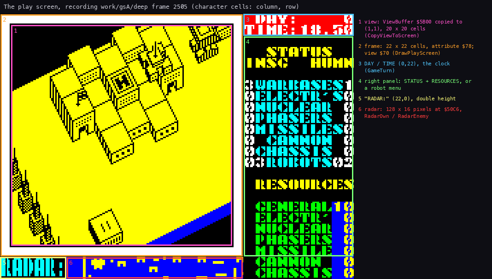

How to read the figure: each numbered frame is one area of the play screen, named on the right with its character
cells and the routine that fills it (6.8). `python3 tools/fig_doc.py areas --work work/gsA/deep --frame 2505 --out
docs/img/render/screen-areas.png`

## 6.1 One view, as it is drawn

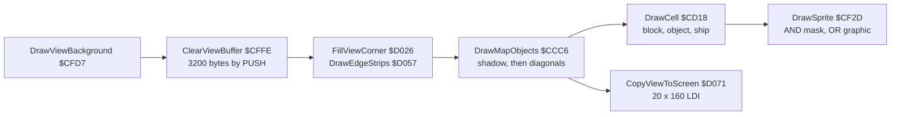

The cost in `deep` (`python3 tools/l1_table.py --l1 work/gsA/deep/l1.json --names ...`):

| Routine | Calls | T-states a call | Share of all T-states |
| --- | ---: | ---: | ---: |
| `DrawView` `$CCBD`, all of it | 2 367 | 546 165 (7.62 frames of 71 680) | 73.4 % |
| `DrawViewBackground` `$CFD7` (clear, corner, edges) | 2 368 | 45 443 | 6.1 % |
| `ClearViewBuffer` `$CFFE` | 2 404 | 22 794 | 3.1 % |
| `DrawMapObjects` `$CCC6` (inclusive) | 2 366 | 430 964 | 57.9 % |
| `DrawCell` `$CD18` | 272 684, 115 a view | 3 003 | 46.5 % |
| `DrawSprite` `$CF2D` (inclusive) | 81 805, 35 a view | 9 222 | 42.8 % |
| `CopyViewToScreen` `$D071` | 2 366 | 61 736 | 8.3 % |
| `ShowRadar` `$D59E`, every frame from the interrupt | 23 685 | 8 134 | 10.9 % |

The traced call runs from frame 2 502 T 17 558 to frame 2 509 T 64 231: 548 433 T, 7.65 frames, 65 886
instructions, 37 sprites. In order:

- the `PUSH` clear sweeps the buffer from the bottom up;
- the corner and the edge strips appear;
- the ship's shadow;
- the blocks and buildings, diagonal by diagonal from the far corner to the near one;
- the robots, where the walk reaches their cells;
- last the copy to the screen, which only reads the buffer.

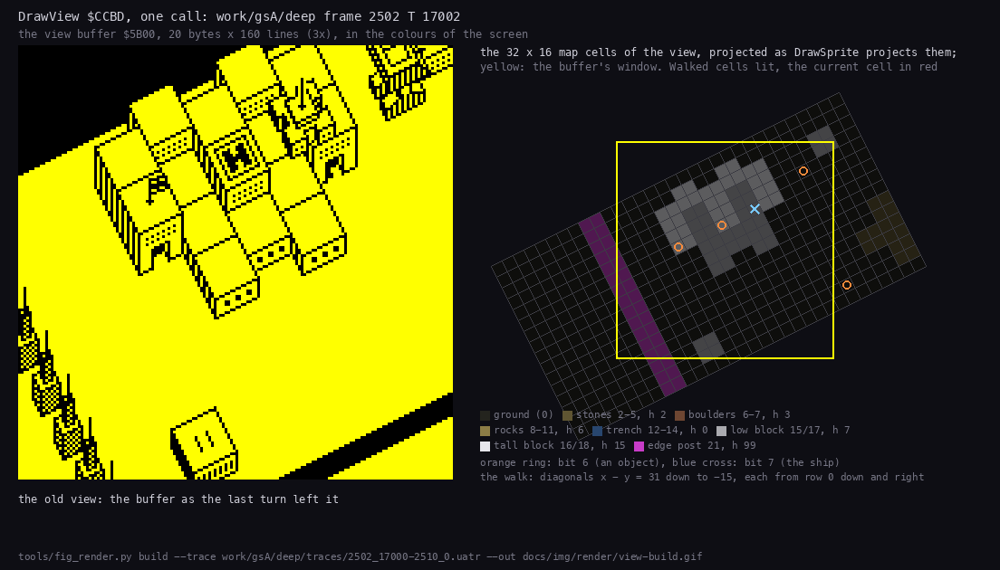

The same call, one picture a sprite. How to read the figure:

- **Left**: the buffer after each `DrawSprite`, the sprite's box in red.
- **Right**: the 32 x 16 map cells of the view, projected as the sprites are; the cells walked so far are lit and
  the current one is red.
- **The point**: the walk crosses the map along diagonals from the far corner. The blocks of a 2 x 2 group draw
  once, at their anchor; the robots come where the walk reaches their cells.

`python3 tools/fig_render.py build --trace work/gsA/deep/traces/2502_17000-2510_0.uatr --out docs/img/render/view-build.gif`:
each picture is the buffer of the trace at the moment that `DrawSprite` returned.

Who drew each byte of the buffer in that call:

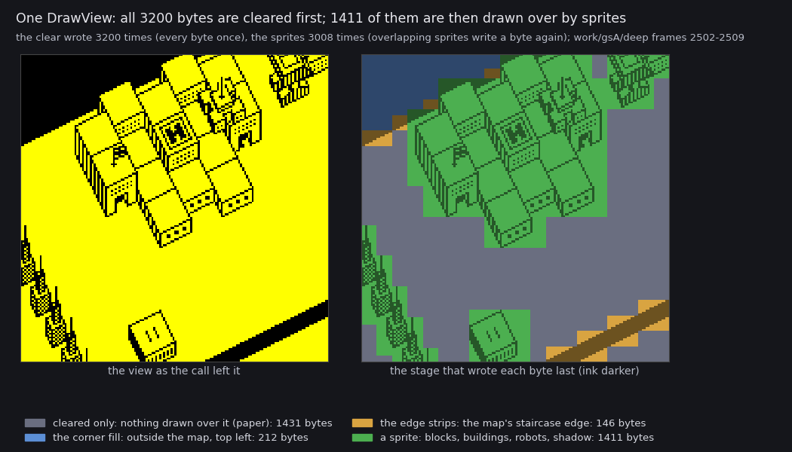

How to read the figure:

- **Left**: the buffer as the call left it, in the screen's colours (black ink on yellow paper).
- **Right**: the same pixels, each byte coloured by the stage that wrote it last; ink pixels are the darker shade.
- **Grey**: the clear only. Nothing was drawn there, so it stays paper: 1 431 bytes.
- **Blue**: the corner fill, the far corner outside the map (`$FF`, all ink): 212 bytes.
- **Orange**: the edge strips, the staircase edge of the map: 146 bytes.
- **Green**: a sprite (blocks, buildings, robots, the shadow): 1 411 bytes.
- **The point**: the clear writes all 3 200 bytes once. The sprites write 3 008 times, because overlapping sprites
  write a byte again, and are the last writer of under half the buffer.

```
python3 tools/fig_view_writers_gs.py --trace work/gsA/deep/traces/2502_17000-2510_0.uatr \
    --listing work/gsA/game.lst --out docs/img/render/writers-view.png
```

## 6.2 The view buffer `$5B00-$677F`

`ViewBuffer`: 160 lines of 20 bytes, top line first, a plain bitmap (bit 7 = the left pixel, 1 = ink). The font
follows at `$6780`. Only `$6590-$677F` is inside the game file; the rest lies over the loader and the system
variables ([2.2](02-architecture.md#22-the-memory-map)).

- **Clear** (`ClearViewBuffer` `$CFFE`): it keeps SP in `SavedSP`, sets SP = `$6780`, and `ClearPushLoop` pushes
  HL = 0 eight times a pass, 198 passes (3 168 bytes). An `LDIR` clears the last 32 bytes, `$5B00-$5B1F`.
- **Corners** (`FillViewCorner` `$D026`): the top left corner is outside the map. Five bands of 8 lines are filled
  with `$FF` over 10, 8, 6, 4 and 2 bytes. The counts are operands of its own loop (`$D038`, `$D041`), changed after
  each band.
- **Edges** (`DrawEdgeStrips` `$D057`): the staircase edge `ViewEdgeA` `$D6A8`, 2 pixels a line, laid in strips of
  8 rows down and to the left: the far edge of the map and its near right corner.
- **Copy** (`CopyViewToScreen` `$D071`): 20 unrolled `LDI` a line to `$4021` (character row 1, column 1), the screen
  address stepped by hand, 160 lines: 61 736 T, 0.86 of a frame. There is no `HALT` before it: it starts when the
  drawing ends (6.9).

The same bytes serve other uses while no view is drawn: the construction menu's robot preview (`ShowRobotDesign`
`$CC1F`, 29 calls in `deep`) and the save's checksum word at `$5B00` ([3.9](03-build-and-load.md#39-the-saved-game)).

## 6.3 The projection

`DrawSprite` `$CF2D` takes A = the sprite (bits 0-5), E = the view column 0-31, D = the map row 0-15, and the height
h in its own operand `$CF3F`, written by every caller. With the column counted in half bytes:

    L = 2E + D - 24                (half-byte column; pixel x = 4L = 8E + 4D - 96)
    H = 8D + 100 - 4E - h          (the buffer line of the sprite's BOTTOM line)

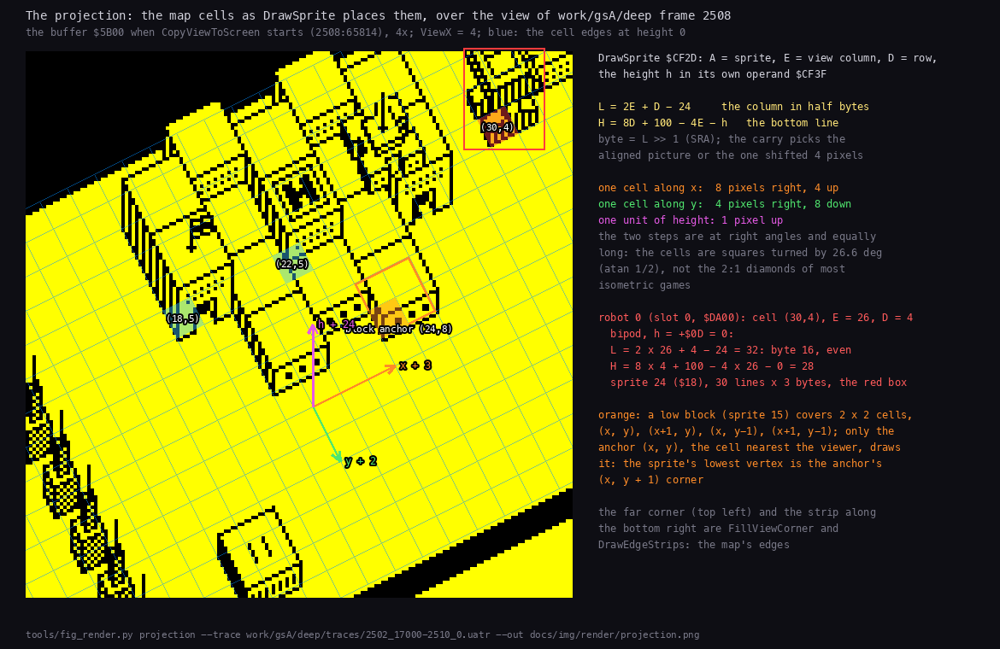

How to read the figure:

- **Left**: the buffer of the traced call when the copy starts (2 508:65 814), 4 times enlarged, `ViewX` = 4. The
  thin blue lines are the cell edges at height 0, from the formulas.
- **The three arrows** from the block anchor at (24,8): one cell along x is 8 pixels right and 4 up (orange); one
  cell along y is 4 right and 8 down (green); one unit of height is 1 pixel up (pink).
- **The marked cells**: the pad (22,5), the flag (18,5), the block anchor (24,8) with its 2 x 2 footprint, and
  robot 0 at (30,4) with its sprite's box in red.
- **Right**: the formulas, and robot 0 worked through them: E = 26, D = 4, h = 0 give L = 32 (byte 16, even) and
  H = 28.
- **The point**: the two steps are at right angles and equally long. The cells are squares turned by 26.6 degrees
  (atan 1/2), not the 2:1 diamonds of most isometric games.

`python3 tools/fig_render.py projection --trace work/gsA/deep/traces/2502_17000-2510_0.uatr --out docs/img/render/projection.png`

- A 2 x 2 block covers (x, y-1) to (x+1, y). Only its anchor cell (x, y), the one nearest the viewer, draws it; the
  sprite's lowest vertex is the anchor's (x, y+1) corner.
- Columns are half bytes, so a sprite lands either on a byte boundary or 4 pixels into a byte. `SRA L` gives the
  byte, and the carry picks one of two pictures of every sprite: the aligned one or one shifted right by 4 pixels
  (6.5). No sprite is shifted at run time.

**Clipping**, all in `DrawSprite` (`src/game/view.asm`):

- a byte column past 19, or a bottom line at `$E2` and below, draws nothing;
- a bottom line in `$A0`-`$E1` skips the sprite's rows below the buffer (`ClipBottomLoop`);
- a negative column skips the left pairs of every row (`ClipLeft` `$CF77`, the count in the operand `$CFAF`);
- a sprite past column 19 leaves out its last pairs (`ClipRight` `$CF85`);
- drawing upward stops above `$5B00`.

The map's far edge and the corner fill hide what sticks out to the upper left.

The view is a window of 32 of the map's 512 columns, `ViewX` `$FD0A` its left column. The whole map:

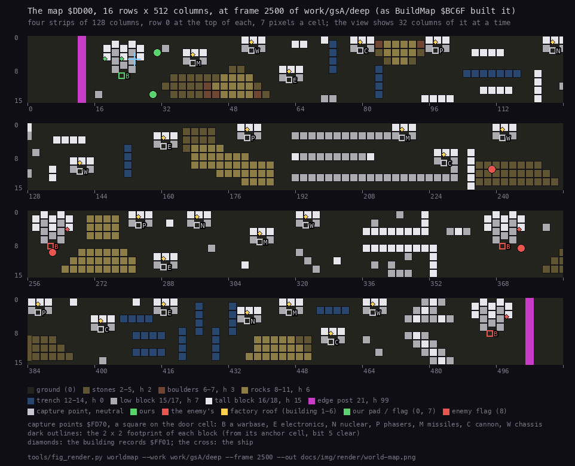

How to read the figure:

- **Four strips** of 128 columns each, row 0 at the top, 7 pixels a cell; the column numbers below.
- **The cell colours** are the terrain types of the legend: stones, boulders, rocks, trenches, low and tall blocks,
  the edge posts (magenta) at columns 12 and 500.
- **Dark outlines**: the 2 x 2 footprint of each block. **Diamonds**: the building records `$FF01`.
- **Squares on door cells**: the capture points `$FD70`, lettered by kind (B warbase, E electronics, N nuclear, P
  phasers, M missiles, C cannon, W chassis), coloured by owner: neutral, ours (green), the enemy's (red).
- **The point**: our warbase is at column 22 at the far left; the enemy's three are at 261, 369 and 494. The 24
  factories lie between.

`python3 tools/fig_render.py worldmap --work work/gsA/deep --frame 2500 --out docs/img/render/world-map.png`

## 6.4 The draw order

`DrawMapObjects` `$CCC6`:

1. `ShipDrawPos` `$FD11` = 0 (no deferred ship), then the ship's shadow: sprite 1 at height 0, at view column
   `ShipX` - `ViewX`, row `ShipY`. The shadow is drawn first, so everything covers it.
2. The diagonals x - y = 31 down to -15 (`DiagonalLoop` `$CCF3`), each from row 0 (or its first column) down and
   right, one row and one column a step, to row 15 or column 31. Cells with x < 0 and empty cells (byte 0) are
   skipped. Every other cell goes to `DrawCell` `$CD18` with HL = the cell, D = the row, E = the view column. A later
   diagonal is nearer the viewer, and so is a later cell on a diagonal.

`DrawCell` reads the cell byte:

| Bit | Draws |
| --- | --- |
| 0-4 (type), bit 5 clear | the block: sprite = type, at height 0 |
| 5 | nothing: the other three cells of a 2 x 2 block (only the anchor draws) |
| 6 | `DrawCellObject` `$CE12`: the robot (`FindRobot`), else the building (`FindBuilding`), else a shot whose `+$00/+$01` is this cell |
| 7 | the ship, or the ship deferred to this cell |

In `deep` `DrawCell` ran 115 times a view and `DrawCellObject` 6 355 times in all, under 3 a view.

**Deferral.** A sprite is taller and wider than its cell, so a block drawn later beside a robot would paint over its
upper body. `DrawMover` `$CE68` therefore looks at the blocks that can overlap (`FindLatestBlock` `$CD96`) and picks
the one drawn last (`KeepLaterCell` `$CDBF`, the walk's order). If that is not the robot's own cell, the robot is
postponed (`MoverDefer` `$CE76`):

- bit 6 is set on the later cell, and the record's draw cell `+$00/+$01` is pointed at it;
- when the walk reaches that cell, `DrawCellObject` finds the robot there by `+$00/+$01`; `+$00/+$01` goes back to
  the real cell (from `+$02-$04`), bit 6 is cleared, and the view column and row are walked back to the real cell's;
- the robot is drawn there, over the block.

The ship does the same with bit 7 and `ShipDrawPos` (`ShipDefer` `$CD6F`). It also looks at the neighbouring objects
(`CheckObjectNeighbour` `$CD90`), because it flies above robots and buildings. In `deep`, `FindLatestBlock` ran 3 989
times and `KeepLaterCell` 2 039 times. How often a deferral changes a picture was not measured in this case.

## 6.5 Sprites

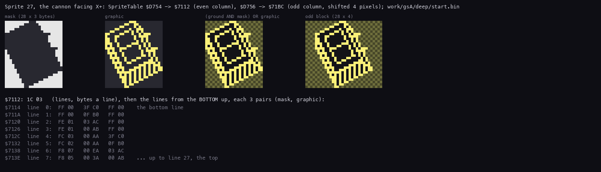

How to read the figure:

- **The four pictures**: the mask (white keeps the ground, dark clears it), the graphic (yellow is ink), the two
  composed over a checkered ground, and the odd-column picture, one byte wider.
- **Below**: the bytes at `$7112`: the header, then the lines from the bottom up, three (mask, graphic) pairs each.

`python3 tools/fig_doc.py sprite --image work/gsA/deep/start.bin --out docs/img/render/sprite-format.png`

**The format.** Byte 0 is the number of lines, byte 1 the width in bytes. Then come the lines from the **bottom**
up, each a run of (mask, graphic) pairs. A byte of the buffer becomes `(byte AND mask) OR graphic`
(`SpriteByteLoop` `$CFBB`); after a line the destination goes 20 bytes up (`ADD A,$EC` on E). The mask keeps the
ground around the outline and clears the inside, so a sprite hides what is behind it without a separate erase.

One robot blitted, part by part:

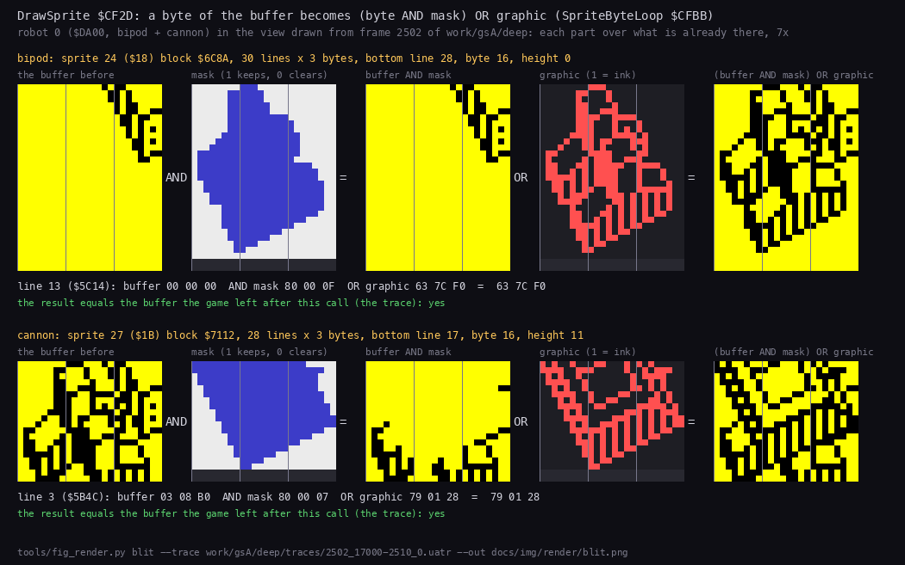

How to read the figure:

- **Two rows**, one for each part of robot 0 (`$DA00`, bipod + cannon): the bipod (sprite `$18`, block `$6C8A`, 30
  lines x 3 bytes) at height 0, then the cannon (sprite `$1B`, block `$7112`, 28 x 3) at height 11.
- **Across**: the buffer before the call, the mask (blue clears), the buffer AND mask, the graphic (red is ink), and
  the result, 7 times enlarged.
- **Under each row**: one line worked through in hex, and whether the result equals the buffer the trace has after
  the call. It does, for both parts.

`python3 tools/fig_render.py blit --trace work/gsA/deep/traces/2502_17000-2510_0.uatr --out docs/img/render/blit.png`

**`SpriteTable`** `$D6E8`: 51 sprites of two words, the aligned picture and the one for an odd half-byte column
(index = 2 x id + parity). Where both are one picture, the odd one is the even one shifted right by 4 pixels and one
byte wider. For map blocks the column parity equals the row parity (x is doubled in L), so some block types use the
two words for two different pictures.

| Ids | What | Drawn by |
| --- | --- | --- |
| 0, 1 | the ship, its shadow | `DrawCell` at `Altitude`; `DrawMapObjects` at 0 |
| 2-18, 21 | map blocks: the cell type is the sprite id | `DrawCell` |
| 19, 20 | unused (both point at the ship) | |
| 22-41 (`$16`-`$29`) | robot parts, `$16` + `PartSpriteTable` (6.6) | `DrawRobotPart` `$CEFD` |
| 42, 43 | the player's and the enemy's flag (building types 7, 8) | `DrawCellObject` |
| 44 | the sign on our warbase's pad (building type 0) | `DrawCellObject` |
| 45-50 | shots: `$2B` + 2 x weapon + (flying along y) | `DrawMoverSprite` `$CEC3` |

Buildings take their sprite and height from `BuildingSprites` `$CE56` and `BuildingHeights` `$CE5F` by type. A
factory shows the part it makes on its roof. In `deep` `DrawMoverSprite` ran 1 490 times: robots and shots.

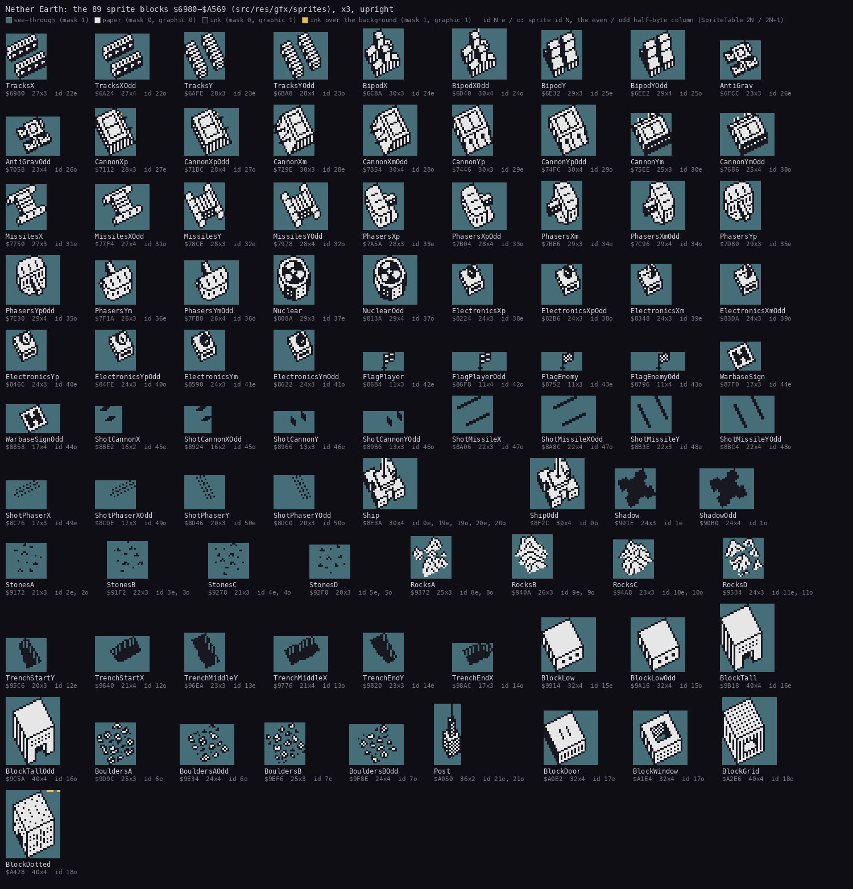

The 89 blocks of `$6980-$A568`, each in its own box: transparent (the mask keeps the ground), paper, ink, and the
bytes of ink outside the mask in their own colour. `python3 tools/fig_sheets.py --image work/gsA/deep/start.bin --out
docs/img/render`

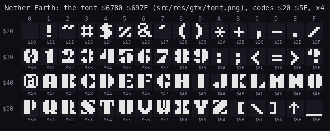

The 64 glyphs of `Font` `$6780`, 8 x 8 each, drawn by the same tool. The print routines that use them are in
[8](08-hud-and-text.md).

## 6.6 Robots: parts stacked

`DrawRobot` `$CEE8` draws the parts of `+$07` from bit 0 up, starting at height `+$0D` (the ground under the robot;
0 in the construction menu's preview). For each part present, `DrawRobotPart` picks the sprite
`$16 + PartSpriteTable[4 x part + direction]` (`PartSpriteTable` `$D6C8`; direction = the number of the lowest set bit
of the facing `+$08`: 0 right, 1 left, 2 down, 3 up), draws it, and adds `PartHeights[part]` (`$D7B4`) to the height.
So the chassis is at the bottom, the weapons on top of it in bit order, electronics last, and a robot's height `+$09`
is the sum of its parts:

| Part (bit) | Sprites r, l, d, u | Height |
| --- | --- | --- |
| 0 bipod | `$18 $18 $19 $19` | 11 |
| 1 tracks | `$16 $16 $17 $17` | 7 |
| 2 anti-grav | `$1A` | 8 |
| 3 cannon | `$1B $1C $1D $1E` | 6 |
| 4 missiles | `$1F $1F $20 $20` | 6 |
| 5 phasers | `$21 $22 $23 $24` | 7 |
| 6 nuclear | `$25` | 7 |
| 7 electronics | `$26 $27 $28 $29` | 7 |

In `deep` `DrawRobot` ran 1 519 times and `DrawRobotPart` 4 343 times: 2.9 parts a robot drawn.

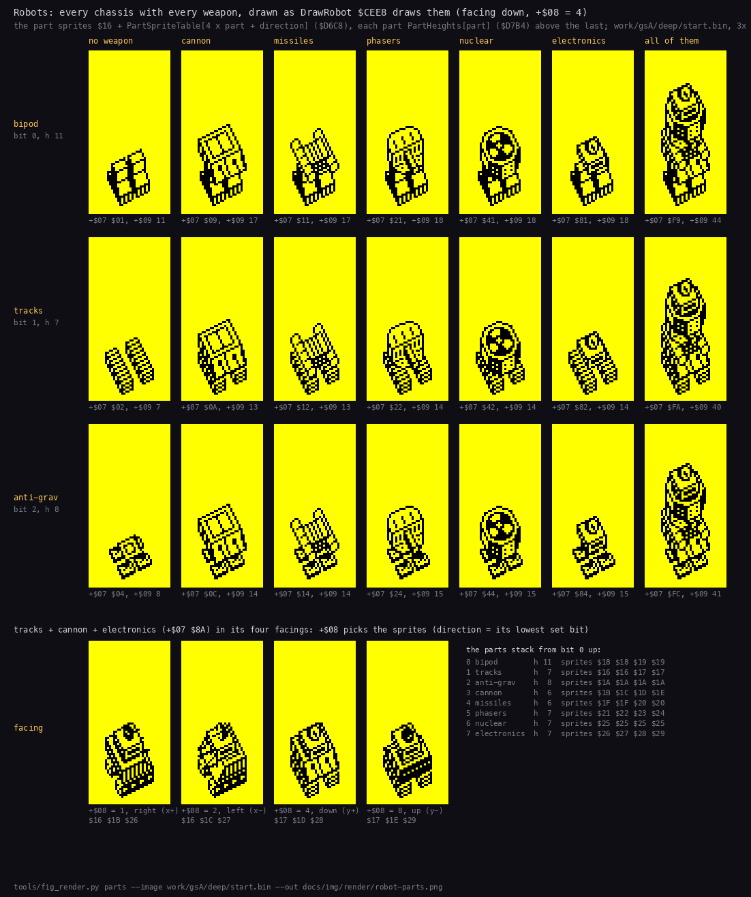

How to read the figure:

- **Rows**: the three chassis. **Columns**: no weapon, each weapon, electronics, and all of them.
- **Under each picture**: the parts byte `+$07` and the height `+$09` it gives.
- **The bottom row**: tracks + cannon + electronics (`$8A`) in its four facings, with the sprites `+$08` picks.
- **The point**: a robot is not a sprite of its own. It is its parts, each blitted (mask, then graphic) its
  `PartHeights` higher than the one below.

`python3 tools/fig_render.py parts --image work/gsA/deep/start.bin --out docs/img/render/robot-parts.png`

## 6.7 The radar

Two pictures of 16 lines x 16 bytes, one pixel a map cell: `RadarOwn` `$D800` and `RadarEnemy` `$D900`, for a window
of 128 map columns from `RadarColumn` `$FD1C`.

- **Built** (`BuildRadar` `$D5F8`): a pixel is set where the cell type is `$0F` or more (blocks, walls, the posts).
  `$D800` is copied to `$D900`. Then every live robot's 2 x 2 dot is XORed into its side's picture
  (`ToggleRadarDot` `$D65A`). In `deep` it ran once, at the start: the window never moved.
- **Kept up**: `PlaceRobot` `$CC7C` XORs a robot's dot at its new place after the robot code XORed the old one away
  (`ToggleRadarDot` 13 390 calls in `deep`). The ship's blip is XORed into `$D800` by `BlinkShipDot` `$B036` on
  alternate turns.
- **The window** moves 64 columns when the ship nears its edge (`ScrollRadar` `$AFE6`).
- **Shown** every frame by the interrupt: `PlayInterrupt` `$D566` toggles `RadarPhase` `$FD1A` and calls `ShowRadar`
  `$D59E` with `$D800` and attribute `$4D` (bright cyan on blue), or `$D900` and `$4E` (bright yellow on blue): 16
  lines of 16 bytes to `$50C6` (character row 22, column 6), then 32 attributes.

The terrain is in both pictures and only changes colour. Our robots exist only in the cyan picture and the enemy's
only in the yellow one, so each side's dots blink at 25 Hz in its own colour.

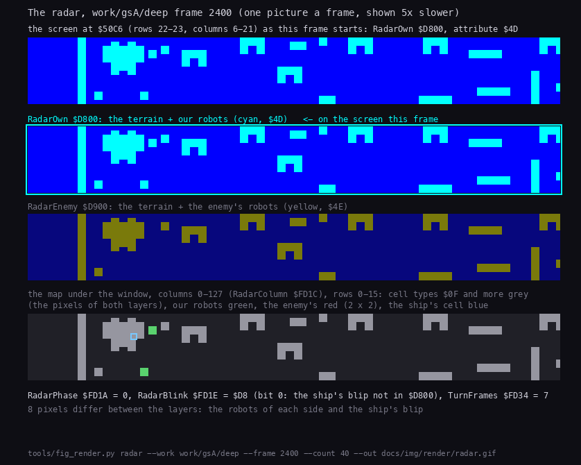

How to read the figure:

- **Each picture** is one frame of `deep` from frame 2 400, 40 frames in all.
- **Top**: the radar area of the screen as shown in that frame.
- **Below**: the two pictures `$D800` and `$D900`, the one on the screen this frame outlined, and the map under the
  window.
- **The point**: the two pictures differ only in the robots and the ship's blip.

`python3 tools/fig_render.py radar --work work/gsA/deep --frame 2400 --count 40 --out docs/img/render/radar.gif`

The radar costs 8 134 T every frame, 10.9 % of all the time in `deep`: more than the copy of the view.

## 6.8 The play screen and the panel

`DrawPlayScreen` `$D0CA` (at `EnterPlay` and after every menu that took the screen; 8 calls in `deep`):

1. It clears the screen and draws the view once.
2. It draws the frame: double lines along the top and the bottom, corners, the sides down columns 0 and 21.
3. It sets the attributes: `$07` everywhere, `$78` on the frame, `$70` (bright, black on yellow) on the 20 x 20 view
   cells, blue on the near right corner past the map's south edge.
4. It prints the texts: " DAY:" / "TIME:" at (0,22), and "RADAR:" double height at (22,0).

The areas, as numbered in the figure at the top of this document:

| Area | Cells | Filled by |
| --- | --- | --- |
| 1, the view | (1,1)-(20,20) | `CopyViewToScreen` `$D071`, every turn |
| 2, the frame | 22 x 22 cells, attribute `$78` | `DrawPlayScreen` |
| 3, DAY and TIME | (0,22) | `GameTurn` `$AD62`, every turn |
| 4, the right panel | columns 22-31, rows 2-21 | the status and the resources (`ShowStatusPanel` `$D1E5`, `UpdateStatusPanel` `$D293`), or a robot menu while `PanelBusy` `$FD39` is 1 |
| 5, "RADAR:" | (22,0) | `DrawPlayScreen` |
| 6, the radar | 128 x 16 pixels at `$50C6` | `ShowRadar` `$D59E`, every frame |

The panel's texts and the print routines are in [8](08-hud-and-text.md). The construction menu takes the whole
screen and draws its part pictures straight to the screen with `DrawMaskedUp` `$D315` (the same sprite format; 56
calls in `deep`).

## 6.9 The copy and the beam

The copy writes one view line every 438 T on average (20 `LDI`, the address stepping, and an interrupt on the way).
The beam shows one screen line every 224 T. The copy is slower, so the beam can only catch it from behind:

- **A copy that starts early in a frame**, just behind the beam, falls further behind it. The beam's next pass comes
  after the copy has finished, and the next frame shows the whole new view. The copy of turn 20 010 is such a copy
  ([4.5](04-game-loop.md#45-time)).
- **A copy that starts late in a frame** is ahead of the beam's next pass at first. The beam catches it up in the
  next frame: the lines the copy has written show the new view, the rest the old one.

On the Pentagon the paper starts at frame T 17 944. A byte at column c of screen line L is fetched at
17 944 + 224 L + 4 c. The view's line 0 is screen line 8.

In `deep` the copy of turn 2 508 started at 2 508:65 814, 5 866 T before the frame's end. The beam overtook it in
frame 2 509 at view line 105, screen line 113:

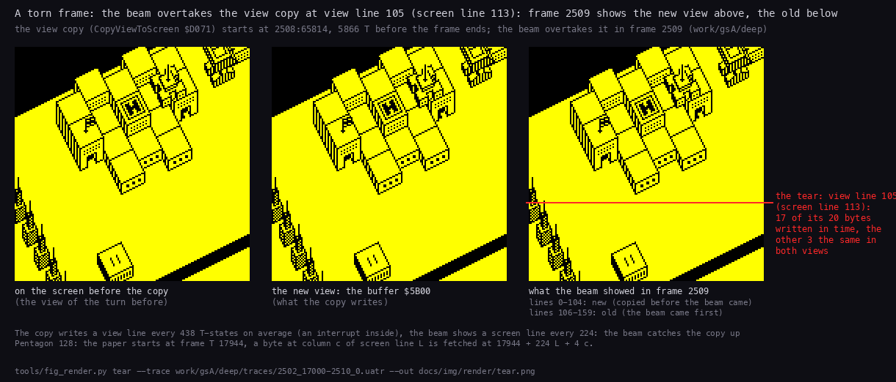

How to read the figure:

- **The three pictures** are the view area of the screen (character rows 1-20, columns 1-20), twice the size.
- **Left**: the screen before the copy: the view of the turn before.
- **Middle**: the new view in the buffer `$5B00`, what the copy writes.
- **Right**: what the beam showed in frame 2 509. For each byte, the value in memory at the moment the beam fetched
  it, from the trace's write cycles.
- **The red line** is the tear. In view line 105 the copy wrote 17 of the 20 bytes before the beam came; the other 3
  are the same in both views. Lines 106-159 still show the old view.
- **The point**: in play the old and the new view differ little (here the view did not move), so the tear is hard
  to see. It is there in every frame like this one.

`python3 tools/fig_render.py tear --trace work/gsA/deep/traces/2502_17000-2510_0.uatr --out docs/img/render/tear.png`

The beam against the copy's writes, in the same two frames:

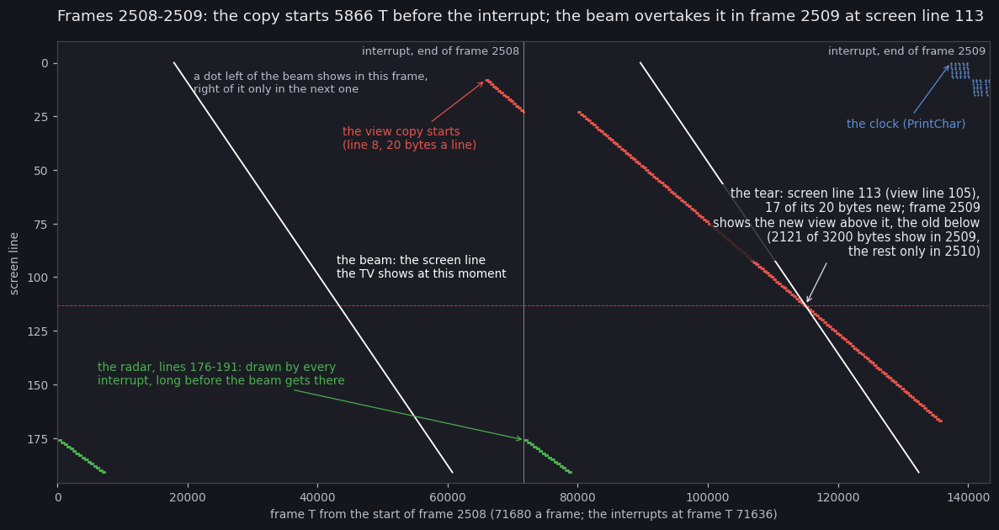

How to read the figure:

- **Across**: the frame T from the start of frame 2 508 (71 680 a frame); the thin vertical line is the interrupt at
  the end of 2 508.
- **Down**: the screen line, 0 at the top.
- **The white diagonals** are the beam, one a frame. A byte written left of a diagonal shows in that frame; one
  written right of it waits for the next pass.
- **The red slope** is the copy, one dot a byte written. It starts at screen line 8 near the end of 2 508, pauses for
  the interrupt, and goes on in 2 509. It is flatter than the beam, so the beam crosses it at screen line 113.
- **The green steps** are the radar at the start of each frame; **the blue marks** at the top right the clock.
- **The point**: of the 3 200 bytes, 2 121 show in frame 2 509; the other 1 079 only in 2 510. The two figures
  agree: screen line 113 is view line 105.

```
python3 tools/fig_beam.py --trace work/gsA/deep/traces/2502_17000-2510_0.uatr --listing work/gsA/game.lst \
    --copy-frame 2508 --copy-only --out docs/img/render/tear-beam.png
```

Neither figure needs an emulator: both read the access trace of frames 2 502:17 000-2 510:0.

## 6.10 Design notes

- **Redraw, don't scroll.** A full redraw a turn makes the depth order trivial (the walk) and the scrolling free:
  moving the view one column is only `ViewX` + 1. It costs three quarters of the CPU and fixes the game's pace at one
  turn in 10 frames.
- **Pre-shifted pictures.** Two pictures a sprite double the sprite data (89 blocks, 15 337 bytes) and buy a blit
  with no shifts: the inner loop is `LD A,(DE)` / `AND (HL)` / `OR (HL)` / `LD (DE),A`.
- **Deferral instead of sorting.** Objects are not sorted. A robot or the ship that a later block would cover is
  moved, for one draw, to that block's cell in the walk.
- **Two radar pictures instead of colour.** The attribute cells could not colour single robots. Showing the sides in
  alternate frames with two attributes gives each side its colour at no cost but the flicker.
- **No sync for the copy.** The copy starts when the drawing ends. Whether a frame tears depends on that moment
  (6.9).
