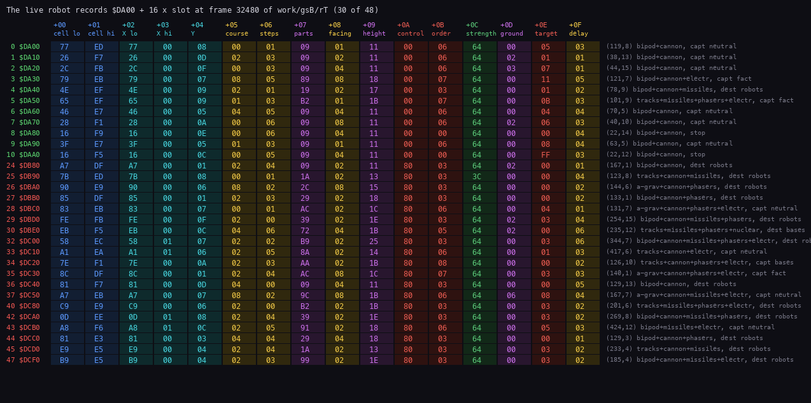
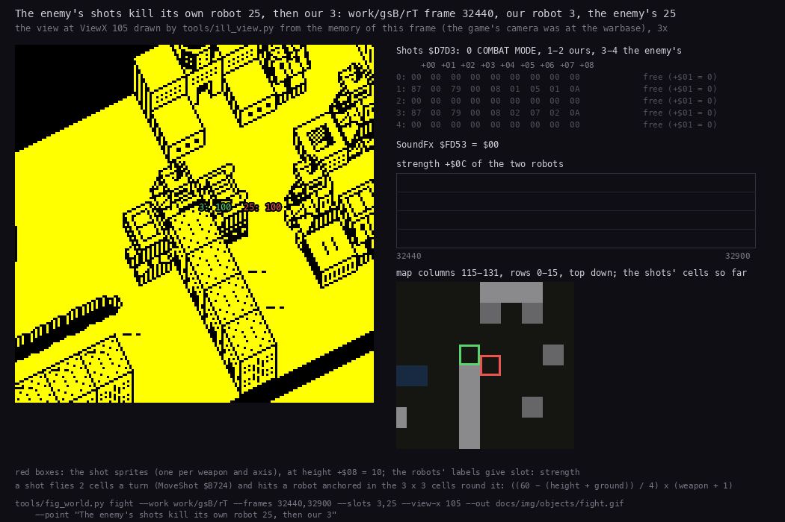
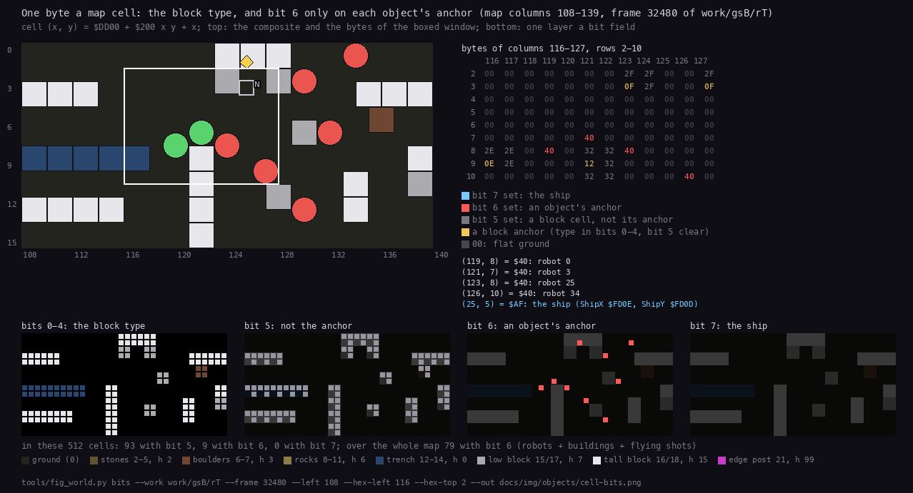
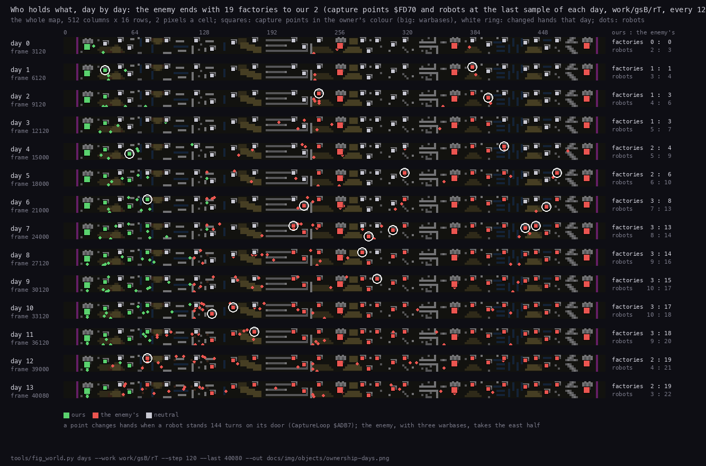
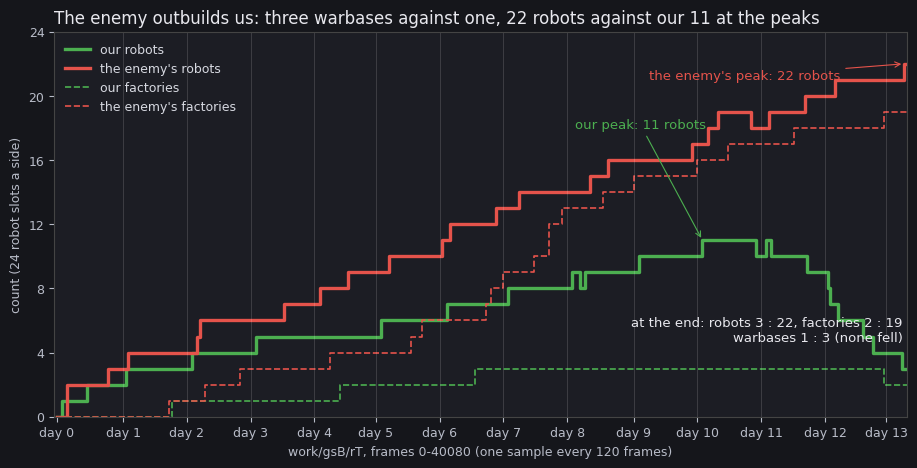
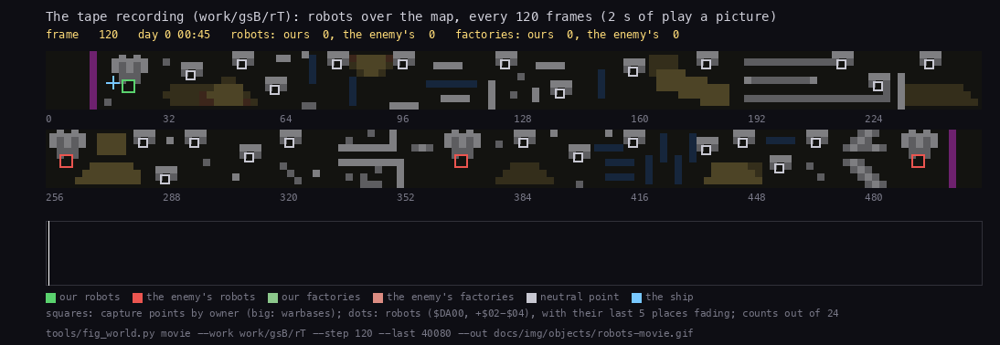

# 7. Objects

The world is four tables and a map:

- 48 robot records of 16 bytes at `$DA00`, 24 a side;
- 5 shot records of 9 bytes at `$D7D3`;
- 56 building records of 3 bytes at `$FF01`;
- 28 capture points of 5 bytes at `$FD70`;
- the map at `$DD00`: 16 rows of 512 cells.

Every record points into the map. A cell byte carries the terrain and two marks: bit 6 "an object is here" and bit
7 "the ship is here". Movers find each other through the map, never through a list:

- a robot looking ahead reads cells;
- a shot hits whatever anchor it lands next to;
- a capture point counts while its door cell has bit 6.

Evidence:

- the code: `src/game/world.asm`, `gameturn.asm`, `bases.asm`, `map.asm`, `enemy.asm`, `worldstate.asm`;
- **`work/gsB/rT`**: Hood's tape on Pentagon 128 + GS 512 KB, from 48 BASIC (`USR 0`), played by `tools/play_gs.py`
  for 40134 frames (13.4 game days). L1 counts, and TTD `memory_at` read only:
  - the memory every 30 frames over the whole game (`work/gsB/cache/rT30.npz`, 1335 pictures);
  - every frame of the fight 32440-32899 (`work/gsB/cache/rT-fight.npz`, 460 pictures);
  - every 120 frames for the figures (`work/gsB/cache/rT/`, one file a moment).
- the figures of `tools/fig_world.py` and `tools/fig_robots_time.py` (the commands under each).

A memory picture taken at a frame's start can show the GS driver's bank 6 at `$C000` instead of bank 0, when a sound
was being sent across the frame interrupt ([9.8](09-sound.md#98-a-whole-game-on-the-tape)). The tools take the next
frame then; it happened once in the 1335 samples (frame 25300).

## 7.1 The world turn

`WorldTurn` `$B0CA` runs once a game turn: from `PlayLoop` and from every robot menu loop that keeps the war going.
It does three things:

1. `EnemyCommander` `$B7F4`: one random enemy slot is built or re-planned ([10.8](10-gameplay-logic.md#108-the-enemy-commander)).
2. The 48 robot records in slot order. Each with `+$01` not 0 goes through `UpdateRobot` `$B0FA`.
3. The 5 shot records through `UpdateShot` `$B70D`.

In `work/gsB/rT`:

| Routine | Calls | T-states with callees | A call on average |
| --- | ---: | ---: | ---: |
| `WorldTurn` | 3 849 | 197.3 M | 51 300 |
| `UpdateRobot` | 70 672 | 170.1 M | 2 400 |
| `EnemyCommander` | 3 849 | 6.4 M | 1 650 |
| `DrawView` (for scale) | 3 862 | 2 177 M | 563 800 |

- `UpdateRobot` ran 18.4 times a turn on average: the live robots.
- A robot does not act every turn. Its `+$0F` counts turns down to its next step (7.3).
- The world costs a tenth of what drawing the view costs: the view decides the turn's length of 10 frames
  ([6. Rendering](06-rendering.md)).

## 7.2 Robots

`Robots` `$DA00` holds slots 0-23, the player's. `EnemyRobots` `$DB80` holds slots 24-47, the computer's.

- A slot is free when `+$01` = 0.
- The side is the slot range. Code that only has the record reads `+$0A` bit 7.

| Offset | Name | Meaning | Written by |
| --- | --- | --- | --- |
| `+$00/+$01` | cell | the map cell of the anchor (bit 6 set there); for one draw it may point at a later cell (the deferral of [6. Rendering](06-rendering.md)); `+$01` = 0: a free slot | `PlaceRobot` `$CC7C`, `DrawMover` `$CE68` |
| `+$02/+$03` | X | the anchor's column, 0-511 | `PlaceRobot` |
| `+$04` | Y | the anchor's row, 0-15 | `PlaceRobot` |
| `+$05` | course | the direction of the current course, one `Input` bit (1 right, 2 left, 4 down, 8 up); 0 standing | `RobotStep` `$B154`; 4 at birth, 0 by DIRECT CONTROL |
| `+$06` | steps | steps left on the course: 3-6 random, \|dx\| - 1 near a target, `$FF` "stay facing down"; a step takes 1, a turn gives it back | `RobotStep`, `TurnOrStep` `$B471`; 5 at birth (3 the enemy's), 0 by LEAVE ROBOT |
| `+$07` | parts | bit 0 bipod, 1 tracks, 2 anti-grav, 3 cannon, 4 missiles, 5 phasers, 6 nuclear, 7 electronics | `StartRobot` `$CB52`, `EnemyCommander` |
| `+$08` | facing | the direction it faces, one `Input` bit; it picks the part sprites and the shot's direction | `TurnOrStep`; 4 at birth |
| `+$09` | height | the sum of `PartHeights` `$D7B4` over its parts (bipod + cannon: 17) | `ShowRobotDesign` `$CC1F`, `EnemyCommander` |
| `+$0A` | control | 0 the AI, 1 the player sits on it (frozen), 2 direct control, `$80` the enemy's | the menus, `EnemyCommander` |
| `+$0B` | order | 0 stop, 1 advance, 2 retreat, 3-5 destroy robots / factories / warbases, 6-8 capture neutral factories / enemy factories / enemy warbases | the menus, `SteerByOrder` `$B222`, `StepPosition` `$B4B9` |
| `+$0C` | strength | 100 (`$64`) at birth, minus the damage; at 0 or below on a hit `$FC`, then + 1 a turn: dying; 0: removed | `MoveShot` `$B724`, `UpdateRobot` |
| `+$0D` | ground | the highest ground under its 2 × 2 footprint; the parts are drawn from here | `TurnOrStep` |
| `+$0E` | target | orders 1-2: columns left (miles × 2); order 3: the opponent's slot in its side; 4-8: the building's index in its table; `$FF` none | the menus, `SteerByOrder`, `StepPosition` |
| `+$0F` | delay | turns to the next step, from `StepDelays` `$B61D` | `SetStepDelay` `$B5F3`; 1 at birth |



How to read it:

- **One row per live record**, slot and address at the left: green rows ours, red the enemy's.
- **One column per byte**, `+$00` to `+$0F`, with the field's name; the columns are tinted by what they hold
  (place, course, parts, control, strength, target, delay).
- **At the right:** the record decoded: the anchor (X, Y), the parts and the order.

What it shows (frame 32480 of `work/gsB/rT`):

- Every `+$01` is `$E0`-`$FB`: rows 0-15 of the map (`$DD00` + `$200` × Y).
- Every strength `+$0C` is `$64` except enemy slot 25 at `$3C` (60): it has been hit twice.
- Our orders are 0, 6 and 7 (stop, capture neutral and enemy factories); the enemy's 3, 5, 6, 7 and 8.
- Enemy slot 30 carries nuclear (`+$07` = `$72`, bit 6), with tracks, missiles and phasers.

`python3 ../nether-earth/tools/doc_figures.py records --work work/gsB/rT --frame 32480 --cache
work/gsB/cache/records.json --out docs/img/objects/robot-records.png`

### The fields over time

The record of every live robot at every frame 32440-32899 of `work/gsB/rT` (13 481 samples of records that were not
dying), from `work/gsB/cache/rT-fight.npz`:

- `+$0F` took the values 1-8, and 0 in 29 samples taken inside a turn.
- `+$06` took 0-7. A new course sets 3-6; the turn toward it gives one back, hence 7 (76 samples).
- `+$05` equalled `+$08` in 10 397 samples (77 %): a robot faces its course, except while it turns toward a new one
  or stands (`+$05` = 0).
- `+$00/+$01` equalled the cell of `+$02`-`$04` in 13 466 samples. The 15 others caught a deferral inside a draw.

Our slot 0 (bipod + cannon, ground 0, order 6) through the fight:

| Frame | (X, Y) | `+$05` | `+$06` | `+$08` | `+$0F` | What happened |
| --- | --- | --- | --- | --- | --- | --- |
| 32440 | (119, 8) | 0 | 1 | 1 | 1 | standing, facing right toward enemy slot 25 four columns away |
| 32625 | (119, 8) | 8 | 6 | 8 | 6 | slot 25 is gone: a new course up, 6 steps, turned to it |
| 32685 | (119, 7) | 8 | 5 | 8 | 6 | a step up: Y - 1, steps - 1 |
| 32745 / 32805 / 32865 | (119, 6) / 5 / 4 | 8 | 4 / 3 / 2 | 8 | 6 | a step every 6 turns (60 frames) |

`python3 work/gsB/an/fields.py work/gsB/cache/rT-fight.npz 0`

### Footprint, birth and the pad bug

- **Footprint.** A robot covers 2 × 2 cells: (X, Y), (X+1, Y), (X, Y-1), (X+1, Y-1). Only the anchor (X, Y) gets
  bit 6. The probes that test a move therefore look for anchors one cell around the cells they would enter
  (`FreeDirections` `$B513`).
- **Our birth.** `StartRobot` `$CB52` places the robot at (ShipX, ShipY + 4), the door of the warbase whose pad the
  ship sits on. It sets `+$0A` = 0 and `+$07` = `MenuParts` `$FD21`. The menu's preview already set `+$08` = 4 and
  `+$09` (`ShowRobotDesign`). `PlayLoop` then sets `+$05` = 4, `+$06` = 5, `+$0B` = 0, `+$0C` = 100 and `+$0F` = 1
  (`$A6F3`-`$A703`). In `work/gsB/rT` our robots were born 13 times, all at our only warbase's door (22, 9): 9
  new records in `rT30.npz` stood there, 4 had already taken their first step down to (22, 10).
- **The enemy's birth.** `EnemyCommander` fills a free enemy slot at one of its warbases' doors, (261, 8), (369, 8)
  or (494, 8). 23 enemy robots were born in `work/gsB/rT`: 15 at the first warbase, 7 at the second, 1 at the third
  (each seen one step below the door, at row 9).
- **The pad bug** (read in the code, not reached here). With all 24 of our slots in use `ConstructionMenu` returns at
  once with IY = `$DB80`, enemy slot 24, and `PlayLoop` writes the birth values there. The enemy robot in slot 24 is
  restored to strength 100 every turn the ship sits on the pad. `work/gsB/rT` never had more than 11 of ours.

## 7.3 A robot's step

`UpdateRobot` `$B0FA`, for one record:

1. `+$0C` = 0: removed (`RobotDestroyed` `$B116`). Bit 6 goes off; a wreck block (type 6 or 7, height 3) is laid when
   the four footprint cells are bare; the radar dot is erased, the slot freed (`+$01` = 0), the counts and the panel
   redone.
2. `+$0C` negative: dying, + 1 a turn. Bit 6 on the cell toggles with the value, so the robot blinks for four turns.
3. `+$0A` = 1: nothing (the player is on it).
4. Otherwise `Side` `$FD51` = `+$0A` bit 7 and `+$0F` - 1. At 0, `RobotStep` `$B154`:
   - off the map (bit 6 and the radar dot removed);
   - under direct control `Input` decides;
   - else the AI: an opponent seen ahead is fired at if a shot record of the side is free (the robot stands that
     step); an opponent to the side is turned to; otherwise the course goes on while `+$06` lasts and the way is
     free, or `SteerByOrder` `$B222` picks a new one.
5. `TurnOrStep` `$B471`: a turn of at most 90 degrees costs the step; a step moves one cell and sets `+$0D`.
   `SetStepDelay` reloads `+$0F`; `PlaceRobot` puts the robot back (cell, bit 6, radar dot).

In `work/gsB/rT` the steps ran 13 796 times (`TurnOrStep`, `SetStepDelay`), and `SteerByOrder` 3 684 times.

| `StepDelays` `$B61D`, turns a step | bipod | tracks | anti-grav |
| --- | --- | --- | --- |
| ground 0 | 6 | 4 | 3 |
| ground 1-3 | 8 | 6 | 3 |
| ground 4 and more | 9 | 7 | 4 |

Slot 0 above (bipod, ground 0) steps every 6 turns, as the first cell says.

**Sight** (`SpotEnemies` `$B626`, `ScanLane` `$B66E`): 8 cells in each direction, 10 ahead (12 with electronics),
three lanes wide. The first object on a lane ends it, so buildings and friends give cover. `ScanLane` ran 82 781
times in `work/gsB/rT`, six lanes a step. Steering by order, the passable terrain per chassis and the enemy's planning
are the rules of [10](10-gameplay-logic.md).

## 7.4 Shots

`Shots` `$D7D3` holds 5 records of 9 bytes (`FindFreeShot` `$B6B8`):

- record 0: the player's COMBAT MODE shot;
- records 1-2: our robots';
- records 3-4: the enemy's.

A record is free when `+$01` = 0. A freed record keeps its other bytes.

| Offset | Meaning |
| --- | --- |
| `+$00/+$01` | the map cell (bit 6 set while it flies); `+$01` = 0 free |
| `+$02/+$03`, `+$04` | column, row |
| `+$05` | direction: the shooter's facing (1, 2, 4, 8) |
| `+$06` | steps left: 5, missiles 7, + 1 with electronics |
| `+$07` | weapon: 1 cannon, 2 missiles, 3 phasers |
| `+$08` | the flight height `$0A`: ground that high stops it |

- A step is 2 cells, one a turn, the first at once (`FireShot` `$B6D6`).
- `MoveShot` `$B724` ends a shot that is out of steps, off rows 0-15, or over ground of height 10 and more.
- Otherwise it looks at the 3 × 3 cells round the shot. A live robot of either side anchored there takes
  `((60 - (+$09 + +$0D)) / 4) × (weapon + 1)`: a tall robot on high ground takes less.
- `SoundFx` `$FD53` gets 1 on firing, `$FC` on a miss, `$FA` on a hit and `$C8` when the hit destroys
  ([9.7](09-sound.md#97-every-call-of-the-sound)).

`FireShot` ran 533 times in `work/gsB/rT`, `MoveShot` 647 times. The first step is taken at once, and robots fire
from a few cells: in the 1335 samples of `rT30.npz` (one every 30 frames) a shot record was live only 23 times.
In the fight below a shot lives 2-3 turns.



How to read it:

- **Left:** the view the game would draw at `ViewX` 105, made by `../nether-earth/tools/ill_view.py` (the game's
  `DrawView` in Python) from the memory of each frame. The game's own camera was at our warbase. Each robot of the
  two slots is labelled "slot: strength".
- **Right, top:** the 5 shot records with their fields decoded, and `SoundFx`.
- **Right, middle:** the strengths of the two robots over the window (green ours, red the enemy's).
- **Right, bottom:** map columns 115-131 seen from above: our robot (green box), the enemy's (red box), and the
  cells shots have crossed so far (diamonds).

What it shows (`work/gsB/rT` frames 32440-32899, every second frame):

- **Friendly fire.** Enemy slot 28 (anti-grav, cannon, phasers, electronics) at (131, 7) fires left along row 7 at
  our slot 3, at (121, 7). Its shots (record 3) start at column 129 and pass (125, 7) next to enemy slot 25 at
  (123, 8). The 3 × 3 test of `MoveShot` does not look at the side: the shot hits slot 25.
- Slot 25 (tracks, cannon, missiles; height 19, ground 0) takes (60 - 19) / 4 = 10 times (weapon + 1): 40 from the
  first shot (record 3 `+$07` = 3, phasers, frame 32476), then 20 from three cannon shots (`+$07` = 1, frames
  32506, 32536, 32596).
- The last hit takes it below 0: `+$0C` = `$FC`, then `$FD`, `$FE`, `$FF`, 0 (frames 32596-32635), and the slot is
  freed at 32645. It is the only enemy robot destroyed in the whole game (7.7).
- **Our slot 3** (bipod, cannon, electronics; height 24) has moved to row 5 meanwhile. Enemy shots along row 5
  hit it: 36 = (60 - 24) / 4 × 4 twice (phasers, frames 32685 and 32736), 18 = 9 × 2 once (cannon, 32796): 100, 64,
  28, 10. A last shot at 32875 makes it `$FC`: it dies after the window.
- Our slot 0 (bipod + cannon) at (119, 8) faces slot 25 but never fires: its record 1 stays free.

```
python3 tools/fig_world.py fight --work work/gsB/rT --frames 32440,32900 --slots 3,25 --view-x 105 \
    --point "The enemy's shots kill its own robot 25, then our 3" --out docs/img/objects/fight.gif
```

## 7.5 The map

`Map` `$DD00-$FCFF`: 16 rows of 512 cells, cell (x, y) at `$DD00` + `$200` × y + x. `BuildMap` `$BC6F` builds it at
every new game from the scenery lists `$BDA9` / `$BE79`, the base lists `$BF46` / `$BF6E` and the shapes of
`ShapeTable` `$BF9C`.

| Bits | Meaning |
| --- | --- |
| 0-4 | the block type: the sprite id and the height (`TerrainHeights` `$D7BC`: 0, 0, 2 ×4, 3 ×2, 6 ×4, 0 ×3, 7, 15, 7, 15, 0, 0, 99) |
| 5 | not the anchor of its 2 × 2 block (`PutBlock` `$BD91` writes the anchor plain and the other three cells with bit 5) |
| 6 | an object's anchor: a robot, a building, a flying shot, or (inside a draw) a deferred robot |
| 7 | the ship's cell (`PutShipOnMap` `$B024` / `LiftShipFromMap` `$B01D`), or the ship deferred inside a draw |



How to read it:

- **Top left:** map columns 108-139, all 16 rows, as the composite of terrain, blocks, buildings, capture points
  (squares, letter = product), robots (green ours, red the enemy's) and the ship (blue).
- **Top right:** the bytes of the boxed window, columns 116-127 and rows 2-10, coloured by their bits (the key
  under them), and the objects named by their anchor cells.
- **Bottom:** one layer per bit field: the block type, bit 5, bit 6, bit 7.

What it shows (frame 32480 of `work/gsB/rT`, the fight of 7.4):

- `$40` at (119, 8), (121, 7), (123, 8) and (126, 10): the anchors of robots 0, 3, 25 and 34, each on bare ground
  (type 0) with bit 6.
- `$0F` / `$2F` are a low block's anchor and its other three cells; `$12` / `$32` the same for a tall block.
- The ship is at our warbase, (25, 5) = `$AF`: a low block cell with bit 7, outside this window, so the bit 7 layer
  is empty here.
- In these 512 cells 93 have bit 5, 9 have bit 6 and none bit 7. Over the whole map 79 cells have bit 6: robots,
  buildings and flying shots.

`python3 tools/fig_world.py bits --work work/gsB/rT --frame 32480 --left 108 --hex-left 116 --hex-top 2 --out
docs/img/objects/cell-bits.png`

## 7.6 Buildings and capture points

**Capture points**: `Warbases` `$FD70` (4) and `Factories` `$FD84` (24), 5 bytes each. The code addresses them from
the owner byte (`$FD73`, `$FD87`), index × 5.

| Offset | Meaning |
| --- | --- |
| `+0/+1` | X of the door cell |
| `+2` | Y of the door cell |
| `+3` | bits 0-2 the type (0 warbase, 1 electronics, 2 nuclear, 3 phasers, 4 missiles, 5 cannon, 6 chassis), bit 5 the enemy's, bit 6 ours, `$80` destroyed by a nuclear blast |
| `+4` | turns a robot has stood on the door |

The capture tick is in `GameTurnEnd` `$AD90` (`CaptureLoop` `$ADB7`):

1. For each point, bit 6 on the door cell adds one to `+4`; an empty door resets it.
2. At 144 (`$90`) the robot there (`FindRobot` `$CDD8`) gives the point to its side (`GiveWarbase` `$BB86` /
   `GiveFactory` `$BB61`), whatever its order.
3. `CountBases` `$BB09` recounts `PlayerBuildings` `$FD3A` and `EnemyBuildings` `$FD42` (7 counts each, warbases
   first).

In `work/gsB/rT`:

- `GiveFactory` ran 22 times, and the owner bytes in `rT30.npz` changed 22 times: 3 factories to us (points 4, 6
  and 7: missiles, electronics, cannon), 19 to the enemy, one of them our cannon factory (point 7, frame 38920).
- `GiveWarbase` ran only at the start (frames 10-11): no warbase changed hands.
- The highest count seen was 143: the sample before a capture.
- No `+3` had bit 7: no robot of either side fired a nuclear bomb.



How to read it:

- **One strip per game day**: the whole map, 512 × 16 cells at 2 pixels a cell, at the last sample of the day
  (`Clock` `$FD35`, the day at `$FD37`).
- **Squares:** the capture points in their owner's colour (green ours, red the enemy's, grey neutral); big squares
  are warbases. A white ring marks a point that changed hands that day.
- **Dots:** the robots of each side. **At the right:** the counts, ours : the enemy's.

What it shows:

- At the start every factory is neutral. Our warbase is at (22, 9); the enemy's three at (261, 8), (369, 8) and
  (494, 8).
- We take the missiles factory at (39, 6) on day 1, electronics (62, 10) on day 4 and cannon (79, 3) on day 6, all
  near our warbase in the west.
- The enemy, building from three warbases, takes the east half by day 7 and then the middle: 13 factories on day 7,
  17 on day 10.
- On day 12 the enemy takes our cannon factory: 2 : 19 at the end.

`python3 tools/fig_world.py days --work work/gsB/rT --step 120 --last 40080 --out
docs/img/objects/ownership-days.png`

**Buildings** `$FF01`: 56 records of 3 bytes: the map cell (2 bytes, high byte 0 = free) and a type.

| Type | Building |
| --- | --- |
| 0 | the pad of a warbase of ours |
| 1-6 | a factory's roof, its product shown |
| 7 | our flag |
| 8 | the enemy's flag |

- They are what `DrawCellObject` draws and what `FindBuilding` `$CDF5` finds under the ship: the pad opens the
  construction menu.
- `AddBuilding` `$BC43` takes the first free record; `RemoveBuilding` `$BC5D` frees one.
- A factory gets its flag 2 columns left (ours) or right (the enemy's) of the roof. A warbase of ours gets a pad and
  a flag, the enemy's only a flag.

In `work/gsB/rT` (`rT30.npz`):

| Frame | Records in use | Of which |
| --- | ---: | --- |
| 100 | 29 | 24 roofs, our pad, our flag, 3 enemy flags |
| 40120 | 50 | 24 roofs, our pad, 3 flags of ours (warbase + 2 factories), 22 enemy flags (3 warbases + 19 factories) |

The 21 more records are the 22 captures less our lost flag: `AddBuilding` 51 calls and `RemoveBuilding` 56 (each
capture removes the old flag first, also when there is none).

## 7.7 Over the whole game



How to read it:

- **Across:** the game, day by day (a game day is 3000 frames, a minute; one sample every 120 frames).
- **Thick lines:** the live robot records per side (`+$01` not 0, 24 slots a side); green ours, red the enemy's.
- **Dashed lines:** the factories each side holds (`PlayerBuildings` `$FD3A` / `EnemyBuildings` `$FD42`).

What it shows:

- We peak at 11 robots (day 10), the enemy at 22 (day 13).
- The enemy builds faster: three warbases (5 general resources a day each) and the factories it captures.
- From day 10 our robots die faster than we build them: 10 of our 13 were destroyed, 1 of the enemy's 23.
- At frame 40080: robots 3 : 22, factories 2 : 19, warbases 1 : 3 (none fell).

`python3 tools/fig_robots_time.py --cache work/gsB/cache/rT --step 120 --last 40080 --out
docs/img/objects/robots-over-time.png` (reads the memory moments `tools/fig_world.py` keeps; no emulator needed)

The same game as it moves, the robots of both sides on the whole map:



How to read it:

- **Two strips:** map columns 0-255 and 256-511, 4 pixels a cell, with the terrain dimmed.
- **Squares:** the capture points by owner (big: warbases). **Dots:** robots, with their last 5 places fading. **The
  cross:** the ship.
- **Bottom:** the counts so far (robots thick, factories thin), the white line at the current frame.

334 pictures, the records `$DA00` and the map `$DD00` from `memory_at`:

```
python3 tools/fig_world.py movie --work work/gsB/rT --step 120 --last 40080 --out docs/img/objects/robots-movie.gif
```

## 7.8 Design notes

- **The map is the index.** Every mover has a record, but every question "what is there" goes through the cell's bit
  6 and a search of the records by cell address (`FindRobot`, `FindBuilding`, the shot search): 48 + 56 + 5
  compares at most, no spatial lists to keep.
- **One anchor a 2 × 2 object.** Marking only the anchor keeps placing and removing to one cell, at the price of
  probes that look one cell further.
- **Slots fixed by side.** 24 a side, so the enemy can never crowd the player out of records, and a record's side
  is known from its address.
- **A shot knows no side.** The hit test asks only "is an anchor here", so a robot standing between a shooter and its
  target takes the shot, friend or foe (7.4). The only enemy robot destroyed in `work/gsB/rT` died this way.
