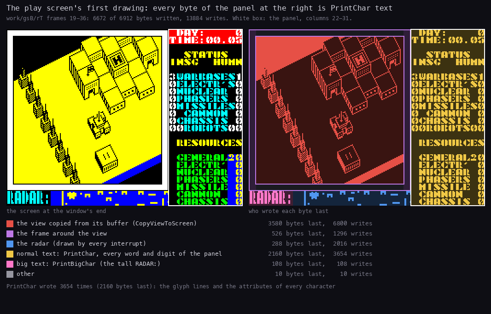
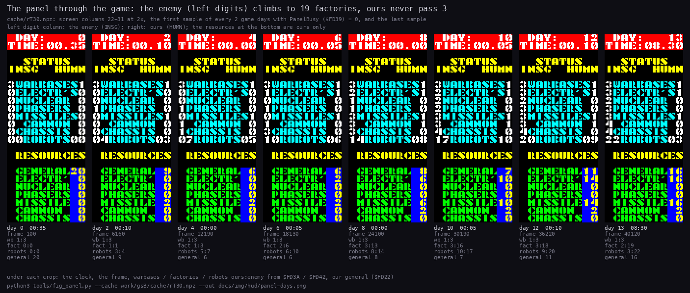

# 8. HUD and text

All text goes through one routine. `PrintInline` (`$D42D`) prints the bytes that follow its `CALL`. Positions,
attributes and sizes are control codes inside the string, so no print call takes arguments. One font of 64 glyphs
serves everything, from the panel numbers to the triple-height title. Besides the view, the play screen has three
fixed areas:

- the clock at the top right;
- the status panel under it, which the robot menus borrow;
- the radar in the two bottom rows.

The game prints no text about the General Sound card. Its name "GS-512" is only on the loading screen, as pixels
([`src/res/screen/README.md`](../src/res/screen/README.md)).

Evidence:

- the code of `src/game/*.asm` (the routines named below) and the built image `build/game/neart001-tap.bin`
  (`$6590`-`$FFFF`), which `tools/fig_text.py` reads for the font and the strings;
- **`work/gsB/rT`**: Hood's tape, the bot's game of 40134 frames (13.35 days,
  [10.11](10-gameplay-logic.md#1011-what-the-tape-recording-showed)). The recording starts at the first frame of
  play.
  - Its L1 counts are the "Runs" of 8.3 and the counts below.
  - The access trace `traces/19_0-36_0.uatr` holds the first drawing of the play screen.
  - `work/gsB/cache/rT30.npz` holds `$4000-$FFFF` every 30 frames;
- **`work/gsA/load`**: gsA's recording of the load and the main menu (5650 frames). Only its L1 counts were read:
  the main menu's strings each ran once in it.

Neither `rT` nor `load` reached the redefine screen, COMBAT MODE, the distance menu or a game end.
gsA's `tour` (`work/gsA/tour`) showed them on the screen: the redefine screen, COMBAT MODE and the distance menu
([5.2](05-controls.md#52-the-main-menu-and-the-redefine-screen), [5.5](05-controls.md#55-the-robot-menu-and-its-submenus)),
and the lost end after a poke ([4.4](04-game-loop.md#44-the-end-of-a-game)).
Its L1 was not read for the run counts of 8.3.
No recording reached LOAD SAVED GAME, the save prompt or the won end: their strings are read from the image only.

## 8.1 The print routine `$D42D`

`PrintInline` works in the alternate registers (`EXX`). It pops the return address, reads one byte, and pushes the
address back one byte further on. This repeats until a 0. The return then lands on the instruction after the string,
so each string sits inline in the routine that prints it. `PrintControl` (`$D43C`) takes each byte:

| Byte | Operands | Effect | Stored in |
| --- | --- | --- | --- |
| 0 | | the end: `EXX`, return past the string | |
| 1 | Y X | the print position: row Y, column X (`SetPrintPos` `$D493` makes the screen and attribute addresses) | `$FD31`/`$FD32`, `$FD04`, `$FD14` |
| 2 | A | the attribute of the next characters | `$FD13` |
| 3 | | the next row, the same column (`PrintNewline` `$D470`) | `$FD32` |
| 4 | N | the size: high nibble the height in rows, low nibble the width in bytes; 0 is normal | `$FD16`, `$FD17` |
| other | | a character: `PrintChar` (`$D4B1`) when the width is 0, else `PrintBigChar` (`$D4DA`) | |

Three other kinds of call end in it or lean on it:

- `PrintKeyPrompt` (`$C40C`) prints "PRESS KEY FOR " and ends in `JP PrintInline`. The key names after its eight
  calls in `RedefineKeys` (`$C34A`) are therefore strings too.
- The names of keys without a glyph follow one pattern: `CP code`, `JR NZ,next`, `CALL PrintInline`, the name, a
  `RET` (`CheckEnterKey` `$C47A` and its neighbours). `PrintInline` returns onto that `RET`.
- `PrintCharKeep` (`$D427`) is `PrintChar` inside `EXX`, for the number printers (8.6).

How much it runs in `work/gsB/rT` (L1 entries):

| Routine | Entries | Note |
| --- | ---: | --- |
| `PrintInline` | 6 927 | 3 848 of them the clock's position string (8.5) |
| `PrintChar` | 74 153 | about 1.8 characters a frame |
| `PrintCharKeep` | 43 452 | the digits of the number printers |
| `PrintBigChar` | 305 | the tall RADAR: of the 14 play-screen drawings and the construction menu's titles |

### Normal and big characters

`PrintChar` copies the 8 lines of glyph `$6680 + 8 × code` down the character cell (`GlyphLineLoop` `$D4C2`). It
puts the attribute into the attribute cell and advances both addresses by one: 9 writes a character.

`PrintBigChar` scales the same glyph:

| Width (low nibble) | Pixels | Lines | Used by |
| --- | --- | --- | --- |
| 1 (size `$21`) | the glyph as it is | each line repeated height times (`TallRepeatLoop` `$D4F5`) | RADAR:, the main menu options, PRESS PLAY ON TAPE, REDEFINE KEYS, CONSTRUCTION |
| 2 (sizes `$22`, `$32`) | each bit doubled into 16 pixels (`WideBitLoop` `$D511`) | the same repeat | ROBOT and LOADING ERROR! (`$22`); NETHER / EARTH (`$32`, three rows high) |

`BigCharAttrs` (`$D532`) then fills a block of width × height attributes and advances the print address by the
width. The code `4 $00` turns big characters off again. Strings that may follow a big one start with it: the
clock's `$AD88`, the construction menu's `$C8BE` after its title, and the panel's `$D29B`.

## 8.2 The font


How to read it:

- **One cell per code**, 8 × 8 pixels at 4x, white the set bits; the code under each cell.
- **Orange frames:** glyphs that are not the ASCII sign of their code.

```
python3 tools/fig_text.py font docs/img/hud/font.png
```

- The 64 glyphs (512 bytes) sit at `Font` (`$6780`), the code `$20` first. `PrintChar` reads `$6680 + 8 × code`.
- The codes are ASCII `$20`-`$5F`, so there are no lower-case letters.
- The face is a heavy stencil, 7 pixels wide with a gap column.

Codes whose glyph is not the ASCII one:

| Code | ASCII | Glyph |
| --- | --- | --- |
| `$22` | `"` | a wave like "~"; no string uses it |
| `$40` | `@` | the copyright sign; no string in the game uses it |
| `$5E` | `^` | an up arrow |
| `$5F` | `_` | one line at the bottom |

The strings fit the font: "FACTORYS", "ELECTR'S", "INSG" (Insignians, the enemy) and "HUMN" are all upper case.

## 8.3 Every string

`python3 tools/fig_text.py strings --l1 work/gsB/rT/l1.json` lists every string after a `CALL PrintInline` or
`CALL PrintKeyPrompt` in the image, with how often its `CALL` ran.

- Positions are (row, column) in the 24 × 32 cells; size `$21` is tall, `$22` and `$32` double width.
- "Runs" is the executions of the `CALL` in `work/gsB/rT`. For the main menu, the count in `work/gsA/load` follows
  after a slash.
- 0 means no recording of this case reached the string.

| Address | Text | Where | Runs |
| --- | --- | --- | ---: |
| `$A738` | DIRECT CONTROL, GIVE ORDERS, COMBAT MODE, LEAVE ROBOT (two lines each), -ORDERS- | the robot menu at (4,23) in `$4D`; -ORDERS- at (17,23) in `$46` (`RobotMenuShow`) | 24 |
| `$A7AD` | (a position) | (18,23) in `$45`: the current order (`ShowOrder` `$A795`, from `OrderLine` `$A7B2`) | 24 |
| `$A7D8` | (a position) | (19,25): the miles of ADVANCE / RETREAT | 0 |
| `$A820` | STRENGTH | (22,23) in `$46`; the value at (23,25) in `$47` (`ShowStrength` `$A81D`) | 192 |
| `$A977` | SELECT ORDERS, STOP AND DEFEND, ADVANCE ?? MILES, RETREAT ?? MILES, SEARCH & DESTROY, SEARCH & CAPTURE | (4,24) in `$47`; the items from (7,23) in `$4D` (`OrdersMenu`) | 12 |
| `$AA1F` | ADVANCE | (5,23) in `$4F`: the distance menu's title | 0 |
| `$AA32` | RETREAT | (5,23) in `$4F` | 0 |
| `$AA43` | ?? MILES, SELECT DISTANCE, 0 MILES | under the title; (9,23) in `$45`; (13,24) in `$46` | 0 |
| `$AAA7` | (a position) | (13,23) in `$46`: the miles as they change (`DistanceShow` `$AAAD`) | 0 |
| `$AAD8` | SEARCH & DESTROY, SELECT TARGET, ENEMY ROBOTS / FACTORYS / WARBASES | (4,23) in `$4F`, (8,24) in `$45`, (12,23) in `$4D` (`TargetMenu`) | 2 |
| `$AB54` | SEARCH & CAPTURE, SELECT TARGET, NEUTRAL FACTORYS, ENEMY FACTORYS, ENEMY WARBASES | the same places (`CaptureMenu`) | 10 |
| `$AC06` | NUCLEAR BOMB, FIRE PHASERS, FIRE MISSILES, FIRE CANNON, MOVE ROBOT, STOP COMBAT | (4,23) in `$4D`: the COMBAT MODE menu (`CombatMenu` `$AC00`) | 0 |
| `$AD88` | (position, size 0, attribute) | (0,27) in `$57`: the clock (8.5) | 3 848 |
| `$AE7C` | YOU HAVE NO BASES LEFT / BETTER LUCK NEXT TIME! | (22,0) in `$45`, over the radar (`CheckGameEnd` `$AE6B`) | 0 |
| `$AEB7` | INSIGNIANS DESTROYED / YOU HAVE WON ! | (22,0) in `$45` (`GameWon` `$AEB1`) | 0 |
| `$C109` | 0..START GAME | (11,8) in `$46`, tall (`MainMenu` `$C100`) | 0 / 1 |
| `$C128` | 1..KEYBOARD | three rows down | 0 / 1 |
| `$C13F` | 2..KEMPSTON J/S | two rows down | 0 / 1 |
| `$C159` | 3..INTERFACE 2, 4..REDEFINE KEYS, 5..LOAD SAVED GAME | two rows apart; 4 and 5 in `$46` | 0 / 1 |
| `$C1E6` | NETHER / EARTH | (1,10) and (5,11) in `$47`, size `$32` (`PrintTitle` `$C1E3`) | 0 / 1 |
| `$C203` | PRESS PLAY ON TAPE | (22,7) in `$45`, tall: LOAD SAVED GAME | 0 |
| `$C26C` | LOADING ERROR! | (22,2) in `$47`, size `$22` (`LoadError` `$C282`) | 0 |
| `$C296` | PRESS RECORD AND PLAY / THEN ANY KEY | (22,0) in `$45`: the save key | 0 |
| `$C33F`, `$C346` | (an attribute) | `$46` / `$45`: an option not chosen / the control option chosen | 0 / 2, 0 / 1 |
| `$C350` | REDEFINE KEYS | (2,9) in `$47`, tall; then (5,3), size 0 (`RedefineKeys` `$C34A`) | 0 |
| `$C382`-`$C3EE` | UP, DOWN, LEFT, RIGHT, FIRE, PAUSE, ABORT, SAVE | after each "PRESS KEY FOR " | 0 |
| `$C40F` | PRESS KEY FOR | two rows down in `$46`; the name in `$45` (`PrintKeyPrompt` `$C40C`) | 0 |
| `$C42B` | two spaces, attribute `$46` | before the key chosen | 0 |
| `$C472`, `$C481`, `$C48F`, `$C4A0` | SYM SH, ENTER, CAPS SH, SPACE | names of keys without a glyph | 0 |
| `$C8BE` | ROBOT / CONSTRUCTION, the part names and their costs, EXIT MENU / START ROBOT, -- RESOURCES -- / -- AVAILABLE --, GENERAL .. CHASSIS, TOTAL | the whole construction screen, one string (`ConstructionMenu` `$C849`) | 13 |
| `$CBFF` | (a position) | (18,12): the TOTAL value | 44 |
| `$CC10` | (a position) | (0,13), then a new row per resource | 308 |
| `$D1C5` | DAY: / TIME:, RADAR: | (0,22) in `$57`; (22,0) in `$45`, tall (`DrawPlayScreen` `$D0CA`) | 14 |
| `$D1EB` | STATUS, INSG HUMN, WARBASES .. ROBOTS, RESOURCES, GENERAL .. CHASSIS | the panel's labels, 8.4 (`ShowStatusPanel` `$D1E5`) | 26 |
| `$D29B` | (a position) | (16,30) in `$4E`, size 0: the resources | 108 |
| `$D2BB` | (a position) | (6,22) in `$47`: the enemy's counts | 108 |
| `$D2CE` | (a position) | (6,31): our counts | 108 |
| `$D2DB` | (a position) | (13,30): our robots | 108 |
| `$D2F9` | (a position) | (2,22), size 0, attribute 0 (`ClearPanel` `$D2F6`) | 86 |
| `$D306` | 10 spaces and a new row | 22 times per `ClearPanel` (`ClearPanelLine` `$D303`) | 1 892 |

What the counts say about `work/gsB/rT`:

- 14 play-screen drawings (`$D1C5`): the first at frame 21 (`DrawPlayScreen`'s first branch in L1), then one after
  each of the 13 construction menus.
- 26 panel labels (`$D1EB`): 14 from the drawings and 12 from the 12 robot menus closing (`CloseRobotMenu`,
  `$A812`; `python3 tools/l1_table.py --l1 work/gsB/rT/l1.json --sym build/game/game-tap.sym --calls
  ShowStatusPanel`).
- 1 892 = 86 × 22: every `ClearPanel` clears all 22 rows.
- The robot menu's items ran 24 times for 12 menus: every submenu ends in `JP RobotMenuShow`, which redraws them.

Two kinds of text are not PrintInline strings:

- **The orders.** `OrderNames` (`$A848`) holds nine 27-byte texts of three 9-character lines: "  STOP  " /
  "  AND   " / " DEFEND", "ADVANCE " / "        " / " MILES", up to "CAPTURE " / "ENEMY  " / "WARBASES".
  `ShowOrder` copies the one in use into `OrderLine` (`$A7B2`), then prints it. The source keeps them as a resource,
  [`src/res/game/text/order-names.txt`](../src/res/game/text/order-names.txt).
- **The construction menu's costs** (`3 20 4 4 2 10 5 3`, electronics down to bipod). They are text inside its
  string: they agree with `PartCosts` (`$CAF0`, [10.3](10-gameplay-logic.md#103-construction-costs-and-limits)) but
  are not read from it.

## 8.4 The status panel



How to read it:

- **Left:** the screen at the end of the window, frame 36 of `work/gsB/rT`.
- **Right:** the same pixels, each in the colour of the code that wrote its byte last: set pixels bright, clear
  pixels dark.
- **The legend:** the routines grouped by job, with the bytes each group wrote last and its writes.
- **The white box:** the panel, columns 22-31.

What it shows:

- 6 672 of the 6 912 bytes are written in frames 19-36, in 13 884 writes.
- The panel is all yellow: `GlyphLineLoop` of `PrintChar` wrote it, 3 654 writes, which is 406 characters of 9
  writes.
- The tall RADAR: is the only `PrintBigChar` text (108 bytes).
- The radar picture is blue: `ShowRadar` rewrote it in every interrupt of the window, 2 016 writes for 288 bytes.
- The view (red) and its frame (violet) fill the rest.

```
python3 ../../kit/writers_map.py --work work/gsB/rT --window 19:0-36:0 --listing build/game/game-tap.lst --out work/gsB/an/writers-play.png
python3 tools/fig_hud.py --trace work/gsB/rT/traces/19_0-36_0.uatr --listing build/game/game-tap.lst --out docs/img/hud/panel-writers.png
```

The first command makes the access trace (its own picture is a by-product); the second draws the figure.

The panel is the right 10 columns (22-31):

| Rows | Content | Printed by |
| --- | --- | --- |
| 0-1 | " DAY:" / "TIME:" at column 22 in `$57`; the values from column 27 | `DrawPlayScreen`, the clock (8.5) |
| 3-4 | "  STATUS" / "INSG  HUMN" in `$46` | `ShowStatusPanel` |
| 6-12 | WARBASES, ELECTR'S, NUCLEAR, PHASERS, MISSILES, CANNON, CHASSIS at column 23 in `$45`. The enemy's count in column 22 and ours in column 31, one digit each, in `$47` | the labels; the values by `PrintInsgCounts` (`$D2C1`) and `PrintHumnCounts` (`$D2D2`) |
| 13 | " ROBOTS"; the enemy's robots at (13,22) as two digits, over the label's leading space; ours at (13,30) | `PrintNumber2Zero` |
| 15 | RESOURCES in `$46` | |
| 17-23 | GENERAL, ELECTR', NUCLEAR, PHASERS, MISSILE, CANNON, CHASSIS at column 23 in `$44`; our resources at column 30 in `$4E` | `PrintResourceValues` (`$D2A3`) |

The values come from three places:

- the counts at `$FD3A` (ours: warbases, then the factories of each kind; robots at `$FD41`);
- the counts at `$FD42` (the enemy's; robots at `$FD49`);
- `Resources` (`$FD22`, 7 bytes).

The enemy's resources are never shown.

`UpdateStatusPanel` (`$D293`) reprints all the values: 108 times in `work/gsB/rT`. It runs after any count changes
and on entering play:

- a capture (`GameTurnEnd` `$AD90`);
- the day's production (`DailyProduction` `$AE38`);
- a robot destroyed (`UpdateRobot` `$B0FA`);
- an enemy robot built (`EnemyCommander` `$B7F4`).

It does nothing while `PanelBusy` (`$FD39`) is not 0:

- `RobotMenu` (`$A720`) sets it; `CloseRobotMenu` clears it.
- `GameStop` sets it at the game's end.
- The robot menus clear the panel with `ClearPanel` (22 rows of 10 spaces from (2,22) in attribute 0) and print
  their own items there (8.3).



How to read it:

- **One crop every second game day**, plus the last sample: screen columns 22-31 at 2x, from the memory of
  `rT30.npz`. Each is the first sample of its day with `PanelBusy` 0, so no robot menu covers it.
- **The left digit column** is the enemy (INSG), the right one ours (HUMN); WARBASES first, then the six factory
  kinds.
- **Under each crop:** the clock, the frame, and the counts read from `$FD3A` / `$FD42` in the same memory
  (ours:enemy), and our general resource.

What it shows:

- The digits on the screen agree with the bytes under each crop in all eight samples.
- The enemy's factory digits fill up, to 2-4 per kind at the end; ours never pass 1 per kind.
- The robots row: 03 against 04 on day 2, 03 against 22 at the end.
- The resources at the bottom are ours only. General moves between 6 and 20; missiles and electronics grow from the
  factories captured.

```
python3 tools/fig_panel.py --cache work/gsB/cache/rT30.npz --out docs/img/hud/panel-days.png
```

`PrintDigitColumn` (`$D2E3`) prints each count as `"0" + n`. A count of 10 or more would print `:` and the
characters after it. This never shows:

- a side has at most 4 warbases;
- the highest count in `rT30.npz` was 4: the enemy's cannon and chassis factories at the end.

## 8.5 The clock

The clock is the only text printed every turn: 3 848 times in `work/gsB/rT`, once a `GameTurn`.

1. `GameTurn` (`$AD62`) adds 5 minutes each game turn.
2. It prints the string `$AD88`: position (0,27), size 0, attribute `$57`.
3. `GameTurnEnd` (`$AD90`) prints from that position:
   - the day (`PrintNumber5`, five digits, blank leading zeros: 3 848 entries);
   - a new row;
   - the hours (`PrintNumber2Zero`), ".", then the minutes (7 912 entries: two a turn, plus the robot counts).

The panel crops above show it: "DAY: 13", "TIME: 08.30" at frame 40120. The rules behind the clock are in
[10.1](10-gameplay-logic.md#101-the-game-turn-and-the-clock).

## 8.6 The number printers

All decimal printing works the same way. `PrintDigit` (`$D413`) counts how often a negative power of ten can be
added to HL. E = `$20` means "still in the leading zeros": a zero digit then prints E itself, a space. Any printed
digit increments E, so later zeros print as "0". E = 0 prints every zero.

| Routine | Address | Digits | Leading zeros | Used for | Entries in `rT` |
| --- | --- | --- | --- | --- | ---: |
| `PrintNumber2` | `$D3E5` | 2 (from A) | blank | resources, construction menu values, miles | 1 064 |
| `PrintNumber2Zero` | `$D3EC` | 2 (from A) | printed | clock hours and minutes, robot counts | 7 912 |
| `PrintNumber5` | `$D3F3` | 5 (from HL) | blank | the day | 3 848 |
| `PrintNumber3` | `$D401` | 3 (from HL; E from the caller) | as E | the construction TOTAL; the strength "nnn%" (`ShowStrengthValue` `$A833`) | 236 |
| `PrintTensUnits` | `$D407` | the tens and units of HL | as E | the tail of the two-digit printers | 8 976 |
| `PrintDigitColumn` | `$D2E3` | 1 each, seven values down a column | - | the status counts | 216 |

`PrintTensUnits` only takes away tens. A value of 100 or more therefore gets a tens "digit" above 9: 200 would print
as "D0" (`"0"` + 20 = `$44`). The game's own values never get there: `AddCapped` (`$AE62`) stops every resource at
99. Our highest resource in `rT30.npz` was 20; the "D0" case is known from the code only.

## 8.7 The radar

The bottom two rows show 128 map columns as 16 × 16 pixels at screen `$50C6` (rows 22-23, columns 6-21), next to the
tall "RADAR:".

`BuildRadar` (`$D5F8`) builds two pictures from the map:

1. One pixel per cell, set for block types `$0F` and above (the tall blocks and buildings).
2. Each live robot's 2 × 2 dot is XORed into its side's picture (`ToggleRadarDot` `$D65A`): `$D800` for ours,
   `$D900` for the enemy's. The robot under direct control is left out.

`PlayInterrupt` (`$D566`) shows the other picture each frame (`RadarPhase` `$FD1A`) with `ShowRadar` (`$D59E`):
`$D800` in `$4D` (bright cyan), `$D900` in `$4E` (bright yellow). The terrain is in both pictures, so it stays;
each side's robots blink at 25 Hz in their own colour.

- A robot keeps its dot up to date: it XORs out the old place, and `PlaceRobot` XORs in the new one.
  `ToggleRadarDot` ran 31 489 times in `work/gsB/rT`.
- The ship's own blip blinks every other turn in `$D800`.
- The 128-column window jumps by 64 columns when the ship nears its edge, and both pictures are rebuilt.
  `BuildRadar` ran once in `work/gsB/rT`, at the start: the window never moved in this game. A jump is known from
  the code only.

The radar is the costliest part of the HUD. `ShowRadar` ran 38 721 times for 40 121 interrupts and took 10.9 % of
all the T-states of `work/gsB/rT` (8 134 T a call). The interrupts it missed are those of the construction menus,
whose handler (`StartInterrupt`) does not draw the radar.

## 8.8 The texts on the media

Every text file or long text on the SCL, the TRD and the TAP, as readable Markdown (layout restored, English where
the original is not) and as the UTF-8 build resource in [`src/res/text/`](../src/res/text/README.md). The build turns
each UTF-8 copy back into its exact bytes.

| Text | Medium | Where | Language | Build resource |
| --- | --- | --- | --- | --- |
| [disk-basic](texts/disk-basic.md) | SCL, TRD | the BASIC `neart GS` (67 bytes) | English (BASIC) | `disk-basic.txt` |
| [tape-basic](texts/tape-basic.md) | TAP | Hood's BASIC `NetherE GS` (961 bytes): his credit, music ON / OFF | English (BASIC) | `tape-basic.txt` |
| [trd-boot-menu](texts/trd-boot-menu.md) | TRD | the boot menu "Work Loader v1.2" by TRON, its 10 strings | English, CP866 | `trd-boot-menu.txt` |
| [trd-boot-hrum-credit](texts/trd-boot-hrum-credit.md) | TRD | HRUM 3.5's credit in `boot` | English | `trd-boot-hrum-credit.txt` |
| [trd-neart482-scroller](texts/trd-neart482-scroller.md) | TRD | `Neart482`'s intro scroller, 2059 characters | Russian (Latin transliteration), with English | `trd-neart482-scroller.txt` |
| [trd-neart482-sector-note](texts/trd-neart482-sector-note.md) | TRD | the note in `Neart482`'s BASIC sector: "KIDSON OF RAPEWARE CORP. PRESENTS" | English | `trd-neart482-sector-note.txt` |
| [trd-neart482-hacked](texts/trd-neart482-hacked.md) | TRD | " HACKED BY KIDSON OF RAPEWARE " at `$89F7` (nothing reads it) | English | `trd-neart482-hacked.txt` |
| [media-trd-sector9](texts/media-trd-sector9.md) | TRD | the credits of ZX Spectrum Navigator 1.10 in sector 9, and the disk label | English | `media-trd-sector9.txt`, `media-trd-label.txt` |
| [media-trd-leftovers](texts/media-trd-leftovers.md) | TRD | the words in the sector tails and the free sectors (old catalogues of the author's disks) | file names | bytes in `src/res/media/` |

- The SCL has no text of its own beyond the BASIC.
- The tape's only text is Hood's BASIC.
- The words on the loading screen ("NETHER EARTH", "GS-512", "TRON 2002") are pixels, described in
  [`src/res/screen/README.md`](../src/res/screen/README.md).

## 8.9 Design notes

- **Inline strings cost no registers.** Every screen in the game is a `CALL PrintInline` followed by its text. A
  number print in between goes on at the position the string left. The construction screen is a single call.
- **The size is a control code.** The same 512-byte font gives the title (16 × 24-pixel letters), the menu headings
  and the panel; no second font is stored.
- **The panel is shared.** The robot menus print into it and block its updates with one flag. The panel's numbers
  stay frozen while the player gives orders, but the war goes on
  ([10.1](10-gameplay-logic.md#101-the-game-turn-and-the-clock)).
- **Two radar pictures instead of a colour per pixel.** The attribute grid cannot colour single pixels, so the
  interrupt alternates two pictures in two attributes and the eye mixes them. The price is a tenth of the machine's
  time.
