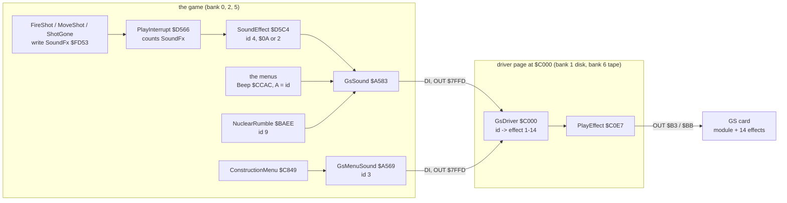
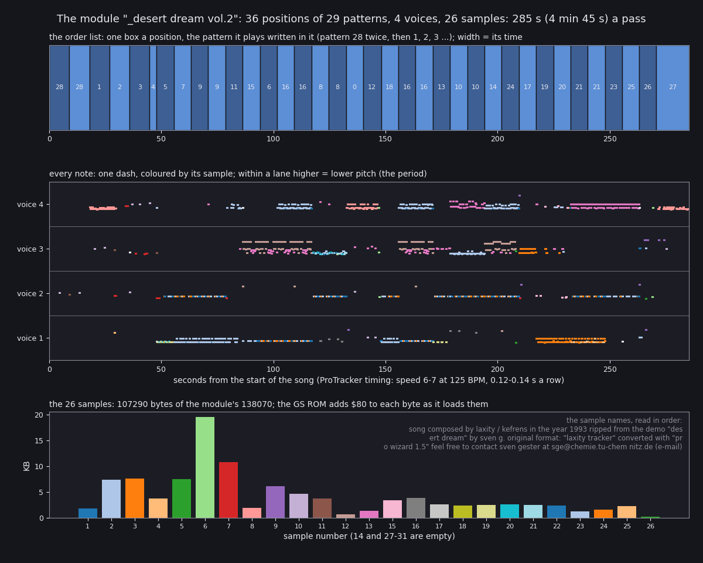
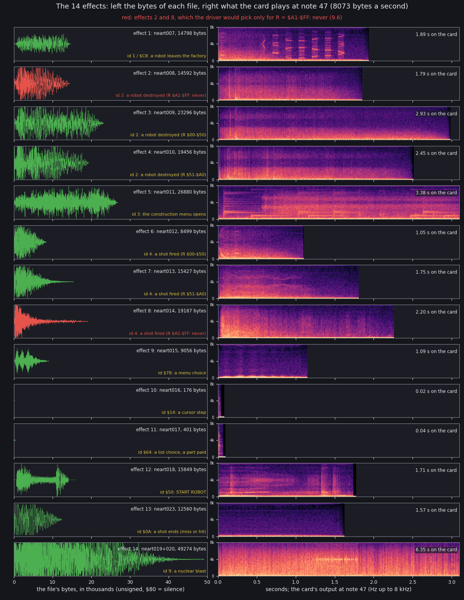
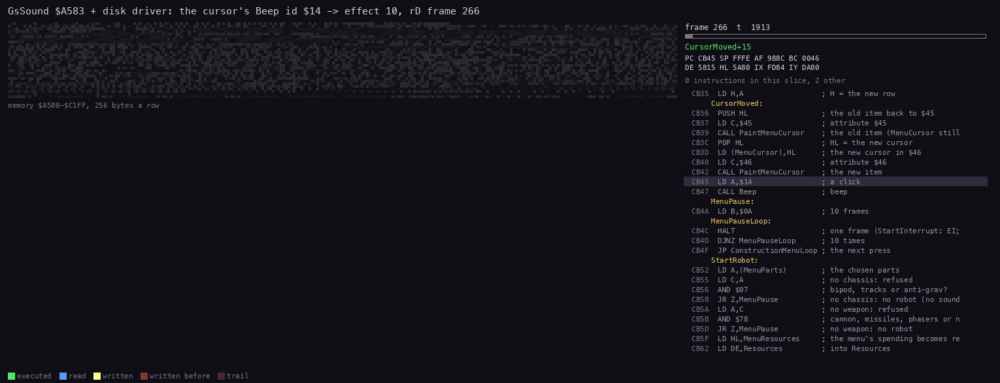
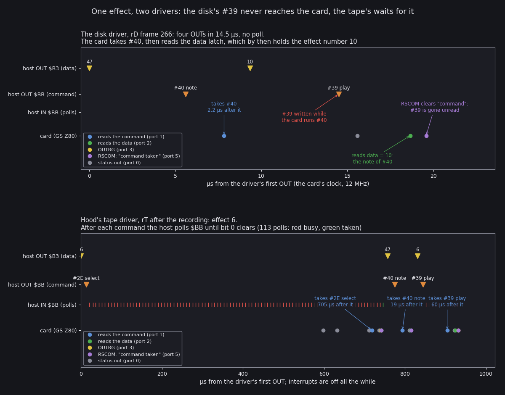
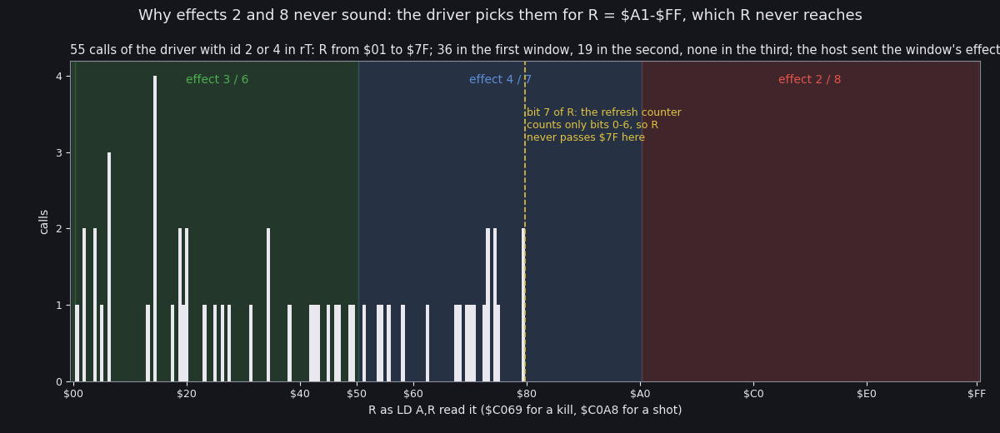
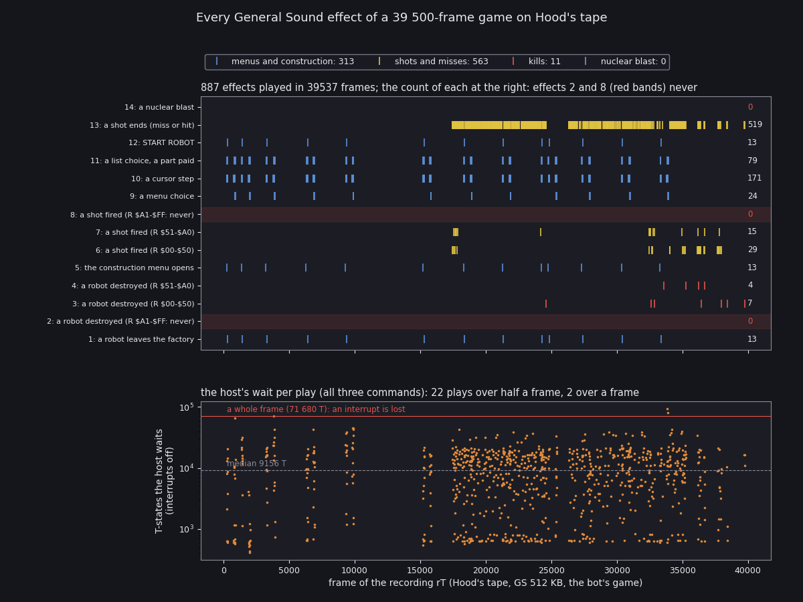

# 9. Sound

Every sound of the game comes from a General Sound card (GS): the Spectrum itself makes none. The card holds two
kinds of sound, both uploaded by the loader before the game starts:

- **The module.** One ProTracker module, "_desert dream vol.2", plays from the end of the load for the whole game:
  the menu, play and the construction screen share one endless tune. The card's own Z80 plays it; the game never
  touches it again.
- **The effects.** 14 sampled effects. The game asks for one with a sound id. A small driver in a RAM page of its
  own turns the id into GS commands on ports `$B3` and `$BB`.

There are two versions of the driver and the loader, and they behave very differently:

- **the disk** (SCL and TRD, Tron Z 2002): the loader loses the module and 5 of the 14 effects, and the driver loses
  every effect it plays (9.5). The disk version is silent from the menu on.
- **Hood's tape** (2017): the loader and the driver wait for the card after every command. The music and every
  effect but 2 and 8 play (9.6). Effect 14 needs a nuclear blast, which no recording reached (9.8).

Evidence:

- the code: `src/game/gssound.asm` (the bridge), `src/game/interrupts.asm` (`SoundEffect`), the drivers
  `src/disk/driver.asm` and `src/tape/driver.asm`, the loaders `src/disk/loader.asm` and `src/tape/loader.asm`, the
  commands in `src/disk/gs.inc`;
- the GS ROM's sources (unreal-ng `docs/inprogress/2026-09-19-general-sound/materials/gs/gs-firmware/firmware/src`:
  `COM_H.a80`, `TABLES_H.a80`, `PLAY.a80`), for what each command does on the card;
- **`work/gsB/rT`**: Hood's tape on Pentagon 128 + GS 512 KB, loaded from 48 BASIC (`USR 0`), played by
  `tools/play_gs.py`. 40134 frames, 13 robots built, fights from frame 17400. TTD recording, L1 (173 routines), and
  the host side of the GS ports for the whole game (`zxbus.1.ports` history, `ports.jsonl`);
- **`work/gsB/rD`**: the SCL on the same machine from the main menu, 2324 frames. TTD, L1, and both sides of the GS
  ports (the `zxbus.1` history: the host's OUTs and the card's own port accesses, on the card's 12 MHz clock);
- experiments on both instances after their recordings (pokes, host-side GS commands, renders of the card's output
  to WAV files, never played aloud);
- stage 1's live runs (`work/stage1/NOTES.md`: `x3` the disk load with the `zxbus.1` history, `x4`/`x6`/`x8` the
  tape under different BASICs and cards).

All runs use unreal-ng's low-level GS (the GS ROM run on an emulated Z80 at 12 MHz). Real hardware was not run.

## 9.1 The sound at a glance



How to read it:

- Boxes in "the game" are routines of the game image, with their addresses.
- `GsSound` and `GsMenuSound` page the driver's RAM page in at `$C000` with interrupts off (`DI`, `OUT $7FFD`).
- The driver is the only code that writes the GS ports.

The rest of the chapter follows the arrows from right to left: what the card holds (9.2), the commands (9.3), the
drivers (9.4, 9.5, 9.6), the game's calls (9.7), and what a whole game sounds like (9.8).

## 9.2 What the card holds

The loader uploads one module and 14 effects. The GS gives each its handle in load order: module 1, effects 1-14.
The driver plays effects by these handles.

| GS object | File(s) | Bytes | Played for (driver id, 9.4) |
| --- | --- | ---: | --- |
| module 1 | `neart002`-`neart006` | 138 070 | always, from the end of the load (the tape; the disk load loses it, below) |
| effect 1 | `neart007` | 14 798 | ids 1 and `$C8`: a robot leaves the factory |
| effect 2 | `neart008` | 14 592 | id 2 when R is `$A1-$FF`: never (9.6) |
| effect 3 | `neart009` | 23 296 | id 2, R `$00-$50`: a robot destroyed |
| effect 4 | `neart010` | 19 456 | id 2, R `$51-$A0`: a robot destroyed |
| effect 5 | `neart011` | 26 880 | id 3: the construction menu opens |
| effect 6 | `neart012` | 8 499 | id 4, R `$00-$50`: a shot fired |
| effect 7 | `neart013` | 15 427 | id 4, R `$51-$A0`: a shot fired |
| effect 8 | `neart014` | 19 187 | id 4 when R is `$A1-$FF`: never (9.6) |
| effect 9 | `neart015` | 9 056 | id `$78`: a menu choice |
| effect 10 | `neart016` | 176 | id `$14`: a cursor step |
| effect 11 | `neart017` (tape); the first 401 bytes of `neart019` (disk) | 401 | id `$64`: a list choice, a part paid |
| effect 12 | `neart018` | 15 849 | id `$50`: START ROBOT |
| effect 13 | `neart023` | 12 560 | id `$0A`: a shot ends (a miss, a building, or a hit) |
| effect 14 | `neart019` + `neart020` | 49 274 | id 9: the nuclear blast |

- Together they take 367 521 bytes: the card needs 512 KB (an expanded GS) or a NeoGS (9.9).
- Effect 14 is one sample over two files: `neart019` (32 768 bytes) and `neart020` (16 506). The loader keeps the
  card's load stream open between them (`LoadEffectOpen` `$6352`, `SendEffectRest` `$637C`).
- The disk loader names `neart019` where effect 11 should be: the card gets the first 401 bytes of effect 14's start
  as effect 11, and `neart017` is never read (`src/disk/loader.asm`).

### The module



How to read it:

- **Top: the order list.** One box per position, with the number of the pattern it plays. The width is its time at
  ProTracker timing.
- **Middle: every note.** One dash per note, one lane per voice, coloured by its sample. Within a lane, higher means
  a lower pitch (the ProTracker period).
- **Bottom: the 26 samples** by size. The text at the right is the sample names read in order: they carry the
  credits.

What it shows:

- `M.K.` format: 36 positions of 29 patterns (28 played twice at the start), 4 voices, 26 samples, restart position 2.
- The speed is 7 for the first rows, then 6, at 125 BPM: one pass lasts 285 s (4 min 45 s). One `F15` effect near
  the end.
- The samples take 107 290 of the module's 138 070 bytes.
- The sample names say: "song composed by laxity / kefrens in the year 1993, ripped from the demo "desert dream" by
  sven g., original format: "laxity tracker", converted with "pro wizard 1.5"".

`python3 tools/fig_sound.py module --out docs/img/sound/module.png` (reads `src/res/music/desert-dream.mod`).

### The effects at their real pitch



How to read it:

- **Left: the file.** Each effect's bytes, unsigned (`$80` is silence), over the first 50 000 bytes. Red marks
  effects 2 and 8, which never play (9.6).
- **Right: the card's output.** A spectrogram up to 8 kHz of what the card plays at note 47, the note both drivers
  set. The text gives the time the effect sounds.
- The lower line under each row names the game event the driver plays it for.

What it shows:

- At note 47 the card plays about 8000 bytes a second: effect 1 is 14 798 bytes in 1.89 s (7812 a second), effect 3
  23 296 in 2.93 s (7964). The median over the 14 is 8073.
- The same effects at the note they are loaded with (60, the GS ROM's default) run at about 16 800 bytes a second
  (`work/audio/tap-fxNN.wav` of stage 1). Note 47 is 13 semitones lower: 16 800 × 2^(-13/12) = 7930. Every effect
  plays an octave and a semitone lower, and twice as long, as at its default note.
- Effects 10 and 11 last 0.02 and 0.04 s: clicks. Effect 14, the blast, lasts 6.35 s; effect 5, 3.4 s, runs past
  the right edge.
- Effect 14 sounds harsh and loud: the tape loader stores it signed, with every byte's top bit flipped (below).

The renders: on `work/gsB/rT` after its recording, the CPU stopped (`DI; JR $` poked at its PC), the module stopped
(`#32`), then for each effect n from the host: data n, `#2E`, data 47, `#40`, data n, `#39`, and 4 s of the card's
output alone (`audiogs`; 8 s for effect 14). The commands are section 3 of [gsB-NOTES](../work/docs/gsB-NOTES.md); the figure:
`python3 tools/fig_sound.py effects --renders work/gsB/audio --out docs/img/sound/effects.png`.

### The samples' sign

The GS firmware keeps samples unsigned. The effect files are unsigned too: the mean step between neighbouring bytes
is 1.2-15 read unsigned, 3.9-138 read signed (stage 1 NOTES 2.4).

- `#3E` with data 1 loads an effect as sent (unsigned). With data 0 the ROM adds `#80` to every byte (`COM3E`: LX =
  `#80`), for signed samples.
- **The disk loader** sends data 0 for all 14 (`LoadEffect` `$6317`): every effect is stored with its top bit
  flipped. A flipped effect plays as a loud, harsh distortion of itself: effect 1 flipped has an AC level of 3434
  against 825 (stage 1 `x4`).
- **Hood's tape loader** sends data 1 for effects 1-13 (`LoadEffect`, rewritten) and data 0 for effect 14 (it kept
  the disk's `LoadEffectOpen` `$6352`). Effect 14 is the only flipped effect on the tape.

### What the disk loader really leaves on the card

The GS has one latch per direction. A command written before the card has taken the last one replaces it. The disk
loader does not wait between commands, and the card misses some of them (stage 1 `x3`, the `zxbus.1` history):

- **The module.** `GsStartModule` `$61BE` writes `#F4`, `#30` and `#D1` back to back. `#F4` restarts the card cold
  (`COMF4`: `JP 0`, then the ROM's RAM test, frames 556-678 of `x3`). `#30` and `#D1` are gone. The 138 070 module
  bytes stream into nothing, and the card takes the closing `#D2` as an unknown command.
- **5 of the 14 effects.** `LoadEffect` waits once, then writes data 0, `#3E` and `#D1` a few T-states apart. In 5
  loads the card was still busy, `#D1` replaced `#3E`, and the effect was skipped: effects 3, 5, 7, 8 and 14 (frames
  1400, 1588, 1732, 1804, 2250 of `x3`).

The card ends the disk load with no module (`CNTMOD` 0) and 9 effects (`CNTFX` 9):

| Card handle | 1 | 2 | 3 | 4 | 5 | 6 | 7 | 8 | 9 |
| --- | --- | --- | --- | --- | --- | --- | --- | --- | --- |
| File | `neart007` | `008` | `010` | `012` | `015` | `016` | `019` (401 bytes) | `018` | `023` |

- In `work/gsB/rD` at the game's start the card's four channels sit at sample 128 (silence), against the module's
  live levels in `work/gsB/rT` (`gs-start.json` of each).
- The same render as above, on `work/gsB/rD`: handles 1-9 sound, for as long as these files at 8000 bytes a second
  (handle 6, `neart016`, 0.1 s; handle 3, `neart010`, 2.5 s). Handles 10-14 are silent: the card refuses them
  (`work/gsB/audio/disk-gs-fx47-NN.wav`).
- Which `#3E` are lost depends on the card's timing. The cold restart is the GS ROM's own, so a card with this ROM
  should lose the module the same way.

**The tape loader** waits after every command (`SendCommand` `$63A3`). Stage 1's tape runs (`x4`, `x6`, `x8`) end with
`CNTMOD` 1, `CNTFX` 14, the module's volume `$25` (37 of 64) and the effects' `$40` (64), and the module playing.

## 9.3 The GS commands

All are commands of the GS ROM's interpreter (the dispatch table `COMTABH` in `TABLES_H.a80`). A parameter goes to
the data port `$B3` before its command goes to `$BB`. Reading `$BB` gives the status: bit 0 is set until the card has
taken the last command.

| Command | Data | Firmware | What it does | Sent by |
| --- | --- | --- | --- | --- |
| `#F4` | | `COMF4` | restart the card's software cold: every module and effect gone | loader, `$61BE` |
| `#30` | | `COM30` | load a module: its bytes follow on `$B3` | loader |
| `#D1` / `#D2` | | `LOAD` | open / close the byte stream of a load | loader |
| `#3E` | 1 / 0 | `COM3E` | load an effect, unsigned (1) or signed (0); its default note is 60 | loader, `LoadEffect` `$6317`, `LoadEffectOpen` `$6352` |
| `#31` | 0 | `COM31` | play the module (0: the current one) | loader, `StartModule` `$62DF` |
| `#2B` | `$40` | `COM2B` | the effects' master volume: 64 (full) | loader |
| `#2A` | `$25` | `COM2A` | the module's master volume: 37 of 64 | loader |
| `#2E` | effect | `COM2E` | make an effect the current one (`CURFX`) | tape driver, `SelectEffect` `$C104` |
| `#40` | `$2F` | `COM40` | the note of the current effect: 47 | both drivers, `PlayEffect` `$C0E7` |
| `#39` | effect | `COM39` | play an effect (it becomes the current one) | both drivers, `PlayEffect` |

What the card does with the last three, from `COM_H.a80`:

- `COM40` reads the data latch, writes `RSCOM` ("command taken") and sets the note of `CURFX`. It plays nothing.
- `COM39` reads the data latch, writes `OUTRG` and `RSCOM`, then starts the effect on a free channel (`PLAYFX`).
- `RSCOM` clears the command bit of the status, whatever command is pending: a command written while the card is
  still inside another one is cleared unread.

## 9.4 The drivers

Both drivers start at `$C000` of their RAM page: bank 1 on the disk, bank 6 on the tape (`DriverBank`, `case.json`).
The game pages them in through two bridges in its free space after the sprites (`src/game/gssound.asm`):

- **`GsSound` `$A583`**: `DI`; `PUSH` HL, DE, BC, AF, IX, IY; `OUT ($7FFD),PageRom48|DriverBank` (`$11` disk, `$16`
  tape: the 48 BASIC ROM and the driver's bank); `CALL $C000` with A = the id; bank 0 back (`$10`); the registers
  back; `EI`. Called by `Beep`, `SoundEffect` and `NuclearRumble`.
- **`GsMenuSound` `$A569`**: the same with A = 3 and no registers kept. It ends with the `LD IY,Robots` that its
  `CALL` took the place of in `ConstructionMenu` `$C849`, then `EI`.

Interrupts must stay off: the IM 2 table and `PlayInterrupt` live in bank 0 (`$FE00-$FF00`, `$D566`), which the
driver's page hides.



How to read it:

- **Left: memory** `$A500-$C1FF`, 256 bytes a row: executed bytes flash green, reads blue, writes yellow. The
  stack writes of the `PUSH`es and the driver's bytes at `$C000` light up in turn.
- **Right: the code** round the instruction last executed, with the registers. The listing is the game's with the
  disk driver's lines at `$C000-$C0F7`.

What it shows (`work/gsB/rD` frame 266, T 1900-2420):

- `MoveMenuCursor` calls `Beep` with A = `$14` at `$CB47`; `Beep` jumps to `GsSound` (T 1943).
- `GsSound` pages bank 1 and calls `$C000` at T 2075. The driver walks its `CP` list to `$14` and loads A = 10.
- `PlayEffect` `$C0E7` (T 2201) writes 47 to `$B3` at `$C0EA`, `#40` to `$BB` at `$C0EE`, 10 to `$B3` at `$C0F1`
  and `#39` to `$BB` at `$C0F5` (T 2274).
- Back in `GsSound` at `$A5A8`, T 2385: 442 T-states from the entry of `GsSound`.

The listing merges the disk driver's lines with the game's (section 4 of [gsB-NOTES](../work/docs/gsB-NOTES.md)):

```
python3 ../../kit/routine_anim.py --work work/gsB/rD --window 266:1900-266:2420 \
    --listing work/gsB/lst/gssound-disk.lst --out docs/img/routines/GsSound.gif --view none \
    --range A500-C1FF --pictures 40 --pc A583-C0F8 \
    --title "GsSound \$A583 + disk driver: the cursor's Beep id \$14 -> effect 10, rD frame 266"
```

### The id list

`GsDriver` `$C000` compares A with each id in turn (`CP n` / `JR NZ`); the first match plays one effect. Both drivers
have the same list, byte for byte at `$C000-$C0E6`.

| Id | Effect | Tested at | Event |
| --- | --- | --- | --- |
| 1 | 1 | `$C000` | none: no caller sends 1 |
| 2 | 3, 4 or 2 by R | `$C009` | a robot destroyed (`RandomFxKill` `$C069`) |
| 3 | 5 | `$C010` | the construction menu opens |
| 4 | 6, 7 or 8 by R | `$C019` | a shot fired (`RandomFxShot` `$C0A8`) |
| `$78` | 9 | `$C020` | a menu choice |
| `$14` | 10 | `$C029` | a cursor step |
| `$64` | 11 | `$C032` | a list choice, a part paid |
| `$50` | 12 | `$C03B` | START ROBOT: the first step of its sweep |
| `$C8` | 1 | `$C044` | a robot leaves the factory |
| `$78` again | 1 | `$C04D` | never: `$78` matched at `$C020` |
| 9 | 14 | `$C056` | each burst of the nuclear blast |
| `$0A` | 13 | `$C05F` | a shot ends |
| anything else | none | `$C068` | `RET`: silent |

### Two play routines

Both `PlayEffect`s start at `$C0E7` with A = the effect.

- **Disk** (`src/disk/driver.asm`): four OUTs, no wait. `OUT ($B3),47` at `$C0EA`, `OUT ($BB),#40` at `$C0EE`,
  `OUT ($B3),effect` at `$C0F1`, `OUT ($BB),#39` at `$C0F5`. Even if the card took every command, the note would go
  to the effect played last (`CURFX`), not the one about to play.
- **Tape** (`src/tape/driver.asm`, 271 bytes): `SelectEffect` `$C104` writes the effect and `#2E`, then 47 into the
  data latch; `#40`; the effect and `#39`. Every command goes through `SendGsCommand` `$C0F8`: `OUT ($BB)` at `$C0FA`,
  then the loop `.wait` `$C0FE` (`IN A,($BB)`, `RRCA`, `JR C` at `$C101`) until bit 0 clears. The note reaches the
  effect that plays.



How to read it:

- Time runs to the right in µs on the card's 12 MHz clock, from the driver's first OUT.
- **Lanes:** the host's OUTs to `$B3` (data, yellow, value written above) and `$BB` (commands, orange), the host's
  status reads of `$BB` (one tick each: red while bit 0 is set, green once clear), and the card's own port accesses
  (dots, colours in the legend).
- **Top: the disk driver**, `work/gsB/rD` frame 266 (the click of the animation above). **Bottom: the tape driver**,
  effect 6 sent on `work/gsB/rT` after its recording (`SoundFx` poked to 1).

What it shows:

- **Disk.** The four OUTs take 14.5 µs. The card reads the command `#40` 2.2 µs after it was written. It then reads
  the data latch, but by then the host has written the effect number 10 there: the note becomes 10. Meanwhile `#39`
  arrived; the card's `RSCOM` at the end of `COM40` clears it. The card never reads `#39`: no effect plays (9.5).
- **Tape.** `#2E` waits 705 µs: the card is busy in its module player. The host polls `$BB` 113 times with
  interrupts off. `#40` is taken 19 µs after it is written, `#39` 60 µs after. The card reads 6, writes `OUTRG` and
  starts the effect.

`python3 tools/fig_sound.py handshake --disk work/gsB/rD/zxbus.jsonl --disk-frame 266 --tape
work/gsB/rT/exp-zxbus.jsonl --tape-frame 0 --out docs/img/sound/handshake.png`. Both streams are `zxbus.1` histories
(`gs_session.py` step `hist:zxbus.1:capture:FILE`).

## 9.5 The disk version plays no effect

The race of the figure above is the same in every call. In `work/gsB/rD` the driver ran 48 times (L1: `GsSound` 68
calls, 20 of them ids the driver does not list):

| | Count |
| --- | --- |
| driver plays (host `#40` + `#39` pairs) | 48: effect 10 × 26, 11 × 12, 9 × 4, 5 × 2, 12 × 2, 1 × 2 |
| host commands | 96 |
| commands the card read (port 1) | 48, every one a `#40` |
| card took `#40` after it was written | 27-67 ticks (2.2-5.6 µs) |
| host wrote `#39` after `#40` | 107-121 ticks (8.9-10.1 µs) |
| `OUTRG` writes by the card (the sign of `COM39`) | 0 |

- `COM40` takes longer than the 9-10 µs between the host's `#40` and `#39`. Each `#39` lands while the card is inside
  `COM40`, and `COM40`'s own `RSCOM` clears it.
- The note `COM40` sets is the effect number, not 47: the host's second `OUT ($B3)` came first.
- With 9 effects on the card and none of them ever started, the disk version is silent in play and in the menus.

Experiments on `work/gsB/rD` after the recording (section 2 of [gsB-NOTES](../work/docs/gsB-NOTES.md)):

- `SoundFx` poked to `$01` (a shot) and to `$FC` (a miss): the driver ran, the card's output stayed at rms 0
  (`work/gsB/audio/disk-soundfx-01.wav`, `-FC.wav`).
- The host writes data 6 and `#39` alone, with the card idle: it plays (rms 0.0139, `disk-host-39-6.wav`). The card
  holds the effects; only the driver's timing loses them.

What this rests on: the emulated GS ROM on a 12 MHz Z80, with the Pentagon's 3.5 MHz CPU. A real card runs the same
ROM at the same clock, so the same race is expected there; no real card was run.

## 9.6 R and effects 2 and 8

Ids 2 and 4 choose among three effects by the R register. `RandomFxKill` `$C069` and `RandomFxShot` `$C0A8` (the same
bytes in both drivers) read `LD A,R`, keep it in H, then count C down through three windows:

| R (H) | Kill (id 2) | Shot (id 4) |
| --- | --- | --- |
| 0 (no window) | 3 | 6 |
| `$01-$50` | 3 | 6 |
| `$51-$A0` | 4 | 7 |
| `$A1-$FF` | 2 | 8 |

The Z80's refresh counter counts only bits 0-6 of R. Bit 7 changes only by `LD R,A`, and it is 0 after a reset.

- No `LD R,A` (`ED 4F`) is anywhere in the game image, the drivers, the loaders, the BASICs or the media files built
  from `src/` (a byte scan of every file under `build/`, section 5 of [gsB-NOTES](../work/docs/gsB-NOTES.md)).
- The machine's ROMs, dumped from `work/gsB/rT`: the TR-DOS ROM (page 1) reads R with `LD A,R` at `$2A67`, keeps it,
  and puts the same value back with `LD R,A` at `$2EBF`: bit 7 stays as it was. The 128 and 48 BASIC ROMs have no
  `ED 4F`. The Pentagon menu ROM has the bytes `ED 4F` at `$3295`, in what reads as data; the tape game never runs
  the menu ROM after the load.
- So R stays `$00-$7F`: the third window is never reached, and effects 2 (`neart008`) and 8 (`neart014`) never play.



How to read it:

- **Across:** the value of R that `LD A,R` read, `$00-$FF`. The three shaded windows are the effects they choose:
  green 3 / 6, blue 4 / 7, red 2 / 8.
- **Bars:** how many calls read each value. The dashed line is `$7F`, the largest value bit 7 = 0 allows.

What it shows:

- 55 calls in `work/gsB/rT`: 44 shots, 11 kills. R ran from `$01` to `$7F`, spread over the whole range below `$80`.
- 36 calls fell in the first window, 19 in the second, none in the third.
- In all 55 the effect the host then sent (the port history) is the window's effect.

The values come from access traces of each play's frame: the instruction after `LD A,R` holds A = R. One example
from the trace of frame 17442: `RandomFxShot` `$C0A8` reads R = `$37`, and the host sends effect 6.
`python3 tools/gs_rreg.py --work work/gsB/rT --plays work/gsB/an/rT-plays.json --out work/gsB/an/r-values.json`, then
`python3 tools/fig_sound.py rreg --rvalues work/gsB/an/r-values.json --out docs/img/sound/r-register.png`.

## 9.7 Every call of the sound

The game sends ids from four places. Counts are L1 call counts of `work/gsB/rT` (the tape game, 40134 frames).

**`SoundEffect` `$D5C4`, the shots.** One byte drives it: `SoundFx` `$FD53`.

| `SoundFx` | Written by | Event |
| --- | --- | --- |
| 1 | `FireShot` `$B6D6` | a shot fired |
| `$FC` | `ShotGone` `$B7EA` | a shot ends on a wall, a building, or out of range |
| `$FA` | `MoveShot` `$B724` | a robot hit and still alive |
| `$C8` | `MoveShotKill` `$B7D7` | a robot destroyed |

`PlayInterrupt` `$D566` adds one to a non-zero `SoundFx` each frame (0 at `$80` or past `$FF`) and calls
`SoundEffect` with the new value. `SoundEffect` sends an id for three values and then clears `SoundFx`:

| New value | Id sent | Effect | Sent from | After |
| --- | --- | --- | --- | --- |
| 2 | 4 | 6 / 7 by R | `$D5CA` | one frame after the shot |
| `$FD` | `$0A` | 13 | `$D5D9` | one frame after a miss; three frames after a hit (`$FA`, `$FB`, `$FC`, `$FD`) |
| `$C9` | 2 | 3 / 4 by R | `$D5E5` | one frame after the kill |

Any other value is left to count on. In `work/gsB/rT` `PlayInterrupt` called `SoundEffect` 652 times; it sent 574
ids (44 shots, 519 ends, 11 kills). The other 78 calls are the silent counts `$FB` and `$FC` of 39 hits.

**A new event overwrites the old.** `FireShot` ran 533 times, but only 44 shots were heard. A shot that ends in the
same game turn it was fired (a target right in front) writes `$FC`, `$FA` or `$C8` over the 1 before the interrupt
sees it. The memory of every frame 32440-32899 of `work/gsB/rT` (TTD `memory_at`) shows both kinds:

| Frame | Shot record 3 | `SoundFx` at the frame's start | Effect sent |
| --- | --- | --- | --- |
| 32455 | live, 6 steps left | 1 | 7 (the shot) |
| 32475-32478 | ended | `$FC`, then `$FA`, `$FB`, `$FC` | 13 at 32475 and 32478 |
| 32555, 32565 | never seen live | `$FC` | 13 only: fired and ended within the frame |
| 32596 | ended | `$C8` | 3 (a kill) |

The table reads `SoundFx` `$FD53` and shot record 3 (`Shots` `$D7D3` + 3 × 9) from the memory of every frame
(section 6 of [gsB-NOTES](../work/docs/gsB-NOTES.md)):

```
python3 ../nether-earth/tools/ill_events.py sample --work work/gsB/rT --frames 32440:32900:1 \
    --out work/gsB/cache/rT-fight.npz
```

**`Beep` `$CCAC`, the menus.** The menus call `Beep` with A = the id, and `Beep` is now only `JP GsSound`.

| Site | Routine | Id | Effect | Event | Calls in `rT` |
| --- | --- | --- | --- | --- | ---: |
| `$CB47` | `MoveMenuCursor` | `$14` | 10 | the construction menu's cursor moved | 62 |
| `$AD17` | `ListMenu` | `$14` | 10 | a list menu's highlight moved | 144 with `$AD37` |
| `$AD37` | `ListMenu` | `$64` | 11 | a list menu item chosen | (above) |
| `$CA91` | `ConstructionMenuLoop` | `$64` | 11 | a part paid for | 31 |
| `$A803` | `ShowOrderMiles` | `$78` | 9 | LEAVE ROBOT | 12 |
| `$ABF7` | `SetOrder` | `$78` | 9 | an order given | 12 |
| `$A96D` | `DirectControl` | `$78` | 9 | fire ends DIRECT CONTROL | 0 |
| `$AA06` | `OrdersMenuChoose` | `$78` | 9 | STOP AND DEFEND chosen | 0 |
| `$AAB3` / `$AAC6` | `DistanceShow` | `$14` / `$78` | 10 / 9 | the miles changed / fired | 0 |
| `$CAAE` | `ConstructionMenuLoop` | `$78` | 9 | a part refused or taken back | 0 |
| `$CB83` | `StartRobot` | `$50`, `$4B` ... `$19`, `$14` | 12, none ..., 10 | START ROBOT: 13 calls, only the first and last sound | 182 with `$CB90` |
| `$CB90` | `StartRobot` | `$C8` | 1 | the robot leaves the factory | (above) |
| `$ACD0` | `CombatMenuCode` | `$FA` | none | COMBAT MODE refused | 0 |
| `$AEEC` | `GameOverWait` | `$FA` | none | the game's end | 0 |
| `$C284` | `LoadError` | `$FA` | none | LOADING ERROR! | 0 |

- `StartRobot`'s sweep calls `Beep` 13 times with `$50` down to `$14` by 5. The driver knows only `$50` and `$14`:
  the 11 steps between are silent. 13 builds × 11 = 143 silent ids in `rT`.
- `Beep` returns as soon as the driver has sent its commands: the menus no longer pause while a sound plays.
  `MoveMenuCursor` still waits 10 frames after each click (`MenuPause` `$CB4A`).

**`NuclearRumble` `$BAEE`.** Each burst of the nuclear blast sends id 9 (effect 14), then waits two empty `DJNZ`
loops. No recording reached a blast; the id-to-effect map is the driver's.

**`GsMenuSound` `$A569`.** The first instruction of `ConstructionMenu` `$C849`: id 3, effect 5, 13 calls in `rT`.

## 9.8 A whole game on the tape



How to read it:

- **Top: one tick per play,** one row per effect, across the 40 000 frames of `work/gsB/rT`. Blue: menus and
  construction; yellow: shots and ends; red: kills; violet: the blast. The number at the right is the row's count.
  The red bands are effects 2 and 8.
- **Bottom: the host's wait** per play: the T-states from its first OUT to the card taking `#39`, on a log scale.
  The red line is one frame (71 680 T on the Pentagon), the dashed line the median.

What it shows:

- 887 plays: effect 13 × 519, 10 × 171, 11 × 79, 6 × 29, 9 × 24, 7 × 15, 1, 5 and 12 × 13 each, 3 × 7, 4 × 4.
  Effects 2, 8 and 14 never played; 14 needs a nuclear blast, which this game did not have.
- The menu sounds come in bursts every 3000 frames or so: each is a visit to the construction menu (13 builds).
- From frame 17400 the shots and their ends go on to the end of the game: effect 13 every 20 frames for long
  stretches, which is a robot firing at a building from the same place.
- The waits:

| Command | Median | 90 % | Max |
| --- | ---: | ---: | ---: |
| `#2E` | 7 507 T | 17 605 T | 79 766 T |
| `#40` | 163 T | 174 T | 65 699 T |
| `#39` | 352 T | 379 T | 541 T |
| the three | 9 156 T | | 93 889 T |

- `#2E` waits longest: the card is inside its module player when the host comes. The median play costs 9156 T, 13 %
  of a frame, all with interrupts off.
- 22 plays waited over half a frame. 2 waited over a whole frame (frames 33857 and 33906, both effect 10, 93 889 and
  80 308 T): the frame interrupt fell inside the wait and was lost, and the game's clock (`TurnFrames`) missed a count.
- Over the game the host spent 9.4 million T-states waiting for the card: 132 frames, 0.3 % of the game.

`python3 tools/gs_ports.py plays --ports work/gsB/rT/ports.jsonl --json work/gsB/an/rT-plays.json` (the `zxbus.1.ports`
history of the whole recording, its 16-bit T-state counter unwrapped per frame), then `python3 tools/fig_sound.py
plays --plays work/gsB/an/rT-plays.json --out docs/img/sound/plays.png`.

## 9.9 The machine it needs

| Machine | Card | Disk (SCL / TRD) | Tape (Hood) |
| --- | --- | --- | --- |
| Pentagon 128, TR-DOS | GS 512 KB | loads and plays; no music, and no effect (9.2, 9.5) | - |
| Pentagon 128, TR-DOS | NeoGS | silent at the menu (stage 1 `x1`, capture rms 0) | - |
| Pentagon 128 or 128K, 48 BASIC via `USR 0` | GS 512 KB | - | music and every effect but 2, 8 (`work/gsB/rT`, stage 1 `x6`) |
| 128K, 48 BASIC via `USR 0` | NeoGS | - | music and effects (stage 1 `x8`) |
| 128K, the 128 menu's Tape Loader or its 48 BASIC | GS 512 KB | - | loads with music, then hangs at the first sound in play (stage 1 `x4`; `x5` left bank 6 empty, its play was not run; 9.10) |
| 128K, `LOAD ""` typed in 128 BASIC | any | - | not run; the same 128 ROM loader as the Tape Loader, so by the code the same hang (9.10) |

- The game is 48K code plus one RAM page for the driver: a 128K machine.
- The card needs room for 367 521 bytes: a 512 KB GS or a NeoGS. A 128 KB GS was not run; the uploads would run past
  its memory.
- The loading screen `neart000` says "GS-512" under the title.

## 9.10 Hood's tape: the paging trap

The tape driver must land in bank 6, and only the 48 BASIC with paging free puts it there.

1. The BASIC runs `USR 25254` (`SendFx14b` `$62A6`), which ends by paging bank 6 at `$C000` (`OUT ($7FFD),$16`).
2. It runs `LOAD "neart021" CODE` to `$C000`, then `USR 25273` (`PageBank0` `$62B9`): bank 0 back.

What goes wrong elsewhere:

- Under 128 BASIC the ROM restores its own `BANKM` (bank 0) on its way into the tape loader: the Tape Loader in
  stage 1 `x4`. A `LOAD ""` typed in 128 BASIC takes the same ROM loader; no run tried it.
- From the 128 menu's "48 BASIC" the paging is locked (bit 5 of `$7FFD`): stage 1 `x5`.
- Either way the driver lands in bank 0 under the game, and bank 6 stays zeros
  (`work/images/tap-via128basic-menu-bank6.bin`).
- The game loads and the module plays at the menu. The first sound in play pages bank 6 and calls `$C000`: zeros
  run as `NOP`s to a `HALT` with interrupts off, and the machine stops (stage 1 `x4`: PC `$FFFA`, `iff1` 0).
- From 128 BASIC, `PRINT USR 0` gives a 48 BASIC with paging free, and the tape plays through
  (`work/images/tapusr0-menu-bank6.bin` holds the driver at `$C000`).

Hood's BASIC also offers "2-music OFF": `USR 25516` (`MusicOff` `$63AC`) only resets the card and pokes `RET` at
`StartModule` `$62DF`, so no module is loaded or started.

## 9.11 Design notes

- **No GS program.** Everything the card does is its ROM's: the module player, the effect player, the loaders. The
  conversion only uploads data and sends ROM commands, so it fits in 248 bytes of driver.
- **The driver in a page of its own.** The game's 48K image has no room for it; a RAM page at `$C000` costs a
  `DI` / `OUT $7FFD` pair per sound and leaves the game's code at its addresses.
- **Ids instead of tones.** The game's sound calls keep their A values. The driver maps them to effects, so the game
  code changes at only four places (`Beep`, `SoundEffect`, `NuclearRumble`, `ConstructionMenu`).
- **No handshake, no sound.** The disk driver and loader write commands faster than the card takes them. The cost is
  everything: the module, five effects and every play. Hood's tape version waits after each command and works, at
  the price of up to a frame with interrupts off.
- **Randomness from R.** R gives a different effect per shot at no cost, but only 7 bits of it change: the third
  window of each choice is dead code.
