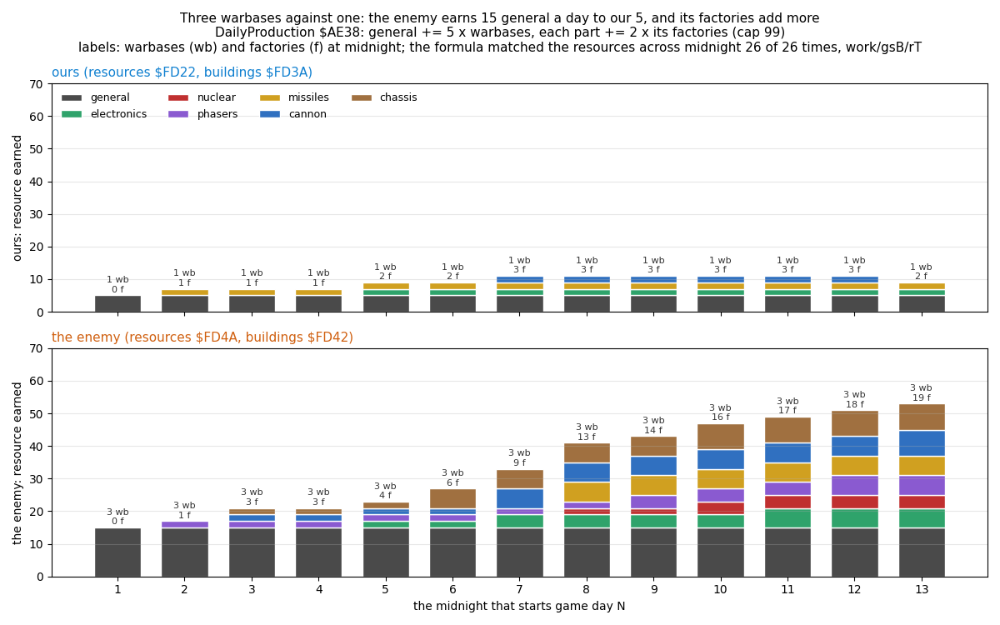
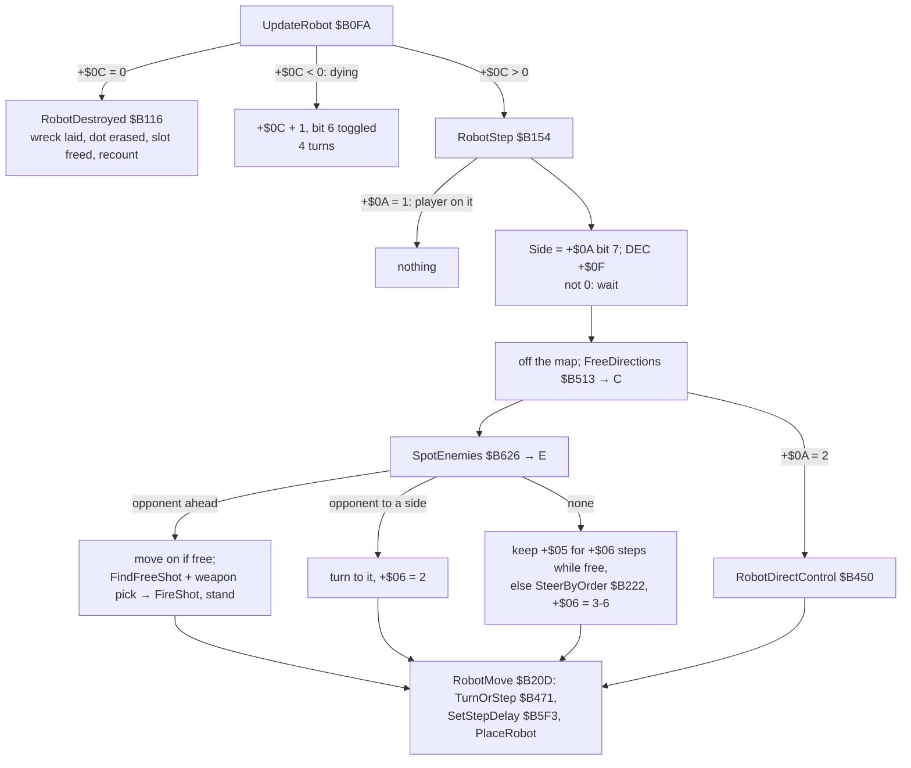
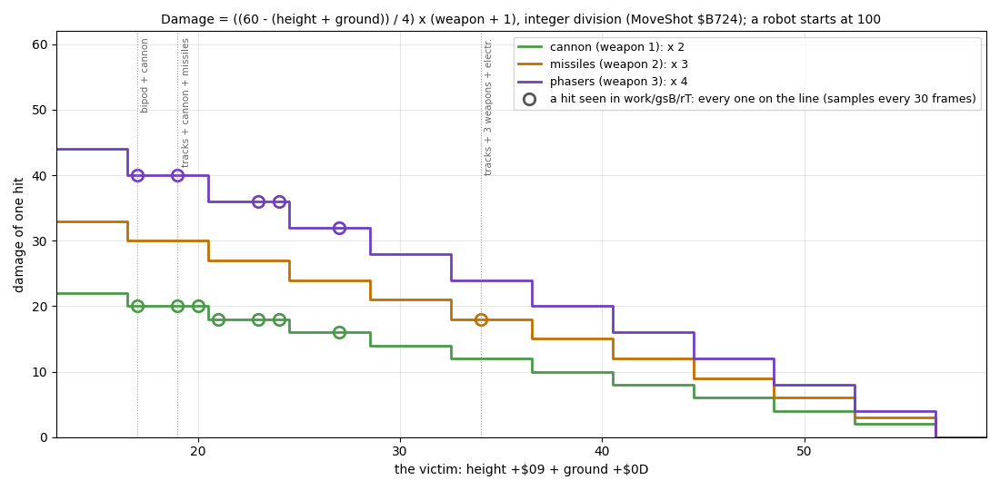
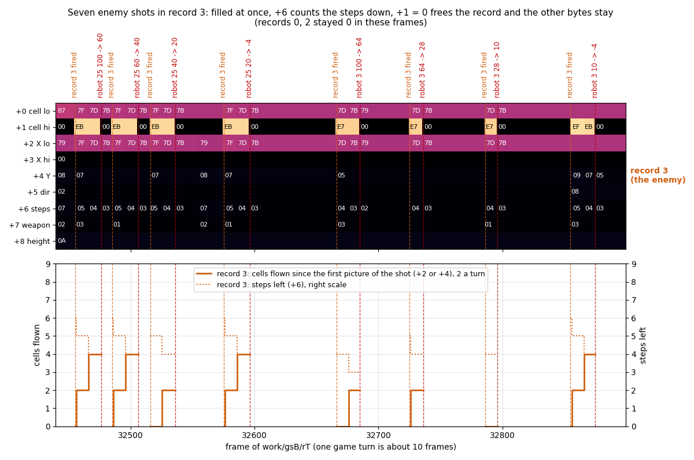
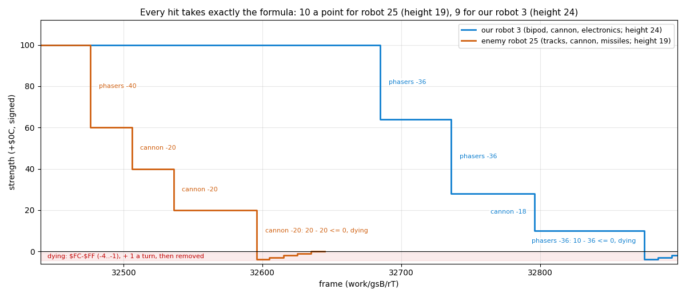
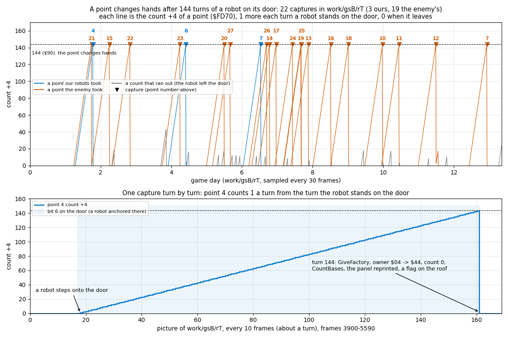
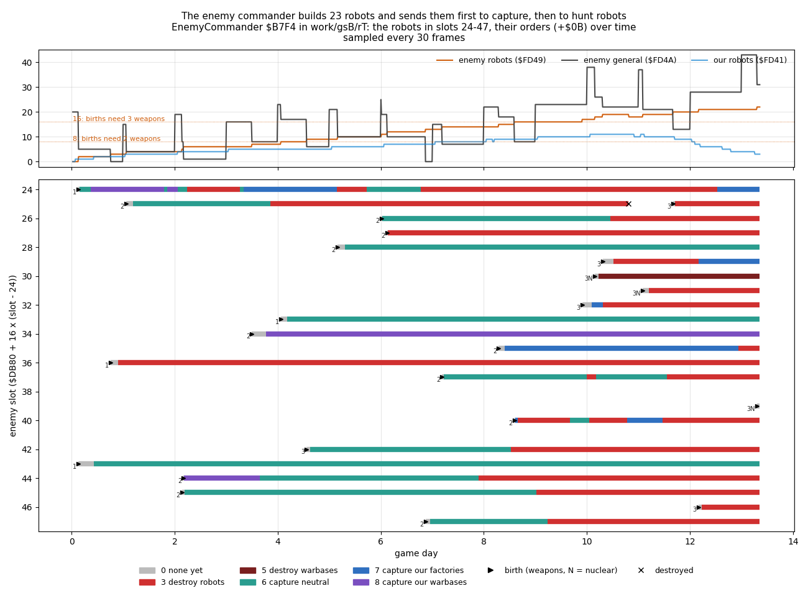

# 10. Gameplay logic

Nether Earth GS is a war of production:

- Each side starts with warbases and 20 general resource.
- Each game day pays out per building owned.
- Robots built from parts capture more buildings.
- The player never fights directly. The robots walk, look, shoot and capture on their own, steered by orders.
- The enemy (the "Insignians") uses the same robots, the same costs and the same capture rule. Its commander is a
  few lines of random choices (`EnemyCommander` `$B7F4`).
- A side with no warbase left has lost.

The GS conversion changed only the sound calls of the game (`Beep`, `SoundEffect`, `NuclearRumble`, the first
instruction of `ConstructionMenu`: [9.4](09-sound.md#94-the-drivers)). Every rule below runs at its original address.
The one change that touches the rules' timing: a sound sent to the card waits for it with interrupts off, and two
of them in `work/gsB/rT` cost the game clock a frame ([9.8](09-sound.md#98-a-whole-game-on-the-tape)).

Evidence:

- the code: `src/game/*.asm` (the routines named below);
- **`work/gsB/rT`**: Hood's tape on Pentagon 128 + GS 512 KB from 48 BASIC (`USR 0`), played for 40134 frames
  (13.35 game days) by `tools/play_gs.py`, which drives Nether Earth's bot (`../nether-earth/tools/bot.py`) with
  the keyboard:
  - L1 counts (173 routines);
  - TTD `memory_at` read only: `$4000-$FFFF` every 30 frames (`work/gsB/cache/rT30.npz`), every frame of the fight
    32440-32899 (`rT-fight.npz`) and every 10 frames of one capture, 3900-5590 (`rT-capture4.npz`);
- the figures of this chapter (`docs/img/events/`), drawn by `tools/fig_events.py` from these caches; the commands
  are under each figure and in 10.14.

Rules no recording reached are marked "code only": the nuclear blast, the won end and the bugs of 10.12. They are
read from the code; this case ran no experiment on them. COMBAT MODE and the lost end ran only in gsA's `tour`
(`work/gsA/tour`): one cannon shot, and the lost end after a poke of `PlayerBuildings`
([5.5](05-controls.md#55-the-robot-menu-and-its-submenus), [4.4](04-game-loop.md#44-the-end-of-a-game)).

## 10.1 The game turn and the clock

The play loop (`PlayLoop` `$A69A`) runs one game turn a pass:

1. read the controls;
2. move the ship;
3. `WorldTurn` (`$B0CA`, [7.1](07-objects.md#71-the-world-turn));
4. draw the view;
5. `GameTurn` (`$AD62`).

The menus call `WorldTurn` and `GameTurn` between key presses too, so the war goes on while the player chooses. Only
the construction menu stops the world: it installs `StartInterrupt` and runs no turns.

`GameTurn`, step by step:

1. `Random` (`$D358`): one step of the random generator a turn, whatever else draws numbers.
2. The clock (`$FD35` minutes, `$FD36` hours, `$FD37` days): + 5 minutes. 60 minutes make an hour, 24 hours a day;
   a new day calls `DailyProduction` (`$AE38`, 10.2).
3. The clock print ([8.5](08-hud-and-text.md#85-the-clock)).
4. `CheckGameEnd` (`$AE6B`, 10.10).
5. The capture loop over the 28 capture points (10.7).
6. The pacing (`TurnPace` `$AE1D`): wait until `PlayInterrupt` has counted 10 frames in `TurnFrames` (`$FD34`)
   since the last turn, then clear it.

A turn is at least 10 frames (0.2 s), an hour 12 turns, and a day 288 turns: at least 2880 frames, 57.6 s.

In `work/gsB/rT`:

- `GameTurn` ran 3 848 times between frames 35 and 40134: 10.42 frames a turn. Some turns' work takes more than 10
  frames.
- `CheckGameEnd` ran 3 848 times too; `DailyProduction` 13 times, once a midnight.
- `TurnFrames` is counted by `PlayInterrupt`. A GS sound that keeps interrupts off over a whole frame loses one
  interrupt, and the turn waits one frame longer: this happened twice (frames 33857 and 33906).

## 10.2 Production and resources

`DailyProduction` runs `ProduceSide` (`$AE4E`) for both sides, then reprints the panel:

- general += 5 × warbases;
- each part resource += 2 × the factories of its kind;
- every resource stops at 99 (`AddCapped` `$AE62`).

Each side has 7 resources: general, electronics, nuclear, phasers, missiles, cannon, chassis. Ours are at
`Resources` (`$FD22`) and the enemy's at `$FD4A`. The building counts are at `$FD3A` and `$FD42`, in the same
order: warbases, then the six factory kinds.



How to read it:

- **One bar per midnight**, for the game day it starts; top ours, bottom the enemy's.
- **The stack:** what each resource earned: 5 × warbases in general (grey), 2 × the factories of each kind in its
  colour.
- **The label:** the warbases (wb) and factories (f) the side held at midnight.

What it shows:

- Each bar is computed from `$FD3A` / `$FD42` in the last sample before midnight. The resources at `$FD22` /
  `$FD4A` in the first sample after it equal the old ones plus these gains, capped at 99: 26 of 26 midnights.
- The enemy's 3 warbases earn 15 general a day to our 5.
- Our factories stay at 1-3 (missiles, then electronics and cannon); the enemy's climb to 19, and on the last day it
  earns 53 a day to our 9.

```
python3 tools/fig_events.py fig-production --cache work/gsB/cache/rT30.npz --out docs/img/events/production.png
```

At the start our side has 1 warbase and the enemy 3, and both have 20 general and nothing else (`work/gsB/rT`
frame 100).

## 10.3 Construction: costs and limits

The construction menu opens when the ship sinks onto the pad of our warbase. This takes three things:

- altitude 15;
- the door cell 4 rows below the pad free of map bit 6;
- the three cells of the row under the door free of bit 6.

The menu's rules, from `ConstructionMenuLoop` (`$CA0F`), `RefundPart` (`$CAC1`) and `StartRobot` (`$CB52`):

| Part | Bit | Cost (`PartCosts` `$CAF0`) | Paid from (`$CAF8`) | Height (`PartHeights` `$D7B4`) |
| --- | --- | --- | --- | --- |
| bipod | 0 | 3 | chassis | 11 |
| tracks | 1 | 5 | chassis | 7 |
| anti-grav | 2 | 10 | chassis | 8 |
| cannon | 3 | 2 | cannon | 6 |
| missiles | 4 | 4 | missiles | 6 |
| phasers | 5 | 4 | phasers | 7 |
| nuclear | 6 | 20 | nuclear | 7 |
| electronics | 7 | 3 | electronics | 7 |

- A part pays from its own resource. The rest comes out of general; if general cannot cover it, the part is
  refused.
- The menu works on a copy of the resources (`MenuResources`). The copy goes back into `Resources` only on START.
- Exactly one chassis: choosing one refunds the chosen one first.
- At most three of the four weapon bits 3-6 (`MenuParts & $78` is never `$78`).
- START ROBOT needs a chassis and a weapon; electronics count as neither.
- A side has 24 robot slots: ours are `$DA00` + 16 × n for n = 0-23, the enemy's `$DB80` + 16 × n.

Our new robot stands on the warbase's door, facing down: `+$05` 4, `+$06` 5, order 0, strength 100, `+$0F` 1, so
it moves at the next turn. Its height `+$09` is the sum of its parts' heights.

The bot's 13 builds in `work/gsB/rT` (`ConstructionMenu` 13 calls, `StartRobot` 13; the new records in
`rT30.npz`):

| Frame | Slot | Parts | Height |
| --- | --- | --- | --- |
| 340, 1480 | 0, 1 | bipod + cannon (`$09`) | 17 = 11 + 6 |
| 3370 | 2 | tracks + cannon + missiles (`$1A`) | 19 = 7 + 6 + 6 |
| 6460 | 3 | bipod + cannon + electronics (`$89`) | 24 |
| 9430 | 4 | bipod + cannon + missiles (`$19`) | 23 |
| 15370 | 5 | tracks + missiles + phasers + electronics (`$B2`) | 27 |
| 18400 - 33400 | 6, 7, 8, 2, 9, 10, 3 | bipod + cannon (`$09`) | 17 |

- Every height is the sum of `PartHeights`.
- From frame 18400 the bot only affords the cheapest robot: 5 resources, 3 from chassis or general and 2 from cannon
  or general. Our general at the samples of day 6, 8 and 10 was 6, 8 and 7.
- Slots 2 and 3 were used twice: their first robots had been destroyed.

## 10.4 A robot's turn



How to read it: each box is a routine or a branch of `UpdateRobot`; the arrows' labels are the conditions on the
record's fields ([7.2](07-objects.md#72-robots)).

`WorldTurn` first calls `EnemyCommander` (10.8). It then calls `UpdateRobot` for each of the 48 records whose
`+$01` is not 0 (ours first), then `UpdateShot` for each of the 5 shot records. In `work/gsB/rT`:

| Routine | Calls |
| --- | ---: |
| `UpdateRobot` | 70 672 |
| `FreeDirections`, `SpotEnemies` (one a step) | 13 797 |
| `TurnOrStep`, `SetStepDelay` | 13 796 |
| `SteerByOrder` | 3 684 |
| `FindFreeShot` | 740 |
| `FireShot` | 533 |

**Step delays.** `SetStepDelay` reloads `+$0F` from `StepDelays` (`$B61D`), in turns per step. The column is the
locomotion: the lowest set bit of the parts `+$07`, so exactly one in every built robot. The row is the ground height
under the robot (`+$0D`):

| Ground | bipod | tracks | anti-grav |
| --- | --- | --- | --- |
| flat (0) | 6 | 4 | 3 |
| low (1-3) | 8 | 6 | 3 |
| high (4 and up) | 9 | 7 | 4 |

A turn of 90 degrees costs a step (`TurnOrStep`). A turn from right to left goes through down or up, so it costs two
steps. In the fight of [7.2](07-objects.md#the-fields-over-time) our bipod slot 0 steps every 60 frames: 6 turns.

**Movement thresholds.** `FreeDirections` tests the 2 × 2 footprint's next cells against the terrain type. It also
tests for object anchors (bit 6), and for the ship's cell (bit 7) when the ship is lower than the robot's top.

| Locomotion | Blocks from type | Ground heights it climbs |
| --- | --- | --- |
| bipod | `$08` | 0, 2, 3 |
| tracks | `$0C` | also 6 |
| anti-grav | `$0F` | also the types `$0C`-`$0E` |

Types `$0F` and above (tall blocks, buildings) stop every robot.

**Vision.** `SpotEnemies` scans 8 cells in each direction, and in the facing direction 10 cells (12 with
electronics) on three parallel lanes. The first object on a lane ends it. Only an opponent (`+$0A` bit 7 differs)
with strength above 0 counts, so buildings, shots and friends hide what is behind them. The result E has the
direction bits in the `Input` order: 0 right, 1 left, 2 down, 3 up.

**An opponent ahead.** The robot moves on if it can. It fires if a shot record of its side is free (`FindFreeShot`
`$B6B8`: records 1-2 ours, 3-4 the enemy's) and it has a weapon:

1. `Random AND $38 AND` the parts chooses each of cannon, missiles and phasers with a coin flip.
2. The highest chosen fires: phasers 3, missiles 2, cannon 1 (`RobotWeaponPick` `$B1B7`).
3. Firing makes the robot stand this step: `+$05` = 0, `+$06` = 1.

So a robot fires its best weapon on half its chances, and a lone cannon fires only on half the turns that see an
opponent. The fight of 10.6 shows the pick: enemy slot 28 (cannon + phasers) fired phasers, cannon, cannon, cannon.

## 10.5 Orders

`SteerByOrder` (`$B222`) picks a direction among the free ones C by the order `+$0B`. It runs only when the robot has
no opponent in sight and its course `+$06` is used up or blocked. The new course lasts 3-6 steps.

| Order | Name ([8.3](08-hud-and-text.md#83-every-string)) | Steering |
| --- | --- | --- |
| 0 | STOP AND DEFEND | stand; it still turns and fires at what it sees |
| 1 | ADVANCE n MILES | lean right (`RobotLeanTo` `$B326`): when right is free, two coin flips for it and else a random free direction other than the opposite; when right is blocked, a random free direction. `+$0E` = miles × 2 counts the columns down (`StepPosition` `$B4B9`: -1 a column in the order's direction, +1 against, at most 99); at 0 the order becomes 0 |
| 2 | RETREAT n MILES | the same to the left |
| 3 | SEARCH & DESTROY ENEMY ROBOTS | the opponent at slot `+$0E`, kept while it lives and is under 50 columns away; else the nearest live opponent by column (`FindNearestOpponent` `$B41D`); none: a random free direction |
| 4 | ... ENEMY FACTORYS | a building target (below); needs the nuclear part |
| 5 | ... ENEMY WARBASES | the same; needs the nuclear part |
| 6 | SEARCH & CAPTURE NEUTRAL FACTORYS | a building target |
| 7 | ... ENEMY FACTORYS | a building target |
| 8 | ... ENEMY WARBASES | a building target |

`SetOrder` (`$ABC8`) turns an order 4 or 5 for a robot without the nuclear part into 0. Any order whose search
finds no target becomes 0 too.

**Building targets.** `TargetBuildingTable` (`$B3D5`) gives the table (warbases `$FD70` for 5 and 8, factories
`$FD84` for the others) and the owner bits wanted:

- `$20` (the enemy's) for our robots;
- `$40` (ours) for the enemy's;
- 0 (neutral) for order 6.

The target is record `+$0E`, kept while it still has those owner bits. Else `FindTargetBuilding` (`$B34D`) takes the
nearest by column that no robot of the side with the same order is already after (`ConsiderBuilding` `$B36C`). With
none, our robot stands and an enemy robot switches to order 3.

**The aim** (`RobotAim` `$B2D5`):

- D = the directions toward the target. While the columns differ, the row aimed at is 3 below the building's row:
  its door.
- 8 or more columns away: lean horizontally, as an advance does. The target's row is ignored.
- Closer: a random free direction among the wanted ones (none free: any free one). When the free wanted set has a
  horizontal direction, `+$06` = |dx| - 1 for whichever direction is picked, vertical too.
- "Away" and "closer" use the low byte of the column difference.
- Arrived (D = 0): orders 4 and 5 detonate (`NuclearBlast`, 10.9); the others face down and stand. A robot that
  stands on a door captures it (10.7).

The orders in `work/gsB/rT` (every live record of `rT30.npz`, counted per sample):

| Side | 0 | 3 | 5 | 6 | 7 | 8 |
| --- | ---: | ---: | ---: | ---: | ---: | ---: |
| ours (the bot's: 6, 7, 3) | 1 252 | 1 581 | 0 | 4 201 | 1 518 | 0 |
| the enemy's | 227 | 7 072 | 307 | 6 047 | 919 | 1 270 |

Nobody gave ADVANCE or RETREAT: the bot does not use them and the commander never does (10.8).

## 10.6 Shooting and damage

`FireShot` (`$B6D6`) launches the shot from the robot's anchor in its facing direction:

- 5 steps of range, 7 for missiles, one more with electronics;
- each step moves 2 cells;
- the first step is taken at once (`MoveShot` `$B724`); when the shot survives it, `SoundFx` = 1
  ([9.7](09-sound.md#97-every-call-of-the-sound)).

Every turn `UpdateShot` (`$B70D`) moves each shot one step. The shot is gone off rows 0-15, when its steps run out,
or over ground of height 10 or more (types `$10` and `$12`). Then the 3 × 3 cells around its new cell are tested for
an object (bit 6):

- **Nothing:** the shot marks its cell and flies on.
- **A live robot of either side** takes the damage below: there is friendly fire.
- **Anything else** ends the shot: a building, another shot, a dying robot (`ShotGone` `$B7EA`, `SoundFx` `$FC`).

    damage = ((60 - (+`$09` + +`$0D`)) / 4) × (weapon + 1)        integer division, weapon 1 cannon, 2 missiles, 3 phasers

A tall robot on high ground takes less. For a robot of height 19 on flat ground: 10 a point, so a cannon does 20,
missiles 30 and phasers 40.

- Strength 0 or below: `+$0C` = `$FC`, dying, `SoundFx` `$C8` (`MoveShotKill` `$B7D7`).
- Otherwise `SoundFx` `$FA`.



How to read it:

- **Across:** the victim's height + ground; **up:** the damage of one hit.
- **The three step lines:** the formula for cannon (green), missiles (orange) and phasers (violet).
- **Circles:** each distinct (height + ground, damage) pair of the drops of a robot's `+$0C` in the 30-frame samples
  of `work/gsB/rT`, in the colour of the weapon whose line it sits on.
- **Dotted verticals:** three common builds (bipod + cannon 17, tracks + cannon + missiles 19, tracks + three weapons
  + electronics 34).

What it shows: 13 distinct pairs, from (17, 20) to (34, 18), all on a line. One drop between two samples can hold
two hits; those that did not land on a line would show, and none did.

```
python3 tools/fig_events.py fig-damage-table --cache work/gsB/cache/rT30.npz --out docs/img/events/damage-table.png
```

### One fight, frame by frame

The fight of [7.4](07-objects.md#74-shots) (frames 32440-32899), from the memory of every frame:



How to read it:

- **Top:** the 9 bytes of shot record 3 (`$D7EE`) at every frame, time across; a value is printed where it changes.
  Records 1 and 4 held only stale bytes and are left out; records 0 and 2 stayed 0.
- **Dashed lines:** each shot fired (orange) and each hit (red, with the victim's strength before and after).
- **Bottom:** the cells the shot has flown since its first picture (solid, left scale) and its steps left `+$06`
  (dotted, right scale).

What it shows:

- `FireShot` fills the record at once with its first step taken: the first picture already has `+$06` one below
  the range.
- `+$06` counts down by one and the cell moves 2 columns a turn.
- `+$01` = 0 frees the record at the hit. A freed record keeps its other bytes (`7B 00 7B 00 ...`).
- `+$07` gives the weapon of each shot: 3, 1, 1, 1 (phasers, then three cannon) at enemy slot 25; 3, 3, 1, 3 at our
  slot 3.

```
python3 tools/fig_events.py fig-shot-record --cache work/gsB/cache/rT-fight.npz --out docs/img/events/shot-records.png \
    --opt from=32440 to=32899 recs=3 "title=Seven enemy shots in record 3: filled at once, +6 counts the steps down, +1 = 0 frees the record and the other bytes stay"
```



How to read it:

- **One line per robot:** its strength `+$0C`, signed, at every frame; blue our slot 3, orange enemy slot 25.
- **Each step down** is one hit, labelled with the weapon of the shot record that ended there and the formula's
  damage.
- **The red band:** dying, `$FC`-`$FF` (-4 to -1).

What it shows:

- Enemy slot 25 (height 19, flat ground: 10 a point) takes phasers 40, then cannon 20 three times. It is hit by
  shots of its own side, fired at our slot 3 behind it ([7.4](07-objects.md#74-shots)).
- Our slot 3 (height 24: 9 a point) takes phasers 36, 36, cannon 18, then phasers 36 from 10: dying.
- A dying robot counts `+$0C` up from `$FC` one step a turn and toggles its cell's bit 6, so shots and eyes see it
  only every other turn. At 0 `RobotDestroyed` frees the slot (25 at frame 32645), erases the dot and recounts. On
  bare ground it lays a 2 × 2 wreck of terrain types 6 / 7 (height 3), which every locomotion can climb.

```
python3 tools/fig_events.py fig-strength --cache work/gsB/cache/rT-fight.npz --out docs/img/events/strength.png \
    --opt slots=3,25 "title=Every hit takes exactly the formula: 10 a point for robot 25 (height 19), 9 for our robot 3 (height 24)"
```

**COMBAT MODE.** The robot menu's COMBAT MODE fires shot record 0 (`$D7D3`) from the player's robot, or
detonates its bomb (`CombatMenuCode` `$AC7C`). Without the weapon chosen it buzzes (`CombatRefused` `$ACCE`): `Beep`
with id `$FA`, which the GS driver does not know, so on this game the refusal is silent
([9.7](09-sound.md#97-every-call-of-the-sound)). The bot never chose COMBAT MODE (`CombatMenu` `$AC00` 0 calls in
`work/gsB/rT`). gsA's `tour` fired the cannon from it once: shot record 0 filled at frame 3 806, ended with
`SoundFx` = `$FC` at 3 878 ([5.5](05-controls.md#55-the-robot-menu-and-its-submenus)). The refusal and the bomb are
code only.

## 10.7 Capture

In each turn `GameTurnEnd` (`$AD90`) looks at the 28 capture points at `$FD70` (5 bytes each: column, row, owner and
type, a count). Points 0-3 are the warbases, 4-27 the factories. The test cell is each point's door.

1. Map bit 6 on the door (a robot anchored there): the count `+4` goes up by 1.
2. At 144 (`$90`) turns, about 30 s of play, the count is reset and the robot there (`FindRobot` `$CDD8`) takes the
   point for its side (`+$0A` bit 7):
   - a warbase: `GiveWarbase` (`$BB86`);
   - a factory: `GiveFactory` (`$BB61`), point - 4.
3. An empty door resets the count to 0.
4. After any capture `CountBases` (`$BB09`) recounts both sides and the panel is reprinted.



How to read it:

- **Top:** each run of a non-zero count `+4` in the 30-frame samples, across the game days, coloured by the side
  that took the point (grey: the robot left first). The triangles are the captures, labelled with the point.
- **Bottom:** point 4 every 10 frames, frames 3900-5590: its count (blue) and bit 6 on its door (shaded).

What it shows:

- 22 captures: 3 ours (points 4, 6, 7: missiles, electronics, cannon), 19 the enemy's. `GiveFactory` ran 22 times.
- Every line climbs at the same slope, 1 a turn, to 144; the grey runs are robots that walked off a door.
- The last capture, point 7 on day 12.9, is our cannon factory taken by the enemy: owner `$45` → `$25`.
- Point 4: the robot anchors on the door at picture 17, and the count rises by one a picture (about a turn) to
  143. At 144 `GiveFactory` sets the owner `$04` → `$44` and resets the count (frame 5510).

```
python3 tools/fig_events.py fig-capture-counts --cache work/gsB/cache/rT30.npz work/gsB/cache/rT-capture4.npz \
    --out docs/img/events/capture-counts.png --opt point=4
```

- Any robot captures, whatever its order: an ADVANCE that stops on a door takes the building.
- A warbase the player captures gets a pad, a second construction site (code only: no warbase changed hands).
- The robot has to stay on the door for 144 turns. An opponent ahead makes it step on if it can (10.4), which
  takes it off the door and resets the count.

## 10.8 The enemy commander

`EnemyCommander` (`$B7F4`) runs first in every `WorldTurn`: 3 849 calls in `work/gsB/rT`. `Random AND $1F` picks one
of the enemy's slots 24-47; the values 24-31 do nothing, so it acts in 3 turns of 4.

**A free slot: maybe a new robot.**

1. Each of the 4 warbases in turn is taken with chance 1/2, but only if its owner byte is exactly `$20` (the
   enemy's, intact).
2. The door and the three cells of the row under it must be free of bit 6.
3. Parts: one random byte (the second of two `Random` calls, `$B84D`). There is no second try: the slot stays free
   this turn unless the byte has
   - exactly one chassis (bit 0, 1 or 2);
   - weapons (bits 3-6) neither none nor all four;
   - at least EnemyRobots / 8 + 1 weapons: 1 below 8 robots, 2 from 8, 3 from 16.

   Electronics (bit 7) come with chance 1/2.
4. Payment on a copy in `MenuResources`, with `PartCosts` like the player's. The shortfall of the own resources must
   be at most max(general / 2, 11), and at most general. Otherwise nothing is spent and nothing built.
5. The new robot: `+$0A` `$80`, `+$05` 4 and `+$08` 4 (down), `+$06` 3, order 0, strength 100, `+$0E` `$FF`,
   `+$0F` 1, height the sum of `PartHeights`. Then the counts and the panel.

**A live robot: maybe a new order** (`EnemyReplan` `$B920`).

- Order 0 is replaced at once; any other order only with chance 1/32 a turn.
- Orders 1-3 are always chosen anew.
- For orders 4-8 the order is kept only if the target has changed owner *and* the robot stands on its door: the
  capture is under way. Otherwise the order is chosen anew, which usually gives the nearest target again.

`EnemyChooseOrder` (`$B95D`):

| Parts | Order | Chance |
| --- | --- | --- |
| with nuclear | 5 destroy warbases | 3/4 |
| | 4 destroy factories | 1/4 |
| without | 6 capture neutral factories | 1/2 |
| | 7 capture the player's factories | 1/4 |
| | 8 capture the player's warbases | 1/4 |

The target is the nearest by column (`FindTargetBuilding`). If there is none, the order is 3: hunt robots. The
commander never gives ADVANCE or RETREAT.



How to read it:

- **Top:** the enemy's robots (`$FD49`), its general resource (`$FD4A`) and our robots (`$FD41`). The dotted lines
  are the weapon thresholds of step 3.
- **Bottom:** one row per enemy slot. A bar is one robot's life, coloured by its order `+$0B`. A triangle marks the
  birth, with the number of weapons in its parts (N: nuclear); a cross marks a death seen in the samples.

What it shows (`work/gsB/rT`, every 30 frames):

- New robots appear only when the general resource can pay: it drops at each birth and refills at each midnight.
- The army passes 16 on day 9.9. Every robot born after that has 3 weapons: slots 29, 30, 31, 32, 46, 39 and the
  second robot of slot 25.
- Three nuclear robots were born: slot 30 on day 10 03:45, slot 31 on day 11 02:05, slot 39 on day 13 07:15
  (`python3 work/gsB/an/orders.py work/gsB/cache/rT30.npz`).
- Slot 30 took order 5 (destroy warbases) at frame 30940. Our only warbase stands at column 22; at the end slot 30
  was still on its way, at column 236.
- Slot 31 took order 3 at frame 33850, and slot 39 at frame 40120. The code gives order 3 when the search finds no
  free target; our one warbase was already slot 30's target (`ConsiderBuilding`), which fits an order-5 pick for
  both.
- Order 6 dominates until the neutral factories run out (3 left from day 12). After each replan more robots end
  with order 3: from day 8 the hunt is the commonest order.
- Only one enemy robot died, slot 25, on day 10 19:35 ([7.4](07-objects.md#74-shots)); its slot was refilled on day 11.7.

```
python3 tools/fig_events.py fig-commander --cache work/gsB/cache/rT30.npz --out docs/img/events/commander.png
```

The enemy pays the same prices but can borrow up to half its general resource. Its robots grow better armed as its
army grows.

## 10.9 The nuclear blast

Code only: no robot of either side detonated in `work/gsB/rT` (`NuclearBlast` not in L1, no capture point with bit
7). `NuclearBlast` (`$B99F`) runs when a robot with order 4 or 5 reaches its target, or from COMBAT MODE's NUCLEAR
BOMB.

1. The first intact base in reach is destroyed: its owner byte gets bit 7 (`$80`) and its blocks become debris.
   - Warbases: |dy| < 7, |dx| < 7 and dx + dy < 10, with dy measured from the robot's row + 5.
   - Factories: 5, 5 and 7, from the row + 1.
2. A round area of 9 × 9 cells around the robot (rows of 5, 7, 9, 9, 9, 9, 9, 7, 5 cells; map rows 1-15 only):
   - every robot there dies, of both sides;
   - blocks of the types `$11`-`$14` become debris (types 6 / 7).
3. The robot itself dies.
4. `NuclearFlash` (`$BA87`): 61 random paper colours on the view. Each colour calls `NuclearRumble` (`$BAEE`), which
   sends GS id 9: effect 14, the 6.35 s blast sample ([9.2](09-sound.md#92-what-the-card-holds)). The game stands
   still meanwhile.
5. The radar is rebuilt, the bases and robots are recounted, and the panel is reprinted.

**A destroyed base can be captured again, and then counts as a warbase** (code only). `CountBases` and the target
searches skip bit 7, but the capture loop (10.7) does not test it: it counts any robot on the door. `GiveFactory` →
`SetBaseOwner` then does `AND $1F` and ORs in the new owner. That clears bit 7 and keeps the type bits, which the
blast left at 0: the warbase type.

## 10.10 Winning and losing

Neither side lost its last warbase in `work/gsB/rT` (warbases 1 : 3 at the end). The won end is code only. The
lost end ran once, after a poke: gsA's `tour` set `PlayerBuildings` `$FD3A` to 0 at frame 7 729, and the message came
at 7 807 ([4.4](04-game-loop.md#44-the-end-of-a-game)). `CheckGameEnd` (`$AE6B`) runs every turn:

- **The enemy has no warbase** (`$FD42` = 0): `GameWon` (`$AEB1`) prints " INSIGNIANS DESTROYED / YOU HAVE WON !"
  over the radar.
- **Ours are 0** (`$FD3A` = 0): "YOU HAVE NO BASES LEFT / BETTER LUCK NEXT TIME!".

Factories and robots do not count. Both ends then run the same code:

1. `GameStop` (`$AF00`).
2. `GameOverWait` (`$AEEA`): `Beep` with id `$FA` (silent on the GS: the driver does not list it), 100 HALTs (2 s),
   `WaitRelease`, then the first control pressed.
3. `JP Start`: the title menu.

There is no score. The enemy's warbases can only be taken by capture (order 8 for us) or destroyed by a nuclear robot
(order 5).

## 10.11 What the tape recording showed

The course of `work/gsB/rT`, from the 30-frame samples taken while `PlayInterrupt` was the handler
(`python3 work/gsB/an/course_table.py`):

| Day | Frame | Robots ours / enemy | Warbases | Factories | Neutral | General | Parts (sum) |
| --- | --- | --- | --- | --- | --- | --- | --- |
| 0.02 | 100 | 0 / 0 | 1 / 3 | 0 / 0 | 24 | 20 / 20 | 0 / 0 |
| 2.01 | 6160 | 3 / 4 | 1 / 3 | 1 / 1 | 22 | 9 / 19 | 2 / 2 |
| 4.00 | 12190 | 5 / 7 | 1 / 3 | 1 / 3 | 20 | 6 / 23 | 2 / 6 |
| 6.00 | 18130 | 6 / 10 | 1 / 3 | 2 / 6 | 16 | 6 / 25 | 4 / 12 |
| 8.00 | 24100 | 8 / 14 | 1 / 3 | 3 / 13 | 8 | 8 / 22 | 14 / 33 |
| 10.00 | 30190 | 10 / 17 | 1 / 3 | 3 / 16 | 5 | 7 / 38 | 22 / 56 |
| 12.01 | 36220 | 9 / 20 | 1 / 3 | 3 / 18 | 3 | 11 / 28 | 30 / 61 |
| 13.35 | 40120 | 3 / 22 | 1 / 3 | 2 / 19 | 3 | 16 / 31 | 34 / 54 |

What the game did:

- **22 captures**: ours 3 (points 4, 6, 7 on days 1.8, 4.4, 6.5), the enemy's 19, of them 18 neutral and our cannon
  factory (point 7) on day 12.9. No warbase changed hands.
- **The enemy outbuilt us** from its 3 warbases' 15 general a day and its factories. It built 23 robots and lost 1,
  ending with 22. Our side built 13, peaked at 11 on day 10 and ended with 3: 10 were destroyed, 9 of them from
  day 10.9 on (`work/gsB/an/orders.py`).
- **The fighting began on day 5.8.** The first shot was fired at frame 17441 (`FireShot`, first frame in L1).
  `FireShot` ran 533 times, `MoveShot` 647 times, `SoundEffect` 652 times ([9.7](09-sound.md#97-every-call-of-the-sound)).
- **The end state, frame 40120.**
  - Our buildings `1 1 0 0 1 0 0` (warbases, electronics .. chassis) and resources `16 16 0 0 16 2 0`.
  - The enemy's buildings `3 3 2 3 3 4 4` and resources `31 11 0 8 4 30 1`.
- **Nuclear robots, no blast, no end.** The enemy built three nuclear robots from day 10; none reached a target.
  Neither side lost a warbase.

The same course as figures: [7.7](07-objects.md#77-over-the-whole-game) (robots and factories over time, the map
movie) and [7.6](07-objects.md#76-buildings-and-capture-points) (who holds what, day by day).

## 10.12 Bugs

Read in the code; no recording of this case reached any of them.

| Where | What |
| --- | --- |
| `ConstructionMenu`, the play loop at `$A6F3` | With all 24 of our slots taken, the menu returns at once with IY = `$DB80`, the enemy's slot 24. The play loop then writes the new-robot values there: that enemy robot gets strength 100 and order 0 back, every turn the ship sits on the pad |
| `SteerByOrder` `$B2B8` | After `FindTargetBuilding` finds a new target, HL is past the table (`$FDFF` for factories, `$FD87` for warbases). The aim reads `$FDFE` / `$FDFD` (the `JP` and `Handler`) as the target's row and column. That decision is wrong for a whole course of 3-6 steps; a nuclear robot with order 4 may blow up where it is |
| `PrintTensUnits` `$D407` | A value above 99 prints a wrong tens digit (200 is "D0"); `AddCapped` keeps every resource at 99 or less ([8.6](08-hud-and-text.md#86-the-number-printers)) |
| `ConstructionMenuLoop` `$CA0F` | A refused chassis swap leaves the old chassis refunded: the robot has no chassis until another is chosen |
| `PrintDigitColumn` `$D2E3` | A count of 10 or more would print `:` onwards. In `work/gsB/rT` the enemy's count of cannon factories reached 4, the highest |
| `GameTurnEnd` `$AD90` capture loop, `SetBaseOwner` | The capture loop does not test bit 7 (destroyed) of a capture point. A robot that stands 144 turns on the door of a nuked base takes it back as a live warbase of its side (10.9) |
| `PlayInterrupt` / the GS driver | Not in the game's code but in the conversion: a sound sent with interrupts off for more than a frame loses a frame interrupt, and `TurnFrames` misses a count (10.1, [9.8](09-sound.md#98-a-whole-game-on-the-tape)) |

Never-run code: `UnusedTapeCode` (`$AE29`). Keys 6 and 7 held together jump into the ROM's SAVE code at `$04B0` with
`Start` as the return address. Nothing calls it.

## 10.13 Design notes

- **One rule set for both sides.** The enemy builds from the same parts at the same prices, steps with the same
  delays, captures by the same count and is hit by the same formula. Its edges are the start (3 warbases to 1) and the
  credit of half its general resource. In `work/gsB/rT` the start alone decided the game: by day 8 the enemy held 13
  factories to our 3.
- **Orders, not control.** A robot's orders only matter when it sees no opponent. Seeing one always wins: turn,
  fire, stand. A capture order is fragile, since a single opponent in view stops the walk.
- **Shots without sides.** The hit test is a map test: a robot between a shooter and its target takes the shot.
- **Time is the currency.** Production is daily and capture takes 144 turns. Step delays make a bipod on rough
  ground three times slower than an anti-grav.
- **Cheap randomness.** One `Random` per turn plus the draws of the commander and the robots decide all choices.

## 10.14 The figure caches

All in `work/gsB/cache/`, read from `work/gsB/rT` on its own instance (`tools/gs_session.py`, port base 15800) with
TTD `memory_at`, read only:

| Cache | Command |
| --- | --- |
| `rT30.npz` | `python3 tools/fig_events.py sample --work work/gsB/rT --frames 100:40130:30 --out work/gsB/cache/rT30.npz` |
| `rT-fight.npz` | `python3 tools/fig_events.py sample --work work/gsB/rT --frames 32440:32900:1 --out work/gsB/cache/rT-fight.npz` |
| `rT-capture4.npz` | `python3 tools/fig_events.py sample --work work/gsB/rT --frames 3900:5600:10 --out work/gsB/cache/rT-capture4.npz` |

A picture taken while the GS driver's page was in at `$C000` is replaced by the next frame's (`fig_events.py`
`memory_at`); in `rT30.npz` this happened once, at frame 25300.
