# 13. Differences from Nether Earth

This document covers what the GS conversion changed in Nether Earth, why, and what the player gets from it. Each point
comes with the bytes, the code and the recordings behind it.

## 13.0 The two games and the verdict

- **NE** is Nether Earth (Argus Press Software, 1987), a 48K tape game. Its case is
  [`../nether-earth`](../../nether-earth/README.md). A path after "NE" is in that case.
- **GS** is this case: the General Sound conversion. It comes in two editions:
  - the Tron Z disk (2002): the SCL and the TRD, which hold the same game file;
  - Hood's tape (2017), whose game file differs from the disk's in 4 bytes.

  When the two editions differ, the text names them "the disk" and "the tape". Paths are relative to this case.

The short answer:

- **The game is NE's memory.** The GS game file `neart001` is NE's game at NE's addresses, taken from a running NE in
  its main menu and cut to `$6590-$FFFF`.
  - Of the 38 745 bytes the two images share, 38 586 are the same: 99.59 %.
  - The 159 that differ are 5 operands of the menu tune, which were mid-tune when the dump was taken, and 154 bytes
    of the conversion.
  - 17 of NE's 22 modules have no differing byte (13.4).
- **Every change is sound.** The beeper is gone. The game sends sound ids through a 64-byte bridge to a driver in a
  128K RAM bank, and the driver sends commands to the card.
  - The edits are at four places: `Beep`, `SoundEffect`, `NuclearRumble` and `ConstructionMenu`.
  - The menu tune's 8 `OUT ($FE),A` are now `NOP NOP`.
- **Everything else is NE's code, with NE's bugs.** That covers the AI, the movement, combat, the view, the radar,
  the turn's arithmetic, the IM 2 table and its place, and the save format. Every bug of NE's 10.12 is still there
  in the same bytes, and the target-search bug still reads the IM 2 jump, as in NE (13.9).
- **The two editions differ for the player.**
  - **The disk** loads in 93 s, against NE's 4.5 minutes of tape, and then makes no sound at all. Its loader loses
    the module, and its driver loses every effect. NE at least beeped.
  - **The tape** takes 42.5 minutes to load. It needs 48 BASIC with paging free, or it hangs at the first sound in
    play. When it does run, it plays a ProTracker tune for the whole game and sampled effects in place of NE's
    clicks and noise.
- **The conversion adds its own bugs** (13.9):
  - the disk's command races;
  - the effects stored with their sign flipped;
  - effects 2 and 8, which R never chooses;
  - the tape's bank 6 trap;
  - waits of up to a frame with interrupts off;
  - six pixels on one sprite where the bridge's first byte overlaps it.

How it was compared:

- Both reverses are complete, and both cases rebuild their originals byte for byte from source. Both annotations use
  NE's names where the code is NE's.
- The game images were compared address by address (`tools/diff_ne.py`). The two images put the game at the same
  addresses, so nothing had to be paired or masked: a byte is the same or it is not. Each changed run is named from
  both cases' `game.ann` and shown from both listings side by side (13.11).
- The sound was compared event by event on the tape recording `rT`:
  - The GS side was measured: its plays and the waits on the card's ports.
  - The NE side was modelled. The game logic that raises the events is NE's bytes, so NE's `Beep` and `SoundEffect`
    were replayed on the same events, and the model was checked against the GS's own sends (13.5).
- The CPU costs come from the L1 recordings both cases already had. No new emulator run was made for this document.

Witnesses:

- "NE line N" is a line of NE `build/game.lst`. "GS line N" is a line of `build/game/game-scl.lst`, the disk build.
  The tape build's listing is `build/game/game-tap.lst`.
- Recordings ([Terms](README.md#terms)):
  - the disk: `load` (`work/gsA/load`), `deep` (`work/gsA/deep`, 24 588 frames) and `rD` (`work/gsB/rD`);
  - the tape: `rT` (`work/gsB/rT`, 40 134 frames), the effect renders `work/gsB/audio`, and the per-frame memory of
    a fight, `work/gsB/cache/rT-fight.npz`;
  - NE: `deep` (`work/deep`, 36 046 frames), the tour and the experiments, as in NE's docs.
- An NE frame is 69 888 T (19.97 ms) and a GS frame 71 680 T (20.48 ms, Pentagon 128).
- The figures are in `docs/img/diff/`. Every command is run from this case's root.

## The differences at a glance

| What | NE | GS | Why | For the player | |
| --- | --- | --- | --- | --- | --- |
| medium | tape: BASIC, N1, one 48 361-byte block | disk: 25 files (SCL, TRD); tape: 25 header + data pairs | the card needs its module and 14 effects uploaded | | [13.1](#131-the-media-and-the-load) |
| load to play | 264.7 s of signal | disk 93.0 s; tape 2 547.5 s of signal | 367 521 sound bytes go to the card | disk 2.8 times faster, tape 9.6 times slower | [13.1](#131-the-media-and-the-load) |
| loading screen | none: a black screen | `neart000` with a GS-512 label | the converters' own | a picture while it loads | [13.1](#131-the-media-and-the-load) |
| the card's upload | | loader `neart022` (disk), `neart0222` (tape) | | disk: no module, 5 effects lost; tape: all loaded | [13.2](#132-the-upload-to-the-card) |
| machine | 48K | 128K + GS 512 KB (or NeoGS) | the driver's bank, the card's RAM | no GS, no game sound; no 128K, no game | [13.3](#133-memory-and-banks) |
| game file | `$5B00-$FCE8` | `$6590-$FFFF`: a memory dump of NE in its menu | the converters saved a running NE | nothing visible | [13.3](#133-memory-and-banks) |
| game code | 563 entries | 99.59 % the same bytes; 10 changed runs; 17 of 22 modules unchanged | only the sound was converted | the same game | [13.4](#134-the-game-code-ten-runs) |
| menu clicks (`Beep`) | beeper tones, 23-241 ms, the game waits | `CALL GsSound; RET`: effects 9, 10, 11, 12, 1 | ids instead of tones | tape: samples; START ROBOT's chirp is two sounds; `$FA` beeps silent | [13.5](#135-sound-hook-by-hook) |
| shots (`SoundEffect`) | pulse sweep, noise, from the interrupt every frame | one id per event, then `SoundFx` cleared | the card plays the sample | tape: samples; hit and miss sound the same | [13.5](#135-sound-hook-by-hook) |
| nuclear blast (`NuclearRumble`) | 61 rumbles of ROM bytes | 61 starts of effect 14, two short delays | | a far shorter flash | [13.5](#135-sound-hook-by-hook) |
| construction menu | silent opening | `CALL GsMenuSound`: effect 5 | a sound for the menu | tape: a 3.4 s effect | [13.5](#135-sound-hook-by-hook) |
| menu tune | beeper, two voices + drum | the same player, its `OUT`s `NOP`ped; the card's module | the module replaces it | tape: one tune for the whole game; disk: silence | [13.5](#135-sound-hook-by-hook) |
| driver | | disk: 4 OUTs, no wait; tape: waits for each command | Hood fixed Tron Z's race | disk silent in play | [13.6](#136-the-drivers) |
| CPU for sound | 2.62 % of the game (`Beep`, `SoundEffect`) | disk 0.02 %, tape 0.35 % | no beeper loops | menus no longer pause for clicks | [13.7](#137-cost-and-timing) |
| frame and turn | 10 frames, 199.7 ms | 10 frames, 204.8 ms | Pentagon timing | the game runs 2.6 % slower | [13.7](#137-cost-and-timing) |
| waits with interrupts off | none for sound | tape: median 9 156 T a play, 2 plays over a frame | the handshake | rarely, a lost clock tick | [13.7](#137-cost-and-timing) |
| save / load | tape, 2 blocks, own pilot (`$04D0`) | disk: the same bytes; tape: the ROM's pilot (`$04C2`) | Hood's change | tape saves take 3.6 s more of pilot; the files load in all three | [13.8](#138-saving-and-loading) |
| NE's bugs | 10.12's list | all kept, same bytes; `MenuMusic`'s silent | the logic is NE's | the same quirks | [13.9](#139-bugs-added-and-kept) |
| new bugs | | 12 (13.9) | the conversion | disk silent, tape hang on a 128K, two effects never heard | [13.9](#139-bugs-added-and-kept) |

## 13.1 The media and the load

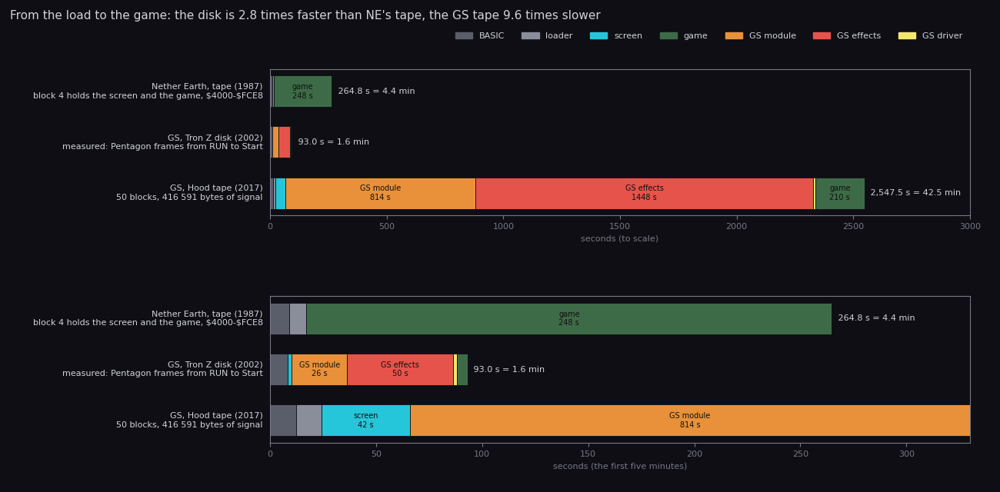

How to read it:

- **Rows**: three editions. Each bar runs from the load's start to the game's `Start`, split by what is loading. The
  colours are in the legend.
- **Top**: the three bars to scale. **Bottom**: the first five and a half minutes, so that the short bars can be read.
- **The numbers**:
  - **NE's tape** is the signal time of its 5 blocks, from their bit counts, pauses not counted
    (NE [3.1](../../nether-earth/docs/03-build-and-load.md#31-the-tape)). The screen loads inside block 4.
  - **The disk** is measured: Pentagon frames of `load` from RUN (frame 326) to `Start` (frame 4 868), split at the
    loader's stages ([3.3](03-build-and-load.md#33-the-disk-load-step-by-step)).
  - **The GS tape** is the signal time of its 50 blocks, grouped by what each loads
    ([3.7](03-build-and-load.md#37-the-tape-hood-2017)).
- **The claim**: the disk is in play in 93.0 s, NE's tape in 264.7 s, and the GS tape in 2 547.5 s, 42.5 minutes.
  The GS spends 87 % of its load on sound: the module and the effects.
- Drawn by `python3 tools/fig_diff_load.py --out docs/img/diff/load-time.png`.

| | NE | GS disk | GS tape |
| --- | --- | --- | --- |
| medium | tape, 5 blocks | SCL (25 files) or TRD (the same 25 + 3) | tape, 50 blocks (25 header + data pairs) |
| boot | BASIC, `LOAD "" CODE 64730` (N1) | BASIC `neart GS`: `CLEAR 24999`, the loader `neart022` | BASIC `NetherE GS`: "1-music ON / 2-music OFF", then every file by `LOAD "" CODE` and a `USR` into `neart0222` |
| loader | N1, 180 bytes at `$FCDA`, LD-BYTES in RAM | `neart022`, 865 bytes at `$61A8`, TR-DOS reads | `neart0222`, the disk loader with 91 bytes changed; the ROM loads each file |
| screen | none | `neart000`, 6 912 bytes, "TRON 2002", the GS-512 label | the same file |
| sound | none | `neart002`-`006` (module), `neart007`-`020` and `neart023` (effects): to the card through `$8000` | the same files, the same way |
| driver | none | `neart021`, 248 bytes, bank 1 | `neart021`, 271 bytes (Hood's), bank 6 |
| the game | 48 361 bytes, `$4000-$FCE8`, screen included | `neart001`, 39 536 bytes, `$6590-$FFFF` | the same file but for 4 bytes (13.4) |
| to play | 264.7 s of signal (about 268 s at ROM speed) | 4 542 frames: 93.0 s | 2 547.5 s of signal |

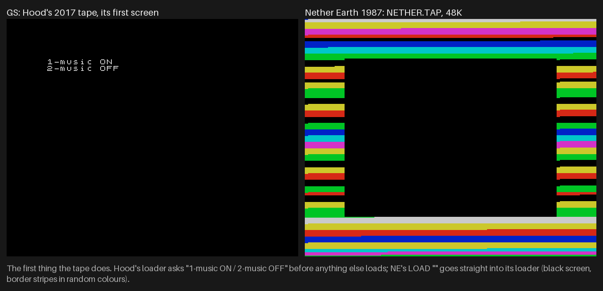

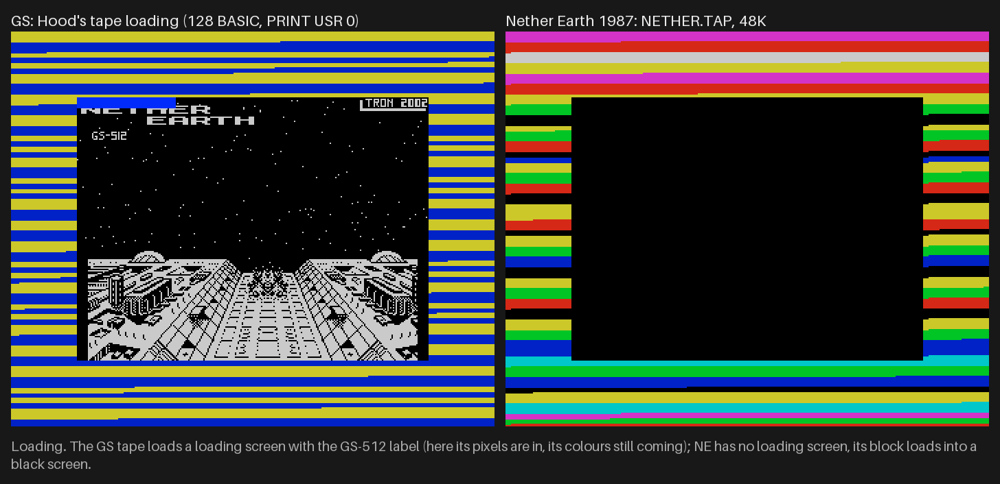

How to read the two figures: left the GS tape, right NE's tape, real emulator frames at 2x, from
`tools/fig_capture.py` (`shots`). The captions under them say what each shows. `python3 tools/fig_compare.py`.

- **What.** NE loads one headerless 48K block through its own loader. The GS loads 23 files, 21 of which are
  sound:
  - the screen;
  - a 138 070-byte module in five files;
  - 14 effects in 15 files, 229 451 bytes sent;
  - the driver;
  - the 39 536-byte game.
- **Why.** The card plays only what the host uploads into its RAM, so every sample has to cross the host's port
  `$B3` at load time. On a disk this costs 76 s of the 93: the module 26.0 s and the effects 50.1 s. On tape the same bytes
  cost 2 263 s of signal.
- **For the player.** The disk edition reaches the menu three times faster than NE ever did. The tape edition takes
  42.5 minutes, nearly ten times NE's tape. Its "2-music OFF" skips the module's `LOAD`s and commands, but the next
  `LOAD "neart007" CODE` still reads past the module's blocks on the tape. The 814 s are saved only if the tape is
  wound on by hand ([texts/tape-basic](texts/tape-basic.md)).
- NE's doc 03 rounds the disk's 4 542 frames to 91 s at 50 frames a second. At the Pentagon's 20.48 ms they are
  93.0 s, the figure used here.

## 13.2 The upload to the card

NE has nothing to upload. The GS's loaders stream each sound file from a 32 KB buffer at `$8000` to the card, with
the ROM commands `#F4` (reset), `#30` (load a module), `#3E` (load an effect), `#D1` / `#D2` (open and close a
stream), then `#31`, `#2B` and `#2A` (play the module, set the volumes).
([3.4](03-build-and-load.md#34-the-loader-neart022), [9.3](09-sound.md#93-the-gs-commands))

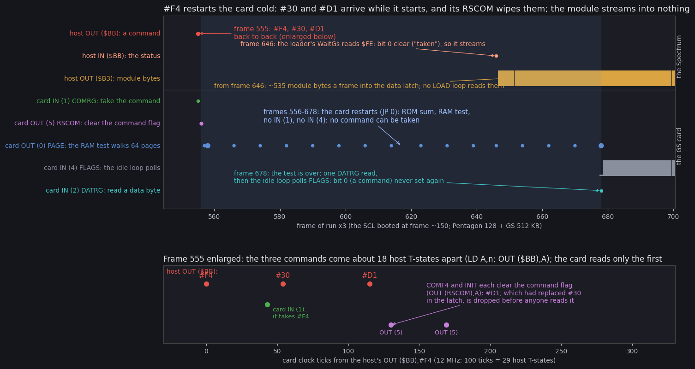

How to read it: the figure of [3.5](03-build-and-load.md#35-the-module-upload-and-the-cold-restart), reused. The top
panel is frames 545-700 of stage 1's `x3`: the host's port accesses above the line, the card's own below. The bottom
panel is frame 555 on the card's 12 MHz clock.

| | Disk loader `neart022` (Tron Z) | Tape loader `neart0222` (Hood) |
| --- | --- | --- |
| `#F4`, `#30`, `#D1` | back to back, 18 T apart: `#F4` restarts the card cold for 123 frames, and `#30` / `#D1` are lost | each waited for (`SendCommand` `$63A3`) |
| the module | 138 070 bytes into nothing; `#D2` arrives as an unknown command | loaded |
| the effects | one wait, then data 0, `#3E`, `#D1`: in 5 of 14 loads `#D1` replaced `#3E` (effects 3, 5, 7, 8, 14 lost) | each command waited for |
| the samples' sign | data 0 for all: every effect stored with its top bit flipped (loud, harsh) | data 1 for 1-13; effect 14 still data 0 (flipped) |
| effect 11 | the first 401 bytes of `neart019` (the blast's start) | `neart017`, by name |
| what the card holds | no module, 9 effects, handles shifted | the module, 14 effects |

- **What.** The upload is new code, not a change of NE's. It is where the disk edition loses its music
  ([9.2](09-sound.md#92-what-the-card-holds)).
- **Why.** Tron Z wrote the commands without waiting for the card, and an emulator or a fast card may have hidden the
  race in 2002. Hood rewrote the command sender in 2017 so that every command waits.
- **For the player.** On the disk there is no music, and the 9 effects the card does hold are the wrong ones under
  shifted handles. On the tape everything is in place except that effect 14 is flipped.

## 13.3 Memory and banks

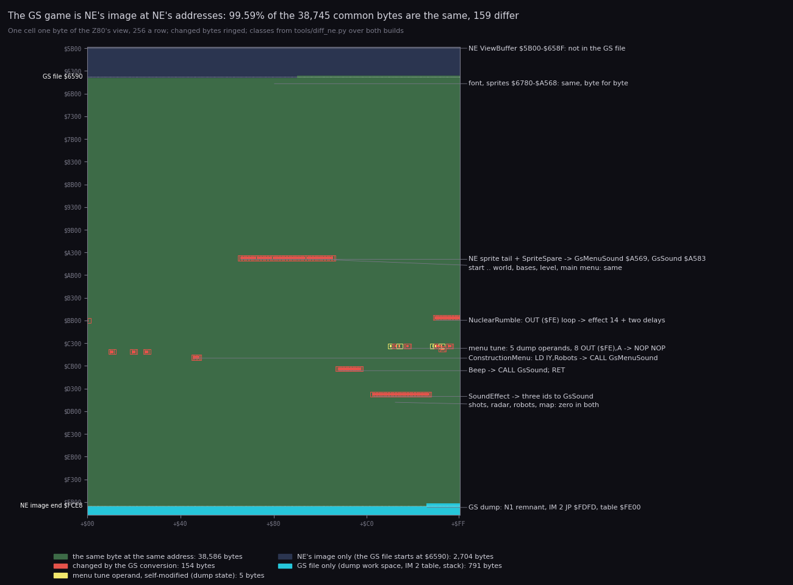

How to read it:

- **One cell, one byte** of the Z80's view, `$5B00-$FFFF`, 256 a row. The classes come from `tools/diff_ne.py` over
  both builds:
  - green: the same byte;
  - red: a byte the conversion changed;
  - yellow: a self-modified operand of the menu tune;
  - dark blue: NE's image only;
  - cyan: the GS file only.
- The changed bytes are ringed so they show at this scale. The white dotted lines mark where the GS file starts
  (`$6590`) and where NE's image ends (`$FCE8`).
- **The claim**: everything between `$6590` and `$FCE8` is NE's bytes but for nine short places, all of them sound
  hooks or tune operands.
- Drawn by `python3 tools/fig_diff_memmap.py` (both figures of this section and 13.4).

| | NE | GS |
| --- | --- | --- |
| machine | 48K | 128K (Pentagon 128 here) |
| the game | `$5B00-$FCE8` from tape; its work space `$FCE9-$FFFF` built at run time | `$6590-$FFFF` from the file, work space included |
| `$5B00-$658F` | the view buffer's head, loaded with the block | not in the file: the GS loader lives at `$61A8-$6508` until `Start`, then the view buffer covers it |
| `$C000-$FFFF` | RAM | bank 0, as NE's RAM; the driver's bank (1 or 6) paged in only inside `GsSound` / `GsMenuSound` |
| ROM | 48K ROM | the 48 BASIC ROM, paged all the time (bit 4 of `$7FFD`) |
| IM 2 | `ImJump` `$FDFD`, table `$FE00-$FF00` | the same addresses, the same bytes |
| stack | `$FFA9-$FFFF` | the same |

**The file is a memory dump of NE in its main menu.** The GS's `game.ann` documents it; this comparison confirms it
byte by byte:

- **The work space.** `$FCE9-$FFFF` (791 bytes) is in the GS file but past NE's image. It holds:
  - NE's tape loader N1 from its 16th byte: 145 of the 165 bytes at `$FCE9-$FD8D` match N1. N1 lies at
    `$FCDA-$FD8D`, and NE's game block loads over its first 15 bytes;
  - the seed `$39,$30,$39,$30` at `$FD00`;
  - `JP MenuInterrupt` (`$C4FD`) at `$FDFD`: the main menu's handler;
  - the stack, whose return address `$C1A1` is `MenuWaitKey`, the menu's key loop.
- **The tune.** Five operands of the menu tune hold mid-tune values: `$C4D0` (0 → `$29`), `$C4D6` (0 → `$0A`),
  `$C4ED` (0 → `$7C`), `$C4EF` (`$18` → 0) and `$C4F3` (0 → `$1F`). NE's tune writes them as it plays
  ([2.9](02-architecture.md#29-self-modifying-code)).
- **The start.** `$6590` is the first address above the GS loader's end (`$6508`). Below it the dump was cut off.

What it means:

- **Why.** The converters ran NE and saved its memory, then patched the sound hooks into that image. This kept every
  address of NE. It also explains why the GS needs no relocation: unlike ANE, the IM 2 table stays at `$FE00` and
  bank 0 is never paged out except inside the bridge.
- **For the player.** Nothing. `Start` rewrites the handler, the stack and the variables. The first
  `ClearViewBuffer` wipes the loader. `NewGameSetup` and `BuildMap` rebuild the world for each game, as in NE.

**Banks.** The only new paging is the bridge: two `OUT ($7FFD)` around each sound
([2.8](02-architecture.md#28-reaching-the-card-paging-and-the-driver)).

- The disk's driver sits in bank 1 (`$11`), the tape's in bank 6 (`$16`). That is two of the four bytes in which the
  tape's game differs from the disk's.
- 128K's other banks are unused: the game is still a 48K program.

## 13.4 The game code: ten runs

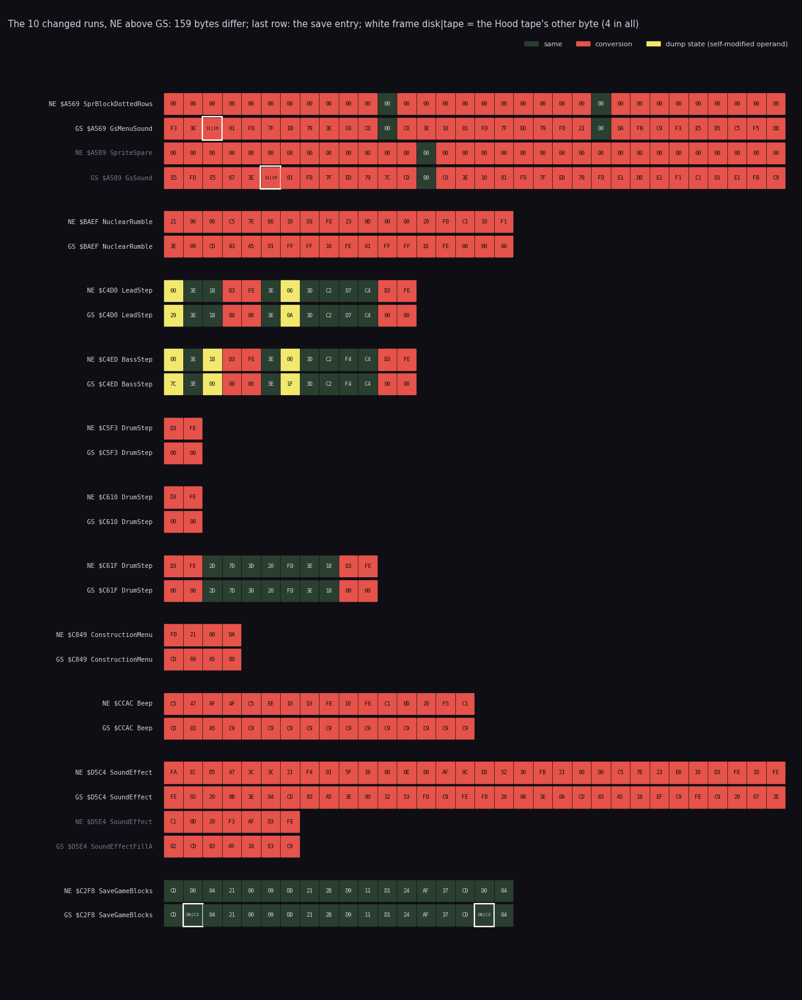

How to read it:

- **Each pair of rows** is one changed run, NE above and GS below, 32 bytes a line. The labels give the address and
  each side's `game.ann` entry at that address.
- **Colours**:
  - dark green: the same byte;
  - red: a byte the conversion changed;
  - yellow: a self-modified tune operand (the dump state of 13.3).
- **The last pair** is not a run. It is `SaveGameBlocks`'s two `CALL $04D0`, the same in NE and on the disk.
- **White frames** with `disk|tape` mark the 4 bytes in which Hood's tape build differs from the disk's.

| Run | Bytes / differ | NE | GS | Module |
| --- | ---: | --- | --- | --- |
| `$A569-$A5A8` | 64 / 61 | `SprBlockDottedRows`' last byte, then `SpriteSpare` (zeros) | `GsMenuSound` `$A569`, `GsSound` `$A583`: the bridge | sprites → gssound |
| `$BAEF-$BB00` | 18 / 18 | `NuclearRumble`: ROM bytes to the beeper | `NuclearRumble`: id 9, two delays | enemy |
| `$C4D0-$C4DC` | 13 / 6 | `LeadStep` | 2 `OUT ($FE),A` → `NOP NOP`; 2 tune operands | music |
| `$C4ED-$C4F9` | 13 / 7 | `BassStep` | 2 `OUT` → `NOP NOP`; 3 tune operands | music |
| `$C5F3`, `$C610`, `$C61F-$C629` | 15 / 8 | `DrumStep` | 4 `OUT` → `NOP NOP` | music |
| `$C849-$C84C` | 4 / 4 | `ConstructionMenu`: `LD IY,Robots` | `CALL GsMenuSound; NOP` | construction |
| `$CCAC-$CCBB` | 16 / 16 | `Beep`: the tone loop | `CALL GsSound; RET`, 13 × `$C9` (`BeepFill`) | construction |
| `$D5C4-$D5EA` | 39 / 39 | `SoundEffect`: pulses and noise | three ids, `SoundFx` cleared (`SoundEffectFillA` one `$C9`) | interrupts |

The 159 differing bytes:

- 5 are dump state, the tune operands of 13.3.
- 154 are the conversion: the bridge 61, the 8 `OUT`s 16, `Beep` 16, `SoundEffect` 39, `NuclearRumble` 18 and
  `ConstructionMenu` 4.

By module (`diff_ne.py --summary`):

- **Unchanged, byte for byte:** start, robotmenu, gameturn, ship, world, bases, level, mainmenu, view, screen,
  controls, print, tables and font, the zero areas worldstate and map, and the 496 bytes of viewbuffer the file
  holds. That is 17 of NE's 22 modules.
- **Changed:**
  - sprites: 61 bytes, the last pixel byte of one sprite and 60 bytes of spare;
  - enemy: 18 (`NuclearRumble`);
  - music: 21, the `NOP`s and the operands;
  - construction: 20 (`Beep` and the menu's first instruction);
  - interrupts: 39 (`SoundEffect`).
- **Entries:** NE has 563 and the GS 572. The extra nine are the two bridge routines, the fill and leftover entries
  that keep the unchanged tails named, and the work space of 13.3.

**What stayed in place around the edits:**

- **`SoundEffectLeftover`** `$D5EB-$D5F7` is still NE's noise loop:
  `LD B,$1E; CALL Random; AND $10; OUT ($FE),A; DJNZ`. Nothing jumps there any more.
- **`Beep`'s tail** `$CCB0-$CCBC` is 13 × `RET`. Every NE byte past the new `RET` was overwritten, so the tail does not
  survive.
- **`NuclearRumble`'s tail** `DEC B` × 3, `INC C` × 3, `RET` is NE's, so `NuclearFlash` passes it the same fading B
  and C as in NE.

### 13.4.1 The tape's 4 bytes

| Address | Disk (= NE where NE has it) | Tape | What |
| --- | --- | --- | --- |
| `$A56B` | `$11` | `$16` | `GsMenuSound`: `LD A,PageRom48` + `DriverBank`, bank 1 → bank 6 |
| `$A58E` | `$11` | `$16` | `GsSound`: the same |
| `$C2F9` | `$04D0` | `$04C2` | `SaveGameBlocks`: the sum block's `CALL SaveBytesEntry` |
| `$C308` | `$04D0` | `$04C2` | `SaveGameBlocks`: the game block's call |

`python3 tools/diff_ne.py --tape` lists them from both builds. 13.8 gives what the save entry changes.

### 13.4.2 The bridge starts one byte inside a sprite

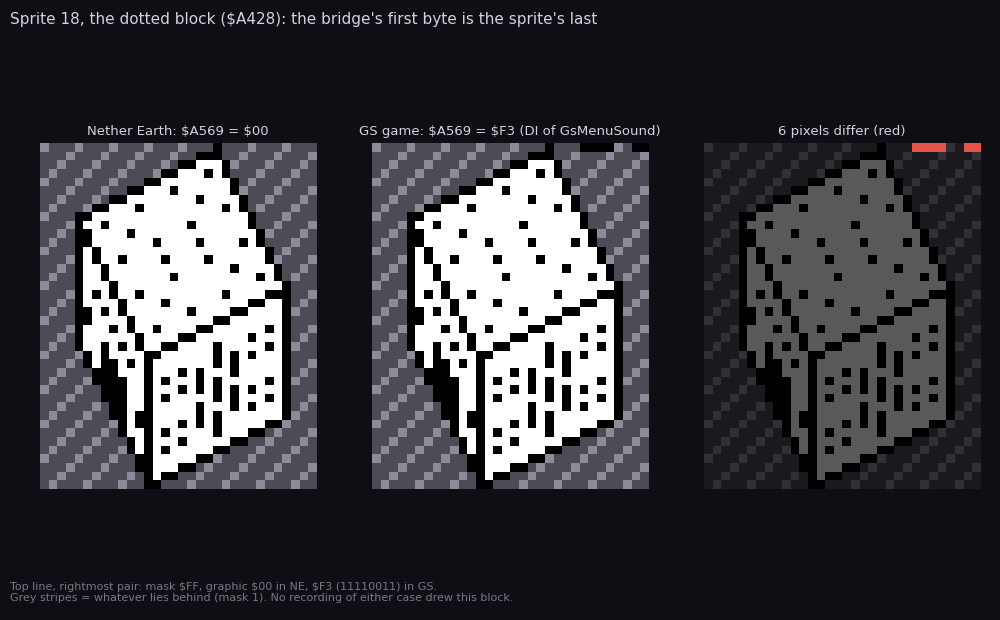

How to read it:

- **Left**: NE's sprite 18, the tall dotted block, as `DrawSprite` would draw it, 40 lines of 4 (mask, graphic)
  pairs, bottom line first. Each pixel is (screen AND mask) OR graphic.
- **Middle**: the same block from the GS image.
- **Right**: the difference in red.
- The grey stripes stand for whatever lies behind the sprite, where the mask is 1.
- Drawn by `python3 tools/fig_diff_sprite.py --out docs/img/diff/sprite-diff.png`.

- **What.** NE's block ends at `$A569` with a graphic byte 0. The GS puts `GsMenuSound`'s `DI` (`$F3`) there. Its
  mask is `$FF`, so `11110011` adds six ink pixels at the top right of every dotted block over whatever is behind.
- **Why.** The converters put the bridge at what NE's `game.ann` calls `SpriteSpare` (`$A56A`) and started it one
  byte early.
- **For the player.** Six stray pixels on a scenery block. No recording of either case drew this block (doc 11).
  A search of `rT`'s view, one frame in every 150 of play (`work/gsB/cache/rT30.npz`, `tools/view_model.py`), found
  no `$A428` drawn either.

## 13.5 Sound, hook by hook

NE's sound is in NE [9.5](../../nether-earth/docs/09-sound.md#95-effects-in-play-soundeffect-d5c4) and
[9.6](../../nether-earth/docs/09-sound.md#96-beep-ccac). The GS's is in [9](09-sound.md). Here the two are side by
side, each hook with its code.

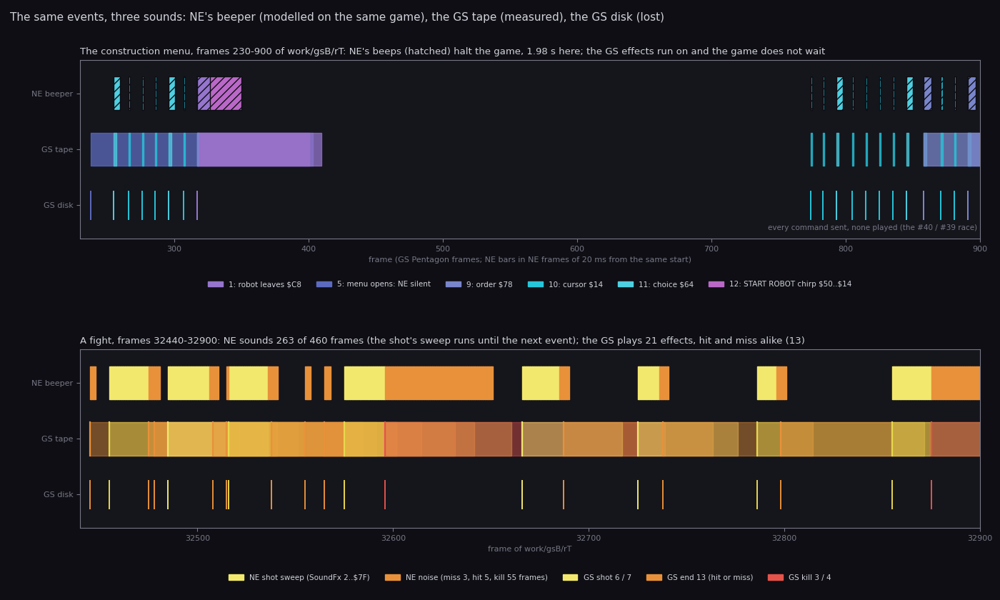

How to read it:

- **Two windows of `rT`.** On top, frames 230-900: two visits to the construction menu and a robot built. Below,
  frames 32 440-32 900: a fight.
- **Three lanes in each**:
  - **NE beeper**: NE's sound for the same events, modelled.
    - In the menu, each GS play's sound id gives NE's `Beep` with that A: 256 × (13A + 50) T, during which the game
      waits. The bars are hatched.
    - In the fight, `SoundFx` `$FD53` is read from every frame's memory and NE's `PlayInterrupt` is replayed on it:
      the game's own writes, then NE's count. The bars are yellow for the shot's pulse sweep and orange for noise.
  - **GS tape**: the plays of `rT` as measured on the card's ports. Each bar lasts as long as the effect sounds in its
    render at note 47. The card starts each effect on a free channel, so they overlap.
  - **GS disk**: the same commands, sent and lost. A tick marks each one, and no sound follows (13.6).
- **The check**: the fight model sends an id exactly where `rT`'s port history has one: 21 sends (shot, end, kill) at
  the same frames. The script stops if they differ.
- **The claim**:
  - NE's menu clicks are short but stop the game: 1.98 s in this window. The GS effects run on while the game goes
    on.
  - In the fight NE sounds 263 of 460 frames, because a shot's sweep runs until the next event replaces it. The GS
    plays 21 effects, one per event.
- Drawn by `python3 tools/fig_diff_sound.py timeline --out docs/img/diff/sound-timeline.png`.

### 13.5.1 `Beep` `$CCAC`: the menus

```text
NE  $CCAC  PUSH BC; LD B,A; XOR A; LD C,A       | GS  $CCAC  CALL GsSound     ; A = the id
    $CCB0  PUSH BC; XOR $10; OUT ($FE),A        |     $CCAF  RET
           DJNZ $; POP BC; DEC C; JR NZ,$CCB0   |     $CCB0  13 x RET          (BeepFill)
           POP BC; RET                          |
```

| A (id) | NE: tone, length (game waits) | GS effect (tape) | Event |
| --- | --- | --- | --- |
| `$14` | 5.6 kHz, 23 ms | 10: a 0.02 s click | a cursor or highlight step, the miles changed |
| `$64` | 1.3 kHz, 98 ms | 11: 0.04 s | a list choice, a part paid for |
| `$78` | 1.1 kHz, 117 ms | 9: 1.09 s | an order, LEAVE ROBOT, a part refused, fire ending direct control |
| `$50`, `$4B` ... `$14` (13 calls) | a falling chirp, 0.66 s | 12 (1.71 s) for `$50`, 10 for `$14`; the 11 between are silent | START ROBOT |
| `$C8` | 194 ms | 1: 1.89 s | the robot leaves the factory |
| `$FA` | 241 ms | none: not in the id list | COMBAT MODE refused, the game's end, LOADING ERROR! |

- **What.** `Beep` keeps A, its single argument, and passes it on as an id. The tone loop is gone.
- **Why.** No change was needed at any of its 16 call sites. The driver maps ids to effects.
- **For the player.**
  - On the tape, sampled sounds replace the clicks, and the menus no longer stop while a sound plays.
    `MoveMenuCursor` still waits 10 frames after each step (`MenuPause` `$CB4A`).
  - The chirp of START ROBOT becomes two effects at once.
  - The game's end, the refused COMBAT MODE and the load error lose their sound.
  - `$78`'s 1.09 s effect is longer than any NE click.
  - On the disk, every menu is silent.

### 13.5.2 `SoundEffect` `$D5C4`: the shots

```text
NE  $D5C4  JP M,NoiseSound          ; $FA-$FF, $C8-$FF: noise      | GS  $D5C4  CP $02 / JR NZ        ; one frame after a shot
    $D5C7  pulses: C = 500/(A+2)+1, | GS             LD A,$04 / CALL GsSound
           13A+63 T apart, bit 4    |                LD A,0 / LD (SoundFx),A / RET
           of ROM bytes             |     $D5D3  CP $FD / JR NZ        ; one frame after a miss, three after a hit
    $D5EC  NoiseLoop: 30 levels of  |                LD A,$0A / CALL GsSound / JR (clear)
           Random to OUT ($FE)      |     $D5DF  CP $C9 / JR NZ        ; one frame after a kill
                                    |                LD A,$02 / CALL GsSound / JR (clear)
                                    |     $D5EA  RET                   ; any other value: counts on
```

`PlayInterrupt` is NE's in both. It adds 1 to a non-zero `SoundFx` each frame and calls `SoundEffect` with the new
value.

| Event (`SoundFx` written) | NE | GS (tape) |
| --- | --- | --- |
| a shot (1) | a noisy downward sweep, 39 kHz → 2 kHz, until `$80` (126 frames) or the next event | effect 6 or 7 by R (1.05 or 1.75 s), sent one frame later |
| a miss (`$FC`) | noise, 3 frames | effect 13 (1.57 s), one frame later |
| a hit (`$FA`) | noise, 5 frames | effect 13, three frames later (at `$FD`) |
| a kill (`$C8`) | noise, 55 frames | effect 3 or 4 by R (2.93 or 2.45 s), one frame later |
| fired and ended in one turn | the 1 is overwritten before the interrupt: only the end sounds | the same |

- **What.** NE drew its sound one frame at a time from inside the interrupt, for as long as `SoundFx` counted. The
  GS sends one id per event and clears `SoundFx`.
- **Why.** A sample plays by itself on the card, so the count is no longer needed.
- **For the player.**
  - **Hits.** NE's hit and miss differ in length (5 against 3 frames). The GS plays effect 13 for both, a hit 40 ms
    later than NE.
  - **Kills.** A kill sounds 2.5-2.9 s instead of 1.1 s.
  - **Shots.** A shot no longer sweeps until the next event. Its sample plays out on its own channel while later
    effects start on others.
  - **Calls.** `SoundEffect` ran 1 356 times in NE's `deep` and 652 times in `rT`, a longer game. The clearing cuts
    the calls.

### 13.5.3 `NuclearRumble` `$BAEE`: the blast

```text
NE  $BAEF  LD HL,$0090              | GS  $BAEF  LD A,$09
    $BAF2  PUSH BC; LD A,(HL)       |     $BAF1  CALL GsSound       ; effect 14
           AND $10; OUT ($FE),A     |     $BAF4  LD BC,$FFFF
           INC HL; DEC C; NOP; NOP  |     $BAF7  DJNZ $             ; 255 x 13 T
           JR NZ,(delay)            |     $BAF9  LD BC,$FFFF
           POP BC; DJNZ (sample)    |     $BAFC  DJNZ $
                                    |     $BAFE  NOP; NOP; NOP
    $BB01  POP BC; DEC B x3; INC C x3; RET   (both)
```

- **What.** `NuclearFlash` calls `NuclearRumble` 61 times with B falling from 244 and C rising from 1
  (NE [10.9](../../nether-earth/docs/10-gameplay-logic.md#109-the-nuclear-blast)).
  - In NE each call plays B samples of ROM bytes with a delay of C. By the code that is about 11.5 million T over the
    61 calls, some 165 frames. NE's recorded flash took 216 frames, 4.3 s.
  - In the GS each call sends id 9, effect 14, then spins two `DJNZ` loops of about 6.6 k T. By the code the 61 calls
    take about 0.44 million T on the disk (6 frames) and about 1 million T on the tape (14 frames, with `GsSound`'s
    mean of 9 801 T a call).
  - The rest of the flash, the paper colours, is NE's code. NE's 216 frames less its 165 of rumble leave about 51,
    so the GS's flash should last some 57-65 frames, 1.2-1.3 s.
- **Why.** One sample replaces the rumble. The two delays are what is left of the rumble's time between two colour
  changes.
- **For the player.** On the tape the flash of random paper colours lasts about a quarter of NE's 4.3 s. The card
  gets 61 starts of the 6.35 s blast sample, which plays flipped, harsh and loud (13.2).
- No recording of this case reached a blast. The flash's length here is from the code, not measured.

### 13.5.4 `ConstructionMenu` `$C849` and the menu tune

```text
NE  $C849  LD IY,Robots             | GS  $C849  CALL GsMenuSound   ; DI, bank, id 3, bank 0,
                                    |                               ; LD IY,Robots, EI, RET
                                    |     $C84C  NOP
```

- **The menu opening.** In NE the construction menu opens in silence. In the GS it sends id 3, effect 5, a 3.4 s
  sound, 13 times in `rT`. `GsMenuSound` runs the displaced `LD IY,Robots` itself.
- **The menu tune.** NE's `MenuMusic` plays a two-voice beeper tune and a drum from `MenuInterrupt`
  (NE [9.1](../../nether-earth/docs/09-sound.md#91-the-menu-tune-at-a-glance)). In the GS all 8 of its
  `OUT ($FE),A` are `NOP NOP`. The tune player still runs every frame of the main menu and costs the same, in silence.
- **The module.** On the tape the card plays "_desert dream vol.2" from the end of the load for the whole game: the
  menu, play and the construction screen. NE had music only in the main menu, and none in play.
- **For the player.** On the tape there is music all the time, where NE had a menu tune and silence in play. On the
  disk there is silence all the time.

## 13.6 The drivers

NE has no driver. The GS has two, with the same id list byte for byte at `$C000-$C0E6`, and different play routines
([9.4](09-sound.md#94-the-drivers)).

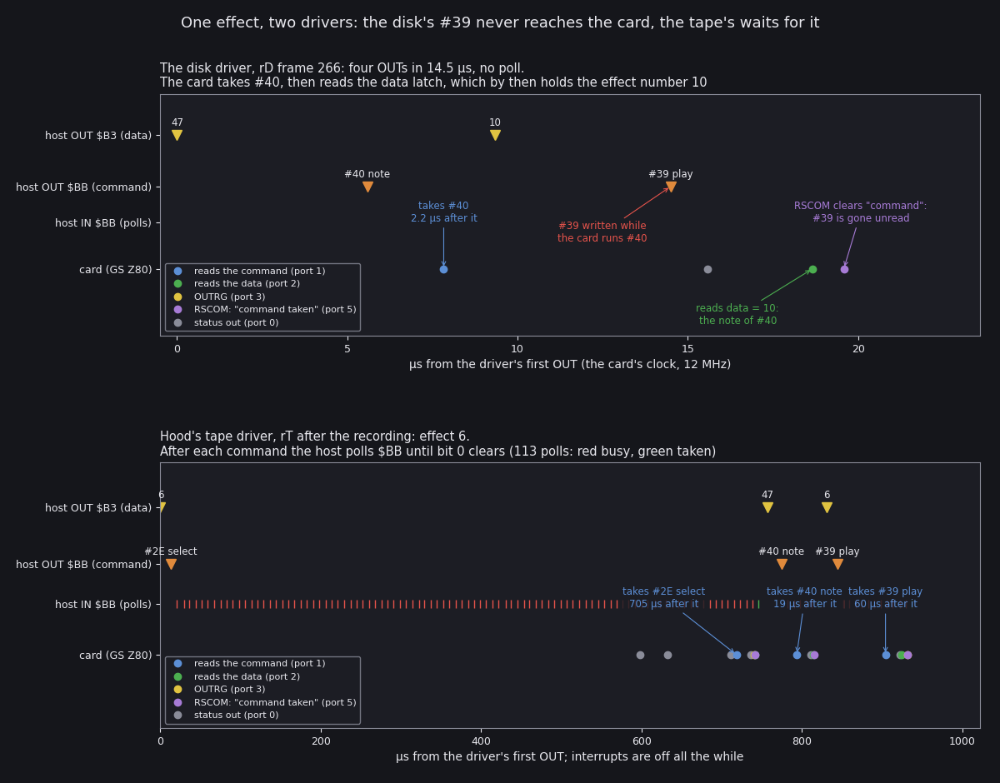

How to read it: the figure of [9.4](09-sound.md#94-the-drivers), reused.

- Time runs right in µs on the card's clock.
- The lanes are the host's OUTs to `$B3` and `$BB`, its status reads, and the card's own port accesses.
- Top: the disk driver (`rD` frame 266). Bottom: the tape driver.

| | Disk `neart021` (Tron Z, 248 bytes, bank 1) | Tape (Hood, 271 bytes, bank 6) |
| --- | --- | --- |
| commands per play | `#40` (note 47), `#39` (play), back to back | `#2E` (select), `#40`, `#39`, each waited for |
| the note | lands on `CURFX`, the effect played last | lands on the effect about to play |
| what the card does | `COM40` is still running when `#39` arrives, and its `RSCOM` clears `#39`: no effect plays | plays every effect sent |
| plays in a recording | `rD`: 48 sent, 0 played | `rT`: 887 played |
| host wait | 4 OUTs, 14.5 µs | median 9 156 T a play, with interrupts off |

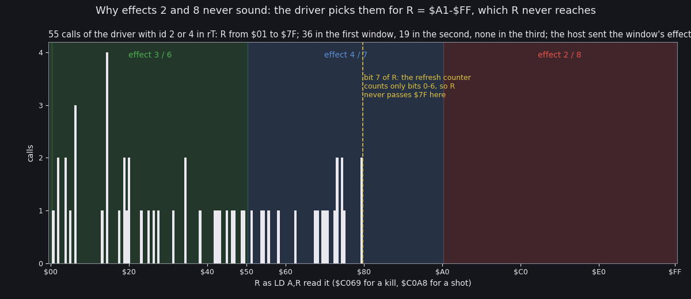

How to read it: the figure of [9.6](09-sound.md#96-r-and-effects-2-and-8), reused.

- Across: the value of R that `LD A,R` read. The shaded windows are the effects each value chooses.
- The bars count the reads at each value. The dashed line is `$7F`.

- **What.** For a kill and a shot, both drivers pick one of three effects by R. The third window needs R bit 7,
  which nothing sets, so effects 2 and 8 never play. Effect 1 sits under two ids, 1 and `$C8`, and nothing sends
  id 1. `$78` is tested twice: the second entry, which would play effect 1, is dead.
- **Why.** A cheap random choice, written without the knowledge that R counts only 7 bits.
- **For the player.** Of 14 uploaded effects, at most 11 are heard on the tape, and 14 only at a blast. The disk
  plays none.

## 13.7 Cost and timing

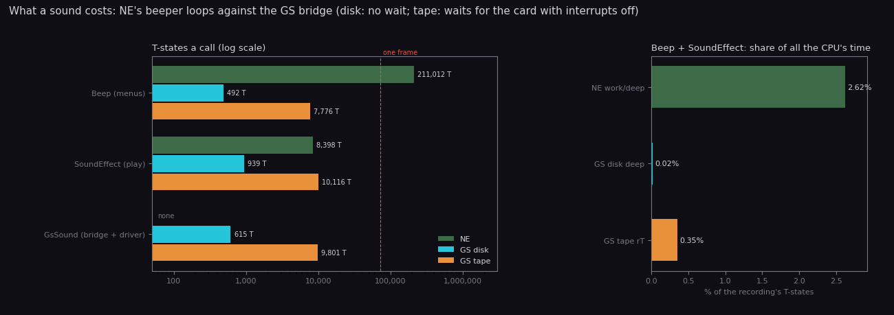

How to read it:

- **Left**: T-states per call of each sound routine, on a log scale, from the L1 of each recording: NE `deep`, GS
  `deep` (disk) and `rT` (tape). The dashed line is one Pentagon frame.
- **Right**: the share of all the recording's T-states that `Beep` and `SoundEffect` took.
- Drawn by `python3 tools/fig_diff_sound.py cost --out docs/img/diff/sound-cost.png`.

| Routine | NE `deep` (36 046 frames) | GS `deep` disk (24 588) | GS `rT` tape (40 134) |
| --- | --- | --- | --- |
| `Beep` | 259 calls, 211 012 T a call | 259, 492 T | 443, 7 776 T |
| `SoundEffect` | 1 356, 8 398 T | 154, 939 T | 652, 10 116 T |
| `GsSound` (bridge + driver) | | 407, 615 T | 1 017, 9 801 T |
| `GsMenuSound` | | 7, 266 T | 13, 8 805 T |
| `Beep` + `SoundEffect`, share of the CPU | 2.62 % | 0.02 % | 0.35 % |
| `ConstructionMenu`, a visit (the bot's keys) | 13.46 M T (192.6 NE frames) | 9.0 M T (125.5 frames) | 7.57 M T (105.6 frames) |
| `DrawView`, a view | 578 127 T (8.27 NE frames) | 546 165 T (7.62 frames) | 563 786 T (7.87 frames) |
| `GameTurn` (mostly `TurnPace`'s wait) | 77 123 T | 130 267 T | 94 431 T |
| frames a turn, on average | 10.6 | 10.4 | |

`python3 tools/l1_table.py --l1 ../nether-earth/work/deep/l1.json --sym work/diff/ne-game.sym --names
Beep,SoundEffect,DrawView,GameTurn,ConstructionMenu` gives NE's numbers; `--l1 work/gsA/deep/l1.json` and
`--l1 work/gsB/rT/l1.json` give the GS's.

- **The menus.** NE's `Beep` costs 211 012 T a call, 3 frames, and the game stands still while it plays: 54.65
  million T over `deep`, about 15.6 s. In the GS a click costs 492 T on the disk or 7 776 T on the tape. That is why
  a construction visit takes fewer frames in the GS (the bot's key timing also differs).
- **Play.** NE's `SoundEffect` spends up to 3.2 ms of the frame inside the interrupt for as long as the effect counts.
  The GS's sends once, but on the tape the send waits for the card with interrupts off:
  - the median play costs 9 156 T, 13 % of a frame;
  - 22 plays waited more than half a frame;
  - 2 waited more than a whole frame (93 889 and 80 308 T) and lost a frame interrupt, so `TurnFrames` missed a
    count ([9.8](09-sound.md#98-a-whole-game-on-the-tape)). `rT`'s L1 counts 40 121 interrupts in 40 134 frames.

  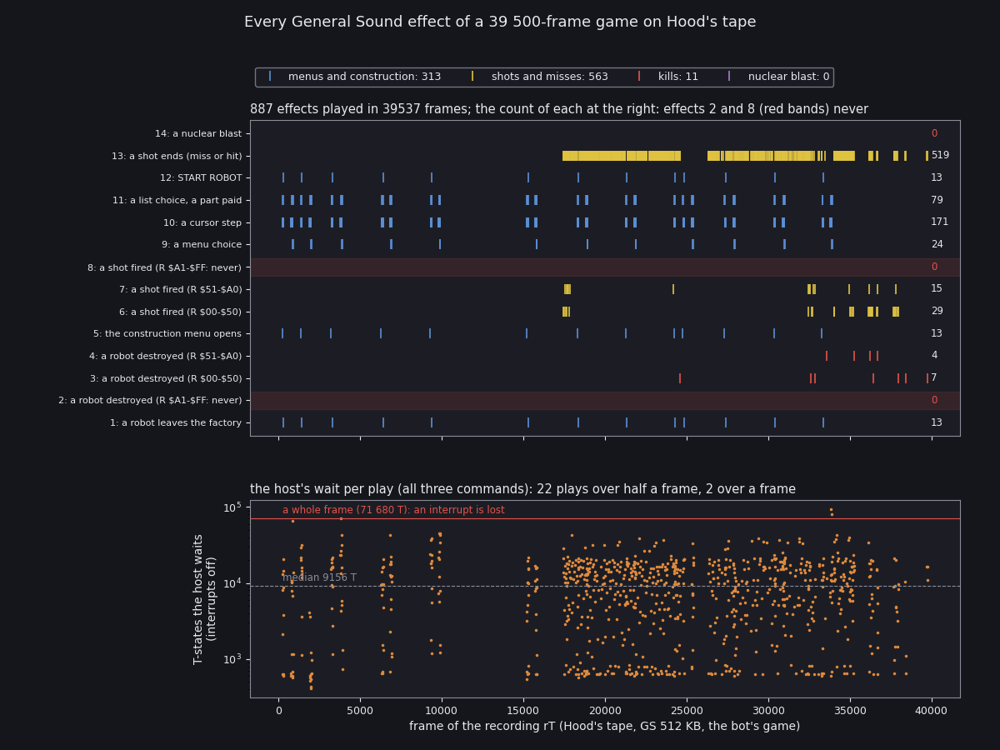

  How to read it: the figure of [9.8](09-sound.md#98-a-whole-game-on-the-tape), reused. The top row has one tick per
  play, one row per effect, across `rT`. The bottom row is the host's wait per play on a log scale, with one frame as
  the red line.
- **The interrupt.** `GsSound` ends with `EI`, also when `SoundEffect` called it from `PlayInterrupt`. The rest of
  the handler then runs with interrupts on. NE's interrupt never enables them early. The next interrupt is a frame
  away, so nothing nests in the recordings.
- **Rendering.** The view's code is NE's byte for byte: the same buffer, the same sprites, the same copy.
  - It costs fewer T-states on the Pentagon, which has no contended memory: 546 165 against 578 127.
  - Its frame is 2.6 % longer: 7.62 frames against 8.27.
  - Both fit in the 10-frame turn, so the turn is 10 frames in both. A turn lasts 204.8 ms in the GS against 199.7
    ms in NE, and a game day 59.0 s against 57.5 s.
  - The copy is not synchronised with the beam in either. On the Pentagon the paper starts 17 988 T after the
    interrupt against NE's 14 340, so the frames where a copy tears differ
    ([6.9](06-rendering.md#69-the-copy-and-the-beam), NE [4.5](../../nether-earth/docs/04-game-loop.md#45-time)).
- **For the player.** The menus react without the beeper's pauses. Play runs 2.6 % slower, as every Pentagon
  conversion of a 48K game does. On the tape, a long wait for the card sometimes costs the clock one tick.

## 13.8 Saving and loading

Both editions save to tape, the disk one too, through NE's code: key 5 in play, option 5 in the menu
([3.9](03-build-and-load.md#39-the-saved-game), NE [3.6](../../nether-earth/docs/03-build-and-load.md#36-the-saved-game)).

| | NE | GS disk | GS tape (Hood) |
| --- | --- | --- | --- |
| `SaveGameBlocks` calls | `$04D0` × 2: past the ROM's pilot choice, HL = `$0900` (the game's short pilot) | the same bytes | `$04C2` × 2: the start of `SA-BYTES` |
| pilot | `$0900` pulses (1.43 s) | the same | the ROM's for flag `$00`, a header's `$1F80` (5.0 s) |
| exit | straight back | the same | through `SA/LD-RET`: the border from `BORDCR`, `EI`, a BREAK test |
| load | `LD-BYTES` at `$0562`, then the sum | the same bytes | the same bytes |
| what is saved | `$D92B-$FDFB` + the 2-byte sum | the same | the same |

- **What.** Hood moved the two calls to the ROM's own entry. The block layout, the sum and the loader are NE's.
- **Why.** It is not documented. The `$04D0` entry expects HL set by the caller, and Hood may have wanted the ROM's
  standard exit.
- **For the player.** A save from any of the three loads in the other two, because `LD-BYTES` does not care how long
  the pilot is. A tape save takes 3.6 s more of pilot per block.
- No recording of this case saved or loaded. All of this is from the code.

## 13.9 Bugs: added and kept

**Kept.** The game's code is NE's bytes, so NE's bugs (NE
[10.12](../../nether-earth/docs/10-gameplay-logic.md#1012-bugs)) are all still there
([10.12](10-gameplay-logic.md#1012-bugs)):

- The construction menu writes over enemy slot 24 when our 24 slots are full.
- `SteerByOrder`'s first aim after a new target reads `$FDFE` / `$FDFD`. Unlike ANE, the GS keeps NE's IM 2 jump at
  `$FDFD`, so the wrong aim reads the same `JP` and handler bytes as in NE, with the same effect: a robot that stands,
  or a nuclear robot that blows up where it is.
- `PrintTensUnits`, the refused chassis swap, `PrintDigitColumn` and the capture of a nuked base are unchanged.
- `MenuMusic`'s restart bug, which keeps a voice's on/off state from where it was cut, is still in the code, but its
  `OUT`s are `NOP`s: nothing can hear it.
- `UnusedTapeCode` `$AE29` is the same 15 bytes.

**Added by the conversion:**

| Bug | Edition | Where | Effect for the player | |
| --- | --- | --- | --- | --- |
| `#F4`, `#30`, `#D1` written back to back | disk | `GsStartModule` `$61BE` | no music | [3.5](03-build-and-load.md#35-the-module-upload-and-the-cold-restart) |
| `#D1` replaces `#3E` in 5 effect loads | disk | `LoadEffect` `$6317` | effects 3, 5, 7, 8, 14 missing, the rest under shifted handles | [9.2](09-sound.md#92-what-the-card-holds) |
| effects loaded signed | disk (all), tape (14) | `LoadEffect`, `LoadEffectOpen` `$6352` | the samples play flipped: loud, harsh | [9.2](09-sound.md#92-what-the-card-holds) |
| effect 11 from `neart019` | disk | the loader's name table | effect 11 is the blast's first 401 bytes | [9.2](09-sound.md#92-what-the-card-holds) |
| `#40` / `#39` race; no `#2E` | disk | `PlayEffect` `$C0E7` | no effect ever plays: silent in play and the menus | [9.5](09-sound.md#95-the-disk-version-plays-no-effect) |
| R bit 7 never set | both | `RandomFxKill` `$C069`, `RandomFxShot` `$C0A8` | effects 2 and 8 never play | [9.6](09-sound.md#96-r-and-effects-2-and-8) |
| `$78` tested twice | both | `$C04D` | dead entry | [9.4](09-sound.md#94-the-drivers) |
| the driver lands in bank 0 | tape on a 128K, unless `USR 0` first | the BASIC's `USR` paging | the first sound in play hangs the machine | [9.10](09-sound.md#910-hoods-tape-the-paging-trap), [1.10](01-game-design.md#110-the-hang-of-hoods-tape-on-a-128k) |
| waits over a frame with `DI` | tape | `SendGsCommand` `$C0F8` | a lost frame interrupt: the clock misses a count | [9.8](09-sound.md#98-a-whole-game-on-the-tape) |
| `EI` inside the interrupt | both | `GsSound` `$A5A7` | the rest of `PlayInterrupt` runs with interrupts on; harmless in practice | [2.8](02-architecture.md#28-reaching-the-card-paging-and-the-driver) |
| `GsMenuSound` starts at the sprite's last byte | both | `$A569` | six stray pixels on every dotted block | [13.4.2](#1342-the-bridge-starts-one-byte-inside-a-sprite) |
| ids `$FA` and `$4B`-`$19` unmapped | both | the id list | the game's end, COMBAT MODE refused and LOADING ERROR! are silent; START ROBOT's chirp is two sounds | [9.7](09-sound.md#97-every-call-of-the-sound) |

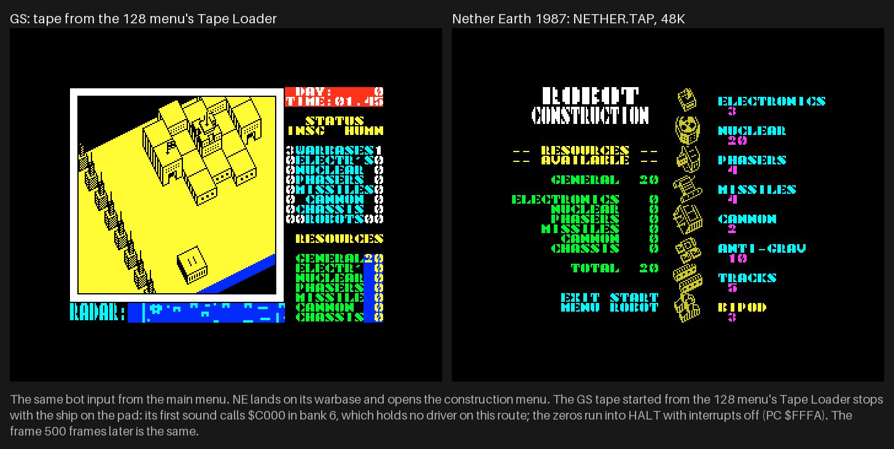

How to read it: left the GS tape from the 128 menu's Tape Loader, frozen on the pad at the first sound; right NE
given the same bot input, on the construction menu ([1.10](01-game-design.md#110-the-hang-of-hoods-tape-on-a-128k)).
The two screens differ in 34 961 pixels. `python3 tools/fig_compare.py`.

## 13.10 What the player sees: unchanged

Because 17 of NE's 22 modules are byte for byte NE's and the rest differ only in sound, every screen of play is NE's. The emulator frames of both games at
the same moments differ in 0 pixels:

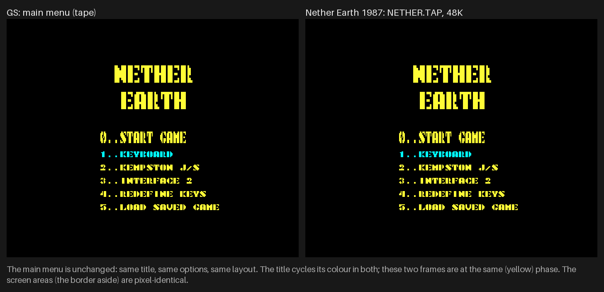

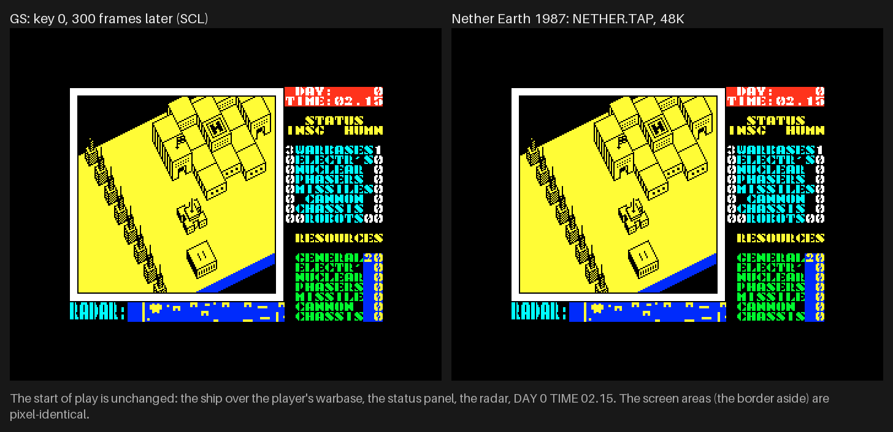

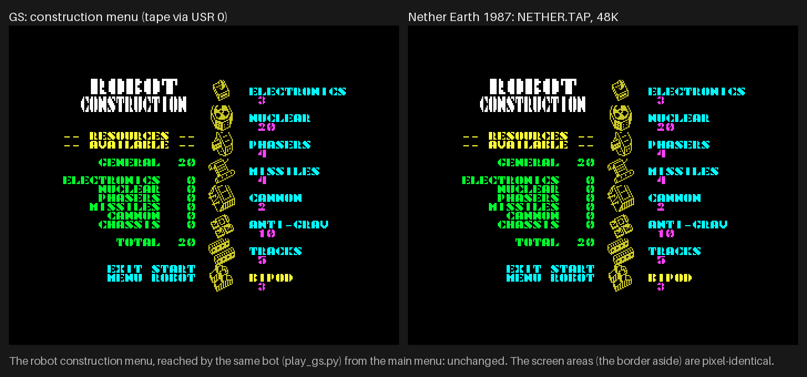

How to read them: left the GS, right NE, real emulator frames at 2x (`shots`, `tools/fig_capture.py`). The captions
were measured pixel by pixel: 0 differing pixels in the menu, the start of play and the construction menu, against
13 524 while loading and 228 at the first screen of the tapes. `python3 tools/fig_compare.py`.

- **The same.** The title and its colour cycling, the options, the redefine screen, the view, the radar, the status
  panel, the font, all 89 sprite blocks but the six pixels of 13.4.2, the levels and the map built from them, the
  rules, the AI, the controls (keyboard, Kempston, Interface 2) and the pace of 10 frames a turn.
- **Not the same.** The loading screen, the hang of 13.9, and what the player hears.

## 13.11 Method and tools

### 13.11.1 The game code: `diff_ne.py`

`tools/diff_ne.py` loads both builds:

- GS: `build/game/neart001-scl.bin` at `$6590`, `build/game/game-scl.lst` and `src/game/game.ann`. With `--tape` it
  also loads `neart001-tap.bin` and `game-tap.lst`;
- NE: `games/nether-earth/build/game.bin` at `$5B00`, `build/game.lst` and `src/game/game.ann`.

Both images place the game at the same addresses, so the comparison is address by address:

- Every byte of `$5B00-$FFFF` is same, differ, ne-only or gs-only.
- A run is a stretch of differing bytes with gaps of up to 8 (`--gap`).
- Each run is named from both `game.ann` files. An entry runs to the next. Its module is the listing file its label
  is defined in, since the first listing line at an address may still belong to the file before.
- `--show` prints both listings side by side with their line numbers, and marks the differing lines `*`.

```
python3 tools/diff_ne.py --summary                      # totals, runs, entries, modules
python3 tools/diff_ne.py --runs                         # every run, both listings side by side
python3 tools/diff_ne.py --show Beep SoundEffect NuclearRumble ConstructionMenu GsSound
python3 tools/diff_ne.py --tape                         # the disk's game against the tape's
python3 tools/diff_ne.py --json work/diff/diff.json     # classes, runs and modules for the figures
```

NE has no symbol file. For `tools/l1_table.py --sym` on NE's L1, `python3 tools/diff_ne.py --ne-sym
work/diff/ne-game.sym` writes NE's 945 labels from its listing.

### 13.11.2 The sound model

`tools/fig_diff_sound.py timeline` models NE on the GS's events:

- **The menus.** Each GS play in the window comes from a `Beep` id, and NE's `Beep` with the same A lasts
  256 × (13A + 50) T at 3.5 MHz (NE [9.6](../../nether-earth/docs/09-sound.md#96-beep-ccac)). START ROBOT's play of
  effect 12 stands for all 13 calls of the chirp.
- **The fight.** `SoundFx` is read from every frame of `work/gsB/cache/rT-fight.npz`.
  - A value that is not what the GS's interrupt left the frame before is a fresh write by the game.
  - NE's count is replayed on the same writes: +1 a frame, positive values ending at `$80`, negative ones wrapping
    past `$FF`, and no clearing. A frame sounds in NE while the count is not zero.
  - The GS's own rule, which sends at 2, `$FD` and `$C9` and then clears, is replayed on the same values. Its sends
    must equal the plays of `rT-plays.json` in the window, or the script stops.
- **The lengths of the GS's effects** are the time above 3 % of the peak in each render `work/gsB/audio/gs-fx47-NN.wav`
  ([9.2](09-sound.md#the-effects-at-their-real-pitch)).

### 13.11.3 The figures

| Figure | Section | Command |
| --- | --- | --- |
| `load-time.png` | 13.1 | `python3 tools/fig_diff_load.py` |
| `memmap-diff.png`, `runs-diff.png` | 13.3, 13.4 | `python3 tools/fig_diff_memmap.py` |
| `sprite-diff.png` | 13.4.2 | `python3 tools/fig_diff_sprite.py` |
| `sound-timeline.png` | 13.5 | `python3 tools/fig_diff_sound.py timeline` |
| `sound-cost.png` | 13.7 | `python3 tools/fig_diff_sound.py cost` |
| `../compare/*.png` | 13.1, 13.9, 13.10 | `python3 tools/fig_compare.py` (frames of `tools/fig_capture.py`) |
| `../load/gs-reset.png`, `../sound/handshake.png`, `../sound/r-register.png`, `../sound/plays.png` | 13.2, 13.6, 13.7 | docs 3 and 9, reused |

All of them read the existing builds, recordings and renders. None starts an emulator.

## 13.12 Notes for the other documents

These came up in the comparison. Docs 01-12 were left as they are; the notes stand here:

- [3.3](03-build-and-load.md#33-the-disk-load-step-by-step) gives 4 542 frames from RUN to `Start` as 91 s, which is
  50 frames a second. At the Pentagon's 20.48 ms a frame they are 93.0 s.
- [2.8](02-architecture.md#28-reaching-the-card-paging-and-the-driver) counts `SoundEffect` 148 times and
  [2.5](02-architecture.md#25-time-frames-and-interrupts) 154. Both are right: 154 runs, of which 148 sent an id to
  `GsSound` (`Beep` 259 + 148 = `GsSound`'s 407 calls).
- The GS's 10.12 does not list `MenuMusic`'s restart bug. It is still in the code but silent (13.9).
