# 1. Game design

This document covers Nether Earth ZS Edition as a player meets it, in both releases:

- the start-up from the disk and the intros;
- the menus and the difficulty and upgrade settings;
- the maps;
- play, and what the enemy does on CRITICAL;
- the author's claims checked against the code (1.11).

The keys are in [05](05-controls.md), what is drawn and how in [06](06-rendering.md), the long texts in
[texts/](texts/README.md). The game's world (robots, factories, warbases, the enemy commander) has its own
documents ([12](12-routine-reference.md) lists every routine).

The recordings (unreal-ng, muted). The screenshots come from `python3 tools/fig_screens.py` and the side-by-side
figures from `python3 tools/fig_compare.py`, each on its own instance. Every caption names the recording and the
frame.

| Recording | Machine | What it holds |
| --- | --- | --- |
| `r98` (`work/stage1/r98`) | Pentagon 128 + TR-DOS | '98: power-on, `RUN "NEZSEd"`, the intro, SPACE, the menu, 0 START, play (frames 103-5903) |
| `x98` (`work/stage2/texts/x98`) | Pentagon 128 + TR-DOS | '98: as `r98`, but the menu's 5 LOAD NEW LEVEL, then 0 START (frames 102-6202; script `work/stage2/texts/inputs/x98.txt`) |
| `r99` (`work/stage1/r99`) | Pentagon 128 + TR-DOS | '99: autostart, the intro, SPACE, "System checking", the start-up menu, every text page, LOAD MAP (`NELEV_00`), HARD, PHASERS, START, play (frames 2-6462) |
| `x99` (`work/stage2/texts/x99`) | Pentagon 128 + TR-DOS | '99: autostart, REDEFINE, LOAD MAP with the highlight moved to `NELEV_06`, START, play, ABORT back to the start-up menu (frames 2-5302; script `work/stage2/texts/inputs/x99.txt`) |
| `r-critical` (`work/stage2/game99/r-critical`) | Pentagon 128 + TR-DOS | '99: CRITICAL, START on the built-in map, then 9 200 frames with the ship parked: three game days (frames 2-12102; script `inputs/critical.txt`) |
| `r99-48` (`work/stage1/r99-48`) | Pentagon, "48 BASIC" (paging locked) | '99 on the 48 K path: "System checking" with 56Kb, then the reset (frames 101-7201) |
| `s99` (`work/stage2/scorpion/s99`) | Scorpion ZS-256 + TR-DOS | '99: "System checking" with 256Kb, the start-up menu, START with no map loaded, play (frames 2-4802) |
| `mouse99` (`work/docs/zsA/mouse99`) | Pentagon 128 + TR-DOS, Kempston mouse fitted | '99 live, from power-on: the mouse moved and clicked in the start-up menu, in LOAD MAP and in play ([05](05-controls.md)) |
| `ne-play` (`games/nether-earth/work/play`) | 48K | the original game, used only in the side-by-side figures |

## 1.1 Two releases

| | '98 (`NEZSED98.SCL`) | '99 (`NEZSED.SCL`) |
| --- | --- | --- |
| on the disk | one file, `NEZSEd.B` | the game `NEZSEd99.B`, four menu texts, a readme, twelve maps `NELEV_00`-`11` |
| before the game | "ZS'98 Presents", an intro with music, a scroller and an animated robot | an intro (photo, logo, scroller, music), then "System checking" |
| menu | six numbered items under the title "ZS EDITION'98"; 5 is LOAD NEW LEVEL! | a start-up menu with a pointer: level, upgrades, control, maps, four texts (128 K) |
| difficulty | one | EASY, MEDIUM, HARD, CRITICAL; on HARD, daily enemy upgrades to the parts the player marks |
| maps | the one in the game | the built-in one (its walls spell `ЗАГРУЗИСЬ`, "load up") and twelve on the disk |
| author's date | 23.12.1998 | 28-30.01.1999 |

## 1.2 Start-up, '98

1. `RUN "NEZSEd"` from TR-DOS (`r98` frame 1903).
2. The REM loader `$5D40` clears the screen to black, makes a bold copy of the ROM font and prints "ZS'98 Presents:
   NETHER EARTH ZS EDITION" with the ROM's PR-STRING (frame 2000).
3. It reads the intro and enters it at frame 2048. The intro fades the title out with a diagonal band from left to
   right (frames 2048-2176).
4. The intro proper:
   - a "ZS" logo whose colour changes every frame;
   - a robot in a frame at the bottom, animated in four frames;
   - a one-line scroller along the middle ([text](texts/scroller98.md));
   - three bars in the bottom-left corner that show the AY's channel volumes;
   - the PT3 tune "COOL WINTER".
5. Any key ends it (`r98` frame 4203). The same band fades the intro out, then the game loads and its menu appears.

| 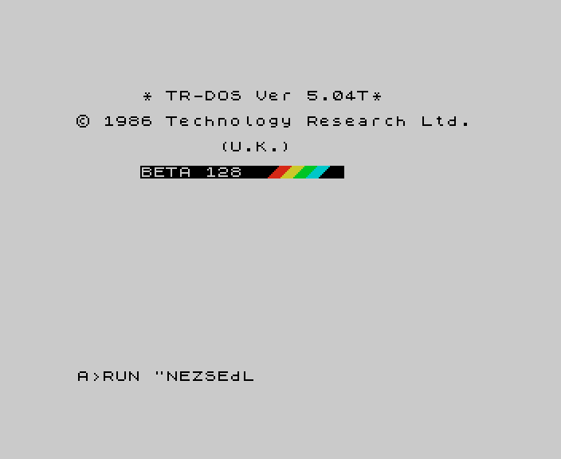 | 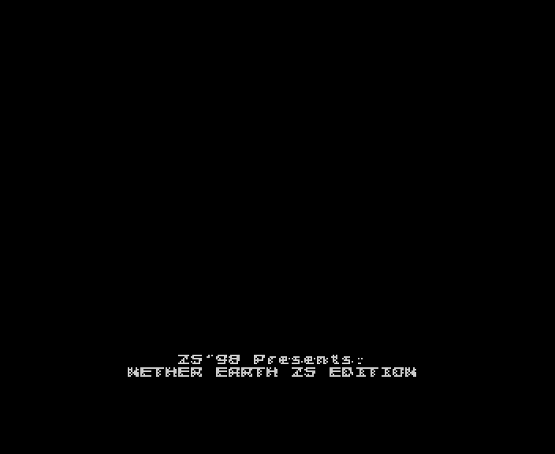 | 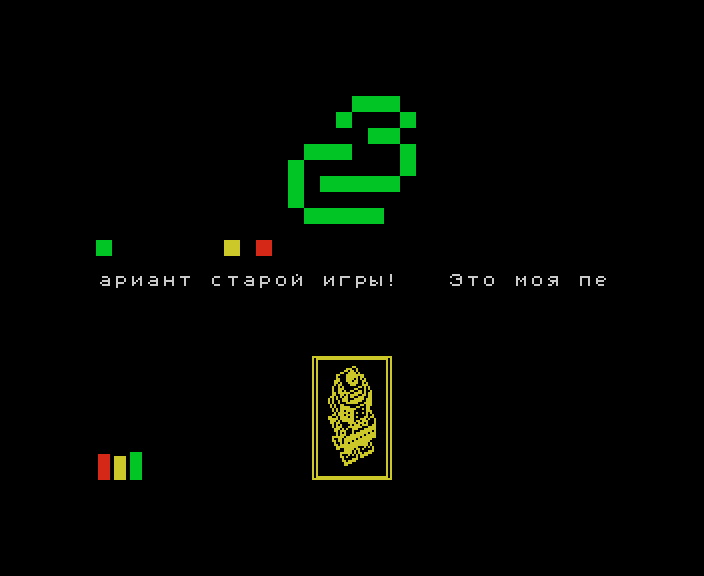 |
| --- | --- | --- |
| `RUN "NEZSEd"` (`r98` 1903) | "ZS'98 Presents" (`r98` 2060) | the intro (`r98` 3000) |

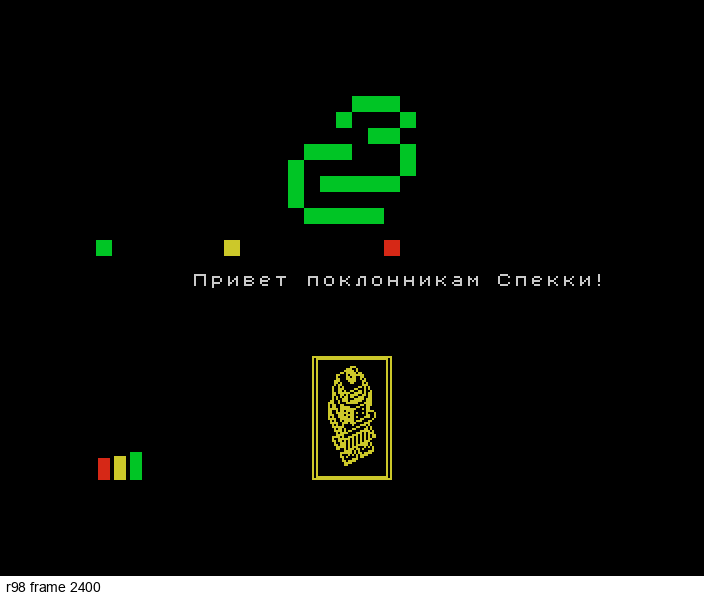

*The '98 intro: `r98` frames 2400-2700, every third frame.*

## 1.3 Start-up, '99

1. The disk autostarts (`r99` frame 102: TR-DOS's title).
2. The old screen dissolves (frames 261-303) and the attributes turn white in a spiral (303-472).
3. The picture rolls down from the top (472-726). Each line of the picture is first stretched over the screen above
   it.
4. Then the picture holds, while the Sound Tracker tune plays:
   - the author's photo on the left;
   - the logo "NETHER EARTH ZS EDITION 1999" in a box on the right, its stripes cycling;
   - a 64-column scroller under the logo;
   - the colour line "You wanted new levels? Take its!" along the bottom.
5. ENTER held stops the scroller ([text](texts/scroller99.md)).
6. SPACE (frame 1310) ends the intro:
   - the picture's left and right halves are pushed apart, a pixel a pass (1312-1953);
   - the attributes wipe to white paper in a spiral (1953-2114);
   - the music stops.

| 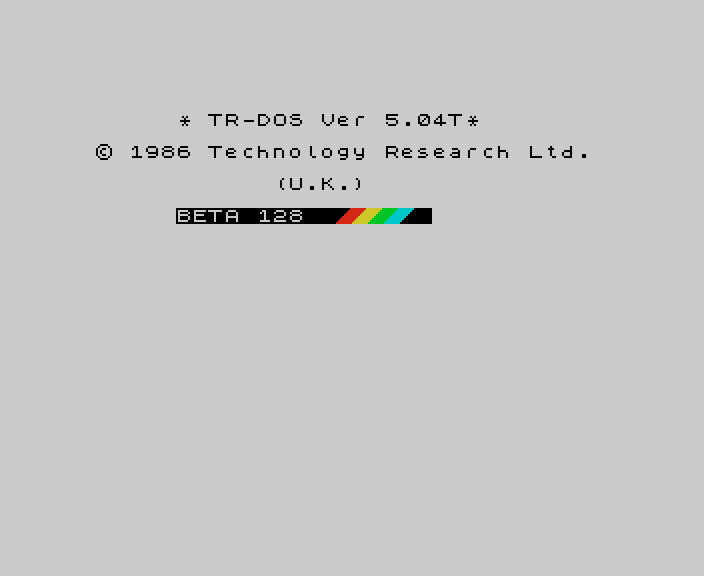 | 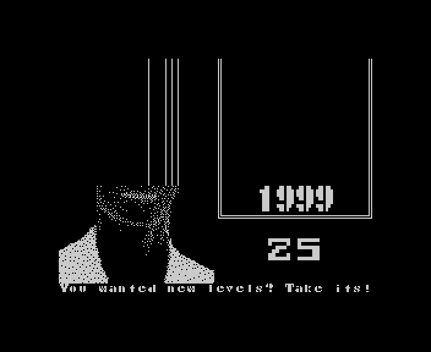 | 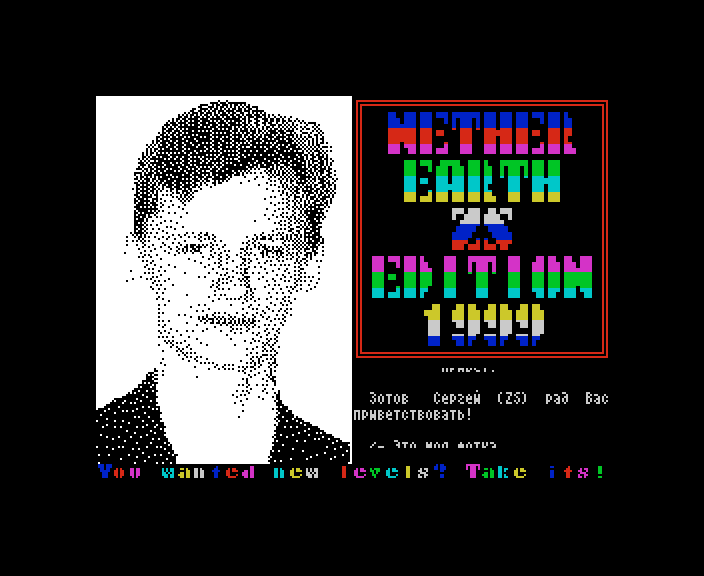 | 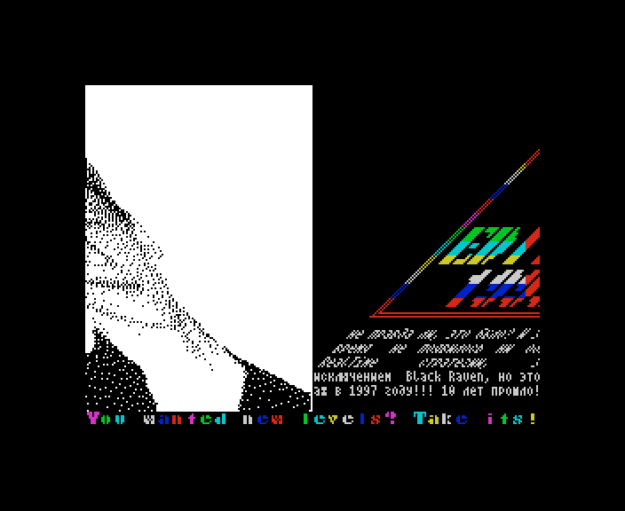 |
| --- | --- | --- | --- |
| TR-DOS (`r99` 102) | the picture rolls in (`r99` 652) | the intro (`r99` 1002) | pushed apart after SPACE (`r99` 1552) |

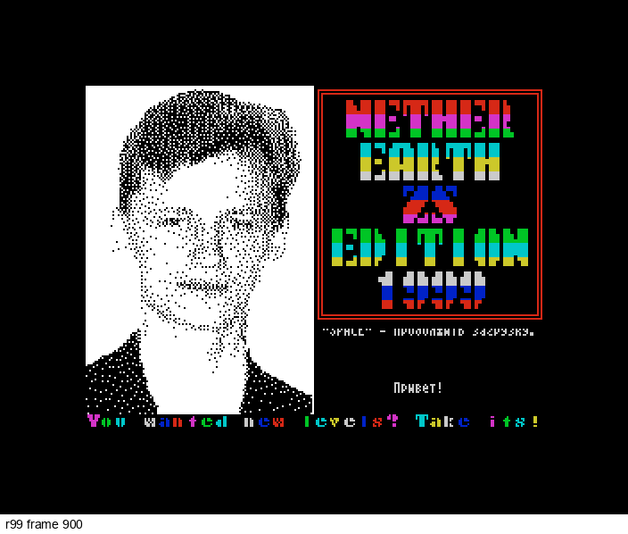

*The '99 intro: `r99` frames 900-1300, every fourth frame.*

Then comes "System checking". The loader names the computer, the memory it found and the TR-DOS version. It then
ticks off what it loads: Game, Drivers, Menus, RAM-Disk. The memory line depends on the machine:

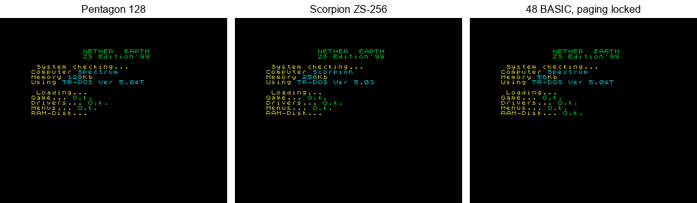

*"System checking": Pentagon 128, "Memory 128Kb" (`r99` 2652); Scorpion ZS-256, "Memory 256Kb", TR-DOS 5.03
(`s99` 2252); Pentagon in 48 BASIC, paging locked, "Memory 56Kb" (`r99-48` 5651).*

| 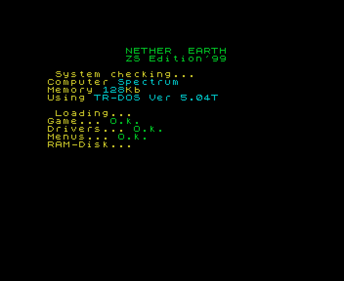 | 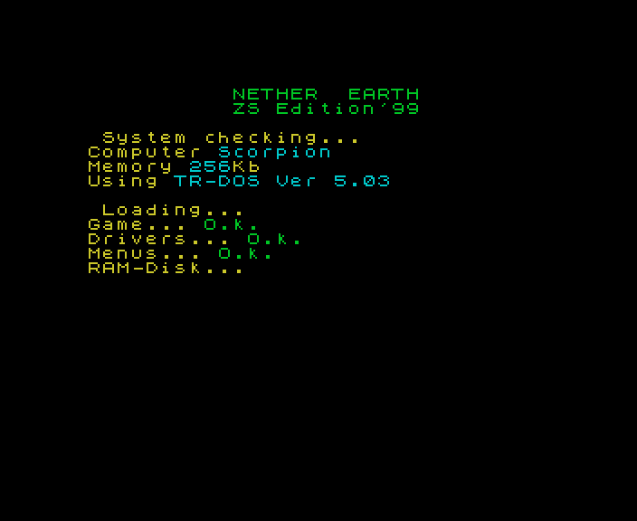 | 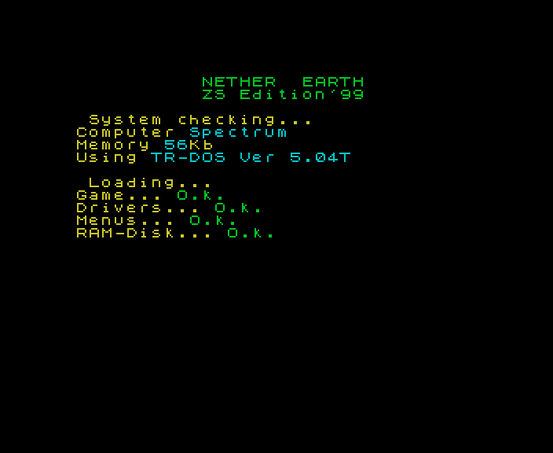 |  |
| --- | --- | --- | --- |
| Pentagon 128 (`r99` 2652) | Scorpion ZS-256 (`s99` 2252) | 48 BASIC (`r99-48` 5651) | 48 BASIC: after the reset (`r99-48` 6501) |

On 128 K the start-up menu follows (frame 2661). On the 48 K path the machine resets at START
([03](03-build-and-load.md)). No recording reaches a game on a 48 K machine.

## 1.4 The '99 start-up menu

One screen with an arrow pointer, moved by Q A O P; SPACE acts on the item under it ([05](05-controls.md)). It has:

- three columns of settings: the chosen setting of each group is white, the others coloured;
- six actions in two rows at the bottom;
- a title whose colours cycle.

The menu is silent: the menu block has no sound code, and the tune of the intro has stopped.

| 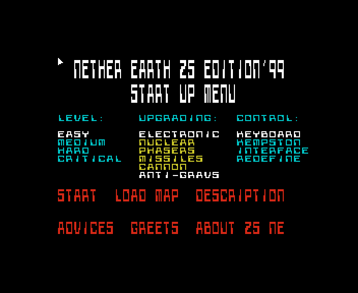 | 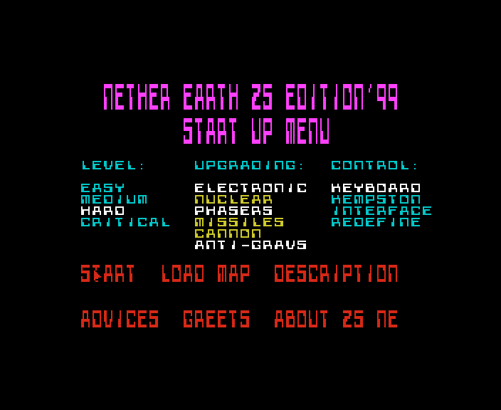 |
| --- | --- |
| as it comes up: EASY, KEYBOARD, upgrades ELECTRONIC and ANTI-GRAVS (`r99` 3002) | after HARD and PHASERS (`r99` 6052) |

| Item | What it does |
| --- | --- |
| LEVEL: EASY, MEDIUM, HARD, CRITICAL | the difficulty (1.6) |
| UPGRADING: ELECTRONIC, NUCLEAR, PHASERS, MISSILES, CANNON, ANTI-GRAVS | toggles: the parts the daily upgrade gives every enemy robot on HARD (1.6) |
| CONTROL: KEYBOARD, KEMPSTON, INTERFACE, REDEFINE | the play device; REDEFINE asks for seven keys ([05](05-controls.md)) |
| START | play on the current map |
| LOAD MAP | the disk's catalogue of `.N` maps; the chosen one replaces the current map (1.7) |
| DESCRIPTION, ADVICES, GREETS, ABOUT ZS NE | the four texts, a page at a time; A pages on |

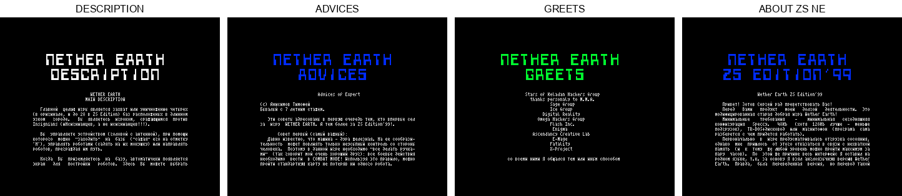

*The text pages: DESCRIPTION (`r99` 4152), ADVICES (4552), GREETS (4852), ABOUT ZS NE (5152). Their texts in full,
with translations: [NEdescri](texts/NEdescri.md), [NEadvice](texts/NEadvice.md), [NEgreets](texts/NEgreets.md),
[NEabout](texts/NEabout.md).*

ABORT in play returns to this menu (`x99` 5302), and so does the end of a game (`GameOverWait` `$AEEA` jumps to
`Start` `$A600`). The menu comes back each time with EASY and the pointer at its start, because it is copied afresh
from page 1 ([02](02-architecture.md)).

## 1.5 The '98 menu

Six numbered items under the title "ZS EDITION'98" in cycling colours, with a beeper tune:

- 0..START GAME;
- 1..KEYBOARD;
- 2..KEMPSTON J/S;
- 3..INTERFACE 2;
- 4..REDEFINE KEYS;
- 5..LOAD NEW LEVEL!

Pressing 5 changes nothing on the screen (`x98` 5000). START after it crashes: the screen fills with garbage and
the machine resets (`x98` 5600). The cause: key 5 copies 500 bytes from `$DD00`, inside the intro's scroller text,
as if they were a map ([03](03-build-and-load.md)).

| 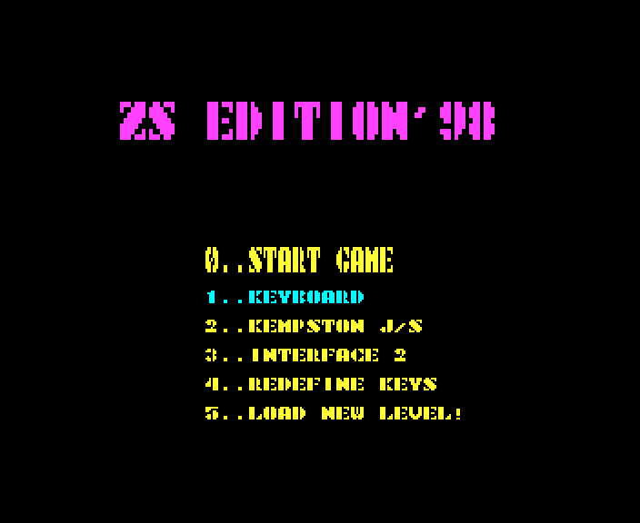 | 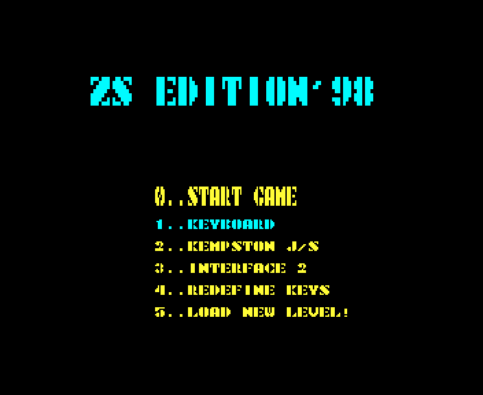 | 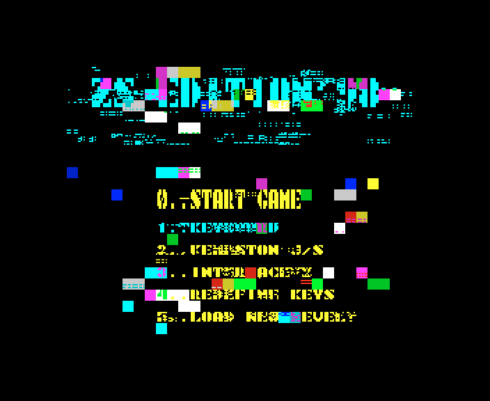 |
| --- | --- | --- |
| the menu (`r98` 4703) | after 5 (`x98` 5000) | 0 START after 5 (`x98` 5600) |

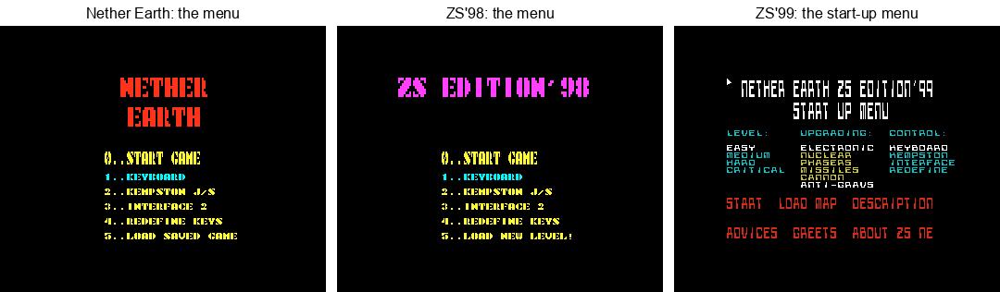

*The menus: the original (`ne-play` 12750), ZS'98 (`r98` 4703), ZS'99 (`r99` 3002).*

## 1.6 Difficulty and upgrades ('99)

The author's account is in [NEabout](texts/NEabout.md), [NEZSEd99](texts/NEZSEd99.md) and
[NEdescri](texts/NEdescri.md):

- four levels, EASY to CRITICAL;
- only on EASY does the enemy depend on the factories and bases it holds;
- UPGRADING makes every enemy robot be built up each day to at least the parts the player marked, on every level
  but CRITICAL, which uses the author's own setting.

What the code does: the start-up menu's `StartGame` `$DA8E` copies patches from `LevelPatches` `$DAE6` into three
places of the game. The level is the operand `$D980`.

| Level | `$B87E` (before each enemy robot) | `$D2C8` (the enemy's robot count on the panel) | `$AE41` (the enemy's daily income) | `$A5E7` / `$A5E5` |
| --- | --- | --- | --- | --- |
| EASY | `LD HL,$FD4A`: the resources as they are | printed | `ProduceSide` for the enemy | as UPGRADING set them (not used) |
| MEDIUM | `CALL $A5F2`: every enemy resource 99 | `??` | `ProduceSide` | (not used) |
| HARD | `CALL $A5F2` | `??` | six `NOP`s and `CALL $A5D6`: no income, the daily upgrade instead | as UPGRADING set them |
| CRITICAL | `CALL $A5F2` | `??` | `CALL $A5D6` | `$FC` / 0 |

On every level the enemy starts with 99 of each resource: `NewGameSetup` calls `FillEnemyResources` `$A5F2`. The
player's general starts at 99 and the other resources at 0 (`r-critical` frame 2920).

`UpgradeEnemyRobots` `$A5D6` works on the 24 enemy slots:

- It sets each slot's parts byte to (parts AND [`$A5E5`]) OR [`$A5E7`].
- UPGRADING's six items toggle the bits 7-2 of `$A5E7` (`ToggleUpgrade` `$DA41`).
- The mask becomes `$F8` when anti-grav is marked (the bipod and tracks dropped), else `$FF`.
- The image's own values, `$78` and `$84`, hold until an item is first toggled. They keep the weapons and add
  electronics and anti-grav.

So the marks matter on HARD only. EASY and MEDIUM upgrade nothing, and CRITICAL writes its own values over the
marks.

### CRITICAL, measured

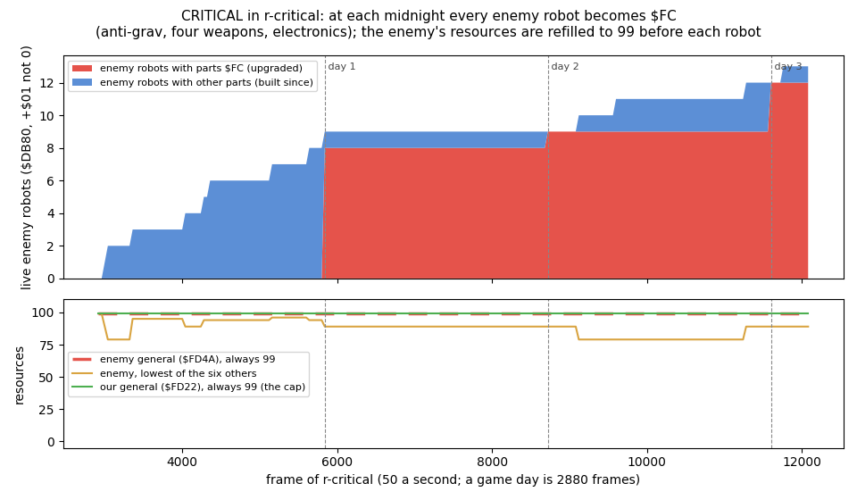

How to read the figure:

- **The x axis** is the frame of `r-critical`, from START (2901) to 12100. The recording is sampled every 40 frames.
- **The dotted lines** are the game's midnights, where the day count (`$FD37`) steps: frames 5840, 8720 and 11600.
- **The top panel** counts the enemy's live robots: records of `EnemyRobots` `$DB80` with `+$01` not 0.
  - Red: robots whose parts byte (`+$07`) is `$FC`: anti-grav, cannon, missiles, phasers, nuclear, electronics.
  - Blue: robots with other parts, built since the last midnight.
- **The bottom panel** shows the resources:
  - red: the enemy's general (`$FD4A`), always 99;
  - orange: the lowest of the enemy's six other resources;
  - green: our general (`$FD22`), always 99 (the cap). The player built nothing.
- **What it shows**:
  - At each midnight every live enemy robot turns red.
  - The enemy's resources are set to 99 before each robot (`$B87E`), then the robot's cost is taken. So the lowest
    one stays at 79-99 and never runs down.
  - The live robots number 2 at frame 3320, 8 by 5720, 9 through day 1 and 12-13 at the end. The count `$FD49`
    peaks at 13.
- **The point**: on CRITICAL the enemy never runs short, and every robot it has at midnight becomes the strongest
  kind.
- Drawn by `python3 tools/fig_zs_critical.py --work work/docs/zsA/rc --from 2920 --to 12100 --step 40 --out
  docs/img/design/critical-days.png --json work/docs/zsA/critical-days.json`, on an instance with `r-critical`
  loaded (`re_session.py open --work work/docs/zsA/rc`).

The '98 has no choice of level. Its code does the following:

- `FillEnemyResources` sets the enemy's resources to 99 at a new game and at every midnight.
- `UpgradeEnemyRobots` (parts AND `$78` OR `$84`) runs at every midnight.
- The enemy's daily income is not paid.

Its scroller makes the claims ([text](texts/scroller98.md), 1.11).

## 1.7 Maps

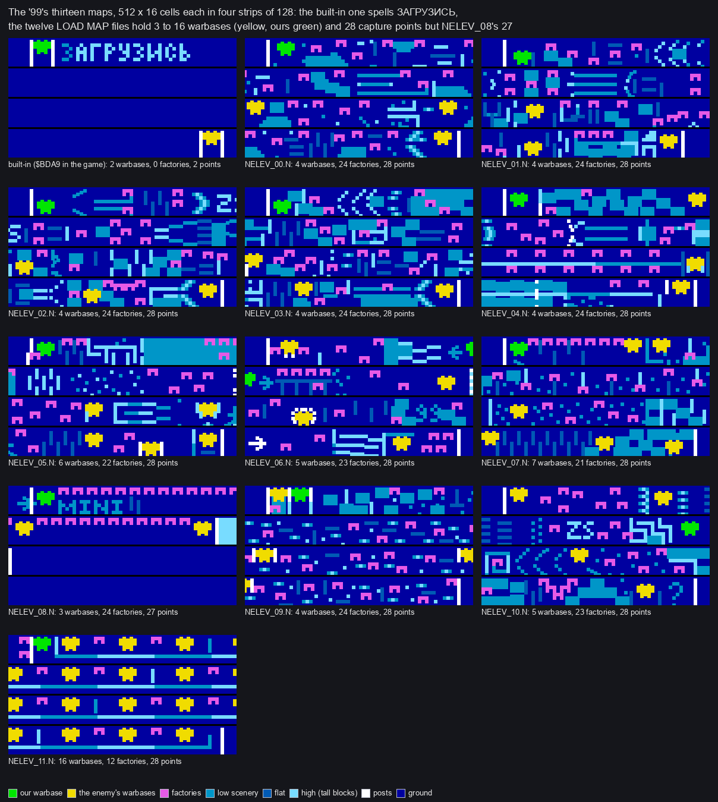

How to read the figure:

- **Each panel** is one map: its 512 x 16 cells drawn as four strips of 128 columns (the radar's width), west at the
  top left.
- **The colours**: the player's warbases green, the enemy's yellow, the factories magenta, the scenery in blues (low,
  flat, high) and the posts white.
- **The caption** of each panel counts its warbases, factories and capture points.
- **The first panel** is the map built into the game. Its walls spell `ЗАГРУЗИСЬ`, "load up!", and it has 2 warbases
  (one a side) and no factory.
- **The point**: every map gives the player one warbase and the enemy the rest. The twelve disk maps have 27-28
  capture points:
  - most have 4 warbases (1 ours, 3 the enemy's) and 24 factories;
  - `NELEV_05`-`07` and `NELEV_10` have 5-7 warbases;
  - `NELEV_11` has 16 warbases and 12 factories;
  - `NELEV_08` spells MINI in its scenery and `NELEV_10` spells ZS.
- Drawn by `python3 tools/fig_zs_maps.py --out docs/img/design/maps.png` from the map files of `build/maps/`,
  through `tools/zs_level.py`.

LOAD MAP shows the disk's catalogue of `.N` files:

- four names to a row, the current one highlighted;
- A moves to the next name and Q back;
- SPACE loads the map and returns to the menu ([05](05-controls.md)).

The map files:

- Each of the twelve is 512 bytes.
- A map file is a level only: the four record lists and a 13-byte tail of pointers and counts
  ([03](03-build-and-load.md)). It holds no robots, day, owners or resources; the game cannot save, so there is
  nothing else to load.
- The readme claims up to 96 maps a disk.

| 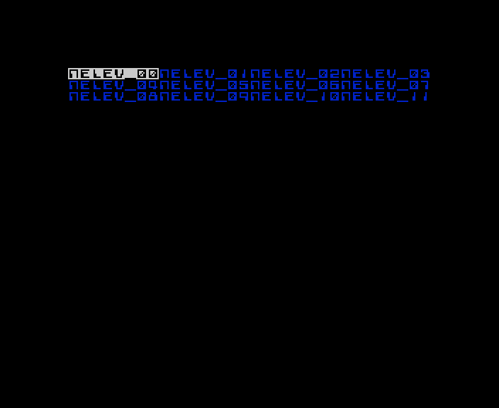 | 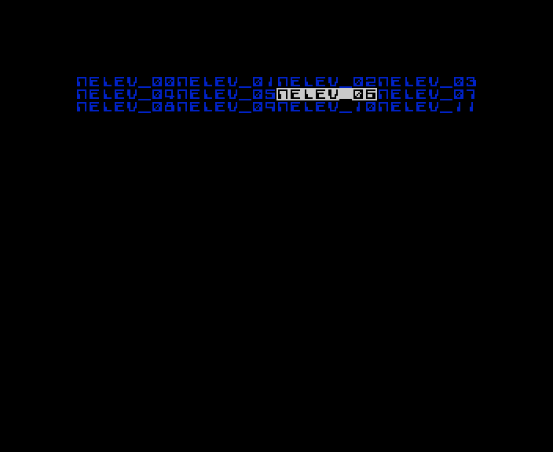 |
| --- | --- |
| LOAD MAP, `NELEV_00` highlighted (`r99` 5452) | moved to `NELEV_06` (`x99` 4127) |

| 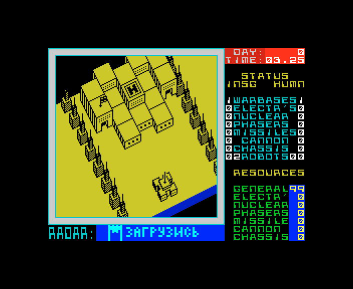 | 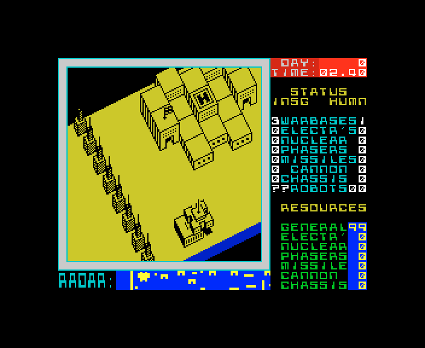 | 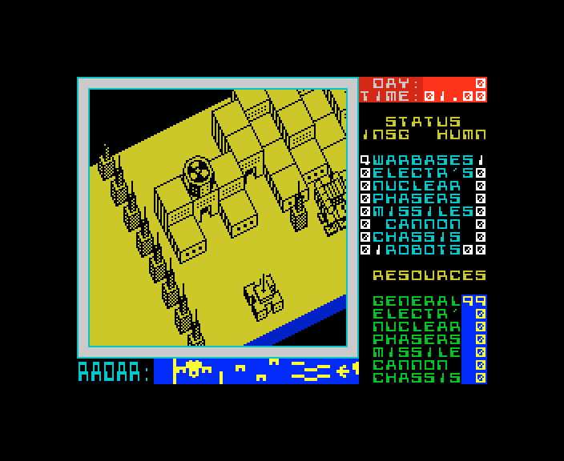 |
| --- | --- | --- |
| the built-in map, Scorpion (`s99` 3302) | `NELEV_00` (`r99` 6402) | `NELEV_06` (`x99` 4602) |

### The owner's memory: numbered snapshots and a mouse

The owner remembers the '99 pre-menu picking one of about sixteen numbered snapshots with the mouse. The code and a
live run show otherwise ([05](05-controls.md) has the details):

- **No mouse port is read.** No block of either release reads a port `$xxDF` (`$FADF`, `$FBDF`, `$FFDF`). The menus
  read the keyboard (`ReadMenuKeys` `$DDE4`); the only Kempston read is the joystick's `IN ($1F)` at `$D3AC` in play.
- **The live run agrees.** With a Kempston mouse fitted (`mouse99`), the mouse ports changed as the mouse moved, but
  unreal-ng's `in_use` flag stayed false at all 177 polls. The pointer stayed at (8,8) and LOAD MAP stayed on its
  first name after the mouse was moved and clicked.
- **The "pre-menu" is the start-up menu.** It is moved by Q A O P. LOAD MAP lists twelve map names, not numbers, and
  each is a level, not a saved game.
- **The sixteen numbered entries exist, but no program reads them.** They are in the slack of the readme's last
  sector: `n 01 00 00` for n = 1 to 16, with `CONVER Commander`, the buffer of the tool that wrote the file
  ([src/res/text](../src/res/text/README.md)).

## 1.8 Play

Play is the same game in both releases:

- an isometric view of the battlefield;
- the status panel on the right (the resources, the robots, the clock);
- the radar at the bottom.

What the player sees at the start:

- the enemy's robot count hidden ('98: blank; '99: `??` from MEDIUM up);
- GENERAL at 99;
- the view's frame cyan and the ground non-bright yellow;
- on a '99 disk map, more warbases than the built-in map's two.

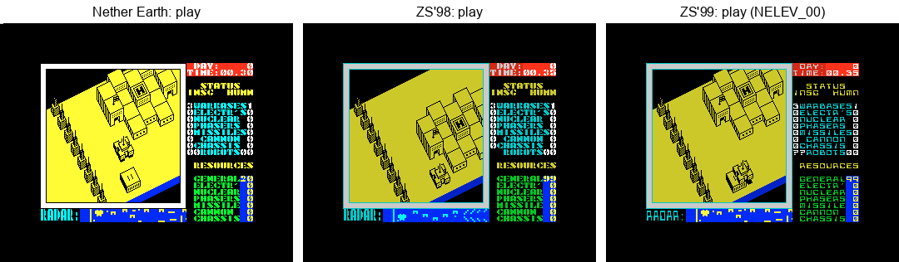

*The start of play: the original (`ne-play` 12900), ZS'98 (`r98` 5000), ZS'99 on `NELEV_00` (`r99` 6150).*

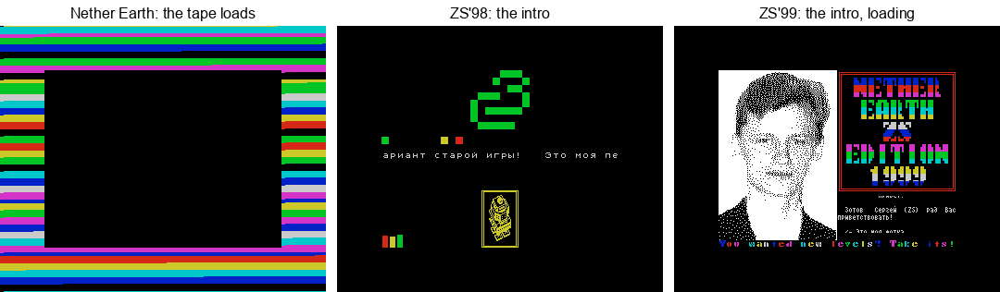

*What the player watches while the game loads: the original's tape border (`ne-play` 5000), the '98 intro
(`r98` 3000), the '99 intro (`r99` 1002), which loads the rest only when SPACE is pressed.*

A game ends when one side has no warbase left (`CheckGameEnd` `$AE6B`):

- The panel shows "INSIGNIANS DESTROYED / CONGRATULATIONS!" or "YOU HAVE NO BASES LEFT / BETTER LUCK NEXT TIME!".
- A low buzz sounds, then a 2 s wait.
- After a key, the menu returns.

No recording reaches the end of a game, so these screens are known from the code only.

## 1.9 Time in the game

- A game turn is ten frames (`TurnPace` `$AE1D`, [04](04-game-loop.md)), and the clock advances 5 minutes a turn
  (`GameTurn` `$AD62`).
- So a game hour is 120 frames (2.4 s) and a game day is 2 880 frames (57.6 s).
- At midnight `DailyProduction` `$AE38` pays the day's income. In `r-critical` the midnights fall at frames 5840,
  8720 and 11600.

## 1.10 What the player meets

- '98: "ZS'98 Presents", the intro with its scroller, music, AY bars and robot, the menu with LOAD NEW LEVEL!
  (broken), and an enemy with unlimited resources that upgrades its robots each night.
- '99: the photo intro with its scroller and tune, "System checking", and the start-up menu with LEVEL, UPGRADING,
  CONTROL, LOAD MAP and four texts. Also the REDEFINE screen with seven keys, the twelve maps and the `ЗАГРУЗИСЬ`
  map.
- Both: the hidden enemy robot count, 99 GENERAL, no save.

## 1.11 The author's claims against the code

The claims that compare the edition with the original game (its numbers, what was rewritten) are listed with what
this code does. Whether the original differs is left to the comparison of the two reverses.

The '98's claims are in its scroller ([scroller98](texts/scroller98.md)); the code is `src/game98`.

| Claim | Verdict | The code |
| --- | --- | --- |
| the enemy's robot count is hidden | true | the count's print at `$D2C8` is cleared to `NOP`s; the panel field stays blank |
| more money for the player | true in this code | GENERAL starts at 99 (`$A684`); each warbase pays 8 general a day (`ProduceSide`, x 8 at `$AE4F`) |
| unlimited money for the enemy | true in effect | the enemy's daily income is not paid; `FillEnemyResources` `$A5F2` sets every enemy resource to 99 at a new game and at every midnight |
| the enemy upgrades the robots it has built | true | `UpgradeEnemyRobots` `$A5D6` each midnight: parts AND `$78` OR `$84`; anti-grav and electronics on, the bipod and tracks off, the weapons kept |
| the map favours the enemy | partly | the enemy's half has 336 trench and 598 rock cells against 204 and 436 in the player's; the bases are placed evenly |
| LOAD NEW LEVEL! | broken | no disk read: the key copies the scroller text as a map, and START resets the machine ([03](03-build-and-load.md)) |

The '99's claims are in [NEabout](texts/NEabout.md), [NEdescri](texts/NEdescri.md), [NEadvice](texts/NEadvice.md)
and the readme [NEZSEd99](texts/NEZSEd99.md). The code is `src/game99`, `src/patches99` and `src/menu99`.

| Claim | Verdict | The code |
| --- | --- | --- |
| runs on 48K and 128K | 128K only | the one-page route (`$62B4`) is built. On 48K the texts land over the game's top and START runs text bytes: a reset ([03](03-build-and-load.md)). |
| loads from tape too | code only | the tape set of the patches (`TapePath` `$6362`, `taperead`, `tapemap`) is never selected by the disk loader |
| four levels | true | 1.6 |
| EASY is harder than the original | left to the comparison | EASY starts the enemy at 99 of each resource and the player at 99 general (1.6) |
| the enemy depends on its factories only on EASY | true | MEDIUM and up refill its resources before each robot (`$B87E`); HARD and up also drop its income (`$AE41`) |
| UPGRADING: the enemy builds up its robots each day on every level but CRITICAL, which uses the author's setting | partly | the daily upgrade runs on HARD and CRITICAL only (`$AE41`). CRITICAL forces every part (`$A5E7` = `$FC`, mask 0): `r-critical` shows every enemy robot at `$FC` after each midnight (1.6). |
| up to 28 bases on a map | partly | a map's tail sets the counts, and a map may have up to 16 warbases (`NELEV_11`). The capture index (`$ADF1`, 28 minus the points left) breaks the capture of a warbase past the fourth, and of every point on maps with fewer than 28. |
| up to 96 maps a disk | partly | the cursor has 96 places (`$C2C4`), but names past the 64th print on the wrong lines (`$C263`). The disk holds twelve. |
| protection proportional to the armament: a cannon + chassis robot dies to one phaser shot, the heaviest to six | partly | the damage is ((60 - height - ground) / 4) x (weapon + 1) (`MoveShot` `$B7A7-$B7E9`), so taller robots take less. Every hit of the first fight of `work/zsB/deep-map0` matches it ([7.4](07-objects.md#74-shots)). By the formula cannon + bipod takes 40 a phaser shot on flat ground (3 shots), not one; no recorded fight had that pair. |
| all weapons have the same range, 15-18 miles | false | cannon and phasers 5 miles (6 with electronics), missiles 7 (8) (`FireShot` `$B6D9-$B6E7`) |
| impassable places are left when fire is held in COMBAT MODE as a shot kills | not traced | the freeze while fire is held is real (`ListMenu` `$ACD8` waits for every control to be let go); how it would leave a cell blocked is not found |
| some routines rewritten from scratch | left to the comparison | the new code is the patches block, the start-up menu and the two difficulty routines `$A5D6`, `$A5F2` |
| no save | true | `PlayLoop` has no save key (`SaveCallRemoved`, eight `NOP`s); REDEFINE asks for seven keys, no SAVE |
| (not claimed) CRITICAL is the hardest | true | `r-critical`: 13 enemy robots by day 3, all `$FC`, the enemy's resources refilled to 99 before each (1.6) |
