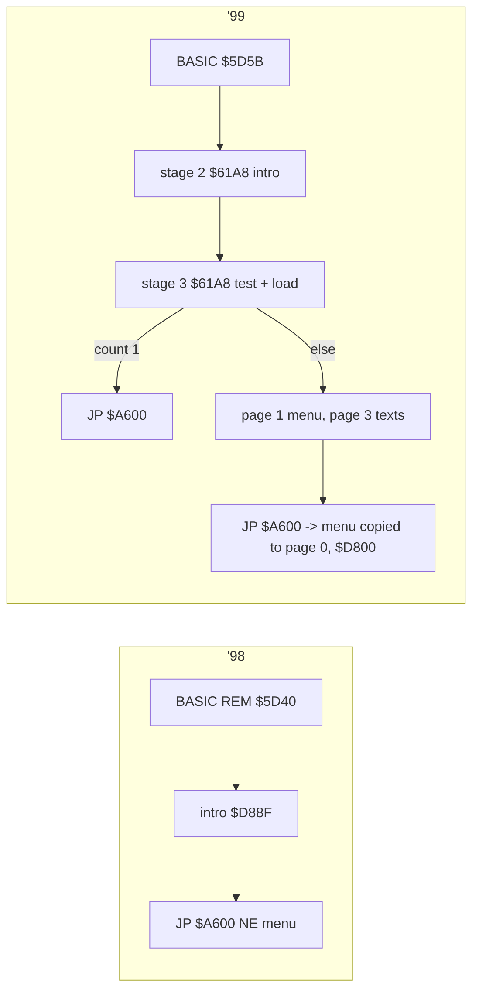

# 2. Architecture

Status: stage 2 (the code is in `src/`, [3.7](03-build-and-load.md)). The memory maps come from the dumps in `work/images/` (TTD `memory_at`, every bank and the
Z80 view) and the signature and NE matches in `work/stage1/` (`sig_scan.tsv`, `ne-match-98.tsv`,
`ne-match-99.tsv`). The recordings (`r98`, `r99`, `r99-48`) are described in
[03-build-and-load.md](03-build-and-load.md).

## 2.1 What the edition is

Both releases are Nether Earth (Argus Press Software, 1987) with its game image at its own addresses
(`$6780-$D7D2`), changed in place, plus a new front end:

- '98 (`NEZSEd.B`, signed 23.12.1998): an intro (PT3 music, a scroller, a robot picture) and NE's menu with a new
  title and a sixth item, LOAD NEW LEVEL. 517 of NE's 563 entries are the same bytes at the same address (26 006
  bytes), 13 changed, 21 absent (`ne-match-98.tsv`); 27 998 of 28 928 bytes equal NE's image.
- '99 (`NEZSED.SCL`, signed 28.01.1999): every program packed (3.4), an intro with a photo and a Sound Tracker tune,
  a "System checking" loader with a memory test, a 128 K start-up menu (level, upgrades, control, maps, four texts)
  in page 1, the texts in page 3, twelve maps on the disk. 502 entries same, 3 moved, 17 changed, 29 absent;
  NE's font is absent (replaced).

## 2.2 Machine

| | '98 | '99 |
| --- | --- | --- |
| needs | 48 K BASIC + TR-DOS; pages `$7FFD` only in the intro | TR-DOS; 128 K for the start-up menu and texts |
| pages used at play | 0 (`$C000`), 2, 5 | 0 (game), 1 (start-up menu `$D800-$FFFF`), 3 (texts), 2, 5 |
| 48 K | runs (nothing outside 48 K at play) | does not run: a 48 K machine counts 0 pages, the 128 K route overwrites the game and START resets (03, 3.6) |

Bank 7 holds 197-199 non-zero bytes in every dump: the machine's own (TR-DOS / 128 system area), not the game's.

## 2.3 Memory maps

At play ('98 `r98` frame 5900, '99 `r99` frame 6450):

| Range | '98 | '99 |
| --- | --- | --- |
| `$4000-$5AFF` | screen | screen |
| `$5B00-$5B99` | TR-DOS stub (`$5B00-$5B2E`) | the depacker copy (load time only) |
| `$5D3B-` | BASIC; REM loader `$5D40-$5D96`; dead 128 K loader `$5DEF` | BASIC; reader `$5D5B-$5D68` |
| `$61A8-$7D86` | | stage 2 (intro) at load time, then stage 3 `$61A8-$67EB` |
| `$6780-$D7D2` | NE's image (changed) | NE's image (changed) |
| `$A56A-$A5D5` | | paging routine `$A58A` and patch from `$D800` |
| `$BDA9-` | the map lists (NE's level) | the map lists, loaded from `NELEV_xx.N` |
| `$C100-$C17E`, `$C1FD-$C332` | NE's menu, rewritten | NE's menu with the patch from `$D83E` and the disk / text pointers |
| `$D800-$FFFF` page 0 | '98: menu data, `$DD00` scroller text | |
| page 1 `$D800-$E6F3` | | the 128 K start-up menu as stored; copied to page 0 `$D800` each time the menu is entered (pointer x `$DD74`, y `$DD75`; level `$D980`; upgrades `$A5E7`) |
| page 3 `$C000-$FFFF` | | `NEabout` `$C000`, `NEdescri` `$CF00`, `NEgreets` `$E500`, `NEadvice` `$E700` |

At the intro:

| Range | '98 (`r98` 3000) | '99 (`r99` 1300) |
| --- | --- | --- |
| `$8100` | IM 2 table | |
| `$B000` | | IM 2 table, handler `$6525` |
| `$C000-` | PT3 player "PT 3 Player v1.0 by Nick of GDC" + "COOL WINTER... KLIM/OHG/'97" | Sound Tracker compiled module "NE___MUS by KSA Software" + player |
| `$D88F-` | the intro: AY bars (registers 2/4/6), ZS logo colours, robot picture | |
| `$DAC2-$E3C9` | scroller text (KOI-7, `tools/scroller_text.py`) | |
| `$654F-$7587` | | scroller text (CP866) |
| `$7D87-` | | RLE screen decoder (escape `$9A`) into `$8A87` / `$A287` |

## 2.4 Stages from the disk to play

## 2.5 Third-party pieces

| Piece | Where | Identified | In `R/signatures` |
| --- | --- | --- | --- |
| PT 3 Player v1.0 by Nick of GDC | '98 `$C000` | its text and the base's entry (candidate: 5/7 anchors, the variable area differs) | yes, `sound/ay-players/pro-tracker-3/nick-gdc-1.0` |
| "COOL WINTER" PT3 module, KLIM/OHG '97 | '98 intro | the base's PT3 detector | format detector |
| Sound Tracker compiled player, KSA Software | '99 `$C000` | its text only | no; listed, not added |
| backward LZ depacker | '99 every block | not identified (03, 3.4) | no; listed, not added |
| RLE screen decoder, escape `$9A` | '99 `$7D87` | not identified | no |
| TR-DOS 5.04T calls `#3D13` | both | ROM | |
