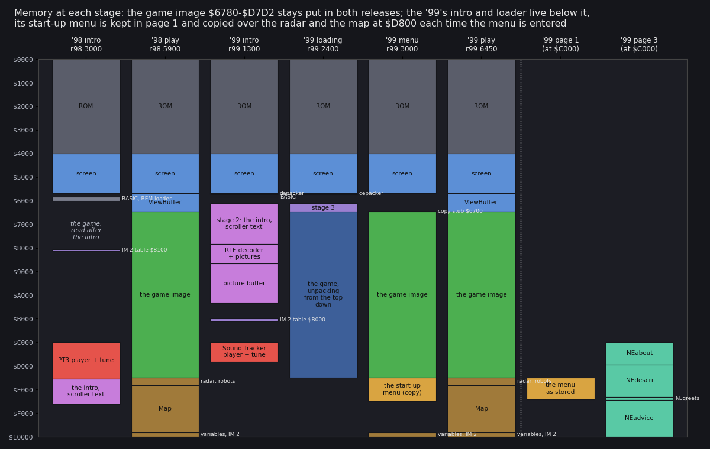
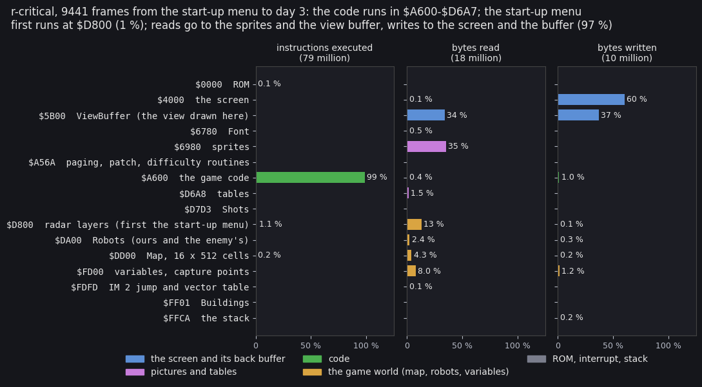
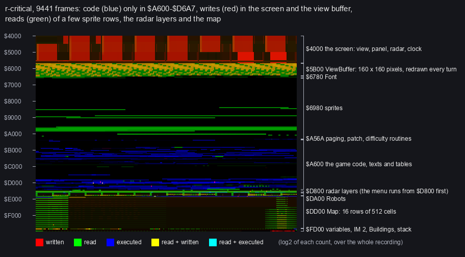
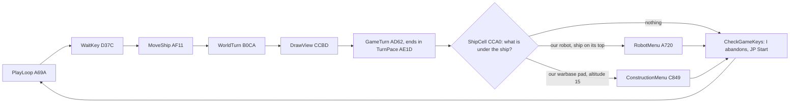

# 2. Architecture

This document maps the two programs as a whole. It covers:

- the machine they need;
- what lies where in memory at each stage;
- the stages from the disk to play;
- how time is kept;
- which modules do what, and the code that rewrites its own operands.

Later documents take each part apart; this one is the map they hang on.

The recordings it rests on (unreal-ng, PENTAGON 128 + TR-DOS 5.04T, muted; [01](01-game-design.md) lists them all):

- `r98` (`work/stage1/r98`): the '98 from `RUN "NEZSEd"` to play, frames 103-5903.
- `r99` (`work/stage1/r99`): the '99 from the autostart to play, frames 2-6462.
- `r-critical` (`work/stage2/game99/r-critical`, script `inputs/critical.txt`): the '99 from the autostart.
  - CRITICAL is chosen at frame 2866 and START at 2899.
  - Then come 9 200 frames of play with the ship parked on its pad, on the built-in map, up to day 3.
  - Its L1 build from the start-up menu on, `crit-play` (`work/stage2/game99/crit-play/l1.json`, frames
    2661-12102), holds 78 632 875 instructions and 676 730 872 T over 9 441 frames.
  - Every share below comes from `crit-play` unless another recording is named.
- The access traces of `r-critical` in `work/docs/zsA/rc/traces/` (frames 8000-8026 and 8026-8326): thirty game
  turns, with every instruction and every bus access.

## 2.1 The machine

| | '98 | '99 |
| --- | --- | --- |
| needs | TR-DOS. The code needs only 48 K: its one `$7FFD` write (`IntroMain` `$D88F`) does nothing on a 48 K machine. No recording ran it on a 48 K machine. | TR-DOS and 128 K. Page 1 holds the start-up menu and page 3 the texts. On 48 K + Beta 128 it resets at START ([03](03-build-and-load.md)). |
| pages at play | 0 at `$C000` | 0 at `$C000` at play. 1 and 3 are paged in by the menus only, through `SetPage` `$A58A`. |
| frame | 71 680 T (Pentagon 128), 50 a second | the same |
| interrupt at play | `PlayInterrupt` `$D566`: 8 377 T a frame (11.7 %) | the same |
| a game turn | at least 10 frames (`TurnPace` `$AE1D`) | 10.00 frames in each of the 29 turns measured (2.5) |
| sound | the AY in the intro (a PT3 tune), the beeper at play and in the menu | the AY in the intro (a Sound Tracker tune), the beeper at play; the start-up menu is silent ([09](09-sound.md)) |

Bank 7 holds 197-199 non-zero bytes in every dump of `work/images/`. These bytes belong to the machine (TR-DOS and
the 128 system area), not to the game.

## 2.2 The memory map



How to read the figure:

- **A column** is the Z80's 64 K at one moment, with `$0000` at the top. The recording and frame are under the
  column's title.
- **A coloured range** is what lies there at that moment:
  - grey: the ROM;
  - blue: the screen and the view buffer;
  - green: the game image;
  - dark blue: a packed block;
  - violet: the intros and the loaders;
  - orange: the start-up menu;
  - brown: the game's world (radar, robots, map, variables);
  - teal: the texts.
- **The last two columns** are the '99's 128 K pages 1 and 3, as the CPU sees them when paged in at `$C000`.
- **The dotted line** separates the Z80 views from the pages.
- **The point**: the game image `$6780-$D7D2` is the one fixed thing. The intros and loaders live below it, the
  start-up menu in page 1, the texts in page 3.
- Drawn by `python3 tools/fig_zs_memmap.py --out docs/img/arch/memmap-stages.png`, from the tables below.

### At play

The table holds for both releases: '98 at `r98` frame 5900, '99 at `r99` frame 6450. The names are the `.ann`
labels of `src/game98` and `src/game99`.

| Range | What | Notes |
| --- | --- | --- |
| `$4000-$5AFF` | the screen | the view at character (1,1), the panel at columns 22-31, the radar at the bottom right ([06](06-rendering.md)) |
| `$5B00-$677F` | `ViewBuffer` | 160 lines of 20 bytes. The view is drawn here, then copied to the screen. |
| `$6780-$697F` | `Font` | 64 glyphs of 8 bytes, codes `$20-$5F` |
| `$6980-$A569` | sprites | the block, robot part, building and shot pictures |
| `$A56A-$A5D5` | '99: the patch room | `TextEntry` `$A56A` (`PagedText`), `SetPage` `$A58A`, `ReadBlock` `$A598` (`DiskRead`), copied there by stage 3 at `r99` frame 2553 |
| `$A5D6-$A5FF` | the difficulty routines | `UpgradeEnemyRobots` `$A5D6`, `FillEnemyResources` `$A5F2` |
| `$A600-$D6A7` | the game code | 2.6 |
| `$BDA9-$BF9B` | the level lists | the built-in level. The '99's LOAD MAP copies a map file here ([03](03-build-and-load.md)). |
| `$C100-$C157`, `$C158-$C17F` | '99: `menu128` | `MenuTable128` `$C100` and `ShowMenu128` `$C112` (the door to the start-up menu); `MenuStub` `$C158` |
| `$C1FD-$C332` | '99: `diskmap` | LOAD MAP (`DiskLoadMap` `$C1FD`) |
| `$D6A8-$D7D2` | tables | the sprite, part and building tables and the heights |
| `$D7D3-$D7FF` | `Shots` | 5 records of 9 bytes |
| `$D800-$D9FF` | `RadarOwn`, `RadarEnemy` | two radar pictures, 16 lines of 16 bytes |
| `$DA00-$DCFF` | `Robots`, `EnemyRobots` | slots 0-23 at `$DA00` and slots 24-47 at `$DB80`, 16 bytes a record |
| `$DD00-$FCFF` | `Map` | 16 rows of 512 cells; a cell is `$DD00` + `$200` x Y + X |
| `$FD00-$FDFC` | variables | `RandomSeed` `$FD00`, `PrintAddr` `$FD04`, `Input` `$FD0C`, `Resources` `$FD22`, `TurnFrames` `$FD34`, `Clock` `$FD35`, `EnemyResources` `$FD4A`, `Warbases` `$FD70` |
| `$FDFD-$FDFF` | `JP (Handler)` | the IM 2 jump; `Handler` `$FDFE` is the switch (2.4) |
| `$FE00-$FF00` | the IM 2 table | 257 bytes of `$FD`, with `I` = `$FE` |
| `$FF01-$FFA8` | `Buildings` | 56 records of 3 bytes. `NewGameSetup` clears up to `$FFC9`. |
| `$FFCA-$FFFF` | the stack | `SP` = 0 at `StartGame` `$A603` |

### Before play

Before play, the same addresses hold other things.

| Range | '98 intro (`r98` 3000) | '99 intro (`r99` 1300) | '99 loading (`r99` 2400) | '99 start-up menu (`r99` 3000) |
| --- | --- | --- | --- | --- |
| `$5B00-$5B99` | `$5B00-$5B2E`: TR-DOS's paging stub on this machine | the depacker, copied there by each packed block | the depacker | |
| `$5D3B-` | BASIC, the REM loader `$5D40-$5D96`, a dead 128 K loader in the VARS area from `$5DEF` (nothing past `$5D96` runs in `r98`) | BASIC, the reader `$5D5B-$5D68` | | |
| `$61A8-` | | stage 2 `$61A8-$7D86`: the intro, its print routine, the scroller text `$654C-$7586`, the 64-column font `$7587-$7D86` | stage 3 `$61A8-$67EB` | |
| `$6700-$6727` | | | | `MenuStub` (the copy stub) |
| `$6780-$D7D2` | | | the game block, unpacking downwards | the game image |
| `$7D87-$8A86` | | the RLE decoder `DecodeScreen` and the packed picture | | |
| `$8080-$8200` | the IM 2 table at `$8100-$8200` (`I` = `$81`), its `JP` at `$8080` | | | |
| `$8A87-$A586` | | the picture buffer (pixels `$8A87`, attributes `$A287`) | | |
| `$B000-$B1B3` | | the intro's IM 2 table (`I` = `$B0`) and its `JP` at `$B1B1` | | |
| `$C000-` | the PT3 player and the tune "COOL WINTER" (`$C000-$D88E`) | the Sound Tracker player and tune (`$C000-$CCFF`) | | |
| `$D800-$E9FF` | the intro `$D88F`, its scroller text `$DAC2` (KOI-7), the logo mask `$E3B9`, the robot `$E3FE`, the font `$E6CC` | | | `$D800-$E7FF`: the start-up menu, a copy of page 1's |

The '99's two extra pages:

| Page | Range (at `$C000`) | What | Written |
| --- | --- | --- | --- |
| 1 | `$D800-$E6F3` | the start-up menu as stored (`menumain` `$D800`, `menuviewer` `$DBE2`, `menupointer` `$DD62`) | unpacked by its own block at `r99` frame 2561 |
| 1 | `$E800-$F1FF` | the menu's packed block as read | frame 2561 |
| 3 | `$C000-$CEFF` | `NEabout` | read by stage 3: 64 sectors, before frame 2659 |
| 3 | `$CF00-$E4FF` | `NEdescri` | |
| 3 | `$E500-$E6FF` | `NEgreets` | |
| 3 | `$E700-$FFFF` | `NEadvice` | |

### Where the time and the bytes go at play



How to read the figure:

- **Three panels** show the instructions executed, the bytes read and the bytes written. Each bar is a region's
  share of all of `crit-play` (9 441 frames, from the start-up menu to day 3 of play).
- **A bar's colour** is its group:
  - blue: the screen and its buffer;
  - violet: pictures and tables;
  - green: code;
  - brown: the game world;
  - grey: the ROM, the interrupt jump and the stack.
- **Executed**: 98.5 % of the instructions run in `$A600-$D6A7`. The 1.1 % in the radar's region is the start-up
  menu, which runs at `$D800` before play.
- **Read**: reads go to the sprites (35.3 %), the view buffer (34.1 %) and the radar pictures (13.2 %).
- **Written**: writes go to the screen (60.1 %) and the view buffer (36.9 %).
- **The point**: drawing is the program.
- Drawn by `python3 tools/fig_zs_regions.py --l1 work/stage2/game99/crit-play/l1.json --out
  docs/img/arch/access-regions.png`. The script is the kit's region figure with this game's regions and the
  Pentagon's ROM page; it prints the table too.



How to read the figure:

- **The grid** is `$4000-$FFFF`. A row is 256 bytes and each byte is a 2 x 2 square.
- **The colour** mixes three counts over all of `crit-play`, each as log2:
  - red: written;
  - green: read;
  - blue: executed.

  So yellow is read and written, and cyan is read and executed.
- **The brackets** on the right are the regions of `tools/zsa_regions99.txt`.
- **The point**:
  - The code is one blue band, `$A600-$D6A7`.
  - The screen and `ViewBuffer` are rewritten all the time (red and yellow).
  - In the sprites `$6980-$A569` only the pictures in use are read (green streaks).
  - The map `$DD00-$FCFF` is read cell by cell.
- Drawn by `python3 tools/fig_zs_heatmap.py --l1 work/stage2/game99/crit-play/l1.json --out
  docs/img/arch/heatmap-play.png` (the kit `heatmap.py`'s composite panel alone, with this game's regions).

## 2.3 The stages from the disk to play

```mermaid
flowchart TD
  subgraph s98 ["the 98 release, NEZSEd.B"]
    B98["BASIC line 10: RANDOMIZE USR 23872"] --> R98["REM loader 5D40: the title, 42 sectors to C000"]
    R98 --> I98["IntroMain D88F: PT3, scroller, logo, robot, until a key"]
    I98 --> L98["113 sectors to 6780"] --> S98["JP A600: StartGame, CALL MainMenu C100"]
  end
  subgraph s99 ["the 99 release, NEZSEd99.B"]
    B99["BASIC: RANDOMIZE USR 23899"] --> T2["stage 2: 18 sectors to 8000, unpacked to 61A8"]
    T2 --> I99["stage 2: pictures 7D87, music C000, the intro until SPACE"]
    I99 --> T3["stage 3: 6 sectors to 8000, unpacked to 61A8: System checking"]
    T3 --> G99["the game block 6780, the patches block DC00"]
    G99 --> M99["page 1: the menu block; page 3: the texts"]
    M99 --> S99["JP A600: Start, CALL C100: the start-up menu"]
  end
```



The '99 in time. [03](03-build-and-load.md) has the sectors. Each frame is a first arrival of `r99`, from
`re_session.py stages --work work/stage1/r99`.

| Frame | Arrival | What it is |
| --- | --- | --- |
| 152 | `$5D5B` | the BASIC's reader |
| 177 | `$8000`, `$5B00` | stage 2's block runs; its set-up copies the depacker to `$5B00` |
| 227 | `$61A8` | stage 2, unpacked |
| 261 | `$C00B`, `$B1B1`, `$6525` | the tune's init; IM 2 through `$B1B1` to `IM2Handler` `$6525` |
| 464 | `$7D87` | `DecodeScreen`: the picture into its buffer |
| 472-726 | `$62DB` | `RollInPicture` ([06](06-rendering.md)) |
| 746 | `$6474`, `$6428` | the scroller's first print and scroll |
| 1310 | | SPACE (the script) |
| 2179 | `$628A` | stage 3 unpacked over stage 2. The `.ann` puts `Stage3Entry` `$61A8` at frame 2194. |
| 2299 | `$6250`, `$6780` | `RunGameBlock`: the game block's set-up and depacker |
| 2545 | `$DC00` | the patches block |
| 2553 | `$A58A` | `InstallPaged`: the paged pieces copied into the game |
| 2561 | `$E800` | the menu block, unpacked in page 1 |
| 2659 | `$C100`, `$6700` | `Start` calls the menu's door; the copy stub runs |
| 2661 | `$D800` | the start-up menu runs |

### Start, `$A600`

The two releases enter their menus in different ways:

- **'98**: `Start` `$A600` is `StartGame` itself. It builds the interrupts and the seed, then `CALL MainMenu`
  `$C100`, which returns on 0 START.
- **'99**: `Start` `$A600` is `CALL $C100`; `StartGame` follows at `$A603`. `$C100` holds `MenuTable128`, a piece
  of the patches block that stage 3 copied there. Its first entry jumps to `ShowMenu128` `$C112`.
  1. `ShowMenu128` stores the caller's stack in the stub's `LD SP,nn` (operand `$C179`).
  2. It copies `MenuStub` (40 bytes, `$C158`) to `$6700` and runs it through the ROM's `LDIR; RET` at `$33C3`.
  3. The stub pages 1 in, copies 4 K from `$D800` to the screen `$4000` and pages 0 back.
  4. It copies the 4 K from the screen back to `$D800`, restores the caller's stack and returns into
     `MenuEntry` `$D800`.
  5. The menu's START returns from that call to `$A603`.

```
MenuStub:                         ; src/patches99, menu128: runs at $6700
  DEFB $31,$80,$67                ; LD SP,$6780: a stack of its own
  DEFB $3E,$01,$CD,$8A,$A5        ; LD A,1: CALL SetPage: page 1
  DEFB $21,$00,$D8                ; LD HL,$D800: the menu in page 1 ...
  DEFB $11,$00,$40                ; LD DE,$4000: ... to the screen ...
  DEFB $01,$00,$10,$ED,$B0        ; LD BC,$1000: LDIR: ... 4 K
```

The copy goes through the screen, and it shows: the menu's code is on the screen for three frames
([04](04-game-loop.md)).

From `StartGame` on, both releases run the same chain:

1. `StartGame` builds the IM 2 table.
2. `NewGameSetup` `$A62D` clears the state and builds the map.
3. `EnterPlay` `$A68E` draws the play screen and installs `PlayInterrupt`.
4. `PlayLoop` `$A69A` runs one game turn a pass.

Each falls into the next. Only the jumps back to `Start` leave the loop: ABORT and a game's end.

## 2.4 Time: frames and interrupts

At play, both releases run in IM 2 through one fixed vector:

```
StartGame:                        ; src/game99/start.asm, $A603 ('98: Start, $A600)
  DI
  LD SP,$0000             ; the stack grows down from $FFFF
  LD HL,$FE00             ; the IM 2 table: 257 bytes of $FD at $FE00-$FF00
  LD BC,$00FD
FillVectorTable:
  LD (HL),C
  INC HL
  DJNZ FillVectorTable
  LD (HL),C               ; the 257th byte, $FF00
  LD A,$C3                ; the JP opcode
  LD ($FDFD),A            ; at $FDFD: every vector lands on Handler
  LD HL,StartInterrupt    ; EI; RET until EnterPlay
  LD (Handler),HL
  LD A,$FE
  LD I,A
  IM 2
  EI
  LD HL,$3039             ; the random seed, the same at every start
  LD (RandomSeed),HL
  LD (RandomSeed+2),HL
```

- **The vector.** Whatever byte the bus holds, the vector is `$FDFD`. There a `JP` takes its operand from
  `Handler` `$FDFE`, which is the switch.
- **The handlers.**
  - While the world stands, `Handler` holds `StartInterrupt` `$D59C` (`EI; RET`): during the set-up, the menus
    inside the game and the end of a game.
  - At play it holds `PlayInterrupt` `$D566`, installed by `EnterPlay`.
- **`PlayInterrupt`** counts `TurnFrames` `$FD34`, shows one of the two radar pictures (`ShowRadar` `$D59E`) and
  steps the sound effect. It costs 8 377 T a frame, measured over the ten frames of `r-critical` 8002-8012.
- **The seed.** `RandomSeed` `$FD00-$FD03` starts at `$39,$30,$39,$30` in every game. Two games with the same
  keys at the same frames play out the same.

Before play other handlers run:

| Stage | Interrupt mode and handler | Witness |
| --- | --- | --- |
| '98 REM loader | IM 1, the ROM | `src/basic98` |
| '98 intro | IM 2, table `$8100`, `JP` at `$8080` to `IntroInterrupt` `$DA0D`: the PT3 tune, the scroller step, then the ROM's `$0038` | `r98` frames 2048-4202, 2155 interrupts |
| '98 main menu | IM 2 through `$FDFD`: `MenuInterrupt` `$C4FD` (the beeper tune, the title colours) | `src/game98/mainmenu.asm` |
| '99 stage 2 | IM 2, table `$B000`, `JP` at `$B1B1` to `IM2Handler` `$6525`: the tune, then the ROM's `$0038` | `r99` frames 261-2114, 1845 interrupts |
| '99 stage 3 | IM 0 with `I` = `$3F`. The bus reads `$FF`, so `RST $38`: the ROM's handler. | `OutroAndLoad` `$6262` |
| '99 start-up menu | IM 0 with `I` = `$3F`: the ROM's handler (`FRAMES`, KEY-SCAN) | `MenuEntry` `$D800` |
| play, both releases | IM 2, `$FDFD` to `Handler` | `StartGame` |

`TurnPace` `$AE1D`, the end of `GameTurn`, sets the pace of the game. It loops until `TurnFrames` reaches 10, then
clears it. A turn that finishes early waits for the tenth frame. A turn that runs late is not caught up.

## 2.5 The main loop



The loop's body (`src/game99/start.asm`):

```
PlayLoop:
  CALL WaitKey            ; the controls; the pause while key 1 is held
  CALL MoveShip           ; the ship (unless a robot is under direct control)
  CALL WorldTurn          ; the robots and the shots
  CALL DrawView           ; the view
  CALL GameTurn           ; the turn: clock, captures, game end, frame pacing
  CALL ShipCell           ; HL = the map cell under the ship
  BIT 6,(HL)              ; bit 6: a robot or a building under the ship
  ...
CheckGameKeys:
  LD A,(Input)            ; Input bit 6 (key I): abandon the game
  BIT 6,A
  JP NZ,Start             ; abandon: Start, the menu again
  JP PlayLoop
```

The time of one turn, `r-critical` frames 8002-8012 (the first turn of the trace; [04](04-game-loop.md) has all 29):

| Phase | T | Share |
| --- | ---: | ---: |
| `DrawMapObjects` `$CCC6` (the cells and sprites into the buffer) | 432 211 | 60.3 % |
| interrupts (10 x `PlayInterrupt`) | 83 770 | 11.7 % |
| `CopyViewToScreen` `$D071` | 61 736 | 8.6 % |
| `WorldTurn` `$B0CA` (the enemy commander, the robots, the shots) | 59 737 | 8.3 % |
| `DrawViewBackground` `$CFD7` (clear the buffer, paint the corners) | 40 602 | 5.7 % |
| `TurnPace` (waiting) | 28 553 | 4.0 % |
| `GameTurn` without the wait (clock, captures, end) | 8 153 | 1.1 % |
| `WaitKey`, `MoveShip`, the checks under the ship | 2 006 | 0.3 % |
| a turn | 716 768 | 10.00 frames |

`tools/zs_turn_profile.py` sums these from the access trace `work/docs/zsA/rc/traces/8000_0-8026_0.uatr` and the
listing `build/game99/game.lst`.

## 2.6 Module map

The game block has 20 modules (`src/game99/game.ann`, cut by `kit/mkgame.py`). The "Executed" column is each
module's share of the 78.6 million instructions of `crit-play`; blank means no instruction ran there. The '98's
block (`src/game98`) has the same modules at the same addresses, with two differences:

- `zsenemy` takes the place of `difficulty`;
- `worldstate` follows `tables`.

| Module | Range | Bytes | Executed | What it does |
| --- | --- | ---: | ---: | --- |
| `font` | `$6780-$697F` | 512 | | the 8 x 8 font (data) |
| `sprites` | `$6980-$A569` | 15 338 | | the pictures (data) |
| `difficulty` | `$A56A-$A5FF` | 150 | 0.00 % | the patch room and the two difficulty routines (once a game day) |
| `start` | `$A600-$A71F` | 288 | 0.02 % | `Start`, `StartGame`, `NewGameSetup`, `EnterPlay`, `PlayLoop` |
| `robotmenu` | `$A720-$AD61` | 1 602 | | the robot menu and its submenus (not entered in `r-critical`) |
| `gameturn` | `$AD62-$AF10` | 431 | 4.78 % | the clock, `DailyProduction` `$AE38`, captures, the game end, `TurnPace` |
| `ship` | `$AF11-$B0C9` | 441 | 0.14 % | the ship's move and the view window |
| `world` | `$B0CA-$B7F3` | 1 834 | 3.14 % | `WorldTurn`: robots and shots |
| `enemy` | `$B7F4-$BB08` | 789 | 0.05 % | `EnemyCommander` `$B7F4`: what the enemy builds and orders |
| `bases` | `$BB09-$BDA8` | 672 | 0.03 % | `BuildMap` `$BC6F`, the base counts, captures |
| `level` | `$BDA9-$C0FF` | 855 | | the level lists and the shape table (data) |
| `mainmenu` | `$C100-$C4A6` | 935 | | '99: the patch pieces at `$C100` and `$C1FD`, `RedefineKeys` `$C34A`; '98: `MainMenu` |
| `music` | `$C4A7-$C848` | 930 | 0.50 % | the beeper title tune (run by the '98 menu only) and `TitleColourCycle` `$C820` (the '99 start-up menu calls it) |
| `construction` | `$C849-$CCBC` | 1 140 | 0.11 % | `ConstructionMenu`: the robot construction screen |
| `view` | `$CCBD-$D0B8` | 1 020 | 79.86 % | `DrawView`: the isometric view into `ViewBuffer`, then the copy |
| `screen` | `$D0B9-$D37B` | 707 | 2.34 % | the fixed play screen, `ShowStatusPanel` `$D1E5`, helpers, `Random` |
| `controls` | `$D37C-$D3E4` | 105 | 0.10 % | `WaitKey`, `ReadControls` `$D38A`, `KeyTable`, `Controls` `$D3E4` |
| `print` | `$D3E5-$D565` | 385 | 1.15 % | `PrintInline` `$D42D` and the number prints |
| `interrupts` | `$D566-$D6A7` | 322 | 6.33 % | `PlayInterrupt`, the radar, the sound effects |
| `tables` | `$D6A8-$D7D2` | 299 | | the sprite, part and building tables (data) |

The other parts of the '99 each have their own `.ann` in `src/`:

| Part | Range | Modules | Runs |
| --- | --- | --- | --- |
| `stage2` | `$61A8-$7D86` | `loader` `$61A8`, `effects` `$628B`, `print` `$6446`, `interrupt` `$6525`, `texts` `$6547` | the intro, frames 227-2179 |
| `pictures99` | `$7D87-$8A86` | `DecodeScreen` `$7D87`, `PackedScreen` `$7DFA` | frame 464 |
| `music99` | `$C000-$CCFF` | the Sound Tracker player and tune | frames 261-2114 |
| `stage3` | `$61A8-$67EB` | `s3main` `$61A8`, `s3util` `$6421`, `s3memtest` `$647B`, `s3data` `$6633` | System checking and the loads, frames 2194-2659 |
| `patches99` | `$D800-$DB6F` as stored | eight pieces in two sets: `paging128`, `textload48`, `diskread`, `taperead`, `menu128`, `menu48`, `diskmap`, `tapemap` | copied into the game by stage 3, which installs one set |
| `menu99` | page 1 `$D800-$E6F3` | `menumain` `$D800`, `menuviewer` `$DBE2`, `menupointer` `$DD62` | from frame 2661; 1.30 % of the instructions of `crit-play` |

The '98's front end has two parts:

- `basic98`: the REM loader `$5D40`.
- `intro98`: `pt3player` `$C000`, `pt3tune` `$CE21`, `intromain` `$D88F`, `introtext` `$DAC2`, `intrologo` `$E3B9`,
  `robot` `$E3FE`, `introfont` `$E6CC`.

## 2.7 Self-modifying code

The game and the menus keep state in their own instructions. The docs rely on these places:

| Address | Written by | What the operand holds |
| --- | --- | --- |
| `$FDFE` `Handler` | `StartGame`, `EnterPlay`, the menus | the interrupt handler |
| `$B87E` `SpawnResources` (3 bytes) | the start-up menu's `StartGame` `$DA8E` | EASY: `LD HL,$FD4A`; MEDIUM and up: `CALL $A5F2` |
| `$D2C8` `InsgRobotCount` (6) | `$DA8E` | EASY: the count's print; MEDIUM and up: `NOP`, `CALL PrintInline`, `??` |
| `$AE41` `EnemyProduce` (9) | `$DA8E` | EASY and MEDIUM: the enemy's daily production; HARD and up: six `NOP`s and `CALL $A5D6` |
| `$A5E5` `EnemyPartsMask`, `$A5E7` `EnemyUpgrade` | `ToggleUpgrade` `$DA41`, `$DA8E` (CRITICAL) | the upgrade's mask and parts |
| `$D980` (`LevelLd`+1, menu) | `SelectLevel` `$DA33` | the level, 1-4 |
| `$DD74`, `$DD75` (`DrawPointer`+1, menu) | `MenuLoop` `$D9A3` | the pointer's x and y |
| `$C27F` (`MapCursor`+1) | `diskmap` | LOAD MAP's highlighted name, 0-95 |
| `$A684` `MapGeneral` | `DiskApplyLevel` `$C2EB` | the player's starting general resource |
| `$ADB4`, `$BB1F`, `$B3E6`, `$B817`, `$BCB7`, `$BC8A`, `$BC92`, `$BCA2`, `$BCAA`, `$BC9B` | `DiskApplyLevel` | the map's counts and list addresses ([03](03-build-and-load.md)) |
| `$CF3F` (`DrawSprite`+`$12`) | every caller of `DrawSprite` | the next sprite's height |
| `$CFAF`, `$D038`, `$D041` | the view | the left / right cut, the corner fill and skip counts |
| `$C179` (in `MenuStub`) | `ShowMenu128` | the caller's stack |
| `$C125`, `$C130`, `$C13B`, `$C146` and their lengths | stage 3 (`Stage3Paged` `$62E7`) | the texts' addresses in page 3 |

## 2.8 Third-party pieces

| Piece | Where | Identified | In `R/signatures` |
| --- | --- | --- | --- |
| PT 3 Player v1.0 by Nick of GDC | '98 `$C000` | its text, and the base's entry: 3557 of its 3617 bytes equal, 60 differ in two places (`src/intro98/intro.ann`) | yes, `sound/ay-players/pro-tracker-3/nick-gdc-1.0` |
| "COOL WINTER" PT3 module, KLIM/OHG '97 | '98 `$CE21` | the base's PT3 detector | format detector |
| Sound Tracker compiled player, KSA Software | '99 `$C000` | its text only | no; listed, not added |
| the backward LZ depacker | '99, every block | not identified ([03](03-build-and-load.md)) | no; listed, not added |
| the RLE screen decoder, escape `$9A` | '99 `$7D87` | not identified | no |
| the robot's delta stream decoder | '98 `$E3FE` | not identified | no |
| TR-DOS 5.04T calls `$3D13`, `$3D2F` | both | the ROM | |

## 2.9 Design notes

- **One image, three layers.** The game image keeps its addresses. The '99 adds three layers:
  - below it, the loaders, which run once and are then overwritten;
  - beside it, pages 1 and 3;
  - into it, patches: stage 3's copies at `$A56A`, `$A598`, `$C100` and `$C1FD`, and the level patches of the
    start-up menu.

  Each layer is reached through a fixed door: `$C100` for the menu, `$C1FD` for LOAD MAP, `$A58A` for paging.
- **The menu borrows the world's RAM.** In page 0, `$D800-$E7FF` is the radar, the robots and the map's first rows.
  - The menu can run there because nothing of the world is alive before `StartGame`. `NewGameSetup` and `BuildMap`
    clear and rebuild all of it.
  - So every entry to the menu (the first, after ABORT, after a game's end) copies it afresh from page 1.
  - So its level and pointer start again at EASY and (8,8) each time ([05](05-controls.md)).
- **Two paths built, one used.** Stage 3 holds two more paths:
  - a one-page path: the menu read again from the disk at each entry (`menu48`), the texts read on demand
    (`textload48`);
  - a tape path (`taperead`, `tapemap`).

  No recording reaches either. A 48 K machine counts 0 pages, not 1, and the disk loader never selects the tape set
  ([03](03-build-and-load.md)). They are known from the code only.
- **The pace is a floor.**
  - `TurnPace` makes a turn last at least ten frames.
  - In the measured turn the drawing alone (`DrawViewBackground`, `DrawMapObjects`, `CopyViewToScreen`) takes
    534 549 T, 7.5 frames.
  - No turn of `r-critical` ran late. A busier view would stretch a turn rather than drop a frame, but no recording
    shows one.
