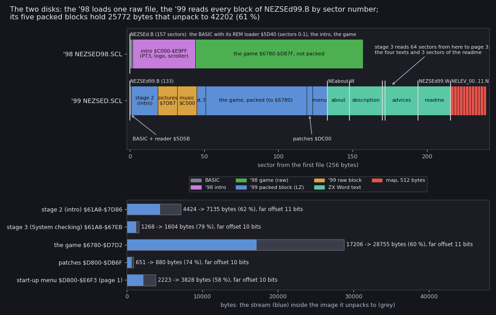
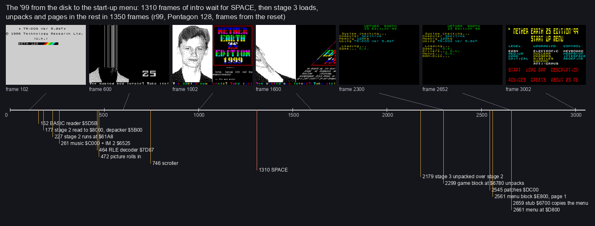
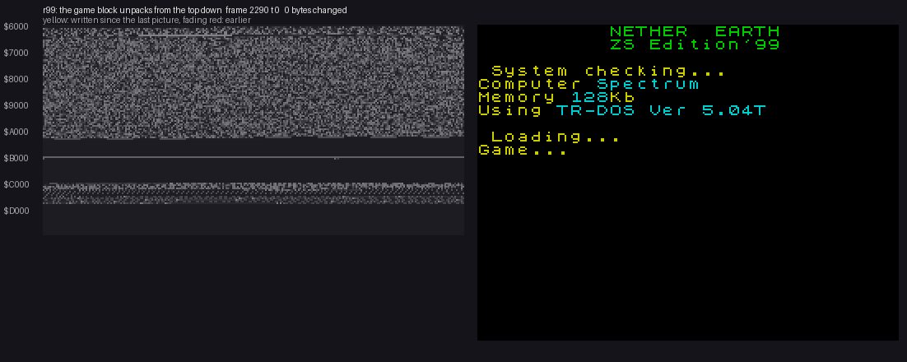
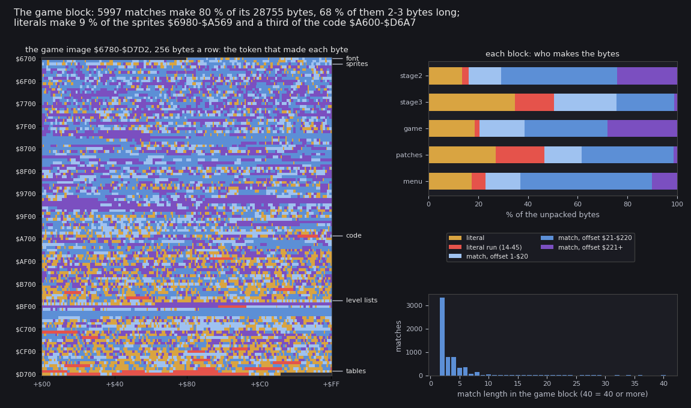

# 3. Build and load

This document covers how the two releases get from their disks into memory:

- the media and the sector layout of both disks (3.1);
- the '98 load (3.2);
- the '99's three-stage load (3.3);
- the '99's packer and its block format (3.4);
- the map files and LOAD MAP (3.5);
- the machines and the ROM (3.6);
- the source build, which rebuilds both disks bit for bit (3.7).

What is here comes from three sources: the recordings' writes and runs, the static unpacks that match them, and the
source in `src/`.

The recordings and runs it rests on (all PENTAGON 128 + TR-DOS 5.04T in unreal-ng, muted, own port bases):

- `r98`: power-on, TR-DOS from the Pentagon menu, `RUN "NEZSEd"`, the intro, SPACE, the menu, `0`, play.
  `work/stage1/r98`, script `inputs/r98.txt`, recording frames 103-5903. A recording frame is the script's + 1603.
- `r99`: the '99 disk autostarted (the quick reset into TR-DOS, recording from frame 2), the intro, SPACE, the
  start-up menu, every menu page, LOAD MAP, LEVEL HARD, UPGRADING PHASERS, START, play. `work/stage1/r99`, script
  `inputs/r99-128.txt`, frames 2-6462.
- `r99-48`: power-on, the Pentagon menu's "48 BASIC" (paging locked), `RANDOMIZE USR 15616`, `RUN "NEZSEd99"`. This
  is the path a 48 K machine would take. `work/stage1/r99-48`, frames 101-7201.
- `x99p`: the '99 disk started from the Pentagon menu's TR-DOS item; it hangs in the intro (3.6).

The static side has two tools:

- `tools/scl.py`: SCL list and extract;
- `tools/zsdepack.py`: the '99 depacker, reimplemented.

## 3.1 The media

| Release | Archive (md5) | SCL | Files |
| --- | --- | --- | --- |
| '98 | `orig/NEZSED98.zip` (`d5e0b181c5323a9bc5459399f4c4953f`) | `NEZSED98.SCL` | one: `NEZSEd.B`, 157 sectors |
| '99 | `orig/NEZSED.ZIP` (`24a13a6972ddfad4db560ec496799f2b`) | `NEZSED.SCL` | 18 (below) |

The '99 disk:

| File | Type, catalogue | Sectors | What |
| --- | --- | --- | --- |
| `NEZSEd99.B` | BASIC, 48 bytes | 133 | the BASIC (sector 0) and, read by number, every block (3.3) |
| `NEabout.W` | `W` 38912, 3763 bytes | 15 | the author's story of the edition (CP866) |
| `NEdescri.W` | `W`, 5469 bytes | 22 | the game description |
| `NEgreets.W` | `W`, 313 bytes | 2 | greetings |
| `NEadvice.W` | `W`, 5572 bytes | 22 | "Advices of Expert" by Timofey Anisimov |
| `NEZSEd99.W` | `W`, 5384 bytes | 22 | the readme (not read by the program) |
| `NELEV_00.N` .. `NELEV_11.N` | `N`, words 0 | 2 each | twelve maps, 512 bytes each (3.5) |

The `.W` texts are ZX Word documents (the intro scroller says so). Their content and translation are in
[texts/](texts/README.md).

How to read the figure:

- **The top two bars** are the disks, one 256-byte sector a step, counted from the first file's first sector.
- **The '98** is one file: the BASIC with its REM loader (sectors 0-1), the intro (2-43) and the game (44-156), the
  game not packed.
- **The '99**: `NEZSEd99.B` holds the BASIC (sector 0) and every block, read by sector number:

  | Sectors | Content |
  | --- | --- |
  | 1-18 | stage 2 |
  | 19-31 | the pictures |
  | 32-44 | the music |
  | 45-50 | stage 3 |
  | 51-118 | the game |
  | 119-122 | the patches |
  | 123-132 | the menu |

  - The four texts and the readme follow (133-215), then the twelve maps of two sectors each (216-239).
  - The arrow marks where stage 3 starts its 64-sector read into page 3: the four texts and the first 3 sectors of
    the readme.
- **The colours**:
  - blue: a packed block;
  - amber: a raw block of the '99;
  - green: the '98's raw game;
  - violet: the '98 intro;
  - teal: a text;
  - red: a map.
- **The bottom panel** shows each '99 block's stream (blue) inside the image it unpacks to (grey), with the ratio and
  the far-offset width.
- **The point**: 25 772 bytes of streams unpack to 42 202 bytes (61 %). The game block is the bulk: 17 206 -> 28 755
  (60 %).
- Drawn by `python3 tools/fig_zs_disk.py --out docs/img/load/disks.png`, from `src/disk98.txt`,
  `src/disk99.txt` and `work/media/99/blocks.json`.

## 3.2 The '98 load

`NEZSEd.B` is a BASIC monoblock: 340 bytes of BASIC (2 sectors), then 42 sectors of the intro, then 113 sectors of
the game, read by sector number from the BASIC's own position.

| Step | Where | Evidence |
| --- | --- | --- |
| line 10 `CLEAR VAL "26495": RANDOMIZE USR VAL "23872"` | `$5D40`, the code in line 1's REM | `r98` stage 3: `$5D40` entered at frame 2000 from `$34BB` (`USR`) |
| copy ROM's font `$3D00` to `$C000` area, bold, `CHARS=$BF00`; print "ZS'98 Presents: NETHER EARTH ZS EDITION" | REM code | screen in `r98` |
| `#3D13` read `$2A` sectors to `$C000-$E9FF`, `CALL $D88F` | the intro (3.4) | stage 4: `$C000-$E9FF` written by `$3FEC` (TR-DOS), `$D88F` entered at frame 2048 |
| read `$71` sectors to `$6780-$D87F`, `JP $A600` | the game, not packed | stage 9: `$A600` entered at frame 4500 from `$5D94` |

- The game image equals the file's bytes from offset `$2C00` placed at `$6780` (`work/static98-game.bin`): at the
  menu (`r98` frame 4600) 3 bytes differ, all game variables (`$C4D0`, `$C4D6`, `$C4EF`).
- The intro at `$C000` equals the file's `$200-$2BFF` (`work/intro98-C000.bin`) except 130 bytes the PT3 player's
  init writes at frame 2048 (its variables and note table, `$C048-$C0FF`).
- The BASIC's VARS area holds more code at `$5DEF` (`RES 4,(IY+1)`, pages `$51`/`$57`/`$54` to `$7FFD`): a 128 K
  loader left behind. Nothing in `$5D97-$5FFF` runs in `r98` (the executed blocks there end at `$5D96`).
- `$5B00-$5B2E` runs: TR-DOS's own paging stub on this machine, not the game's.

## 3.3 The '99 load

`NEZSEd99.B`: line 10 `CLEAR 24999: RANDOMIZE USR 23899`. The code at `$5D5B` (in the BASIC) reads 18 sectors to
`$8000` and returns into it. From then on every program is a self-extracting packed block (3.4) read by sector
number; sector numbers below count from the file's first sector.

| Sectors | Read to | Unpacks to | What | `r99` arrival |
| --- | --- | --- | --- | --- |
| 0 | `$5D3B` | | the BASIC, the first reader at `$5D5B` | `$5D5B` at 152 |
| 1-18 | `$8000` | `$61A8-$7D86` (far 11) | stage 2: the intro (3.4) | `$8000` at 177, `$61A8` at 227 |
| 19-31 | `$7D87` | | not packed: the RLE screen decoder and the pictures | `$7D87` at 464 |
| 32-44 | `$C000` | | not packed: Sound Tracker compiled module and player (init `$C00B`, mute `$C011`) | `$C00B` at 261 |
| 45-50 | `$8000` | `$61A8-$67EB` (far 10) | stage 3: "System checking", the memory test, the game load | after SPACE |
| 51-118 | `$6780` | `$6780-$D7D2` (far 11), in place | the game | `$6780` at 2299 |
| 119-122 | `$DC00` | `$D800-$DB6F` (far 10) | patches: eight pieces in two sets; on 128 K stage 3 copies `paging128` to `$A56A`, `diskread` to `$A598`, `menu128` to `$C100`, `diskmap` to `$C1FD` (frames 2553-2659) | `$DC00` at 2545 |
| 123-132 | `$E800`, page 1 | `$D800-$E6F3`, page 1 (far 10) | the 128 K start-up menu (128 K only) | `$E800` at 2561 |
| `NEabout.W` .. 3 sectors of `NEZSEd99.W` (64) | page 3 `$C000` | | the four texts: `$C000` about, `$CF00` description, `$E500` greets, `$E700` advice | before 2659 |

How to read the figure:

- **The axis** is `r99`'s frame, from the reset to 3050.
- **The seven screens** above it are `r99`'s own at the frames under them, joined to their place on the axis:
  - 102: TR-DOS's title;
  - 600: the picture rolling in;
  - 1002: the intro;
  - 1600: the picture pushed apart after SPACE;
  - 2300 and 2652: "System checking" as the loads tick off;
  - 3002: the start-up menu.
- **The marks below** are the first arrivals of code (`re_session.py stages --work work/stage1/r99`), each with its
  address. SPACE (red) is the script's one key before the menu.
- **The point**: the intro waits 1 310 frames for SPACE, and nothing more is read until it is pressed. Stage 3 then
  loads, unpacks and pages in the rest in about 480 frames (2179-2661).
- Drawn by `python3 tools/fig_zs_boot.py --work work/docs/zsA/r99 --out docs/img/load/boot99.png`, on an instance
  with `r99` loaded (`re_session.py open --work work/docs/zsA/r99 --ttd work/stage1/r99/session.ttd --model
  PENTAGON --port-base 15220`).

How to read the animation:

- **The left grid** is the 64 K at `$6000-$DFFF`, one row per 256 bytes, every 322 560 T (4.5 frames) of `r99`
  frames 2290-2560.
  - A byte's grey is its value.
  - A byte written since the last picture flashes yellow, then fades through red.
- **The right picture** is the screen at the same moment.
- **What it shows**:
  - The block's 68 sectors were read to `$6780-$AB66` just before (TR-DOS's writes). Stage 3 has already printed
    "Game... O.k." on the screen.
  - The first pictures (frame 2303) flash the whole stream yellow: the depacker's first `LDIR` moves it down by
    `$B0` bytes, over the set-up, to `$6780`.
  - Then the writes run from `$D7D2` downwards (yellow at the front, red behind it). The depacker fills the image
    from its top while it reads the stream from its end.
  - The stream lies at the bottom, so the writes never catch up with unread bytes.
  - The front passes `$9C00` at frame 2425 and reaches `$6780` before the patches block is read (2545).
- Drawn by `python3 tools/zs_memanim.py --work work/docs/zsA/r99 --from 2290 --to 2560 --step 322560
  --from-address 6000 --to-address DFFF --screen --cell 2 --label "r99: the game block unpacks from the top down"
  --unreal <unreal-ng checkout> docs/img/load/depack-game.gif`. The script is the kit's `memanim.py` with the
  Pentagon's 71 680 T frame.

Then stage 3 installs one set of patch pieces and decides the route by `(IY+$77)` (`$5CB1`), the page count the
memory test left.

- **A count of 1** (`$62B4`): the one-page route. It uses the tape / one-page patch set of `src/patches99`, which
  reads the texts and the maps from the disk when asked. No machine counts 1 (3.6).
- **Any other count**: the 128 K route.
  1. Page 1 in by `$A58A`; the menu block is loaded and unpacked there.
  2. Page 3 in; the 64 text sectors are read.
  3. The texts' page-3 addresses and lengths go into the operands at `$C124-$C150` (`Stage3Paged` `$62E7`).
  4. `JP $A600`.

  `ShowMenu128`, entered through `$C100`, runs a stub at `$6700`. The stub copies `$D800-$E7FF` from page 1 to
  page 0 every time the menu is entered. So the start-up menu runs in page 0 at `$D800` (`r99` frame 2661), over
  the game's radar and map area, and its level and pointer start afresh each time ([04](04-game-loop.md)).

Each part's source and the stage 2 findings: `src/` (README.md lists the parts); the memory test, the menu and the
level table: `src/stage3/stage3.ann`, `src/menu99/menu.ann`.

Checks against the static unpacks (`tools/zsdepack.py block`):

- stage 2 at `r99` frame 262, `$61A8-$7D86`: 0 bytes differ;
- the game at frame 2554, `$6780-$D7D2` (page 0 at `$C000`): 0 bytes differ outside the areas the patches write
  after the unpack (`$A56A-$A5D5`, `$C100-$C17E`, `$C1FD-$C332`, frames 2553-2659);
- stage 3 at frame 2300: equal except `$663A-$66AD` (its page table and screen strings, written as it runs);
- the menu at frame 3700, `$D800-$E6F3`: equal except `$DE31-$DEF0` (the 192 attribute bytes it saves).
- Every block's stream is consumed exactly: the source pointer ends at the block's own start.

## 3.4 The '99 packer

A backward LZ with a bit stream read from the end; the depacker is `$9A` bytes, copied to `$5B00` by each block.

A block loaded at AT:

| Offset | Bytes | What |
| --- | --- | --- |
| `+$00` | `$16` | set-up: `LD DE,$5B00`, `LD HL,AT+$16`, `LD BC,$9A`, `LDIR`; then `DE = AT`, `HL = AT+$B0`, `BC` = packed length (word at `+$13`), `JP $5B00` |
| `+$16` | `$9A` | the depacker; its first `LDIR` moves the stream down to AT |
| `+$B0` | length | the packed stream |

Operands inside the depacker (offsets from `+$16`): `+$06` source end, `+$0B` destination end, `+$6C` far-offset
bits (11 or 10), `+$78` stop (the byte below the first output byte), `+$81` the jump when done (`$0052`, a `RET`
in the ROM, for the blocks called from stage 3; `$61A8` for the two loader stages).

The tokens (bits from bit 7 of each byte, bytes from the end down):

| Bits | Meaning |
| --- | --- |
| `0` + 8 | a literal byte |
| `11` + 1 | match of 2-3 |
| `101` + 2 | match of 4-7 |
| `1001` + 4 | match of 8-22; value 15: a literal run of 14 + 5 bits bytes |
| `1000` + bytes | match of 23 + the byte; a byte `$FF` adds the next one |
| offset `1` + far bits | `+$221` |
| offset `01` + 5 | `+1` |
| offset `00` + 9 | `+$21` |

The match is an `LDDR` from `DE + offset`. Sizes: stage 2 4424 -> 7135, stage 3 1268 -> 1604, game 17206 -> 28755,
patches 651 -> 880, menu 2223 -> 3828.

### What the streams are made of

How to read the figure:

- **The left grid** is the unpacked game image `$6780-$D7D2`, 256 bytes a row. Each byte is coloured by the token of
  the original stream that wrote it:
  - amber: a literal;
  - red: a literal run;
  - three blues by the match's offset: light for near (1-`$20`), mid for middle (`$21-$220`), violet for far
    (`$221` and up).
- **The labels** on its right are the image's regions: font, sprites, code, level lists, tables.
- **The top right panel** shows each block's output bytes by token kind.
- **The bottom right panel** is the histogram of match lengths in the game block.
- **The point**:
  - Matches make 80 % of the game block's 28 755 bytes: 5 997 matches, 68 % of them 2-3 bytes long. Literals make
    5 870 bytes.
  - The sprites are 9 % literal, and 34 % of their bytes come from far matches (the pictures repeat across the
    sheet).
  - The code is 32-35 % literal, the tables 80 %.
- The figure is read from the original streams' own tokens (`tools/zspack.py` `stream_tokens`, through the depacker
  `tools/zsdepack.py`), not from the reimplemented packer, so it shows the author's streams.
- Drawn by `python3 tools/fig_zs_lz.py --out docs/img/load/lz-game.png`.

The byte shares by token kind, each block's output (%):

| Block | literal | literal run | near match | middle match | far match |
| --- | ---: | ---: | ---: | ---: | ---: |
| stage 2 | 13.6 | 2.7 | 13.0 | 46.5 | 24.2 |
| stage 3 | 34.9 | 15.6 | 25.0 | 23.3 | 1.2 |
| game | 18.5 | 1.9 | 18.2 | 33.5 | 27.9 |
| patches | 27.0 | 19.7 | 15.0 | 36.9 | 1.4 |
| menu | 17.5 | 5.4 | 14.0 | 53.1 | 10.1 |

The blocks with 10-bit far offsets (stage 3, the patches, the menu) are small: their far matches make 1-10 %. The two
11-bit blocks make a quarter of their bytes from far matches.

### The packer

The packer, reimplemented (`tools/zspack.py`, stage 2): every stream rebuilds bit for bit from its unpacked image.
`python3 tools/zspack.py check` prints per block:

| Block | Unpacked -> packed | Tokens | Decisions | By the rule | Hints | Pad byte |
| --- | --- | ---: | ---: | ---: | ---: | --- |
| stage 2 | 7135 -> 4424 | 2722 | 2907 | 2907 | 0 | `$00` |
| stage 3 | 1604 -> 1268 | 799 | 1041 | 1041 | 0 | `$2A` |
| game | 28755 -> 17206 | 11351 | 11867 | 11867 | 0 | `$71` |
| patches | 880 -> 651 | 365 | 529 | 528 | 1 | `$00` |
| menu | 3828 -> 2223 | 1399 | 1596 | 1596 | 0 | `$00` |

The rule (a decision is a match or one literal; positions count from the top byte down, as the depacker writes):

1. at each position the longest match whose offset k is at most the window (`$220` + 2 to the far bits) and whose
   length is at most k (no self-overlap), the nearest of the equally long, taken when its length is at least 2;
2. only where step 1 finds nothing: a run of one byte repeated at least 8 times, written as a match of offset 1 and
   length min(run, 22) (the only overlapping matches in the five streams);
3. else a literal. Literals between matches go out singly when fewer than 14; 14 or more go out as literal runs of
   45 (`1001 1111` + 5 bits), the last run taking the rest (14-45).

The stream ends with the last token's bits padded with zeros in its byte, then one more byte the depacker never
reads (the pad byte above: a left-over of the packer's buffer). The one decision the rule misses is the patches'
last match, two bytes before the end: the original took offset `$64` where `$15` is nearer, as if it compared one byte
past the data's end. It and the pad bytes are kept in `src/sfx/hints/<block>.lzhints`; a hint applies only where it
is valid for the data being packed, so an edited image packs by the rule.

The set-up and the depacker are source, `src/sfx/zsblock.asm` (every label named and described), assembled once a
block by `tools/build.sh` with the block's parameters from `src/sfx/blocks.txt`; the five blocks come out identical.
The rest of each block's last sector is not slack from the disk: it is the block's own unpacked image from the
block's length on (zero past the image's end) - the author packed each image in place in memory and saved the
sectors over it. `tools/build.sh` writes it so.

Identification: not identified. The depacker is byte-identical except for its addresses in other disks of the time
(ZX Format #7 disk 2 "R.R.demo", `CHASE_HQ.SCL`, `HAPPYNEW.$B`, `BRAIN_CR.$B`, `XAS9_10`, `SAA10991.TRD`,
`SG2.01m.scl`), and a variant with a 12-bit far offset is in `POOGABOO.$B` of Spectrum Expert #1, whose disk also
holds LCP 128 ("COMPRESSOR BY ALEXANDER TRUSH ODESSA"). That is a candidate attribution only; the packer is not in
`R/signatures` and is not added (`work/stage1/NOTES.md`).

## 3.5 The maps (`NELEV_xx.N`) and LOAD MAP

512 bytes each: four lists of 3-byte records (scenery west, scenery east, ending 0; bases west, east, ending `$FF`),
zeros after them, then at `$1F3` a 13-byte tail. LOAD MAP's code (the patch piece at `$C1FD`, `src/patches99`
module `diskmap`) reads the TR-DOS catalogue (8 sectors to `$F000`), lists the `N` files, reads the chosen one to
`$F000` and `DiskApplyLevel` (`$C2EB-$C332`) copies `$1F3` bytes to `$BDA9-$BF9B` and writes the tail into the
game's instruction operands:

| Offset | Size | Written to | What |
| --- | --- | --- | --- |
| `$1F3` | 1 | `$ADB4`, `$BB1F` | capture points = warbases + factories (28; 27 in `NELEV_08`) |
| `$1F4` | 2 | `$BC8A` | the address of the west scenery list (`$BDA9`) |
| `$1F6` | 2 | `$BC92` | the east scenery list |
| `$1F8` | 2 | `$BCA2` | the west base list |
| `$1FA` | 2 | `$BCAA` | the east base list |
| `$1FC` | 2 | `$BC9B` | the first factory's record in the buildings table, `$FD70` + 5 x warbases (a pointer) |
| `$1FE` | 1 | `$BCB7`; +1 to `$B3E6`, `$B817` | the enemy's warbases |
| `$1FF` | 1 | `$A684` | the player's starting general resource (`$63` = 99 in all twelve) |

A map file is a level only, no game state: no robots, day, clock, owners or the enemy's resources. Every field but
the last follows from the lists (`tools/zs_level.py` derives them and checks). The text form is
`src/res/maps/NELEV_xx.txt` (the level's text form plus the tail), with a preview per map (`src/res/maps/README.md`).

The catalogue screen shows the file names only, four to a row, no numbers; the highlight is attribute `$38`.
Keys: Q the previous name, A the next, SPACE loads; nothing else (P does not move it, as stage 1 saw). Keys are
read by the ROM's KEY-SCAN every third interrupt with no wait for release, so a held key repeats. The cursor runs
over 96 places (`$C2C4`) whatever the file count; names past the 64th print on the wrong lines (`$C263` corrects
only the first third of the screen), and SPACE on an empty place returns to the menu. After a load the menu comes
back; START plays the map. No mouse: no block of either release reads a port `$xxDF`; the menus read the keyboard
(Q A O P, SPACE; `$DDE4`), and the only Kempston read is the game's joystick `IN ($1F)` at `$D3AC`.

### The '98's LOAD NEW LEVEL

The '98 menu's key 5 jumps (`$C1B5`) to `$C1FD`. There 62 `NOP`s stand where a load would be, and no disk read
follows: the '98 game has no TR-DOS call at all. `LoadLevelCopy` `$C23B` then copies 500 bytes from `$DD00` to `$BDA9`
(one byte past the lists, into the shape table), loads the words at `$DEF4-$DEFA` into BuildMap's list operands
`$BC8A`, `$BC92`, `$BCA2`, `$BCAA` and jumps to `$A600`: the second half of what became the '99's map loader,
without the read that should fill `$DD00`. `$DD00` holds the intro's scroller text left in memory, so the four list
operands become `$2020` (spaces), an address in the ROM; START GAME builds the map from ROM bytes, rows past 15 wrap
round the 64 K and overwrite the code, a `CALL $ED48` lands in the map and the machine resets to the 48 BASIC
copyright screen (`work/stage2/game98/key5menu`: the call at frame 415, PC `$0000` at 462).

## 3.6 Machines and the ROM

- The '98 runs on a Pentagon 128 with TR-DOS; it pages only to set the intro's `$7FFD=$10`.
- The '99's stage 3 runs a memory test (`$647B`) that knows many paging schemes (`$7FFD`, `$1FFD`, `$DFFD`, `$FDFD`,
  `$7FF7`/`$FFF7` ...) and leaves the page count in `$5CB1` and a scheme bitmask in `$5CB0`. On Pentagon 128 it
  finds 5 (`$5CB0=$01`), prints "Memory 128Kb" (`(n + 3) * 16`).
- With no paging the test finds no page: count 0 (`$5CB0` = 0, `$5CB1` = 0), "Memory 56Kb" (`(0 + 3) * 16`). The
  one-page branch at `$62B4` needs a count of exactly 1, which no machine gives (a 48 K machine counts 0), so the
  128 K route runs: the menu block is unpacked at `$E800` and the 64 text sectors are read to `$C000-$FFFF`, which
  on a machine without paging is the game itself, the patched table at `$C100` included. START calls `$C100`, now
  the bytes of the about text: they run as code (`CALL PE,$A0AD`, then `RST $28`), the ROM calculator reaches
  USR-NO `$34B3` and jumps to `$0001`, NEW `$11CB`: the machine resets. Seen twice:
  - `r99-48` (Pentagon 128, "48 BASIC", paging locked): frames 5647-5664, the "(c) 1982 Sinclair" screen at 5760
    (`work/stage2/menu99/r48-5760.png`); the `0 OK` at frame 7200 that stage 1 noted came later, from a key in the
    BASIC editor after the reset;
  - unreal-ng's `48K-BETA128` model (a 48 K Spectrum with a Beta 128 interface, TR-DOS 5.03): "Computer Spectrum /
    Memory 56Kb / Using TR-DOS Ver 5.03 / ... RAM-Disk... O.k.", then about 300 frames after the second SPACE the
    same reset (PC `$34B6-$34BB` -> `$0001` -> `$11CB`).
  So the '99 does not run on a 48 K machine with a Beta disk, although its texts say it does: its 48 K path (the
  one-page patch set of `src/patches99`, the tape pieces) is unreachable. The '98's code needs only 48 K (its one `$7FFD` write does nothing there); it was not run on the `48K-BETA128` model.
- Scorpion ZS-256 (unreal-ng model `SCORPION`, `work/stage2/scorpion`): both releases autostart, load and play.
  The '99 prints "Computer Scorpion", "Memory 256Kb", "Using TR-DOS Ver 5.03" and goes through the start-up menu,
  its texts and START into play (`e99s`, `s99`); the '98 goes through its intro and menu into play (`e98s`, `s98`).
  On Scorpion the default map was played (no LOAD MAP): its scenery spells "ЗАГРУЗИСЬ" ("load up") on the radar, the
  built-in level is a prompt to load a map, not a fault.

### The hang from the Pentagon 128 menu's TR-DOS item

Started from the Pentagon 128 boot menu's TR-DOS item, the '99 hangs in the intro (`work/stage1/x99p`). This is the
game's incompatibility with the Pentagon 128 ROM, not an emulator fault: the ROM is the original. Its 48 BASIC IM 1
handler at `$004A` calls `$386E`, which with FLAGS (`$5C3B`) bit 4 set calls `$3A42`; that reads the AY's port A and
writes `$5B88`. Every packed block copies its depacker to `$5B00-$5B99` (the printer buffer, free on a 48 K machine)
and runs it with interrupts on, and `$5B88` is the depacker's own code (`DepackGetBits+5`, the `RL C`,
`src/sfx/zsblock.asm`): the first interrupt during an unpack breaks it. The menu's TR-DOS item leaves FLAGS bit 4
set (the 128 BASIC mode bit); the disk's autostart (FLAGS `$C8`, bit 4 clear) and the menu's "48 BASIC" path then
`RANDOMIZE USR 15616` do not, so the handler never reaches `$3A42`. The author most likely tested only on Scorpion
and Leningrad-type machines, where the printer buffer is free at any time; the '98 does not use `$5B00` and is
not affected.

## 3.7 The source build

`tools/build.sh [SJASMPLUS]` (a lock in `build/.lock` keeps one build at a time) runs each part's build, then packs
and writes the disks:

| Part | Source (`src/`) | Bytes | Build |
| --- | --- | --- | --- |
| '98 BASIC + REM loader | `basic98/basic.asm` | `NEZSEd.B` sectors 0-1 | `tools/build_intro98.sh` |
| '98 intro (PT3 player and tune, logo, robot, scroller) | `intro98/intro.ann` | sectors 2-43, `$C000-$E9FF` | `tools/build_intro98.sh` |
| '98 game | `game98/game.ann` | sectors 44-156, `$6780-$D87F` | `tools/build_game98.sh` |
| '99 BASIC + reader | `basic99/basic.asm` | `NEZSEd99.B` sector 0 | `tools/build_front99.sh` |
| '99 stage 2 (the intro) | `stage2/stage2.ann` | `$61A8-$7D86`, packed | `tools/build_front99.sh` |
| '99 RLE decoder and picture | `pictures99/pictures.ann` | sectors 19-31 | `tools/build_front99.sh` |
| '99 Sound Tracker player and tune | `music99/music.ann` | sectors 32-44 | `tools/build_front99.sh` |
| '99 stage 3 (System checking, the loads) | `stage3/stage3.ann` | `$61A8-$67EB`, packed | `tools/build_menu99.sh` |
| '99 game | `game99/game.ann` | `$6780-$D7D2`, packed | `tools/build_game99.sh` |
| '99 patches (eight pieces, two sets) | `patches99/patches.ann` | `$D800-$DB6F`, packed | `tools/build_game99.sh` |
| '99 start-up menu | `menu99/menu.ann` | `$D800-$E6F3` of page 1, packed | `tools/build_menu99.sh` |
| the five `.W` texts | `res/text/*.txt` | the `W` files | `tools/build_texts.sh` |
| the twelve maps | `res/maps/NELEV_xx.txt` | the `N` files | `tools/build_game99.sh` |
| the five packed blocks | `sfx/zsblock.asm`, `sfx/blocks.txt`, `sfx/hints/` | | `tools/build.sh` (`tools/zspack.py`) |
| the disks | `disk98.txt`, `disk99.txt` | the SCLs | `tools/mkscl.py` |

Each `.ann` is turned into its `.asm` files by its part's wrapper around `kit/mkgame.py` (`tools/<part>_mkgame.py
--install`), which installs only when sjasmplus gives the original bytes. Result:
`build: NEZSED98.SCL identical to orig/NEZSED98.zip`, `build: NEZSED.SCL identical to orig/NEZSED.ZIP`.
