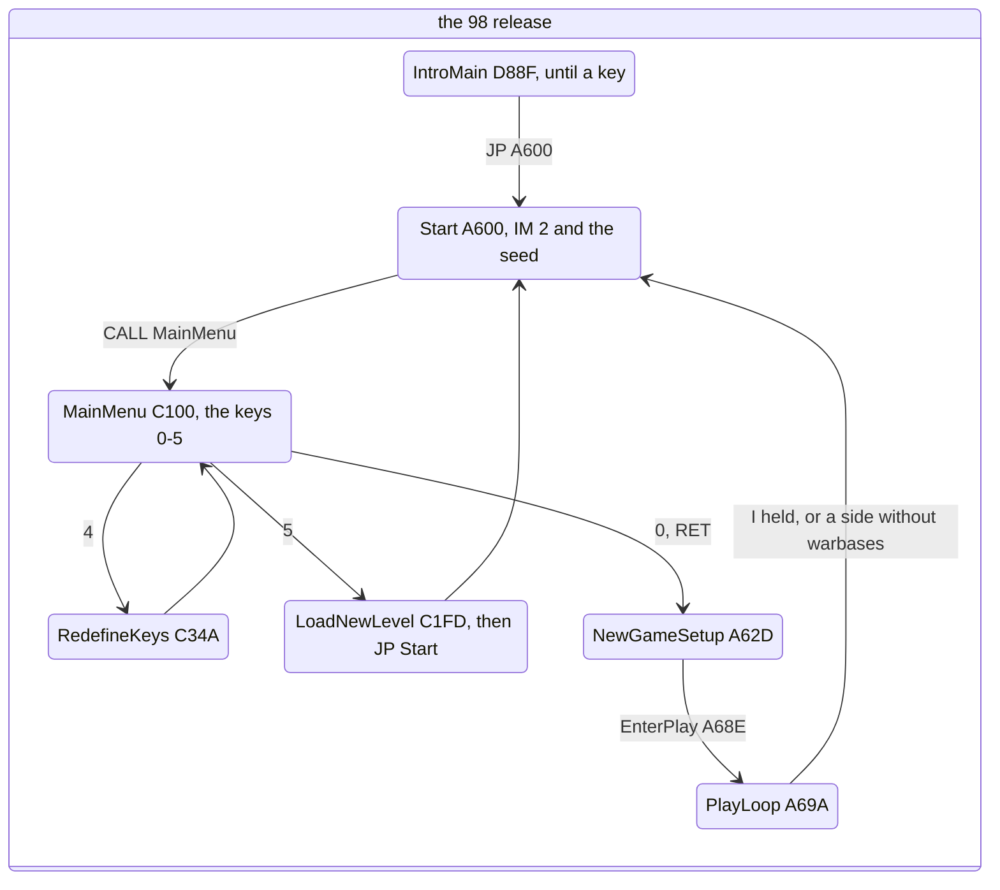
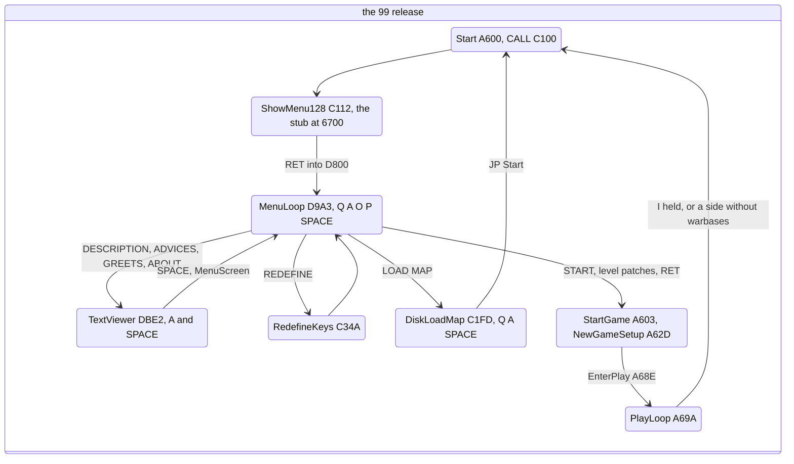
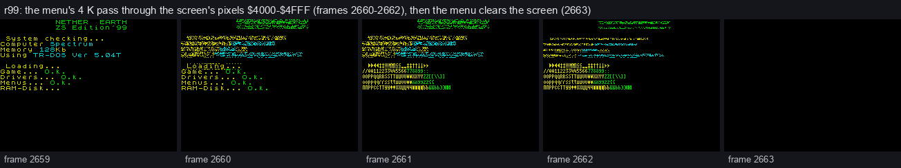
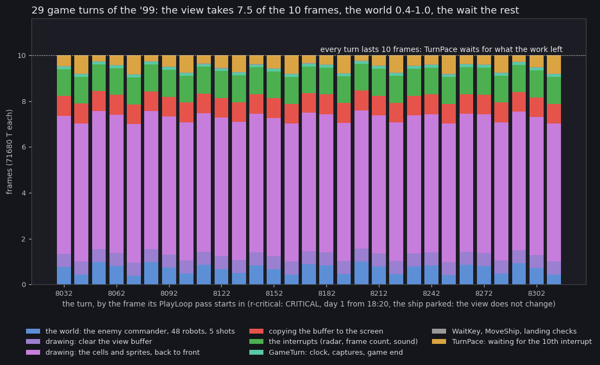
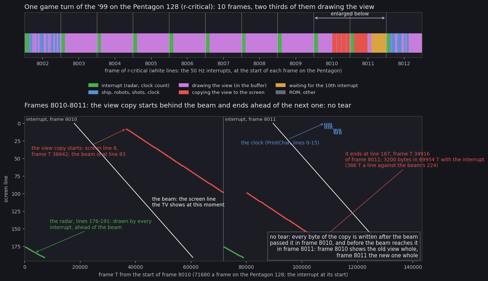
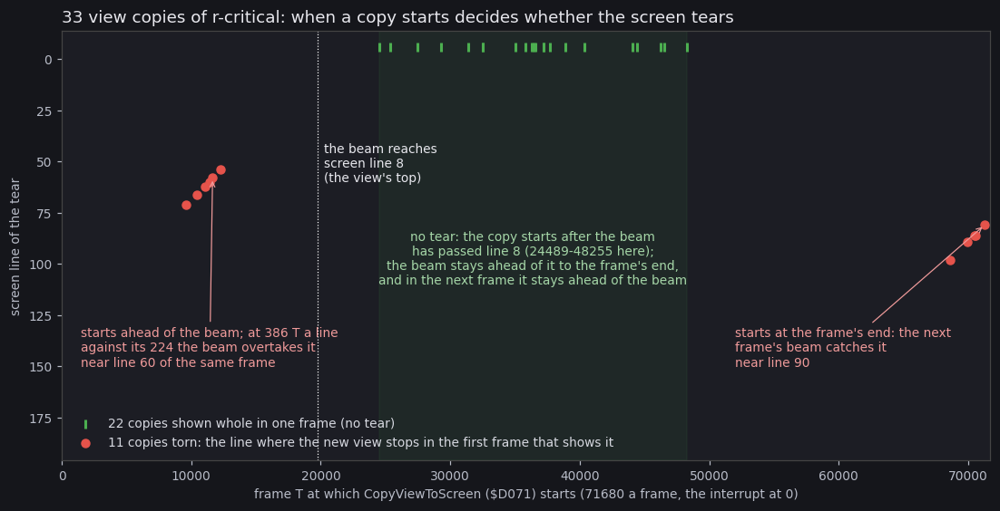

# 4. Game loop

This document follows the program's control through both releases:

- the state machine from the start-up to play and back (4.1);
- how the '99 enters its start-up menu (4.2);
- the menu loops, which have no frame pacing (4.3);
- one game turn and where its time goes (4.4);
- the turn's place against the beam, and when the view copy tears (4.5);
- the clock and the random seed (4.6).

[02](02-architecture.md) has the memory map and the interrupt handlers. [03](03-build-and-load.md) has the loads
that come before.

The recordings (unreal-ng, PENTAGON 128 + TR-DOS 5.04T, muted):

- `r99` (`work/stage1/r99`): the '99 from the autostart through every menu page to play, frames 2-6462.
- `r-critical` (`work/stage2/game99/r-critical`, script `inputs/critical.txt`): the '99 from the autostart.
  - SPACE at 1310; CRITICAL at 2866; START at 2899.
  - The game starts at frame 2901 on the built-in map.
  - Then 9 200 frames of play with the ship parked, to frame 12102.
- Two access traces of `r-critical`, made by `zsa_common.trace` through the kit's `kitlib.py` on our own instance:
  - `work/docs/zsA/rc/traces/8000_0-8026_0.uatr`: 26 frames, the first whole turn at frames 8002-8012;
  - `work/docs/zsA/rc/traces/8026_0-8326_0.uatr`: 300 frames, 30 turns.
- A trace of `r99` frames 3740-3750 (`work/docs/zsA/r99/traces/3740_0-3750_0.uatr`): the start-up menu with P and A
  held.
- `r98` (`work/stage1/r98`): the '98, frames 103-5903.

## 4.1 The state machine





How to read the diagrams:

- **A state** is a routine that holds control, with its address.
- **An arrow** is the key or the event that leaves it.
- **The '98** enters its menu by a `CALL` from `Start`, after the IM 2 table and the seed are set; the menu's 0
  `RET`s into `NewGameSetup`.
- **The '99** enters its menu before `StartGame`. `Start` `$A600` is `CALL $C100`, and START returns to `$A603`.
  - LOAD MAP leaves through `JP Start`, so the menu is copied again from page 1 after every map.
  - The text pages and REDEFINE return to `MenuScreen` `$D813`, which redraws the menu without a new copy.
- **Play** leaves in two ways, both through `JP Start`:
  - `CheckGameKeys` sees `Input` bit 6 (key I, ABORT);
  - `CheckGameEnd` `$AE6B` finds a side without warbases. `GameOverWait` `$AEEA` then waits 100 frames and a key.

Each witness:

| Edge | Witness |
| --- | --- |
| '98 intro to the menu | `r98`: key at frame 4203, `$A600` entered at 4500 |
| '98 menu to play | `r98`: 0 START, the play screen at frame 5000 |
| '98 5 LOAD NEW LEVEL!, then 0 | `x98`: the reset at START ([03](03-build-and-load.md)) |
| '99 start-up to the menu | `r99`: `$C100` and `$6700` at 2659, `$D800` at 2661 |
| '99 a text page and back | `r99`: DESCRIPTION at 3819 (SPACE), back with SPACE |
| '99 LOAD MAP and back | `r99` frame 5452; `x99` 4127 |
| '99 START | `r99`, `x99`, `r-critical` (2899) |
| '99 ABORT to the menu | `x99` frame 5302 |
| either release, the game's end | no recording; from the code |

## 4.2 Entering the start-up menu ('99)

`ShowMenu128` (`$C112`, the patches block's `menu128`) does four things:

1. stores the caller's stack in the stub's `LD SP,nn` (operand `$C179`);
2. copies the 40-byte `MenuStub` from `$C158` to `$6700`;
3. pushes `$6700`;
4. jumps into the ROM's `LDIR; RET` at `$33C3`.

The stub then moves the menu through the screen:

```
MenuStub:                         ; src/patches99/menu128.asm, runs at $6700
  DEFB $31,$80,$67                ; LD SP,$6780: a stack of its own
  DEFB $3E,$01,$CD,$8A,$A5        ; LD A,1: CALL SetPage: page 1
  DEFB $21,$00,$D8                ; LD HL,$D800: the menu in page 1 ...
  DEFB $11,$00,$40                ; LD DE,$4000: ... to the screen ...
  DEFB $01,$00,$10,$ED,$B0        ; LD BC,$1000: LDIR: ... 4 K
  DEFB $AF,$CD,$8A,$A5            ; XOR A: CALL SetPage: page 0
  DEFB $21,$00,$40                ; LD HL,$4000: from the screen ...
  DEFB $11,$00,$D8                ; LD DE,$D800: ... into page 0
  DEFB $01,$00,$10                ; LD BC,$1000: 4 K
  DEFB $31,$00,$00                ; LD SP,nn: the caller's stack (operand $C179)
  DEFB $D5                        ; PUSH DE: $D800, the menu's start
  DEFB $C3,$C3,$33                ; JP $33C3: the ROM's LDIR; RET into $D800
```

The copy needs a 4 K buffer that both pages can see, and the screen is the only one. So the menu's code shows on
the screen.



How to read the figure:

- **Five screens** of `r99`, one a frame, 2659 to 2663.
- **2659**: "System checking" with every load ticked off: the last screen of stage 3.
- **2660-2662**: the top two thirds (`$4000-$4FFF`) hold the menu's 4 K as pixels; the attributes are still stage
  3's. The stub copies in frame 2660, the menu starts at 2661.
- **2663**: `MenuScreen` has cleared the screen. The menu text is printed next.
- **The point**: the screen is the stub's buffer.
- Drawn by `python3 tools/fig_zs_anim.py --work work/docs/zsA/r99 --from 2659 --to 2663 --step 1 --scale 1 --title
  "..." --out docs/img/loop/menu-copy.png`, on an instance with `r99` loaded.

`MenuEntry` `$D800` sets up its own environment:

- interrupts in IM 0 with `I` = `$3F` (the ROM's handler);
- its own stack at `$677E`, with the caller's return address pushed on it.

In IM 0 the bus byte `$FF` is `RST $38`, so the ROM's handler runs each frame: it counts `FRAMES` and scans the
keyboard. The game's IM 2 table at `$FE00` is left alone; `StartGame` builds it again in any case.

## 4.3 The menu loops

### The '99 start-up menu

`MenuLoop` (`$D9A3`) has no `HALT`. One pass does four things:

1. `CALL TitleColourCycle` (`$C820`, in the game's music module): repaint the title rows 0-6 on even phases of the
   counter `$FD33`.
2. Delay: `C` = 3 outer x 256 `DJNZ`.
3. `CALL ReadMenuKeys` (`$DDE4`): the half-rows `$DFFE`, `$FBFE`, `$FDFE`, `$7FFE` give Q, A, O, P and SPACE in `E`.
4. Move the pointer 1 pixel on each held axis (`D` counts the moves). If it moved: restore the background, store the
   new position in `DrawPointer`'s operand `$DD74`, draw again.

```
MenuLoop:
  CALL TitleColourCycle   ; the title colours
  LD C,$03
DelayOuter:
  LD B,$00
DelayInner:
  DJNZ DelayInner         ; 3 x 256 turns
  DEC C
  JR NZ,DelayOuter
  CALL ReadMenuKeys       ; E: bit 0 P, 1 O, 2 Q, 3 A, 4 SPACE (0 = held)
  LD D,$00                ; D counts the moves of this pass
  LD BC,(DrawPointer+$0001) ; C = x, B = y
  ...
```

The pass rate is measured in the trace of `r99` 3740-3750:

- 5 passes a frame with no key held;
- 3 passes a frame with a key held (each move redraws the pointer).

So the pointer runs 3-4 pixels a frame with a key held. The track in `r99`, with P and A held every other frame
from 3735:

| Frame | 3737 | 3738 | 3750 | 3770 | 3790 | 3800 | 3812 | 3830 |
| --- | --- | --- | --- | --- | --- | --- | --- | --- |
| x, y | 8, 8 | 11, 11 | 32, 32 | 68, 68 | 103, 103 | 120, 120 | 142, 142 | 148, 142 |

The speed therefore depends on the CPU clock: on a faster machine the pointer runs faster.

### The '99 text viewer and LOAD MAP

- **`TextViewer`** (`$DBE2`) waits in its own key loop (`ViewerKeys` `$DC39`), one `HALT` a pass. A moves 16 lines on,
  Q 16 lines back, SPACE returns (`ViewerSpace` `$DC78`).
- **`DiskLoadMap`** (`$C1FD`) reads the keys with the ROM's KEY-SCAN once every three `HALT`s (`DiskMapKeys`
  `$C292`), with no wait for release.

### The '98 main menu

`MainMenuKeys` (`$C192`) is frame-paced:

1. `HALT`, `TitleColourCycle`, the ROM's KEY-SCAN, until no key is held.
2. `MenuMusic` (`$C4A7`) plays the title tune until a key.
3. `MenuWaitKey`: `HALT`, `TitleColourCycle`, KEY-SCAN. The key's character comes from the ROM's key table at
   `$0205`.
4. The key decides:
   - `5`: `LoadNewLevel`;
   - `0`: `RET` with Z;
   - `1`-`3`: set `Controls`;
   - `4`: `RedefineKeys`, then the whole menu again.

## 4.4 One game turn

`PlayLoop` (`$A69A`) runs one turn a pass:

1. `WaitKey` `$D37C`: the controls, and the pause while key 1 is held.
2. `MoveShip` `$AF11`.
3. `WorldTurn` `$B0CA`: the enemy commander, the 48 robot slots, the 5 shots.
4. `DrawView` `$CCBD`, in three calls:
   - `DrawViewBackground` `$CFD7`;
   - `DrawMapObjects` `$CCC6`;
   - `CopyViewToScreen` `$D071`.
5. `GameTurn` `$AD62`: the clock, the captures, the game end, then `TurnPace`.
6. The checks under the ship (`ShipCell` `$CCA0`): `RobotMenu` `$A720` on our robot, `ConstructionMenu` `$C849` on
   our warbase's pad.
7. `CheckGameKeys`.

`TurnPace` (`$AE1D`) is the pace:

```
TurnPace:
  LD A,(TurnFrames)       ; counted up by PlayInterrupt, once a frame
  CP $0A                  ; 10 frames since the last turn?
  JR C,TurnPace           ; not yet: wait
  XOR A
  LD (TurnFrames),A       ; the next turn's frames
  RET
```



How to read the figure:

- **A bar** is one game turn of the 300-frame trace, labelled by the frame its `PlayLoop` pass starts in. The height
  is in frames of 71 680 T.
- **The colours** are the phases, as `tools/zs_turn_profile.py` assigns them: the `PlayLoop` call that is running,
  with the interrupts apart. An interrupt runs from the jump to `$FDFD` until `SP` is back above what it pushed.
  - blue: the world;
  - violet, two shades: clearing the view buffer, and the cells and sprites;
  - red: the copy to the screen;
  - green: the interrupts;
  - teal: `GameTurn`;
  - grey: `WaitKey`, `MoveShip` and the checks;
  - amber: the wait in `TurnPace`.
- **The dotted line** is 10 frames.
- **The point**:
  - Every turn is exactly 10 frames: the wait absorbs whatever the work leaves.
  - The view takes about 7.5 of the 10 frames.
  - The world takes 0.4-1.0, and the interrupts about 1.2.
- Drawn by `python3 tools/fig_zs_turns.py --trace work/docs/zsA/rc/traces/8026_0-8326_0.uatr --out
  docs/img/loop/turn-phases.png`.

Over the bot's whole games the wait is smaller than in this parked-ship trace: `GameTurnEnd` is 1.4 % of the CPU in
the '98's `deep` (its 2 693 turns average 11.2 frames) and 5.7 % in the '99's `deep-easy-map0`
([2.2](02-architecture.md#where-the-time-and-the-bytes-go-at-play)).

The first whole turn of the shorter trace, frames 8002-8012 (`python3 tools/zs_turn_profile.py
work/docs/zsA/rc/traces/8000_0-8026_0.uatr`):

| Phase | T | Share |
| --- | ---: | ---: |
| `DrawMapObjects` | 432 211 | 60.3 % |
| interrupts (10 x `PlayInterrupt`, 8 377 T each) | 83 770 | 11.7 % |
| `CopyViewToScreen` | 61 736 | 8.6 % |
| `WorldTurn` | 59 737 | 8.3 % |
| `DrawViewBackground` | 40 602 | 5.7 % |
| `TurnPace` (waiting) | 28 553 | 4.0 % |
| `GameTurn` (clock, captures, end) | 8 153 | 1.1 % |
| `WaitKey`, `MoveShip`, the checks | 2 006 | 0.3 % |
| one turn | 716 768 | 10.00 frames |

The ship is parked and the view does not change, yet the view is drawn again in full each turn. This view has no
robot in sight; one with robots in sight costs more sprites, and no recording measured such a turn.

## 4.5 The turn against the beam



How to read the figure:

- **The top strip** is one turn, `r-critical` frames 8002-8012. Every instruction is coloured by its phase, and the
  white lines are the 50 Hz interrupts.
- **The bottom panel** enlarges frames 8010-8011. Across is the T-state from the start of 8010; down is the screen
  line.
  - The white diagonals are the beam.
  - Each dot is a screen write.
  - A write left of the beam shows in this frame; one right of it shows only in the next.
- **The red dots** are `CopyViewToScreen`:
  - It starts at screen line 8 at frame T 36 642, when the beam is at line 83.
  - It ends at line 167 at T 34 916 of frame 8011.
  - That is 3 200 bytes in 69 954 T, the interrupt included: 386 T a line against the beam's 224.
- **The green dots** are the radar (lines 176-191), drawn by every interrupt ahead of the beam.
- **The blue dots** are the clock's digits (`PrintChar`, lines 0-15).
- **The point**: this copy starts behind the beam and ends before the next beam reaches its lines. Frame 8010 shows
  the old view whole, and frame 8011 the new one whole.
- Drawn by `python3 tools/fig_zs_turn.py --trace work/docs/zsA/rc/traces/8000_0-8026_0.uatr --listing
  build/game99/game.lst --copy-frame 8010 --out docs/img/loop/beam-turn.png`.

The copy loop, 20 `LDI`s a line (`$D071`):

```
CopyViewToScreen:
  LD HL,ViewBuffer        ; $5B00, 20 bytes a line
  LD DE,$4021             ; the screen at character (1,1)
  ...                     ; 20 character rows x 8 lines x 20 LDI
```

Whether a copy tears depends on when it starts:



How to read the figure:

- **The x axis** is the frame T at which `CopyViewToScreen` starts, the interrupt at 0.
- **The y axis** is the screen line of the tear: where the new view stops in the first frame that shows it.
- **Green ticks** at the top are the 22 copies shown whole in one frame.
- **Red dots** are the 11 torn copies.
- **The green band** (frame T 24 489 to 48 255) is where every copy started clean. A copy is clean when it starts
  after the beam has passed line 8, the view's top. At 386 T a line the copy is slower than the beam, so the beam
  stays ahead of it to the frame's end, and in the next frame it reaches no line the copy has not yet written.
- **Left cluster**: copies that start ahead of the beam (T 9 500-12 300). The beam overtakes them near line 55-70.
- **Right cluster**: copies that start at the frame's end. The next frame's beam catches them near line 80-100.
- **The dotted line** is when the beam reaches line 8 (T 19 736).
- **The point**: the turn is not synchronised with the beam. Where the copy falls in the frame drifts from turn to
  turn, and a third of the copies tear.
- Drawn by `python3 tools/fig_zs_tear.py --trace work/docs/zsA/rc/traces/8026_0-8326_0.uatr --trace
  work/docs/zsA/rc/traces/8000_0-8026_0.uatr --out docs/img/loop/tear-band.png`. A byte at screen line L, column c
  shows in the frame whose beam fetches it after the write, at frame T 17 944 + 224 L + 4 c on the Pentagon.

## 4.6 The clock and the seed

`GameTurn` (`$AD62`) advances the clock `Clock` (`$FD35` minutes, `$FD36` hours, `$FD37-$FD38` days) by 5 minutes a
turn.

- At 60 minutes it carries an hour, and at 24 hours a day.
- At each new day it calls `DailyProduction` (`$AE38`).
- With 10 frames a turn, an hour is 120 frames and a day 2 880 frames.

In `r-critical`:

- the clock reads day 0, 00:00 at frame 2920 and 00:15 at 2960;
- the day count steps at frames 5840, 8720 and 11600, 2 880 frames apart.

`DailyProduction` pays each side:

- 5 general a warbase ('98: 8);
- 2 of each kind a factory of that kind;
- on HARD and CRITICAL ('99), the enemy's income is replaced by `UpgradeEnemyRobots` (`$AE41`, [01](01-game-design.md)).

`GameTurn` calls `Random` (`$D358`) at the start of each turn; other routines call it too. `Random` is a 32-bit
shift register over `RandomSeed` (`$FD00-$FD03`):

- the feedback is bit 6 XOR bit 3 of `$FD00`;
- the byte returned is one of the four, chosen by the last one's low two bits.

The seed is `$39,$30,$39,$30` at every `StartGame`. No instruction of the game block reads the `R` register or the
ROM's `FRAMES`. So the game is deterministic: the same keys at the same turns give the same game.

`UnusedTapeCode`, after `TurnPace`, is a tape save (keys 6 and 7 held, the ROM's SAVE at `$04B0`). No instruction
jumps to it (`src/game99/game.ann`); it is known from the code only.
