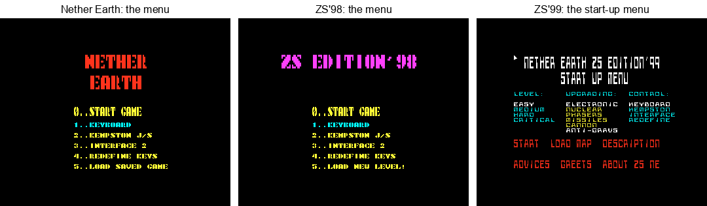
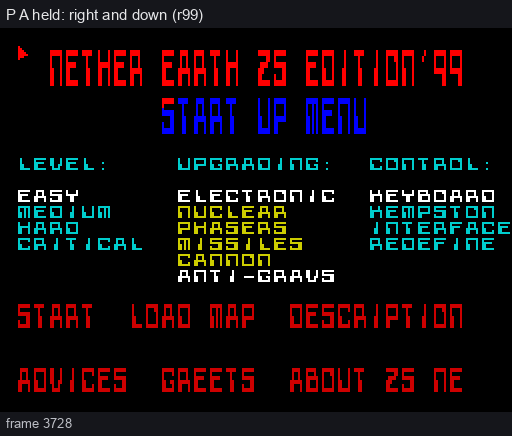
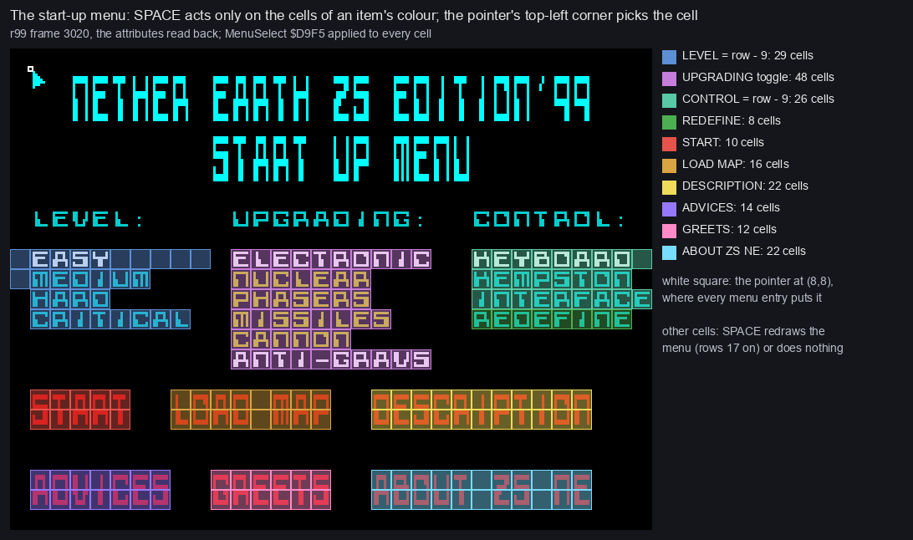
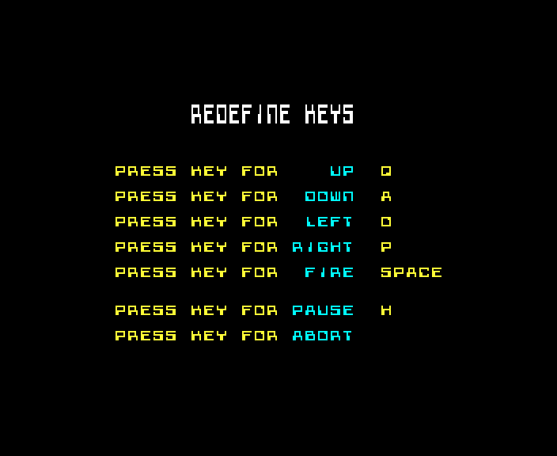
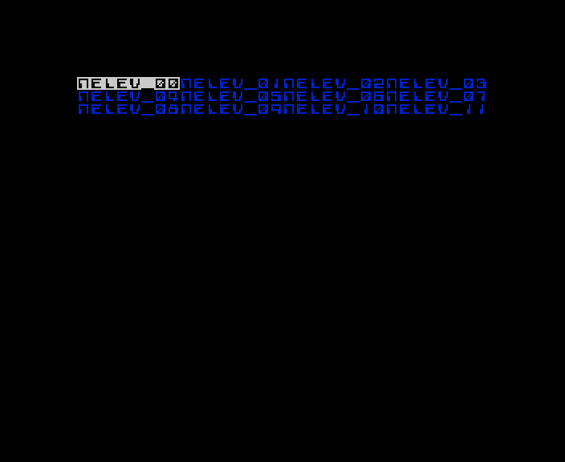
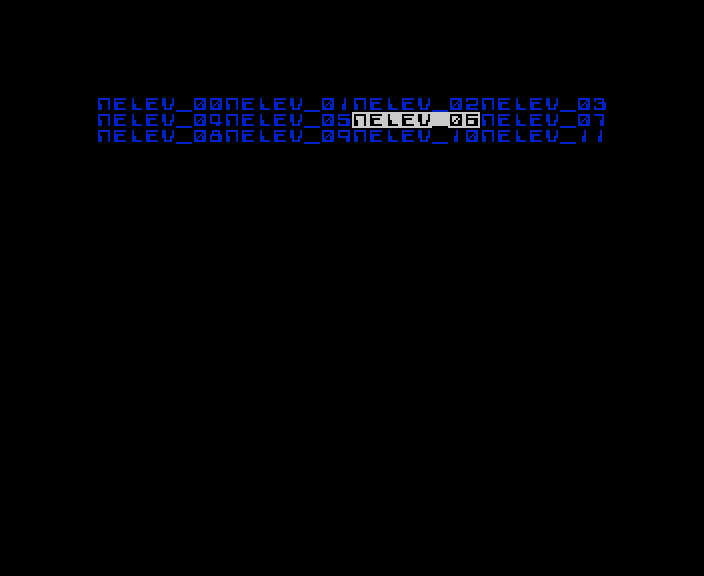
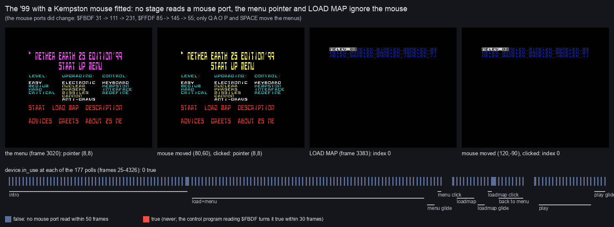
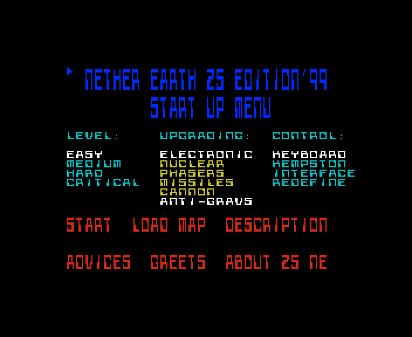

# 5. Controls

This document covers every key and device the two releases read:

- the intros (5.1);
- the '98 menu (5.2);
- the '99 start-up menu, its pointer and its hit rule (5.3);
- REDEFINE (5.4);
- the text pages and LOAD MAP (5.5);
- the Kempston mouse, which nothing reads (5.6);
- play (5.7).

For each one it gives the routine that reads it and what the recordings show. The screens themselves are in
[01](01-game-design.md), how they are drawn in [06](06-rendering.md), and the menu loops' timing in
[04](04-game-loop.md).

The recordings (unreal-ng, muted; their input scripts beside them):

| Recording | Machine | The keys it presses |
| --- | --- | --- |
| `r98` (`work/stage1/r98`) | Pentagon 128 + TR-DOS | `RUN "NEZSEd"`, SPACE in the intro, 0 START |
| `x98` (`work/stage2/texts/x98`, `inputs/x98.txt`) | Pentagon 128 + TR-DOS | as `r98`, then 5 LOAD NEW LEVEL!, 0 START |
| `r99` (`work/stage1/r99`, `inputs/r99-128.txt`) | Pentagon 128 + TR-DOS | SPACE in the intro (1310); P and A held every other frame (3735-3809); SPACE on DESCRIPTION (3819); every text page; LOAD MAP; HARD; PHASERS; START |
| `x99` (`work/stage2/texts/x99`, `inputs/x99.txt`) | Pentagon 128 + TR-DOS | REDEFINE (seven keys), LOAD MAP with A / Q, START, ABORT |
| `mouse99` (`work/docs/zsA/mouse99`) | Pentagon 128 + TR-DOS, Kempston mouse fitted | live, from power-on: SPACE, then the mouse moved and clicked in the menu, in LOAD MAP and in play (5.6) |

## 5.1 The intros

| Release | Key | Read by | What it does |
| --- | --- | --- | --- |
| '98 | any key | `IntroLoop` `$D8E6` tests `LAST_K` (`$5C08`), which the ROM's handler sets (run from `IntroInterrupt` each frame) | ends the intro: the fade, then the game loads |
| '99 | ENTER held | `ScrollerPause` `$623D`: `IN` from `$BFFE` bit 0 | stops the scroller; the colours keep cycling |
| '99 | SPACE | `$7FFE` bit 0, after each one-pixel scroll (every two frames) | `OutroAndLoad` `$6262`: the picture is pushed apart, then stage 3 |

The '99 scroller names these keys itself ([texts/scroller99.md](texts/scroller99.md)).

## 5.2 The '98 menu

`MenuWaitKey` (in `MainMenuKeys` `$C192`) reads one key a frame through the ROM's KEY-SCAN (`$028E`). It turns the
key into its character with the ROM's key table at `$0205`. It first waits for every key to be let go, so a key
held from the last choice is not taken again.

| Key | Item | What the code does |
| --- | --- | --- |
| 0 | START GAME | `RET` with Z: `Start` goes on into `NewGameSetup` |
| 1 | KEYBOARD | `Controls` `$D3E4` = 1, the options reprinted |
| 2 | KEMPSTON J/S | `Controls` = 2 |
| 3 | INTERFACE 2 | `Controls` = 3 |
| 4 | REDEFINE KEYS | `RedefineKeys` `$C34A`: eight keys (UP, DOWN, LEFT, RIGHT, FIRE, PAUSE, ABORT, SAVE), then the menu again |
| 5 | LOAD NEW LEVEL! | `LoadNewLevel` `$C1FD`: no disk read; START after it resets the machine (`x98` 5600, [03](03-build-and-load.md)) |

The '98 asks for a SAVE key, but nothing reads it: `PlayLoop` has no save.



*The menus: the original (`ne-play` 12750), ZS'98 (`r98` 4703), ZS'99 (`r99` 3002).*

## 5.3 The '99 start-up menu

### The keys

`ReadMenuKeys` (`$DDE4`) reads four half-rows and packs five keys into `E` (0 = held):

```
ReadMenuKeys:                     ; src/menu99/menupointer.asm
  LD BC,$DFFE : IN A,(C) : AND $03       ; P (bit 0), O (bit 1)
  LD E,A
  LD BC,$FBFE : IN A,(C) : RLA : RLA : AND $04 : OR E : LD E,A   ; Q to bit 2
  LD BC,$FDFE : IN A,(C) : RLA : RLA : RLA : AND $08 : OR E : LD E,A   ; A to bit 3
  LD BC,$7FFE : IN A,(C) : RLA : RLA : RLA : RLA : AND $10 : OR E : LD E,A   ; SPACE to bit 4
  RET
```

| Key | What it does |
| --- | --- |
| Q, A | the pointer up, down, 1 pixel a pass (y 0 to `$B8`) |
| O, P | the pointer left, right, 1 pixel a pass (x 0 to `$F8`) |
| SPACE | `MenuSelect` `$D9F5`: act on the cell under the pointer |

The pointer is an 8 x 8 arrow (`PointerSprite` `$DE11`) drawn over a saved background (`SavePointerBg` `$DDD7`,
`RestorePointerBg` `$DDE0`). Its position is the operand of `DrawPointer` (`$DD74` x, `$DD75` y).

- Every entry to the menu puts the pointer at (8,8), because the menu is copied afresh from page 1
  ([04](04-game-loop.md)).
- The menu loop has no `HALT`. It runs about 5 passes a frame with no key held and 3 with a key held, so the pointer
  moves 3-4 pixels a frame ([04](04-game-loop.md)).



How to read the animation:

- **The pictures** are the screen every second frame of `r99`, 3728 to 3800. The counter under each is the frame.
- **The input**: the script holds P and A every other frame from 3735 (`inputs/r99-128.txt`).
- **The pointer**:
  - it leaves (8,8) at frame 3738;
  - it moves along the diagonal: (32,32) at 3750, (68,68) at 3770, (103,103) at 3790, (120,120) at 3800;
  - the title's colours change as it goes (`TitleColourCycle` once a pass).
- Drawn by `python3 tools/fig_zs_anim.py --work work/docs/zsA/r99 --from 3728 --to 3800 --step 2 --title "P A held:
  right and down (r99)" --out docs/img/controls/99-pointer.gif`, on an instance with `r99` loaded.

### Where SPACE acts

`MenuSelect` takes the character cell under the pointer's top-left corner: row = y / 8, column = x / 8. It then
decides by the row, the column and the cell's attribute:

- **Rows 0-9**: nothing.
- **Rows 10-16** need attribute 5, 6 or `$47` (an item's colour, or a chosen item in white):
  - columns 0-10: LEVEL = row - 9 (`SelectLevel` `$DA33`, into the operand `$D980`);
  - columns 11-22: toggle the part `$80` >> (row - 10) in `EnemyUpgrade` `$A5E7` (`ToggleUpgrade` `$DA41`). The
    mask `EnemyPartsMask` `$A5E5` becomes `$F8` when any of bits 2-0 is set, else `$FF`. Then it waits for SPACE
    to be let go;
  - columns 23-31: rows 10-12 set `Controls` = row - 9, and row 13 runs REDEFINE (`RedefineItem` `$DA77`).
- **Rows 17 and on** need attribute 2 (red, the actions); on any other cell SPACE just redraws the menu:
  - rows 17-20: START (columns 0-7), LOAD MAP (8-17), DESCRIPTION (18-31);
  - rows 21 and on: ADVICES (0-9), GREETS (10-17), ABOUT ZS NE (18-31).



How to read the figure:

- **The screen** is `r99` frame 3020, the menu as it comes up, scaled 3x.
- **A coloured cell** is one where SPACE acts, coloured by the action. The rule above is applied to the frame's own
  attributes.
- **The legend** counts the cells of each action:

  | Action | Cells |
  | --- | ---: |
  | LEVEL | 29 |
  | UPGRADING | 48 |
  | CONTROL | 26 |
  | REDEFINE | 8 |
  | START | 10 |
  | LOAD MAP | 16 |
  | DESCRIPTION | 22 |
  | ADVICES | 14 |
  | GREETS | 12 |
  | ABOUT ZS NE | 22 |

- **The white square** at (8,8) is where the pointer starts.
- **The point**: only the cells an item's text or its white bar covers act. The test is the cell's attribute, and
  the paper between the items has none of the four colours.
  - A chosen item's bar (`PaintBar` `$DD62`, attribute `$47`) is 10 cells long, so it covers empty cells after a
    short word (EASY).
  - KEYBOARD's bar starts at column 23, so it runs past column 31 into the start of row 11. Those cells count as
    LEVEL cells.
  - The arrow's tip is its top-left corner.
- Drawn by `python3 tools/fig_zs_menuhits.py --work work/docs/zsA/r99 --frame 3020 --out
  docs/img/controls/menu-hits.png`, on an instance with `r99` loaded.

## 5.4 REDEFINE

REDEFINE (`RedefineItem` `$DA77`) calls the game's `RedefineKeys` (`$C34A`). It asks for seven keys, one at a time:
UP, DOWN, LEFT, RIGHT, FIRE, PAUSE, ABORT.

- It first clears all 24 bytes of `KeyTable` (eight records of 3 bytes).
- Each key then goes into its record: the port's high byte, the bit mask, the key code.
- A key already taken is refused.
- No key is asked for the save record, so it stays 0. With mask 0, `ReadControls`' `AND` always gives Z, so after a
  REDEFINE `Input` bit 5 always reads as held. Nothing tests bit 5, so it does no harm. This is from the code; no
  recording traced `Input` after REDEFINE.
- After the last key, the menu is drawn again (`MenuScreen` `$D813`), with the pointer where it was.



*REDEFINE (`x99` 3477).*

## 5.5 Text pages and LOAD MAP

| Screen | Key | Read by | What it does |
| --- | --- | --- | --- |
| DESCRIPTION, ADVICES, GREETS, ABOUT ZS NE | A | `ViewerKeys` `$DC39` (`ReadMenuKeys`, one `HALT` a pass) | 16 lines on, unless the page shows the text's end |
| | Q | | 16 lines back, unless the page shows its start |
| | SPACE | `ViewerSpace` `$DC78` | back to the menu (`MenuScreen`) |
| LOAD MAP | A | `DiskMapKeys` `$C292`: the ROM's KEY-SCAN every third `HALT` | the next name |
| | Q | | the previous name |
| | SPACE | `DiskMapKeySpace` `$C2BD` | load the highlighted map, then `JP Start`: the menu again |

LOAD MAP has some quirks:

- It does not wait for a key to be let go, so a held key repeats every three frames.
- O and P do nothing.
- The highlight (`MapCursor`, operand `$C27F`) has 96 places, four to a row, whatever the disk holds.
- Names past the 64th print on the wrong lines.
- SPACE on an empty place returns to the menu with nothing loaded ([03](03-build-and-load.md)).

|  |  |
| --- | --- |
| LOAD MAP (`r99` 5452) | the highlight moved to `NELEV_06` (`x99` 4127) |

## 5.6 No mouse

The owner remembers choosing among about sixteen numbered snapshots with the mouse in the '99 pre-menu. Three
checks say that no part of either release reads a mouse.

**The code.**

- No block of either release (the BASICs, both intros, stage 3, the game blocks, the patches, the start-up menu)
  holds an `IN` from a port `$xxDF`. There is no `IN A,(n)` with n = `$DF`, and no `IN r,(C)` with `B`/`C` set to
  `$FADF`, `$FBDF` or `$FFDF`.
- The menus read the keyboard only: `ReadMenuKeys` `$DDE4`, and the ROM's KEY-SCAN in LOAD MAP.
- The one Kempston read in the whole program is the joystick's `IN A,($1F)` at `$D3AC`, in play, when `Controls`
  is 2.

**The run.** `mouse99` booted the '99 from power-on on a Pentagon with unreal-ng's Kempston mouse fitted. The
script is `work/docs/zsA/mouse99.py`, on our own instance on port base 15200.

- Every 25 frames it read the mouse's status. unreal-ng's `device.in_use` is true when a program read a mouse port
  within the last 50 frames.
- In the start-up menu it read the pointer (`$DD74`, `$DD75`), moved the mouse by (80,60) and clicked it.
- In LOAD MAP it read the index (`$C27F`), moved the mouse by (120,-90) and clicked.
- It did the same in play.



How to read the figure:

- **The four screens**:
  - the menu at frame 3020, the pointer at (8,8);
  - the menu after the mouse moved and clicked: the pointer still at (8,8);
  - LOAD MAP at frame 3383, the index 0;
  - LOAD MAP after the mouse moved and clicked: the index still 0.
- **The strip below** shows the 177 status polls, frames 25-4326, coloured by `device.in_use`. Blue is false; red
  would be true. The phases of the run are under it: intro, load and menu, the menu's glide and click, LOAD MAP and
  its glide and click, back to the menu, play and its glide.
- **The subtitle** gives the mouse ports' values: they did move (`$FBDF` 31 -> 111 -> 231, `$FFDF` 85 -> 145 -> 55),
  so the mouse was there to read.
- **The point**: no stage reads the mouse. `in_use` is false at every poll, and the pointer and LOAD MAP do not
  react to it.
- Drawn by `python3 tools/fig_zs_mouse.py --out docs/img/controls/mouse-test.png`, from `work/docs/zsA/mouse99/`.

**The controls.**

- A positive control, `work/docs/zsA/mouse_control.py`, ran a short loop that reads `$FBDF` on the same machine.
  `in_use` turned true within 30 frames, so the flag does report reads.
- In the same run, two A presses in LOAD MAP gave index 2: the keys work where the mouse does not.

**What the owner remembers.**

- The "pre-menu" is the start-up menu, and it is moved by Q A O P.
- LOAD MAP lists the disk's `N` files by name (`NELEV_00` .. `NELEV_11`), without numbers. Each is a 512-byte level,
  not a saved game ([01](01-game-design.md)).
- The only sixteen numbered entries on the disk are in the slack of the readme's last sector: `n 01 00 00` for
  n = 1 to 16, with `CONVER Commander`. No program reads them ([src/res/text](../src/res/text/README.md)).

## 5.7 Play

`ReadControls` (`$D38A`) builds `Input` (`$FD0C`) once a turn:

1. It rotates the eight keys of `KeyTable` into `C`, the first record ending in bit 7.
2. It ORs in the joystick that `Controls` (`$D3E4`) chose:
   - 2: Kempston, `IN A,($1F)` at `$D3AC`, bits 4-0 = fire, up, down, left, right;
   - 3: Interface 2, the keys 6-0 from `$EFFE`, reordered to the same bits;
   - otherwise none.

| `Input` bit | Default key | Action |
| --- | --- | --- |
| 7 | 1 | pause: `WaitKey` `$D37C` waits while it is held, then for another control |
| 6 | I | ABORT: `CheckGameKeys` jumps to `Start` (the menu) |
| 5 | 5 | save: read into `Input`, but nothing tests it |
| 4 | SYMBOL SHIFT | fire |
| 3 | Q | up |
| 2 | A | down |
| 1 | O | left |
| 0 | P | right |

What the directions and fire do (the ship, the robot menu, the construction screen) is described with those
routines ([12](12-routine-reference.md)).



*After ABORT, the '99 is back in the start-up menu (`x99` 5302). A new map or level can be chosen before the next
START.*
