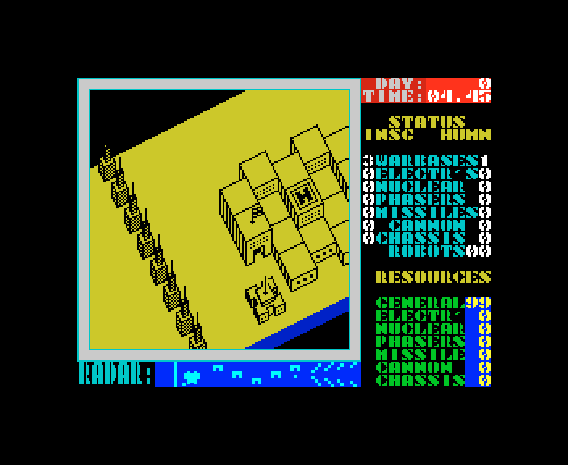

# 6. Rendering

This document covers what ZS Edition draws that Nether Earth does not, in both releases, as the recordings show it:
the '98 title and intro, the '99 intro (unpacking, picture, scroller, wipe), "System checking", the menus, the text
pages, the map catalogue and the changes to the play screen. The isometric view, the sprites and the panel are
Nether Earth's (the nether-earth case). The routines behind each picture are the parts' (intro98, front99, the game
parts); this chapter names what is on the screen and where to see it. Every figure is a real frame
(`tools/fig_screens.py`, `tools/fig_compare.py`: unreal-ng's screen with its border, 352 x 288, scaled 2x by nearest
neighbour where single).

The recordings: `r98`, `r99`, `r99-48` (`work/stage1/`), `x98`, `x99` (`work/stage2/texts/`), `s99`
(`work/stage2/scorpion/`), all Pentagon 128 + TR-DOS but `r99-48` (48 BASIC, paging locked) and `s99` (Scorpion
ZS-256); Nether Earth's `ne-play` (nether-earth case, 48K). [01](01-game-design.md) lists what each holds.

## 6.1 The '98: title and intro

|  |  |
| --- | --- |
| "ZS'98 Presents", printed a letter at a time on black (`r98` 2060) | the intro (`r98` 3000) |

The intro is one still picture (the "ZS" logo, a robot in a frame) with a one-line scroller across it. The scroller
moves by pixels and switches font in the middle of the text: the ROM font at `$3D00` and the intro's own at `$E6CC`
(a `$01 LO HI` code in the text, [texts/scroller98.md](texts/scroller98.md)).

*`r98` frames 2400-2700, every third frame, 60 ms a picture (the counter under each picture).*

## 6.2 The '99: intro

The intro picture is unpacked straight into the screen, column strip after column strip (`r99` 652), then holds:
the author's photo on the left, the logo "NETHER EARTH ZS EDITION 1999" in a frame on the right, under the logo a
32-column scroller panel moving up by pixels, and a colour line along the bottom (`r99` 1002). SPACE clears it with a
diagonal wipe (`r99` 1552).

|  |  |  |
| --- | --- | --- |
| unpacking (`r99` 652) | the intro (`r99` 1002) | the wipe (`r99` 1552) |

*`r99` frames 900-1300, every fourth frame, 80 ms a picture. Its text: [texts/scroller99.md](texts/scroller99.md).*

## 6.3 The '99: System checking

A coloured text screen under the title "NETHER EARTH ZS Edition'99", printed line by line as the loader works:
computer, memory, TR-DOS version, then each part loaded with its "O.k.". The memory count is the test's result ([03](03-build-and-load.md)):

*Pentagon 128 (`r99` 2652), Scorpion ZS-256 (`s99` 2252), 48 BASIC with paging locked (`r99-48` 5651).*

## 6.4 Menus

The '98 keeps Nether Earth's menu screen and changes only the title ("ZS EDITION'98") and the last line. The '99 draws a new screen: a title whose colours cycle every few frames, three columns of
settings, six actions, a pointer; the chosen setting of each group in white.

|  |  |  |
| --- | --- | --- |
| '98 (`r98` 4703) | '99 (`r99` 3002) | '99 after HARD and PHASERS (`r99` 6052) |

*Nether Earth (`ne-play` 12750), ZS'98 (`r98` 4703), ZS'99 (`r99` 3002).*

## 6.5 Text pages, REDEFINE and the catalogue ('99)

The four text pages show the `.W` files of page 3 as they are: CP866 Russian in a narrow Cyrillic font, 64
columns, under a large heading, scrolled by lines (A). REDEFINE prints its seven prompts on the menu screen. LOAD MAP lists the disk's `.N`
files four to a row with the current one highlighted.

*DESCRIPTION, ADVICES, GREETS, ABOUT ZS NE (`r99` 4152, 4552, 4852, 5152).*

|  |  |
| --- | --- |
| REDEFINE (`x99` 3477) | LOAD MAP (`r99` 5452) |

## 6.6 The play screen

The view and the sprites are Nether Earth's. What changes on the screen:

| | Nether Earth | ZS'98 | ZS'99 |
| --- | --- | --- | --- |
| enemy robot count (INSG) | `00` | blank | `??` |
| GENERAL at the start | 20 | 99 | 99 |
| ground | bright yellow | non-bright yellow | non-bright yellow |
| frame of the view | white | cyan | cyan |
| map on the radar | Nether Earth's | the one in the game | the loaded map, or `ЗАГРУЗИСЬ` |

*Nether Earth (`ne-play` 12900), ZS'98 (`r98` 5000), ZS'99 on `NELEV_00` (`r99` 6150).*

|  |  |  |
| --- | --- | --- |
| '98 (`r98` 5500) | '99, the built-in map: `ЗАГРУЗИСЬ` on the radar (`s99` 3302) | '99, `NELEV_06` (`x99` 4602) |

The '98's LOAD NEW LEVEL! followed by START draws garbage over the screen and hangs (`x98` 5600,
[01, 1.5](01-game-design.md#15-the-98-menu)).

## 6.7 Loading compared

*Nether Earth's tape border (`ne-play` 5000); the '98 intro, shown once everything is loaded (`r98` 3000); the '99
intro, shown while the rest waits on the disk (`r99` 1002).*
