# 6. Rendering

This document covers how each screen of both releases is drawn: the routines that write it, in what order, and what
the recordings show. In order:

- the '98 title and intro (6.1);
- the '99 intro: the picture, its decoder, the roll-in, the scroller and the push-out (6.2);
- "System checking" (6.3);
- the menus (6.4);
- the '99 text viewer, REDEFINE and the catalogue (6.5);
- the play screen: the view, its buffer, the projection, the copy and the radar (6.6);
- the loading screens side by side (6.7).

The fonts and the panel's texts are in [08](08-hud-and-text.md); the turn's timing against the beam is in
[04](04-game-loop.md).

The figures come from four sources:

- the screenshots (`tools/fig_screens.py`, `tools/fig_compare.py`): unreal-ng's screen with its border, 352 x 288,
  scaled 2x by nearest neighbour where single;
- the screen GIFs (`tools/fig_zs_anim.py`), read with TTD `memory_at` from our own instance;
- the writer maps (the kit's `writers_map.py`): every screen byte coloured by the routine that wrote it last, from
  an access trace;
- the routine animation (the kit's `routine_anim.py`).

The recordings: `r98`, `r99`, `r99-48` (`work/stage1/`), `x98`, `x99` (`work/stage2/texts/`), `s99`
(`work/stage2/scorpion/`), `r-critical` (`work/stage2/game99/`). All run on Pentagon 128 + TR-DOS, except `r99-48`
(48 BASIC, paging locked) and `s99` (Scorpion ZS-256). The original game's `ne-play` appears only in the side-by-side
figures. [01](01-game-design.md) lists what each recording holds.

## 6.1 The '98: title and intro

### The title

The REM loader (`$5D40`) prints the title with the ROM:

1. `ATTR_P` = 7, `BORDER 0`, `CLS`.
2. A bold copy of the ROM font is made at `$BF00`+256: each even row ORed with itself shifted right one pixel, each
   odd row with itself shifted right two pixels. `CHARS` is pointed at it.
3. "ZS'98 Presents:" and "NETHER EARTH ZS EDITION" are printed with `PR-STRING` (frame 2000).

`IntroMain` (`$D88F`) then fades the title out with `AttrWipe` (`$DA77`):

- A band of eight diagonals moves one cell right each frame.
- Its front is white ink (`$47`), and the inks get darker down to black (`$40`) behind it.
- So the screen fades from left to right (frames 2048-2176).
- `AttrDiagonal` `$DA84` paints a band, and `AttrCell` `$DA9F` paints one cell, skipping cells off the screen.

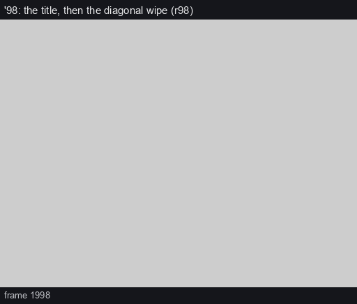

How to read the animation:

- **The pictures** are the screen every third frame of `r98`, 1998 to 2160. The counter under each is the frame.
- **The title** appears at once (frame 2000): `PR-STRING` prints it within one frame.
- **From 2048** the band crosses the screen from the left. Cells behind it are black ink on black paper, so the
  title vanishes column by column.
- **At 2176** `ClearScreen` (`$DA65`, the ROM's `CLS`) clears the screen and the intro begins.
- Drawn by `python3 tools/fig_zs_anim.py --work work/docs/zsA/r98 --from 1998 --to 2160 --step 3 --delay 60 --title
  "'98: the title, then the diagonal wipe (r98)" --out docs/img/render/98-presents-wipe.gif`, on an instance with
  `r98` loaded.

### The intro

| 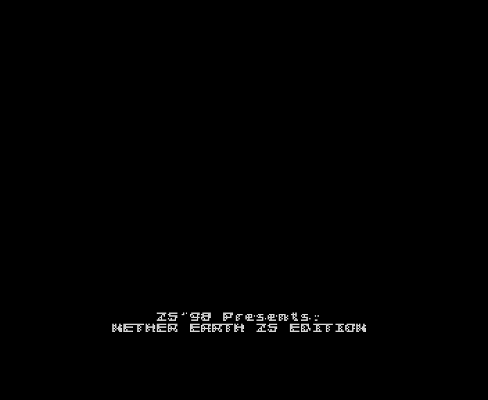 | 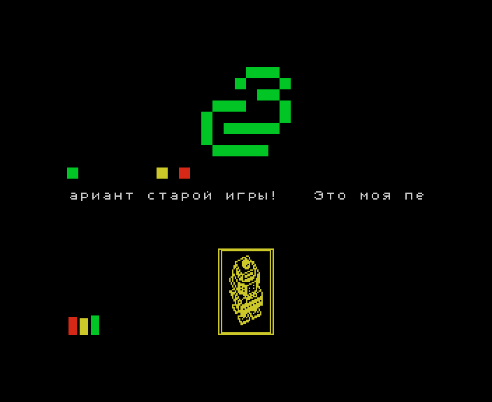 |
| --- | --- |
| "ZS'98 Presents" (`r98` 2060) | the intro (`r98` 3000) |

The intro screen has five parts, all drawn into the screen directly:

- **The scroller** on row 11 (`ScrollStep` `$D982`, from `IntroInterrupt` every frame): one pixel column of the
  next glyph is ORed into the row's right-hand byte (`$487F`) on its 8 lines. The row's 8 lines (`$4860-$487F`)
  then shift left one pixel (`ScrollShiftLine` `$D9E5`, `ScrollShiftByte` `$D9E9`).
  - The text switches font in mid-line: the intro's own Cyrillic font at `$E6CC` (KOI-7) and the ROM's at `$3D00`
    for the Latin names, by a `$01 LO HI` code ([texts/scroller98.md](texts/scroller98.md)).
- **The logo** (`LogoColour` `$D95F`, every frame): the cells of an 8 x 8 block at column 12, row 0 whose byte in
  `LogoMask` (`$E3B9`) is not 0 get paper `FRAMES` AND 7, ink 0. So the "ZS" letters flash through the colours,
  black every eighth frame. The logo is drawn by attributes alone.
- **The robot** (`RobotFrame` `$E3FE`, every 32 frames) decodes the next of four animation frames into its yellow
  box at column 13, row 16.
  - The stream holds deltas from the screen as the last frame left it: skips, runs, zeros and literal bytes, and
    copies of 3 bytes from up to `$800` behind.
  - `RobotFrame` finds its own address through the ROM (`$1FC6`), so the code runs wherever it is loaded.
- **The AY bars** (`AyBars` `$D9F4`, five times a frame, 10 040 calls in 2 008 frames): the volumes of AY registers
  8, 9 and 10 (channels A, B, C) as bars from the bottom line of row 23 up, in columns 0-2 (red, yellow, green).
- **Three cells on row 9** (`IntroLoop` `$D8E6`) follow AY registers 2, 4 and 6 (the low bytes of the three tone
  periods): each register's value picks the cell that is lit.

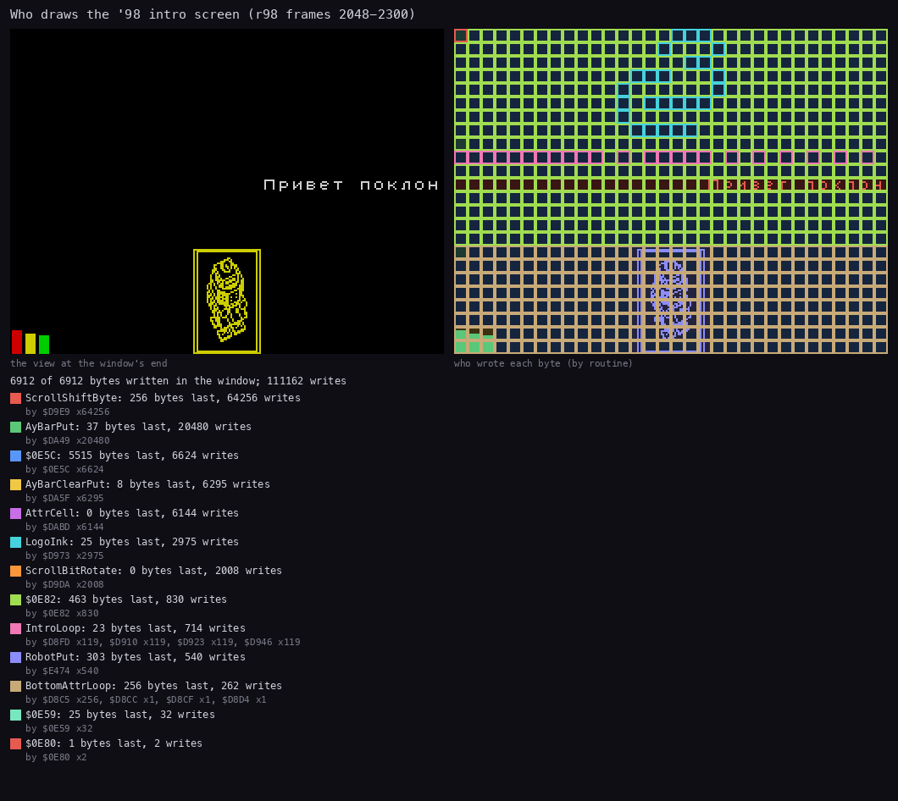

How to read the figure:

- **Left**: the screen at the window's end (frame 2300).
- **Right**: the same screen, each byte coloured by the routine that wrote it last in the window. Each attribute
  cell is framed in the colour of its last writer.
- **The legend** lists each routine with the bytes it wrote last, all its writes, and the instructions that wrote
  them:
  - `ScrollShiftByte` (`$D9E9`): 256 bytes, 64 256 writes, the scroller row moving a pixel a frame;
  - `AyBarPut` (`$DA49`): 37 bytes, 20 480 writes, the bars redrawn five times a frame;
  - the ROM's `CLS` (`$0E5C`, `$0E82`): the cleared screen (5 515 bytes last written by `$0E5C`);
  - `AttrCell` (`$DABD`): 6 144 writes, the wipe;
  - `LogoInk` (`$D973`): 25 cells, the logo;
  - `RobotPut` (`$E474`): 303 bytes, the robot;
  - `BottomAttrLoop` (`$D8C5`): 256 bytes, the bottom third's yellow.
- **The point**: the intro redraws only what moves. The scroller row and the bars take nearly all of the 111 162
  writes; the rest of the screen is the cleared background.
- Drawn by the kit's `python3 kit/writers_map.py --work work/docs/zsA/r98 --window 2048:0-2300:0 --listing
  build/intro98/intro98.lst --view screen --title "Who draws the '98 intro screen (r98 frames 2048-2300)" --out
  docs/img/render/intro98-writers.png`.

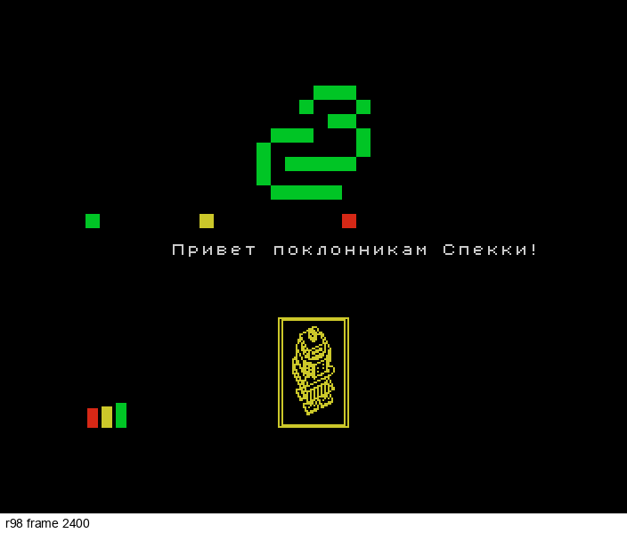

*`r98` frames 2400-2700, every third frame, 60 ms a picture (the counter under each picture).*

## 6.2 The '99 intro

### The picture and its decoder

The picture block (`$7D87-$8A86`) is `DecodeScreen` and the packed screen behind it:

- **Position-independent**: `DecodeScreen` finds its own address by calling a `RET` in the ROM and reading the return
  address back from below the stack. The packed screen starts `$6F` bytes after that.
- **The stream** is a simple RLE: a byte other than `$9A` is itself, and `$9A V N` is V N times.
- **The order**:
  - the 6 144 pixel bytes column by column (32 columns), each column's 192 lines from the top;
  - then the 768 attributes in order.
- **The size**: 429 runs make the 6 912 bytes. The stream ends at `$8A35`.
- **The targets**: stage 2 patches the decoder's two targets to `PictureBuffer` `$8A87` and the attributes at
  `$A287`, so the picture is decoded off screen (frames 464-472) and then rolled in.

### The roll-in

Before the picture, stage 2 clears the old screen:

- `DissolveScreen` (`$6370`, frames 261-303) ANDs every 29th byte with a moving one-bit hole, 250 passes, so the
  pixels fade out in a scattered order.
- `SpiralAttrs` (`$638B`, 303-472) sets the attributes to white ink on black, cell by cell in 12 rings from the
  corner.

`RollInPicture` (`$62DB`, frames 472-726) shows the picture:

- for y = 191 down to 0, the picture's line y is copied into every screen line from 0 to y;
- so the picture rolls down from the top, its lower lines first stretched over the screen above them;
- then the 768 attributes are copied.

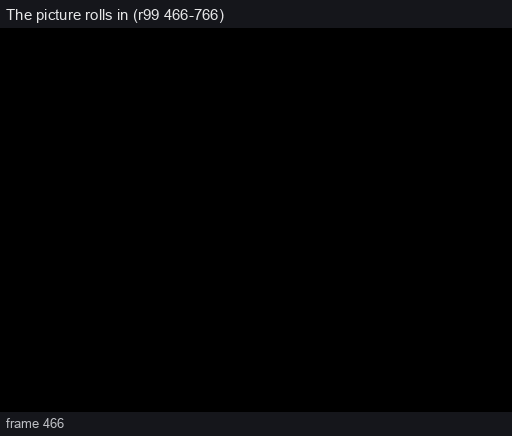

How to read the animation:

- **The pictures** are the screen every sixth frame of `r99`, 466 to 766.
- **At first** the screen is empty, white ink on black.
- **Then** the bottom of the picture appears as vertical streaks over the whole height: line 191 copied into every
  line above it.
- **As y falls**, each next line is copied into a shorter stretch, so the streaks shrink upwards and the picture
  settles from the bottom up.
- **Last** come the attributes (frame 726): the logo's colours and the coloured bottom line appear at once.
- Drawn by `python3 tools/fig_zs_anim.py --work work/docs/zsA/r99 --from 466 --to 766 --step 6 --title "The picture
  rolls in (r99 466-766)" --out docs/img/render/99-rollin.gif`, on an instance with `r99` loaded.

### The scroller and the colour cycles

Then the border flashes yellow and black ten times (20 frames) and the scroller runs (`ScrollerLoop` `$6225`, frames 746-1310):

- **`PrintLine`** (`$62B9`) prints one text line at column 32, row 22 of a 64 x 24 grid in 4-pixel characters
  (`PrintChar` `$6451`, the font `Font64` `$7587`). The character's half of each byte is kept by the mask `$F0` or
  `$0F`.
  The print routine takes the ROM's controls (AT, CR, LF, TAB) and `$17 LO HI`, a font address. Its `$08` (one
  column back) is broken: `DEC A` sets no carry, so column 0 becomes 255. The text holds no `$08`.
- **`ScrollWindowUp`** (`$63FE`) moves the window `ScrollWindow` (columns 16-31, rows 17-22) up one pixel line and
  clears its last line: 184 calls in frames 746-1309, about three frames a scroll and eight scrolls a text line.
- **`CycleLogoColours`** (`$629C`) gives each of the logo box's 15 rows (14 cells from row 1, column 17) the next
  ink, so the stripes move up one row each scroll.
- **`CycleBottomRow`** (`$628B`, twice a scroll) makes row 23 a rainbow of inks 1-7 that moves each call.

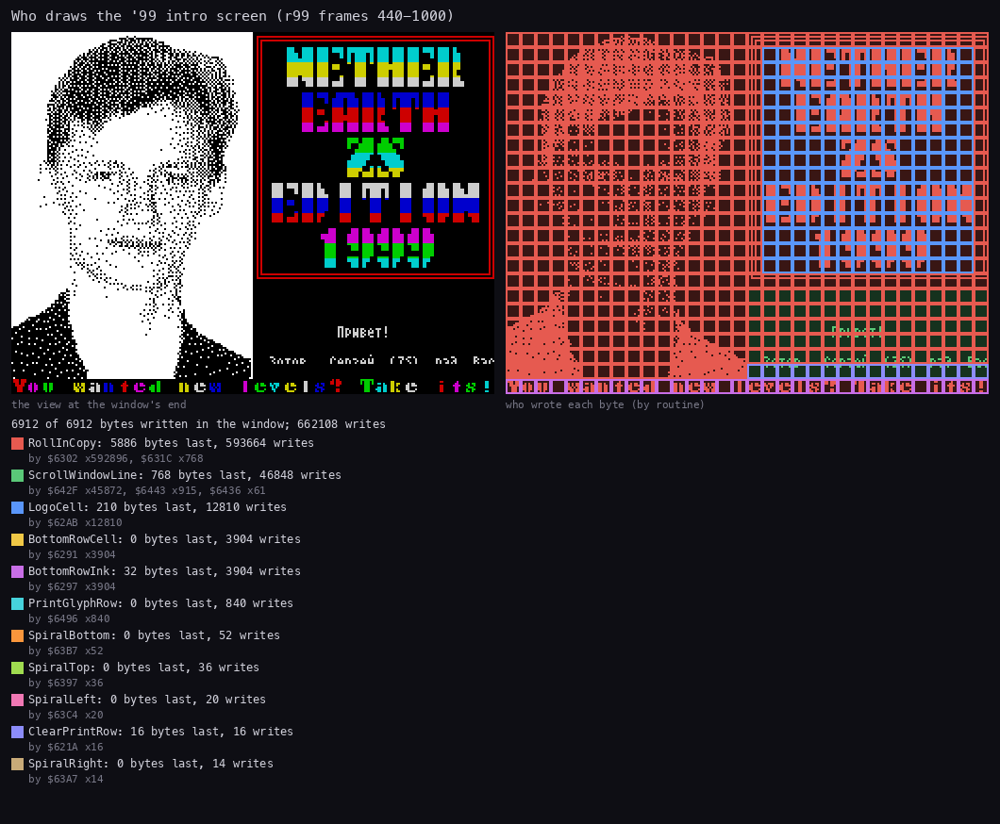

How to read the figure:

- **Left**: the screen at frame 1000.
- **Right**: each byte coloured by its last writer in frames 440-1000, attribute cells framed.
- **The legend**:
  - `RollInCopy` (label `$62F6`; the writes at `$6302` and `$631C`): 5 886 bytes and 593 664 writes, the roll-in's stretching;
  - `ScrollWindowLine` (`$6421`): 768 bytes, the scroller window;
  - `LogoCell` (`$62AB`): 210 cells (15 x 14), the logo's stripes;
  - `BottomRowInk` (`$6292`): 32 cells, the rainbow line;
  - `PrintGlyphRow` (`$6489`): the scroller's glyphs, already scrolled up into the window;
  - `ClearPrintRow` (`$621A`), and the spiral's four sides (`SpiralTop` and the rest).
- **The point**: the roll-in writes the screen almost a hundred times over (593 664 writes for 5 886 bytes). The
  intro's motion is then the window and the colour cycles alone.
- Drawn by `python3 kit/writers_map.py --work work/docs/zsA/r99 --window 440:0-1000:0 --listing
  build/front99/stage2.lst --view screen --title "Who draws the '99 intro screen (r99 frames 440-1000)" --out
  docs/img/render/intro99-writers.png`.

| 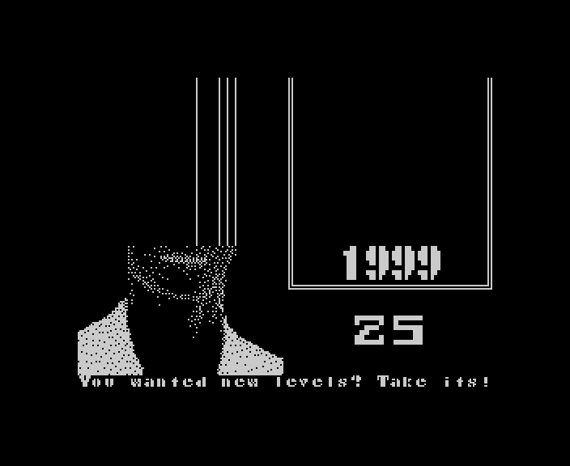 | 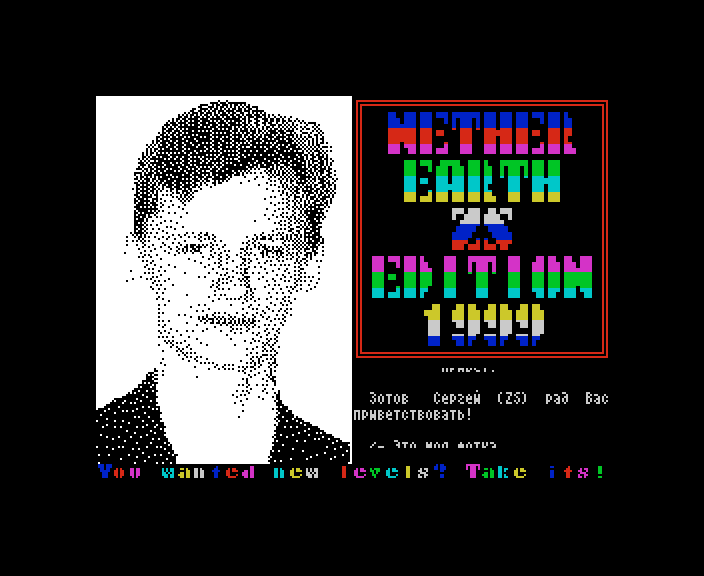 | 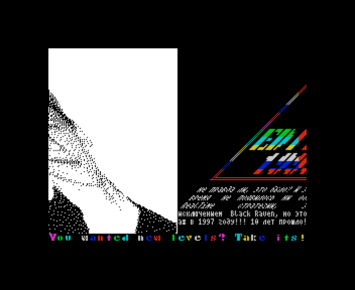 |
| --- | --- | --- |
| the roll-in (`r99` 652) | the intro (`r99` 1002) | pushed apart (`r99` 1552) |

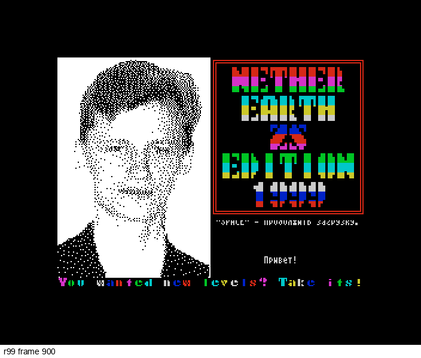

*`r99` frames 900-1300, every fourth frame, 80 ms a picture. Its text: [texts/scroller99.md](texts/scroller99.md).*

### After SPACE

`OutroAndLoad` (`$6262`) clears the screen in two steps:

1. **`PushOutScreen`** (`$6321`, frames 1312-1953): the left half of each line (bytes 0-15) is shifted left and the
   right half (16-31) right, one pixel a pass.
   - The pass covers lines 0..n-1 for n = 1 to 191, so the opening runs down the screen.
   - Then lines 64-191 get 128 more passes.
2. **`SpiralAttrs`** with `$38` (1953-2114): the attributes go to white paper in the 12-ring spiral.

Then the music is muted, interrupts go back to IM 0, and stage 3 is read.

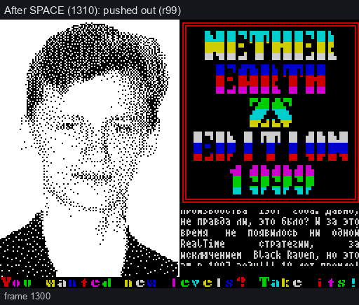

How to read the animation:

- **The pictures** are the screen every twelfth frame of `r99`, 1300 to 1972.
- **From 1312** a gap opens between the photo and the logo, starting at the top. The halves slide out of the screen
  to the left and right, the top lines first.
- **The bottom two thirds** keep moving after the top is empty: the 128 extra passes over lines 64-191.
- **At the end** the screen is empty; the spiral follows (not in the animation).
- Drawn by `python3 tools/fig_zs_anim.py --work work/docs/zsA/r99 --from 1300 --to 1972 --step 12 --delay 70
  --title "After SPACE (1310): pushed out (r99)" --out docs/img/render/99-outro.gif`.

## 6.3 The '99: System checking

`Stage3Entry` (`$61A8`) draws a text screen through the ROM's `PR-STRING`:

1. It fades in eight steps: border B-1, every attribute (B-1) x 8, two `HALT`s.
2. It clears the screen and prints the title "NETHER EARTH / ZS Edition'99" and "System checking...".
3. It prints, line by line as the loader works:
   - the computer's name;
   - the memory, (count + 3) x 16 Kb;
   - the TR-DOS version, read from the TR-DOS ROM;
   - each part loaded, with its "O.k." (Game, Drivers, Menus, RAM-Disk).

The strings end with `$FF` and may hold the ROM's colour controls.

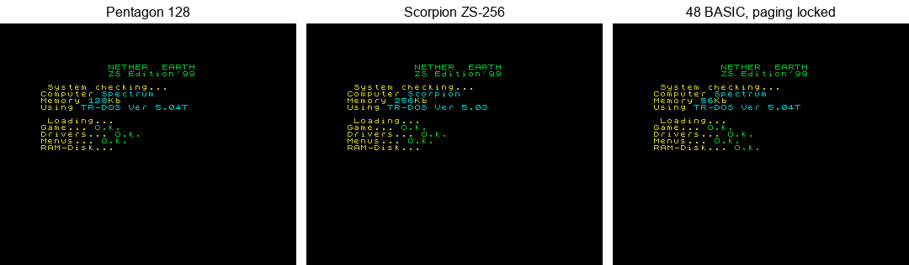

*Pentagon 128 (`r99` 2652), Scorpion ZS-256 (`s99` 2252), 48 BASIC with paging locked (`r99-48` 5651).*

## 6.4 Menus

### The '98 menu

`MainMenu` (`$C100`) draws its screen with the game's `PrintInline`:

- the title "ZS EDITION'98" (`PrintTitle` `$C1E3`, rows 1-3);
- the options 0-5: the current controls in cyan, the others in yellow.

`TitleColourCycle` (`$C820`) runs every frame from the menu's `HALT` loops. On every other call it paints rows 0-6,
columns 0-30 with BRIGHT, black paper and the next ink, so the title runs through all 8 inks every 16 frames.

### The '99 start-up menu

`MenuScreen` (`$D813`) draws the screen with the game's `PrintInline` and its 8 x 8 font:

1. `MenuText`: the title in double size; LEVEL (rows 10-13, column 1, attribute 5); UPGRADING (rows 10-15,
   column 11, attribute 6); CONTROL (rows 10-13, column 23, attribute 5).
2. `MenuBottomText`: the six actions in red (attribute 2), double height, rows 17 and 21.
3. `MenuRedraw` (`$D967`) restores the items' plain colours from `SavedAttrs` (`$DE31`). It then marks the choices
   with `PaintBar` (`$DD62`): 10 cells of attribute `$47`, bright white.
   - the level at column 0;
   - the control at column 23;
   - each part bit 7..2 of `EnemyUpgrade` at column 11.

The pointer is a masked 8 x 8 arrow (`DrawPointer` `$DD73`), shifted to its pixel position. It is drawn over a saved
copy of the cells under it (`SavePointerBg` `$DDD7`), which `RestorePointerBg` (`$DDE0`) puts back before each
move. The menu loop and the viewer call the game's `TitleColourCycle` (`$C820`) too, so the title's inks cycle here
as in the '98.

| 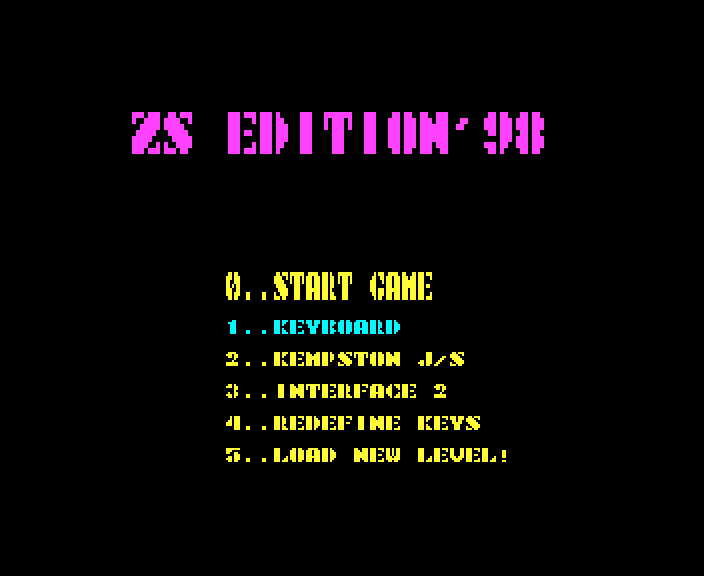 | 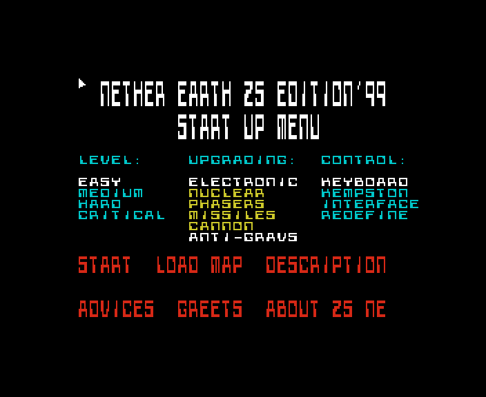 | 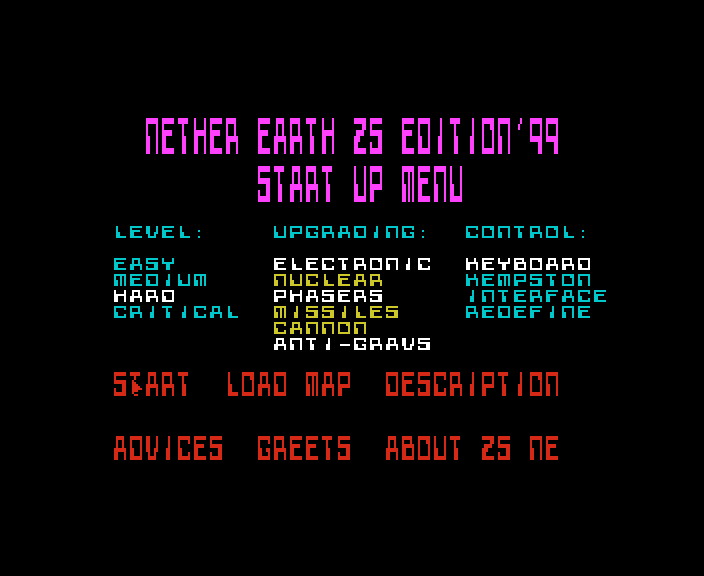 |
| --- | --- | --- |
| '98 (`r98` 4703) | '99 (`r99` 3002) | '99 after HARD and PHASERS (`r99` 6052) |

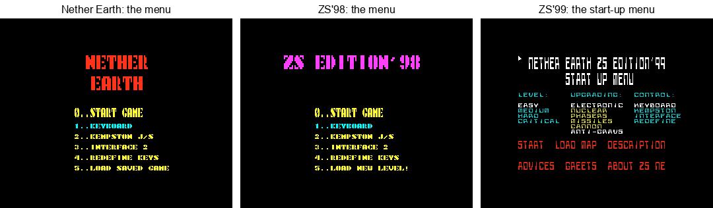

*The original (`ne-play` 12750), ZS'98 (`r98` 4703), ZS'99 (`r99` 3002).*

## 6.5 Text pages, REDEFINE and the catalogue ('99)

### The text viewer

Each page's item (`ShowDescription` and the others) loads its text from page 3 into `TextBuffer` (through
`TextEntry` `$A56A`), clears the screen and prints the page's title with `PrintInline`. `TextShow` (`$DB7F`) sets
the viewer's top line to the text's start, and `TextViewer` (`$DBE2`) shows it:

- rows 8-23, 64 columns, in a 4 x 8 font (`ViewerFont` `$DEF1`: the same 2 048 bytes as the intro's `Font64`);
- the texts are CP866, with CR LF line ends;
- `ViewerPutChar` (`$DC8E`) takes the ROM's print controls (AT, TAB, CR, LF) and a font switch, `$17 LO HI`;
- the header `ViewerHeader` is `AT 0,8` and `$17` with `$DEF1`, the font's address.

A page change runs in three steps:

1. **Fade out**: the attributes of rows 8-23 step down from 7 to 0, a frame each; then their pixels are cleared.
2. **Print**: the 16 lines from the new top.
3. **Fade in**: the attributes step back up from 1 to 7.

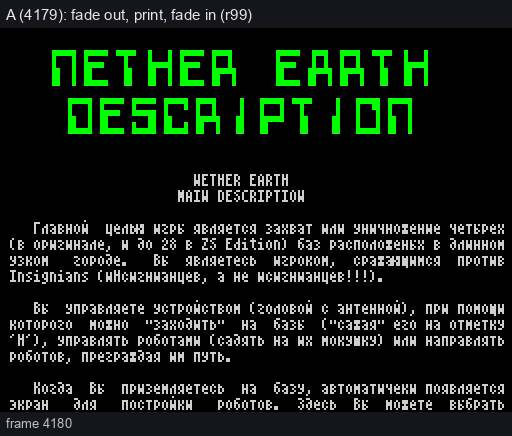

How to read the animation:

- **The pictures** are every frame of `r99`, 4180 to 4242. The script pressed A at 4179.
- **First** the text dims step by step to dark blue (fade out).
- **Then** the page goes black, and the new lines appear top to bottom as `PrintPage` (`$DC10`) prints them.
- **Last** the text brightens step by step back to white (fade in).
- **The point**: the whole page change takes about a second, and most of it is printing 16 lines of 64 characters.
- Drawn by `python3 tools/fig_zs_anim.py --work work/docs/zsA/r99 --from 4180 --to 4242 --step 1 --delay 60
  --title "A (4179): fade out, print, fade in (r99)" --out docs/img/render/99-viewer-page.gif`.

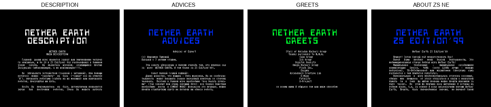

*DESCRIPTION, ADVICES, GREETS, ABOUT ZS NE (`r99` 4152, 4552, 4852, 5152).*

The single pages at full size: [DESCRIPTION](img/screens/99-description.png), [ADVICES](img/screens/99-advices.png),
[GREETS](img/screens/99-greets.png), [ABOUT ZS NE](img/screens/99-about.png).

### REDEFINE and the catalogue

- **REDEFINE** is the game's `RedefineKeys` (`$C34A`): a cleared screen, "REDEFINE KEYS" in white, double height,
  and one "PRESS KEY FOR" prompt a key.
- **LOAD MAP** (`DiskLoadMap` `$C1FD`) builds its screen:
  1. It reads the catalogue (track 0, sectors 0-7) to `LoadBuffer` `$F000` and copies every live `N` entry to
     `FileList` `$F800`.
  2. It prints the 8-character names four to a row, eight columns each, from the top left, in attribute `$01` (blue
     on black).
  3. It highlights the chosen name's eight cells with attribute `$38`, black on white (`DiskCursorPaint` `$C28D`).
  4. The print fix at `$C263` moves the print address from the screen's first third to the second only. From the
     65th name on, the names land on the wrong pixel lines while the highlight goes on in order.
  5. Q and A move the choice, polled every three frames (`HALT` x 3), so a held key repeats.

| 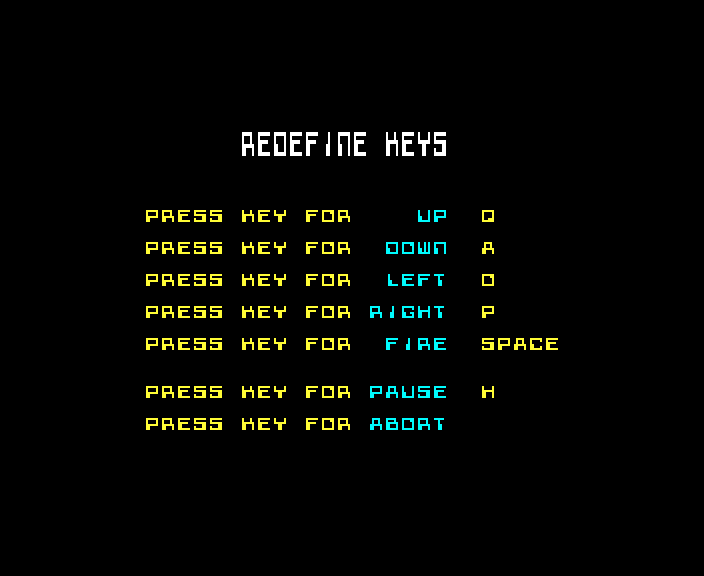 | 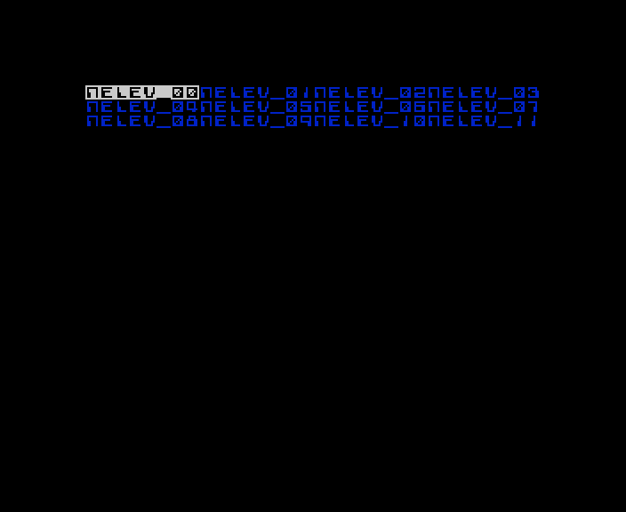 |
| --- | --- |
| REDEFINE (`x99` 3477) | LOAD MAP (`r99` 5452) |

## 6.6 The play screen

### The fixed parts

`EnterPlay` (`$A68E`) draws the fixed parts once with `DrawPlayScreen` (`$D0CA`, [08](08-hud-and-text.md)):

- the view's frame, 22 x 22 characters from (0,0), in `$3D` (cyan on white);
- the ground in `$30` (yellow paper, not BRIGHT), and `$31` / `$01` past the map's edge;
- the status panel on the right: DAY and TIME, STATUS, WARBASES with the building counts, RESOURCES;
- the radar's label.

### The view

`DrawView` (`$CCBD`) draws the view each turn in three calls:

1. **`DrawViewBackground`** (`$CFD7`) clears `ViewBuffer` (`$5B00-$677F`, 20 bytes x 160 lines) with `PUSH`, and
   paints the corners outside the map and the map's edge strips.
2. **`DrawMapObjects`** (`$CCC6`) draws every map cell and object of the window into the buffer, back to front:
   - the order is diagonals by falling x - y, and along a diagonal by rising x;
   - each object is `DrawSprite` (`$CF2D`): AND the mask, OR the pixels, row by row from the bottom up;
   - a robot is its parts stacked: after each part the height operand (`$CF3F`) grows by the part's height
     (`PartHeights` `$D7B4`);
   - there is no sort: an object that a later neighbouring block would cover is deferred. Its neighbour's cell is
     marked (bit 6, bit 7 for the ship), and the object is drawn when the walk reaches that cell.
3. **`CopyViewToScreen`** (`$D071`) copies the buffer to the screen at character (1,1): 160 lines of 20 unrolled
   `LDI`s, the target stepped through the screen's thirds. No `HALT` comes first, so the copy may tear
   ([04](04-game-loop.md)).

Nothing scrolls and nothing is erased: the whole view is redrawn from nothing every turn. A call takes about
578 000 T, 8.3 frames, which is why a turn is 10 frames.

The projection (`DrawSprite`):

- column L (half-bytes) = 2E + D - 24;
- the sprite's bottom line H = 8D + 100 - 4E - height.

So a step along x moves 8 pixels right and 4 up, and a step along y 4 right and 8 down. The sprite table `$D6E8`
holds two images of each sprite, the second shifted 4 pixels for an odd half-byte column. Each image is rows,
width, then (mask, pixels) byte pairs from the bottom line up.

Clipping (`DrawSprite`):

- a column past 19 or a bottom line past `$E1`: nothing is drawn;
- bottom lines `$A0-$E1`: the rows below the buffer are skipped;
- a negative column: each row's left bytes are skipped (the cut at `$CFAF`); a sprite past column 19 loses its right
  bytes;
- the top stops at `$5B00`.

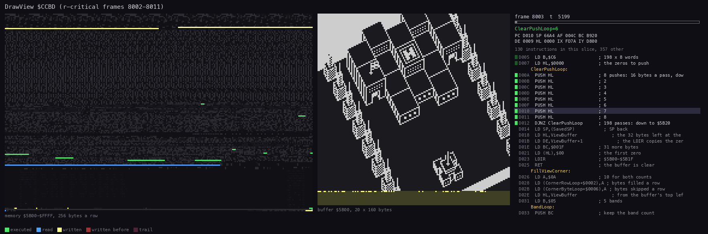

How to read the animation:

- **90 pictures** follow one `DrawView` call, from `r-critical` frame 8002 T 70 100 to frame 8011 T 35 100.
- **Left**: memory `$5B00-$FFFF`, 256 bytes a row, lit by age:
  - green: executed;
  - blue: read;
  - yellow: written in this slice;
  - red: written before;
  - dark: a fading trail.
- **Middle**: `ViewBuffer` as a 160 x 160 picture.
  - The sprites being drawn are framed in yellow (now) and orange (just before).
  - The top band of the left panel is the buffer being written.
- **Right**: the routine and the instruction running (`SpriteRowLoop`, `SpriteByteLoop` ...), the registers, and the
  listing window around `PC`.
- **What it shows**:
  - The buffer is cleared, then the corners are painted.
  - The sprites go in back to front, so a nearer block covers a farther one.
  - The copy (`CopyLineLoop`) runs last, and the buffer's 3 200 bytes flash red on their way to the screen.
- Drawn by the kit's `routine_anim.py`:

```
python3 kit/routine_anim.py --work work/docs/zsA/rc --window 8002:70100-8011:35100 \
    --listing build/game99/game.lst --view buffer:5B00:20x160 --pc CCBD-D0B8 --range 5B00-FFFF \
    --pictures 90 --title "DrawView \$CCBD (r-critical frames 8002-8011)" --out docs/img/render/drawview.gif
```

### The radar

`PlayInterrupt` (`$D566`) shows the radar every frame (`ShowRadar` `$D59E`). It alternates two pictures by
`RadarPhase`:

- `RadarOwn` (`$D800`, the map and our robots) with attribute `$4D`;
- `RadarEnemy` (`$D900`, the map and the enemy's) with attribute `$4E`.

Each is 16 lines x 16 bytes, one pixel a map cell for 128 map columns. It is copied to rows 22-23, columns 6-21
(`RadarLineLoop` `$D5A4`, an `LDIR` a line), with the attributes filled by `FillAttrLoop` (`$D5BF`). The terrain is
in both pictures, so it stays; each side's robots blink at 25 Hz in their colour. The radar costs 8 134 T a frame,
11 % of the time in play.

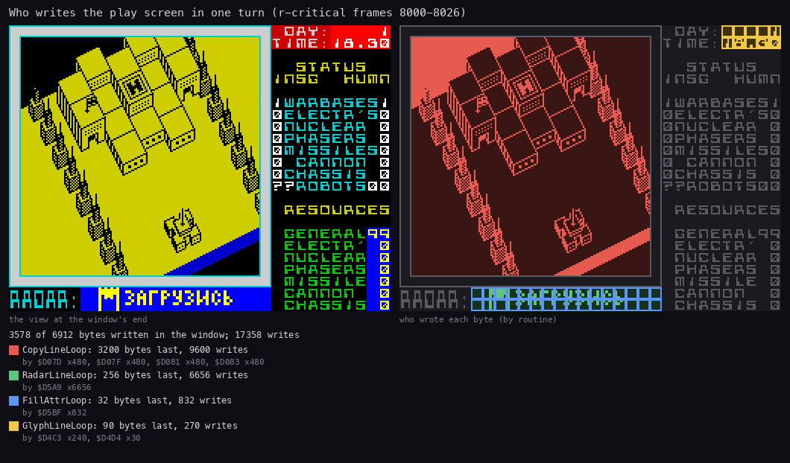

How to read the figure:

- **Left**: the play screen at frame 8026, the built-in map, the ship parked on its pad. The radar reads
  `ЗАГРУЗИСЬ`.
- **Right**: each byte coloured by its last writer in frames 8000-8026, attribute cells framed.
- **The legend**: 3 578 of the 6 912 bytes were written in the window, 17 358 writes in all:
  - `CopyLineLoop` (`$D07B`): 3 200 bytes and 9 600 writes by its 20 unrolled `LDI`s. That is three copies of the
    view in 26 frames;
  - `RadarLineLoop` (`$D5A4`): 256 bytes and 6 656 writes, the radar every frame (26 x 256);
  - `FillAttrLoop` (`$D5BF`): 32 attribute cells and 832 writes, the radar's colour every frame;
  - `GlyphLineLoop` (`$D4C2`): 90 bytes and 270 writes, the clock's digits.
- **The point**: at play the screen gets only the view's copy, the radar and the clock. The panel is written only
  when a value changes, and in this window none did.
- Drawn by `python3 kit/writers_map.py --trace work/docs/zsA/rc/traces/8000_0-8026_0.uatr --listing
  build/game99/game.lst --view screen --title "Who writes the play screen in one turn (r-critical frames
  8000-8026)" --out docs/img/render/play-writers.png`.

### What the player sees at the start

| | ZS'98 | ZS'99 |
| --- | --- | --- |
| the enemy robot count (INSG) | blank | `??` (MEDIUM and up; EASY prints it) |
| GENERAL at the start | 99 | 99 |
| the ground | non-bright yellow | non-bright yellow |
| the view's frame | cyan | cyan |
| the map on the radar | the one in the game | the loaded map, or `ЗАГРУЗИСЬ` |

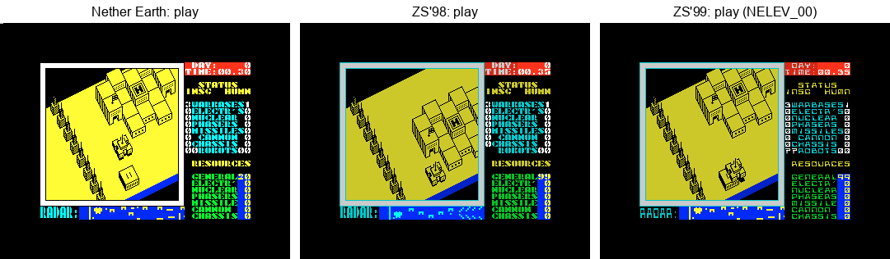

*The original (`ne-play` 12900), ZS'98 (`r98` 5000), ZS'99 on `NELEV_00` (`r99` 6150).*

|  | 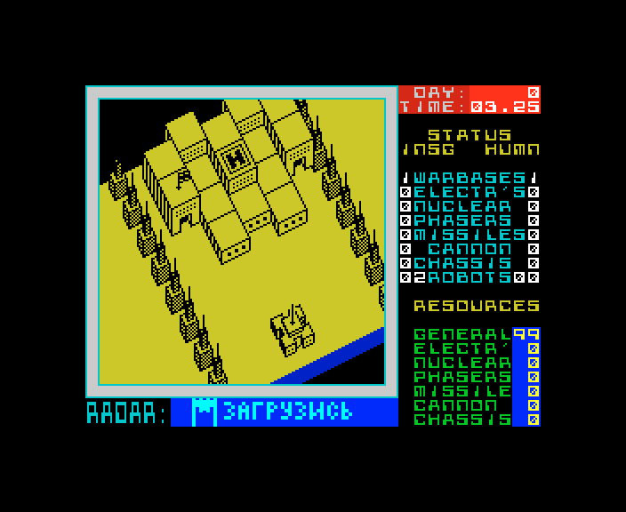 | 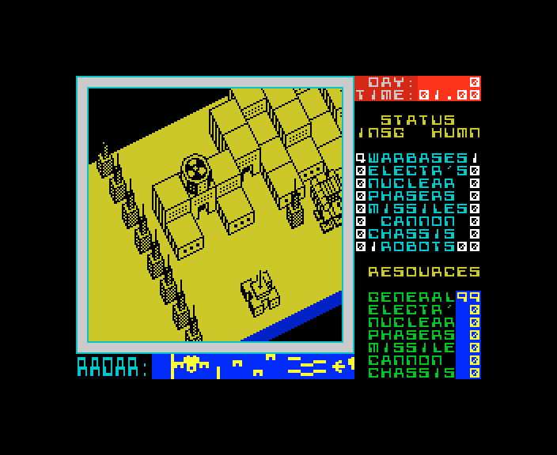 |
| --- | --- | --- |
| '98 (`r98` 5500) | '99, the built-in map: `ЗАГРУЗИСЬ` on the radar (`s99` 3302) | '99, `NELEV_06` (`x99` 4602) |

The '98's LOAD NEW LEVEL! followed by START draws garbage over the screen and resets the machine (`x98` 5600,
[01](01-game-design.md)).

## 6.7 Loading screens

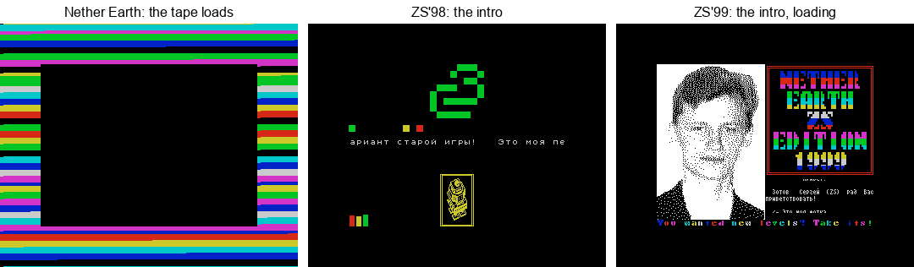

*The original's tape border (`ne-play` 5000); the '98 intro, shown once everything is loaded (`r98` 3000); the '99
intro, shown while the rest waits on the disk (`r99` 1002).*
