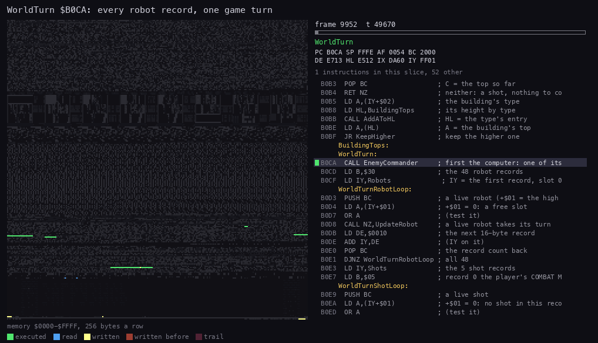
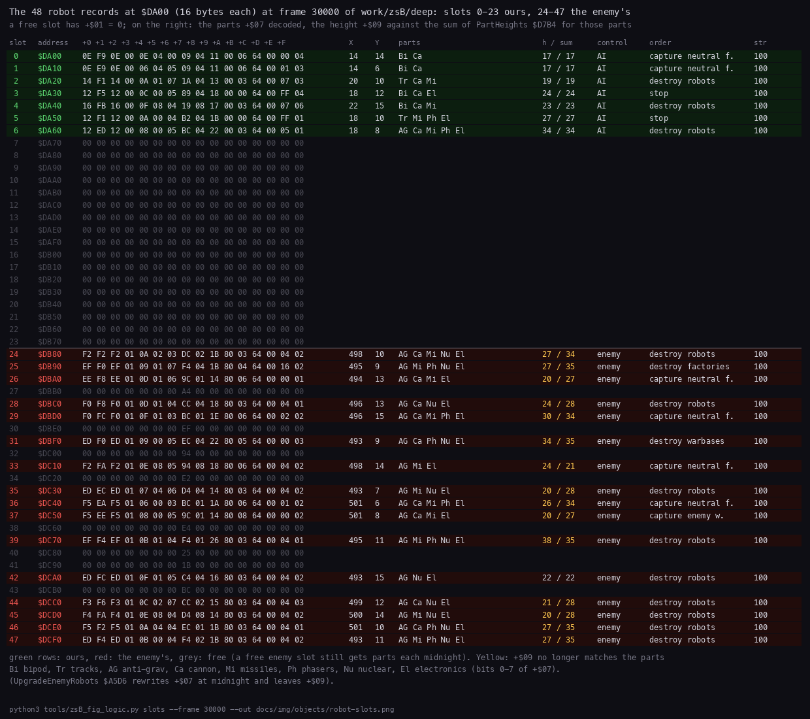
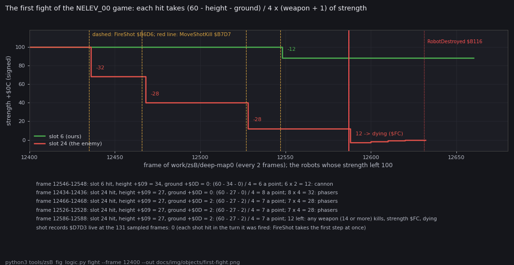
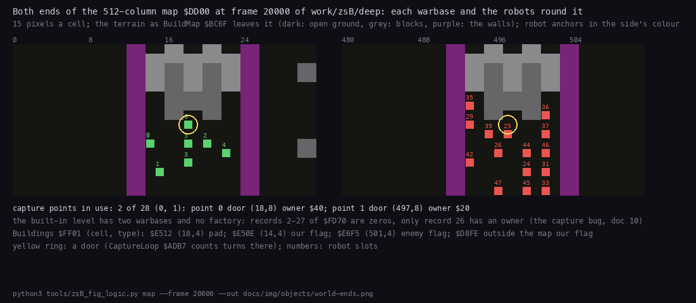
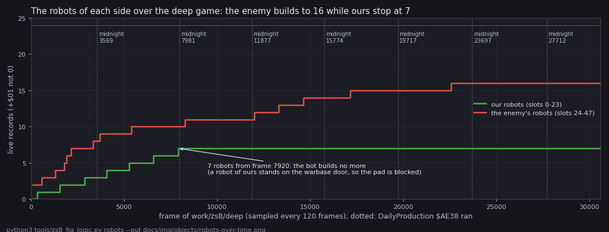

# 7. Objects

This document covers the things that live in the '99's world and how each is stored: the robot records, the shot
records, the map, the buildings and the capture points. It also covers the world turn that moves them, and the
built-in level that a game without LOAD MAP plays on.

Evidence:

- the code of `src/game99` (`world.asm`, `bases.asm`, `level.asm`, `enemy.asm`, `tables.asm`);
- `work/zsB/deep`: the '99 on HARD, the built-in level, played by `tools/zsB_play99.py deep` for 30 602 frames
  (2 224 turns, 7.7 game days);
- `work/zsB/deep-map0`: the '99 on HARD with `NELEV_00` loaded by LOAD MAP (`tools/zsB_play99.py menu --map 0`), the
  same bot, 24 416 frames;
- the figures, drawn from those recordings' memory by `tools/zsB_fig_logic.py`.

The '98 game block holds this code at the same addresses. Compared byte for byte in `build/game98/game98-6780.bin`
and `build/game99/game-6780.bin`:

- the world and shot code (`$B0CA-$B7F3`), the enemy commander (`$B7F4-$BB08`), `PlaceRobot` to `DrawCellObject`
  (`$CC7C-$CE11`) and the tables `$D7B4-$D7D2` are identical;
- the base code (`$BB09-$BC6E`) differs in one byte, `$BB1F`: the count of capture points, 28 in the '98 and 2 in the
  '99;
- the built-in level's data (`$BC6F-$BF9B`) differ in 480 bytes: the '98 has a level of its own with 28 capture points
  and 66 scenery records. The stage recording `work/stage2/game98/deep` (30 284 frames of the '98, NE's bot) plays
  it: there `GiveFactory` ran 8 times, `GiveWarbase` 4 times and `FireShot` 47 times (L1 block executions).

## 7.1 The world turn

`WorldTurn` `$B0CA` runs once a game turn, from the play loop and from the robot menus, so the war goes on while the
player chooses:

1. `EnemyCommander` `$B7F4` looks at one random enemy slot: it builds a robot there or re-thinks its order
   ([10](10-gameplay-logic.md)).
2. `UpdateRobot` `$B0FA` for each of the 48 robot records whose `+$01` is not 0, in slot order, ours (0-23) first.
3. `UpdateShot` `$B70D` for each of the 5 shot records whose `+$01` is not 0.



How to read the animation:

- **The listing:** the PC over `WorldTurn` and the robot routines (`$B0CA-$B2B7`), one frame a step.
- **The window:** one game turn of `work/zsB/deep` at frame 9952, from `EnemyCommander` to the last robot.

```
python3 ../../kit/routine_anim.py --work work/zsB/deep --window 9952:49198-9953:20000 \
    --listing build/game99/game.lst --view none --pc B0CA-B2B7 \
    --title 'WorldTurn $B0CA: every robot record, one game turn' --out docs/img/routines/WorldTurn.gif
```

Witnesses (L1 block executions):

| Routine | `work/zsB/deep` | `work/zsB/deep-map0` |
| --- | ---: | ---: |
| `WorldTurn` `$B0CA` | 2 224 | 2 094 |
| `EnemyCommander` `$B7F4` | 2 224 | 2 094 |
| `UpdateRobot` `$B0FA` | 41 053 | 52 244 |
| `SpotEnemies` `$B626`, `FreeDirections` `$B513`, `TurnOrStep` `$B471` | 11 784 each | 15 039 each |
| `PlaceRobot` `$CC7C` | 11 807 | 15 078 |
| `UpdateShot` `$B70D` | 0 | 113 |

`WorldTurn` runs once per `GameTurn` in both games. A robot takes a step only every few turns (7.3), so the step
routines run about a quarter as often as `UpdateRobot`.

## 7.2 Robots

48 records of 16 bytes: `Robots` `$DA00` holds ours (slots 0-23), `EnemyRobots` `$DB80` the enemy's (slots 24-47). A
slot is free when `+$01` is 0.

| Byte | Field | Values |
| --- | --- | --- |
| `+$00`/`+$01` | the map cell of the anchor | `$DD00` + `$200` x Y + X; the high byte 0 = a free slot |
| `+$02`/`+$03` | X, the column | 0-511 |
| `+$04` | Y, the row | 0-15 |
| `+$05` | the course | the direction it is walking |
| `+$06` | steps left on the course | |
| `+$07` | the parts | bit 0 bipod, 1 tracks, 2 anti-grav, 3 cannon, 4 missiles, 5 phasers, 6 nuclear, 7 electronics |
| `+$08` | the facing | a direction bit: 1 right, 2 left, 4 down, 8 up |
| `+$09` | the height | the sum of `PartHeights` `$D7B4` over the parts |
| `+$0A` | control | 0 our AI, 1 the player sits on it (a menu is open), 2 direct control; bit 7 the enemy's |
| `+$0B` | the order | 0 stop and defend, 1 advance, 2 retreat, 3-5 destroy robots / factories / warbases, 6-8 capture neutral factories / enemy factories / enemy warbases |
| `+$0C` | strength | 100 at birth; negative while dying (7.4) |
| `+$0D` | the ground height under it | from `GroundUnderFootprint` |
| `+$0E` | the target | a robot slot or a building record |
| `+$0F` | the step delay | turns until the next step (7.3) |

`PartHeights` `$D7B4`: bipod 11, tracks 7, anti-grav 8, cannon 6, missiles 6, phasers 7, nuclear 7, electronics 7.



How to read the figure:

- **One row a record:** slot, address, the 16 bytes, then the fields decoded: X, Y, the parts, the height against the
  sum of the parts' heights, control, the order and the strength.
- **Green rows:** ours. **Red rows:** the enemy's. **Grey rows:** free slots.
- **Yellow h / sum:** `+$09` no longer matches the parts.

```
python3 tools/zsB_fig_logic.py slots --frame 30000 --out docs/img/objects/robot-slots.png
```

What it shows:

- Our 7 robots sit at X 14-22, the enemy's at X 493-501: each side inside its own fenced end of the map (7.5).
- Our heights all match the parts. Robot 0, a bipod with a cannon (`$09`), is 11 + 6 = 17 high.
- The enemy's heights mostly do not match. Slot 25 has `$F4` (anti-grav, missiles, phasers, nuclear, electronics),
  sum 35, but height 27. That is the HARD upgrade rewriting `+$07` at midnight and leaving `+$09`
  ([10](10-gameplay-logic.md)).
- Free enemy slots (27, 30, 32, ...) hold a parts byte too: the upgrade writes all 24 enemy slots, alive or not.
- All live robots have strength 100: nobody fought in this game.

A robot is 2 x 2 cells: its anchor (X, Y) and (X+1, Y), (X, Y-1), (X+1, Y-1). Only the anchor cell carries the object
bit 6 of the map. `FindRobot` `$CDD8` finds the record by walking the 48 records for the anchor cell.

## 7.3 A robot's step

`UpdateRobot` decides by strength `+$0C`:

- above 0: `RobotStep` `$B154`;
- below 0: the robot is dying. `+$0C` counts up from `$FC`, and the object bit of its cell blinks each turn;
- 0: `RobotDestroyed` `$B116` frees the record.

`RobotStep`:

1. A robot the player sits on (`+$0A` = 1) does nothing.
2. `+$0F` counts the turns down. At 0 the robot leaves its cell (bit 6 cleared, radar dot erased).
3. `FreeDirections` `$B513` gives the directions it may step to (bit 0 right, 1 left, 2 down, 3 up).
4. Under direct control the player's keys choose. Else `SpotEnemies` `$B626` looks for an opponent in sight; with
   one in sight it fires (7.4), else `SteerByOrder` `$B222` steers by the order.
5. `TurnOrStep` `$B471` turns toward the direction (never 180 degrees at once), or steps when the robot already faces
   it.
6. `SetStepDelay` `$B5F3` sets `+$0F` from `StepDelays` `$B61D`, and `PlaceRobot` `$CC7C` marks the new cell.

`StepDelays` `$B61D`, game turns a step takes:

| Ground | Bipod | Tracks | Anti-grav |
| --- | ---: | ---: | ---: |
| flat (`+$0D` 0) | 6 | 4 | 3 |
| low (1-3) | 8 | 6 | 3 |
| high (4 and more) | 9 | 7 | 4 |

What a robot may enter, by its slowest chassis bit (`FreeDirections`):

| Locomotion | Terrain types it enters | Heights |
| --- | --- | --- |
| bipod | 0-7 | 0-3 |
| tracks | 0-`$0B` | up to 6 |
| anti-grav | 0-`$0E` | `$0C-$0E` count as 0 |
| none | `$0F` and up | 7, 15, 99 |

`TerrainHeights` `$D7BC` gives each type's height. Type `$15` is 99: the built-in level's fences (7.5).

`SpotEnemies` scans four lanes from the anchor, up to 8 cells. In the facing direction it scans 10 cells (12 with
electronics), across three parallel lanes. `ScanLane` `$B66E` stops at the first object; only a live robot of the
other side counts. Buildings, shots and friends block the view; terrain does not.

## 7.4 Shots

5 records of 9 bytes at `Shots` `$D7D3`:

| Record | Address | Who fires it |
| --- | --- | --- |
| 0 | `$D7D3` | the player, from the robot menu's COMBAT MODE |
| 1, 2 | `$D7DC`, `$D7E5` | our robots (`FindFreeShot` `$B6B8`) |
| 3, 4 | `$D7EE`, `$D7F7` | the enemy's robots |

| Byte | Field |
| --- | --- |
| `+$00`/`+$01` | the map cell; `+$01` = 0 a free record |
| `+$02`/`+$03`, `+$04` | the column and the row |
| `+$05` | the direction |
| `+$06` | steps left: 5 (7 for missiles), one more with electronics |
| `+$07` | the weapon: 1 cannon, 2 missiles, 3 phasers |
| `+$08` | the ground height that stops it: `$0A` |

The flight:

- `FireShot` `$B6D6` fills the record and takes the first step at once, from the shooter's anchor. The shooter is off
  the map then, so it cannot hit itself.
- Each step (`MoveShot` `$B724`) moves 2 cells. Ground of height `$0A` or more under the shot ends it; so does
  leaving rows 0-15.
- An object bit in the 3 x 3 cells round the shot is a hit. If that object is a live robot, the damage is
  (60 - `+$09` - `+$0D`) / 4 x (weapon + 1): low robots on low ground take the most.
- Strength exactly 0 or below: the robot is destroyed (`MoveShotKill` `$B7D7`). Its strength becomes `$FC`, and it
  dies four turns later.
- The sound: `SoundFx` `$FD53` = `$FC` a miss, `$FA` a hit, `$C8` a kill ([09](09-sound.md), 9.5).



How to read the figure:

- **Lines:** the strength `+$0C` of the robots whose strength left 100 in frames 12 400-12 660 of
  `work/zsB/deep-map0`, read every 2 frames. Green ours (slot 6), red the enemy's (slot 24).
- **Dashed lines:** `FireShot` ran. **Red line:** `MoveShotKill` ran. **Dotted red:** `RobotDestroyed` ran.
- **The notes below:** each drop, the target's height and ground at that moment, and the weapon whose damage matches.

```
python3 tools/zsB_fig_logic.py fight --frame 12400 --out docs/img/objects/first-fight.png
```

What it shows:

- Every drop matches the formula. Slot 24 (height 27) loses 32 on flat ground and 28 on ground 2: phasers, x 4.
  Slot 6 (height 34) loses 12: a cannon, x 2.
- The fourth hit leaves slot 24 at 12 or less, so its strength becomes `$FC` (-4). It counts up to 0 over four turns,
  and `RobotDestroyed` runs 44 frames after the kill.
- No shot record was live at any of the 131 sampled frames: each of these shots hit in the turn it was fired.

Witnesses in `work/zsB/deep-map0`: `FireShot` ran 76 times, `MoveShot` 189, `MoveShotKill` 17 and `RobotDestroyed`
17. In `work/zsB/deep` none of them ran: the two sides never met (7.5).

Known only from the code: a miss. `ShotGone` `$B7EA` (out of range) has no L1 entry in either recording. The player's
shot record 0 (COMBAT MODE) was never used by the bot.

## 7.5 The map

`Map` `$DD00-$FCFF`: 16 rows of 512 cells, `$200` bytes a row; cell (X, Y) is `$DD00` + `$200` x Y + X.

| Bits | Meaning |
| --- | --- |
| 0-4 | the terrain type (0-22); its height from `TerrainHeights` `$D7BC` |
| 6 | an object's anchor: a robot, a building or a flying shot |
| 7 | the ship's cell, while it hangs lower than a robot's top |

`BuildMap` `$BC6F` builds a new game's map from the level: it clears the map and the radar picture, places the
scenery lists, then the base lists. It gives warbase 0 to the player and the others to the enemy, and counts the
bases.



How to read the figure:

- **Two panels:** map columns 0-31 (left) and 480-511 (right), all 16 rows, 15 pixels a cell.
- **Colours:** dark open ground, grey blocks (types `$0F-$12`), purple the walls (type `$15`).
- **Squares:** robot anchors, green ours and red the enemy's, with their slot numbers.
- **Yellow ring:** a capture point's door, the cell `CaptureLoop` counts turns on.
- **The text below:** the capture points in use and the building records, decoded from `$FD70` and `$FF01`.

```
python3 tools/zsB_fig_logic.py map --frame 20000 --out docs/img/objects/world-ends.png
```

What the figure and the map's bytes show about the built-in level:

- Columns 12-13 and 24-25 (ours), and 491-492 and 503-504 (the enemy's), are type `$15` in all 16 rows. Its height
  is 99, and every type from `$0F` stops every robot. So each warbase stands in a closed box 10 columns wide.
- The robots of the two sides can never meet. Lanes reach 12 cells at most, and the boxes are about 470 columns apart. No
  shot was fired in `work/zsB/deep` (7.4).
- Our box fills up: from frame 7 920 our robot 6 stands on our warbase's door (18,8), the ring.
- Columns 30-101 hold blocks of types `$0F-$12` shaped as letters: the radar spells ЗАГРУЗИСЬ ("load up") with them
  ([08](08-hud-and-text.md), 8.8).
- The map holds types 0, `$0F`, `$10`, `$11`, `$12` and `$15` only: 7 644 cells of open ground in 8 192.

A loaded level (`NELEV_00` to `NELEV_11`) replaces the scenery, the bases and the capture count ([03](03-build-and-load.md)).
`work/zsB/deep-map0` plays `NELEV_00`: 4 warbases and 24 factories, 28 capture points.

## 7.6 Buildings and capture points

`Buildings` `$FF01`: 56 records of 3 bytes, the map cell (2 bytes) and the type.

| Type | Building | Top (`BuildingTops` `$B0C1`) |
| --- | --- | ---: |
| 0 | the pad of our warbase: landing on it opens the construction menu | 15 |
| 1-6 | factory roofs: electronics, nuclear, phasers, missiles, cannon, chassis | 21-22 |
| 7 | our flag | 25 |
| 8 | the enemy's flag | 25 |

- `AddBuilding` `$BC43` takes the first free record and sets bit 6 of the cell. `RemoveBuilding` `$BC5D` frees it.
- `FindBuilding` `$CDF5` finds a record by its cell.

The capture points: 28 records of 5 bytes, `Warbases` `$FD70` (records 0-3) and `Factories` `$FD84` (records 4-27).

| Byte | Field |
| --- | --- |
| `+$00`/`+$01` | X of the door |
| `+$02` | Y of the door |
| `+$03` | bits 0-2 the kind (0 warbase, 1-6 the factory's resource); bit 5 the enemy's, bit 6 ours, bit 7 destroyed |
| `+$04` | the turns a robot has stood on the door |

- `CountBases` `$BB09` counts each side's bases by kind into `PlayerBuildings` `$FD3A` and `EnemyBuildings` `$FD42`.
  The panel shows them ([08](08-hud-and-text.md), 8.5) and the daily production pays by them
  ([10](10-gameplay-logic.md)).
- `GiveWarbase` `$BB86` and `GiveFactory` `$BB61` hand a base over (`SetBaseOwner` `$BBB9`) and move its flags.
- A capture takes 144 turns on the door ([10](10-gameplay-logic.md)).

What the recordings hold:

- The built-in level (`work/zsB/deep`, frame 20 000): 2 capture points in use. Point 0 is our warbase, door (18,8),
  owner `$40`. Point 1 is the enemy's, door (497,8), owner `$20`. Records 2-27 are zeros: no factory.
- Its buildings: our pad `$E512` (18,4), our flag `$E50E` (14,4), the enemy's flag `$E6F5` (501,4). The fourth,
  `$D8FE`, is outside the map: the capture bug's phantom flag ([10](10-gameplay-logic.md)).
- `NELEV_00` (`work/zsB/deep-map0`, frame 100): our warbase at door (22,9), three enemy warbases at X 261, 369 and 494,
  and 24 neutral factories of all six kinds.

## 7.7 Over the whole game



How to read the figure:

- **Green and red steps:** the live robot records of each side, sampled every 120 frames of `work/zsB/deep`.
- **Dotted lines:** midnights (`DailyProduction` `$AE38` ran).
- **Grey line at 24:** a side's slot limit.

```
python3 tools/zsB_fig_logic.py robots --out docs/img/objects/robots-over-time.png
```

What it shows:

- The enemy builds steadily to 16 robots; on HARD its resources are refilled before each robot
  ([10](10-gameplay-logic.md)).
- Ours stop at 7 from frame 7 920. From then on a robot of ours stands on the warbase door. `CheckWarbasePad` `$A6C8`
  opens the construction menu only when the door and the three cells under it are free, so the bot can build no
  more.
- Nobody dies: in the closed boxes no robot ever sees an enemy.

On `NELEV_00` the game is a war: [10](10-gameplay-logic.md) shows its robots, factories, shots and kills over 24 416
frames.

## 7.8 Design notes

- **The map is the only index.** Robots, buildings and shots mark their anchor cell with bit 6. Anything that meets
  the bit asks `FindRobot` or `FindBuilding` whose it is: no lists of neighbours, no collision tables.
- **Fixed slots, no allocation.** 24 robots a side, 2 shots a side, 56 buildings, 28 capture points. A full table
  just refuses (no robot, no shot, no flag).
- **The '99's built-in level is a placeholder, not a battlefield.** The fences make it unplayable on purpose, and the
  scenery tells the player to load a map.
- **Damage favours the small.** The damage formula subtracts the target's height and ground, so a tall robot on a
  hill takes less from every weapon.
