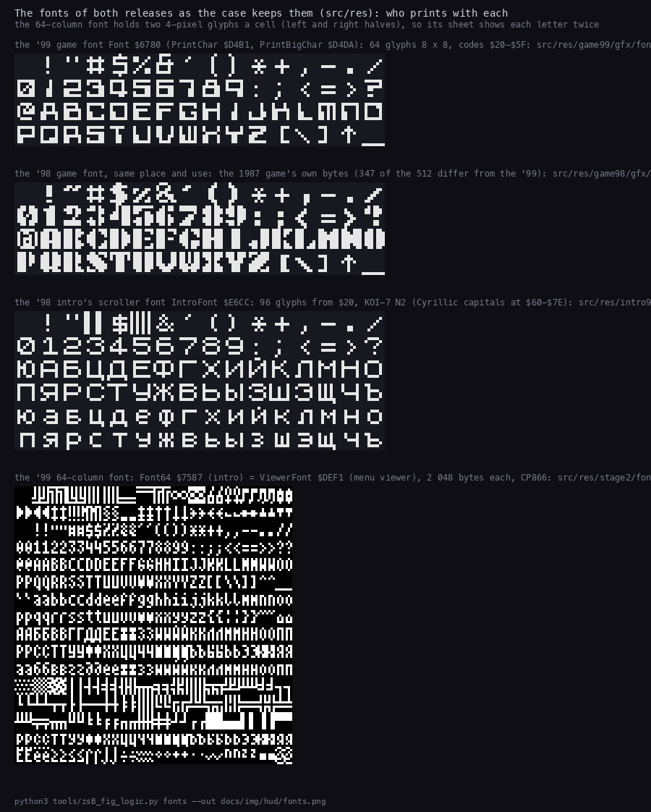
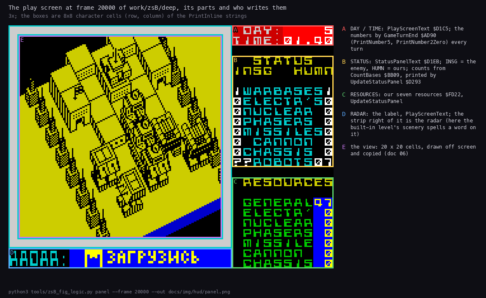
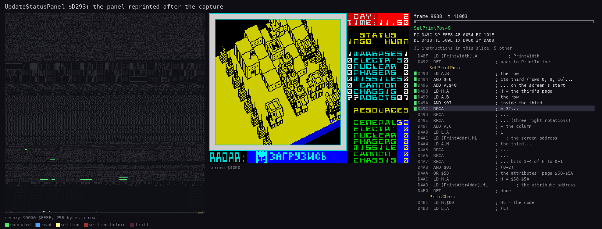
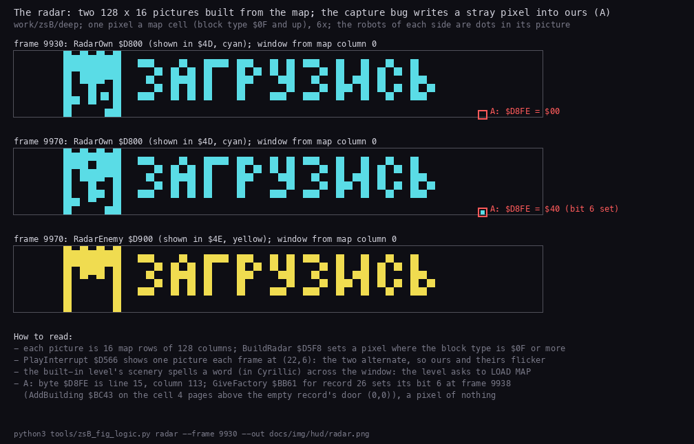

# 8. HUD and text

This document covers everything the two releases print or show as text: the long texts on the '99 disk and in the
intros, the print routine every screen string goes through, the four fonts, every string of the game blocks, the play
screen's panel, clock and radar, the menus' titles and the end-of-game messages.

Evidence:

- the code of `src/game99`, `src/game98` (`print.asm`, `screen.asm`, `gameturn.asm`, `music.asm`) and `src/menu99`;
- the strings decoded from the built game blocks by `tools/zsB_strings.py` (8.4);
- `work/zsB/deep`: the '99 on HARD, the built-in level, played by `tools/zsB_play99.py deep` for 30 602 frames;
- `work/zsB/deep-map0`: the '99 on HARD with `NELEV_00` loaded by LOAD MAP, the same bot, 24 416 frames;
- the L1 counts of the stage recordings `work/stage1/r98` and `work/stage2/menu99/m99`.

## 8.1 The long texts

| Text | Encoding | Where | Shown by | Readable copy | Build source |
| --- | --- | --- | --- | --- | --- |
| `NEabout.W` | CP866, CR LF | '99 disk, page 3 `$C000` | ABOUT ZS NE | [NEabout](texts/NEabout.md) | `src/res/text/NEabout.txt` |
| `NEdescri.W` | CP866, CR LF, TABs | page 3 `$CF00` | DESCRIPTION | [NEdescri](texts/NEdescri.md) | `src/res/text/NEdescri.txt` |
| `NEgreets.W` | CP866, CR LF, TABs | page 3 `$E500` | GREETS | [NEgreets](texts/NEgreets.md) | `src/res/text/NEgreets.txt` |
| `NEadvice.W` | CP866, CR LF, TABs | page 3 `$E700` | ADVICES | [NEadvice](texts/NEadvice.md) | `src/res/text/NEadvice.txt` |
| `NEZSEd99.W` | CP866, CR LF, TABs | the disk only (three sectors read, never shown) | a text viewer (ZX Word) | [NEZSEd99](texts/NEZSEd99.md) | `src/res/text/NEZSEd99.txt` |
| the '98 intro scroller | KOI-7 N2, font switches | '98 intro `$DAC2-$E3B8` | the '98 intro | [scroller98](texts/scroller98.md) | `src/res/intro98/scroll-text.txt` |
| the '99 intro scroller | CP866, CR LF, TABs | '99 stage 2 `$654C-$7586` | the '99 intro | [scroller99](texts/scroller99.md) | `src/res/stage2/scroller.txt` |

- Each readable copy holds the original Russian text with its paragraphs restored, then a full English translation.
  The index of the copies, with sizes and sectors, is [texts/README.md](texts/README.md).
- Every build source is UTF-8.
- Its part's build writes the original encoding back, with the line ends, the end mark and the sector slack, byte
  for byte ([src/res/text/README.md](../src/res/text/README.md)).
- The authors' claims in these texts are checked against the code in [01](01-game-design.md), 1.10.
- The start-up menu pages the four `.W` files it shows with its own viewer (`ViewerPutChar` `$DC8E`), in the
  64-column font of 8.3.
- The game blocks print no long text: every game string is a short `PrintInline` string (8.2, 8.4).

## 8.2 The print routine `PrintInline` `$D42D`

Every string of the game blocks of both releases, and of the '99 start-up menu, is printed by one routine. The string
sits in the code right after the `CALL PrintInline`. The routine reads it byte by byte and returns past its end.

| Byte | Meaning | Handler | Variables it sets |
| --- | --- | --- | --- |
| 0 | the end: return past the string | `PrintInlineEnd` | |
| 1 Y X | the position: row Y, column X | `SetPosition` | `PrintRow` `$FD32`, `PrintColumn` `$FD31`, then `PrintAddr` `$FD04` and `PrintAttrAddr` `$FD14` |
| 2 A | the attribute | `SetAttr` | `PrintAttr` `$FD13` |
| 3 | the next row, the same column | `PrintNewline` | `PrintRow` + 1 |
| 4 N | the size: high nibble the height in rows, low nibble the width in bytes | `SetSize` | `PrintHeight` `$FD16`, `PrintWidth` `$FD17` |
| `$20-$5F` | a glyph of the game font | `PrintChar` `$D4B1` (width 0) or `PrintBigChar` `$D4DA` | `PrintAddr` and `PrintAttrAddr` move on |

The chain:

- `PrintInline` `$D42D` swaps to the alternate registers, so the caller's BC, DE and HL survive.
- It pops the return address, reads one byte, pushes the address one byte on, and hands the byte to `PrintControl`
  `$D43C`.
- The control handlers read their operands two stack levels up (`POP DE`, `POP HL`, read, `PUSH HL`, `PUSH DE`).
- `SetPrintPos` `$D493` turns the row and column into the screen address (`$4000` + the third, the line in the third
  times 32, the column) and the attribute address (`$5800` + 32 x row + column).
- `PrintChar` copies the 8 lines of glyph `$6680` + 8 x code into the cell and writes `PrintAttr` into the attribute
  cell. It does not check the row's end.
- `PrintBigChar` repeats each glyph line `PrintHeight` times (width 1) or doubles each pixel (width 2). Then it fills
  a block of width x height attribute cells.

The sizes in use:

| Size | Look | Used for |
| --- | --- | --- |
| 0 | 8 x 8 | the panel, the robot menus, the messages |
| `$11` | 8 x 8, through `PrintBigChar` | the '99 start-up menu's items |
| `$21` | 8 x 16 | RADAR:, CONSTRUCTION, REDEFINE KEYS, the '98 menu items, the '99 menu's bottom row |
| `$22` | 16 x 16 | ROBOT on the construction menu |
| `$31` | 8 x 24 | the '99 start-up menu's title NETHER EARTH ZS EDITION'99 |
| `$32` | 16 x 24 | the '98 menu's title ZS EDITION'98, the '99 text pages' title NETHER EARTH |

Witnesses (L1 block executions):

- In `work/zsB/deep` `PrintInline` ran 3 975 times, `PrintChar` 42 234 times and `PrintBigChar` 161 times.
- In `work/zsB/deep-map0` `PrintInline` ran 5 356 times and `PrintBigChar` 299 times.
- In the '99 start-up menu recording `work/stage2/menu99/m99` `PrintInline` ran 230 times.

## 8.3 The fonts



How to read the figure:

- **Four sheets, top to bottom:** the '99 game font, the '98 game font, the '98 intro font and the '99 64-column font.
- **Above each sheet:** the font's label and address, the routines that print with it, and its source file in
  `src/res`.
- **The 64-column sheet:** each 8 x 8 cell holds two 4-pixel glyphs (left and right halves), so each letter appears
  twice.

```
python3 tools/zsB_fig_logic.py fonts --out docs/img/hud/fonts.png
```

| Font | Where | Size | Used by | Source |
| --- | --- | --- | --- | --- |
| the game font, '98 | `$6780-$697F` | 64 glyphs of 8 x 8, codes `$20-$5F` | `PrintChar`, `PrintBigChar`: the menu, the panel, the messages | the 1987 game's own bytes (`src/res/game98/gfx/font.png`) |
| the game font, '99 | `$6780-$697F` | 64 glyphs | the same, and the start-up menu's title (size `$31`) | ZS's new design: 347 of 512 bytes differ from the '98 (`src/res/game99/gfx/font.png`) |
| the '98 intro font | `IntroFont` `$E6CC-$E9CB` | 96 glyphs from `$20` | the '98 scroller; KOI-7 Cyrillic capitals at `$60-$7E` | `src/res/intro98/font.png` |
| the 64-column font | '99 stage 2 `Font64` `$7587-$7D86`, and again in the menu block `ViewerFont` `$DEF1-$E6F0` | 256 glyphs of 4 x 8, two a byte, CP866 | the '99 scroller and the start-up menu's text viewer | `src/res/stage2/font64.png`, `src/res/menu99/viewer-font.png` (the same 2 048 bytes) |

- The game font sits right after the view buffer, so `PrintChar` adds 8 x code to `$6680` (`ViewBuffer` + 2944).
- The '99 font is wider and squarer. Its zero is a box with a slash (the panel in 8.5 shows it).
- The two copies of the 64-column font are byte-identical, compared in the built blocks.

## 8.4 Every string

`tools/zsB_strings.py` decodes every string entry (kind `t` in the `.ann`) from the built bytes with the codes of 8.2.
It prints one row per entry: the glyph runs, with the position and the attribute in force when each run starts.

```
python3 tools/zsB_strings.py --ann src/game99/game.ann --bin build/game99/game-6780.bin --at 6780 \
    --md work/zsB/md/strings99.md
python3 tools/zsB_strings.py --ann src/game98/game.ann --bin build/game98/game98-6780.bin --at 6780 \
    --md work/zsB/md/strings98.md
```

The strings of the '99 game block (positions as (row, column); attributes in hex):

| Address | Entry | Printed |
| --- | --- | --- |
| `$A738` | `RobotMenuText` | DIRECT CONTROL, GIVE ORDERS, COMBAT MODE, LEAVE ROBOT at rows 4-14, column 23 (`$4D`); -ORDERS- (17,23) `$46` |
| `$A7B2` | `OrderLine` | STOP / AND / DEFEND: the order shown under -ORDERS- |
| `$A820` | `StrengthText` | STRENGTH (22,23) `$46` |
| `$A848-$A920` | `OrderNames`, `OrderName1`-`OrderName8` | the nine orders, three lines of 8 each: STOP AND DEFEND, ADVANCE .. MILES, RETREAT .. MILES, DESTROY ENEMY ROBOTS / FACTORYS / WARBASES, CAPTURE NEUTRAL FACTORYS, CAPTURE ENEMY FACTORYS / WARBASES |
| `$A977` | `OrdersMenuText` | SELECT ORDERS (4,24) `$47`, then the five choices in `$4D` |
| `$AA1F`, `$AA32` | `AdvanceTitle`, `RetreatTitleText` | ADVANCE / RETREAT (5,23) `$4F` |
| `$AA43` | `DistanceText` | ?? MILES, SELECT DISTANCE (9,23) `$45`, 0 MILES (13,24) `$46` |
| `$AAD8` | `DestroyMenuText` | SEARCH & DESTROY (4,23) `$4F`, SELECT TARGET, ENEMY ROBOTS / FACTORYS / WARBASES |
| `$AB54` | `CaptureMenuText` | SEARCH & CAPTURE (4,23) `$4F`, SELECT TARGET, NEUTRAL FACTORYS, ENEMY FACTORYS / WARBASES |
| `$AC06` | `CombatMenuText` | NUCLEAR BOMB, FIRE PHASERS, FIRE MISSILES, FIRE CANNON, MOVE ROBOT (`$4D`) |
| `$AE7C` | `LostText` | YOU HAVE NO BASES LEFT (22,0) / BETTER LUCK NEXT TIME! (23,0), `$45` |
| `$AEB7` | `WonText` | INSIGNIANS DESTROYED (22,0) / CONGRATULATIONS! (23,0), `$45` |
| `$C350` | `RedefineTitleText` | REDEFINE KEYS (2,9) `$47`, size `$21` |
| `$C382-$C3DF` | `KeyNameUp` .. `KeyNameAbort` | UP, DOWN, LEFT, RIGHT, FIRE, PAUSE, ABORT |
| `$C40F` | `PressKeyForText` | PRESS KEY FOR (then the key's name), `$46` |
| `$C472-$C4A0` | `KeyNameSymShift` .. `KeyNameSpace` | SYM SH, ENTER, CAPS SH, SPACE: the keys without a glyph |
| `$C8BE` | `ConstructionTitleText` | ROBOT (0,3) size `$22`; CONSTRUCTION (2,2) size `$21`; `$47` |
| `$C8DD` | `PartNamesText` | ELECTRONICS, NUCLEAR, PHASERS, MISSILES, CANNON, ANTI-GRAV, TRACKS, BIPOD down column 21 (`$45`) |
| `$C932` | `ExitStartText` | EXIT / MENU at (21-22,5), then START / ROBOT on the same rows |
| `$C94A` | `PartCostsText` | the part costs 3, 20, 4, 4, 2, 10, 5, 3 at column 22 (`$43`) |
| `$C96E` | `ResourceNamesText` | -- RESOURCES -- / -- AVAILABLE -- (6-7,0) `$46`, then the seven resource names (`$44`) |
| `$D1C5` | `PlayScreenText` | DAY: (0,22), TIME: (1,22) `$17`; RADAR: (22,0) `$05`, size `$21` |
| `$D1EB` | `StatusPanelText` | STATUS (3,22), INSG HUMN (4,22) `$06`; WARBASES .. ROBOTS (6-13,23) `$05`; RESOURCES (15,23) `$06`; GENERAL .. CHASSIS (17-23,23) `$04` |
| `$D306` | `PanelBlankLine` | ten spaces: wipes a panel row |

- The position strings without glyphs (`OrderLineHead` `$A7AD`, `MilesPos` `$A7D8`, `DistanceAtText` `$AAA7`,
  `ClockPos` `$AD88`, `TotalPosition` `$CBFF`, and the panel's in 8.5) only set a place before a number.
- FACTORYS is the game's own spelling.

The '98 block holds the same strings at the same addresses, except:

| Address | Entry | '98 | '99 |
| --- | --- | --- | --- |
| `$A7B2` | `OrderLine` | no entry: the bytes are code | STOP / AND / DEFEND |
| `$AEB7` | `WonText` | WELL DONE! WAIT FOR / NEW LEVELS FROM ZS! | INSIGNIANS DESTROYED / CONGRATULATIONS! |
| `$C109-$C159` | `MenuStartText` .. `MenuMoreText` | 0..START GAME (11,8) `$46` size `$21`, 1..KEYBOARD, 2..KEMPSTON J/S, 3..INTERFACE 2, 4..REDEFINE KEYS, 5..LOAD NEW LEVEL! | the start-up menu's patches replace the main menu |
| `$C1E6` | `TitleText` | ZS EDITION'98 (1,2) `$47`, size `$32` | (patched over) |
| `$C3EE` | `KeyNameSave` | SAVE | no entry |

The '99 start-up menu's own strings live in the menu block. They are built from
[`src/res/menu99/menu-strings.txt`](../src/res/menu99/README.md):

| Section | Entry | Printed |
| --- | --- | --- |
| [menu] | `MenuText` `$D826` | NETHER EARTH ZS EDITION'99 (1,3) `$04` size `$31`; START UP MENU (4,10); LEVEL: EASY MEDIUM HARD CRITICAL; UPGRADING: ELECTRONIC NUCLEAR PHASERS MISSILES CANNON ANTI-GRAVS; CONTROL: KEYBOARD KEMPSTON INTERFACE REDEFINE |
| [bottom] | `MenuBottomText` `$D920` | START, LOAD MAP, DESCRIPTION (row 17); ADVICES, GREETS, ABOUT ZS NE (row 21); `$02`, size `$21` |
| [description], [about], [advices], [greets] | `DescTitle` `$DB2B`, `AboutTitle` `$DB5B`, `AdvicesTitle` `$DB97`, `GreetsTitle` `$DBC3` | NETHER EARTH (1,3) size `$32` over each text page, then the page's name |

## 8.5 The play screen and the status panel



How to read the figure:

- **The screen:** unreal-ng's screen memory at frame 20 000 of `work/zsB/deep`, 3x.
- **A (red):** the clock, rows 0-1, columns 22-31.
- **B (yellow):** the status table, rows 3-13: the labels and two columns of counts, INSG (the enemy) and HUMN (ours).
- **C (green):** our seven resources, rows 15-23.
- **D (blue):** the RADAR: label and the radar strip right of it (8.8).
- **E (violet):** the 20 x 20 cell view, drawn off screen and copied ([06](06-rendering.md)).
- **The text right of the screen:** for each box, the string that labels it and the routine that fills in its
  numbers.

```
python3 tools/zsB_fig_logic.py panel --frame 20000 --out docs/img/hud/panel.png
```

What it shows:

- The panel's labels are `PlayScreenText` `$D1C5` and `StatusPanelText` `$D1EB`, printed once when play starts.
- The clock reads day 5, 01.40: `Clock` `$FD35-$FD38` holds 40, 1, 5 at that frame.
- GENERAL reads 47: `Resources` `$FD22` = 47 at that frame.
- The enemy's robot count reads `??`: the '99 on MEDIUM and up hides it (below).

`UpdateStatusPanel` `$D293` prints all the panel's numbers in one pass:

1. It does nothing while `PanelBusy` `$FD39` is not 0: a robot menu then holds the panel's place.
2. Position (16,30), attribute `$4E`, size 0 (`ResourceValuesPos` `$D29B`).
3. `PrintResourceValues` `$D2A3`: the seven resources from `Resources` `$FD22`, each after a `PrintNewline`, by
   `PrintNumber2` (rows 17-23, a blank leading zero).
4. Position (6,22), attribute `$47` (`InsgCountsPos` `$D2BB`).
5. `PrintInsgCounts` `$D2C1`: the enemy's seven building counts `EnemyBuildings` `$FD42` as single digits down column
   22 (rows 6-12), then its robot count `$FD49` by `PrintNumber2Zero` at (13,22).
6. Position (6,31) (`HumnCountsPos` `$D2CE`); `PrintHumnCounts` `$D2D2`: ours from `PlayerBuildings` `$FD3A`, then our
   robots `$FD41` at (13,30).

The enemy's robot count is where the releases and levels differ:

| Release, level | The 6 bytes at `$D2C8` | The INSG robot count |
| --- | --- | --- |
| '98 | `00 00 00 CD 2D D4`: three `NOP`s over `CALL PrintNumber2Zero`, then `CALL PrintInline` | blank |
| '99 EASY | `CD EC D3 CD 2D D4`: `CALL PrintNumber2Zero`, `CALL PrintInline` (the image as built) | the number |
| '99 MEDIUM, HARD, CRITICAL | `NOP`, `CALL PrintInline`, `??`, written by the start-up menu (`src/game99/difficulty.asm`) | `??`; the string goes on into `HumnCountsPos` |

The '98 and '99 bytes are read from `build/game98/game98-6780.bin` and `build/game99/game-6780.bin`; the `??` is on the
panel figure above.

Who calls `UpdateStatusPanel`:

| Caller | When |
| --- | --- |
| `GameTurnEnd` `$AE1A` | after a capture changed the counts |
| `DailyProduction` `$AE4A` | at midnight, after both sides are paid |
| `UpdateRobot` `$B150` | a robot was removed |
| `EnemyCommander` `$B91C` | the enemy built a robot |
| `NuclearBlast` `$BA84` | after a nuclear blast |
| `CheckWarbasePad` `$A70A` | the player left the construction menu |



The animation shows the run at frame 9938 of `work/zsB/deep`, called by `GameTurnEnd` after the phantom capture of
[10](10-gameplay-logic.md): the PC over the listing, and the screen as each byte lands.

```
python3 ../../kit/routine_anim.py --work work/zsB/deep --window 9938:40700-9938:67900 \
    --listing build/game99/game.lst --view screen --pc D293-D4FF \
    --title 'UpdateStatusPanel $D293: the panel reprinted after the capture' \
    --out docs/img/routines/UpdateStatusPanel.gif
```

Witnesses: `UpdateStatusPanel` ran 55 times in `work/zsB/deep` and 108 times in `work/zsB/deep-map0`.

## 8.6 The clock

`GameTurn` `$AD62` advances the clock every turn and prints it:

- `Clock` `$FD35` holds the minutes, `$FD36` the hours, `$FD37-$FD38` the day count.
- A turn adds 5 minutes. 60 minutes make an hour, 24 hours a day, and a new day calls `DailyProduction` `$AE38`.
- `ClockPos` `$AD88` sets (0,27), size 0, attribute `$57` (white on red).
- `GameTurnEnd` `$AD90` prints the day count by `PrintNumber5` (five digits, leading zeros blank).
- On the next row it prints the hours by `PrintNumber2Zero`, a dot, and the minutes (`01.40` in 8.5).
- Witness: `GameTurn`, `GameTurnEnd` and `PrintNumber5` each ran 2 224 times in `work/zsB/deep`, once a turn.
- A turn takes at least 10 frames (`TurnPace` `$AE1D`). So a game hour takes at least 120 frames, and a day at least
  2 880 (59 s at 48.83 frames a second).
- In the deep game the midnights came 3 900-4 400 frames apart, because many turns took longer than 10 frames
  ([10](10-gameplay-logic.md)).

## 8.7 The number printers

All number printing is one chain in `print.asm`. `PrintDigit` `$D413` counts how often a negative power of ten fits
into HL. E = `$20` means "still in the leading zeros", which print as spaces.

| Entry | Prints | Leading zeros | Used for |
| --- | --- | --- | --- |
| `PrintNumber5` `$D3F3` | HL, five digits | blank | the day count |
| `PrintNumber3` `$D401` | HL, three digits | as E says | the construction menu's total (`PrintMenuTotal` `$CC03`) |
| `PrintNumber2` `$D3E5` | A, two digits | blank | the resources, the construction menu's values, the MILES |
| `PrintNumber2Zero` `$D3EC` | A, two digits | printed | the clock, the robot counts |
| `PrintTensUnits` `$D407` | HL's tens and units | as E says | the common tail |
| `PrintCharKeep` `$D427` | one character, BC, DE, HL kept | | every digit |

- Each entry falls or jumps into the next, so the code holds one digit loop.
- The operands of `PrintNumber5` and `PrintNumber3` are negative powers of ten: `$D8F0` (-10000), `$FC18` (-1000) and
  `$FF9C` (-100).
- A value of 100 or more in the two-digit printers gives a tens "digit" past 9 (`:` and on).
- Known only from the code: that overflow. Every resource is capped at 99 (`AddCapped`), so no recording reached it.
- The '98 and '99 print modules (`$D3E5-$D58E`) are the same bytes, compared in the built blocks.
- Witness: in `work/zsB/deep` `PrintNumber2Zero` ran 4 501 times and `PrintTensUnits` 7 438 times.

## 8.8 The radar



How to read the figure:

- **Three strips:** our picture `RadarOwn` `$D800` at frame 9930, the same at frame 9970, and the enemy's picture
  `RadarEnemy` `$D900` at frame 9970 of `work/zsB/deep`, 6x.
- **A pixel:** a map cell whose block type is `$0F` or more (scenery tall enough to show), or a robot of that side.
- **A (red box):** byte `$D8FE` (line 15, column 113 of our picture) and its value.
- **The window:** the radar shows 128 of the map's 512 columns, from `RadarColumn` `$FD1C` (0 here).

```
python3 tools/zsB_fig_logic.py radar --frame 9930 --out docs/img/hud/radar.png
```

What it shows:

- The built-in level's scenery spells a Cyrillic word, ЗАГРУЗИСЬ ("load up"), across the radar. The level is a
  prompt to LOAD MAP ([07](07-objects.md)).
- Our picture holds our warbase and our robots' dots. The enemy's picture holds the same terrain without them.
- Between frames 9930 and 9970 a pixel appears at A: the phantom capture of [10](10-gameplay-logic.md) sets bit 6 of
  `$D8FE`. It is no map cell: it is the capture bug writing into the radar picture.

How the radar works:

- `BuildRadar` `$D5F8` builds our picture from the 16 map rows, eight cells a byte. Then it copies it to the enemy's
  picture and adds each side's robots (`ToggleRadarDot` `$D65A`, a 2 x 2 XOR dot).
- `PlayInterrupt` `$D566` shows one picture a frame by `ShowRadar` `$D59E` at (22,6): ours in `$4D` (cyan), the
  enemy's in `$4E` (yellow). The two alternate every frame, so the radar flickers between them.
- `ScrollRadar` `$AFE6` moves the window by 64 columns when the ship nears its edge; `PutShipOnMap` `$B024` then
  rebuilds the radar.
- `RefreshRadar` `$B029` blinks the ship's dot on odd turns.
- Witnesses: in `work/zsB/deep` `ShowRadar` ran 29 274 times, `ToggleRadarDot` 25 815 times and `ScrollRadar` 2 142
  times.
- Known only from the code: a rebuild. The ship stayed in the first window in both deep games, so `BuildRadar` has no
  L1 entry in either.

## 8.9 The menus' titles and the end of a game

The title colour cycle, `TitleColourCycle` `$C820`:

- It counts `TitleColourPhase` `$FD33` from 0 to 15, one step a call.
- On even counts it paints rows 0-6, columns 0-30 (from `$5800`, 31 cells a row, a step of 1) with BRIGHT, black
  paper and ink = count / 2. So the ink runs through all 8 colours every 16 calls.
- The '98 main menu calls it every frame from its `HALT` loops, and `MenuInterrupt` calls it while the menu tune
  plays: 401 calls in `work/stage1/r98`.
- The '99 start-up menu calls the game's copy from `src/menu99/menumain.asm` and from its text viewer: 18 311 calls in
  `work/stage2/menu99/m99`.
- The two releases hold the same bytes for it (`$C820-$C848`).

The end of a game, `CheckGameEnd` `$AE6B`, runs every turn:

- `EnemyBuildings` `$FD42` (the enemy's warbases) = 0: the player has won. `WonText` `$AEB7` is printed at (22,0)
  over the radar, in `$45`.
- Else `PlayerBuildings` `$FD3A` (ours) = 0: the player has lost. `GameStop` stops the world and `LostText` `$AE7C` is
  printed.
- Both end in `GameOverWait` `$AEEA`.
- Witness: `CheckGameEnd` ran 2 224 times in `work/zsB/deep`, once a turn.
- Known only from the code: both ends. No recording lost or won a game; `LostText`, `WonText` and `GameOverWait` have
  no L1 entry in `work/zsB/deep` or `work/zsB/deep-map0`.

| Release | Lost | Won |
| --- | --- | --- |
| '98 | YOU HAVE NO BASES LEFT / BETTER LUCK NEXT TIME! | WELL DONE! WAIT FOR / NEW LEVELS FROM ZS! |
| '99 | YOU HAVE NO BASES LEFT / BETTER LUCK NEXT TIME! | INSIGNIANS DESTROYED / CONGRATULATIONS! |

## 8.10 Design notes

- **One print routine for everything.** Strings inline after the `CALL` cost no pointers and no table. Codes 1-4
  are enough for every screen, and the alternate registers keep the caller's state.
- **The panel is a text table.** Every number goes through the same digit loop. A whole rewrite
  (`UpdateStatusPanel`) is cheap enough to run after every change, so nothing tracks which number changed.
- **The '99 hides information by patching code.** The `??` is not a flag: the start-up menu overwrites six bytes of
  `PrintInsgCounts` with a `NOP` and a string. The '98 did the same with three `NOP`s.
- **The radar costs a picture copy a frame.** Two pictures alternating at 50 Hz give two colours in one attribute
  cell, at the price of flicker.
- **The built-in level speaks through the radar.** Its scenery is shaped as a word only the radar shows: the '99's
  way of telling the player to load a real map.
