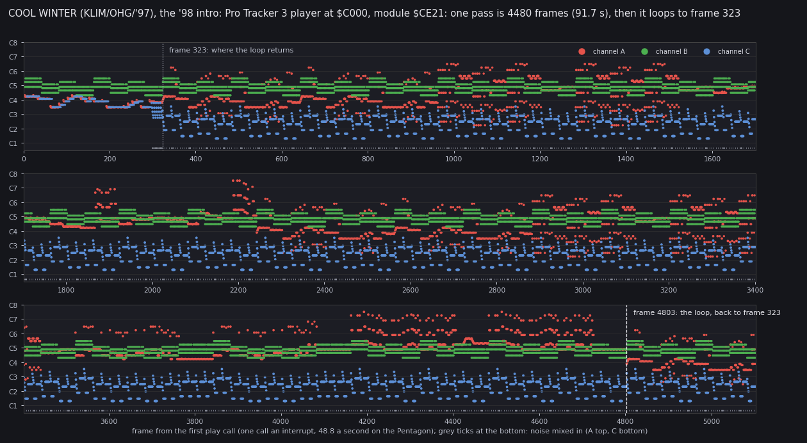
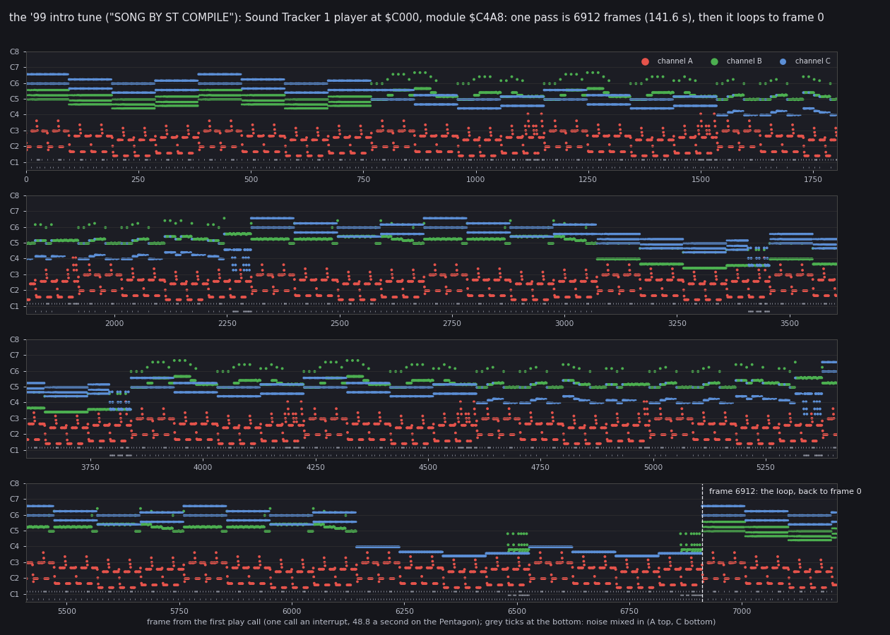
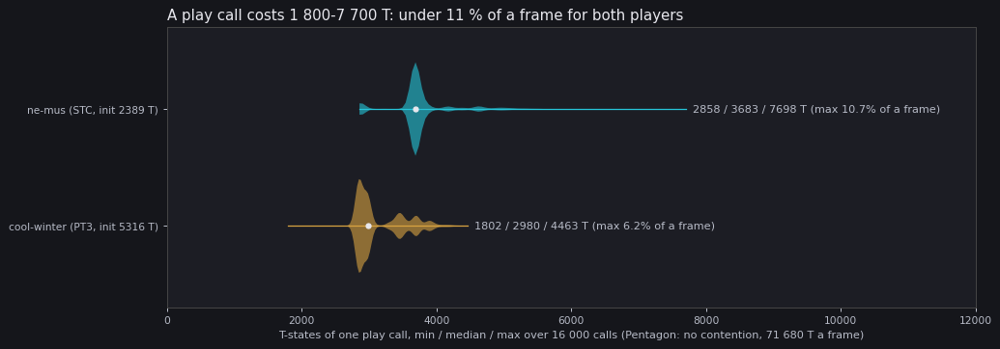
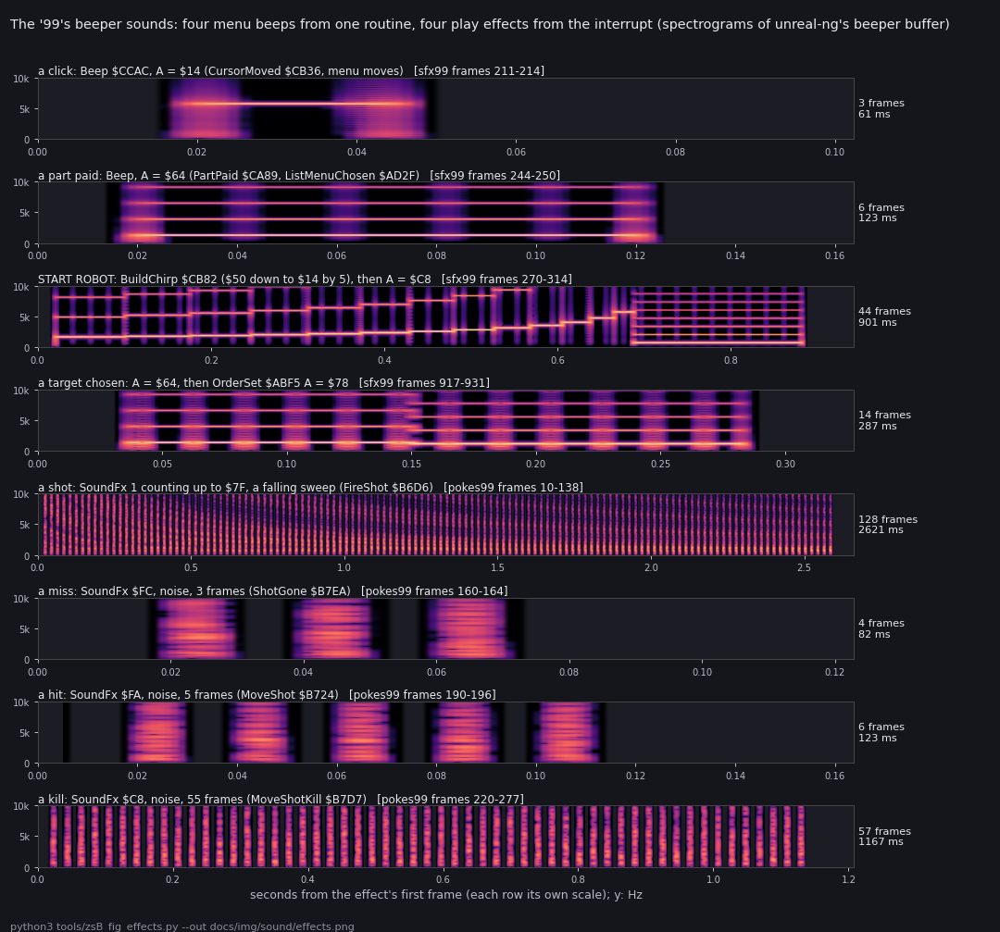

# 9. Sound

This document covers every sound of both releases: the two AY intro tunes, the '98 game menu's beeper tune, the
beeps of the menus and the four effects of play. For each it gives the code that makes it, the data it reads, what
it costs, and a rendered file in [audio/](audio/README.md).

Evidence:

- the code of `src/intro98` (the '98 intro and its Pro Tracker 3 player), `src/music99` (the '99 Sound Tracker
  player), `src/stage2` (the '99 intro's interrupt), `src/game99` and `src/game98` (`interrupts.asm`, `music.asm`,
  `construction.asm`, `robotmenu.asm`);
- the players run on SkoolKit's Z80 simulator for 16 000 calls each (`tools/zsB_ay_play.py`, 9.2-9.4): every AY
  register write and the T-states of every call;
- four captures of unreal-ng's own audio output on an own muted instance (`tools/zsB_render_audio.py`, stages
  `intro98`, `intro99`, `sfx99`, `pokes99`; [audio/README.md](audio/README.md) has the machine and the cuts);
- the L1 counts of `work/stage1/r98` and `r99` (the intros), of `work/zsB/deep` (30 602 frames of the '99 on
  HARD, the built-in level, `tools/zsB_play99.py deep`) and of `work/zsB/deep-map0` (24 416 frames of the '99 on HARD
  with `NELEV_00`).

Nothing was played aloud: the instances run offscreen with the master muted.

## 9.1 What sounds where

| Release | Where | Chip | Code | Data | File |
| --- | --- | --- | --- | --- | --- |
| '98 | the intro | AY | Pro Tracker 3 player `Pt3Init` `$C000`, `Pt3PlayEntry` `$C005` from `IntroInterrupt` `$DA0D` | `Pt3Module` `$CE21`, "COOL WINTER" (KLIM/OHG/'97), 2 670 bytes | [cool-winter.mp3](audio/cool-winter.mp3) |
| '98 | the game's main menu | beeper | `MenuMusic` `$C4A7`, `MenuInterrupt` `$C4FD` | the bass, lead and drum tracks from `$C665` | [menu-tune98.mp3](audio/menu-tune98.mp3) |
| '99 | the intro (stage 2) | AY | Sound Tracker player: `Init` `$C00B`, `Play` `$C00E`, `Mute` `$C011`, from `IM2Handler` `$6525` | `Module` `$C4A8`, "SONG BY ST COMPILE", 2 023 bytes | [intro-tune99.mp3](audio/intro-tune99.mp3) |
| '99 | the start-up menu | none | no `OUT` and no `Beep` call in `src/menu99` | | |
| both | the game's menus | beeper | `Beep` `$CCAC` (9.6) | A = the half-period | 4 files `sfx-*` |
| both | play | beeper | `SoundEffect` `$D5C4` from `PlayInterrupt` `$D566` (9.5) | `SoundFx` `$FD53` | 4 files `sfx-*` |

- The game blocks of the two releases hold the same bytes for `PlayInterrupt`, `SoundEffect`, `Beep`, the
  construction menu (`$C849-$CBA7`) and the shot code (`$B6D6-$B7F3`): compared byte for byte in
  `build/game99/game-6780.bin` and `build/game98/game98-6780.bin`. So the effects sound the same in both.
- The menu tune's code and tracks (`$C4A7-$C8BF`) differ in 3 bytes between the releases. All three are operands
  the tune writes while it plays, left as they were when each image was saved: the lead period at `$C4D0`
  (`$37` / `$29`), the lead pulse width at `$C4D6` (`$0D` / `$0A`) and the bass on/off byte at `$C4EF` (`$18` / 0).
- The title colour cycle that `MenuInterrupt` also runs (`TitleColourCycle` `$C820`) is the same code in both
  ([8](08-hud-and-text.md), 8.7).
- The '99 keeps `MenuMusic` and its tracks, but nothing calls it: no `CALL MenuMusic` in `src/game99`, and the
  routine has no L1 entry in `work/zsB/deep` or in the stage-2 windows. Known only from the code: the tune it would
  play.
- The '99 game itself never touches the AY: no `OUT` to `$FFFD` / `$BFFD` in `src/game99`. The intro mutes the AY
  (`Mute` `$C011`) in `OutroAndLoad` `$6262` before the game loads.

## 9.2 The '98 intro tune: COOL WINTER

The '98 intro sets IM 2 with the table at `$8100` (I = `$81`, every vector `$8080`, a `JP IntroInterrupt` there). It
calls `Pt3Init` `$C000` once. Then each interrupt runs `IntroInterrupt` `$DA0D`, which saves the registers and calls
`Pt3PlayEntry` `$C005` (one frame of the tune) and `ScrollStep` (the scroller). `Pt3StopEntry` `$C008` silences the
AY when the intro ends.

The player is a Pro Tracker 3 player (the variant whose text names it "Nick of GDC 1.0"); the module is a PT3 file
named "COOL WINTER" by KLIM/OHG/'97 (`src/res/intro98/cool-winter.pt3`).



How to read the figure:

- **Across:** the frames from the first play call, in strips of about 1800 frames.
- **Dots:** each channel's tone at each frame, at the note of its period (AY clock 1.75 MHz), the dot's size its
  volume. Red A, green B, blue C.
- **Grey ticks at the bottom:** frames where a channel mixes noise (A top, C bottom).
- **Dashed line:** where the tune goes back; dotted: the frame it goes back to.

What it shows:

- The first 323 frames are an introduction that is never played again.
- From frame 323 one pass takes 4480 frames (91.7 s at 48.83 frames a second), then the tune repeats from frame 323.
- Channel C mixes noise on 1344 frames of the pass (the drums); no channel uses the AY envelope.

```
VENV/bin/python tools/zsB_ay_play.py --load build/intro98/intro-c000.bin@C000 --init C000 --play C005 \
    --frames 16000 --out work/zsB/ay/cool-winter.json
python3 tools/zsB_fig_tunes.py --ay work/zsB/ay --out-dir docs/img/sound
```

`VENV` is the SkoolKit virtualenv (`/Volumes/TB4-4Tb/Projects/Test/unreal-ng/scratch/venv-skoolkit`). The loop is
found where the 14 AY registers after each call repeat to the end of the run.

In unreal-ng the tune sounds the same: the capture of the running intro repeats with a loudness correlation of 0.942
one pass (4480 frames) later ([audio/README.md](audio/README.md)).

## 9.3 The '99 intro tune

Stage 2 of the '99 (`IntroMain`, `src/stage2/stage2/loader.asm`) builds an IM 2 table at `$B000` (257 bytes `$B1`,
I = `$B0`), puts `JP IM2Handler` at `$B1B1` and calls `MusicInit` (`Init` `$C00B`) before `EI`. `IM2Handler` `$6525`
saves every register, calls `MusicPlay` (`Play` `$C00E`) and jumps on into the ROM's `$0038` (keyboard scan,
FRAMES).

- The player is a compiled Sound Tracker 1 player. Its bytes match, outside its name text, the player of zxart.ee
  87860 "Slide" (FunTop 1998) (`work/stage2/STATE-front99.md`).
- The module `ne_mus.stc` (`src/res/music99/`) names itself "SONG BY ST COMPILE": tempo 6, 18 positions.



The figure reads like 9.2's. What it shows:

- The tune has no introduction: it goes back to its first frame after 6912 frames (141.6 s).
- Channel A mixes noise on 1934 frames of the pass, B on 76, C on 692; no envelope.

```
VENV/bin/python tools/zsB_ay_play.py --load build/front99/music-c000.bin@C000 --init C00B --play C00E \
    --frames 16000 --out work/zsB/ay/ne-mus.json
```

**The running intro loses interrupts.** In the capture of the intro (`intro99`) the tune repeats after 6920 frames,
not 6912: the loudness of the first 3 s correlates 0.987 with the stretch 6920 frames later and 0.05 with the one
6912 frames later. The L1 count of `r99` agrees: `IM2Handler` ran 1845 times over frames 261-2114, 1854 frames, so
9 interrupts reached no `Play` call. Which code holds the interrupts off was not traced: this is a measured count,
not an explained one. The rendered file uses the 6920-frame pass.

## 9.4 What the players cost



How to read the figure:

- **Across:** the T-states of one play call (the simulator counts a Pentagon's uncontended T-states).
- **Each row:** one player's 16 000 calls as a violin, its median as a white dot; the text gives min / median / max.

| Player | Init | Play, min / median / max | Max share of a frame (71 680 T) |
| --- | --- | --- | --- |
| Pro Tracker 3 ('98 intro) | 5 316 T | 1 802 / 2 980 / 4 463 T | 6.2 % |
| Sound Tracker 1 ('99 intro) | 2 389 T | 2 858 / 3 683 / 7 698 T | 10.7 % |

The Sound Tracker player is the older and simpler format, yet costs more a call here: its median is 24 % above the
PT3 player's.

## 9.5 Effects in play: `SoundEffect` `$D5C4`

`PlayInterrupt` `$D566` runs every frame of play. After the radar it reads `SoundFx` `$FD53`:

1. 0: silent, nothing to do.
2. Otherwise one step on: `SoundFx` + 1; a value that reaches `$80` becomes 0 (the end of a tone), a value past
   `$FF` wraps to 0 (the end of a noise).
3. Not 0 after the step: `CALL SoundEffect`, with the flags of the new value.

`SoundEffect` has two kinds:

- **A tone, `SoundFx` 2-`$7F`:** C = 500 / (A + 2) + 1 pulses, B = A the delay between them. Each pulse's speaker
  level is bit 4 of the next ROM byte from `$0000`. As A counts up, the pulses get fewer and further apart: a falling
  sweep over 126 frames.
- **A noise, `SoundFx` `$C8`-`$FF`:** 30 random speaker levels (`Random`), then return.

Who sets `SoundFx` (the shot code, `src/game99/world.asm`):

| Value | Set by | Sound | Length |
| --- | --- | --- | --- |
| 1 | `FireShot` `$B6D6`, a shot leaves a robot | the falling sweep | 126 frames, cut short by any later value |
| `$FC` | `ShotGone` `$B7EA`, a shot ends on nothing | noise | 3 frames |
| `$FA` | `MoveShot` `$B724`, a robot hit and still alive | noise | 5 frames |
| `$C8` | `MoveShotKill` `$B7D7`, a robot destroyed | noise | 55 frames |



How to read the figure:

- **Each row:** one sound, the spectrogram of unreal-ng's beeper buffer (0-10 kHz), the time from its first frame.
  Each row has its own time scale.
- **The title of each row:** the routine and the value that make it, and the frames of the capture it comes from.
- **Right:** the length in frames and milliseconds (20.48 ms a frame).

What it shows:

- The shot's sweep is a train of short broadband pulses, one burst a frame, thinning out to the right.
- The miss, the hit and the kill are the same noise burst, one a frame, for 3, 5 and 55 frames.
- The menu beeps are pure square waves at one pitch each; the chirp steps up in pitch 13 times, then drops to the
  long low beep.

```
python3 tools/zsB_render_audio.py --only sfx99,pokes99
python3 tools/zsB_fig_effects.py --out docs/img/sound/effects.png
```

**Witness.** The four play effects come from `pokes99`, an experiment: `SoundFx` written by hand into the play
snapshot `work/zsB/menu-hard/play.szx` (1 at frame 10, `$FC` at 160, `$FA` at 190, `$C8` at 220). The lengths
measured from the capture's bursts match the table: 128 frames for the sweep (126 steps plus the frame of the write
and the end), 3, 5 and 55 for the noises.

**Witness in play.** On the built-in level no shot is fired: `FireShot`, `MoveShot` and `SoundEffect` have no L1
entry in `work/zsB/deep` (the level fences each side in, [07](07-objects.md), 7.5). The game on `NELEV_00`
(`work/zsB/deep-map0`, [10](10-gameplay-logic.md), 10.6) is a war:

- `FireShot` ran 76 times, `MoveShotKill` 17 times, and `SoundEffect` 1 725 times (L1 block executions).
- `SoundFx` read from the recording's memory at the frames after a `FireShot` (23106, 24115, 24212, 24254) counts
  1, 2, 3: the sweep.
- At the frames after each of the last five `MoveShotKill` runs (22293 to 24289) it reads `$C8`, `$C9`, `$CA`: the
  kill's noise.
- Known only from the code: `$FC` from `ShotGone` (out of range). `ShotGone` has no L1 entry in either recording;
  every shot there hit something.

## 9.6 `Beep` `$CCAC`

`Beep` toggles the speaker 256 times (128 periods) with a delay of A between toggles:

```
BeepLoop: PUSH BC / XOR $10 / OUT ($FE),A / DJNZ BeepDelay / POP BC / DEC C / JR NZ,BeepLoop
```

One half-period is 50 + 13 x A T-states (the loop's 50, the `DJNZ` 13 a turn), so on a 3.5 MHz Pentagon:

| A | Half-period | Pitch | Length | Called by |
| --- | --- | --- | --- | --- |
| `$14` | 310 T | 5 645 Hz | 23 ms | `CursorMoved` `$CB36` (construction cursor), `ListMenuKey` `$ACEC` (a list menu moves), `DistanceShow` `$AAAD` (the miles change) |
| `$50`-`$14` by 5 | 1 090-310 T | 1 606-5 645 Hz | 13 beeps | `BuildChirp` `$CB82` (START ROBOT) |
| `$64` | 1 350 T | 1 296 Hz | 99 ms | `PartPaid` `$CA89`, `ListMenuChosen` `$AD2F` |
| `$78` | 1 610 T | 1 087 Hz | 118 ms | `PartRefused` `$CAAC`, `OrderSet` `$ABF5`, `LeaveRobot` `$A801`, direct control's release, STOP AND DEFEND, the distance set |
| `$C8` | 2 650 T | 660 Hz | 194 ms | `LeaveConstructionMenu` `$CB8E` |
| `$FA` | 3 300 T | 530 Hz | 241 ms | `CombatRefused` `$ACCE`, `GameOverWait` `$AEEA` |

- The pitches and lengths are computed from the loop; the spectrogram rows of 9.5 agree (the part-paid line near
  1.3 kHz, the click near 5.6 kHz).
- `Beep` runs with interrupts on, so the interrupt's work splits a long beep into pieces: the gaps in the
  spectrograms.
- The `$FA` beep was not heard in any run here: `CombatRefused` and `GameOverWait` have no L1 entry in
  `work/zsB/deep` or `work/zsB/deep-map0`. Known only from the code.

## 9.7 The '98 menu tune

The '98 main menu (`src/game98/mainmenu.asm`) calls `MenuMusic` `$C4A7` once all keys are up. `MenuMusic` makes
`MenuInterrupt` `$C4FD` the handler, sets the three track positions and runs a two-voice tone loop that never
returns by itself:

- The main loop toggles the speaker for two voices, the lead and the bass, each a pulse train whose period and
  width are operands of the loop's own instructions (`$C4D0`, `$C4D2`, `$C4D6`, `$C4ED`, `$C4EF`, `$C4F3`).
- `MenuInterrupt` reads the next event of each voice when its frames run out and writes those operands. It also
  plays the drum records (which stop the tone loop for their length) and recolours the title.
- A number key down: `MenuInterrupt` loads SP from `SavedSP` `$FD08`, and its `RET` returns from `MenuMusic` to the
  menu.

Tracks: a note is (period, frames) with the period 9 or more; a byte below 9 is a command (1 goto, 2 call a pattern,
3 start a drum track, 4 voice on, 5 voice off, 6 return). The tracks are `src/res/game98/music/menu.txt`.

**Measured:** in the capture (`intro98` after SPACE) the tune repeats after 5192 frames (106.3 s): a loudness
correlation of 0.876 between the first 6 s and the same 6 s one pass later. The tracks add up to 5120 frames, one
interrupt a frame: 72 frames a pass reach no track step. Like the '99 intro's 8 frames, these are interrupts the CPU
did not take; the drum records, which run inside the handler, are the likely place, not traced here.

**Known only from the code:** a restart of the tune (after keys 1-3 in the menu) keeps a voice that was off silent
until its next command 4, because `MenuMusic` does not reset the on / off operands (`src/game98/music.asm` header).

## 9.8 Design notes

- **Two chips, two eras.** Both intros play AY tunes made in trackers (PT3 and Sound Tracker), while the game keeps
  the 1987 beeper code: a 128 K front end on a 48 K game. The game itself never writes the AY.
- **One beep routine.** Every menu sound is `Beep` with one byte of pitch; the effects of play are the interrupt's,
  so they run under the world without holding it up.
- **Effects are a counter.** One byte, `SoundFx`, is the whole state of an effect: its value picks the kind and its
  step to `$80` or past `$FF` ends it. A new value cuts the old effect off.
