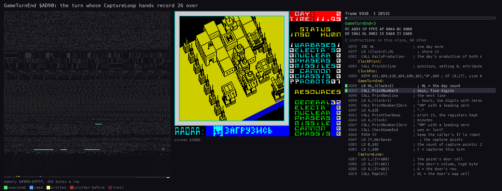
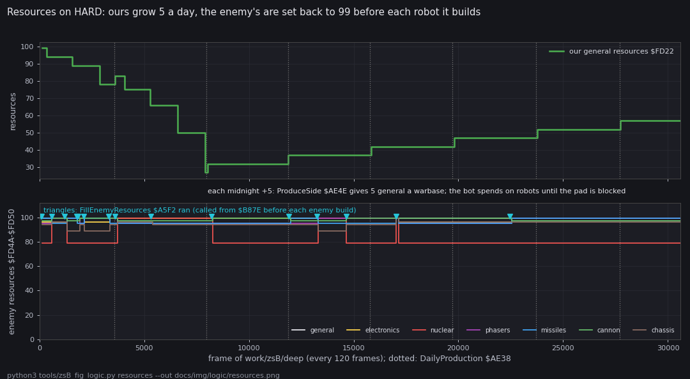
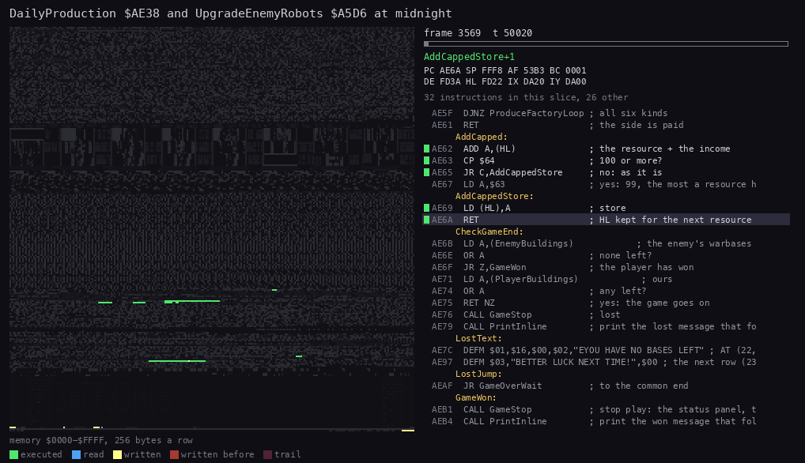
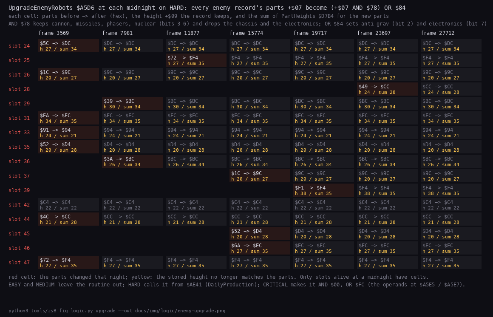
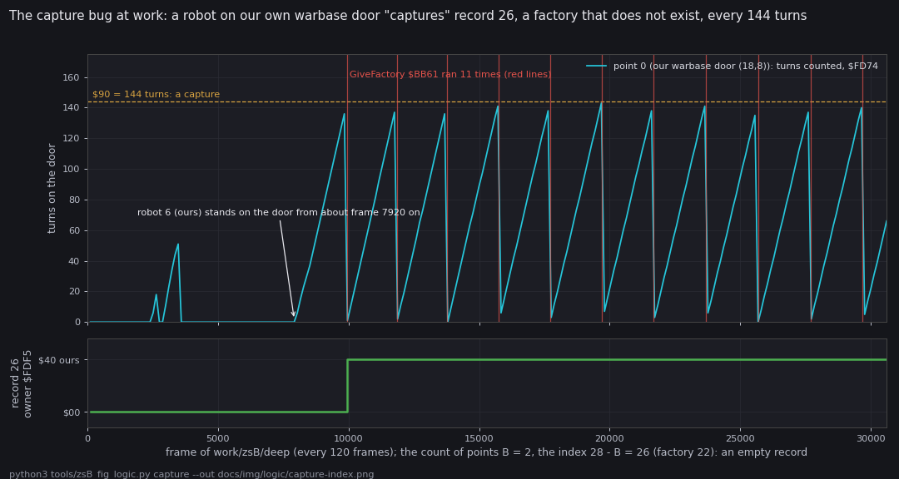
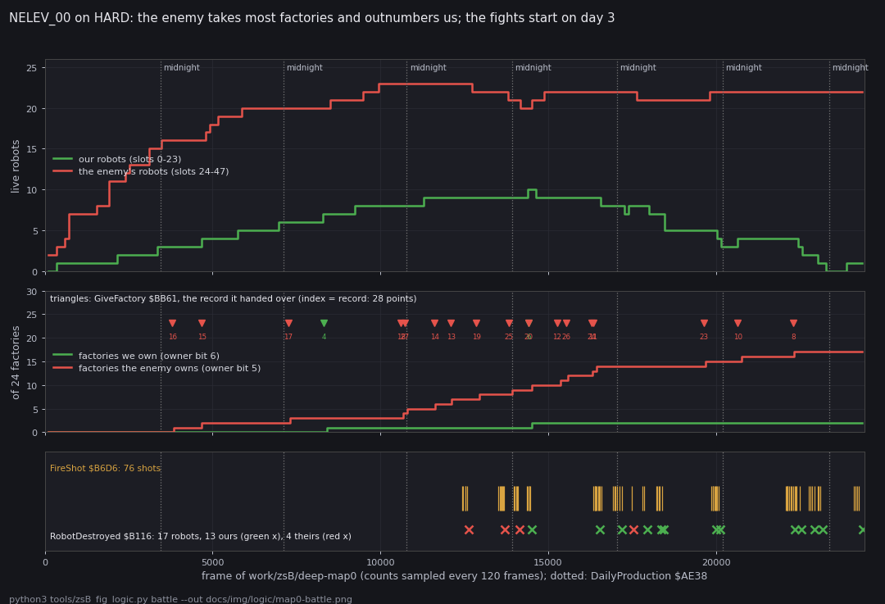

# 10. Gameplay logic

This document covers the rules of a game of the '99 and the '98: the turn and the clock, production, the four
difficulty levels, the enemy's daily upgrade, captures, and the bugs the code holds. Every claim gives its addresses
and the run that shows it. A claim no recording reached is marked as known only from the code.

Evidence:

- the code of `src/game99` and `src/game98` (`gameturn.asm`, `bases.asm`, `difficulty.asm`, `enemy.asm`,
  `construction.asm`, `world.asm`);
- `work/zsB/deep`: the '99 on HARD, the built-in level, NE's bot driven by `tools/zsB_play99.py deep` for 30 602
  frames (2 224 turns, 7.7 game days);
- `work/zsB/deep-map0`: the '99 on HARD with `NELEV_00` loaded by LOAD MAP (`tools/zsB_play99.py menu --map 0`, then
  `deep`), 24 416 frames (2 094 turns, 7.3 game days);
- the stage recordings `work/stage2/game98/deep` (the '98, 30 284 frames) and `work/stage2/game99/r-critical` (the
  '99 on CRITICAL);
- the figures, drawn from the recordings' memory by `tools/zsB_fig_logic.py`.

Both deep runs use the same bot: it builds robots from a fixed plan whenever it can pay and the pad is free, and gives
each one an order. It never takes direct control and never fires by hand.

## 10.1 The turn and the clock

A game turn is one pass of `PlayLoop` `$A69A`: the controls, the ship, `WorldTurn` `$B0CA` ([07](07-objects.md)), the
view, then `GameTurn` `$AD62`.

`GameTurn` and its second half `GameTurnEnd` `$AD90`:

1. `Random`, then 5 minutes on the clock. A new day calls `DailyProduction` `$AE38` (10.2).
2. The clock is printed ([08](08-hud-and-text.md), 8.6).
3. `CheckGameEnd` `$AE6B`: a side without a warbase ends the game ([08](08-hud-and-text.md), 8.9).
4. `CaptureLoop` `$ADB7` counts turns on the capture points' doors (10.5).
5. `TurnPace` `$AE1D` waits until `PlayInterrupt` has counted 10 frames in `TurnFrames` `$FD34` since the last turn.



How to read the animation:

- **Left:** the PC over the listing of `GameTurnEnd` (`$AD90-$AE37`), one frame a step.
- **Right:** the screen as the clock and the panel are reprinted.
- **The window:** frame 9938 of `work/zsB/deep`, the turn of the first phantom capture (10.5).

```
python3 ../../kit/routine_anim.py --work work/zsB/deep --window 9938:20000-9938:68100 \
    --listing build/game99/game.lst --view screen --pc AD90-AE37 \
    --title 'GameTurnEnd $AD90: the turn whose CaptureLoop hands record 26 over' \
    --out docs/img/routines/GameTurnEnd.gif
```

What the recordings show about the pace:

- A turn takes at least 10 frames, so a day takes at least 2 880 frames (288 turns).
- `work/zsB/deep`: 2 224 turns in 30 602 frames, 13.8 frames a turn. The midnights came at frames 3569, 7981, 11877,
  15774, 19717, 23697 and 27712: 3 900-4 400 frames a day.
- `work/zsB/deep-map0`: 2 094 turns in 24 416 frames, 11.7 frames a turn. Midnights at 3451, 7122, 10789, 13924,
  17042, 20207 and 23378.
- The extra frames are the time the world stands: the construction menu runs on `StartInterrupt`, which counts no
  frames ([07](07-objects.md)), and a turn's work can take more than 10 frames.

## 10.2 Production and resources

`DailyProduction` `$AE38` pays both sides at midnight by `ProduceSide` `$AE4E`, then reprints the panel:

| Release | General a warbase | A factory's resource | Who is paid | Start |
| --- | ---: | ---: | --- | --- |
| '99 | 5 (`$AE4F-$AE52`: x 4 + x 1) | 2 | both sides; HARD and up: only us (10.3) | our general 99 (`$A684`, the map's own byte after LOAD MAP) |
| '98 | 8 (`$AE4F-$AE52`: `ADD A,A` three times, then a `NOP`) | 2 | only us; the enemy is refilled to 99 instead (`$AE47`) | our general 99 |

- Every resource stops at 99 (`AddCapped`).
- The robot's parts are paid from their own resource first, then from the general one (`ConstructionMenuLoop`
  `$CA0F`). Part costs (`PartCosts` `$CAF0`): electronics 3, nuclear 20, phasers 4, missiles 4, cannon 2, anti-grav
  10, tracks 5, bipod 3.



How to read the figure:

- **Top:** our general resource `$FD22`, every 120 frames of `work/zsB/deep`.
- **Bottom:** the enemy's seven resources `$FD4A-$FD50`; the triangles mark `FillEnemyResources` `$A5F2` runs.
- **Dotted lines:** midnights.

```
python3 tools/zsB_fig_logic.py resources --out docs/img/logic/resources.png
```

What it shows:

- Our general falls from 99 while the bot builds 7 robots, then rises by exactly 5 at each midnight from frame 7 981 on:
  one warbase, no factory (the built-in level has none, [07](07-objects.md)).
- The enemy's resources never fall far: `FillEnemyResources` ran 16 times, each time the enemy built (`$B87E`).



The animation shows the first midnight of `work/zsB/deep` (frame 3569): `ProduceSide` for us, then the patched call
of `UpgradeEnemyRobots` (10.4) in place of the enemy's production, then `UpdateStatusPanel`.

```
python3 ../../kit/routine_anim.py --work work/zsB/deep --window 3569:49500-3570:24600 \
    --listing build/game99/game.lst --view none --pc AD62-AE6A \
    --title 'DailyProduction $AE38 and UpgradeEnemyRobots $A5D6 at midnight' \
    --out docs/img/routines/DailyProduction.gif
```

## 10.3 The difficulty levels

The '99 start-up menu (`src/menu99`, code at `$DA8E`) writes the level into the game before each start:

| Level | `$B87E` (the enemy builds) | `$D2C8` (the panel) | `$AE41` (midnight) | `$A5E5` / `$A5E7` |
| --- | --- | --- | --- | --- |
| EASY | the block's own bytes: the enemy pays from its resources | the enemy's robot count shown | the enemy's `ProduceSide` | `$78` / `$84` |
| MEDIUM | `CALL FillEnemyResources`: 99 of each before every robot | `NOP`, `??` | the enemy's `ProduceSide` | `$78` / `$84` |
| HARD | the same | the same | 6 `NOP`s, `CALL UpgradeEnemyRobots` | `$78` / `$84` |
| CRITICAL | the same | the same | the same | 0 / `$FC` |

- Every level: `NewGameSetup` `$A62D` calls `FillEnemyResources` once, so the enemy starts with 99 of all seven.
- UPGRADING in the start-up menu toggles bits 7-2 of `$A5E7`, and sets `$A5E5` to `$F8` with anti-grav on, else `$FF`.

Witnesses:

- At frame 100 of both deep runs (HARD): `$B87E` = `CD F2 A5`, `$AE41` = `00 00 00 00 00 00 CD D6 A5`, `$D2C8` =
  `00 CD 2D D4 3F 3F` (`??`), `$A5E5` = `$78`, `$A5E7` = `$84`.
- `FillEnemyResources` ran 16 times in `work/zsB/deep` and 26 times in `work/zsB/deep-map0`; `UpgradeEnemyRobots` 7
  times in each, at the midnights.
- `work/stage2/game99/r-critical` (CRITICAL): `UpgradeEnemyRobots` ran 3 times at its 3 midnights.

The '98 has no levels: its `DailyProduction` calls `UpgradeEnemyRobots` and `FillEnemyResources` every midnight
(`$AE41` = `00 00 00 CD D6 A5 CD F2 A5`, read in `build/game98/game98-6780.bin`). In `work/stage2/game98/deep` they ran
9 and 10 times.

## 10.4 The enemy's upgrade

`UpgradeEnemyRobots` `$A5D6`: for all 24 enemy records (`$DB80`), alive or not, `+$07` = (`+$07` AND `[$A5E5]`) OR
`[$A5E7]`. With the image's `$78` / `$84` it keeps each robot's weapons and gives it anti-grav and electronics in place
of its chassis.



How to read the figure:

- **Columns:** the seven midnights of `work/zsB/deep`. **Rows:** the enemy slots alive at a midnight.
- **Each cell:** the parts before -> after (hex), the height `+$09` the record keeps, and the sum of `PartHeights`
  `$D7B4` for the new parts.
- **Red cell:** the parts changed that night. **Yellow height:** it no longer matches the parts.

```
python3 tools/zsB_fig_logic.py upgrade --out docs/img/logic/enemy-upgrade.png
```

What it shows:

- Each robot is upgraded on the first midnight after it is built, then stays the same.
- The height is never recomputed. Slot 24 goes from `$5C` to `$DC` and keeps height 27 against a sum of 34; slot 33,
  `$91` to `$94`, keeps 24 against 21. The height decides the damage a robot takes ([07](07-objects.md), 7.4) and the
  ship's landing on it.
- Free slots get parts too ([07](07-objects.md), 7.2): the routine does not test `+$01`.

## 10.5 Capture, and the capture-index bug

`CaptureLoop` `$ADB7` walks the capture points from `Warbases` `$FD70`, 5 bytes each:

1. An anchor on the point's door (map bit 6): its count `+$04` goes up by one. An empty door resets it.
2. At 144 (`$90`) the count starts again. `FindRobot` takes the robot there; a door anchor that is no robot captures
   nothing.
3. The robot's side gets the point, whatever its order: `GiveWarbase` `$BB86` for index 0-3, `GiveFactory` `$BB61`
   (index - 4) for 4-27.
4. After any capture, `CountBases` `$BB09` recounts and `UpdateStatusPanel` reprints.

The bug: the loop counts B down from the number of points (the operand at `$ADB4`), and takes the index as 28 - B
(`LD A,$1C`, `SUB B` at `$ADF1-$ADF3`). That is the record's own index only when the count is 28. With N points, record k is handed over as index
k + 28 - N. `CountBases` loops over the same count (the operand at `$BB1F`).

| Level | `$ADB4` / `$BB1F` | Record k handed over as | Effect |
| --- | --- | --- | --- |
| the '98's own level | 28 / 28 | k | right |
| `NELEV_00` and ten more maps | 28 / 28 (LOAD MAP writes them) | k | right |
| `NELEV_08` | 27 / 27 | k + 1 | every capture moves the next record's owner |
| the '99's built-in level | 2 / 2 | k + 26 | a capture at record 0 goes to factory 22 (record 26), at record 1 to factory 23 (record 27) |



How to read the figure:

- **Top, cyan:** the count `$FD74` of point 0 (our warbase's door (18,8)), every 120 frames of `work/zsB/deep`.
- **Dashed line:** 144, where a capture happens. **Red lines:** `GiveFactory` ran.
- **Bottom:** the owner byte of record 26 (`$FDF5`).

```
python3 tools/zsB_fig_logic.py capture --out docs/img/logic/capture-index.png
```

What it shows:

- From frame 7 920 our robot 6 stands on our own door, so the count saw-tooths to 144 and back.
- `GiveFactory` ran 11 times: frames 9938, 11850, 13786, 15746, 17713, 19689, 21675, 23669, 25679, 27684 and 29686.
- At 9938 record 26 (`$FDF2`, all zeros: door (0,0)) becomes ours (`$40`).
- `CountBases` counts only records 0-1, so `PlayerBuildings` stays at one warbase and our income stays 5 a day (10.2).

What `GiveFactory` does with the empty record:

- It removes the flags at row y - 2, columns x - 2 and x + 2, and puts our flag at x - 2.
- With the door at (0,0) that cell is `$DD00` - `$400` - 2 = `$D8FE`: below the map, in the radar picture `RadarOwn`.
- `AddBuilding` `$BC43` takes a building record for it and sets bit 6 of `$D8FE`.
- Witnesses: from frame 9 960 `$D8FE` = `$40`, the radar shows a stray pixel ([08](08-hud-and-text.md), 8.8), and
  `Buildings` holds a fourth record, cell `$D8FE` type 7 ([07](07-objects.md), 7.6).

The other cases:

- `NELEV_00` captures go to the right record. In `work/zsB/deep-map0` `GiveFactory` ran 19 times, each changing
  exactly one record's owner. At frame 8 314 our robot 0 stands at (39,6), the door of record 4, and at 8 315 record 4
  becomes ours (`$04` -> `$44`).
- Known only from the code: `NELEV_08`'s shift by one, and a capture at the enemy's warbase on the built-in level.
  Our robots never leave their box there ([07](07-objects.md), 7.5).
- Known only from the code: in the maps with more than four warbases (`NELEV_05`, `06`, `07`, `10`, `11`) a warbase
  of index 4 or more is handed over by `GiveFactory`. Its owner is set and counted right, but no pad is built, so the
  player can never build robots there.

## 10.6 A war: `NELEV_00` on HARD



How to read the figure:

- **Top:** the live robot records of each side, every 120 frames of `work/zsB/deep-map0`.
- **Middle:** the factories each side owns (owner bits 6 and 5 of records 4-27). The triangles mark `GiveFactory`
  runs, coloured by the new owner, with the record handed over.
- **Bottom:** `FireShot` `$B6D6` runs (ticks) and `RobotDestroyed` `$B116` runs (crosses, coloured by the side that
  lost the robot).
- **Dotted lines:** midnights.

```
python3 tools/zsB_fig_logic.py battle --out docs/img/logic/map0-battle.png
```

What it shows:

- The enemy has three warbases to our one. It builds to 23 robots by frame 10 000, with its resources refilled before
  each robot (10.3).
- The enemy takes 17 of the 24 factories, we take 2 (records 4 and 6, a missiles and an electronics factory).
- Our income is 5 general plus 2 for each factory's resource. The bot spends it on cheap robots (bipod and cannon,
  5).
- The first shot is fired at frame 12 435, on day 3. 76 shots, 17 robots destroyed: 13 ours, 4 the enemy's.
- At the end we have 1 robot, the enemy 22. No warbase changed hands, so the game goes on.

The first fight is drawn in [07](07-objects.md), 7.4: each hit's damage matches the formula of `MoveShot`.

## 10.7 The blocked pad

`CheckWarbasePad` `$A6C8` opens the construction menu only when the ship rests on the pad at altitude 15, and the
door (4 rows under the pad) and the three cells under the door hold no object.

- On the built-in level our box is 10 columns wide, and our robots cannot leave it ([07](07-objects.md), 7.5).
- In `work/zsB/deep` the bot builds 7 robots by frame 7 920. Then robot 6 walks onto the door and stays.
- From then on the menu never opens: the bot notes "the pad is blocked" and builds nothing more in the next 22 682
  frames ([07](07-objects.md), 7.7).
- On `NELEV_00` the bot built 10 robots and 3 more as old ones died; the pad was blocked only once (frame 1 498).

## 10.8 Bugs and quirks, checked in both releases

| What | Where | '98 | '99 | Witness |
| --- | --- | --- | --- | --- |
| A capture goes to the record 28 - N + k | `CaptureLoop` `$ADF1-$ADF3`, counts `$ADB4`, `$BB1F` | N = 28: right | built-in level N = 2: a phantom factory and a stray flag at `$D8FE`; `NELEV_08` N = 27: shifted | `work/zsB/deep` (10.5); `NELEV_08` known only from the code |
| A warbase of index 4 or more is handed over as a factory | `CaptureLoop` `$ADF4` (`CP $04`) | no such warbase | `NELEV_05`, `06`, `07`, `10`, `11` | known only from the code |
| The upgrade leaves the height | `UpgradeEnemyRobots` `$A5D6` | every midnight | HARD, CRITICAL | `work/zsB/deep`: 10.4 |
| The upgrade writes free slots | `UpgradeEnemyRobots` | yes | yes | `work/zsB/deep`: slots 27, 30, 32 at frame 30 000 ([07](07-objects.md), 7.2) |
| UPGRADING does nothing below HARD | `$A5E5` / `$A5E7` are read only by `UpgradeEnemyRobots`, called only from the `$AE41` patch | no menu | EASY, MEDIUM | known only from the code |
| A robot on the door blocks building | `CheckWarbasePad` `$A6C8` | yes | yes; on the built-in level for good | `work/zsB/deep` (10.7) |
| A full robot table makes PlayLoop write into enemy slot 24 | `ConstructionMenu` `$C849` returns with IY = `$DB80`; the writes after `$A6F3` | yes | yes | known only from the code: no recording reached 24 robots of ours |
| One wrong aim after a new building target | `FindTargetBuilding` leaves HL past the table; `SteerByOrder` `$B222` | yes | yes | known only from the code here |
| A refused part leaves a replaced chassis refunded | `ConstructionMenuLoop` `$CA0F` | yes | yes | known only from the code (the source's experiment in `construction.asm`) |
| SetBaseOwner clears the destroyed bit | `SetBaseOwner` `$BBB9` replaces bits 5-7 | yes | yes | known only from the code: no base was destroyed in either deep run |
| A tens digit past 9 for values of 100 and up | `PrintTensUnits` `$D407` | yes | yes | unreachable: every resource is capped at 99 ([08](08-hud-and-text.md), 8.7) |
| The menu tune restarts with a voice off | `MenuMusic` `$C4A7` | yes | not called | known only from the code ([09](09-sound.md), 9.7) |
| LOAD NEW LEVEL! crashes | `$C1FD-$C23A` zeros, `LoadLevelCopy` `$C23B` | yes | replaced by LOAD MAP | `x98` ([03](03-build-and-load.md)) |
| Keys 6 and 7 jump into the ROM's SAVE | `UnusedTapeCode` | yes | yes | unreachable: nothing calls it |

## 10.9 Design notes

- **Difficulty by patching code.** The start-up menu writes `CALL`s and `NOP`s into the game instead of setting a
  level variable. The game's code holds no test of the level.
- **HARD trades production for upgrades.** On HARD the enemy is never paid at midnight, but it does not need to be:
  its resources are refilled before every robot. Its robots instead all become anti-grav with electronics.
- **The capture count is a patch operand, not a table length.** The built-in level's two points work only by the
  accident that the loop counts down. The index arithmetic assumes 28 points and was never adjusted.
- **The '99's built-in level is not meant to be played.** Its fenced boxes make a war impossible, and the radar asks
  for LOAD MAP. A player who starts on it sees robots pile up in their box, and a phantom "capture" every 144 turns.
